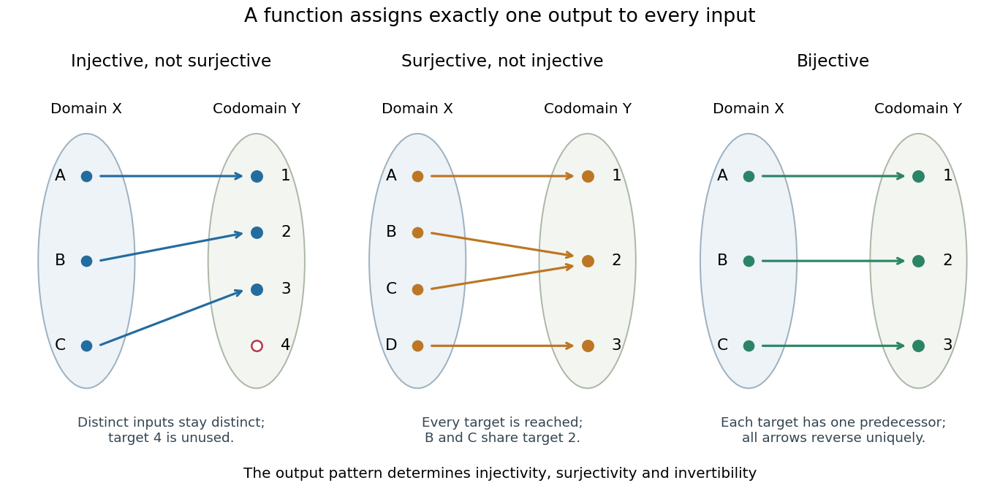

# Function

↑ **Parent:** [Set theory](set-theory-split.md)  
ⓦ [Wiki](https://en.wikipedia.org/wiki/Function_(mathematics))

A [function](function-split.md) $f:X\to Y$ assigns exactly one [output](output-computing.md) in the specified [codomain](codomain.md) $Y$ to each [input](input-computer-science.md) in its [domain of a function](domain-of-a-function.md) $X$. Its rule may be a formula, a finite table, or another unambiguous assignment. The outputs actually reached form its [image of a function](image-of-a-function.md) $f(X)\subseteq Y$. A [codomain](codomain.md) states where outputs are allowed; the [image of a function](image-of-a-function.md) records where they actually land. Oscar Levin's introduction makes this distinction explicit. [Levin, Discrete Mathematics: An Open Introduction, Functions](https://discrete.openmathbooks.org/preview/sec_intro-functions.html).

For example, $f:\mathbb R\to\mathbb R$, $f(x)=x^2$, has the entire [real line](real-line.md) as its [domain of a function](domain-of-a-function.md) and [codomain](codomain.md), but its [image of a function](image-of-a-function.md) is $[0,\infty)$. Both $-2$ and $2$ give the output $4$: several inputs sharing an output is permitted. Assigning two distinct outputs to one input is not permitted. A [partial function](partial-function.md) can be undefined at some elements of a larger specified source [set](set-split.md); an ordinary [function](function-split.md) on $X$ must be defined at every element of $X$.

Three properties describe how a [function](function-split.md) uses its target. An [injective function](injective-function.md) never sends distinct inputs to the same output. A [surjective function](surjective-function.md) reaches every member of its specified [codomain](codomain.md). A [bijection](bijection.md) does both, pairing each source element with exactly one target element. These are different requirements, as finite arrow diagrams show.

**[Figure 1](#image-injective-surjective-and-bijective-functions-have-different-output-patterns). Injective, surjective and bijective functions have different output patterns**. Every source element has exactly one outgoing arrow. Left: an [injective function](injective-function.md) from three elements to four leaves one target unused. Middle: a [surjective function](surjective-function.md) from four elements to three reaches every target but merges two inputs. Right: a [bijection](bijection.md) pairs three source elements with three targets, allowing every arrow to be reversed uniquely.

The chosen [codomain](codomain.md) matters even when the formula does not change. The [function](function-split.md) $x\mapsto x^2$ from $\mathbb R$ to $\mathbb R$ is not [surjective](surjective-function.md), whereas the same rule from $\mathbb R$ to $[0,\infty)$ is [surjective](surjective-function.md). Both fail [injectivity](injective-function.md). Further restricting the [domain of a function](domain-of-a-function.md) to $[0,\infty)$ makes it a [bijection](bijection.md) onto $[0,\infty)$, with [square root](square-root.md) as its [inverse function](inverse-function.md).

[Functions](function-split.md) make transformations composable: if $f:X\to Y$ and $g:Y\to Z$, their [function composition](function-composition.md) is $(g\circ f)(x)=g(f(x))$. Identifying each intermediate [codomain](codomain.md) prevents attempting to feed an output into a rule that is not defined there. When a transformation is a [bijection](bijection.md), an [inverse function](inverse-function.md) recovers the original input without ambiguity. This is useful whenever information must be transported or a calculation reversed.

**Table of contents**

- [Integer-valued function](integer-valued-function.md)
- [Unimodal function](unimodal-function.md)
- [Scalar-valued function](scalar-valued-function.md)
- [Implicit function](implicit-function.md)
- [Function evaluation](function-evaluation.md)
- [Function input](function-input.md)
- [Function output](function-output.md)
- [Quotient of functions](quotient-of-functions.md)
- [Codomain](codomain.md)
- [Self-map](self-map.md)
  - [Idempotent function](idempotent-function.md)
    - [Idempotent matrix](idempotent-matrix.md)
- [Function composition](function-composition.md)
- [Germ (mathematics)](germ-mathematics.md)
- [Nonnegative function](nonnegative-function.md)
- [Commuting functions](commuting-functions.md)
- [Finite modification of the identity on the real line](finite-modification-of-the-identity-on-the-real-line.md)
- [Pointwise periodic self-map](pointwise-periodic-self-map.md)
  - [Uniform period criterion for pointwise periodic maps](uniform-period-criterion-for-pointwise-periodic-maps.md)
- [Vector-valued function](vector-valued-function.md)
- [Set function](set-function.md)
  - [Finite additivity of a set function](finite-additivity-of-a-set-function.md)
  - [Supermodular set function](supermodular-set-function.md)
  - [Submodular set function](submodular-set-function.md)
- [Function collision](function-collision.md)
- [Fiber of a function](fiber-of-a-function.md)
  - [Factorization through a surjection](factorization-through-a-surjection.md)
- [Translation of a function](translation-of-a-function.md)
- [Graph of a function](graph-of-a-function.md)
  - [Compact graph of a continuous map](compact-graph-of-a-continuous-map.md)
  - [Closed graph of a map into a Hausdorff space](closed-graph-of-a-map-into-a-hausdorff-space.md)
- [Partial function](partial-function.md)
  - [Partial unary operation](partial-unary-operation.md)
  - [Composition of partial functions](composition-of-partial-functions.md)
- [Domain of a function](domain-of-a-function.md)
  - [Preserve the domain when simplifying a function](preserve-the-domain-when-simplifying-a-function.md)
  - [Domain of a partial function](domain-of-a-partial-function.md)
- [Restriction (mathematics)](restriction-mathematics.md)
- [Function class](function-class.md)
- [Support](support.md)
  - [Compact support](compact-support.md)
- [Identity function](identity-function.md)
- [Inverse function](inverse-function.md)
  - [Horizontal line test](horizontal-line-test.md)
  - [Inverse function rule](inverse-function-rule.md)
  - [Right inverse](right-inverse.md)
    - [Right-inverse characterization of the axiom of choice](right-inverse-characterization-of-the-axiom-of-choice.md)
  - [Left inverse](left-inverse.md)
- [Projection (mathematics)](projection-mathematics.md)
  - [Projection map](projection-map.md)
    - [Empty-set cases for Cartesian projections](empty-set-cases-for-cartesian-projections.md)
- [Fixed point](fixed-point.md)
- [Conjugate functions](conjugate-functions.md)
- [Piecewise linear function](piecewise-linear-function.md)
  - [Linear interpolation](linear-interpolation.md)
- [Bounded function](bounded-function.md)
  - [Unbounded function](unbounded-function.md)
- [Constant function](constant-function.md)
- [Nonconstant function](nonconstant-function.md)
- [Real-valued function](real-valued-function.md)
  - [Global maximum](global-maximum.md)
  - [Positive part of a real-valued function](positive-part-of-a-real-valued-function.md)
  - [Negative part of a real-valued function](negative-part-of-a-real-valued-function.md)
- [Bijection](bijection.md)
- [Periodic function](periodic-function.md)
  - [Periodic extension](periodic-extension.md)
  - [Fundamental period of a function](fundamental-period-of-a-function.md)
    - [Continuous periodic functions have a least positive period](continuous-periodic-functions-have-a-least-positive-period.md)
    - [Periodic function without a least positive period](periodic-function-without-a-least-positive-period.md)
  - [Period group of a function](period-group-of-a-function.md)
  - [Simply periodic function](simply-periodic-function.md)
  - [Cardinality of integer-periodic function spaces](cardinality-of-integer-periodic-function-spaces.md)
  - [Period average](period-average.md)
  - [Triangular wave](triangular-wave.md)
    - [Fourier cosine series of a triangular wave](fourier-cosine-series-of-a-triangular-wave.md)

## ↑ Ancestors (5)

1. [Set theory](set-theory-split.md)
2. [Foundations of mathematics](foundations-of-mathematics-split.md)
3. [Area of mathematics](area-of-mathematics.md)
4. [Mathematics](mathematics-split.md)
5. [Codex Wiki](split.md)

## ← Incoming links (944)

- [Abelianization of the square symmetry group](abelianization-of-the-square-symmetry-group.md)
- [Absolute Fourier convergence from a square-integrable derivative](absolute-fourier-convergence-from-a-square-integrable-derivative.md)
- [Abstraction function](abstraction-function.md)
- [Adaptivity to an unknown covariate distribution](adaptivity-to-an-unknown-covariate-distribution.md)
- [Additive constant](additive-constant.md)
- [Adjoints of inverse image on power sets](adjoints-of-inverse-image-on-power-sets.md)
- [Affine upper envelope](affine-upper-envelope.md)
- [Aliasing of discrete Fourier modes](aliasing-of-discrete-fourier-modes.md)
- [Analysis of Boolean functions](analysis-of-boolean-functions-split.md)
- [Analyticity](analyticity.md)
- [Antiderivative](antiderivative.md)
- [Antiderivatives on disconnected domains](antiderivatives-on-disconnected-domains.md)
- [Arithmetic function](arithmetic-function-split.md)
- [Asymptotic analysis](asymptotic-analysis.md)
- [Asymptotic equivalence](asymptotic-equivalence.md)
- [Asymptotic expansion](asymptotic-expansion-split.md)
- [Asymptotic power series](asymptotic-power-series.md)
- [Asymptotic sequence](asymptotic-sequence.md)
- [Average value of a function](average-value-of-a-function.md)
- [Axiom of global choice](axiom-of-global-choice.md)
- [Barycenter](barycenter.md)
- [Bernoulli corrections for polynomial sums](bernoulli-corrections-for-polynomial-sums.md)
- [Best N-term wavelet approximation of piecewise Hölder functions](best-n-term-wavelet-approximation-of-piecewise-holder-functions.md)
- [Best uniform approximation](best-uniform-approximation.md)
- [Biconjugation as closed convexification](biconjugation-as-closed-convexification.md)
- [Big O notation](big-o-notation.md)
- [Bijection](bijection.md)
- [Bilinear correlation bound for the box norm](bilinear-correlation-bound-for-the-box-norm.md)
- [Binary diagonally noncomputable function](binary-diagonally-noncomputable-function.md)
- [Binary operation](binary-operation.md)
- [Bisection error bound](bisection-error-bound.md)
- [Bisection stopping criterion](bisection-stopping-criterion.md)
- [Bohr-Mollerup theorem](bohr-mollerup-theorem.md)
- [Boolean cube expansion from bounded differences](boolean-cube-expansion-from-bounded-differences.md)
- [Boundary condition](boundary-condition.md)
- [Boundary convergence of a power series](boundary-convergence-of-a-power-series.md)
- [Boundary trace of a function](boundary-trace-of-a-function.md)
- [Bounded differences property](bounded-differences-property.md)
- [Bounded nonconvergent Fourier partial sums](bounded-nonconvergent-fourier-partial-sums.md)
- [Bounding-to-almost-disjointness inequality](bounding-to-almost-disjointness-inequality.md)
- [Box norm](box-norm.md)
- [Bracketing method](bracketing-method.md)
- [Brent cycle-finding algorithm](brent-cycle-finding-algorithm.md)
- [Bukovský-Hechler theorem](bukovsky-hechler-theorem.md)
- [Calculus](calculus-split.md)
- [Calculus of variations](calculus-of-variations-split.md)
- [Canonical projection of a quotient set](canonical-projection-of-a-quotient-set.md)
- [Cantor's theorem](cantor-s-theorem.md)
- [Cantor-Schröder-Bernstein theorem](cantor-schroder-bernstein-theorem.md)
- [Cardinality of integer-periodic function spaces](cardinality-of-integer-periodic-function-spaces.md)
- [Cartan's magic formula](cartan-s-magic-formula.md)
- [Category](category-split.md)
- [Category of finite sets](category-of-finite-sets.md)
- [Category of pointed sets](category-of-pointed-sets.md)
- [Category of topological manifolds](category-of-topological-manifolds.md)
- [Cauchy-Hadamard theorem](cauchy-hadamard-theorem.md)
- [Cauchy principal value](cauchy-principal-value.md)
- [Cauchy's functional equation](cauchy-s-functional-equation.md)
- [Causal extension by zero](causal-extension-by-zero.md)
- [Cellular automaton](cellular-automaton.md)
- [Certifiable function](certifiable-function.md)
- [Chain rule](chain-rule.md)
- [Change of variables formula](change-of-variables-formula.md)
- [Chebyshev polynomial](chebyshev-polynomial.md)
- [Choquet's theorem by strict convexity](choquet-s-theorem-by-strict-convexity.md)
- [Classifier](classifier.md)
- [Closed ball](closed-ball.md)
- [Closed forcing adds no short ground-valued sequences](closed-forcing-adds-no-short-ground-valued-sequences.md)
- [Closed-form expression](closed-form-expression.md)
- [Closest point on a plane](closest-point-on-a-plane.md)
- [Codomain](codomain.md)
- [Coherent coinfinite injections into omega](coherent-coinfinite-injections-into-omega.md)
- [Coherent-injection Aronszajn tree](coherent-injection-aronszajn-tree.md)
- [Colour-preserving symmetry group](colour-preserving-symmetry-group.md)
- [Compact metrizable convex set](compact-metrizable-convex-set.md)
- [Compilation arithmetic example](compilation-arithmetic-example.md)
- [Complex analysis](complex-analysis-split.md)
- [Complex differentiability](complex-differentiability.md)
- [Composite midpoint quadrature rule](composite-midpoint-quadrature-rule.md)
- [Conditional entropy](conditional-entropy.md)
- [Conformal automorphism of the upper half-plane](conformal-automorphism-of-the-upper-half-plane.md)
- [Constant function](constant-function.md)
- [Continuity into a product space](continuity-into-a-product-space.md)
- [Continuous exponential functional equation](continuous-exponential-functional-equation.md)
- [Continuous function](continuous-function.md)
- [Continuous map](continuous-map.md)
- [Continuous maps from an infinite cofinite space to a Hausdorff space are constant](continuous-maps-from-an-infinite-cofinite-space-to-a-hausdorff-space-are-constant.md)
- [Contour plot](contour-plot.md)
- [Control-point influence on a curve](control-point-influence-on-a-curve.md)
- [Convergence in a product space](convergence-in-a-product-space.md)
- [Convex conjugate](convex-conjugate.md)
- [Convex function](convex-function.md)
- [Convolution](convolution.md)
- [Convolution kernel](convolution-kernel.md)
- [Convolution theorem for Laplace transforms](convolution-theorem-for-laplace-transforms.md)
- [Conway Game of Life](conway-game-of-life.md)
- [Correlation function of a point process](correlation-function-of-a-point-process.md)
- [Countable saturation of a nonprincipal ultraproduct over omega](countable-saturation-of-a-nonprincipal-ultraproduct-over-omega.md)
- [Counting lemma for octahedrally quasirandom three-uniform hypergraphs](counting-lemma-for-octahedrally-quasirandom-three-uniform-hypergraphs.md)
- [Counting measure](counting-measure.md)
- [Critical point](critical-point.md)
- [Cubic exactness of Simpson's rule](cubic-exactness-of-simpson-s-rule.md)
- [Curl of a gradient](curl-of-a-gradient.md)
- [Decay of a nonnegative uniformly continuous integrable function](decay-of-a-nonnegative-uniformly-continuous-integrable-function.md)
- [Decoupled coefficients of orthogonal polynomial projections](decoupled-coefficients-of-orthogonal-polynomial-projections.md)
- [Definite integral](definite-integral.md)
- [Delay differential equation](delay-differential-equation.md)
- [Density of bounded centered scores](density-of-bounded-centered-scores.md)
- [Derivative](derivative.md)
- [Derivative along a curve](derivative-along-a-curve.md)
- [Derivative criterion for monotonicity](derivative-criterion-for-monotonicity.md)
- [Derivative seminorms on a compact interval](derivative-seminorms-on-a-compact-interval.md)
- [Deterministic finite automaton](deterministic-finite-automaton.md)
- [Differentiability implies continuity](differentiability-implies-continuity.md)
- [Differential calculus](differential-calculus.md)
- [Differential equation](differential-equation-split.md)
- [Differential form](differential-form-split.md)
- [Differential operator](differential-operator.md)
- [Differentiation](differentiation.md)
- [Dirac measure](dirac-measure.md)
- [Directed limit of elementary embeddings](directed-limit-of-elementary-embeddings.md)
- [Directional derivative](directional-derivative.md)
- [Discontinuity of a function](discontinuity-of-a-function.md)
- [Discrete Fourier transform](discrete-fourier-transform-split.md)
- [Discrete uniform distribution](discrete-uniform-distribution.md)
- [Double-coset Hecke algebra](double-coset-hecke-algebra.md)
- [Dyadic conditional averages recover integrable functions](dyadic-conditional-averages-recover-integrable-functions.md)
- [Edge coloring](edge-coloring.md)
- [Effective diagonal lemma](effective-diagonal-lemma.md)
- [Effective domain](effective-domain.md)
- [Efron–Stein inequality](efron-stein-inequality.md)
- [Electric potential](electric-potential.md)
- [Empirical spectral measure](empirical-spectral-measure.md)
- [Entire function](entire-function.md)
- [Epsilon-delta definition of continuity](epsilon-delta-definition-of-continuity.md)
- [Equality in Minkowski inequality](equality-in-minkowski-inequality.md)
- [Equation](equation.md)
- [Equilibrium solution of an ordinary differential equation](equilibrium-solution-of-an-ordinary-differential-equation.md)
- [Equivalence of partial functions modulo finite changes](equivalence-of-partial-functions-modulo-finite-changes.md)
- [Equivalence relation induced by a function](equivalence-relation-induced-by-a-function.md)
- [Essential infimum](essential-infimum.md)
- [Essential infimum and essential supremum](essential-infimum-and-essential-supremum.md)
- [Essential range](essential-range.md)
- [Essential supremum](essential-supremum.md)
- [Essentially bounded function](essentially-bounded-function.md)
- [Events determined by a random variable](events-determined-by-a-random-variable.md)
- [Exponential-linear separable potential](exponential-linear-separable-potential.md)
- [Exponential order](exponential-order.md)
- [Extrapolation](extrapolation.md)
- [Extreme-point criterion for the L-infinity unit ball](extreme-point-criterion-for-the-l-infinity-unit-ball.md)
- [Factorial](factorial.md)
- [Factorization through a surjection](factorization-through-a-surjection.md)
- [Failure of L2 closure of the global BV domain](failure-of-l2-closure-of-the-global-bv-domain.md)
- [Failure of Minkowski inequality below exponent one](failure-of-minkowski-inequality-below-exponent-one.md)
- [Fano's inequality via an error indicator](fano-s-inequality-via-an-error-indicator.md)
- [Fast-growing hierarchy](fast-growing-hierarchy.md)
- [Feasible region](feasible-region.md)
- [Fiber of a function](fiber-of-a-function.md)
- [Finite coloring](finite-coloring.md)
- [Finite-cost optimal transport converse](finite-cost-optimal-transport-converse.md)
- [Finite difference](finite-difference-split.md)
- [Finite samples do not certify quadrature accuracy](finite-samples-do-not-certify-quadrature-accuracy.md)
- [Finite witness array coding](finite-witness-array-coding.md)
- [First three derivatives of an inverse function](first-three-derivatives-of-an-inverse-function.md)
- [Foundations of mathematics](foundations-of-mathematics-split.md)
- [Four-neighbour mean expansion](four-neighbour-mean-expansion.md)
- [Fourier analysis](fourier-analysis-split.md)
- [Fourier coefficient](fourier-coefficient.md)
- [Fourier inversion theorem](fourier-inversion-theorem.md)
- [Fourier partial sum](fourier-partial-sum.md)
- [Fourier series](fourier-series-split.md)
- [Fourier series of a periodically extended exponential](fourier-series-of-a-periodically-extended-exponential.md)
- [Fourier sine coefficient](fourier-sine-coefficient.md)
- [Frequency spectrum](frequency-spectrum.md)
- [Full second-order replacement rank obstruction](full-second-order-replacement-rank-obstruction.md)
- [Full shift](full-shift.md)
- [Full transformation monoid](full-transformation-monoid.md)
- [Function](function-split.md)
- [Function class](function-class.md)
- [Function collision](function-collision.md)
- [Function composition](function-composition.md)
- [Function in extension](function-in-extension.md)
- [Function input](function-input.md)
- [Function output](function-output.md)
- [Function space](function-space.md)
- [Functional](functional.md)
- [Functional analysis](functional-analysis-split.md)
- [Functional equation](functional-equation.md)
- [Functional graph](functional-graph.md)
- [Functor](functor-split.md)
- [Fundamental theorem for line integrals](fundamental-theorem-for-line-integrals.md)
- [Fundamental theorem of calculus](fundamental-theorem-of-calculus.md)
- [Gaussian initial data for the heat equation](gaussian-initial-data-for-the-heat-equation.md)
- [Gaussian process regression](gaussian-process-regression.md)
- [Gaussian quadrature](gaussian-quadrature.md)
- [Gaussian white noise model](gaussian-white-noise-model.md)
- [Geometric power-series remainder](geometric-power-series-remainder.md)
- [Germ (mathematics)](germ-mathematics.md)
- [Globally Lipschitz function](globally-lipschitz-function.md)
- [Golden-section search](golden-section-search.md)
- [Golgi cargo processing](golgi-cargo-processing.md)
- [Goodstein function](goodstein-function.md)
- [Gradient](gradient.md)
- [Graph coloring](graph-coloring-split.md)
- [Graph homomorphism](graph-homomorphism.md)
- [Graph of a function](graph-of-a-function.md)
- [Great Picard theorem](great-picard-theorem.md)
- [Group action](group-action-split.md)
- [Haar projection](haar-projection.md)
- [Haar projection error for a Lipschitz function](haar-projection-error-for-a-lipschitz-function.md)
- [Hamiltonian trace functional on monic differential operators](hamiltonian-trace-functional-on-monic-differential-operators.md)
- [Hardy's integral inequality for an interval indicator](hardy-s-integral-inequality-for-an-interval-indicator.md)
- [Harmonic function for a Markov chain](harmonic-function-for-a-markov-chain.md)
- [Hash collision](hash-collision.md)
- [Hash function](hash-function.md)
- [Hessian matrix](hessian-matrix.md)
- [Hilbert space](hilbert-space-split.md)
- [History function of a delay differential equation](history-function-of-a-delay-differential-equation.md)
- [History of Hölder's inequality](history-of-holder-s-inequality.md)
- [History of total variation of a function](history-of-total-variation-of-a-function.md)
- [Hölder-Taylor remainder bound](holder-taylor-remainder-bound.md)
- [Holomorphic function](holomorphic-function-split.md)
- [Homogeneous function](homogeneous-function.md)
- [Homogeneous linear differential equation](homogeneous-linear-differential-equation.md)
- [Horizontal line test](horizontal-line-test.md)
- [Hyperbolic function](hyperbolic-function.md)
- [Idempotent function](idempotent-function.md)
- [Identity function](identity-function.md)
- [Image and preimage of a function](image-and-preimage-of-a-function.md)
- [Image of a function](image-of-a-function.md)
- [Implicit equation](implicit-equation.md)
- [Implicit function](implicit-function.md)
- [Implicit function theorem](implicit-function-theorem.md)
- [Independent random variables](independent-random-variables.md)
- [Infinite-dimensional Hamiltonian integrability](infinite-dimensional-hamiltonian-integrability.md)
- [Infinite path through a binary tree](infinite-path-through-a-binary-tree.md)
- [Influence-function representer](influence-function-representer.md)
- [Initial value problem](initial-value-problem.md)
- [Injection-chain proof of the Cantor-Schröder-Bernstein theorem](injection-chain-proof-of-the-cantor-schroder-bernstein-theorem.md)
- [Inner product](inner-product-split.md)
- [Integrable singularity](integrable-singularity.md)
- [Integral](integral-split.md)
- [Integral comparison for a nonincreasing nonnegative function](integral-comparison-for-a-nonincreasing-nonnegative-function.md)
- [Integral kernel](integral-kernel.md)
- [Integral representation](integral-representation.md)
- [Integrand](integrand.md)
- [Integrating factor](integrating-factor.md)
- [Intermediate value theorem hypotheses and counterexamples](intermediate-value-theorem-hypotheses-and-counterexamples.md)
- [Interpolant](interpolant.md)
- [Interpolation](interpolation-split.md)
- [Interval arithmetic](interval-arithmetic.md)
- [Interval bisection](interval-bisection.md)
- [Interval dependency problem](interval-dependency-problem.md)
- [Interval enclosure](interval-enclosure.md)
- [Interval root exclusion](interval-root-exclusion.md)
- [Interval square range](interval-square-range.md)
- [Inverse Ackermann function](inverse-ackermann-function.md)
- [Inverse function](inverse-function.md)
- [Inverse-function linearization of a first-order equation](inverse-function-linearization-of-a-first-order-equation.md)
- [Inverse function theorem](inverse-function-theorem.md)
- [Jensen gap](jensen-gap.md)
- [Jensen's inequality](jensen-s-inequality.md)
- [Joint injectivity of a pair of functions](joint-injectivity-of-a-pair-of-functions.md)
- [Jordan decomposition of a function of bounded variation](jordan-decomposition-of-a-function-of-bounded-variation.md)
- [Jump response of a localized analyzing function](jump-response-of-a-localized-analyzing-function.md)
- [Kahane-Katznelson divergence theorem](kahane-katznelson-divergence-theorem.md)
- [Kernel density estimation](kernel-density-estimation.md)
- [Kernel support-vector coefficient from hinge activity](kernel-support-vector-coefficient-from-hinge-activity.md)
- [Kinetic energy](kinetic-energy.md)
- [Kolmogorov axioms](kolmogorov-axioms.md)
- [Kuratowski ordered pair](kuratowski-ordered-pair.md)
- [L-infinity norm](l-infinity-norm.md)
- [Lagrangian duality](lagrangian-duality.md)
- [Lambda definition of primitive recursion by pair iteration](lambda-definition-of-primitive-recursion-by-pair-iteration.md)
- [Lambda representation of partial computable functions](lambda-representation-of-partial-computable-functions.md)
- [Laplace transform](laplace-transform.md)
- [Lebesgue integral](lebesgue-integral.md)
- [Left inverse](left-inverse.md)
- [Legendre symbol](legendre-symbol.md)
- [Leibniz integral rule](leibniz-integral-rule.md)
- [Lenard-Magri recursion](lenard-magri-recursion.md)
- [Lie algebra](lie-algebra-split.md)
- [Life glider](life-glider.md)
- [Life oscillator](life-oscillator.md)
- [Linear approximation](linear-approximation.md)
- [Linear combination](linear-combination.md)
- [Linear differential equation](linear-differential-equation.md)
- [Linearity of expectation](linearity-of-expectation.md)
- [Linearity of integration](linearity-of-integration.md)
- [Lipschitz constant](lipschitz-constant.md)
- [Lipschitz continuity](lipschitz-continuity.md)
- [Local extremum](local-extremum.md)
- [Local maximum](local-maximum.md)
- [Local minimum](local-minimum.md)
- [Locally Lipschitz function](locally-lipschitz-function.md)
- [Locally square-integrable function](locally-square-integrable-function.md)
- [Logarithm](logarithm.md)
- [Logarithmic differentiation](logarithmic-differentiation.md)
- [Logarithmic integral representation of the natural logarithm](logarithmic-integral-representation-of-the-natural-logarithm.md)
- [Logarithmic parameter integral with Cauchy weight](logarithmic-parameter-integral-with-cauchy-weight.md)
- [Logarithmic polar coordinate change](logarithmic-polar-coordinate-change.md)
- [Long chain under eventual domination](long-chain-under-eventual-domination.md)
- [Low-pass filter of a multiresolution analysis](low-pass-filter-of-a-multiresolution-analysis.md)
- [Lp norm](lp-norm.md)
- [Markov information source](markov-information-source.md)
- [Matrix inverse](matrix-inverse-split.md)
- [Mean value theorem](mean-value-theorem.md)
- [Measure](measure-split.md)
- [Mellin transform in logarithmic coordinates](mellin-transform-in-logarithmic-coordinates.md)
- [Memoization](memoization.md)
- [Memoization key](memoization-key.md)
- [Metric](metric.md)
- [Metric space](metric-space.md)
- [Minkowski inequality](minkowski-inequality.md)
- [Minkowski inequality for error aggregation](minkowski-inequality-for-error-aggregation.md)
- [Mollification](mollification.md)
- [Monotonic function](monotonic-function.md)
- [Multipartite hypergraph](multipartite-hypergraph.md)
- [Multiple integral](multiple-integral.md)
- [Multiplicative function](multiplicative-function.md)
- [Multiresolution analysis](multiresolution-analysis.md)
- [Natural density](natural-density.md)
- [Natural interval extension](natural-interval-extension.md)
- [Natural transformation](natural-transformation.md)
- [Negative part of a real-valued function](negative-part-of-a-real-valued-function.md)
- [Noise sensitivity of a quadrature rule](noise-sensitivity-of-a-quadrature-rule.md)
- [Nonconstant function](nonconstant-function.md)
- [Nondecreasing function](nondecreasing-function.md)
- [Nondegenerate critical point](nondegenerate-critical-point.md)
- [Nondeterministic finite automaton](nondeterministic-finite-automaton.md)
- [Nonlinear ordinary differential equation](nonlinear-ordinary-differential-equation.md)
- [Nonparametric statistics](nonparametric-statistics-split.md)
- [Normal ultrafilter on small subsets](normal-ultrafilter-on-small-subsets.md)
- [Normalizing constant](normalizing-constant.md)
- [Numerical integration](numerical-integration-split.md)
- [Omitted value](omitted-value.md)
- [Ordinary differential equation](ordinary-differential-equation.md)
- [Orthogonal polynomial](orthogonal-polynomial-split.md)
- [Orthogonal polynomial projection kernel](orthogonal-polynomial-projection-kernel.md)
- [Orthogonal projection](orthogonal-projection.md)
- [Orthogonal vectors](orthogonal-vectors.md)
- [Pair-factor correlation bound for the three-dimensional box norm](pair-factor-correlation-bound-for-the-three-dimensional-box-norm.md)
- [Pairing function](pairing-function.md)
- [Parametric equation](parametric-equation.md)
- [Partial derivative](partial-derivative.md)
- [Partial differential equation](partial-differential-equation-split.md)
- [Solution](past-exam-of-the-chemistry-a-course-of-the-university-of-cambridge/2021/paper-1/a1/a/i/solution.md)
- [Solution](past-exam-of-the-mathematics-course-of-the-university-of-cambridge/2001/ib/paper-1/10a/solution.md)
- [Solution](past-exam-of-the-mathematics-course-of-the-university-of-cambridge/2001/ib/paper-1/11h/solution.md)
- [Solution](past-exam-of-the-mathematics-course-of-the-university-of-cambridge/2001/ib/paper-1/1a/ii/solution.md)
- [Solution](past-exam-of-the-mathematics-course-of-the-university-of-cambridge/2001/ib/paper-1/1a/solution.md)
- [Solution](past-exam-of-the-mathematics-course-of-the-university-of-cambridge/2001/ib/paper-1/2h/solution.md)
- [Solution](past-exam-of-the-mathematics-course-of-the-university-of-cambridge/2001/iii/paper-58/2/solution.md)
- [Solution](past-exam-of-the-mathematics-course-of-the-university-of-cambridge/2001/iii/paper-58/3/solution.md)
- [Solution](past-exam-of-the-mathematics-course-of-the-university-of-cambridge/2001/iii/paper-58/4/solution.md)
- [Solution](past-exam-of-the-mathematics-course-of-the-university-of-cambridge/2001/iii/paper-58/6/solution.md)
- [Solution](past-exam-of-the-mathematics-course-of-the-university-of-cambridge/2001/iii/paper-58/7/solution.md)
- [Solution](past-exam-of-the-mathematics-course-of-the-university-of-cambridge/2001/iii/paper-9/5/solution.md)
- [Solution](past-exam-of-the-mathematics-course-of-the-university-of-cambridge/2002/ia/paper-1/10c/iv/solution.md)
- [Solution](past-exam-of-the-mathematics-course-of-the-university-of-cambridge/2002/ia/paper-1/11c/solution.md)
- [Solution](past-exam-of-the-mathematics-course-of-the-university-of-cambridge/2002/ia/paper-1/12c/solution.md)
- [Solution](past-exam-of-the-mathematics-course-of-the-university-of-cambridge/2002/iii/paper-20/1/iii/solution.md)
- [Solution](past-exam-of-the-mathematics-course-of-the-university-of-cambridge/2002/iii/paper-20/7/iii/solution.md)
- [Solution](past-exam-of-the-mathematics-course-of-the-university-of-cambridge/2002/iii/paper-76/4/solution.md)
- [Solution](past-exam-of-the-mathematics-course-of-the-university-of-cambridge/2003/ia/paper-1/3b/solution.md)
- [Solution](past-exam-of-the-mathematics-course-of-the-university-of-cambridge/2003/ia/paper-4/8c/solution.md)
- [Solution](past-exam-of-the-mathematics-course-of-the-university-of-cambridge/2003/iii/paper-19/2/solution.md)
- [Solution](past-exam-of-the-mathematics-course-of-the-university-of-cambridge/2003/iii/paper-19/5/solution.md)
- [Solution](past-exam-of-the-mathematics-course-of-the-university-of-cambridge/2003/iii/paper-19/7/i/solution.md)
- [Solution](past-exam-of-the-mathematics-course-of-the-university-of-cambridge/2003/iii/paper-19/7/ii/solution.md)
- [Solution](past-exam-of-the-mathematics-course-of-the-university-of-cambridge/2004/ia/paper-1/9d/i/solution.md)
- [Solution](past-exam-of-the-mathematics-course-of-the-university-of-cambridge/2004/ia/paper-1/9d/ii/solution.md)
- [Solution](past-exam-of-the-mathematics-course-of-the-university-of-cambridge/2004/iii/paper-20/1/ii/solution.md)
- [Solution](past-exam-of-the-mathematics-course-of-the-university-of-cambridge/2004/iii/paper-20/2/i/solution.md)
- [Solution](past-exam-of-the-mathematics-course-of-the-university-of-cambridge/2004/iii/paper-20/2/ii/solution.md)
- [Solution](past-exam-of-the-mathematics-course-of-the-university-of-cambridge/2004/iii/paper-24/1/solution.md)
- [Solution](past-exam-of-the-mathematics-course-of-the-university-of-cambridge/2004/iii/paper-24/2/solution.md)
- [Solution](past-exam-of-the-mathematics-course-of-the-university-of-cambridge/2004/iii/paper-24/3/solution.md)
- [Solution](past-exam-of-the-mathematics-course-of-the-university-of-cambridge/2004/iii/paper-24/7/solution.md)
- [Solution](past-exam-of-the-mathematics-course-of-the-university-of-cambridge/2004/iii/paper-34/6/solution.md)
- [Solution](past-exam-of-the-mathematics-course-of-the-university-of-cambridge/2004/iii/paper-8/1/iii/solution.md)
- [Solution](past-exam-of-the-mathematics-course-of-the-university-of-cambridge/2004/iii/paper-8/2/i/solution.md)
- [Solution](past-exam-of-the-mathematics-course-of-the-university-of-cambridge/2004/iii/paper-8/3/i/solution.md)
- [Solution](past-exam-of-the-mathematics-course-of-the-university-of-cambridge/2004/iii/paper-8/3/iii/solution.md)
- [Solution](past-exam-of-the-mathematics-course-of-the-university-of-cambridge/2004/iii/paper-8/4/i/solution.md)
- [Solution](past-exam-of-the-mathematics-course-of-the-university-of-cambridge/2004/iii/paper-8/4/ii/solution.md)
- [Solution](past-exam-of-the-mathematics-course-of-the-university-of-cambridge/2005/ib/paper-2/13b/i/solution.md)
- [Solution](past-exam-of-the-mathematics-course-of-the-university-of-cambridge/2005/ib/paper-2/14f/solution.md)
- [Solution](past-exam-of-the-mathematics-course-of-the-university-of-cambridge/2005/ib/paper-2/15e/solution.md)
- [Solution](past-exam-of-the-mathematics-course-of-the-university-of-cambridge/2005/ib/paper-2/16g/solution.md)
- [Solution](past-exam-of-the-mathematics-course-of-the-university-of-cambridge/2005/ib/paper-2/18f/b/solution.md)
- [Solution](past-exam-of-the-mathematics-course-of-the-university-of-cambridge/2005/ib/paper-2/3b/solution.md)
- [Solution](past-exam-of-the-mathematics-course-of-the-university-of-cambridge/2005/ii/paper-2/18g/ii/solution.md)
- [Solution](past-exam-of-the-mathematics-course-of-the-university-of-cambridge/2005/ii/paper-2/19g/i/solution.md)
- [Solution](past-exam-of-the-mathematics-course-of-the-university-of-cambridge/2005/ii/paper-2/23h/solution.md)
- [Solution](past-exam-of-the-mathematics-course-of-the-university-of-cambridge/2005/ii/paper-2/30c/solution.md)
- [Solution](past-exam-of-the-mathematics-course-of-the-university-of-cambridge/2005/iii/paper-16/4/b/solution.md)
- [Solution](past-exam-of-the-mathematics-course-of-the-university-of-cambridge/2006/iii/paper-20/1/solution.md)
- [Solution](past-exam-of-the-mathematics-course-of-the-university-of-cambridge/2006/iii/paper-25/1/solution.md)
- [Solution](past-exam-of-the-mathematics-course-of-the-university-of-cambridge/2006/iii/paper-25/10/solution.md)
- [Solution](past-exam-of-the-mathematics-course-of-the-university-of-cambridge/2006/iii/paper-25/11/i/solution.md)
- [Solution](past-exam-of-the-mathematics-course-of-the-university-of-cambridge/2006/iii/paper-25/2/solution.md)
- [Solution](past-exam-of-the-mathematics-course-of-the-university-of-cambridge/2006/iii/paper-25/5/solution.md)
- [Solution](past-exam-of-the-mathematics-course-of-the-university-of-cambridge/2006/iii/paper-25/6/solution.md)
- [Solution](past-exam-of-the-mathematics-course-of-the-university-of-cambridge/2006/iii/paper-25/7/solution.md)
- [Solution](past-exam-of-the-mathematics-course-of-the-university-of-cambridge/2006/iii/paper-25/9/solution.md)
- [Solution](past-exam-of-the-mathematics-course-of-the-university-of-cambridge/2006/iii/paper-56/4/solution.md)
- [Solution](past-exam-of-the-mathematics-course-of-the-university-of-cambridge/2006/iii/paper-67/2/solution.md)
- [Solution](past-exam-of-the-mathematics-course-of-the-university-of-cambridge/2006/iii/paper-67/3/solution.md)
- [Solution](past-exam-of-the-mathematics-course-of-the-university-of-cambridge/2006/iii/paper-86/2/a/solution.md)
- [Solution](past-exam-of-the-mathematics-course-of-the-university-of-cambridge/2006/iii/paper-86/2/b/solution.md)
- [Solution](past-exam-of-the-mathematics-course-of-the-university-of-cambridge/2006/iii/paper-86/3/b/solution.md)
- [Solution](past-exam-of-the-mathematics-course-of-the-university-of-cambridge/2006/iii/paper-86/3/c/solution.md)
- [Solution](past-exam-of-the-mathematics-course-of-the-university-of-cambridge/2007/iii/paper-88/2/i/solution.md)
- [Solution](past-exam-of-the-mathematics-course-of-the-university-of-cambridge/2007/iii/paper-88/4/ii/solution.md)
- [Solution](past-exam-of-the-mathematics-course-of-the-university-of-cambridge/2007/iii/paper-88/4/iii/solution.md)
- [Solution](past-exam-of-the-mathematics-course-of-the-university-of-cambridge/2008/iii/paper-11/1/solution.md)
- [Solution](past-exam-of-the-mathematics-course-of-the-university-of-cambridge/2008/iii/paper-16/3/i/solution.md)
- [Solution](past-exam-of-the-mathematics-course-of-the-university-of-cambridge/2008/iii/paper-16/3/ii/solution.md)
- [Solution](past-exam-of-the-mathematics-course-of-the-university-of-cambridge/2008/iii/paper-16/3/iii/solution.md)
- [Solution](past-exam-of-the-mathematics-course-of-the-university-of-cambridge/2008/iii/paper-42/2/i/solution.md)
- [Solution](past-exam-of-the-mathematics-course-of-the-university-of-cambridge/2008/iii/paper-75/1/a/solution.md)
- [Solution](past-exam-of-the-mathematics-course-of-the-university-of-cambridge/2008/iii/paper-75/1/b/solution.md)
- [Solution](past-exam-of-the-mathematics-course-of-the-university-of-cambridge/2008/iii/paper-75/1/c/solution.md)
- [Solution](past-exam-of-the-mathematics-course-of-the-university-of-cambridge/2008/iii/paper-75/2/solution.md)
- [Solution](past-exam-of-the-mathematics-course-of-the-university-of-cambridge/2008/iii/paper-75/3/a/solution.md)
- [Solution](past-exam-of-the-mathematics-course-of-the-university-of-cambridge/2008/iii/paper-75/4/a/solution.md)
- [Solution](past-exam-of-the-mathematics-course-of-the-university-of-cambridge/2008/iii/paper-75/4/b/solution.md)
- [Solution](past-exam-of-the-mathematics-course-of-the-university-of-cambridge/2009/iii/paper-23/5/a/solution.md)
- [Solution](past-exam-of-the-mathematics-course-of-the-university-of-cambridge/2009/iii/paper-23/5/c/solution.md)
- [Solution](past-exam-of-the-mathematics-course-of-the-university-of-cambridge/2010/ia/paper-4/7e/a/solution.md)
- [Solution](past-exam-of-the-mathematics-course-of-the-university-of-cambridge/2010/ia/paper-4/7e/c/solution.md)
- [Solution](past-exam-of-the-mathematics-course-of-the-university-of-cambridge/2010/iii/paper-21/4/ii/solution.md)
- [Solution](past-exam-of-the-mathematics-course-of-the-university-of-cambridge/2010/iii/paper-70/1/a/solution.md)
- [Solution](past-exam-of-the-mathematics-course-of-the-university-of-cambridge/2010/iii/paper-70/2/b/solution.md)
- [Solution](past-exam-of-the-mathematics-course-of-the-university-of-cambridge/2011/ia/paper-1/11e/i/solution.md)
- [Solution](past-exam-of-the-mathematics-course-of-the-university-of-cambridge/2011/ia/paper-1/11e/ii/solution.md)
- [Solution](past-exam-of-the-mathematics-course-of-the-university-of-cambridge/2011/ia/paper-1/12d/solution.md)
- [Solution](past-exam-of-the-mathematics-course-of-the-university-of-cambridge/2011/ia/paper-1/9f/b/solution.md)
- [Solution](past-exam-of-the-mathematics-course-of-the-university-of-cambridge/2012/ia/paper-3/12c/ii/a/solution.md)
- [Solution](past-exam-of-the-mathematics-course-of-the-university-of-cambridge/2012/ia/paper-3/12c/ii/solution.md)
- [Solution](past-exam-of-the-mathematics-course-of-the-university-of-cambridge/2012/ia/paper-3/3c/solution.md)
- [Solution](past-exam-of-the-mathematics-course-of-the-university-of-cambridge/2012/ia/paper-4/8d/solution.md)
- [Solution](past-exam-of-the-mathematics-course-of-the-university-of-cambridge/2012/iii/paper-24/2/solution.md)
- [Solution](past-exam-of-the-mathematics-course-of-the-university-of-cambridge/2012/iii/paper-24/4/solution.md)
- [Solution](past-exam-of-the-mathematics-course-of-the-university-of-cambridge/2012/iii/paper-25/5/a/solution.md)
- [Solution](past-exam-of-the-mathematics-course-of-the-university-of-cambridge/2012/iii/paper-31/1/iii/solution.md)
- [Solution](past-exam-of-the-mathematics-course-of-the-university-of-cambridge/2012/iii/paper-31/1/v/solution.md)
- [Solution](past-exam-of-the-mathematics-course-of-the-university-of-cambridge/2012/iii/paper-31/2/i/solution.md)
- [Solution](past-exam-of-the-mathematics-course-of-the-university-of-cambridge/2012/iii/paper-31/2/v/solution.md)
- [Solution](past-exam-of-the-mathematics-course-of-the-university-of-cambridge/2012/iii/paper-36/1/a/solution.md)
- [Solution](past-exam-of-the-mathematics-course-of-the-university-of-cambridge/2012/iii/paper-36/2/d/solution.md)
- [Solution](past-exam-of-the-mathematics-course-of-the-university-of-cambridge/2012/iii/paper-36/4/b/solution.md)
- [Solution](past-exam-of-the-mathematics-course-of-the-university-of-cambridge/2012/iii/paper-36/4/c/solution.md)
- [Solution](past-exam-of-the-mathematics-course-of-the-university-of-cambridge/2012/iii/paper-36/4/d/solution.md)
- [Solution](past-exam-of-the-mathematics-course-of-the-university-of-cambridge/2012/iii/paper-67/1/a/solution.md)
- [Solution](past-exam-of-the-mathematics-course-of-the-university-of-cambridge/2012/iii/paper-70/4/b/solution.md)
- [Solution](past-exam-of-the-mathematics-course-of-the-university-of-cambridge/2012/iii/paper-70/5/a/solution.md)
- [Solution](past-exam-of-the-mathematics-course-of-the-university-of-cambridge/2012/iii/paper-70/6/a/solution.md)
- [Solution](past-exam-of-the-mathematics-course-of-the-university-of-cambridge/2012/iii/paper-70/6/c/solution.md)
- [Solution](past-exam-of-the-mathematics-course-of-the-university-of-cambridge/2012/iii/paper-76/3/b/solution.md)
- [Solution](past-exam-of-the-mathematics-course-of-the-university-of-cambridge/2012/iii/paper-82/1/2/solution.md)
- [Solution](past-exam-of-the-mathematics-course-of-the-university-of-cambridge/2012/iii/paper-82/4/solution.md)
- [Solution](past-exam-of-the-mathematics-course-of-the-university-of-cambridge/2012/iii/paper-82/5/solution.md)
- [Solution](past-exam-of-the-mathematics-course-of-the-university-of-cambridge/2012/iii/paper-83/1/ii/solution.md)
- [Solution](past-exam-of-the-mathematics-course-of-the-university-of-cambridge/2012/iii/paper-83/3/solution.md)
- [Solution](past-exam-of-the-mathematics-course-of-the-university-of-cambridge/2013/ia/paper-4/5e/i/solution.md)
- [Solution](past-exam-of-the-mathematics-course-of-the-university-of-cambridge/2013/ia/paper-4/5e/ii/solution.md)
- [Solution](past-exam-of-the-mathematics-course-of-the-university-of-cambridge/2013/ia/paper-4/5e/iii/solution.md)
- [Solution](past-exam-of-the-mathematics-course-of-the-university-of-cambridge/2013/ia/paper-4/7e/ii/solution.md)
- [Solution](past-exam-of-the-mathematics-course-of-the-university-of-cambridge/2013/iii/paper-18/5/a/solution.md)
- [Solution](past-exam-of-the-mathematics-course-of-the-university-of-cambridge/2013/iii/paper-19/2/i/b/solution.md)
- [Solution](past-exam-of-the-mathematics-course-of-the-university-of-cambridge/2013/iii/paper-19/2/iii/solution.md)
- [Solution](past-exam-of-the-mathematics-course-of-the-university-of-cambridge/2013/iii/paper-19/2/iv/a/solution.md)
- [Solution](past-exam-of-the-mathematics-course-of-the-university-of-cambridge/2013/iii/paper-19/2/iv/b/solution.md)
- [Solution](past-exam-of-the-mathematics-course-of-the-university-of-cambridge/2013/iii/paper-19/3/iv/solution.md)
- [Solution](past-exam-of-the-mathematics-course-of-the-university-of-cambridge/2013/iii/paper-19/5/iii/solution.md)
- [Solution](past-exam-of-the-mathematics-course-of-the-university-of-cambridge/2013/iii/paper-19/6/ii/a/solution.md)
- [Solution](past-exam-of-the-mathematics-course-of-the-university-of-cambridge/2013/iii/paper-19/6/ii/b/solution.md)
- [Solution](past-exam-of-the-mathematics-course-of-the-university-of-cambridge/2013/iii/paper-19/6/iv/solution.md)
- [Solution](past-exam-of-the-mathematics-course-of-the-university-of-cambridge/2013/iii/paper-49/1/c/solution.md)
- [Solution](past-exam-of-the-mathematics-course-of-the-university-of-cambridge/2013/iii/paper-8/3/b/solution.md)
- [Solution](past-exam-of-the-mathematics-course-of-the-university-of-cambridge/2014/ia/paper-3/3a/a/solution.md)
- [Solution](past-exam-of-the-mathematics-course-of-the-university-of-cambridge/2014/ia/paper-3/3a/c/solution.md)
- [Solution](past-exam-of-the-mathematics-course-of-the-university-of-cambridge/2014/ia/paper-3/9a/a/solution.md)
- [Solution](past-exam-of-the-mathematics-course-of-the-university-of-cambridge/2014/ia/paper-4/8e/ii/solution.md)
- [Solution](past-exam-of-the-mathematics-course-of-the-university-of-cambridge/2014/ib/paper-4/1g/solution.md)
- [Solution](past-exam-of-the-mathematics-course-of-the-university-of-cambridge/2014/iii/paper-19/1/iii/solution.md)
- [Solution](past-exam-of-the-mathematics-course-of-the-university-of-cambridge/2014/iii/paper-19/3/i/a/solution.md)
- [Solution](past-exam-of-the-mathematics-course-of-the-university-of-cambridge/2014/iii/paper-19/3/iii/solution.md)
- [Solution](past-exam-of-the-mathematics-course-of-the-university-of-cambridge/2014/iii/paper-19/5/ii/solution.md)
- [Solution](past-exam-of-the-mathematics-course-of-the-university-of-cambridge/2014/iii/paper-19/5/iv/b/solution.md)
- [Solution](past-exam-of-the-mathematics-course-of-the-university-of-cambridge/2014/iii/paper-19/5/iv/c/solution.md)
- [Solution](past-exam-of-the-mathematics-course-of-the-university-of-cambridge/2014/iii/paper-19/6/ii/solution.md)
- [Solution](past-exam-of-the-mathematics-course-of-the-university-of-cambridge/2014/iii/paper-19/6/iv/a/solution.md)
- [Solution](past-exam-of-the-mathematics-course-of-the-university-of-cambridge/2014/iii/paper-8/2/solution.md)
- [Solution](past-exam-of-the-mathematics-course-of-the-university-of-cambridge/2014/iii/paper-8/3/a/solution.md)
- [Solution](past-exam-of-the-mathematics-course-of-the-university-of-cambridge/2014/iii/paper-8/3/solution.md)
- [Solution](past-exam-of-the-mathematics-course-of-the-university-of-cambridge/2014/iii/paper-8/4/solution.md)
- [Solution](past-exam-of-the-mathematics-course-of-the-university-of-cambridge/2015/ii/paper-4/13i/iii/solution.md)
- [Solution](past-exam-of-the-mathematics-course-of-the-university-of-cambridge/2015/iii/paper-25/3/solution.md)
- [Solution](past-exam-of-the-mathematics-course-of-the-university-of-cambridge/2015/iii/paper-25/4/solution.md)
- [Solution](past-exam-of-the-mathematics-course-of-the-university-of-cambridge/2015/iii/paper-25/5/solution.md)
- [Solution](past-exam-of-the-mathematics-course-of-the-university-of-cambridge/2015/iii/paper-25/6/solution.md)
- [Solution](past-exam-of-the-mathematics-course-of-the-university-of-cambridge/2015/iii/paper-36/1/solution.md)
- [Solution](past-exam-of-the-mathematics-course-of-the-university-of-cambridge/2015/iii/paper-36/2/solution.md)
- [Solution](past-exam-of-the-mathematics-course-of-the-university-of-cambridge/2016/iii/paper-120/4/solution.md)
- [Solution](past-exam-of-the-mathematics-course-of-the-university-of-cambridge/2017/ia/paper-4/2d/b/ii/solution.md)
- [Solution](past-exam-of-the-mathematics-course-of-the-university-of-cambridge/2017/ia/paper-4/4a/solution.md)
- [Solution](past-exam-of-the-mathematics-course-of-the-university-of-cambridge/2017/ia/paper-4/6d/a/solution.md)
- [Solution](past-exam-of-the-mathematics-course-of-the-university-of-cambridge/2017/ia/paper-4/6d/c/solution.md)
- [Solution](past-exam-of-the-mathematics-course-of-the-university-of-cambridge/2017/ii/paper-1/13e/solution.md)
- [Solution](past-exam-of-the-mathematics-course-of-the-university-of-cambridge/2017/ii/paper-1/22f/b/solution.md)
- [Solution](past-exam-of-the-mathematics-course-of-the-university-of-cambridge/2017/ii/paper-1/22f/d/solution.md)
- [Solution](past-exam-of-the-mathematics-course-of-the-university-of-cambridge/2017/ii/paper-1/24i/a/solution.md)
- [Solution](past-exam-of-the-mathematics-course-of-the-university-of-cambridge/2017/ii/paper-1/24i/b/solution.md)
- [Solution](past-exam-of-the-mathematics-course-of-the-university-of-cambridge/2017/ii/paper-1/26j/a/solution.md)
- [Solution](past-exam-of-the-mathematics-course-of-the-university-of-cambridge/2017/ii/paper-1/26j/d/solution.md)
- [Solution](past-exam-of-the-mathematics-course-of-the-university-of-cambridge/2017/ii/paper-1/27k/a/solution.md)
- [Solution](past-exam-of-the-mathematics-course-of-the-university-of-cambridge/2017/ii/paper-1/29j/b/solution.md)
- [Solution](past-exam-of-the-mathematics-course-of-the-university-of-cambridge/2017/ii/paper-1/31a/solution.md)
- [Solution](past-exam-of-the-mathematics-course-of-the-university-of-cambridge/2017/ii/paper-1/4h/a/solution.md)
- [Solution](past-exam-of-the-mathematics-course-of-the-university-of-cambridge/2017/ii/paper-1/8e/solution.md)
- [Solution](past-exam-of-the-mathematics-course-of-the-university-of-cambridge/2017/iii/paper-109/3/i/solution.md)
- [Solution](past-exam-of-the-mathematics-course-of-the-university-of-cambridge/2017/iii/paper-119/1/solution.md)
- [Solution](past-exam-of-the-mathematics-course-of-the-university-of-cambridge/2017/iii/paper-129/1/solution.md)
- [Solution](past-exam-of-the-mathematics-course-of-the-university-of-cambridge/2017/iii/paper-129/4/solution.md)
- [Solution](past-exam-of-the-mathematics-course-of-the-university-of-cambridge/2017/iii/paper-130/1/ii/solution.md)
- [Solution](past-exam-of-the-mathematics-course-of-the-university-of-cambridge/2017/iii/paper-135/3/solution.md)
- [Solution](past-exam-of-the-mathematics-course-of-the-university-of-cambridge/2017/iii/paper-135/4/solution.md)
- [Solution](past-exam-of-the-mathematics-course-of-the-university-of-cambridge/2017/iii/paper-135/6/solution.md)
- [Solution](past-exam-of-the-mathematics-course-of-the-university-of-cambridge/2017/iii/paper-137/1/solution.md)
- [Solution](past-exam-of-the-mathematics-course-of-the-university-of-cambridge/2017/iii/paper-137/5/b/solution.md)
- [Solution](past-exam-of-the-mathematics-course-of-the-university-of-cambridge/2017/iii/paper-205/1/solution.md)
- [Solution](past-exam-of-the-mathematics-course-of-the-university-of-cambridge/2017/iii/paper-205/3/solution.md)
- [Solution](past-exam-of-the-mathematics-course-of-the-university-of-cambridge/2017/iii/paper-205/5/solution.md)
- [Solution](past-exam-of-the-mathematics-course-of-the-university-of-cambridge/2017/iii/paper-216/5/a/solution.md)
- [Solution](past-exam-of-the-mathematics-course-of-the-university-of-cambridge/2017/iii/paper-216/5/b/solution.md)
- [Solution](past-exam-of-the-mathematics-course-of-the-university-of-cambridge/2017/iii/paper-311/2/d/solution.md)
- [Solution](past-exam-of-the-mathematics-course-of-the-university-of-cambridge/2017/iii/paper-340/2/b/solution.md)
- [Solution](past-exam-of-the-mathematics-course-of-the-university-of-cambridge/2017/iii/paper-340/4/a/solution.md)
- [Solution](past-exam-of-the-mathematics-course-of-the-university-of-cambridge/2017/iii/paper-340/4/b/solution.md)
- [Solution](past-exam-of-the-mathematics-course-of-the-university-of-cambridge/2021/ia/paper-4/1e/iii/solution.md)
- [Solution](past-exam-of-the-mathematics-course-of-the-university-of-cambridge/2023/ia/paper-1/10e/solution.md)
- [Solution](past-exam-of-the-mathematics-course-of-the-university-of-cambridge/2023/ia/paper-1/11e/b/solution.md)
- [Solution](past-exam-of-the-mathematics-course-of-the-university-of-cambridge/2023/ia/paper-1/12e/c/solution.md)
- [Solution](past-exam-of-the-mathematics-course-of-the-university-of-cambridge/2023/ia/paper-1/3e/i/solution.md)
- [Solution](past-exam-of-the-mathematics-course-of-the-university-of-cambridge/2023/ia/paper-1/3e/iii/solution.md)
- [Solution](past-exam-of-the-mathematics-course-of-the-university-of-cambridge/2023/ia/paper-2/10f/b/solution.md)
- [Solution](past-exam-of-the-mathematics-course-of-the-university-of-cambridge/2023/ia/paper-2/12f/a/solution.md)
- [Solution](past-exam-of-the-mathematics-course-of-the-university-of-cambridge/2023/ia/paper-2/7a/a/i/solution.md)
- [Solution](past-exam-of-the-mathematics-course-of-the-university-of-cambridge/2023/ia/paper-2/7a/a/iii/solution.md)
- [Solution](past-exam-of-the-mathematics-course-of-the-university-of-cambridge/2023/ia/paper-4/8d/solution.md)
- [Solution](past-exam-of-the-mathematics-course-of-the-university-of-cambridge/2023/ib/paper-1/10g/solution.md)
- [Solution](past-exam-of-the-mathematics-course-of-the-university-of-cambridge/2023/ib/paper-1/12g/c/solution.md)
- [Solution](past-exam-of-the-mathematics-course-of-the-university-of-cambridge/2023/ib/paper-1/14d/c/solution.md)
- [Solution](past-exam-of-the-mathematics-course-of-the-university-of-cambridge/2023/ib/paper-1/17b/a/solution.md)
- [Solution](past-exam-of-the-mathematics-course-of-the-university-of-cambridge/2023/ib/paper-1/17b/b/solution.md)
- [Solution](past-exam-of-the-mathematics-course-of-the-university-of-cambridge/2023/ib/paper-2/10g/solution.md)
- [Solution](past-exam-of-the-mathematics-course-of-the-university-of-cambridge/2023/ib/paper-2/13c/b/iii/solution.md)
- [Solution](past-exam-of-the-mathematics-course-of-the-university-of-cambridge/2023/ib/paper-2/2g/solution.md)
- [Solution](past-exam-of-the-mathematics-course-of-the-university-of-cambridge/2023/ib/paper-2/3a/solution.md)
- [Solution](past-exam-of-the-mathematics-course-of-the-university-of-cambridge/2023/ib/paper-2/7h/solution.md)
- [Solution](past-exam-of-the-mathematics-course-of-the-university-of-cambridge/2023/ib/paper-3/11g/solution.md)
- [Solution](past-exam-of-the-mathematics-course-of-the-university-of-cambridge/2023/ib/paper-3/13g/solution.md)
- [Solution](past-exam-of-the-mathematics-course-of-the-university-of-cambridge/2023/ib/paper-3/4c/solution.md)
- [Solution](past-exam-of-the-mathematics-course-of-the-university-of-cambridge/2023/ib/paper-3/6d/a/solution.md)
- [Solution](past-exam-of-the-mathematics-course-of-the-university-of-cambridge/2024/ia/paper-1/10e/a/solution.md)
- [Solution](past-exam-of-the-mathematics-course-of-the-university-of-cambridge/2024/ia/paper-1/10e/c/ii/solution.md)
- [Solution](past-exam-of-the-mathematics-course-of-the-university-of-cambridge/2024/ia/paper-1/12d/b/ii/solution.md)
- [Solution](past-exam-of-the-mathematics-course-of-the-university-of-cambridge/2024/ia/paper-1/12d/b/iii/solution.md)
- [Solution](past-exam-of-the-mathematics-course-of-the-university-of-cambridge/2024/ia/paper-2/1a/a/solution.md)
- [Solution](past-exam-of-the-mathematics-course-of-the-university-of-cambridge/2024/ia/paper-2/2a/i/solution.md)
- [Solution](past-exam-of-the-mathematics-course-of-the-university-of-cambridge/2024/ia/paper-2/3f/b/i/solution.md)
- [Solution](past-exam-of-the-mathematics-course-of-the-university-of-cambridge/2024/ia/paper-2/9f/iv/solution.md)
- [Solution](past-exam-of-the-mathematics-course-of-the-university-of-cambridge/2024/ia/paper-3/9b/b/solution.md)
- [Solution](past-exam-of-the-mathematics-course-of-the-university-of-cambridge/2024/ia/paper-3/9b/c/i/solution.md)
- [Solution](past-exam-of-the-mathematics-course-of-the-university-of-cambridge/2024/ib/paper-1/12f/a/solution.md)
- [Solution](past-exam-of-the-mathematics-course-of-the-university-of-cambridge/2024/ib/paper-1/12f/c/iii/solution.md)
- [Solution](past-exam-of-the-mathematics-course-of-the-university-of-cambridge/2024/ib/paper-1/18h/c/solution.md)
- [Solution](past-exam-of-the-mathematics-course-of-the-university-of-cambridge/2024/ib/paper-1/6h/b/solution.md)
- [Solution](past-exam-of-the-mathematics-course-of-the-university-of-cambridge/2024/ib/paper-2/18h/solution.md)
- [Solution](past-exam-of-the-mathematics-course-of-the-university-of-cambridge/2024/ib/paper-2/5d/solution.md)
- [Solution](past-exam-of-the-mathematics-course-of-the-university-of-cambridge/2024/ib/paper-2/8g/b/solution.md)
- [Solution](past-exam-of-the-mathematics-course-of-the-university-of-cambridge/2024/ib/paper-3/11f/a/solution.md)
- [Solution](past-exam-of-the-mathematics-course-of-the-university-of-cambridge/2024/ib/paper-3/13f/solution.md)
- [Solution](past-exam-of-the-mathematics-course-of-the-university-of-cambridge/2024/ib/paper-3/5b/solution.md)
- [Solution](past-exam-of-the-mathematics-course-of-the-university-of-cambridge/2024/ib/paper-4/10f/solution.md)
- [Solution](past-exam-of-the-mathematics-course-of-the-university-of-cambridge/2024/ib/paper-4/12b/iii/solution.md)
- [Solution](past-exam-of-the-mathematics-course-of-the-university-of-cambridge/2024/ib/paper-4/18h/b/solution.md)
- [Solution](past-exam-of-the-mathematics-course-of-the-university-of-cambridge/2024/ib/paper-4/2f/solution.md)
- [Solution](past-exam-of-the-mathematics-course-of-the-university-of-cambridge/2024/ib/paper-4/3f/solution.md)
- [Solution](past-exam-of-the-mathematics-course-of-the-university-of-cambridge/2024/ii/paper-1/13l/e/solution.md)
- [Solution](past-exam-of-the-mathematics-course-of-the-university-of-cambridge/2024/ii/paper-1/14d/b/i/solution.md)
- [Solution](past-exam-of-the-mathematics-course-of-the-university-of-cambridge/2024/ii/paper-1/16i/i/solution.md)
- [Solution](past-exam-of-the-mathematics-course-of-the-university-of-cambridge/2024/ii/paper-1/16i/ii/solution.md)
- [Solution](past-exam-of-the-mathematics-course-of-the-university-of-cambridge/2024/ii/paper-1/16i/solution.md)
- [Solution](past-exam-of-the-mathematics-course-of-the-university-of-cambridge/2024/ii/paper-1/25f/solution.md)
- [Solution](past-exam-of-the-mathematics-course-of-the-university-of-cambridge/2024/ii/paper-1/27g/b/ii/solution.md)
- [Solution](past-exam-of-the-mathematics-course-of-the-university-of-cambridge/2024/ii/paper-1/37d/b/solution.md)
- [Solution](past-exam-of-the-mathematics-course-of-the-university-of-cambridge/2024/ii/paper-1/5l/a/solution.md)
- [Solution](past-exam-of-the-mathematics-course-of-the-university-of-cambridge/2024/ii/paper-2/13d/a/solution.md)
- [Solution](past-exam-of-the-mathematics-course-of-the-university-of-cambridge/2024/ii/paper-2/13d/b/solution.md)
- [Solution](past-exam-of-the-mathematics-course-of-the-university-of-cambridge/2024/ii/paper-2/13d/c/solution.md)
- [Solution](past-exam-of-the-mathematics-course-of-the-university-of-cambridge/2024/ii/paper-2/4j/b/solution.md)
- [Solution](past-exam-of-the-mathematics-course-of-the-university-of-cambridge/2024/ii/paper-2/4j/c/solution.md)
- [Solution](past-exam-of-the-mathematics-course-of-the-university-of-cambridge/2024/ii/paper-2/4j/d/solution.md)
- [Solution](past-exam-of-the-mathematics-course-of-the-university-of-cambridge/2024/ii/paper-3/16i/a/solution.md)
- [Solution](past-exam-of-the-mathematics-course-of-the-university-of-cambridge/2024/ii/paper-3/21g/solution.md)
- [Solution](past-exam-of-the-mathematics-course-of-the-university-of-cambridge/2024/ii/paper-3/24f/solution.md)
- [Solution](past-exam-of-the-mathematics-course-of-the-university-of-cambridge/2024/ii/paper-3/26g/a/i/solution.md)
- [Solution](past-exam-of-the-mathematics-course-of-the-university-of-cambridge/2024/ii/paper-3/38c/c/solution.md)
- [Solution](past-exam-of-the-mathematics-course-of-the-university-of-cambridge/2024/ii/paper-3/3k/a/solution.md)
- [Solution](past-exam-of-the-mathematics-course-of-the-university-of-cambridge/2024/ii/paper-3/3k/c/solution.md)
- [Solution](past-exam-of-the-mathematics-course-of-the-university-of-cambridge/2024/ii/paper-4/16i/a/solution.md)
- [Solution](past-exam-of-the-mathematics-course-of-the-university-of-cambridge/2024/ii/paper-4/19h/a/solution.md)
- [Solution](past-exam-of-the-mathematics-course-of-the-university-of-cambridge/2024/ii/paper-4/1f/solution.md)
- [Solution](past-exam-of-the-mathematics-course-of-the-university-of-cambridge/2024/ii/paper-4/22g/a/solution.md)
- [Solution](past-exam-of-the-mathematics-course-of-the-university-of-cambridge/2024/ii/paper-4/23g/b/solution.md)
- [Solution](past-exam-of-the-mathematics-course-of-the-university-of-cambridge/2024/ii/paper-4/29l/c/solution.md)
- [Solution](past-exam-of-the-mathematics-course-of-the-university-of-cambridge/2025/ia/paper-1/10e/b/solution.md)
- [Solution](past-exam-of-the-mathematics-course-of-the-university-of-cambridge/2025/ia/paper-1/10e/d/solution.md)
- [Solution](past-exam-of-the-mathematics-course-of-the-university-of-cambridge/2025/ia/paper-1/10e/e/i/solution.md)
- [Solution](past-exam-of-the-mathematics-course-of-the-university-of-cambridge/2025/ia/paper-1/12e/a/solution.md)
- [Solution](past-exam-of-the-mathematics-course-of-the-university-of-cambridge/2025/ia/paper-2/4f/a/solution.md)
- [Solution](past-exam-of-the-mathematics-course-of-the-university-of-cambridge/2025/ia/paper-3/10a/b/i/solution.md)
- [Solution](past-exam-of-the-mathematics-course-of-the-university-of-cambridge/2025/ib/paper-1/10g/solution.md)
- [Solution](past-exam-of-the-mathematics-course-of-the-university-of-cambridge/2025/ib/paper-2/10g/solution.md)
- [Solution](past-exam-of-the-mathematics-course-of-the-university-of-cambridge/2025/ib/paper-2/15c/solution.md)
- [Solution](past-exam-of-the-mathematics-course-of-the-university-of-cambridge/2025/ib/paper-2/17a/a/solution.md)
- [Solution](past-exam-of-the-mathematics-course-of-the-university-of-cambridge/2025/ib/paper-2/7h/a/solution.md)
- [Solution](past-exam-of-the-mathematics-course-of-the-university-of-cambridge/2025/ib/paper-2/9e/solution.md)
- [Solution](past-exam-of-the-mathematics-course-of-the-university-of-cambridge/2025/ib/paper-3/13e/solution.md)
- [Solution](past-exam-of-the-mathematics-course-of-the-university-of-cambridge/2025/ib/paper-3/18h/b/solution.md)
- [Solution](past-exam-of-the-mathematics-course-of-the-university-of-cambridge/2025/ib/paper-3/18h/c/solution.md)
- [Solution](past-exam-of-the-mathematics-course-of-the-university-of-cambridge/2025/ib/paper-3/3a/b/solution.md)
- [Solution](past-exam-of-the-mathematics-course-of-the-university-of-cambridge/2025/ib/paper-4/10g/solution.md)
- [Solution](past-exam-of-the-mathematics-course-of-the-university-of-cambridge/2025/ii/paper-1/12f/a/i/solution.md)
- [Solution](past-exam-of-the-mathematics-course-of-the-university-of-cambridge/2025/ii/paper-1/15e/a/ii/solution.md)
- [Solution](past-exam-of-the-mathematics-course-of-the-university-of-cambridge/2025/ii/paper-1/25j/solution.md)
- [Solution](past-exam-of-the-mathematics-course-of-the-university-of-cambridge/2025/ii/paper-1/27h/a/solution.md)
- [Solution](past-exam-of-the-mathematics-course-of-the-university-of-cambridge/2025/ii/paper-1/27h/c/solution.md)
- [Solution](past-exam-of-the-mathematics-course-of-the-university-of-cambridge/2025/ii/paper-1/32a/a/solution.md)
- [Solution](past-exam-of-the-mathematics-course-of-the-university-of-cambridge/2025/ii/paper-1/35b/b/solution.md)
- [Solution](past-exam-of-the-mathematics-course-of-the-university-of-cambridge/2025/ii/paper-1/36c/b/i/solution.md)
- [Solution](past-exam-of-the-mathematics-course-of-the-university-of-cambridge/2025/ii/paper-1/40a/a/solution.md)
- [Solution](past-exam-of-the-mathematics-course-of-the-university-of-cambridge/2025/ii/paper-2/8b/a/solution.md)
- [Solution](past-exam-of-the-mathematics-course-of-the-university-of-cambridge/2025/iii/paper-164/3/i/solution.md)
- [Solution](past-exam-of-the-mathematics-course-of-the-university-of-cambridge/2026/ia/paper-1/12e/b/solution.md)
- [Solution](past-exam-of-the-mathematics-course-of-the-university-of-cambridge/2026/ia/paper-1/12e/c/solution.md)
- [Solution](past-exam-of-the-mathematics-course-of-the-university-of-cambridge/2026/ia/paper-1/12e/d/solution.md)
- [Solution](past-exam-of-the-mathematics-course-of-the-university-of-cambridge/2026/ia/paper-1/12e/e/solution.md)
- [Solution](past-exam-of-the-mathematics-course-of-the-university-of-cambridge/2026/ia/paper-2/11f/a/solution.md)
- [Solution](past-exam-of-the-mathematics-course-of-the-university-of-cambridge/2026/ia/paper-2/12f/iii/solution.md)
- [Solution](past-exam-of-the-mathematics-course-of-the-university-of-cambridge/2026/ib/paper-1/11/11-2c/v/solution.md)
- [Solution](past-exam-of-the-mathematics-course-of-the-university-of-cambridge/2026/ib/paper-1/16c/i/solution.md)
- [Solution](past-exam-of-the-mathematics-course-of-the-university-of-cambridge/2026/ib/paper-2/10f/solution.md)
- [Solution](past-exam-of-the-mathematics-course-of-the-university-of-cambridge/2026/ib/paper-3/13g/solution.md)
- [Solution](past-exam-of-the-mathematics-course-of-the-university-of-cambridge/2026/ib/paper-4/10f/solution.md)
- [Solution](past-exam-of-the-mathematics-course-of-the-university-of-cambridge/2026/ii/paper-1/16j/a/solution.md)
- [Solution](past-exam-of-the-mathematics-course-of-the-university-of-cambridge/2026/ii/paper-1/24g/b/solution.md)
- [Solution](past-exam-of-the-mathematics-course-of-the-university-of-cambridge/2026/ii/paper-1/27l/b/solution.md)
- [Solution](past-exam-of-the-mathematics-course-of-the-university-of-cambridge/2026/ii/paper-1/30l/d/solution.md)
- [Solution](past-exam-of-the-mathematics-course-of-the-university-of-cambridge/2026/ii/paper-1/4j/a/solution.md)
- [Solution](past-exam-of-the-mathematics-course-of-the-university-of-cambridge/2026/ii/paper-2/23h/e/solution.md)
- [Solution](past-exam-of-the-mathematics-course-of-the-university-of-cambridge/2026/ii/paper-2/25f/solution.md)
- [Solution](past-exam-of-the-mathematics-course-of-the-university-of-cambridge/2026/ii/paper-2/2i/solution.md)
- [Solution](past-exam-of-the-mathematics-course-of-the-university-of-cambridge/2026/ii/paper-3/10e/iii/solution.md)
- [Solution](past-exam-of-the-mathematics-course-of-the-university-of-cambridge/2026/ii/paper-3/12j/b/solution.md)
- [Solution](past-exam-of-the-mathematics-course-of-the-university-of-cambridge/2026/ii/paper-3/12j/c/solution.md)
- [Solution](past-exam-of-the-mathematics-course-of-the-university-of-cambridge/2026/ii/paper-3/22h/b/solution.md)
- [Solution](past-exam-of-the-mathematics-course-of-the-university-of-cambridge/2026/ii/paper-3/22h/d/solution.md)
- [Solution](past-exam-of-the-mathematics-course-of-the-university-of-cambridge/2026/ii/paper-3/23g/solution.md)
- [Solution](past-exam-of-the-mathematics-course-of-the-university-of-cambridge/2026/ii/paper-3/26l/a/solution.md)
- [Solution](past-exam-of-the-mathematics-course-of-the-university-of-cambridge/2026/ii/paper-3/31b/e/solution.md)
- [Solution](past-exam-of-the-mathematics-course-of-the-university-of-cambridge/2026/ii/paper-4/18f/c/solution.md)
- [Solution](past-exam-of-the-mathematics-course-of-the-university-of-cambridge/2026/ii/paper-4/24f/solution.md)
- [Solution](past-exam-of-the-mathematics-course-of-the-university-of-cambridge/2026/ii/paper-4/26l/a/solution.md)
- [Solution](past-exam-of-the-mathematics-course-of-the-university-of-cambridge/2026/ii/paper-4/26l/b/solution.md)
- [Solution](past-exam-of-the-mathematics-course-of-the-university-of-cambridge/2026/ii/paper-4/4i/a/solution.md)
- [Solution](past-exam-of-the-mathematics-course-of-the-year-1-of-the-natural-sciences-course-of-the-university-of-cambridge/2001/paper-1/9/solution.md)
- [Solution](past-exam-of-the-mathematics-course-of-the-year-1-of-the-natural-sciences-course-of-the-university-of-cambridge/2001/paper-2/2/solution.md)
- [Solution](past-exam-of-the-mathematics-course-of-the-year-1-of-the-natural-sciences-course-of-the-university-of-cambridge/2001/paper-2/5/c/solution.md)
- [Solution](past-exam-of-the-mathematics-course-of-the-year-1-of-the-natural-sciences-course-of-the-university-of-cambridge/2002/paper-2/9/solution.md)
- [Solution](past-exam-of-the-mathematics-course-of-the-year-1-of-the-natural-sciences-course-of-the-university-of-cambridge/2003/paper-2/10/b/solution.md)
- [Solution](past-exam-of-the-mathematics-course-of-the-year-1-of-the-natural-sciences-course-of-the-university-of-cambridge/2003/paper-2/12/solution.md)
- [Solution](past-exam-of-the-mathematics-course-of-the-year-1-of-the-natural-sciences-course-of-the-university-of-cambridge/2003/paper-2/2/solution.md)
- [Solution](past-exam-of-the-mathematics-course-of-the-year-1-of-the-natural-sciences-course-of-the-university-of-cambridge/2007/paper-1/section-a/10/a/solution.md)
- [Solution](past-exam-of-the-mathematics-course-of-the-year-1-of-the-natural-sciences-course-of-the-university-of-cambridge/2007/paper-1/section-a/10/b/solution.md)
- [Solution](past-exam-of-the-mathematics-course-of-the-year-1-of-the-natural-sciences-course-of-the-university-of-cambridge/2007/paper-1/section-b/3/a/ii/solution.md)
- [Solution](past-exam-of-the-mathematics-course-of-the-year-1-of-the-natural-sciences-course-of-the-university-of-cambridge/2007/paper-1/section-b/9/a/solution.md)
- [Solution](past-exam-of-the-mathematics-course-of-the-year-1-of-the-natural-sciences-course-of-the-university-of-cambridge/2010/paper-1/19/b/solution.md)
- [Solution](past-exam-of-the-mathematics-course-of-the-year-1-of-the-natural-sciences-course-of-the-university-of-cambridge/2010/paper-1/19/c/solution.md)
- [Solution](past-exam-of-the-mathematics-course-of-the-year-1-of-the-natural-sciences-course-of-the-university-of-cambridge/2010/paper-2/13/a/solution.md)
- [Solution](past-exam-of-the-mathematics-course-of-the-year-1-of-the-natural-sciences-course-of-the-university-of-cambridge/2010/paper-2/15/solution.md)
- [Solution](past-exam-of-the-mathematics-course-of-the-year-1-of-the-natural-sciences-course-of-the-university-of-cambridge/2011/paper-1/11/b/i/solution.md)
- [Solution](past-exam-of-the-mathematics-course-of-the-year-1-of-the-natural-sciences-course-of-the-university-of-cambridge/2011/paper-1/11/b/iii/solution.md)
- [Solution](past-exam-of-the-mathematics-course-of-the-year-1-of-the-natural-sciences-course-of-the-university-of-cambridge/2011/paper-1/14/a/solution.md)
- [Solution](past-exam-of-the-mathematics-course-of-the-year-1-of-the-natural-sciences-course-of-the-university-of-cambridge/2011/paper-1/16/a/solution.md)
- [Solution](past-exam-of-the-mathematics-course-of-the-year-1-of-the-natural-sciences-course-of-the-university-of-cambridge/2011/paper-1/18/a/solution.md)
- [Solution](past-exam-of-the-mathematics-course-of-the-year-1-of-the-natural-sciences-course-of-the-university-of-cambridge/2011/paper-1/18/b/i/solution.md)
- [Solution](past-exam-of-the-mathematics-course-of-the-year-1-of-the-natural-sciences-course-of-the-university-of-cambridge/2011/paper-1/20/a/i/solution.md)
- [Solution](past-exam-of-the-mathematics-course-of-the-year-1-of-the-natural-sciences-course-of-the-university-of-cambridge/2011/paper-1/20/a/ii/solution.md)
- [Solution](past-exam-of-the-mathematics-course-of-the-year-1-of-the-natural-sciences-course-of-the-university-of-cambridge/2011/paper-1/20/a/iii/solution.md)
- [Solution](past-exam-of-the-mathematics-course-of-the-year-1-of-the-natural-sciences-course-of-the-university-of-cambridge/2011/paper-2/11/a/ii/solution.md)
- [Solution](past-exam-of-the-mathematics-course-of-the-year-1-of-the-natural-sciences-course-of-the-university-of-cambridge/2011/paper-2/19/a/solution.md)
- [Solution](past-exam-of-the-mathematics-course-of-the-year-1-of-the-natural-sciences-course-of-the-university-of-cambridge/2012/paper-1/13/b/solution.md)
- [Solution](past-exam-of-the-mathematics-course-of-the-year-1-of-the-natural-sciences-course-of-the-university-of-cambridge/2012/paper-1/19/a/i/solution.md)
- [Solution](past-exam-of-the-mathematics-course-of-the-year-1-of-the-natural-sciences-course-of-the-university-of-cambridge/2012/paper-2/15/c/solution.md)
- [Solution](past-exam-of-the-mathematics-course-of-the-year-1-of-the-natural-sciences-course-of-the-university-of-cambridge/2012/paper-2/17/c/solution.md)
- [Solution](past-exam-of-the-mathematics-course-of-the-year-1-of-the-natural-sciences-course-of-the-university-of-cambridge/2012/paper-2/20/a/solution.md)
- [Solution](past-exam-of-the-mathematics-course-of-the-year-1-of-the-natural-sciences-course-of-the-university-of-cambridge/2013/paper-1/1/a/solution.md)
- [Solution](past-exam-of-the-mathematics-course-of-the-year-1-of-the-natural-sciences-course-of-the-university-of-cambridge/2013/paper-1/13/b/solution.md)
- [Solution](past-exam-of-the-mathematics-course-of-the-year-1-of-the-natural-sciences-course-of-the-university-of-cambridge/2013/paper-1/17/a/solution.md)
- [Solution](past-exam-of-the-mathematics-course-of-the-year-1-of-the-natural-sciences-course-of-the-university-of-cambridge/2013/paper-1/17/b/solution.md)
- [Solution](past-exam-of-the-mathematics-course-of-the-year-1-of-the-natural-sciences-course-of-the-university-of-cambridge/2013/paper-1/5/b/solution.md)
- [Solution](past-exam-of-the-mathematics-course-of-the-year-1-of-the-natural-sciences-course-of-the-university-of-cambridge/2013/paper-2/8/a/solution.md)
- [Solution](past-exam-of-the-mathematics-course-of-the-year-1-of-the-natural-sciences-course-of-the-university-of-cambridge/2013/paper-2/9/a/solution.md)
- [Solution](past-exam-of-the-mathematics-course-of-the-year-1-of-the-natural-sciences-course-of-the-university-of-cambridge/2014/paper-1/17/a/solution.md)
- [Solution](past-exam-of-the-mathematics-course-of-the-year-1-of-the-natural-sciences-course-of-the-university-of-cambridge/2014/paper-1/19/a/solution.md)
- [Solution](past-exam-of-the-mathematics-course-of-the-year-1-of-the-natural-sciences-course-of-the-university-of-cambridge/2014/paper-1/20/b/solution.md)
- [Solution](past-exam-of-the-mathematics-course-of-the-year-1-of-the-natural-sciences-course-of-the-university-of-cambridge/2014/paper-2/13/c/solution.md)
- [Solution](past-exam-of-the-mathematics-course-of-the-year-1-of-the-natural-sciences-course-of-the-university-of-cambridge/2014/paper-2/14/b/solution.md)
- [Solution](past-exam-of-the-mathematics-course-of-the-year-1-of-the-natural-sciences-course-of-the-university-of-cambridge/2014/paper-2/17/b/solution.md)
- [Solution](past-exam-of-the-mathematics-course-of-the-year-1-of-the-natural-sciences-course-of-the-university-of-cambridge/2015/paper-1/12/a/ii/solution.md)
- [Solution](past-exam-of-the-mathematics-course-of-the-year-1-of-the-natural-sciences-course-of-the-university-of-cambridge/2015/paper-1/4/b/solution.md)
- [Solution](past-exam-of-the-mathematics-course-of-the-year-1-of-the-natural-sciences-course-of-the-university-of-cambridge/2015/paper-1/7/b/solution.md)
- [Solution](past-exam-of-the-mathematics-course-of-the-year-1-of-the-natural-sciences-course-of-the-university-of-cambridge/2015/paper-1/9/b/solution.md)
- [Solution](past-exam-of-the-mathematics-course-of-the-year-1-of-the-natural-sciences-course-of-the-university-of-cambridge/2015/paper-2/16/a/solution.md)
- [Solution](past-exam-of-the-mathematics-course-of-the-year-1-of-the-natural-sciences-course-of-the-university-of-cambridge/2016/paper-1/18/a/i/solution.md)
- [Solution](past-exam-of-the-mathematics-course-of-the-year-1-of-the-natural-sciences-course-of-the-university-of-cambridge/2016/paper-1/19/a/solution.md)
- [Solution](past-exam-of-the-mathematics-course-of-the-year-1-of-the-natural-sciences-course-of-the-university-of-cambridge/2016/paper-1/19/b/solution.md)
- [Solution](past-exam-of-the-mathematics-course-of-the-year-1-of-the-natural-sciences-course-of-the-university-of-cambridge/2016/paper-2/17/b/v/solution.md)
- [Solution](past-exam-of-the-mathematics-course-of-the-year-1-of-the-natural-sciences-course-of-the-university-of-cambridge/2016/paper-2/17/b/vi/solution.md)
- [Solution](past-exam-of-the-mathematics-course-of-the-year-1-of-the-natural-sciences-course-of-the-university-of-cambridge/2017/paper-1/14/a/i/solution.md)
- [Solution](past-exam-of-the-mathematics-course-of-the-year-1-of-the-natural-sciences-course-of-the-university-of-cambridge/2017/paper-2/15/b/solution.md)
- [Solution](past-exam-of-the-mathematics-course-of-the-year-1-of-the-natural-sciences-course-of-the-university-of-cambridge/2017/paper-2/18/a/solution.md)
- [Solution](past-exam-of-the-mathematics-course-of-the-year-1-of-the-natural-sciences-course-of-the-university-of-cambridge/2017/paper-2/18/b/solution.md)
- [Solution](past-exam-of-the-mathematics-course-of-the-year-1-of-the-natural-sciences-course-of-the-university-of-cambridge/2017/paper-2/18/c/solution.md)
- [Solution](past-exam-of-the-mathematics-course-of-the-year-1-of-the-natural-sciences-course-of-the-university-of-cambridge/2017/paper-2/19/a/solution.md)
- [Solution](past-exam-of-the-mathematics-course-of-the-year-1-of-the-natural-sciences-course-of-the-university-of-cambridge/2017/paper-2/20/b/solution.md)
- [Solution](past-exam-of-the-mathematics-course-of-the-year-1-of-the-natural-sciences-course-of-the-university-of-cambridge/2017/paper-2/9/a/solution.md)
- [Solution](past-exam-of-the-mathematics-course-of-the-year-1-of-the-natural-sciences-course-of-the-university-of-cambridge/2018/paper-2/18/a/solution.md)
- [Solution](past-exam-of-the-mathematics-course-of-the-year-1-of-the-natural-sciences-course-of-the-university-of-cambridge/2018/paper-2/5/solution.md)
- [Solution](past-exam-of-the-mathematics-course-of-the-year-1-of-the-natural-sciences-course-of-the-university-of-cambridge/2022/paper-1/14/b/iv/solution.md)
- [Solution](past-exam-of-the-mathematics-course-of-the-year-1-of-the-natural-sciences-course-of-the-university-of-cambridge/2022/paper-1/15/a/solution.md)
- [Solution](past-exam-of-the-mathematics-course-of-the-year-1-of-the-natural-sciences-course-of-the-university-of-cambridge/2022/paper-2/18/a/i/solution.md)
- [Solution](past-exam-of-the-mathematics-course-of-the-year-1-of-the-natural-sciences-course-of-the-university-of-cambridge/2023/paper-1/17/b/solution.md)
- [Solution](past-exam-of-the-mathematics-course-of-the-year-1-of-the-natural-sciences-course-of-the-university-of-cambridge/2023/paper-1/17/d/solution.md)
- [Solution](past-exam-of-the-mathematics-course-of-the-year-1-of-the-natural-sciences-course-of-the-university-of-cambridge/2023/paper-1/19/d/ii/solution.md)
- [Solution](past-exam-of-the-mathematics-course-of-the-year-1-of-the-natural-sciences-course-of-the-university-of-cambridge/2023/paper-2/19/a/solution.md)
- [Solution](past-exam-of-the-mathematics-course-of-the-year-1-of-the-natural-sciences-course-of-the-university-of-cambridge/2024/paper-1/14/c/solution.md)
- [Solution](past-exam-of-the-mathematics-course-of-the-year-1-of-the-natural-sciences-course-of-the-university-of-cambridge/2024/paper-1/20/c/i/solution.md)
- [Solution](past-exam-of-the-mathematics-course-of-the-year-1-of-the-natural-sciences-course-of-the-university-of-cambridge/2024/paper-2/18/a/solution.md)
- [Solution](past-exam-of-the-mathematics-course-of-the-year-1-of-the-natural-sciences-course-of-the-university-of-cambridge/2024/paper-2/18/b/iii/solution.md)
- [Solution](past-exam-of-the-mathematics-course-of-the-year-1-of-the-natural-sciences-course-of-the-university-of-cambridge/2024/paper-2/18/c/i/solution.md)
- [Solution](past-exam-of-the-mathematics-course-of-the-year-1-of-the-natural-sciences-course-of-the-university-of-cambridge/2024/paper-2/7/solution.md)
- [Solution](past-exam-of-the-mathematics-course-of-the-year-1-of-the-natural-sciences-course-of-the-university-of-cambridge/2025/paper-1/16/c/solution.md)
- [Solution](past-exam-of-the-mathematics-course-of-the-year-1-of-the-natural-sciences-course-of-the-university-of-cambridge/2025/paper-1/18/b/solution.md)
- [Solution](past-exam-of-the-mathematics-course-of-the-year-1-of-the-natural-sciences-course-of-the-university-of-cambridge/2025/paper-1/18/c/solution.md)
- [Solution](past-exam-of-the-mathematics-course-of-the-year-1-of-the-natural-sciences-course-of-the-university-of-cambridge/2025/paper-1/4/b/solution.md)
- [Solution](past-exam-of-the-mathematics-course-of-the-year-1-of-the-natural-sciences-course-of-the-university-of-cambridge/2025/paper-1/7/b/solution.md)
- [Solution](past-exam-of-the-mathematics-course-of-the-year-1-of-the-natural-sciences-course-of-the-university-of-cambridge/2025/paper-2/19/a/i/solution.md)
- [Solution](past-exam-of-the-mathematics-course-of-the-year-1-of-the-natural-sciences-course-of-the-university-of-cambridge/2025/paper-2/19/a/ii/solution.md)
- [Solution](past-exam-of-the-mathematics-course-of-the-year-1-of-the-natural-sciences-course-of-the-university-of-cambridge/2025/paper-2/20/a/solution.md)
- [Solution](past-exam-of-the-mathematics-course-of-the-year-2-of-the-natural-sciences-course-of-the-university-of-cambridge/2001/paper-1/2/solution.md)
- [Solution](past-exam-of-the-mathematics-course-of-the-year-2-of-the-natural-sciences-course-of-the-university-of-cambridge/2001/paper-1/3/solution.md)
- [Solution](past-exam-of-the-mathematics-course-of-the-year-2-of-the-natural-sciences-course-of-the-university-of-cambridge/2001/paper-1/7/solution.md)
- [Solution](past-exam-of-the-mathematics-course-of-the-year-2-of-the-natural-sciences-course-of-the-university-of-cambridge/2001/paper-1/9/solution.md)
- [Solution](past-exam-of-the-mathematics-course-of-the-year-2-of-the-natural-sciences-course-of-the-university-of-cambridge/2002/paper-1/10/a/solution.md)
- [Solution](past-exam-of-the-mathematics-course-of-the-year-2-of-the-natural-sciences-course-of-the-university-of-cambridge/2002/paper-1/3/solution.md)
- [Solution](past-exam-of-the-mathematics-course-of-the-year-2-of-the-natural-sciences-course-of-the-university-of-cambridge/2002/paper-1/9/b/solution.md)
- [Solution](past-exam-of-the-mathematics-course-of-the-year-2-of-the-natural-sciences-course-of-the-university-of-cambridge/2003/paper-1/1/solution.md)
- [Solution](past-exam-of-the-mathematics-course-of-the-year-2-of-the-natural-sciences-course-of-the-university-of-cambridge/2003/paper-1/10/solution.md)
- [Solution](past-exam-of-the-mathematics-course-of-the-year-2-of-the-natural-sciences-course-of-the-university-of-cambridge/2003/paper-1/3/solution.md)
- [Solution](past-exam-of-the-mathematics-course-of-the-year-2-of-the-natural-sciences-course-of-the-university-of-cambridge/2003/paper-2/4/solution.md)
- [Solution](past-exam-of-the-mathematics-course-of-the-year-2-of-the-natural-sciences-course-of-the-university-of-cambridge/2007/paper-1/10/solution.md)
- [Solution](past-exam-of-the-mathematics-course-of-the-year-2-of-the-natural-sciences-course-of-the-university-of-cambridge/2007/paper-1/2/i/solution.md)
- [Solution](past-exam-of-the-mathematics-course-of-the-year-2-of-the-natural-sciences-course-of-the-university-of-cambridge/2007/paper-1/2/ii/solution.md)
- [Solution](past-exam-of-the-mathematics-course-of-the-year-2-of-the-natural-sciences-course-of-the-university-of-cambridge/2007/paper-1/3/ii/solution.md)
- [Solution](past-exam-of-the-mathematics-course-of-the-year-2-of-the-natural-sciences-course-of-the-university-of-cambridge/2007/paper-2/3/i/solution.md)
- [Solution](past-exam-of-the-physics-b-course-of-the-university-of-cambridge/2010/paper-2a/section-d/d17/c/solution.md)
- [Solution](past-exam-of-the-physics-b-course-of-the-university-of-cambridge/2010/paper-2a/section-d/d17/d/solution.md)
- [Peano zero](peano-zero.md)
- [Penrose-Ward correspondence](penrose-ward-correspondence.md)
- [Period average](period-average.md)
- [Period of a function](period-of-a-function.md)
- [Periodic domain](periodic-domain.md)
- [Periodic extension](periodic-extension.md)
- [Periodic function](periodic-function.md)
- [Periodic function without a least positive period](periodic-function-without-a-least-positive-period.md)
- [Periodic phase change of a scaling function](periodic-phase-change-of-a-scaling-function.md)
- [Periodic upwind finite volume advection](periodic-upwind-finite-volume-advection.md)
- [Permutation](permutation.md)
- [Picard iteration](picard-iteration.md)
- [Picard theorem](picard-theorem.md)
- [Piecewise continuous function](piecewise-continuous-function.md)
- [Pigeonhole principle](pigeonhole-principle.md)
- [Pointed set](pointed-set.md)
- [Pointwise convergence](pointwise-convergence.md)
- [Pointwise convergence of a piecewise smooth Fourier series](pointwise-convergence-of-a-piecewise-smooth-fourier-series.md)
- [Pointwise limit](pointwise-limit.md)
- [Poisson pencil](poisson-pencil.md)
- [Poisson summation formula](poisson-summation-formula.md)
- [Pole at infinity](pole-at-infinity.md)
- [Polynomial function](polynomial-function.md)
- [Polynomial interpolation](polynomial-interpolation.md)
- [Polynomial kernel](polynomial-kernel.md)
- [Positively homogeneous function (degree one)](positively-homogeneous-function-degree-one.md)
- [Potential of a conservative vector field](potential-of-a-conservative-vector-field.md)
- [Power law](power-law.md)
- [Power series](power-series.md)
- [Preimage](preimage.md)
- [Preserve the domain when simplifying a function](preserve-the-domain-when-simplifying-a-function.md)
- [Primitive recursive pairing function](primitive-recursive-pairing-function.md)
- [Principal minor resolvent trace bound](principal-minor-resolvent-trace-bound.md)
- [Probability density](probability-density.md)
- [Probability space](probability-space-split.md)
- [Productive set](productive-set.md)
- [Progression partition with nearly constant linear phase](progression-partition-with-nearly-constant-linear-phase.md)
- [Projection (mathematics)](projection-mathematics.md)
- [Proof outline of Hardy's integral inequality](proof-outline-of-hardy-s-integral-inequality.md)
- [Propagation of uncertainty](propagation-of-uncertainty.md)
- [Pushforward filter](pushforward-filter.md)
- [Pushforward ultrafilter](pushforward-ultrafilter.md)
- [Quadratic polynomial](quadratic-polynomial.md)
- [Quadratic spline](quadratic-spline.md)
- [Quadrature rule](quadrature-rule.md)
- [Quantum collision finding](quantum-collision-finding.md)
- [Quantum spectral filtering](quantum-spectral-filtering.md)
- [Quotient of functions](quotient-of-functions.md)
- [Quotient set](quotient-set.md)
- [Qutrit linear-function identification](qutrit-linear-function-identification.md)
- [Radial flux through a truncated unit sphere](radial-flux-through-a-truncated-unit-sphere.md)
- [Radius of a Maclaurin series from successive derivatives](radius-of-a-maclaurin-series-from-successive-derivatives.md)
- [Random variable](random-variable-split.md)
- [Real analysis](real-analysis-split.md)
- [Reduced-denominator function unbounded on every interval](reduced-denominator-function-unbounded-on-every-interval.md)
- [Regular variation](regular-variation.md)
- [Residue](residue.md)
- [Residue theorem](residue-theorem.md)
- [Restriction (mathematics)](restriction-mathematics.md)
- [Retarded delay differential equation](retarded-delay-differential-equation.md)
- [Reversible density-ratio propagation](reversible-density-ratio-propagation.md)
- [Richardson extrapolation](richardson-extrapolation.md)
- [Right inverse](right-inverse.md)
- [Rule of product](rule-of-product.md)
- [Runge's phenomenon](runge-s-phenomenon.md)
- [Sample path](sample-path.md)
- [Scalar-valued function](scalar-valued-function.md)
- [Second-derivative test](second-derivative-test.md)
- [Second-difference analyzing function](second-difference-analyzing-function.md)
- [Second-order Euler identity for homogeneous functions](second-order-euler-identity-for-homogeneous-functions.md)
- [Second-order logic](second-order-logic.md)
- [Sections of the degree-one line bundle on the projective line](sections-of-the-degree-one-line-bundle-on-the-projective-line.md)
- [Self-bounding function](self-bounding-function.md)
- [Self-map](self-map.md)
- [Seminorm](seminorm.md)
- [Sequence](sequence.md)
- [Sequence of functions](sequence-of-functions.md)
- [Set](set-split.md)
- [Set theory](set-theory-split.md)
- [Sharp constant in Hardy's integral inequality](sharp-constant-in-hardy-s-integral-inequality.md)
- [Signal](signal.md)
- [Simpson's rule](simpson-s-rule.md)
- [Skolem expansion](skolem-expansion.md)
- [Skolem function](skolem-function.md)
- [Slowly varying function](slowly-varying-function.md)
- [Smooth convergence on a compact interval](smooth-convergence-on-a-compact-interval.md)
- [Smoothness](smoothness.md)
- [Solution of a differential equation](solution-of-a-differential-equation.md)
- [Sort key](sort-key.md)
- [Sorting algorithm](sorting-algorithm.md)
- [Sparse-shift bijection between nonnegative and positive integers](sparse-shift-bijection-between-nonnegative-and-positive-integers.md)
- [Spectral Lipschitz bound from Frobenius distance](spectral-lipschitz-bound-from-frobenius-distance.md)
- [Square wave](square-wave.md)
- [Stability of a supremum under uniform perturbations](stability-of-a-supremum-under-uniform-perturbations.md)
- [Step-function proof of the Riemann-Lebesgue lemma](step-function-proof-of-the-riemann-lebesgue-lemma.md)
- [Stirling numbers of the second kind](stirling-numbers-of-the-second-kind.md)
- [Strict local maximum](strict-local-maximum.md)
- [Strict local minimum](strict-local-minimum.md)
- [Strong duality without dual attainment](strong-duality-without-dual-attainment.md)
- [Strongly universal hash family](strongly-universal-hash-family.md)
- [Subdifferential under scalar affine composition](subdifferential-under-scalar-affine-composition.md)
- [Substructure of a first-order structure](substructure-of-a-first-order-structure.md)
- [Supporting measure lemma for affine upper envelopes](supporting-measure-lemma-for-affine-upper-envelopes.md)
- [Supremum error](supremum-error.md)
- [Supremum norm](supremum-norm.md)
- [Supremum of a sum](supremum-of-a-sum.md)
- [Tangent line](tangent-line.md)
- [Tangential boundary derivative](tangential-boundary-derivative.md)
- [Taylor expansion from a periodic derivative equation](taylor-expansion-from-a-periodic-derivative-equation.md)
- [Taylor polynomial](taylor-polynomial.md)
- [Taylor's theorem](taylor-s-theorem.md)
- [Taylor series](taylor-series.md)
- [Tensorization of entropy](tensorization-of-entropy.md)
- [Thermodynamic internal pressure](thermodynamic-internal-pressure.md)
- [Thermometer](thermometer.md)
- [Threshold Choquet representation in L-infinity](threshold-choquet-representation-in-l-infinity.md)
- [Total computable diagonal over primitive recursive syntax](total-computable-diagonal-over-primitive-recursive-syntax.md)
- [Total derivative](total-derivative.md)
- [Total differential](total-differential.md)
- [Total variation of a function](total-variation-of-a-function.md)
- [Transitive group action](transitive-group-action.md)
- [Translation continuity in Lp](translation-continuity-in-lp.md)
- [Translation of a Fourier series](translation-of-a-fourier-series.md)
- [Translation of a function](translation-of-a-function.md)
- [Transport cost function](transport-cost-function.md)
- [Trapped surface](trapped-surface.md)
- [Trigonometric function](trigonometric-function.md)
- [Ultraproduct proof of the Ehrenfeucht-Mostowski theorem](ultraproduct-proof-of-the-ehrenfeucht-mostowski-theorem.md)
- [Unbounded torsion obstructs uniform control of four-term progressions](unbounded-torsion-obstructs-uniform-control-of-four-term-progressions.md)
- [Uniform approximation](uniform-approximation-split.md)
- [Uniform big O bound](uniform-big-o-bound.md)
- [Uniform convergence](uniform-convergence.md)
- [Uniform convergence preserves integrals on a compact interval](uniform-convergence-preserves-integrals-on-a-compact-interval.md)
- [Uniform derivative convergence with an anchored value](uniform-derivative-convergence-with-an-anchored-value.md)
- [Uniform limit theorem](uniform-limit-theorem.md)
- [Uniform negative curvature and global maximization](uniform-negative-curvature-and-global-maximization.md)
- [Uniform step approximation on a compact interval](uniform-step-approximation-on-a-compact-interval.md)
- [Uniformization of a binary relation](uniformization-of-a-binary-relation.md)
- [Uniformly continuous function](uniformly-continuous-function.md)
- [Uniqueness of the packed spherical bilayer radius](uniqueness-of-the-packed-spherical-bilayer-radius.md)
- [Universal property of Cartesian products](universal-property-of-cartesian-products.md)
- [Upper half-plane (complex analysis)](upper-half-plane-complex-analysis.md)
- [Upper semicontinuity](upper-semicontinuity.md)
- [Vanishing moment](vanishing-moment.md)
- [Variational principle](variational-principle.md)
- [Vector](vector.md)
- [Vector calculus in elliptic cylindrical coordinates](vector-calculus-in-elliptic-cylindrical-coordinates.md)
- [Vector space](vector-space-split.md)
- [Vector-valued function](vector-valued-function.md)
- [Wavelet](wavelet.md)
- [Wavelet polynomial annihilation](wavelet-polynomial-annihilation.md)
- [Weak gradient](weak-gradient.md)
- [Weierstrass approximation does not preserve derivatives](weierstrass-approximation-does-not-preserve-derivatives.md)
- [Weighted arithmetic mean](weighted-arithmetic-mean.md)
- [Weighted inner product](weighted-inner-product.md)
- [Wiener algebra](wiener-algebra.md)
- [Wiener-Hopf kernel](wiener-hopf-kernel.md)
- [Window function](window-function.md)
- [Wronskian](wronskian.md)
- [Zero set](zero-set.md)
- [Zeta series truncation error](zeta-series-truncation-error.md)
