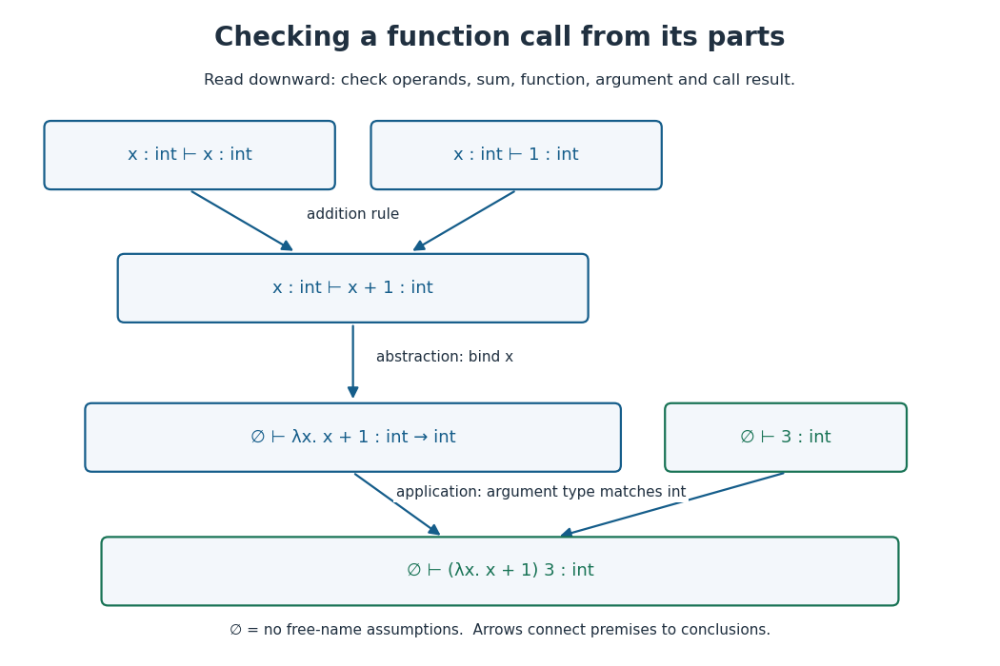

# Function type

↑ **Parent:** [Type system](type-system.md)  
ⓦ [Wiki](https://en.wikipedia.org/wiki/Function_type)

A [function type](function-type.md) $\tau_1\to\tau_2$ classifies functions that accept arguments of type $\tau_1$ and produce results of type $\tau_2$ if they return. For example, $\lambda x.x+1$ has [function type](function-type.md) $\mathrm{int}\to\mathrm{int}$ in our teaching [programming language](programming-language.md), while $\lambda b.\mathrm{if}\ b\ \mathrm{then}\ 1\ \mathrm{else}\ 2$ has [function type](function-type.md) $\mathrm{bool}\to\mathrm{int}$. A [function type](function-type.md) specifies how a function may be used; it does not guarantee that a call returns.

**[Figure 62](#image-checking-an-integer-function-call-from-its-parts). Checking an integer function call from its parts**. An addition rule checks the body of a [lambda abstraction](lambda-abstraction.md), the abstraction rule gives its [function type](function-type.md), and [lambda application](lambda-application.md) checks the argument and obtains the result type. Arrows run from prerequisite [typing judgments](typing-judgment.md) to their conclusions.

The two central [typing judgment](typing-judgment.md) rules are

$$
\frac{\Gamma,x:\tau_1\vdash e:\tau_2}{\Gamma\vdash\lambda x.e:\tau_1\to\tau_2},\qquad
\frac{\Gamma\vdash f:\tau_1\to\tau_2\qquad\Gamma\vdash a:\tau_1}{\Gamma\vdash f\,a:\tau_2}.
$$

The [lambda abstraction](lambda-abstraction.md) rule checks the body under an extended [typing context](typing-context.md); the [lambda application](lambda-application.md) rule checks that the argument has exactly the required type. These rules describe our [simple type](simple-type.md) examples. [Software Foundations, Programming Language Foundations, The Simply Typed Lambda-Calculus: typing rules](https://softwarefoundations.cis.upenn.edu/plf-current/Stlc.html)

For $(\lambda x.x+1)\,3$, assume $x:\mathrm{int}$; both $x$ and $1$ have type `int`, so $x+1$ has type `int`. The abstraction therefore has [function type](function-type.md) $\mathrm{int}\to\mathrm{int}$. Since $3$ has type `int`, the call has type `int` and evaluates to $4$. Replacing $3$ by `true` fails the argument requirement. This local derivation explains each step without running the program.

Arrows associate to the right: $\tau_1\to\tau_2\to\tau_3$ means $\tau_1\to(\tau_2\to\tau_3)$, a function returning another function. For instance, $\lambda x.\lambda y.x+y$ has [function type](function-type.md) $\mathrm{int}\to(\mathrm{int}\to\mathrm{int})$. Supplying one [integer](integer.md) yields a function awaiting the second. Functions can also be arguments: $(\mathrm{int}\to\mathrm{int})\to\mathrm{int}$ accepts an [integer](integer.md)-to-[integer](integer.md) function and has an [integer](integer.md) result type.

// Target: computer-science.bigb

## ↑ Ancestors (4)

1. [Type system](type-system.md)
2. [Programming language](programming-language.md)
3. [Computer science](computer-science-split.md)
4. [Codex Wiki](split.md)

## ← Incoming links (9)

- [Function type](function-type.md)
- [Hindley-Milner type system](hindley-milner-type-system.md)
- [Solution](past-exam-of-the-mathematics-course-of-the-university-of-cambridge/2007/ia/paper-5/10/a/solution.md)
- [Programming language](programming-language.md)
- [Simple type](simple-type.md)
- [Type scheme](type-scheme.md)
- [Type system](type-system.md)
- [Type unification](type-unification.md)
- [Type variable](type-variable.md)
