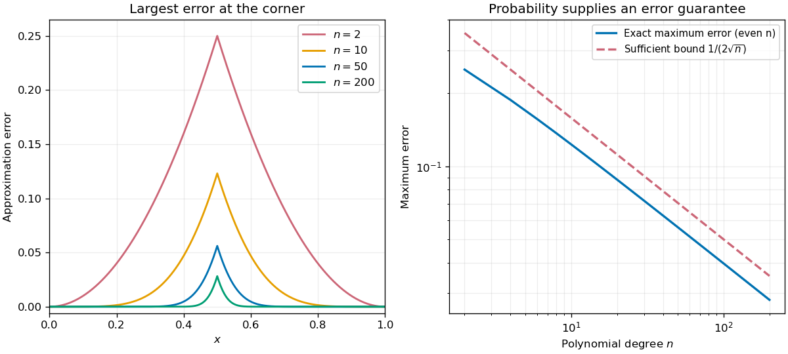

# Functional analysis

↑ **Parent:** [Analysis](analysis.md)  
ⓦ [Wiki](https://en.wikipedia.org/wiki/Functional_analysis)

Functional analysis brings [linear algebra](linear-algebra.md) and [topology](topology.md) together to study [vector spaces](vector-space.md) of [functions](function.md) and the [linear operators](vector-space.md#linear-operator) acting on them. A [function space](#function-space) such as $C([0,1])$ has infinitely many independent directions: the [monomials](polynomial.md#monomial) $1,x,x^2,\ldots$ are [linearly independent](vector-space.md#linear-independence). Finite [linear combinations](vector-space.md#linear-combination) alone cannot describe all its [continuous functions](calculus.md#continuous-function). A useful theory must also say when approximations converge, whether their limits belong to the chosen space, and which operations preserve that [norm convergence](normed-vector-space.md#norm-convergence). [Normed vector spaces](normed-vector-space.md), [Banach spaces](banach-space.md), and [bounded linear operators](topological-vector-space.md#continuous-linear-operator) provide these three controls.[MIT 18.102, lecture 1: the infinite-dimensional viewpoint](https://ocw.mit.edu/courses/18-102-introduction-to-functional-analysis-spring-2021/4ae9a5af8622dba3aa37461b71d08407_MIT18_102s21_lec1.pdf)

A [bounded linear operator](topological-vector-space.md#continuous-linear-operator) $T:X\to Y$ between [normed vector spaces](normed-vector-space.md) satisfies $\|Tf\|_Y\leq M\|f\|_X$ for every $f$, with one finite constant $M$. The least possible constant is its [operator norm](continuous-dual-space.md#operator-norm). By [linearity](vector-space.md#linearity), the same estimate controls approximation errors:

$$
\|Tf-Tg\|_Y\leq\|T\|\,\|f-g\|_X.
$$

This is exactly [continuity](calculus.md#continuous-function) for a [linear map](vector-space.md#linear-map) between [normed vector spaces](normed-vector-space.md); neither space needs to be complete. It turns an input accuracy guarantee into an output accuracy guarantee, even when the input has infinitely many degrees of freedom.[MIT 18.102, lecture 2: boundedness, continuity, and the operator norm](https://ocw.mit.edu/courses/18-102-introduction-to-functional-analysis-spring-2021/22bf2f774fb161776032491568148707_MIT18_102s21_lec2.pdf)

For a concrete [linear functional](dual-space.md#linear-functional) on $C([0,1])$, take the [integral](integral.md) $F(f)=\int_0^1 f(x)\,dx$. In the [supremum norm](normed-vector-space.md#supremum-norm),

$$
|F(f)|\leq\int_0^1|f(x)|\,dx\leq\|f\|_\infty.
$$

The constant function $f=1$ attains equality, so $\|F\|=1$. For $f(x)=x^2$, the output is $F(f)=1/3$; any approximation $g$ with $\|g-x^2\|_\infty\leq0.01$ therefore has $|F(g)-1/3|\leq0.01$. The [Cauchy-Schwarz inequality](probability-and-statistics.md#cauchy-schwarz-inequality) also gives $|F(f)|\leq\|f\|_2\|1\|_2=\|f\|_2$ on this interval, again with equality at $1$. Thus integration remains a [bounded linear functional](topological-vector-space.md#continuous-linear-functional) under the [L2 norm](real-analysis.md#l2-norm), although [point evaluation](topological-vector-space.md#point-evaluation-functional) behaves very differently.

The beauty of this viewpoint is that one estimate can justify an entire approximation procedure. Once a [sequence](sequence-and-series.md#sequence) converges in the chosen [norm](normed-vector-space.md#norm), every [bounded linear operator](topological-vector-space.md#continuous-linear-operator) carries its limit along. [Completeness](topological-analysis.md#completeness) ensures that Cauchy approximations actually describe an element of the space. The choice of [norm](normed-vector-space.md#norm) matters: it determines which errors are small and which measurements are stable. The examples below distinguish an average, which ignores sufficiently narrow peaks, from [point evaluation](topological-vector-space.md#point-evaluation-functional), which detects their full height. For applications, this decides whether reducing an overall fitting error guarantees an accurate reported measurement. A small [L2 norm](real-analysis.md#l2-norm) of the error controls its [integral](integral.md) on this interval, while it gives no such guarantee for a single sampled value.

**Table of contents**

- [Sublinear operator](#sublinear-operator)
  - [Weak-type operator](#weak-type-operator)
    - [Strong Lp bound from weak L1 and L-infinity bounds](#strong-lp-bound-from-weak-l1-and-l-infinity-bounds)
    - [Weak type with a normed domain](#weak-type-with-a-normed-domain)
      - [Dense approximation under a weak-type maximal bound](#dense-approximation-under-a-weak-type-maximal-bound)
    - [Weak type (1,1)](#weak-type-1-1)
      - [Almost-everywhere convergence from weak-type domination](#almost-everywhere-convergence-from-weak-type-domination)
- [Operator algebra](#operator-algebra)
  - [Quasi-local observable algebra](#quasi-local-observable-algebra)
  - [Cyclic vector for an operator algebra](#cyclic-vector-for-an-operator-algebra)
    - [Separating vector for an operator algebra](#separating-vector-for-an-operator-algebra)
      - [Tomita operator](#tomita-operator)
        - [Modular operator](#modular-operator)
        - [Modular conjugation](#modular-conjugation)
  - [Von Neumann algebra](#von-neumann-algebra)
    - [Hilbert space module over a von Neumann algebra](#hilbert-space-module-over-a-von-neumann-algebra)
      - [Schröder-Bernstein theorem for Hilbert space modules](#schroder-bernstein-theorem-for-hilbert-space-modules)
    - [Von Neumann factor](#von-neumann-factor)
    - [Group von Neumann algebra](#group-von-neumann-algebra)
- [Metric embedding](metric-embedding.md)
  - [Bi-Lipschitz distortion](metric-embedding.md#bi-lipschitz-distortion)
    - [Stretch factor](metric-embedding.md#stretch-factor)
  - [Coarse embedding](metric-embedding.md#coarse-embedding)
    - [Uniform coarse embedding of a family of metric spaces](metric-embedding.md#uniform-coarse-embedding-of-a-family-of-metric-spaces)
  - [Hamming cube as an L1 and L2 metric](metric-embedding.md#hamming-cube-as-an-l1-and-l2-metric)
  - [Expander graph](metric-embedding.md#expander-graph)
    - [Zig-zag product](metric-embedding.md#zig-zag-product)
      - [Squaring and zig-zag iteration yields bounded-degree expanders](metric-embedding.md#squaring-and-zig-zag-iteration-yields-bounded-degree-expanders)
    - [L1 Poincare inequality for an expander graph](metric-embedding.md#l1-poincare-inequality-for-an-expander-graph)
      - [Layer cake representation](metric-embedding.md#layer-cake-representation)
        - [Lp bound from a tail domination inequality](metric-embedding.md#lp-bound-from-a-tail-domination-inequality)
      - [L1 distortion lower bound for an expander graph](metric-embedding.md#l1-distortion-lower-bound-for-an-expander-graph)
    - [Expander graph obstruction to uniform coarse embedding](metric-embedding.md#expander-graph-obstruction-to-uniform-coarse-embedding)
  - [Finite representability of a Banach space](metric-embedding.md#finite-representability-of-a-banach-space)
    - [Superreflexive Banach space](metric-embedding.md#superreflexive-banach-space)
      - [Convex-block separation criterion for reflexivity](metric-embedding.md#convex-block-separation-criterion-for-reflexivity)
        - [James's theorem](metric-embedding.md#james-s-theorem)
          - [Principle of local reflexivity](metric-embedding.md#principle-of-local-reflexivity)
      - [Uniform finite convex-block criterion for superreflexivity](metric-embedding.md#uniform-finite-convex-block-criterion-for-superreflexivity)
      - [Diamond-graph characterization of superreflexivity](metric-embedding.md#diamond-graph-characterization-of-superreflexivity)
  - [Bourgain embedding theorem](metric-embedding.md#bourgain-embedding-theorem)
    - [Fréchet embedding](metric-embedding.md#frechet-embedding)
    - [Low-dimensional Frechet embedding into linfinity](metric-embedding.md#low-dimensional-frechet-embedding-into-linfinity)
      - [Dimension lower bound for an expander embedded in linfinity](metric-embedding.md#dimension-lower-bound-for-an-expander-embedded-in-linfinity)
  - [Johnson–Lindenstrauss lemma](metric-embedding.md#johnson-lindenstrauss-lemma)
    - [Gaussian Johnson–Lindenstrauss transform](metric-embedding.md#gaussian-johnson-lindenstrauss-transform)
      - [Finite-set example of the Johnson–Lindenstrauss lemma](metric-embedding.md#finite-set-example-of-the-johnson-lindenstrauss-lemma)
      - [Gaussian Johnson–Lindenstrauss concentration argument](metric-embedding.md#gaussian-johnson-lindenstrauss-concentration-argument)
    - [Net estimate for a linear operator](metric-embedding.md#net-estimate-for-a-linear-operator)
    - [Rademacher Johnson–Lindenstrauss transform](metric-embedding.md#rademacher-johnson-lindenstrauss-transform)
    - [Subgaussian concentration of the absolute Gaussian average](metric-embedding.md#subgaussian-concentration-of-the-absolute-gaussian-average)
      - [Almost-isometric Gaussian embedding from l2 into l1](metric-embedding.md#almost-isometric-gaussian-embedding-from-l2-into-l1)
        - [Low-dimensional L1 embedding of a finite metric space](metric-embedding.md#low-dimensional-l1-embedding-of-a-finite-metric-space)
- [Exponentially weighted supremum norm](#exponentially-weighted-supremum-norm)
- [Operator topology](#operator-topology)
  - [Strong operator topology](#strong-operator-topology)
    - [Strong-star operator topology](#strong-star-operator-topology)
  - [Weak operator topology](#weak-operator-topology)
    - [Operator predual from matrix coefficients](#operator-predual-from-matrix-coefficients)
- [Schauder basis](#schauder-basis)
  - [Block basic sequence](#block-basic-sequence)
    - [Small perturbation of a complemented block basis](#small-perturbation-of-a-complemented-block-basis)
  - [Block sequence](#block-sequence)
    - [Block subspace](#block-subspace)
      - [Gowers Ramsey theorem for Banach spaces](#gowers-ramsey-theorem-for-banach-spaces)
  - [Basis projection](#basis-projection)
    - [Basis constant](#basis-constant)
  - [Coordinate functional of a Schauder basis](#coordinate-functional-of-a-schauder-basis)
    - [Dual sequence of a Schauder basis](#dual-sequence-of-a-schauder-basis)
      - [Shrinking Schauder basis](#shrinking-schauder-basis)
  - [Basic sequence](#basic-sequence)
    - [Rosenthal l1 theorem](#rosenthal-l1-theorem)
    - [Bourgain l1-index](#bourgain-l1-index)
    - [Unconditional basic sequence](#unconditional-basic-sequence)
      - [Unconditional tree index](#unconditional-tree-index)
      - [Suppression-unconditional basic sequence](#suppression-unconditional-basic-sequence)
    - [Spreading model](#spreading-model)
    - [Basis selection theorem](#basis-selection-theorem)
- [Reflexive space](#reflexive-space)
  - [Reflexive Banach space](#reflexive-banach-space)
    - [Norm minimizer in a closed convex subset of a reflexive Banach space](#norm-minimizer-in-a-closed-convex-subset-of-a-reflexive-banach-space)
    - [Weak compactness characterization of reflexivity](#weak-compactness-characterization-of-reflexivity)
      - [Weak sequential compactness in a Hilbert space](#weak-sequential-compactness-in-a-hilbert-space)
      - [Weak sequential compactness of bounded sequences in a reflexive Banach space](#weak-sequential-compactness-of-bounded-sequences-in-a-reflexive-banach-space)
- [Banach algebra](banach-algebra.md)
  - [Semisimple Banach algebra](banach-algebra.md#semisimple-banach-algebra)
    - [Automatic continuity onto a semisimple Banach algebra](banach-algebra.md#automatic-continuity-onto-a-semisimple-banach-algebra)
  - [Volterra convolution algebra on a finite interval](banach-algebra.md#volterra-convolution-algebra-on-a-finite-interval)
  - [Renorming a separately continuous Banach algebra](banach-algebra.md#renorming-a-separately-continuous-banach-algebra)
  - [Hermitian Banach algebra](banach-algebra.md#hermitian-banach-algebra)
    - [Spectral permanence for Hermitian Banach algebras](banach-algebra.md#spectral-permanence-for-hermitian-banach-algebras)
  - [L1 convolution algebra](banach-algebra.md#l1-convolution-algebra)
    - [Character space of an Abelian L1 group algebra](banach-algebra.md#character-space-of-an-abelian-l1-group-algebra)
  - [Closed subalgebra of a Banach algebra](banach-algebra.md#closed-subalgebra-of-a-banach-algebra)
  - [Continuously differentiable functions on a compact interval form a Banach algebra](banach-algebra.md#continuously-differentiable-functions-on-a-compact-interval-form-a-banach-algebra)
    - [Character space of C1 on a compact interval](banach-algebra.md#character-space-of-c1-on-a-compact-interval)
  - [Uniform algebra](banach-algebra.md#uniform-algebra)
    - [Boundary-analytic disk algebra with doubled character space](banach-algebra.md#boundary-analytic-disk-algebra-with-doubled-character-space)
    - [Disk algebra](banach-algebra.md#disk-algebra)
    - [Natural uniform algebra](banach-algebra.md#natural-uniform-algebra)
      - [Finite-generator criterion for a natural uniform algebra](banach-algebra.md#finite-generator-criterion-for-a-natural-uniform-algebra)
  - [Semisimple commutative Banach algebra](banach-algebra.md#semisimple-commutative-banach-algebra)
  - [Supremum bound for a complete function-algebra norm](banach-algebra.md#supremum-bound-for-a-complete-function-algebra-norm)
  - [Group of invertible elements of a Banach algebra](banach-algebra.md#group-of-invertible-elements-of-a-banach-algebra)
    - [Identity component of Banach-algebra invertibles](banach-algebra.md#identity-component-of-banach-algebra-invertibles)
    - [Noninvertible limits of invertibles have no one-sided inverse](banach-algebra.md#noninvertible-limits-of-invertibles-have-no-one-sided-inverse)
    - [Right inverse of an algebra element](banach-algebra.md#right-inverse-of-an-algebra-element)
    - [Left inverse of an algebra element](banach-algebra.md#left-inverse-of-an-algebra-element)
    - [Inverse norm divergence at noninvertible boundary points](banach-algebra.md#inverse-norm-divergence-at-noninvertible-boundary-points)
    - [Continuity of inversion in a Banach algebra](banach-algebra.md#continuity-of-inversion-in-a-banach-algebra)
  - [Qp-Banach algebra](banach-algebra.md#qp-banach-algebra)
  - [Gelfand-Mazur theorem](banach-algebra.md#gelfand-mazur-theorem)
  - [Algebra norm](banach-algebra.md#algebra-norm)
    - [Renorming a bounded multiplicative semigroup](banach-algebra.md#renorming-a-bounded-multiplicative-semigroup)
      - [Simultaneous spectral-radius renorming](banach-algebra.md#simultaneous-spectral-radius-renorming)
    - [Submultiplicativity](banach-algebra.md#submultiplicativity)
    - [Continuous functions on the complex plane admit no algebra norm](banach-algebra.md#continuous-functions-on-the-complex-plane-admit-no-algebra-norm)
    - [Entire function algebra admits no complete algebra norm](banach-algebra.md#entire-function-algebra-admits-no-complete-algebra-norm)
      - [Compact-disk algebra norm on entire functions](banach-algebra.md#compact-disk-algebra-norm-on-entire-functions)
    - [Minimality of the supremum norm on C(K)](banach-algebra.md#minimality-of-the-supremum-norm-on-c-k)
  - [Unitization of an algebra](banach-algebra.md#unitization-of-an-algebra)
  - [Neumann series](banach-algebra.md#neumann-series)
  - [Spectrum of an element](banach-algebra.md#spectrum-of-an-element)
    - [Resolvent set of a Banach algebra element](banach-algebra.md#resolvent-set-of-a-banach-algebra-element)
    - [Resolvent components in a closed unital subalgebra](banach-algebra.md#resolvent-components-in-a-closed-unital-subalgebra)
      - [Boundary inclusion of spectra in a closed unital subalgebra](banach-algebra.md#boundary-inclusion-of-spectra-in-a-closed-unital-subalgebra)
    - [Translation of the spectrum by a scalar](banach-algebra.md#translation-of-the-spectrum-by-a-scalar)
    - [Quasinilpotent element](banach-algebra.md#quasinilpotent-element)
    - [Nonzero spectra of products in opposite orders](banach-algebra.md#nonzero-spectra-of-products-in-opposite-orders)
    - [Nonemptiness of the Banach-algebra spectrum](banach-algebra.md#nonemptiness-of-the-banach-algebra-spectrum)
    - [Approximate point spectrum](banach-algebra.md#approximate-point-spectrum)
      - [Bilateral shift operator](banach-algebra.md#bilateral-shift-operator)
    - [Resolvent of an element](banach-algebra.md#resolvent-of-an-element)
      - [Resolvent Cauchy coefficient formula](banach-algebra.md#resolvent-cauchy-coefficient-formula)
      - [Resolvent identity](banach-algebra.md#resolvent-identity)
      - [Resolvent norm](banach-algebra.md#resolvent-norm)
      - [Pseudospectrum](banach-algebra.md#pseudospectrum)
      - [Riesz projection](banach-algebra.md#riesz-projection)
        - [Disconnected spectrum yields a nontrivial invariant subspace](banach-algebra.md#disconnected-spectrum-yields-a-nontrivial-invariant-subspace)
    - [Spectrum in a closed unital subalgebra](banach-algebra.md#spectrum-in-a-closed-unital-subalgebra)
      - [Connected-component permanence of subalgebra invertibility](banach-algebra.md#connected-component-permanence-of-subalgebra-invertibility)
    - [Holomorphic functional calculus](banach-algebra.md#holomorphic-functional-calculus)
      - [Logarithm from a spectral slit in a Banach algebra](banach-algebra.md#logarithm-from-a-spectral-slit-in-a-banach-algebra)
      - [Spectral idempotent from a separated spectrum](banach-algebra.md#spectral-idempotent-from-a-separated-spectrum)
      - [Banach algebra exponential](banach-algebra.md#banach-algebra-exponential)
      - [Principal cube root of a Banach-algebra element](banach-algebra.md#principal-cube-root-of-a-banach-algebra-element)
      - [Principal square root in a commutative Banach algebra](banach-algebra.md#principal-square-root-in-a-commutative-banach-algebra)
      - [Resolvent-generated commutative algebra](banach-algebra.md#resolvent-generated-commutative-algebra)
      - [Continuity and uniqueness of holomorphic functional calculus](banach-algebra.md#continuity-and-uniqueness-of-holomorphic-functional-calculus)
      - [Logarithm of an element near the identity](banach-algebra.md#logarithm-of-an-element-near-the-identity)
      - [Composition rule for holomorphic functional calculus](banach-algebra.md#composition-rule-for-holomorphic-functional-calculus)
      - [Injectivity through a holomorphic functional calculus with nonvanishing derivative](banach-algebra.md#injectivity-through-a-holomorphic-functional-calculus-with-nonvanishing-derivative)
    - [Full spectrum](banach-algebra.md#full-spectrum)
  - [Character of an algebra](banach-algebra.md#character-of-an-algebra)
    - [Maximal ideals of a commutative complex unital Banach algebra are character kernels](banach-algebra.md#maximal-ideals-of-a-commutative-complex-unital-banach-algebra-are-character-kernels)
    - [Maximal ideals of a complex unital Banach algebra are character kernels](banach-algebra.md#maximal-ideals-of-a-complex-unital-banach-algebra-are-character-kernels)
    - [Characters of a C-star algebra respect the involution](banach-algebra.md#characters-of-a-c-star-algebra-respect-the-involution)
    - [Automatic continuity of characters](banach-algebra.md#automatic-continuity-of-characters)
    - [Character space of an algebra](banach-algebra.md#character-space-of-an-algebra)
      - [Maximal ideal space of a commutative Banach algebra](banach-algebra.md#maximal-ideal-space-of-a-commutative-banach-algebra)
      - [Character space of R(K)](banach-algebra.md#character-space-of-r-k)
      - [Absence of characters on an operator algebra with isomorphic complementary summands](banach-algebra.md#absence-of-characters-on-an-operator-algebra-with-isomorphic-complementary-summands)
      - [Gelfand topology](banach-algebra.md#gelfand-topology)
      - [Evaluation character](banach-algebra.md#evaluation-character)
      - [Gelfand representation](banach-algebra.md#gelfand-representation)
        - [Involution alone does not imply an isometric Gelfand transform](banach-algebra.md#involution-alone-does-not-imply-an-isometric-gelfand-transform)
        - [Spectrum equals character values in a commutative Banach algebra](banach-algebra.md#spectrum-equals-character-values-in-a-commutative-banach-algebra)
        - [Gelfand representation theorem](banach-algebra.md#gelfand-representation-theorem)
  - [Banach subalgebra generated by one element](banach-algebra.md#banach-subalgebra-generated-by-one-element)
    - [Spectrum of a polynomial-generated Banach subalgebra](banach-algebra.md#spectrum-of-a-polynomial-generated-banach-subalgebra)
  - [C-star algebra](banach-algebra.md#c-star-algebra)
    - [Unitization of a C-star algebra](banach-algebra.md#unitization-of-a-c-star-algebra)
      - [C-star unitization by left multiplication](banach-algebra.md#c-star-unitization-by-left-multiplication)
    - [Calkin algebra](banach-algebra.md#calkin-algebra)
    - [C-star subalgebra](banach-algebra.md#c-star-subalgebra)
    - [C-star homomorphism](banach-algebra.md#c-star-homomorphism)
      - [Injective C-star homomorphism is isometric](banach-algebra.md#injective-c-star-homomorphism-is-isometric)
    - [Spectral permanence for C-star algebras](banach-algebra.md#spectral-permanence-for-c-star-algebras)
    - [Continuous functional calculus](banach-algebra.md#continuous-functional-calculus)
      - [Nonunital continuous functional calculus](banach-algebra.md#nonunital-continuous-functional-calculus)
      - [Square-root resolvent integral in a C-star algebra](banach-algebra.md#square-root-resolvent-integral-in-a-c-star-algebra)
        - [Order preservation by the positive square root](banach-algebra.md#order-preservation-by-the-positive-square-root)
      - [Strong continuity of functional calculus through resolvents](banach-algebra.md#strong-continuity-of-functional-calculus-through-resolvents)
      - [Disconnected spectrum gives a reducing subspace](banach-algebra.md#disconnected-spectrum-gives-a-reducing-subspace)
    - [C-star identity](banach-algebra.md#c-star-identity)
    - [Commutative Gelfand--Naimark theorem](banach-algebra.md#commutative-gelfand-naimark-theorem)
    - [Positive element of a C-star algebra](banach-algebra.md#positive-element-of-a-c-star-algebra)
      - [Positive cone of a C-star algebra](banach-algebra.md#positive-cone-of-a-c-star-algebra)
      - [Squaring is not order preserving in a C-star algebra](banach-algebra.md#squaring-is-not-order-preserving-in-a-c-star-algebra)
      - [Inversion reverses the order of strictly positive elements](banach-algebra.md#inversion-reverses-the-order-of-strictly-positive-elements)
      - [Congruence preserves positivity in a C-star algebra](banach-algebra.md#congruence-preserves-positivity-in-a-c-star-algebra)
      - [Positivity of adjoint products from spectral positivity](banach-algebra.md#positivity-of-adjoint-products-from-spectral-positivity)
      - [Positive square root in a C-star algebra](banach-algebra.md#positive-square-root-in-a-c-star-algebra)
      - [Spectral characterization of a positive element in a C-star algebra](banach-algebra.md#spectral-characterization-of-a-positive-element-in-a-c-star-algebra)
    - [Hermitian element of a C-star algebra](banach-algebra.md#hermitian-element-of-a-c-star-algebra)
    - [Unitary element of a C-star algebra](banach-algebra.md#unitary-element-of-a-c-star-algebra)
    - [Normal element of a C-star algebra](banach-algebra.md#normal-element-of-a-c-star-algebra)
      - [Star polynomial in one normal element](banach-algebra.md#star-polynomial-in-one-normal-element)
      - [Unital versus nonunital generation by a normal element](banach-algebra.md#unital-versus-nonunital-generation-by-a-normal-element)
      - [Real spectrum criterion for a normal C-star element](banach-algebra.md#real-spectrum-criterion-for-a-normal-c-star-element)
      - [Spectral radius norm equality for normal elements](banach-algebra.md#spectral-radius-norm-equality-for-normal-elements)
    - [Positive functional on a C-star algebra](banach-algebra.md#positive-functional-on-a-c-star-algebra)
      - [Cauchy–Schwarz inequality for positive C-star functionals](banach-algebra.md#cauchy-schwarz-inequality-for-positive-c-star-functionals)
      - [Tracial positive functional](banach-algebra.md#tracial-positive-functional)
      - [State on a C-star algebra](banach-algebra.md#state-on-a-c-star-algebra)
        - [States separate elements of a C-star algebra](banach-algebra.md#states-separate-elements-of-a-c-star-algebra)
        - [Spectral values attained by C-star states](banach-algebra.md#spectral-values-attained-by-c-star-states)
        - [Pure state on a C-star algebra](banach-algebra.md#pure-state-on-a-c-star-algebra)
    - [Borel functional calculus for a normal operator](banach-algebra.md#borel-functional-calculus-for-a-normal-operator)
      - [Spectral essential range in Borel functional calculus](banach-algebra.md#spectral-essential-range-in-borel-functional-calculus)
      - [Normal square root from Borel functional calculus](banach-algebra.md#normal-square-root-from-borel-functional-calculus)
      - [Functional calculus convergence](banach-algebra.md#functional-calculus-convergence)
    - [Partial isometry](banach-algebra.md#partial-isometry)
    - [Polar decomposition of a bounded operator](banach-algebra.md#polar-decomposition-of-a-bounded-operator)
      - [Absolute value of an operator](banach-algebra.md#absolute-value-of-an-operator)
      - [Unitary polar factor of a finite compression](banach-algebra.md#unitary-polar-factor-of-a-finite-compression)
- [Weak topology](weak-topology.md)
  - [Original and weak continuity of linear maps between Fréchet spaces](weak-topology.md#original-and-weak-continuity-of-linear-maps-between-frechet-spaces)
  - [Countable separating family metrizes a weakly compact set](weak-topology.md#countable-separating-family-metrizes-a-weakly-compact-set)
  - [Weakly bounded set](weak-topology.md#weakly-bounded-set)
  - [Weak and norm Borel sigma-algebras in a separable Banach space](weak-topology.md#weak-and-norm-borel-sigma-algebras-in-a-separable-banach-space)
  - [Weak convergence](weak-topology.md#weak-convergence)
    - [Concentration prevents weak compactness in L1](weak-topology.md#concentration-prevents-weak-compactness-in-l1)
    - [Radon-Riesz property](weak-topology.md#radon-riesz-property)
  - [Finite-dimensional weak and norm topologies coincide](weak-topology.md#finite-dimensional-weak-and-norm-topologies-coincide)
  - [Weakly convergent sequence is bounded](weak-topology.md#weakly-convergent-sequence-is-bounded)
  - [Metrization of the weak topology on a bounded set](weak-topology.md#metrization-of-the-weak-topology-on-a-bounded-set)
    - [Weak-ball metrizability requires a norm-separable dual](weak-topology.md#weak-ball-metrizability-requires-a-norm-separable-dual)
  - [Weak closure](weak-topology.md#weak-closure)
  - [Weakly null sequence](weak-topology.md#weakly-null-sequence)
    - [Standard unit vectors are weakly null in lp](weak-topology.md#standard-unit-vectors-are-weakly-null-in-lp)
    - [Weak convergence of bounded disjointly supported sequences in lp](weak-topology.md#weak-convergence-of-bounded-disjointly-supported-sequences-in-lp)
  - [Weakly Cauchy sequence](weak-topology.md#weakly-cauchy-sequence)
  - [Weak closure of the unit sphere](weak-topology.md#weak-closure-of-the-unit-sphere)
  - [Weak-star topology](weak-topology.md#weak-star-topology)
    - [Weak-star fixed point theorem for an adjoint operator](weak-topology.md#weak-star-fixed-point-theorem-for-an-adjoint-operator)
    - [Weak-star separability of the entire dual](weak-topology.md#weak-star-separability-of-the-entire-dual)
    - [Weak-star open dual ball category obstruction](weak-topology.md#weak-star-open-dual-ball-category-obstruction)
    - [Weak-star topology on an entire infinite-dimensional Banach dual is not metrizable](weak-topology.md#weak-star-topology-on-an-entire-infinite-dimensional-banach-dual-is-not-metrizable)
    - [Continuous dual of a weak-star topology](weak-topology.md#continuous-dual-of-a-weak-star-topology)
    - [Failure of weak-star convergence to commute with squaring](weak-topology.md#failure-of-weak-star-convergence-to-commute-with-squaring)
    - [Weak-star metrizability of the dual ball](weak-topology.md#weak-star-metrizability-of-the-dual-ball)
      - [Weak-star metrizability criterion for a dual ball](weak-topology.md#weak-star-metrizability-criterion-for-a-dual-ball)
    - [Grothendieck space](weak-topology.md#grothendieck-space)
    - [Szlenk derivation](weak-topology.md#szlenk-derivation)
      - [One-step Szlenk derivation for a separable dual](weak-topology.md#one-step-szlenk-derivation-for-a-separable-dual)
  - [Weakly compact set](weak-topology.md#weakly-compact-set)
    - [Discontinuous pointwise limit obstruction to weak compactness](weak-topology.md#discontinuous-pointwise-limit-obstruction-to-weak-compactness)
    - [Weakly compact subsets of l-infinity are norm separable](weak-topology.md#weakly-compact-subsets-of-l-infinity-are-norm-separable)
    - [Weakly compact set is norm bounded](weak-topology.md#weakly-compact-set-is-norm-bounded)
    - [Weakly sequentially compact set](weak-topology.md#weakly-sequentially-compact-set)
      - [Eberlein-Šmulian theorem](weak-topology.md#eberlein-smulian-theorem)
    - [Krein-Šmulian theorem](weak-topology.md#krein-smulian-theorem)
  - [Szlenk index](weak-topology.md#szlenk-index)
- [Weakly compact operator](#weakly-compact-operator)
  - [Bidual characterization of weakly compact operators](#bidual-characterization-of-weakly-compact-operators)
    - [Weak compactness of an operator and its adjoint](#weak-compactness-of-an-operator-and-its-adjoint)
  - [Gantmacher theorem](#gantmacher-theorem)
  - [Operator ideal of weakly compact operators](#operator-ideal-of-weakly-compact-operators)
  - [Pitt theorem](#pitt-theorem)
- [Topological vector space](topological-vector-space.md)
  - [Dense subspace](topological-vector-space.md#dense-subspace)
  - [Sequential continuity criterion in a metrizable vector space](topological-vector-space.md#sequential-continuity-criterion-in-a-metrizable-vector-space)
  - [Bounded set in a topological vector space](topological-vector-space.md#bounded-set-in-a-topological-vector-space)
  - [Strict inductive limit topology](topological-vector-space.md#strict-inductive-limit-topology)
  - [Metrizable topological vector space](topological-vector-space.md#metrizable-topological-vector-space)
  - [Finite-dimensional vector-space topology](topological-vector-space.md#finite-dimensional-vector-space-topology)
    - [Equivalence of norms in finite dimensions](topological-vector-space.md#equivalence-of-norms-in-finite-dimensions)
      - [Sharp comparison of l1 and l2 norms](topological-vector-space.md#sharp-comparison-of-l1-and-l2-norms)
  - [Locally convex space](topological-vector-space.md#locally-convex-space)
    - [Seminorm topology](topological-vector-space.md#seminorm-topology)
      - [Separating family of seminorms](topological-vector-space.md#separating-family-of-seminorms)
    - [Compact metrizable convex set](topological-vector-space.md#compact-metrizable-convex-set)
      - [Choquet theorem](topological-vector-space.md#choquet-theorem)
        - [Threshold Choquet representation in L-infinity](topological-vector-space.md#threshold-choquet-representation-in-l-infinity)
        - [Choquet's theorem by strict convexity](topological-vector-space.md#choquet-s-theorem-by-strict-convexity)
      - [Affine upper envelope](topological-vector-space.md#affine-upper-envelope)
        - [Supporting measure lemma for affine upper envelopes](topological-vector-space.md#supporting-measure-lemma-for-affine-upper-envelopes)
      - [Barycenter](topological-vector-space.md#barycenter)
    - [Seminorm](topological-vector-space.md#seminorm)
      - [Kernel of a seminorm](topological-vector-space.md#kernel-of-a-seminorm)
      - [Coordinate seminorms](topological-vector-space.md#coordinate-seminorms)
      - [Dual seminorm](topological-vector-space.md#dual-seminorm)
    - [Fréchet space](topological-vector-space.md#frechet-space)
      - [Derivative seminorms on a compact interval](topological-vector-space.md#derivative-seminorms-on-a-compact-interval)
        - [Smooth convergence on a compact interval](topological-vector-space.md#smooth-convergence-on-a-compact-interval)
    - [Minkowski functional](topological-vector-space.md#minkowski-functional)
      - [Norm from a bounded symmetric convex neighbourhood](topological-vector-space.md#norm-from-a-bounded-symmetric-convex-neighbourhood)
    - [Separation of a point and an open convex set](topological-vector-space.md#separation-of-a-point-and-an-open-convex-set)
      - [Hahn-Banach separation theorem for two convex sets](topological-vector-space.md#hahn-banach-separation-theorem-for-two-convex-sets)
      - [Finite-dimensional separation of open convex sets](topological-vector-space.md#finite-dimensional-separation-of-open-convex-sets)
    - [Dual pair](topological-vector-space.md#dual-pair)
      - [Continuous dual of a weak topology](topological-vector-space.md#continuous-dual-of-a-weak-topology)
      - [Compact norming dual-pair criterion](topological-vector-space.md#compact-norming-dual-pair-criterion)
      - [Bipolar theorem for a dual pair](topological-vector-space.md#bipolar-theorem-for-a-dual-pair)
    - [Product of locally convex spaces](topological-vector-space.md#product-of-locally-convex-spaces)
  - [Continuous linear operator](topological-vector-space.md#continuous-linear-operator)
    - [Completely continuous operator](topological-vector-space.md#completely-continuous-operator)
    - [Approximate surjectivity with geometric correction](topological-vector-space.md#approximate-surjectivity-with-geometric-correction)
    - [Absolutely p-summing operator](topological-vector-space.md#absolutely-p-summing-operator)
      - [2-summing operator](topological-vector-space.md#2-summing-operator)
        - [2-summing norm of a finite-dimensional identity](topological-vector-space.md#2-summing-norm-of-a-finite-dimensional-identity)
      - [Pietsch factorization theorem](topological-vector-space.md#pietsch-factorization-theorem)
      - [Absolutely summing operator](topological-vector-space.md#absolutely-summing-operator)
    - [Strictly singular operator](topological-vector-space.md#strictly-singular-operator)
    - [Positivity-preserving linear operator on L1](topological-vector-space.md#positivity-preserving-linear-operator-on-l1)
      - [Mean control for positive imaging operators](topological-vector-space.md#mean-control-for-positive-imaging-operators)
    - [Schur test](topological-vector-space.md#schur-test)
    - [Bounded inverse](topological-vector-space.md#bounded-inverse)
    - [Positive linear operator on continuous functions](topological-vector-space.md#positive-linear-operator-on-continuous-functions)
      - [Zero-preserving linear operator on continuous functions](topological-vector-space.md#zero-preserving-linear-operator-on-continuous-functions)
    - [Contractive linear operator](topological-vector-space.md#contractive-linear-operator)
    - [Range of a bounded linear operator](topological-vector-space.md#range-of-a-bounded-linear-operator)
    - [Extension of a bounded linear operator from a dense subspace](topological-vector-space.md#extension-of-a-bounded-linear-operator-from-a-dense-subspace)
      - [Failure of dense-subspace extension into an incomplete codomain](topological-vector-space.md#failure-of-dense-subspace-extension-into-an-incomplete-codomain)
    - [Banach space of bounded linear operators](topological-vector-space.md#banach-space-of-bounded-linear-operators)
    - [Continuous linear functional](topological-vector-space.md#continuous-linear-functional)
      - [Linear functional with closed kernel](topological-vector-space.md#linear-functional-with-closed-kernel)
      - [Point evaluation functional](topological-vector-space.md#point-evaluation-functional)
    - [Sequential continuity criterion for a linear map on a metrizable topological vector space](topological-vector-space.md#sequential-continuity-criterion-for-a-linear-map-on-a-metrizable-topological-vector-space)
    - [Isomorphism of Banach spaces](topological-vector-space.md#isomorphism-of-banach-spaces)
- [Function space](#function-space)
  - [Space of continuous compactly supported functions](#space-of-continuous-compactly-supported-functions)
  - [Skorokhod space](#skorokhod-space)
- [Integral operator](#integral-operator)
  - [Integral kernel](#integral-kernel)
    - [Projection kernel determinant integration](#projection-kernel-determinant-integration)
    - [Finite-rank projection kernel](#finite-rank-projection-kernel)
      - [Orthogonal polynomial projection kernel](#orthogonal-polynomial-projection-kernel)
        - [Laguerre projection kernel](#laguerre-projection-kernel)
  - [Abel transform](#abel-transform)
  - [Volterra operator](#volterra-operator)
    - [Volterra inverse differentiation has empty spectrum](#volterra-inverse-differentiation-has-empty-spectrum)
    - [Mixed-boundary singular system of the Volterra operator](#mixed-boundary-singular-system-of-the-volterra-operator)
      - [Spectral Tikhonov differentiation for the Volterra operator](#spectral-tikhonov-differentiation-for-the-volterra-operator)
    - [Differentiation by one-sided difference quotients](#differentiation-by-one-sided-difference-quotients)
      - [Error bound for one-sided differentiation](#error-bound-for-one-sided-differentiation)
    - [Range of the Volterra integration operator](#range-of-the-volterra-integration-operator)
  - [Mercer's theorem](#mercer-s-theorem)
- [Normed vector space](normed-vector-space.md)
  - [Interior and closure of norm balls](normed-vector-space.md#interior-and-closure-of-norm-balls)
  - [Uniformly convex space](normed-vector-space.md#uniformly-convex-space)
  - [Strictly convex normed space](normed-vector-space.md#strictly-convex-normed-space)
    - [Uniqueness of best approximation in a strictly convex space](normed-vector-space.md#uniqueness-of-best-approximation-in-a-strictly-convex-space)
  - [Best approximation in a normed space](normed-vector-space.md#best-approximation-in-a-normed-space)
    - [Lower-frequency Lp approximation to a single harmonic](normed-vector-space.md#lower-frequency-lp-approximation-to-a-single-harmonic)
    - [Sign criterion for best L1 approximation](normed-vector-space.md#sign-criterion-for-best-l1-approximation)
  - [Volume ratio](normed-vector-space.md#volume-ratio)
    - [Orthogonal splitting with bounded volume ratio](normed-vector-space.md#orthogonal-splitting-with-bounded-volume-ratio)
  - [Point-evaluation kernel is not closed in the integral norm](normed-vector-space.md#point-evaluation-kernel-is-not-closed-in-the-integral-norm)
  - [Sphere in a normed vector space](normed-vector-space.md#sphere-in-a-normed-vector-space)
  - [Completion of a normed space](normed-vector-space.md#completion-of-a-normed-space)
  - [Lambda-injective normed space](normed-vector-space.md#lambda-injective-normed-space)
    - [Retraction characterization of lambda-injectivity](normed-vector-space.md#retraction-characterization-of-lambda-injectivity)
  - [Norm topology](normed-vector-space.md#norm-topology)
    - [Norm convergence](normed-vector-space.md#norm-convergence)
  - [Finite-dimensional subspace is closed](normed-vector-space.md#finite-dimensional-subspace-is-closed)
  - [Isometric isomorphism of normed spaces](normed-vector-space.md#isometric-isomorphism-of-normed-spaces)
  - [Norm](normed-vector-space.md#norm)
    - [Quasi-norm](normed-vector-space.md#quasi-norm)
    - [Dual norm](normed-vector-space.md#dual-norm)
      - [Dual norm as a worst-case linear error bound](normed-vector-space.md#dual-norm-as-a-worst-case-linear-error-bound)
      - [Dual norm supremum need not be attained](normed-vector-space.md#dual-norm-supremum-need-not-be-attained)
    - [Block mixed norm](normed-vector-space.md#block-mixed-norm)
      - [Duality of block mixed norms](normed-vector-space.md#duality-of-block-mixed-norms)
    - [Definiteness of a norm](normed-vector-space.md#definiteness-of-a-norm)
    - [Absolute homogeneity of a norm](normed-vector-space.md#absolute-homogeneity-of-a-norm)
    - [Norm determined by a convex radial unit ball](normed-vector-space.md#norm-determined-by-a-convex-radial-unit-ball)
    - [Discrete L2 norm](normed-vector-space.md#discrete-l2-norm)
  - [L1 norm](normed-vector-space.md#l1-norm)
    - [Weighted one-norm on l2](normed-vector-space.md#weighted-one-norm-on-l2)
      - [Subdifferential of a weighted one-norm on l2](normed-vector-space.md#subdifferential-of-a-weighted-one-norm-on-l2)
    - [Taxicab geometry](normed-vector-space.md#taxicab-geometry)
  - [Trace norm](normed-vector-space.md#trace-norm)
    - [Unitary variational formula for the trace norm](normed-vector-space.md#unitary-variational-formula-for-the-trace-norm)
    - [Trace-norm variational principle for Hermitian operators](normed-vector-space.md#trace-norm-variational-principle-for-hermitian-operators)
      - [Diagonal absolute-sum bound for the trace norm](normed-vector-space.md#diagonal-absolute-sum-bound-for-the-trace-norm)
    - [Induced trace norm](normed-vector-space.md#induced-trace-norm)
      - [Diamond norm](normed-vector-space.md#diamond-norm)
  - [Euclidean norm](normed-vector-space.md#euclidean-norm)
    - [Hessian of the Euclidean norm](normed-vector-space.md#hessian-of-the-euclidean-norm)
    - [Squared Euclidean norm](normed-vector-space.md#squared-euclidean-norm)
    - [Euclidean norm duality](normed-vector-space.md#euclidean-norm-duality)
    - [Euclidean ball](normed-vector-space.md#euclidean-ball)
      - [Euclidean unit ball](normed-vector-space.md#euclidean-unit-ball)
      - [Unit ball](normed-vector-space.md#unit-ball)
        - [Closed unit ball](normed-vector-space.md#closed-unit-ball)
        - [Open unit ball](normed-vector-space.md#open-unit-ball)
  - [Supremum norm](normed-vector-space.md#supremum-norm)
    - [Unboundedness of derivative evaluation in the supremum norm](normed-vector-space.md#unboundedness-of-derivative-evaluation-in-the-supremum-norm)
    - [Derivative supremum norm](normed-vector-space.md#derivative-supremum-norm)
  - [Surjective isometry of normed vector spaces](normed-vector-space.md#surjective-isometry-of-normed-vector-spaces)
    - [Mazur-Ulam theorem](normed-vector-space.md#mazur-ulam-theorem)
      - [Metric extraction of a midpoint by shrinking diameters](normed-vector-space.md#metric-extraction-of-a-midpoint-by-shrinking-diameters)
    - [Nonsurjective isometry need not preserve midpoints](normed-vector-space.md#nonsurjective-isometry-need-not-preserve-midpoints)
  - [Equivalent norms](normed-vector-space.md#equivalent-norms)
    - [Topology determines norm equivalence](normed-vector-space.md#topology-determines-norm-equivalence)
    - [Signed interval projection norm](normed-vector-space.md#signed-interval-projection-norm)
    - [Bounded distortion of a Banach space](normed-vector-space.md#bounded-distortion-of-a-banach-space)
    - [Banach norm rigidity from continuous point evaluations](normed-vector-space.md#banach-norm-rigidity-from-continuous-point-evaluations)
    - [Finite-dimensional equivalence of norms](normed-vector-space.md#finite-dimensional-equivalence-of-norms)
  - [Banach space](banach-space.md)
    - [Finite codimension in a Banach space](banach-space.md#finite-codimension-in-a-banach-space)
    - [Banach-Saks property](banach-space.md#banach-saks-property)
    - [Cotype of a Banach space](banach-space.md#cotype-of-a-banach-space)
      - [Cotype 2](banach-space.md#cotype-2)
        - [Cotype 2 extrapolation on finite-dimensional linfinity](banach-space.md#cotype-2-extrapolation-on-finite-dimensional-linfinity)
    - [Complemented subspace](banach-space.md#complemented-subspace)
      - [Pełczyński decomposition method](banach-space.md#pelczynski-decomposition-method)
    - [Hereditarily indecomposable Banach space](banach-space.md#hereditarily-indecomposable-banach-space)
      - [Gowers dichotomy theorem](banach-space.md#gowers-dichotomy-theorem)
    - [Quotient Banach space](banach-space.md#quotient-banach-space)
      - [Approximate weakly null lifting through a quotient](banach-space.md#approximate-weakly-null-lifting-through-a-quotient)
      - [Quotient norm](banach-space.md#quotient-norm)
    - [Convex block](banach-space.md#convex-block)
      - [Convex-block cancellation of a weak-star limit](banach-space.md#convex-block-cancellation-of-a-weak-star-limit)
    - [Duality mapping](banach-space.md#duality-mapping)
    - [Bounded scalar functions on an index set](banach-space.md#bounded-scalar-functions-on-an-index-set)
      - [Coordinate functional representation of an operator into bounded indexed functions](banach-space.md#coordinate-functional-representation-of-an-operator-into-bounded-indexed-functions)
    - [Separable Banach space](banach-space.md#separable-banach-space)
    - [l-p sequence space](banach-space.md#l-p-sequence-space)
      - [Absolutely summable sequence space](banach-space.md#absolutely-summable-sequence-space)
      - [l2 sequence space](banach-space.md#l2-sequence-space)
        - [Uniform convexity of l2](banach-space.md#uniform-convexity-of-l2)
      - [Finitely supported sequence](banach-space.md#finitely-supported-sequence)
        - [Incompleteness of finitely supported sequences](banach-space.md#incompleteness-of-finitely-supported-sequences)
        - [Density of finitely supported sequences in l-p](banach-space.md#density-of-finitely-supported-sequences-in-l-p)
    - [l-infinity sequence space](banach-space.md#l-infinity-sequence-space)
      - [Generalized limit](banach-space.md#generalized-limit)
      - [Banach limit](banach-space.md#banach-limit)
        - [Cesàro construction of a Banach limit](banach-space.md#cesaro-construction-of-a-banach-limit)
        - [Ultrafilter construction of a Banach limit](banach-space.md#ultrafilter-construction-of-a-banach-limit)
      - [Left shift on bounded sequences](banach-space.md#left-shift-on-bounded-sequences)
    - [Riesz's lemma](banach-space.md#riesz-s-lemma)
      - [Compact unit ball characterizes finite-dimensional normed spaces](banach-space.md#compact-unit-ball-characterizes-finite-dimensional-normed-spaces)
    - [Uniformly convex Banach space](banach-space.md#uniformly-convex-banach-space)
      - [Nearest point in a uniformly convex Banach space](banach-space.md#nearest-point-in-a-uniformly-convex-banach-space)
      - [Clarkson's inequalities](banach-space.md#clarkson-s-inequalities)
        - [Dual-exponent Clarkson inequality](banach-space.md#dual-exponent-clarkson-inequality)
    - [Uniform boundedness principle](banach-space.md#uniform-boundedness-principle)
      - [Weak boundedness implies norm boundedness](banach-space.md#weak-boundedness-implies-norm-boundedness)
      - [Uniform bound from pointwise absolute summability of dual evaluations](banach-space.md#uniform-bound-from-pointwise-absolute-summability-of-dual-evaluations)
- [Riesz-Markov-Kakutani representation theorem](#riesz-markov-kakutani-representation-theorem)
  - [Riesz representation on compactly supported continuous functions](#riesz-representation-on-compactly-supported-continuous-functions)
  - [Cantor-space representation of positive functionals](#cantor-space-representation-of-positive-functionals)
    - [Compact-metric representation by Cantor-space pullback](#compact-metric-representation-by-cantor-space-pullback)
  - [Atomic approximation on finite-dimensional spaces of continuous functions](#atomic-approximation-on-finite-dimensional-spaces-of-continuous-functions)
- [Stone-Weierstrass theorem](#stone-weierstrass-theorem)
  - [Lattice approximation from two-point approximation](#lattice-approximation-from-two-point-approximation)
  - [Weierstrass approximation theorem](#weierstrass-approximation-theorem)
    - [Weierstrass approximation does not preserve derivatives](#weierstrass-approximation-does-not-preserve-derivatives)
    - [Polynomial recurrence for the absolute value](#polynomial-recurrence-for-the-absolute-value)
    - [Bernstein polynomial](#bernstein-polynomial)
      - [Bernstein approximation of a corner](#bernstein-approximation-of-a-corner)
      - [Lipschitz error bound for Bernstein approximation](#lipschitz-error-bound-for-bernstein-approximation)
      - [Bernstein polynomial degree preservation](#bernstein-polynomial-degree-preservation)
      - [Derivatives of Bernstein polynomials](#derivatives-of-bernstein-polynomials)
        - [Uniform convergence of Bernstein polynomial derivatives](#uniform-convergence-of-bernstein-polynomial-derivatives)
      - [Bernstein falling-factorial identity](#bernstein-falling-factorial-identity)
      - [Rounded Bernstein polynomial](#rounded-bernstein-polynomial)
      - [Bernstein monomial recurrence](#bernstein-monomial-recurrence)
      - [Inverse Bernstein approximation on a fixed-degree polynomial space](#inverse-bernstein-approximation-on-a-fixed-degree-polynomial-space)
      - [Bernstein basis](#bernstein-basis)
        - [Quadratic Bernstein coefficient bound](#quadratic-bernstein-coefficient-bound)
        - [Positive Bernstein coefficients for a strictly positive polynomial](#positive-bernstein-coefficients-for-a-strictly-positive-polynomial)
        - [Degree elevation of Bernstein coefficients](#degree-elevation-of-bernstein-coefficients)
  - [Globally uniform limit of real polynomials](#globally-uniform-limit-of-real-polynomials)
- [Open mapping theorem (functional analysis)](#open-mapping-theorem-functional-analysis)
  - [Geometric correction for approximate surjectivity](#geometric-correction-for-approximate-surjectivity)
    - [Completeness forced by uniformly bounded lifting](#completeness-forced-by-uniformly-bounded-lifting)
  - [Open mapping theorem for Fréchet spaces](#open-mapping-theorem-for-frechet-spaces)
  - [Dense open-unit-ball image criterion](#dense-open-unit-ball-image-criterion)
  - [Bounded inverse theorem](#bounded-inverse-theorem)
- [Diagonal operator on sequence space](#diagonal-operator-on-sequence-space)
  - [Unbounded inverse on a nonclosed operator range](#unbounded-inverse-on-a-nonclosed-operator-range)
- [Coercive operator](#coercive-operator)
  - [Strict positivity without coercivity can fail variational solvability](#strict-positivity-without-coercivity-can-fail-variational-solvability)
  - [Ellipticity of a bounded Hilbert-space operator](#ellipticity-of-a-bounded-hilbert-space-operator)
- [Graph of a linear operator](#graph-of-a-linear-operator)
  - [Closed linear operator](#closed-linear-operator)
    - [Sectorial operator](#sectorial-operator)
    - [Resolvent formalism](#resolvent-formalism)
      - [Resolvent of an operator](#resolvent-of-an-operator)
        - [Stieltjes matrix resolvent](#stieltjes-matrix-resolvent)
          - [Resolvent self-consistency defect](#resolvent-self-consistency-defect)
          - [Principal minor resolvent trace bound](#principal-minor-resolvent-trace-bound)
          - [Positive imaginary part of a Stieltjes matrix resolvent](#positive-imaginary-part-of-a-stieltjes-matrix-resolvent)
    - [Graph norm](#graph-norm)
    - [Resolvent set of an operator](#resolvent-set-of-an-operator)
  - [Closed graph theorem](#closed-graph-theorem)
    - [Separating space of a linear map](#separating-space-of-a-linear-map)
      - [Gliding-hump continuity principle](#gliding-hump-continuity-principle)
    - [Closed graph theorem for Fréchet spaces](#closed-graph-theorem-for-frechet-spaces)
    - [Closed graph theorem from the bounded inverse theorem](#closed-graph-theorem-from-the-bounded-inverse-theorem)
    - [Closed-graph proof for a factored operator](#closed-graph-proof-for-a-factored-operator)
    - [Incomplete-domain counterexample to closed-graph factorization](#incomplete-domain-counterexample-to-closed-graph-factorization)
    - [Continuity of a positive linear map into a dual space](#continuity-of-a-positive-linear-map-into-a-dual-space)
- [Closed-range criterion for an injection](#closed-range-criterion-for-an-injection)
  - [Closed-range bound on the kernel complement](#closed-range-bound-on-the-kernel-complement)
    - [Sequential properness for a self-adjoint operator](#sequential-properness-for-a-self-adjoint-operator)
- [Neumann-series perturbation](#neumann-series-perturbation)
- [Density by annihilators](#density-by-annihilators)
- [Hilbert space](hilbert-space.md)
  - [Reducing subspace of a Hilbert-space operator](hilbert-space.md#reducing-subspace-of-a-hilbert-space-operator)
  - [Hilbert tensor product](hilbert-space.md#hilbert-tensor-product)
  - [Hardy space of the circle](hilbert-space.md#hardy-space-of-the-circle)
  - [Bargmann-Fock space](hilbert-space.md#bargmann-fock-space)
  - [Norm-compact unit ball criterion](hilbert-space.md#norm-compact-unit-ball-criterion)
  - [Closed subspace of a Hilbert space](hilbert-space.md#closed-subspace-of-a-hilbert-space)
  - [Linear isometry of Hilbert spaces](hilbert-space.md#linear-isometry-of-hilbert-spaces)
    - [Unitary extension of a finite-dimensional isometry](hilbert-space.md#unitary-extension-of-a-finite-dimensional-isometry)
  - [N-term approximation](hilbert-space.md#n-term-approximation)
    - [Best N-term approximation](hilbert-space.md#best-n-term-approximation)
      - [Best N-term wavelet approximation of piecewise Hölder functions](hilbert-space.md#best-n-term-wavelet-approximation-of-piecewise-holder-functions)
    - [Linear N-term approximation](hilbert-space.md#linear-n-term-approximation)
  - [Hilbert space completion](hilbert-space.md#hilbert-space-completion)
    - [Mean-square completion of trigonometric polynomials](hilbert-space.md#mean-square-completion-of-trigonometric-polynomials)
  - [Separable Hilbert space](hilbert-space.md#separable-hilbert-space)
  - [Hilbert projection theorem](hilbert-space.md#hilbert-projection-theorem)
    - [Orthogonal decomposition by a closed subspace](hilbert-space.md#orthogonal-decomposition-by-a-closed-subspace)
      - [Orthogonal complement](hilbert-space.md#orthogonal-complement)
        - [Double orthogonal complement](hilbert-space.md#double-orthogonal-complement)
      - [Orthogonal projection](hilbert-space.md#orthogonal-projection)
        - [Directed subspace angle](hilbert-space.md#directed-subspace-angle)
          - [Complementarity from two directed subspace angles](hilbert-space.md#complementarity-from-two-directed-subspace-angles)
        - [Smallest angle between two subspaces](hilbert-space.md#smallest-angle-between-two-subspaces)
          - [Kitaev geometrical lemma](hilbert-space.md#kitaev-geometrical-lemma)
        - [Powers of a product of two orthogonal projections](hilbert-space.md#powers-of-a-product-of-two-orthogonal-projections)
  - [Riesz representation theorem](hilbert-space.md#riesz-representation-theorem)
    - [Kernel-orthogonal proof of the Riesz representation theorem](hilbert-space.md#kernel-orthogonal-proof-of-the-riesz-representation-theorem)
    - [Adjoint operator](hilbert-space.md#adjoint-operator)
      - [Adjoint in weighted coordinates](hilbert-space.md#adjoint-in-weighted-coordinates)
      - [Adjoint of a densely defined operator](hilbert-space.md#adjoint-of-a-densely-defined-operator)
      - [Adjoint of a commutator](hilbert-space.md#adjoint-of-a-commutator)
      - [Symmetric operator](hilbert-space.md#symmetric-operator)
        - [Two-endpoint symmetric derivative has whole complex spectrum](hilbert-space.md#two-endpoint-symmetric-derivative-has-whole-complex-spectrum)
      - [Image-kernel orthogonality for an adjoint](hilbert-space.md#image-kernel-orthogonality-for-an-adjoint)
      - [Invertibility from lower bounds on an operator and its adjoint](hilbert-space.md#invertibility-from-lower-bounds-on-an-operator-and-its-adjoint)
      - [Hermitian conjugation](hilbert-space.md#hermitian-conjugation)
      - [Formal adjoint](hilbert-space.md#formal-adjoint)
        - [Boundary terms exclude formal adjoint eigenvectors](hilbert-space.md#boundary-terms-exclude-formal-adjoint-eigenvectors)
        - [Adjoint reciprocity for a weighted Helmholtz operator](hilbert-space.md#adjoint-reciprocity-for-a-weighted-helmholtz-operator)
        - [Complete boundary-jet condition for formal adjoints](hilbert-space.md#complete-boundary-jet-condition-for-formal-adjoints)
      - [Hermitian operator](hilbert-space.md#hermitian-operator)
        - [Hermitian quadratic form](hilbert-space.md#hermitian-quadratic-form)
        - [Hermitian part of a matrix](hilbert-space.md#hermitian-part-of-a-matrix)
        - [Determinant of Hermitian congruence](hilbert-space.md#determinant-of-hermitian-congruence)
        - [Positive operator](hilbert-space.md#positive-operator)
          - [Positive definite symmetric operator](hilbert-space.md#positive-definite-symmetric-operator)
            - [Quadratic variational principle for a symmetric positive operator](hilbert-space.md#quadratic-variational-principle-for-a-symmetric-positive-operator)
              - [Symmetric part determines a real quadratic functional](hilbert-space.md#symmetric-part-determines-a-real-quadratic-functional)
            - [Uniformly positive definite symmetric operator](hilbert-space.md#uniformly-positive-definite-symmetric-operator)
          - [Positive contraction](hilbert-space.md#positive-contraction)
          - [Support of a positive operator](hilbert-space.md#support-of-a-positive-operator)
          - [Positive square root of an operator](hilbert-space.md#positive-square-root-of-an-operator)
        - [Positive-negative decomposition of a Hermitian operator](hilbert-space.md#positive-negative-decomposition-of-a-hermitian-operator)
          - [Negative part of a Hermitian operator](hilbert-space.md#negative-part-of-a-hermitian-operator)
          - [Positive part of a Hermitian operator](hilbert-space.md#positive-part-of-a-hermitian-operator)
        - [Löwner order](hilbert-space.md#lowner-order)
          - [Operator monotonicity of the square root](hilbert-space.md#operator-monotonicity-of-the-square-root)
      - [Adjoint criterion for an invariant orthogonal complement](hilbert-space.md#adjoint-criterion-for-an-invariant-orthogonal-complement)
      - [Normal operator](hilbert-space.md#normal-operator)
        - [Normal spectrum equals approximate point spectrum](hilbert-space.md#normal-spectrum-equals-approximate-point-spectrum)
        - [Spectral theorem](hilbert-space.md#spectral-theorem)
          - [Spectral theorem for normal operators](hilbert-space.md#spectral-theorem-for-normal-operators)
            - [Finite commuting normal operators have joint spectral projections](hilbert-space.md#finite-commuting-normal-operators-have-joint-spectral-projections)
            - [Spectral matrix functional calculus](hilbert-space.md#spectral-matrix-functional-calculus)
            - [Spectral theorem for normal operators on a separable Hilbert space](hilbert-space.md#spectral-theorem-for-normal-operators-on-a-separable-hilbert-space)
              - [Weyl-von Neumann theorem](hilbert-space.md#weyl-von-neumann-theorem)
                - [Classification of separable self-adjoint operators modulo compacts](hilbert-space.md#classification-of-separable-self-adjoint-operators-modulo-compacts)
              - [Projection-valued measure](hilbert-space.md#projection-valued-measure)
                - [Cyclic multiplication model for a normal operator](hilbert-space.md#cyclic-multiplication-model-for-a-normal-operator)
                - [Scalar-measure construction of a projection-valued measure](hilbert-space.md#scalar-measure-construction-of-a-projection-valued-measure)
                - [Spectral theorem for a commutative operator algebra](hilbert-space.md#spectral-theorem-for-a-commutative-operator-algebra)
                  - [Full support of a faithful spectral measure](hilbert-space.md#full-support-of-a-faithful-spectral-measure)
                - [Spectral projector](hilbert-space.md#spectral-projector)
              - [Spectral measure of a normal operator](hilbert-space.md#spectral-measure-of-a-normal-operator)
                - [Spectral projection gives a reducing subspace](hilbert-space.md#spectral-projection-gives-a-reducing-subspace)
                - [Scalar spectral measure](hilbert-space.md#scalar-spectral-measure)
                  - [Weak convergence of scalar spectral measures](hilbert-space.md#weak-convergence-of-scalar-spectral-measures)
                - [Stone formula](hilbert-space.md#stone-formula)
  - [Weak convergence in a Hilbert space](hilbert-space.md#weak-convergence-in-a-hilbert-space)
    - [Weak Banach–Saks theorem in a Hilbert space](hilbert-space.md#weak-banach-saks-theorem-in-a-hilbert-space)
    - [Coordinate criterion for weak convergence in a separable Hilbert space](hilbert-space.md#coordinate-criterion-for-weak-convergence-in-a-separable-hilbert-space)
    - [Weak subsequence of a bounded Hilbert-space sequence](hilbert-space.md#weak-subsequence-of-a-bounded-hilbert-space-sequence)
    - [Weak lower semicontinuity of the Hilbert norm](hilbert-space.md#weak-lower-semicontinuity-of-the-hilbert-norm)
    - [Radon-Riesz theorem](hilbert-space.md#radon-riesz-theorem)
      - [Uniform basis-tail criterion for strong convergence](hilbert-space.md#uniform-basis-tail-criterion-for-strong-convergence)
    - [Weakly null orthonormal sequence](hilbert-space.md#weakly-null-orthonormal-sequence)
    - [Mazur's lemma](hilbert-space.md#mazur-s-lemma)
      - [Mazur theorem](hilbert-space.md#mazur-theorem)
    - [Norm-closed convex set is weakly closed](hilbert-space.md#norm-closed-convex-set-is-weakly-closed)
  - [Orthonormal sequence](hilbert-space.md#orthonormal-sequence)
    - [Hilbertian basis](hilbert-space.md#hilbertian-basis)
      - [Parseval identity for a Hilbertian basis](hilbert-space.md#parseval-identity-for-a-hilbertian-basis)
    - [Bessel's inequality](hilbert-space.md#bessel-s-inequality)
- [Weak lower semicontinuity](#weak-lower-semicontinuity)
  - [Local Sobolev compactness gives lower semicontinuity of a nonnegative integral](#local-sobolev-compactness-gives-lower-semicontinuity-of-a-nonnegative-integral)
- [Compact operator](compact-operator.md)
  - [Compact L2 potential perturbation of the Dirichlet Laplacian](compact-operator.md#compact-l2-potential-perturbation-of-the-dirichlet-laplacian)
  - [Nondegenerate representations by compact operators](compact-operator.md#nondegenerate-representations-by-compact-operators)
  - [Compact operators send weak convergence to norm convergence](compact-operator.md#compact-operators-send-weak-convergence-to-norm-convergence)
  - [Norm-closedness of compact operators](compact-operator.md#norm-closedness-of-compact-operators)
  - [Schauder theorem for compact operators](compact-operator.md#schauder-theorem-for-compact-operators)
  - [Orthogonal eigenvectors of a compact operator](compact-operator.md#orthogonal-eigenvectors-of-a-compact-operator)
  - [Finite-rank approximation theorem for compact operators on a Hilbert space](compact-operator.md#finite-rank-approximation-theorem-for-compact-operators-on-a-hilbert-space)
  - [Fredholm alternative](compact-operator.md#fredholm-alternative)
  - [Hilbert-Schmidt operator](compact-operator.md#hilbert-schmidt-operator)
    - [Compact averaging of a rank-one operator](compact-operator.md#compact-averaging-of-a-rank-one-operator)
    - [Hilbert-Schmidt kernel bound](compact-operator.md#hilbert-schmidt-kernel-bound)
    - [Hilbert-Schmidt norm](compact-operator.md#hilbert-schmidt-norm)
      - [Frobenius norm](compact-operator.md#frobenius-norm)
    - [Hilbert-Schmidt inner product](compact-operator.md#hilbert-schmidt-inner-product)
      - [Rank bound for a weighted operator trace](compact-operator.md#rank-bound-for-a-weighted-operator-trace)
      - [Hilbert-Schmidt distance](compact-operator.md#hilbert-schmidt-distance)
    - [Trace-class operator](compact-operator.md#trace-class-operator)
      - [Trace-class duality](compact-operator.md#trace-class-duality)
      - [Fredholm determinant](compact-operator.md#fredholm-determinant)
        - [Fredholm determinant of an exponential commutator](compact-operator.md#fredholm-determinant-of-an-exponential-commutator)
      - [Hilbert-Schmidt factorization of a trace-class operator](compact-operator.md#hilbert-schmidt-factorization-of-a-trace-class-operator)
      - [Schatten norm Hölder inequality](compact-operator.md#schatten-norm-holder-inequality)
      - [Operator trace](compact-operator.md#operator-trace)
        - [Trace duality](compact-operator.md#trace-duality)
      - [Rank-one operator](compact-operator.md#rank-one-operator)
        - [Powers of a rank-one operator](compact-operator.md#powers-of-a-rank-one-operator)
          - [Exponential of a rank-one operator](compact-operator.md#exponential-of-a-rank-one-operator)
  - [Finite-rank operator](compact-operator.md#finite-rank-operator)
    - [Finite-rank Fredholm alternative](compact-operator.md#finite-rank-fredholm-alternative)
  - [Spectral theorem for compact Hermitian operators](compact-operator.md#spectral-theorem-for-compact-hermitian-operators)
    - [Courant–Fischer min-max principle](compact-operator.md#courant-fischer-min-max-principle)
    - [Finite-rank truncation of a compact Hermitian operator](compact-operator.md#finite-rank-truncation-of-a-compact-hermitian-operator)
  - [Coordinate-projection approximation of a compact operator](compact-operator.md#coordinate-projection-approximation-of-a-compact-operator)
  - [Riesz–Schauder theorem](compact-operator.md#riesz-schauder-theorem)
  - [Finite-section approximation of a compact operator](compact-operator.md#finite-section-approximation-of-a-compact-operator)
  - [Compact resolvent](compact-operator.md#compact-resolvent)
    - [Compact elliptic spectral theorem](compact-operator.md#compact-elliptic-spectral-theorem)
      - [Eigenvalue counting function](compact-operator.md#eigenvalue-counting-function)
    - [Imaginary Airy operator](compact-operator.md#imaginary-airy-operator)
- [Lower norm of an operator](#lower-norm-of-an-operator)
  - [Fredholm operator](#fredholm-operator)
    - [Fredholm Kuranishi reduction](#fredholm-kuranishi-reduction)
    - [Atkinson theorem](#atkinson-theorem)
    - [Fredholm index](#fredholm-index)
      - [Equivariant Fredholm index](#equivariant-fredholm-index)
      - [Local constancy of the Fredholm index](#local-constancy-of-the-fredholm-index)
    - [Compact perturbation invariance of Fredholm operators](#compact-perturbation-invariance-of-fredholm-operators)
    - [Essential spectrum of a closed operator](#essential-spectrum-of-a-closed-operator)
      - [Essential spectrum in the Calkin algebra](#essential-spectrum-in-the-calkin-algebra)
      - [Essential-spectrum invariance under relatively compact perturbations](#essential-spectrum-invariance-under-relatively-compact-perturbations)
      - [Weyl theorem for bounded compact perturbations](#weyl-theorem-for-bounded-compact-perturbations)
      - [Essential spectrum of a bounded self-adjoint operator](#essential-spectrum-of-a-bounded-self-adjoint-operator)
        - [Weyl theorem for compact self-adjoint perturbations](#weyl-theorem-for-compact-self-adjoint-perturbations)
      - [Discrete spectrum](#discrete-spectrum)
- [Gap between closed operators](#gap-between-closed-operators)
- [Solvability complexity index](#solvability-complexity-index)
  - [Computational problem in the SCI hierarchy](#computational-problem-in-the-sci-hierarchy)
    - [General algorithm in the SCI hierarchy](#general-algorithm-in-the-sci-hierarchy)
      - [Arithmetic algorithm in the SCI hierarchy](#arithmetic-algorithm-in-the-sci-hierarchy)
    - [Inexact information in the SCI hierarchy](#inexact-information-in-the-sci-hierarchy)
      - [Perfect measurement device for a dynamical system](#perfect-measurement-device-for-a-dynamical-system)
  - [Tower of algorithms](#tower-of-algorithms)
  - [Classical computational spectral problem](#classical-computational-spectral-problem)
  - [Finite-column decision problem](#finite-column-decision-problem)
  - [Verification in the SCI hierarchy](#verification-in-the-sci-hierarchy)
- [Numerical range of an operator](#numerical-range-of-an-operator)
  - [Numerical-range spectral enclosure](#numerical-range-spectral-enclosure)
    - [Numerical-range endpoint approximate-eigenvalue theorem](#numerical-range-endpoint-approximate-eigenvalue-theorem)
  - [Numerical radius](#numerical-radius)
  - [Essential numerical range](#essential-numerical-range)
    - [Spectral pollution](#spectral-pollution)
    - [Attouch--Wets topology](#attouch-wets-topology)
- [Sublinear function](#sublinear-function)
  - [Superlinear functional](#superlinear-functional)
- [Hahn-Banach theorem](#hahn-banach-theorem)
  - [Convex domination form of the Hahn-Banach theorem](#convex-domination-form-of-the-hahn-banach-theorem)
  - [Sandwich form of the Hahn-Banach theorem](#sandwich-form-of-the-hahn-banach-theorem)
    - [Admissible values for a sandwich extension](#admissible-values-for-a-sandwich-extension)
  - [Choice-free Hahn-Banach extension in a separable space](#choice-free-hahn-banach-extension-in-a-separable-space)
  - [Separation of a point from a closed linear subspace](#separation-of-a-point-from-a-closed-linear-subspace)
  - [One-dimensional dominated extension of a real linear functional](#one-dimensional-dominated-extension-of-a-real-linear-functional)
  - [Countable norming family](#countable-norming-family)
  - [Hahn-Banach distance formula](#hahn-banach-distance-formula)
  - [Canonical embedding into the bidual](#canonical-embedding-into-the-bidual)
  - [Singular functional on L infinity](#singular-functional-on-l-infinity)
  - [Hahn-Banach separation theorem](#hahn-banach-separation-theorem)
    - [Separation from an absorbing convex set](#separation-from-an-absorbing-convex-set)
    - [Geometric Hahn-Banach theorem for radially open sets](#geometric-hahn-banach-theorem-for-radially-open-sets)
- [Banach-Alaoglu theorem](#banach-alaoglu-theorem)
  - [Sequential Banach-Alaoglu theorem for a separable predual](#sequential-banach-alaoglu-theorem-for-a-separable-predual)
  - [Goldstine theorem](#goldstine-theorem)
    - [Finite-dimensional interpolation form of Goldstine's theorem](#finite-dimensional-interpolation-form-of-goldstine-s-theorem)
    - [Sequential Goldstine approximation for a separable dual](#sequential-goldstine-approximation-for-a-separable-dual)
- [Krein-Milman theorem](#krein-milman-theorem)
  - [Minimal compact face argument](#minimal-compact-face-argument)
  - [Milman's converse to the Krein-Milman theorem](#milman-s-converse-to-the-krein-milman-theorem)
- [Lax-Milgram theorem](#lax-milgram-theorem)
  - [Coercive variable-coefficient Dirichlet form](#coercive-variable-coefficient-dirichlet-form)
  - [Coercive weak formulation of a coupled Dirichlet-Neumann system](#coercive-weak-formulation-of-a-coupled-dirichlet-neumann-system)
  - [Weak boundary value problem with an inverse-square potential](#weak-boundary-value-problem-with-an-inverse-square-potential)
  - [Weak mixed Poisson problem](#weak-mixed-poisson-problem)
  - [Weak Dirichlet problem for the massive Laplacian](#weak-dirichlet-problem-for-the-massive-laplacian)
    - [Compact massive-Laplacian resolvent](#compact-massive-laplacian-resolvent)
  - [Constant-drift massive-Laplacian Dirichlet problem](#constant-drift-massive-laplacian-dirichlet-problem)
- [Sobolev space](sobolev-space.md)
  - [Zero-trace Sobolev space](sobolev-space.md#zero-trace-sobolev-space)
  - [Near-identity Sobolev loop factorization](sobolev-space.md#near-identity-sobolev-loop-factorization)
  - [Trace operator](sobolev-space.md#trace-operator)
    - [Sobolev trace theorem](sobolev-space.md#sobolev-trace-theorem)
      - [Multiplicative trace inequality on a bounded smooth domain](sobolev-space.md#multiplicative-trace-inequality-on-a-bounded-smooth-domain)
      - [W1p trace theorem on a half-space](sobolev-space.md#w1p-trace-theorem-on-a-half-space)
      - [Failure of an Lp hyperplane trace](sobolev-space.md#failure-of-an-lp-hyperplane-trace)
  - [Sobolev interpolation inequality](sobolev-space.md#sobolev-interpolation-inequality)
  - [Interior cone property](sobolev-space.md#interior-cone-property)
  - [Clamped second-order Sobolev space](sobolev-space.md#clamped-second-order-sobolev-space)
    - [Clamped interval derivative norm bound](sobolev-space.md#clamped-interval-derivative-norm-bound)
    - [Weak formulation of a clamped fourth-order equation](sobolev-space.md#weak-formulation-of-a-clamped-fourth-order-equation)
    - [Clamped Hessian identity](sobolev-space.md#clamped-hessian-identity)
  - [Homogeneous Sobolev space](sobolev-space.md#homogeneous-sobolev-space)
  - [Gaussian Sobolev space](sobolev-space.md#gaussian-sobolev-space)
  - [Sobolev norm](sobolev-space.md#sobolev-norm)
  - [Sobolev multiplication by a smooth cutoff](sobolev-space.md#sobolev-multiplication-by-a-smooth-cutoff)
  - [Sobolev duality](sobolev-space.md#sobolev-duality)
  - [Sobolev fundamental theorem of calculus on lines](sobolev-space.md#sobolev-fundamental-theorem-of-calculus-on-lines)
    - [Sobolev slicing and planar continuity](sobolev-space.md#sobolev-slicing-and-planar-continuity)
  - [Sobolev algebra](sobolev-space.md#sobolev-algebra)
    - [Tame Sobolev product estimate](sobolev-space.md#tame-sobolev-product-estimate)
  - [Periodic Sobolev space](sobolev-space.md#periodic-sobolev-space)
  - [Local Sobolev space](sobolev-space.md#local-sobolev-space)
  - [First-order Sobolev space](sobolev-space.md#first-order-sobolev-space)
    - [Sobolev gradient vanishes on a zero set](sobolev-space.md#sobolev-gradient-vanishes-on-a-zero-set)
    - [Sobolev function with zero weak gradient](sobolev-space.md#sobolev-function-with-zero-weak-gradient)
    - [H1 space](sobolev-space.md#h1-space)
    - [Sobolev characterization by bounded difference quotients](sobolev-space.md#sobolev-characterization-by-bounded-difference-quotients)
    - [Zero-boundary Sobolev space](sobolev-space.md#zero-boundary-sobolev-space)
      - [No uniformly positive coefficient in a zero-boundary Sobolev space](sobolev-space.md#no-uniformly-positive-coefficient-in-a-zero-boundary-sobolev-space)
      - [Lipschitz truncation preserves zero-boundary Sobolev spaces](sobolev-space.md#lipschitz-truncation-preserves-zero-boundary-sobolev-spaces)
      - [Dirichlet inner product](sobolev-space.md#dirichlet-inner-product)
        - [Conformal invariance of the planar Dirichlet inner product](sobolev-space.md#conformal-invariance-of-the-planar-dirichlet-inner-product)
        - [Dirichlet energy space](sobolev-space.md#dirichlet-energy-space)
          - [Orthogonality of supported and harmonic Dirichlet functions](sobolev-space.md#orthogonality-of-supported-and-harmonic-dirichlet-functions)
    - [One-dimensional Sobolev representative](sobolev-space.md#one-dimensional-sobolev-representative)
      - [Interval Sobolev supremum estimate](sobolev-space.md#interval-sobolev-supremum-estimate)
    - [Density of smooth functions in a Sobolev space](sobolev-space.md#density-of-smooth-functions-in-a-sobolev-space)
    - [Zero extension of W01](sobolev-space.md#zero-extension-of-w01)
    - [Sobolev extension operator](sobolev-space.md#sobolev-extension-operator)
      - [Reflection extension from a half-space](sobolev-space.md#reflection-extension-from-a-half-space)
        - [Odd reflection](sobolev-space.md#odd-reflection)
    - [Absolutely continuous function](sobolev-space.md#absolutely-continuous-function)
      - [Dyadic slope-tail criterion for absolute continuity](sobolev-space.md#dyadic-slope-tail-criterion-for-absolute-continuity)
  - [Sobolev space with a partial Dirichlet condition](sobolev-space.md#sobolev-space-with-a-partial-dirichlet-condition)
  - [Affine Sobolev space](sobolev-space.md#affine-sobolev-space)
    - [Homogenization of Dirichlet boundary data](sobolev-space.md#homogenization-of-dirichlet-boundary-data)
  - [Hardy operator](sobolev-space.md#hardy-operator)
    - [Hardy averaging inequality](sobolev-space.md#hardy-averaging-inequality)
      - [Hardy inequality on an interval](sobolev-space.md#hardy-inequality-on-an-interval)
  - [Poincaré inequality](sobolev-space.md#poincare-inequality)
    - [Poincare inequality with a positive-measure zero set](sobolev-space.md#poincare-inequality-with-a-positive-measure-zero-set)
    - [Poincare inequality on an annulus](sobolev-space.md#poincare-inequality-on-an-annulus)
    - [Poincare-Wirtinger inequality](sobolev-space.md#poincare-wirtinger-inequality)
      - [Cube mean-gradient inequality](sobolev-space.md#cube-mean-gradient-inequality)
      - [Mean-zero Sobolev space](sobolev-space.md#mean-zero-sobolev-space)
    - [Poincare inequality with a partial Dirichlet boundary](sobolev-space.md#poincare-inequality-with-a-partial-dirichlet-boundary)
    - [Poincare inequality with a boundary trace](sobolev-space.md#poincare-inequality-with-a-boundary-trace)
    - [Weighted Poincare inequality](sobolev-space.md#weighted-poincare-inequality)
      - [Ground-state transform for a weighted Dirichlet energy](sobolev-space.md#ground-state-transform-for-a-weighted-dirichlet-energy)
  - [Sobolev derivative estimate](sobolev-space.md#sobolev-derivative-estimate)
    - [Periodic elliptic estimate](sobolev-space.md#periodic-elliptic-estimate)
  - [Massive Laplacian isomorphism on Sobolev spaces](sobolev-space.md#massive-laplacian-isomorphism-on-sobolev-spaces)
    - [Constant-drift massive elliptic estimate](sobolev-space.md#constant-drift-massive-elliptic-estimate)
  - [Compactness from bounded support and an H2 bound](sobolev-space.md#compactness-from-bounded-support-and-an-h2-bound)
  - [Regularity gain for one plus an even power of the Laplacian](sobolev-space.md#regularity-gain-for-one-plus-an-even-power-of-the-laplacian)
  - [Sobolev embedding theorem](sobolev-space.md#sobolev-embedding-theorem)
    - [Morrey's inequality](sobolev-space.md#morrey-s-inequality)
    - [Differentiability almost everywhere of supercritical Sobolev functions](sobolev-space.md#differentiability-almost-everywhere-of-supercritical-sobolev-functions)
    - [Morrey inequality on a cube](sobolev-space.md#morrey-inequality-on-a-cube)
    - [Failure of first-order Sobolev embedding into Linfinity in two dimensions](sobolev-space.md#failure-of-first-order-sobolev-embedding-into-linfinity-in-two-dimensions)
    - [Sobolev inequality](sobolev-space.md#sobolev-inequality)
      - [Sobolev–Gallagher inequality](sobolev-space.md#sobolev-gallagher-inequality)
      - [H1 L3 interpolation inequality in three dimensions](sobolev-space.md#h1-l3-interpolation-inequality-in-three-dimensions)
      - [Hardy inequality in Euclidean space](sobolev-space.md#hardy-inequality-in-euclidean-space)
      - [Sobolev conjugate exponent](sobolev-space.md#sobolev-conjugate-exponent)
    - [Gagliardo-Nirenberg interpolation inequality](sobolev-space.md#gagliardo-nirenberg-interpolation-inequality)
    - [Rellich-Kondrachov theorem](sobolev-space.md#rellich-kondrachov-theorem)
      - [Failure of Rellich compactness on an unbounded domain](sobolev-space.md#failure-of-rellich-compactness-on-an-unbounded-domain)
      - [Rellich-Kondrashov compactness theorem for H01](sobolev-space.md#rellich-kondrashov-compactness-theorem-for-h01)
        - [Zero extension of H01](sobolev-space.md#zero-extension-of-h01)
        - [High-frequency control by a Sobolev derivative](sobolev-space.md#high-frequency-control-by-a-sobolev-derivative)
        - [Fourier proof of Rellich compactness](sobolev-space.md#fourier-proof-of-rellich-compactness)
        - [Weak lower semicontinuity of a bounded-domain Schrodinger energy](sobolev-space.md#weak-lower-semicontinuity-of-a-bounded-domain-schrodinger-energy)
          - [Constrained ground-state minimizer on a bounded domain](sobolev-space.md#constrained-ground-state-minimizer-on-a-bounded-domain)
        - [Local compactness plus uniform tail control](sobolev-space.md#local-compactness-plus-uniform-tail-control)
          - [Strong convergence from weak convergence and tightness](sobolev-space.md#strong-convergence-from-weak-convergence-and-tightness)
    - [Noncompactness of a Sobolev embedding by translation](sobolev-space.md#noncompactness-of-a-sobolev-embedding-by-translation)
      - [Loss of compactness at infinity](sobolev-space.md#loss-of-compactness-at-infinity)
      - [Vanishing Dirichlet energy by dilation on the line](sobolev-space.md#vanishing-dirichlet-energy-by-dilation-on-the-line)
    - [Hölder condition](sobolev-space.md#holder-condition)
      - [Hölder space](sobolev-space.md#holder-space)
        - [Hölder-Taylor remainder bound](sobolev-space.md#holder-taylor-remainder-bound)
          - [Wavelet coefficient decay for Hölder functions](sobolev-space.md#wavelet-coefficient-decay-for-holder-functions)
        - [Hölder norm](sobolev-space.md#holder-norm)
        - [Hölder seminorm](sobolev-space.md#holder-seminorm)
          - [Lower semicontinuity of a Hölder seminorm](sobolev-space.md#lower-semicontinuity-of-a-holder-seminorm)
        - [Hölder class](sobolev-space.md#holder-class)
        - [Hölder interpolation inequality](sobolev-space.md#holder-interpolation-inequality)
        - [Compact embedding of Hölder spaces](sobolev-space.md#compact-embedding-of-holder-spaces)
        - [Fourier proof of Hölder regularity from a Sobolev norm](sobolev-space.md#fourier-proof-of-holder-regularity-from-a-sobolev-norm)
      - [Hölder exponent](sobolev-space.md#holder-exponent)
      - [Hölder exponent greater than one forces constancy](sobolev-space.md#holder-exponent-greater-than-one-forces-constancy)
      - [Hölder continuity of a one-dimensional fractional kernel integral](sobolev-space.md#holder-continuity-of-a-one-dimensional-fractional-kernel-integral)
      - [Derivative criterion for Hölder continuity up to a boundary](sobolev-space.md#derivative-criterion-for-holder-continuity-up-to-a-boundary)
  - [Ladyzhenskaya's inequality](sobolev-space.md#ladyzhenskaya-s-inequality)
    - [Ladyzhenskaya inequality in two dimensions](sobolev-space.md#ladyzhenskaya-inequality-in-two-dimensions)
  - [Morrey-Campanato space](sobolev-space.md#morrey-campanato-space)
    - [Campanato space](sobolev-space.md#campanato-space)
      - [Campanato iteration lemma](sobolev-space.md#campanato-iteration-lemma)
- [Space of continuous functions vanishing at infinity](#space-of-continuous-functions-vanishing-at-infinity)
  - [Space of continuous functions on a compact space](#space-of-continuous-functions-on-a-compact-space)
    - [Planar logarithm factorization](#planar-logarithm-factorization)
    - [Character space of continuous functions on the circle](#character-space-of-continuous-functions-on-the-circle)
    - [Isometric evaluation embedding into continuous functions on a compact dual ball](#isometric-evaluation-embedding-into-continuous-functions-on-a-compact-dual-ball)
    - [Weakly null continuous functions converge in L1](#weakly-null-continuous-functions-converge-in-l1)
    - [Banach–Stone theorem](#banach-stone-theorem)
      - [Extreme points of the dual unit ball of C(K)](#extreme-points-of-the-dual-unit-ball-of-c-k)
  - [Completeness of continuous functions vanishing at infinity](#completeness-of-continuous-functions-vanishing-at-infinity)
  - [Uniform square-root perturbation under linear growth](#uniform-square-root-perturbation-under-linear-growth)
- [Noncompactness by separated translates](#noncompactness-by-separated-translates)
- [Continuous dual space](continuous-dual-space.md)
  - [Norming functional](continuous-dual-space.md#norming-functional)
  - [Norming subspace of a dual space](continuous-dual-space.md#norming-subspace-of-a-dual-space)
    - [Vanishing sequences norm the summable sequence space](continuous-dual-space.md#vanishing-sequences-norm-the-summable-sequence-space)
    - [Finite-codimensional weak-star dense dual subspace is norming](continuous-dual-space.md#finite-codimensional-weak-star-dense-dual-subspace-is-norming)
  - [Continuous-dual separation theorem for Hausdorff locally convex spaces](continuous-dual-space.md#continuous-dual-separation-theorem-for-hausdorff-locally-convex-spaces)
  - [Strong dual topology](continuous-dual-space.md#strong-dual-topology)
  - [Transpose of a bounded linear operator](continuous-dual-space.md#transpose-of-a-bounded-linear-operator)
  - [Positive linear functional](continuous-dual-space.md#positive-linear-functional)
    - [Jordan decomposition of a bounded functional on C(K)](continuous-dual-space.md#jordan-decomposition-of-a-bounded-functional-on-c-k)
    - [Positive extension from a unital subspace of C(K)](continuous-dual-space.md#positive-extension-from-a-unital-subspace-of-c-k)
    - [Norm of a positive functional on C(K)](continuous-dual-space.md#norm-of-a-positive-functional-on-c-k)
    - [Unital contraction positivity criterion](continuous-dual-space.md#unital-contraction-positivity-criterion)
  - [Operator norm](continuous-dual-space.md#operator-norm)
    - [Riesz-Thorin theorem](continuous-dual-space.md#riesz-thorin-theorem)
    - [Operator norm duality](continuous-dual-space.md#operator-norm-duality)
    - [Euclidean logarithmic norm](continuous-dual-space.md#euclidean-logarithmic-norm)
      - [Euclidean semigroup growth bounds](continuous-dual-space.md#euclidean-semigroup-growth-bounds)
    - [Submultiplicativity of the operator norm](continuous-dual-space.md#submultiplicativity-of-the-operator-norm)
    - [Telescoping bound for products of operators](continuous-dual-space.md#telescoping-bound-for-products-of-operators)
      - [Unitary product telescoping](continuous-dual-space.md#unitary-product-telescoping)
    - [Matrix 2-norm](continuous-dual-space.md#matrix-2-norm)
  - [Completeness of the dual space](continuous-dual-space.md#completeness-of-the-dual-space)
  - [Duality of sequence spaces](continuous-dual-space.md#duality-of-sequence-spaces)
    - [Duality of l1 and l infinity](continuous-dual-space.md#duality-of-l1-and-l-infinity)
      - [Schur property](continuous-dual-space.md#schur-property)
        - [Gliding hump argument](continuous-dual-space.md#gliding-hump-argument)
          - [Schur property of l1](continuous-dual-space.md#schur-property-of-l1)
  - [Duality of Lp spaces](continuous-dual-space.md#duality-of-lp-spaces)
    - [Closed-hyperplane proof of Lp duality](continuous-dual-space.md#closed-hyperplane-proof-of-lp-duality)
    - [Lp duality on an arbitrary measure space](continuous-dual-space.md#lp-duality-on-an-arbitrary-measure-space)
      - [Support localization of an Lp functional](continuous-dual-space.md#support-localization-of-an-lp-functional)
    - [Dual of L infinity is larger than L1](continuous-dual-space.md#dual-of-l-infinity-is-larger-than-l1)
    - [Reflexivity of Lp spaces](continuous-dual-space.md#reflexivity-of-lp-spaces)
    - [Positive functional representation on Lp](continuous-dual-space.md#positive-functional-representation-on-lp)
- [Holder inequality](#holder-inequality)
  - [Littlewood interpolation inequality](#littlewood-interpolation-inequality)
  - [Weak-strong product convergence lemma](#weak-strong-product-convergence-lemma)
  - [Conjugate exponents](#conjugate-exponents)
  - [Norming vector for Holder inequality](#norming-vector-for-holder-inequality)
  - [Generalized Holder inequality](#generalized-holder-inequality)
  - [Minkowski integral inequality](#minkowski-integral-inequality)
- [Space of sequences converging to zero](#space-of-sequences-converging-to-zero)
  - [Convergent sequence space](#convergent-sequence-space)
    - [Matrix summability method](#matrix-summability-method)
      - [Regular matrix summability method](#regular-matrix-summability-method)
        - [Subsequence selection as regular matrix summability](#subsequence-selection-as-regular-matrix-summability)
        - [Summability domain of a regular matrix](#summability-domain-of-a-regular-matrix)
        - [Bounded divergence for every regular summability matrix](#bounded-divergence-for-every-regular-summability-matrix)
        - [Silverman-Toeplitz theorem](#silverman-toeplitz-theorem)
    - [Absorption of a finite-dimensional summand by c0](#absorption-of-a-finite-dimensional-summand-by-c0)
- [Banach space isomorphism](#banach-space-isomorphism)
  - [Banach-Mazur distance](#banach-mazur-distance)
- [John-Nirenberg inequality](#john-nirenberg-inequality)
- [C0-semigroup](#c0-semigroup)
  - [Analytic semigroup](#analytic-semigroup)
  - [Contraction semigroup](#contraction-semigroup)
    - [Hypercontractivity](#hypercontractivity)
    - [Contraction generator from an exponentially weighted difference operator](#contraction-generator-from-an-exponentially-weighted-difference-operator)
    - [Feller semigroup](#feller-semigroup)
      - [Symmetric Feller semigroup](#symmetric-feller-semigroup)
        - [Joint energy of a symmetric Markov semigroup](#joint-energy-of-a-symmetric-markov-semigroup)
          - [Power inequality for symmetric Markov energies](#power-inequality-for-symmetric-markov-energies)
      - [Carré du champ operator](#carre-du-champ-operator)
        - [Generator square inequality](#generator-square-inequality)
    - [Ornstein-Uhlenbeck semigroup](#ornstein-uhlenbeck-semigroup)
      - [Ornstein-Uhlenbeck gradient commutation identity](#ornstein-uhlenbeck-gradient-commutation-identity)
      - [Gaussian creation and annihilation operators](#gaussian-creation-and-annihilation-operators)
        - [Gaussian number operator](#gaussian-number-operator)
          - [Gaussian Dirichlet energy](#gaussian-dirichlet-energy)
      - [Mehler formula for the Ornstein-Uhlenbeck semigroup](#mehler-formula-for-the-ornstein-uhlenbeck-semigroup)
    - [Multiplication semigroup](#multiplication-semigroup)
      - [Generator of a multiplication semigroup](#generator-of-a-multiplication-semigroup)
  - [Semigroup property](#semigroup-property)
  - [Strong continuity](#strong-continuity)
  - [Infinitesimal generator of a semigroup](#infinitesimal-generator-of-a-semigroup)
    - [Semigroup commutation with its unbounded generator](#semigroup-commutation-with-its-unbounded-generator)
    - [Generator of a strongly continuous semigroup is closed and densely defined](#generator-of-a-strongly-continuous-semigroup-is-closed-and-densely-defined)
    - [Generator domain](#generator-domain)
      - [Semigroup restricted to its generator domain](#semigroup-restricted-to-its-generator-domain)
  - [Hille-Yosida theorem](#hille-yosida-theorem)
    - [Laplace-transform formula for a semigroup resolvent](#laplace-transform-formula-for-a-semigroup-resolvent)
    - [Yosida averaging of a semigroup](#yosida-averaging-of-a-semigroup)
  - [Exponentially shifted semigroup](#exponentially-shifted-semigroup)
  - [Stable family of semigroup generators](#stable-family-of-semigroup-generators)
  - [Dissipative operator](#dissipative-operator)
    - [Positive spectrum of a dissipative operator is adjoint point spectrum](#positive-spectrum-of-a-dissipative-operator-is-adjoint-point-spectrum)
    - [Dissipative Cayley-transform contraction](#dissipative-cayley-transform-contraction)
    - [Maximal dissipative operator](#maximal-dissipative-operator)
      - [Lumer-Phillips theorem](#lumer-phillips-theorem)
  - [Strongly continuous unitary group](#strongly-continuous-unitary-group)
    - [Stone's theorem on one-parameter unitary groups](#stone-s-theorem-on-one-parameter-unitary-groups)
    - [Skew-adjoint generator](#skew-adjoint-generator)
      - [Even rank of a skew-adjoint linear map](#even-rank-of-a-skew-adjoint-linear-map)
      - [Skew-adjoint nilpotent operators vanish](#skew-adjoint-nilpotent-operators-vanish)
  - [Abstract Cauchy problem](#abstract-cauchy-problem)
    - [Classical solution of an abstract Cauchy problem](#classical-solution-of-an-abstract-cauchy-problem)
    - [Nonautonomous abstract Cauchy problem](#nonautonomous-abstract-cauchy-problem)
      - [Evolution family](#evolution-family)
        - [Frozen-generator product approximation](#frozen-generator-product-approximation)
    - [Mild solution of an abstract Cauchy problem](#mild-solution-of-an-abstract-cauchy-problem)
      - [Variation-of-constants formula](#variation-of-constants-formula)
    - [Semilinear abstract Cauchy problem](#semilinear-abstract-cauchy-problem)
      - [Local mild solution of a semilinear evolution equation](#local-mild-solution-of-a-semilinear-evolution-equation)
        - [Blow-up alternative for a semilinear evolution equation](#blow-up-alternative-for-a-semilinear-evolution-equation)

## Sublinear operator

↑ **Parent:** [Functional analysis](functional-analysis.md)

A nonnegative function-valued operator $S$ is sublinear if $S(f+g)\leq S(f)+S(g)$ and $S(cf)=|c|S(f)$ [almost everywhere](measure-theory.md#almost-everywhere). This pointwise domination notion includes maximal [one-sided interval averaging operators](analysis.md#one-sided-interval-averaging-operator) and differs from requiring an ordinary [linear map](vector-space.md#linear-map).

### Weak-type operator

↑ **Parent:** [Sublinear operator](#sublinear-operator)

An operator has weak type $(p,q)$, with finite $q$, if the displayed bound holds for every input and every $\lambda>0$, with one constant independent of both. It controls the distribution of its output rather than requiring its strong $L^q$ [norm](normed-vector-space.md#norm) to be finite.

#### Strong Lp bound from weak L1 and L-infinity bounds

↑ **Parent:** [Weak-type operator](#weak-type-operator)

Let $S$ be a [sublinear operator](#sublinear-operator) with positive constants and $\mu\{Sf>a\}\leq C_1\|f\|_1/a$ and $\|Sf\|_\infty\leq C_\infty\|f\|_\infty$. Split $f$ into its part above $a/(2C_\infty)$ and its bounded remainder. The latter contributes at most $a/2$, so the weak bound controls the superlevel measure by $2C_1a^{-1}\int_{|f|>a/(2C_\infty)}|f|$. Integrating this estimate with [layer cake representation](metric-embedding.md#layer-cake-representation) proves the displayed bound for $1<p<\infty$ and $q=p/(p-1)$. In particular it gives the strong $L^p$ estimate for the [Hardy-Littlewood maximal function](analysis.md#hardy-littlewood-maximal-function).

#### Weak type with a normed domain

↑ **Parent:** [Weak-type operator](#weak-type-operator)

For a [normed space](normed-vector-space.md) $E$ and $0<q<\infty$, an operator $T:E\to L^0$ is of weak type $(E,q)$ when the displayed distribution bound holds uniformly over $f\in E$ and $a>0$. No completeness of $E$ is needed. A [sublinear operator](#sublinear-operator) has pointwise triangle domination and absolute homogeneity; its outputs may be understood modulo [almost everywhere](measure-theory.md#almost-everywhere) equality.

##### Dense approximation under a weak-type maximal bound

↑ **Parent:** [Weak type with a normed domain](#weak-type-with-a-normed-domain)

Suppose [linear operators](vector-space.md#linear-operator) $A_t$ and $A_0$ on a [normed space](normed-vector-space.md) satisfy $|A_tf|,|A_0f|\leq Sf$, where $S$ has [weak type with a normed domain](#weak-type-with-a-normed-domain), and all relevant suprema are measurable. If $A_tg\to A_0g$ [almost everywhere](measure-theory.md#almost-everywhere) on a dense subspace, the same holds for every input. For a fixed approximation $g$, the limiting error is at most $2S(f-g)$. The measure where it exceeds $a$ is at most $(2C\|f-g\|/a)^q$, which tends to zero as the approximation improves. This is a convergence-to-a-specified-limit version of [almost-everywhere convergence from weak-type domination](#almost-everywhere-convergence-from-weak-type-domination).

<h4 id="weak-type-1-1">Weak type (1,1)</h4>

↑ **Parent:** [Weak-type operator](#weak-type-operator)

For a nonnegative [sublinear operator](#sublinear-operator), weak type $(1,1)$ is the displayed level-set bound for all integrable inputs and positive thresholds. It supplies an exceptional-set estimate for approximation errors; the [uncentered maximal weak-type inequality](analysis.md#uncentered-maximal-weak-type-inequality) is a central example.

##### Almost-everywhere convergence from weak-type domination

↑ **Parent:** [Weak type (1,1)](#weak-type-1-1)

Suppose a family of [linear operators](vector-space.md#linear-operator), including its limiting operator, is pointwise dominated by a [sublinear operator](#sublinear-operator) of [weak type (1,1)](#weak-type-1-1). Convergence [almost everywhere](measure-theory.md#almost-everywhere) on an $L^1$-dense subspace then extends to every $L^1$ input. Approximate the input by errors of [norm](normed-vector-space.md#norm) at most $2^{-2n}$. The weak estimate and the [Borel-Cantelli first lemma](probability-theory.md#borel-cantelli-first-lemma) make the corresponding domination errors tend to zero [almost everywhere](measure-theory.md#almost-everywhere). [Linearity](vector-space.md#linearity) bounds the difference between the full and approximating convergence errors by twice that domination error. This argument does not need an uncountable supremum to be measurable.

## Operator algebra

↑ **Parent:** [Functional analysis](functional-analysis.md)  
ⓦ [Wiki](https://en.wikipedia.org/wiki/Operator_algebra)

An [operator algebra](#operator-algebra) is an algebra of [linear operators](vector-space.md#linear-operator), with multiplication given by composition. In quantum examples it can be generated by creation and annihilation operators subject to the [canonical commutation relations](quantum-mechanics.md#canonical-commutation-relation) or [canonical anticommutation relations](supersymmetric-quantum-mechanics.md#canonical-anticommutation-relations). Its analytic realization requires specifying a common domain for unbounded operators.

### Quasi-local observable algebra

↑ **Parent:** [Operator algebra](#operator-algebra)

For a lattice system, finite-region observable algebras $\mathcal A_\Lambda$ embed into larger ones by tensoring with the identity. Their union has a norm closure called the [quasi-local observable algebra](#quasi-local-observable-algebra), a [C-star algebra](banach-algebra.md#c-star-algebra). It describes finite-support observables and norm limits of such observables. An operator flipping every spin of an infinite lattice need not belong to it: successive finite-region flips are not norm-Cauchy. Restrictions to this algebra can therefore lose relative-phase information retained by increasingly nonlocal finite-system observables.

### Cyclic vector for an operator algebra

↑ **Parent:** [Operator algebra](#operator-algebra)

A [vector](vector-space.md#vector) is cyclic for an [operator algebra](#operator-algebra) when its orbit under that algebra has dense linear span. This is distinct from requiring the powers of one chosen operator to span the space. If the algebra is linear, its orbit itself is already a [vector](vector-space.md#vector) subspace.

#### Separating vector for an operator algebra

↑ **Parent:** [Cyclic vector for an operator algebra](#cyclic-vector-for-an-operator-algebra)

A [vector](vector-space.md#vector) is separating for an [operator algebra](#operator-algebra) when evaluation at that [vector](vector-space.md#vector) is injective. A cyclic [vector](vector-space.md#vector) for the [commutant of an operator algebra](associative-algebra.md#commutant-of-an-operator-algebra) is separating for the original algebra: if $a\Omega=0$, then $a$ vanishes on its dense commutant orbit.

##### Tomita operator

↑ **Parent:** [Separating vector for an operator algebra](#separating-vector-for-an-operator-algebra)

For a [Von Neumann algebra](#von-neumann-algebra) with a cyclic separating [vector](vector-space.md#vector), this is a densely defined antilinear operator. It is closable: the commutant orbit lies in the domain of its antilinear adjoint and is dense. Write $S$ for its [closure](topology.md#closure-topology) and $S=J\Delta^{1/2}$ for its polar decomposition. In finite dimension it is everywhere defined and invertible. For a tracial [vector](vector-space.md#vector), $S_0$ is isometric and extends to an antiunitary involution.

###### Modular operator

↑ **Parent:** [Tomita operator](#tomita-operator)

The [positive operator](hilbert-space.md#positive-operator) in the polar decomposition $S=J\Delta^{1/2}$ of the [Tomita operator](#tomita-operator). In a matrix-algebra standard representation with cyclic [vector](vector-space.md#vector) $D>0$, it is $\Delta(X)=D^2XD^{-2}$. For a tracial [vector](vector-space.md#vector) it is the identity.

###### Modular conjugation

↑ **Parent:** [Tomita operator](#tomita-operator)

The antiunitary factor in the polar decomposition of the [Tomita operator](#tomita-operator). In the finite-dimensional and tracial settings it satisfies $J^2=I$ and $JMJ=M'$. In a matrix-algebra standard representation by left multiplication, with positive invertible cyclic [vector](vector-space.md#vector) $D$, it acts by $J(X)=X^*$.

### Von Neumann algebra

↑ **Parent:** [Operator algebra](#operator-algebra)  
ⓦ [Wiki](https://en.wikipedia.org/wiki/Von_Neumann_algebra)

A [unital](associative-algebra.md#unital-algebra) [star-subalgebra](associative-algebra.md#star-subalgebra) of the [bounded operators](topological-vector-space.md#continuous-linear-operator) on a [Hilbert space](hilbert-space.md) that is closed in the [weak operator topology](#weak-operator-topology), equivalently in the [strong operator topology](#strong-operator-topology). The [Von Neumann double commutant theorem](associative-algebra.md#von-neumann-double-commutant-theorem) makes these conditions equivalent to equality with the double [commutant of an operator algebra](associative-algebra.md#commutant-of-an-operator-algebra). It is [norm](normed-vector-space.md#norm) closed and hence a [C-star algebra](banach-algebra.md#c-star-algebra).

#### Hilbert space module over a von Neumann algebra

↑ **Parent:** [Von Neumann algebra](#von-neumann-algebra)

Here a [Hilbert space module](#hilbert-space-module-over-a-von-neumann-algebra) means a [Hilbert space](hilbert-space.md) with a [unital](associative-algebra.md#unital-algebra) star-representation of a [Von Neumann algebra](#von-neumann-algebra), rather than a Hilbert C-star module with an algebra-valued [inner product](inner-product.md). A closed [invariant subspace](representation-theory.md#invariant-subspace) is reducing because the algebra is closed under adjoints. Module equivalence means an intertwining unitary. The [polar decomposition of a bounded operator](banach-algebra.md#polar-decomposition-of-a-bounded-operator) converts an intertwiner into a unitary between its initial and final support subspaces.

<h5 id="schroder-bernstein-theorem-for-hilbert-space-modules">Schröder-Bernstein theorem for Hilbert space modules</h5>

↑ **Parent:** [Hilbert space module over a von Neumann algebra](#hilbert-space-module-over-a-von-neumann-algebra)

Two [Hilbert space modules](#hilbert-space-module-over-a-von-neumann-algebra) are unitarily equivalent if each embeds isometrically as a closed submodule of the other. For isometric intertwiners $u:H_1\to H_2$ and $v:H_2\to H_1$, let $D=H_1\ominus vH_2$ and $K=\bigoplus_{n\geq0}(vu)^nD$. These summands are orthogonal. The operator acting as $u$ on $K$ and as $v^*$ on $K^\perp$ is the required unitary onto $H_2$.

#### Von Neumann factor

↑ **Parent:** [Von Neumann algebra](#von-neumann-algebra)

A [Von Neumann algebra](#von-neumann-algebra) whose center consists exactly of scalar multiples of the identity. A [group von Neumann algebra](#group-von-neumann-algebra) is a factor exactly when every nonidentity [conjugacy class](group-action.md#conjugacy-class) is infinite. A central operator has a square-summable coefficient [vector](vector-space.md#vector) constant on those classes; an infinite class must therefore have coefficient zero. Conversely, the sum of left translations over a finite nonidentity class is a nonscalar central operator.

#### Group von Neumann algebra

↑ **Parent:** [Von Neumann algebra](#von-neumann-algebra)

For a discrete [group](group.md), its [group von Neumann algebra](#group-von-neumann-algebra) is generated on $\ell^2(\Gamma)$ by left translations $\lambda(g)\delta_h=\delta_{gh}$. The [vector](vector-space.md#vector) $\delta_e$ is cyclic and separating, and its [vector](vector-space.md#vector) functional is tracial. Its [modular conjugation](#modular-conjugation) acts by $J\delta_g=\delta_{g^{-1}}$ with conjugated scalar coefficients. The commutant is the algebra generated by right translations $\rho(g)\delta_h=\delta_{hg^{-1}}$.

## Metric embedding

↑ **Parent:** [Functional analysis](functional-analysis.md)

[This section is present in another page, follow this link to view it.](metric-embedding.md)

## Exponentially weighted supremum norm

↑ **Parent:** [Functional analysis](functional-analysis.md)

On continuous functions $u:[0,T]\to X$, the exponentially weighted supremum norm is $\|u\|_\alpha=\sup_{0\leq t\leq T}e^{-\alpha t}\|u(t)\|$. It is equivalent to the ordinary supremum norm and often turns a Volterra integral map into a [contraction mapping](analysis.md#contraction-mapping).

## Operator topology

↑ **Parent:** [Functional analysis](functional-analysis.md)  
ⓦ [Wiki](https://en.wikipedia.org/wiki/Operator_topology)

An operator topology specifies convergence of linear operators. Common choices include the norm, strong, and weak operator topologies.

### Strong operator topology

↑ **Parent:** [Operator topology](#operator-topology)  
ⓦ [Wiki](https://en.wikipedia.org/wiki/Strong_operator_topology)

Operators $T_n$ converge to $T$ in the strong operator topology when $T_nx\to Tx$ in norm for every vector $x$.

#### Strong-star operator topology

↑ **Parent:** [Strong operator topology](#strong-operator-topology)

This topology on [bounded operators](topological-vector-space.md#continuous-linear-operator) is generated by the seminorms $(\|T\xi\|^2+\|T^*\xi\|^2)^{1/2}$. A net converges exactly when both it and its adjoint net converge in the [strong operator topology](#strong-operator-topology). It is the topology used in the full-unit-ball version of the [Kaplansky density theorem](associative-algebra.md#kaplansky-density-theorem).

### Weak operator topology

↑ **Parent:** [Operator topology](#operator-topology)  
ⓦ [Wiki](https://en.wikipedia.org/wiki/Weak_operator_topology)

Operators $T_n$ converge to $T$ in the weak operator topology when $\langle T_nx,y\rangle\to\langle Tx,y\rangle$ for every pair of vectors $x,y$.

#### Operator predual from matrix coefficients

↑ **Parent:** [Weak operator topology](#weak-operator-topology)

For a [Hilbert space](hilbert-space.md) $H$, the linear span of the matrix-coefficient functionals $T\mapsto\langle Tx,y\rangle$ is a predual of $\mathcal B(H)$. The unit ball is compact in the resulting [weak operator topology](#weak-operator-topology) by the [Tychonoff theorem](geometry-and-topology.md#tychonoff-s-theorem), and the [compact norming dual-pair criterion](topological-vector-space.md#compact-norming-dual-pair-criterion) identifies $\mathcal B(H)$ with the dual of that span.

## Schauder basis

↑ **Parent:** [Functional analysis](functional-analysis.md)  
ⓦ [Wiki](https://en.wikipedia.org/wiki/Schauder_basis)

A Schauder basis of a [Banach space](banach-space.md) $X$ is a sequence $(e_n)$ such that every $x\in X$ has a unique norm-convergent expansion $x=\sum_{n=1}^\infty a_ne_n$.

### Block basic sequence

↑ **Parent:** [Schauder basis](#schauder-basis)

Relative to a [Schauder basis](#schauder-basis) $(e_j)$, a block basic sequence consists of nonzero finite combinations supported on successive disjoint coordinate intervals. In the [l-p sequence space](banach-space.md#l-p-sequence-space), disjointly supported vectors $u_n$ of norm one satisfy $\|\sum a_nu_n\|_p^p=\sum|a_n|^p$. Their closed span is consequently isometric to the [l-p sequence space](banach-space.md#l-p-sequence-space).

#### Small perturbation of a complemented block basis

↑ **Parent:** [Block basic sequence](#block-basic-sequence)

Suppose $(u_n)$ is a normalized [block basic sequence](#block-basic-sequence) in the [l-p sequence space](banach-space.md#l-p-sequence-space), $1\le p<\infty$, and $\sum_n\|x_n-u_n\|_p<1$. Choose norm-one [linear functionals](dual-space.md#linear-functional) $\phi_n$ supported on the respective blocks with $\phi_n(u_n)=1$. The [bounded linear operator](topological-vector-space.md#continuous-linear-operator) $A=I+\sum_n\phi_n(\cdot)(x_n-u_n)$ is invertible by the [Neumann series](banach-algebra.md#neumann-series). The block projection $Qz=\sum_n\phi_n(z)u_n$ has norm at most one, and $AQA^{-1}$ projects onto the closed span of $(x_n)$. Thus that span is a [complemented subspace](banach-space.md#complemented-subspace) isomorphic to the [l-p sequence space](banach-space.md#l-p-sequence-space).

### Block sequence

↑ **Parent:** [Schauder basis](#schauder-basis)

Relative to a [Schauder basis](#schauder-basis), a block sequence consists of nonzero finitely supported vectors with successive disjoint supports: $\max\operatorname{supp}x_i<\min\operatorname{supp}x_{i+1}$. It is a [basic sequence](#basic-sequence), with [basis constant](#basis-constant) at most that of the original basis.

#### Block subspace

↑ **Parent:** [Block sequence](#block-sequence)

A block subspace is the closed linear span of an infinite [block sequence](#block-sequence). Passing to a block subspace preserves the order of supports and permits successive-vector constructions.

##### Gowers Ramsey theorem for Banach spaces

↑ **Parent:** [Block subspace](#block-subspace)

If an analytic family of finite normalized [block sequences](#block-sequence) meets every infinite-dimensional block subspace, then after an arbitrarily prescribed coordinatewise perturbation it is strategically large in some block subspace. In the block game, one player chooses an infinite-dimensional block subspace at each turn and the other chooses a successive unit vector from it; strategically large means the vector player can force a finite initial segment into the family.

### Basis projection

↑ **Parent:** [Schauder basis](#schauder-basis)

The nth basis projection associated with a [Schauder basis](#schauder-basis) is

$$
P_n\left(\sum_{k=1}^\infty a_ke_k\right)=\sum_{k=1}^na_ke_k.
$$

#### Basis constant

↑ **Parent:** [Basis projection](#basis-projection)

The basis constant of a [Schauder basis](#schauder-basis) is $\sup_n\lVert P_n\rVert$, where $P_n$ are its [basis projections](#basis-projection). Uniform boundedness makes this supremum finite.

### Coordinate functional of a Schauder basis

↑ **Parent:** [Schauder basis](#schauder-basis)

The nth coordinate functional of a [Schauder basis](#schauder-basis) is the bounded [linear functional](dual-space.md#linear-functional) $e_n^*(\sum_ka_ke_k)=a_n$.

#### Dual sequence of a Schauder basis

↑ **Parent:** [Coordinate functional of a Schauder basis](#coordinate-functional-of-a-schauder-basis)

The dual sequence consists of the coordinate functionals $(e_n^*)$ in $X^*$. It is always a [basic sequence](#basic-sequence), though it need not span the entire dual space.

##### Shrinking Schauder basis

↑ **Parent:** [Dual sequence of a Schauder basis](#dual-sequence-of-a-schauder-basis)

A Schauder basis is shrinking when its [dual sequence](#dual-sequence-of-a-schauder-basis) is a Schauder basis of the whole dual space. Every Schauder basis of a [reflexive Banach space](#reflexive-banach-space) is shrinking.

### Basic sequence

↑ **Parent:** [Schauder basis](#schauder-basis)  
ⓦ [Wiki](https://en.wikipedia.org/wiki/Basic_sequence)

A basic sequence in a Banach space is a sequence that is a [Schauder basis](#schauder-basis) for its closed linear span.

#### Rosenthal l1 theorem

↑ **Parent:** [Basic sequence](#basic-sequence)

Every bounded sequence in a [Banach space](banach-space.md) has either a [weakly Cauchy sequence](weak-topology.md#weakly-cauchy-sequence) as a subsequence or a subsequence equivalent to the unit vector basis of $\ell^1$. The real-scalar proof represents vectors as continuous functions on a compact dual ball and uses infinite Ramsey theory to select independent lower and upper level sets when pointwise convergence cannot be obtained.

#### Bourgain l1-index

↑ **Parent:** [Basic sequence](#basic-sequence)

For $K\geq1$, let $T_K(X)$ consist of finite normalized sequences satisfying $K^{-1}\sum|a_i|\leq\|\sum a_ix_i\|\leq\sum|a_i|$ for every scalar combination. Its tree order measures the depth of finite copies of the unit vector basis of $\ell^1$. A separable [Banach space](banach-space.md) containing no copy of $\ell^1$ has a countable index because every such tree is closed and well-founded. Countable well-founded trees can be used to construct separable reflexive spaces with arbitrarily high index, precluding a separable reflexive universal space.

#### Unconditional basic sequence

↑ **Parent:** [Basic sequence](#basic-sequence)

An unconditional basic sequence is a [Schauder basis](#schauder-basis) for its closed span whose expansions converge after arbitrary permutations or coordinate suppressions. Equivalently, the finite coordinate projections are uniformly bounded. Failure of this property gives pairs of disjointly supported unit vectors at arbitrarily small distance, obtained by separating a finite combination with a large coordinate projection.

##### Unconditional tree index

↑ **Parent:** [Unconditional basic sequence](#unconditional-basic-sequence)

Let $T_C(X)$ consist of finite normalized sequences for which every scalar combination and sign change satisfy $\|\sum_i\varepsilon_i a_ix_i\|\leq C\|\sum_i a_ix_i\|$. These inequalities give a closed [tree on a Polish space](topological-analysis.md#tree-on-a-polish-space) when $X$ is separable. An infinite branch is an [unconditional basic sequence](#unconditional-basic-sequence). If there is no such sequence, each fixed-constant tree is well-founded and has countable [rank of a well-founded tree](set-theory.md#rank-of-a-well-founded-tree). Consequently, finite unconditional configurations with one fixed constant and arbitrarily high countable ranks force an infinite unconditional sequence.

##### Suppression-unconditional basic sequence

↑ **Parent:** [Unconditional basic sequence](#unconditional-basic-sequence)

A basic sequence is suppression-unconditional with constant $C$ if every coordinate deletion satisfies the displayed inequality. When $C=1$, deletion never increases the norm. Uniformly bounded finite-coordinate projections imply unconditional convergence of the basis expansions; for real scalars, the sign-change constant is at most $2C$.

#### Spreading model

↑ **Parent:** [Basic sequence](#basic-sequence)

A normalized [basic sequence](#basic-sequence) generates a spreading model when the norms of all finite scalar combinations converge as the first index tends to infinity, uniformly over increasing choices of the indices. The limiting norm on finitely supported scalar sequences is unchanged by increasing relabellings of coordinates. Completing this norm gives a [Banach space](banach-space.md) with its canonical [basic sequence](#basic-sequence). A diagonal application of the finite-colour infinite [Ramsey theorem](graph-theory.md#ramsey-theorem) produces such a model from a subsequence of every normalized basic sequence.

#### Basis selection theorem

↑ **Parent:** [Basic sequence](#basic-sequence)

If a bounded subset $K$ of a Banach space is bounded away from zero and zero lies in its [weak closure](weak-topology.md#weak-closure), then $K$ contains a [basic sequence](#basic-sequence). More generally, weak closure may be replaced by closure in any Hausdorff locally convex vector topology weaker than the weak topology.

## Reflexive space

↑ **Parent:** [Functional analysis](functional-analysis.md)  
ⓦ [Wiki](https://en.wikipedia.org/wiki/Reflexive_space)

A locally convex [topological vector space](topological-vector-space.md) is reflexive when its canonical evaluation map to its continuous bidual is an isomorphism with the specified strong dual topologies. For a [Banach space](banach-space.md), this reduces to surjectivity of the canonical map and gives a [reflexive Banach space](#reflexive-banach-space).

### Reflexive Banach space

↑ **Parent:** [Reflexive space](#reflexive-space)

A Banach space $X$ is reflexive when its canonical embedding $J_X:X\to X^{**}$ is surjective. Equivalently, its closed unit ball is [weakly compact](weak-topology.md#weakly-compact-set).

#### Norm minimizer in a closed convex subset of a reflexive Banach space

↑ **Parent:** [Reflexive Banach space](#reflexive-banach-space)

A nonempty norm-closed convex subset $C$ of a [reflexive Banach space](#reflexive-banach-space) attains its distance to zero. For $d=\inf_C\|x\|$, the sets $C\cap(d+1/n)B_X$ are nonempty weakly closed subsets of one weakly compact ball, and form a decreasing family. Compactness gives a point in their intersection, of norm $d$. [Mazur theorem](hilbert-space.md#mazur-theorem) supplies weak closedness of $C$ and the balls; no sequential-compactness theorem is required.

#### Weak compactness characterization of reflexivity

↑ **Parent:** [Reflexive Banach space](#reflexive-banach-space)

A [Banach space](banach-space.md) is [reflexive](#reflexive-banach-space) if and only if its closed unit ball is compact in the [weak topology](weak-topology.md). One direction applies the [Banach-Alaoglu theorem](#banach-alaoglu-theorem) to the unit ball in the bidual; the converse follows because [Goldstine theorem](#goldstine-theorem) makes the canonical image of the unit ball weak-star dense, while weak compactness makes that image weak-star closed.

##### Weak sequential compactness in a Hilbert space

↑ **Parent:** [Weak compactness characterization of reflexivity](#weak-compactness-characterization-of-reflexivity)

Every bounded sequence in a [Hilbert space](hilbert-space.md) has a weakly convergent subsequence. The closed span of a sequence is separable; diagonal convergence of coordinates along an [orthonormal basis](inner-product.md#orthonormal-basis) gives a bounded limiting [linear functional](dual-space.md#linear-functional), represented by a vector of the [Hilbert space](hilbert-space.md). Applied to a bounded family of mollifications, this proves that their strong Lebesgue limit inherits the [weak derivative](distribution-theory.md#weak-derivative) bound.

##### Weak sequential compactness of bounded sequences in a reflexive Banach space

↑ **Parent:** [Weak compactness characterization of reflexivity](#weak-compactness-characterization-of-reflexivity)

Every bounded sequence in a [reflexive Banach space](#reflexive-banach-space) has a weakly convergent subsequence. This is the sequential form of weak compactness supplied by the [Eberlein-Šmulian theorem](weak-topology.md#eberlein-smulian-theorem).

## Banach algebra

↑ **Parent:** [Functional analysis](functional-analysis.md)

[This section is present in another page, follow this link to view it.](banach-algebra.md)

## Weak topology

↑ **Parent:** [Functional analysis](functional-analysis.md)

[This section is present in another page, follow this link to view it.](weak-topology.md)

## Weakly compact operator

↑ **Parent:** [Functional analysis](functional-analysis.md)

A linear operator $T:X\to Y$ is weakly compact when $T(B_X)$ is [relatively weakly compact](weak-topology.md#weakly-compact-set) in $Y$.

### Bidual characterization of weakly compact operators

↑ **Parent:** [Weakly compact operator](#weakly-compact-operator)

A [bounded linear operator](topological-vector-space.md#continuous-linear-operator) $T:X\to Y$ between [Banach spaces](banach-space.md) is a [weakly compact operator](#weakly-compact-operator) exactly when its second adjoint takes values in the canonical copy of $Y$ inside $Y^{**}$. The [Goldstine theorem](#goldstine-theorem) proves necessity; the [Banach-Alaoglu theorem](#banach-alaoglu-theorem), continuity of the second adjoint, and the [Mazur theorem](hilbert-space.md#mazur-theorem) prove sufficiency.

#### Weak compactness of an operator and its adjoint

↑ **Parent:** [Bidual characterization of weakly compact operators](#bidual-characterization-of-weakly-compact-operators)

A [bounded linear operator](topological-vector-space.md#continuous-linear-operator) between [Banach spaces](banach-space.md) is weakly compact exactly when its [Banach-space adjoint](continuous-dual-space.md#transpose-of-a-bounded-linear-operator) is weakly compact. Equivalently, that adjoint is continuous from its domain's [weak-star topology](weak-topology.md#weak-star-topology) to its range's [weak topology](weak-topology.md). For the reverse direction, the bidual condition applied to $T^*$ forces $T^{***}$ to annihilate every functional on $Y^{**}$ vanishing on $J_YY$; the [Hahn-Banach theorem](#hahn-banach-theorem) then places $T^{**}(X^{**})$ inside $J_YY$.

### Gantmacher theorem

↑ **Parent:** [Weakly compact operator](#weakly-compact-operator)

For Banach spaces $X,Y$ and bounded $T:X\to Y$, the following are equivalent: $T$ is weakly compact; $T^{**}(X^{**})\subseteq J_Y(Y)$; and $T^*$ is weakly compact.

### Operator ideal of weakly compact operators

↑ **Parent:** [Weakly compact operator](#weakly-compact-operator)

Weakly compact operators form a norm-closed vector subspace of $\mathcal B(X,Y)$ and have the ideal property: bounded compositions on either side of a weakly compact operator remain weakly compact.

### Pitt theorem

↑ **Parent:** [Weakly compact operator](#weakly-compact-operator)

Pitt's theorem implies in particular that every bounded operator $c_0\to\ell^1$ is compact. Thus two nonreflexive Banach spaces can have only weakly compact operators between them.

## Topological vector space

↑ **Parent:** [Functional analysis](functional-analysis.md)

[This section is present in another page, follow this link to view it.](topological-vector-space.md)

## Function space

↑ **Parent:** [Functional analysis](functional-analysis.md)  
ⓦ [Wiki](https://en.wikipedia.org/wiki/Function_space)

A function space is a collection of [functions](function.md) with common domain and codomain, often supplied with a [vector space](vector-space.md) structure and a [norm](normed-vector-space.md#norm) or [topology](topology.md). Examples include [L2 spaces](measure-theory.md#l2-space-is-a-hilbert-space) and [Sobolev spaces](sobolev-space.md).

### Space of continuous compactly supported functions

↑ **Parent:** [Function space](#function-space)

For a locally compact Hausdorff space $X$, $C_c(X)$ consists of continuous functions whose [support](function.md#support) is compact. A [positive linear functional](continuous-dual-space.md#positive-linear-functional) on this space, bounded on each fixed compact support, is represented by a [Radon measure](measure.md#radon-measure). For a locally compact group with [Haar measure](measure.md#haar-measure), these functions are dense in $L^p$ for $1\leq p<\infty$.

### Skorokhod space

↑ **Parent:** [Function space](#function-space)

The Skorokhod space consists of real paths that are [right-continuous](calculus.md#right-continuous-function) and have a finite left limit at every positive time. Its $J_1$ topology allows small changes of time: $x_n\to x$ when there are increasing homeomorphisms $\lambda_n$ of $[0,1]$ such that $\|\lambda_n-\mathrm{id}\|_\infty\to0$ and $\|x_n\circ\lambda_n-x\|_\infty\to0$, where $\mathrm{id}$ denotes the identity time map. This topology aligns nearby jumps rather than insisting on uniform closeness at identical times. The step-path version of the [Donsker invariance principle](convergence-of-random-variables.md#donsker-s-theorem) converges here to continuous [Brownian motion](brownian-motion.md); its polygonal version uses the ordinary [supremum norm](normed-vector-space.md#supremum-norm) on continuous paths.

## Integral operator

↑ **Parent:** [Functional analysis](functional-analysis.md)

An integral operator maps a function $f$ to a function of the form

$$
(Tf)(x)=\int K(x,y)f(y)\,dy.
$$

A bounded continuous kernel on a compact domain defines a bounded operator in the uniform norm.

### Integral kernel

↑ **Parent:** [Integral operator](#integral-operator)

An integral kernel is a [function](function.md) or [distribution](distribution-theory.md#distribution-mathematical-analysis) specifying an [integral operator](#integral-operator) through $(Tf)(x)=\int K(x,y)f(y)dy$. A [Green function](green-s-function.md) is an integral kernel that inverts a [differential operator](analysis.md#differential-operator) under specified [boundary conditions](differential-equation.md#boundary-condition).

#### Projection kernel determinant integration

↑ **Parent:** [Integral kernel](#integral-kernel)

Suppose an [integral kernel](#integral-kernel) reproduces under convolution and has integrable diagonal with integral $r$, and the displayed single-variable integrals exist. In the [determinant](multilinear-algebra.md#determinant) $D_n=\det[K(x_i,x_j)]$, [permutations](combinatorics.md#permutation) fixing $n$ contribute $rD_{n-1}$ after integration. For every [permutation](combinatorics.md#permutation) on $n-1$ letters there are $n-1$ ways to insert $n$ into a cycle; convolution contracts the two adjacent factors, and insertion reverses the [permutation](combinatorics.md#permutation) sign. These terms contribute $-(n-1)D_{n-1}$. This proves the formula without a symmetry assumption on the kernel.

#### Finite-rank projection kernel

↑ **Parent:** [Integral kernel](#integral-kernel)

An [orthonormal set](inner-product.md#orthonormal-set) $\phi_0,\ldots,\phi_{m-1}$ in an $L^2$ space defines the [integral kernel](#integral-kernel) of the [orthogonal projection](hilbert-space.md#orthogonal-projection) onto its span by this sum. It satisfies $\int K(x,y)K(y,z)\,d\mu(y)=K(x,z)$ and $\int K(x,x)\,d\mu(x)=m$. Its evaluation [matrices](vector-space.md#matrix) are positive semidefinite Gram [matrices](vector-space.md#matrix).

##### Orthogonal polynomial projection kernel

↑ **Parent:** [Finite-rank projection kernel](#finite-rank-projection-kernel)

For real [monic orthogonal polynomials](orthogonal-polynomial.md#monic-orthogonal-polynomial) $p_j$ with squared weighted norms $h_j$ under a positive weight $w$, the [functions](function.md) $p_j\sqrt{w/h_j}$ form an [orthonormal set](inner-product.md#orthonormal-set) for the unweighted reference measure. Their [finite-rank projection kernel](#finite-rank-projection-kernel) turns the squared [weighted Vandermonde determinant](galois-theory.md#weighted-vandermonde-determinant) into a kernel [determinant](multilinear-algebra.md#determinant). Normalization on the full labelled configuration space is $1/m!$.

###### Laguerre projection kernel

↑ **Parent:** [Orthogonal polynomial projection kernel](#orthogonal-polynomial-projection-kernel)

For $w(x)=x^ae^{-x}$ on $[0,\infty)$, $a>-1$, the monic [Generalized Laguerre polynomials](linear-operator-theory.md#generalized-laguerre-polynomial) have squared norms $h_j=j!\Gamma(j+a+1)$. The corresponding [orthogonal polynomial projection kernel](#orthogonal-polynomial-projection-kernel) is $(xy)^{a/2}e^{-(x+y)/2}\sum_{j=0}^{m-1}j!L_j^{(a)}(x)L_j^{(a)}(y)/\Gamma(j+a+1)$ for nonnegative $x,y$, and zero otherwise.

### Abel transform

↑ **Parent:** [Integral operator](#integral-operator)  
ⓦ [Wiki](https://en.wikipedia.org/wiki/Abel_transform)

One form of the Abel transform is

$$
g(y)=\int_0^y\frac{f(x)}{\sqrt{y^2-x^2}}\,dx.
$$

For sufficiently regular $f$, it is inverted by

$$
f(x)=\frac2\pi\frac d{dx}\int_0^x
\frac{y g(y)}{\sqrt{x^2-y^2}}\,dy.
$$

Endpoint atoms must be handled separately as measures rather than ordinary densities.

### Volterra operator

↑ **Parent:** [Integral operator](#integral-operator)  
ⓦ [Wiki](https://en.wikipedia.org/wiki/Volterra_operator)

The Volterra integration operator on $L^2([0,1])$ is compact and injective, but its inverse is differentiation and is unbounded. Its singular values $2/((2n-1)\pi)$ tend to zero, making recovery of a function from noisy indefinite-integral data an ill-posed inverse problem.

#### Volterra inverse differentiation has empty spectrum

↑ **Parent:** [Volterra operator](#volterra-operator)

The [Volterra integration operator](#volterra-operator) $J$ has spectrum $\{0\}$ and is injective. Hence $(\lambda I-iJ^{-1})^{-1}=J(\lambda J-iI)^{-1}$ exists and is bounded for every complex $\lambda$. Empty spectrum is possible for closed unbounded operators, unlike bounded operators on a nonzero complex Banach space.

// Target: analysis.bigb

#### Mixed-boundary singular system of the Volterra operator

↑ **Parent:** [Volterra operator](#volterra-operator)

For the [Volterra integration operator](#volterra-operator) $Af(x)=\int_0^x f(t)dt$, its adjoint is $A^*g(x)=\int_x^1g(t)dt$. With $a_n=(n-\tfrac12)\pi$, the input singular vectors are $\sqrt2\cos(a_nx)$ and the output singular vectors $\sqrt2\sin(a_nx)$, with singular values $1/a_n$. The associated [Sturm-Liouville problem](sturm-liouville-theory.md#sturm-liouville-problem) has Neumann condition at zero and Dirichlet condition at one for the cosine basis; the sine basis has the reversed conditions. These complete [orthonormal bases](inner-product.md#orthonormal-basis) give a [singular value system](inverse-problem.md#singular-system-of-a-compact-operator) for an injective [compact operator](compact-operator.md) with dense range.

##### Spectral Tikhonov differentiation for the Volterra operator

↑ **Parent:** [Mixed-boundary singular system of the Volterra operator](#mixed-boundary-singular-system-of-the-volterra-operator)

The [Tikhonov regularization](inverse-problem.md#tikhonov-regularization) of the [Volterra integration operator](#volterra-operator) replaces the unbounded differentiation gain $a_n$ by $a_n/(1+\alpha a_n^2)$. The series converges in $L^2$ for every datum and $\alpha>0$. On the [range of the Volterra integration operator](#range-of-the-volterra-integration-operator), it converges to the [weak derivative](distribution-theory.md#weak-derivative) of the datum as $\alpha\downarrow0$. No pointwise differentiation of arbitrary noisy [L2 space](measure-theory.md#l2-space-is-a-hilbert-space) data is required.

#### Differentiation by one-sided difference quotients

↑ **Parent:** [Volterra operator](#volterra-operator)

On $(0,1/2)$ use the forward difference and on $(1/2,1)$ the backward difference, with $0<h<1/2$. This defines a [bounded linear operator](topological-vector-space.md#continuous-linear-operator) on $L^2(0,1)$ and $\|D_h\|\leq\sqrt6/h$. For $f$ in the [range of the Volterra integration operator](#range-of-the-volterra-integration-operator), these differences are local averages of $f'$ and converge to $f'$ in $L^2$ by continuity of translations. Hence $D_h$ gives a [linear regularization](inverse-problem.md#linear-regularization) of differentiation. No pointwise evaluation of an arbitrary $L^2$ equivalence class is needed: translated functions are defined almost everywhere.

##### Error bound for one-sided differentiation

↑ **Parent:** [Differentiation by one-sided difference quotients](#differentiation-by-one-sided-difference-quotients)

For $f\in C^2[0,1]$ and $\|f^\delta-f\|_2\leq\delta$, two translated half-interval integrals have overlap multiplicity at most two. The inequality $|a-b|^2\leq2|a|^2+2|b|^2$ gives $\|D_h\|\leq\sqrt6/h$. Averaging $f'$ over the relevant interval and applying $|f'(x+t)-f'(x)|\leq\|f''\|_\infty|t|$ gives the second term. For this to estimate a [Moore–Penrose inverse of an operator](inverse-problem.md#moore-penrose-inverse-of-an-operator), also require $f(0)=0$; otherwise the derivative is still approximated but $K^\dagger f$ is not defined.

#### Range of the Volterra integration operator

↑ **Parent:** [Volterra operator](#volterra-operator)

For $Ku(y)=\int_0^y u(x)\,dx$ on the [Hilbert space](hilbert-space.md) $L^2(0,1)$, every image has a [weak derivative](distribution-theory.md#weak-derivative) $f'=u$ and zero trace at zero. Conversely every such [Sobolev space](sobolev-space.md) element is this integral of its [weak derivative](distribution-theory.md#weak-derivative). The range is dense because it contains smooth functions supported in $(0,1)$, but it is not closed: a step function can be approximated in $L^2$ by continuous ramps and is not itself in $H^1$. The [Moore–Penrose inverse of an operator](inverse-problem.md#moore-penrose-inverse-of-an-operator) has this range as its domain and differentiates there.

<h3 id="mercer-s-theorem">Mercer's theorem</h3>

↑ **Parent:** [Integral operator](#integral-operator)  
ⓦ [Wiki](https://en.wikipedia.org/wiki/Mercer's_theorem)

Mercer's theorem says that a continuous symmetric positive-semidefinite kernel on a compact domain has an orthonormal eigenfunction expansion

$$
K(s,t)=\sum_{k\geq1}\lambda_k\phi_k(s)\phi_k(t),
$$

with nonnegative eigenvalues and absolute uniform convergence under its standard hypotheses.

## Normed vector space

↑ **Parent:** [Functional analysis](functional-analysis.md)

[This section is present in another page, follow this link to view it.](normed-vector-space.md)

## Riesz-Markov-Kakutani representation theorem

↑ **Parent:** [Functional analysis](functional-analysis.md)  
ⓦ [Wiki](https://en.wikipedia.org/wiki/Riesz-Markov-Kakutani_representation_theorem)

Every positive linear functional $\varphi$ on $C(K)$ for a compact Hausdorff space $K$ has a unique representation

$$
\varphi(f)=\int_Kf\,d\mu
$$

by a finite regular positive Borel measure $\mu$. More generally, $C(K)^*$ is isometrically the space of finite regular complex Borel measures with the total-variation norm.

### Riesz representation on compactly supported continuous functions

↑ **Parent:** [Riesz-Markov-Kakutani representation theorem](#riesz-markov-kakutani-representation-theorem)

A [positive linear functional](continuous-dual-space.md#positive-linear-functional) on the [space of continuous compactly supported functions](#space-of-continuous-compactly-supported-functions) of a locally compact Hausdorff space has a unique representing positive [Radon measure](measure.md#radon-measure). Positivity gives boundedness on fixed compact supports: choose a compactly supported continuous cutoff $p\geq1$ on the support $K$, then $|I(f)|\leq\|f\|_\infty I(p)$ for real $f$ supported in $K$. The resulting measure is finite on compact sets but need not have finite total mass.

### Cantor-space representation of positive functionals

↑ **Parent:** [Riesz-Markov-Kakutani representation theorem](#riesz-markov-kakutani-representation-theorem)

Extend the [cylinder premeasure from a positive functional](measure.md#cylinder-premeasure-from-a-positive-functional) to a [Borel probability measure](measure.md#borel-probability-measure) and use [cylinder-function density in Cantor space](geometry-and-topology.md#cylinder-function-density-in-cantor-space). The integral and functional agree on cylinder [simple functions](measure-theory.md#simple-function), and both are continuous in the [supremum norm](normed-vector-space.md#supremum-norm), so they agree on all of $C(\Omega)$. Uniqueness on the generating cylinder algebra gives uniqueness of the Borel [measure](measure.md).

#### Compact-metric representation by Cantor-space pullback

↑ **Parent:** [Cantor-space representation of positive functionals](#cantor-space-representation-of-positive-functionals)

Given a continuous surjection $h:\Omega\to K$ from [Cantor space](geometry-and-topology.md#cantor-space) to a nonempty [compact metric space](topological-analysis.md#compact-metric-space), the pullback $f\mapsto f\circ h$ is a unital [isometric embedding](riemannian-geometry.md#isometric-embedding) of $C(K)$ into $C(\Omega)$. Transport a normalized [positive linear functional](continuous-dual-space.md#positive-linear-functional) to its image, take a [positive extension from a unital subspace of C(K)](continuous-dual-space.md#positive-extension-from-a-unital-subspace-of-c-k), and represent that extension on Cantor space. The [pushforward measure](measure.md#pushforward-measure) $h_*P$ then represents the original functional.

### Atomic approximation on finite-dimensional spaces of continuous functions

↑ **Parent:** [Riesz-Markov-Kakutani representation theorem](#riesz-markov-kakutani-representation-theorem)

A finite regular [complex measure](measure.md#complex-measure) of total variation one can be approximated on a finite-dimensional [vector subspace](vector-space.md#vector-subspace) of continuous functions by a finite sum of phased point evaluations with $\sum_i|t_i|=1$. The [Krein-Milman theorem](#krein-milman-theorem) and the [extreme points of the dual unit ball of C(K)](#extreme-points-of-the-dual-unit-ball-of-c-k) give weak-star approximation by convex combinations of phased point masses. A finite [norm](normed-vector-space.md#norm) net of the [vector subspace](vector-space.md#vector-subspace) [unit ball](normed-vector-space.md#unit-ball) turns finitely many scalar approximations into one uniform estimate. Repeated nodes may be kept separate to retain the exact coefficient-magnitude sum.

## Stone-Weierstrass theorem

↑ **Parent:** [Functional analysis](functional-analysis.md)  
ⓦ [Wiki](https://en.wikipedia.org/wiki/Stone–Weierstrass_theorem)

A point-separating real subalgebra of $C(X)$ that contains the constants is uniformly dense when $X$ is compact Hausdorff. Polynomial approximation of the square root makes its closure a lattice; finite maxima and minima then turn pointwise interpolation into uniform approximation.

### Lattice approximation from two-point approximation

↑ **Parent:** [Stone-Weierstrass theorem](#stone-weierstrass-theorem)

Suppose a family $A\subseteq C(K,\mathbb R)$ on a [compact space](topology.md#compact-space) is closed under pointwise maximum and minimum. If a target $f$ can be approximated arbitrarily closely at each pair of points by a member of $A$, it can be approximated in the [supremum norm](normed-vector-space.md#supremum-norm). For a fixed first point, take finitely many pairwise approximants whose neighborhoods cover $K$ and take their maximum: it lies above $f-\varepsilon$ everywhere and below $f+\varepsilon$ near that first point. Take finitely many such first-point neighborhoods covering $K$ and take the minimum of their maxima. The result is within $\varepsilon$ of $f$ everywhere. Starting with tolerance $\varepsilon/2$ ensures a strict [uniform approximation](uniform-approximation.md) error smaller than $\varepsilon$.

### Weierstrass approximation theorem

↑ **Parent:** [Stone-Weierstrass theorem](#stone-weierstrass-theorem)  
ⓦ [Wiki](https://en.wikipedia.org/wiki/Weierstrass_approximation_theorem)

Every [continuous](calculus.md#continuous-function) [real-valued function](function.md#real-valued-function) on a [compact interval](real-analysis.md#compact-interval) can be approximated by [polynomials](polynomial.md) with arbitrarily small error everywhere on the interval. More precisely, if $a<b$ and $f:[a,b]\to\mathbb R$ is [continuous](calculus.md#continuous-function), then for every $\varepsilon>0$ there is a [polynomial](polynomial.md) $p$ with

$$
\|f-p\|_\infty=\sup_{x\in[a,b]}|f(x)-p(x)|<\varepsilon.
$$

The error is measured in the [supremum norm](normed-vector-space.md#supremum-norm), so one approximation works at every point. The degenerate interval $a=b$ needs only a [constant function](function.md#constant-function). A change of variable $t=(x-a)/(b-a)$ reduces the nondegenerate case to $[0,1]$.[The Weierstrass approximation theorem, Theorem 0.3, printed p. 2: uniform polynomial approximation on the unit interval](mathematics-bibliography.md#the-weierstrass-approximation-theorem-georgia-tech-handout)

This is useful because a [polynomial](polynomial.md) is described by finitely many [coefficients](vector-space.md#coefficient) and can be evaluated with [addition](arithmetic.md#addition) and [multiplication](arithmetic.md#multiplication). Its surprise is that the target need not be [differentiable](analysis.md#differentiable-function): the sharp corner of an [absolute value](real-analysis.md#absolute-value) function can be approximated by smooth [polynomials](polynomial.md). The [Bernstein approximation of a corner](#bernstein-approximation-of-a-corner) below makes this visible. Approximating values, however, does not by itself approximate [derivatives](calculus.md#derivative); [Weierstrass approximation does not preserve derivatives](#weierstrass-approximation-does-not-preserve-derivatives) gives a counterexample.

#### Weierstrass approximation does not preserve derivatives

↑ **Parent:** [Weierstrass approximation theorem](#weierstrass-approximation-theorem)

On $[0,1]$, the [polynomials](polynomial.md) $p_n(x)=x^n/n$ converge in [supremum norm](normed-vector-space.md#supremum-norm) to the zero [function](function.md), since $\|p_n\|_\infty=1/n$. But $p_n'(1)=1$ for every $n$, whereas the zero [function](function.md) has left [derivative](calculus.md#derivative) zero at that endpoint. Thus [uniform convergence](sequence-and-series.md#uniform-convergence) of function values does not imply [uniform convergence](sequence-and-series.md#uniform-convergence) of [derivatives](calculus.md#derivative). This does not contradict [uniform convergence of Bernstein polynomial derivatives](#uniform-convergence-of-bernstein-polynomial-derivatives), which has a particular approximation construction and additional [differentiability](analysis.md#differentiability) hypotheses.

#### Polynomial recurrence for the absolute value

↑ **Parent:** [Weierstrass approximation theorem](#weierstrass-approximation-theorem)

Starting with $p_0=0$ on $[-1,1]$, this [polynomial](polynomial.md) recurrence gives $0\le p_r(x)\le |x|$ and $p_{r+1}(x)\ge p_r(x)$. Indeed the error satisfies $|x|-p_{r+1}=(|x|-p_r)[1-(|x|+p_r)/2]$. Its pointwise limit solves $p^2=x^2$, so it is $|x|$. [Dini's theorem](sequence-and-series.md#dini-s-theorem) gives [uniform convergence](sequence-and-series.md#uniform-convergence). Each [continuous](calculus.md#continuous-function) [piecewise linear function](function.md#piecewise-linear-function) is an affine function plus a finite [linear combination](vector-space.md#linear-combination) of $(x-t)_+=(x-t+|x-t|)/2$. Scaling and translating the recurrence therefore gives [polynomial approximation](uniform-approximation.md#polynomial-approximation) of every such function, and their density gives the [Weierstrass approximation theorem](#weierstrass-approximation-theorem).

#### Bernstein polynomial

↑ **Parent:** [Weierstrass approximation theorem](#weierstrass-approximation-theorem)  
ⓦ [Wiki](https://en.wikipedia.org/wiki/Bernstein_polynomial)

For a function $f:[0,1]\to\mathbb R$ and an [integer](integer.md) $n\geq1$, its [Bernstein polynomial](#bernstein-polynomial) is

$$
B_nf(x)=\sum_{k=0}^n f(k/n)\binom nk x^k(1-x)^{n-k}
       =\mathbb E[f(K/n)],\qquad K\sim\operatorname{Bin}(n,x).
$$

The [Bernstein basis](#bernstein-basis) supplies nonnegative weights whose sum is one. Equivalently, the weights are the [probabilities](probability-theory.md#probability) of a [binomial distribution](discrete-probability-distribution.md#binomial-distribution), and the result is an [expected value](expected-value.md). At a given $x$, this averages the sampled values $f(k/n)$ with weights concentrated near $k/n=x$.[The Weierstrass approximation theorem, Lemmas 0.1–0.2 and Theorem 0.3, printed pp. 1–2: weights, binomial moments and polynomial construction](mathematics-bibliography.md#the-weierstrass-approximation-theorem-georgia-tech-handout)

The endpoints are exact: $B_nf(0)=f(0)$ and $B_nf(1)=f(1)$. Interior sampled points need not be interpolated. For example, [binomial distribution](discrete-probability-distribution.md#binomial-distribution) moments give $B_n(x)=x$ and $B_n(x^2)=x^2+x(1-x)/n$. Thus every [affine function](vector-space.md#affine-function) is reproduced exactly, whereas $x^2$ is generally changed. [Bernstein polynomial degree preservation](#bernstein-polynomial-degree-preservation) is a statement about [degree of a polynomial](polynomial.md#degree-of-a-polynomial), not equality of the entire [polynomial](polynomial.md).

For a [continuous](calculus.md#continuous-function) $f$, the [uniform continuity](topological-analysis.md#uniform-continuity) of $f$ and the [variance](variance.md) $\operatorname{Var}(K/n)=x(1-x)/n\leq1/(4n)$ explain [uniform convergence](sequence-and-series.md#uniform-convergence). Split the [expected value](expected-value.md) of the error into $|K/n-x|<\delta$, where [uniform continuity](topological-analysis.md#uniform-continuity) makes the change small, and its complement, whose [probability](probability-theory.md#probability) is at most $1/(4n\delta^2)$ by [Chebyshev's inequality](probability-inequality.md#chebyshev-s-inequality). The [bounded function](function.md#bounded-function) $f$ bounds the remaining error. This proves convergence without assuming [differentiability](analysis.md#differentiability).

For $f\in C([0,1]^d)$, the tensor-product [Bernstein polynomial](#bernstein-polynomial) is the [expected value](expected-value.md) of $f(X_1/n,\ldots,X_d/n)$ for [independent random variables](random-variable.md#independent-random-variables) $X_j\sim\operatorname{Bin}(n,x_j)$. The same [uniform continuity](topological-analysis.md#uniform-continuity) and coordinatewise [variance](variance.md) estimates give [uniform convergence](sequence-and-series.md#uniform-convergence) for each fixed finite $d$.

##### Bernstein approximation of a corner

↑ **Parent:** [Bernstein polynomial](#bernstein-polynomial)

Take the [continuous](calculus.md#continuous-function) function $f(x)=|x-1/2|$ on $[0,1]$. It is [Lipschitz continuous](real-analysis.md#lipschitz-continuity) with [Lipschitz constant](real-analysis.md#lipschitz-constant) one, but is not [differentiable](analysis.md#differentiable-function) at $x=1/2$. For $n=2$, the sample values are $1/2,0,1/2$, so

$$
B_2f(x)=\frac12(1-x)^2+\frac12x^2,
\qquad B_2f(1/2)=\frac14\ne f(1/2).
$$

This is already a useful warning: the [Bernstein polynomial](#bernstein-polynomial) is built from grid values but is not generally their [polynomial interpolation](interpolation.md#polynomial-interpolation).

**[Figure 1](#image-bernstein-polynomials-approximate-the-values-of-an-absolute-value-function-including-its-corner). Bernstein polynomials approximate the values of an absolute value function, including its corner**. The black target is $|x-1/2|$ on $[0,1]$; colored curves are the explicitly computed [Bernstein polynomials](#bernstein-polynomial) of degrees $2$, $10$, $50$, and $200$. Each has exact endpoint values and a smooth middle. These are theoretical functions, not measured data.

Every finite approximant is [differentiable](analysis.md#differentiable-function), and symmetry makes its [derivative](calculus.md#derivative) zero at the center. The target instead has left [derivative](calculus.md#derivative) $-1$ and right [derivative](calculus.md#derivative) $1$. Smooth curves can therefore approach a corner in [supremum norm](normed-vector-space.md#supremum-norm) while their center [derivatives](calculus.md#derivative) have no target value to approach. The [Lipschitz error bound for Bernstein approximation](#lipschitz-error-bound-for-bernstein-approximation) quantifies the improvement in values.

##### Lipschitz error bound for Bernstein approximation

↑ **Parent:** [Bernstein polynomial](#bernstein-polynomial)

If $f$ is [Lipschitz continuous](real-analysis.md#lipschitz-continuity) on $[0,1]$ with [Lipschitz constant](real-analysis.md#lipschitz-constant) $L$, then [Cauchy-Schwarz inequality](probability-and-statistics.md#cauchy-schwarz-inequality) and the [binomial distribution](discrete-probability-distribution.md#binomial-distribution) [variance](variance.md) give

$$
|B_nf(x)-f(x)|
\leq L\mathbb E|K/n-x|
\leq L\sqrt{\mathbb E[(K/n-x)^2]}
=L\sqrt{\frac{x(1-x)}n}
\leq\frac L{2\sqrt n}.
$$

This is an explicit error guarantee, rather than only an existence theorem. For the [Bernstein approximation of a corner](#bernstein-approximation-of-a-corner), choosing $n\geq2500$ guarantees [supremum norm](normed-vector-space.md#supremum-norm) error at most $0.01$; $n>2500$ guarantees error strictly less than $0.01$. The guarantee is sufficient, not optimal.

**[Figure 2](#image-the-corner-s-approximation-error-stays-below-a-binomial-distribution-variance-bound). The corner's approximation error stays below a binomial distribution variance bound**. Left: error profiles for $|x-1/2|$ and selected [Bernstein polynomials](#bernstein-polynomial). Right: for even positive degrees, exact maximum error $\binom n{n/2}/2^{n+1}$ is compared with the sufficient bound $1/(2\sqrt n)$. All values are model calculations; no experimental data are represented.

For this specific target, the error reaches its maximum at $x=1/2$. Indeed the [derivative](calculus.md#derivative) of $B_nf$ is a weighted average of the slopes $n[f((k+1)/n)-f(k/n)]$, all in $[-1,1]$: see [derivatives of Bernstein polynomials](#derivatives-of-bernstein-polynomials). Subtracting the target makes the error nondecreasing to the left of the corner and nonincreasing to its right. For even $n\geq2$, the symmetric [binomial distribution](discrete-probability-distribution.md#binomial-distribution) at $x=1/2$ gives the exact value

$$
\|B_nf-f\|_\infty=B_nf(1/2)
=\frac1{n2^n}\sum_{k=0}^n\binom nk\left|k-\frac n2\right|
=\frac{\binom n{n/2}}{2^{n+1}}.
$$

The last equality follows by pairing terms about $n/2$ and telescoping the [binomial coefficients](binomial-coefficient.md). It gives $1/4$ for $n=2$ and $3/16$ for $n=4$.

##### Bernstein polynomial degree preservation

↑ **Parent:** [Bernstein polynomial](#bernstein-polynomial)

For $K$ with a binomial distribution of parameters $n,x$, the Bernstein image of a monomial is $B_n(x^m)=\mathbb E(K/n)^m$. Expand $K^m$ in the monic [falling factorial](combinatorics.md#falling-factorial) [basis](vector-space.md#basis). Since $\mathbb E K^{\underline r}=n^{\underline r}x^r$, the [leading coefficient](polynomial.md#leading-coefficient-of-a-polynomial) becomes $n^{\underline m}/n^m$, which is nonzero for $m\leq n$. Thus an actual degree-$m$ [polynomial](polynomial.md) retains its degree, even though its lower [coefficients](vector-space.md#coefficient) generally change.

##### Derivatives of Bernstein polynomials

↑ **Parent:** [Bernstein polynomial](#bernstein-polynomial)

Differentiating the Bernstein basis $p_{n,j}(x)=\binom njx^j(1-x)^{n-j}$ gives $p_{n,j}'=n(p_{n-1,j-1}-p_{n-1,j})$, with out-of-range terms zero. Telescoping coefficient differences and induction give the displayed formula, where $(n)_r=n!/(n-r)!$ and $0\le r\le n$. For $n>r$, set $g_{n,r}(t)=(n)_r\Delta_{1/n}^rf((n-r)t/n)$; then $B_n^{(r)}f=B_{n-r}g_{n,r}$. The rescaled argument compensates for the different sampling meshes.

###### Uniform convergence of Bernstein polynomial derivatives

↑ **Parent:** [Derivatives of Bernstein polynomials](#derivatives-of-bernstein-polynomials)

For fixed $r$ and $f\in C^r[0,1]$, uniform convergence of normalized [finite differences](finite-difference.md) to $f^{(r)}$, uniform continuity of $f^{(r)}$, and $(n)_r/n^r\to1$ imply $g_{n,r}\to f^{(r)}$ uniformly. Positivity and partition of unity make [Bernstein polynomials](#bernstein-polynomial) contractions in the [supremum norm](normed-vector-space.md#supremum-norm). Consequently $\|B_{n-r}g_{n,r}-f^{(r)}\|_\infty\le\|g_{n,r}-f^{(r)}\|_\infty+\|B_{n-r}f^{(r)}-f^{(r)}\|_\infty\to0$. The differentiability assumption is essential; continuity alone does not define the target derivative.

##### Bernstein falling-factorial identity

↑ **Parent:** [Bernstein polynomial](#bernstein-polynomial)

At the sampling point $j/n$, the polynomial inside the [Bernstein polynomial](#bernstein-polynomial) has value $n^{-m}j(j-1)\cdots(j-m+1)$. The [falling factorial](combinatorics.md#falling-factorial) identity $j^{\underline m}\binom nj=n^{\underline m}\binom{n-m}{j-m}$ and the [binomial theorem](binomial-coefficient.md#binomial-theorem) prove the displayed formula. For fixed $m$, both the input and its scalar factor tend uniformly to $x^m$ as $n$ grows. The [supremum norm](normed-vector-space.md#supremum-norm) contraction of the [Bernstein polynomial](#bernstein-polynomial) therefore gives $\|B_n(x^m)-x^m\|_\infty\le m(m-1)/n$ for $n\ge m$.

##### Rounded Bernstein polynomial

↑ **Parent:** [Bernstein polynomial](#bernstein-polynomial)

The rounded [Bernstein polynomial](#bernstein-polynomial) replaces each coefficient $\binom nk f(k/n)$ in the unnormalized [basis](vector-space.md#basis) $x^k(1-x)^{n-k}$ by its [floor function](calculus.md#floor-function). It therefore has [integer](integer.md) [coefficients](vector-space.md#coefficient) in the ordinary monomial [basis](vector-space.md#basis). If $f(0),f(1)\in\mathbb Z$, only interior rounding errors remain and

$$
\|B_n^*f-B_nf\|_\infty\le\max\{3/(2n),(n-1)(3/4)^n\}\longrightarrow0\qquad(n\ge2).
$$

To prove this, bound each interior rounding error by one. On $[0,1/4]$, sum the resulting powers as a [geometric series](sequence-and-series.md#geometric-series) of ratio at most $1/3$ and maximize $x(1-x)^{n-1}$; reflect for $[3/4,1]$. On the middle interval each degree-$n$ product is at most $(3/4)^n$. [integer](integer.md) endpoints are necessary for this convergence: a noninteger endpoint produces a fixed nonzero rounding error there.

##### Bernstein monomial recurrence

↑ **Parent:** [Bernstein polynomial](#bernstein-polynomial)

For $m\ge1$ and $n\ge2$, the [Bernstein polynomial](#bernstein-polynomial) of the [monomial](polynomial.md#monomial) $x^m$ satisfies

$$
B_n(x^m)=x\sum_{\ell=0}^{m-1}\binom{m-1}{\ell}\frac{(n-1)^{m-1-\ell}}{n^{m-1}}B_{n-1}(x^{m-1-\ell}).
$$

It follows by applying $k\binom nk=n\binom{n-1}{k-1}$ and expanding $k=(k-1)+1$ with the [binomial theorem](binomial-coefficient.md#binomial-theorem). The coefficients sum to one; only the first tends to one as $n\to\infty$. Induction on $m$ proves [uniform convergence](sequence-and-series.md#uniform-convergence) of these monomial approximants, starting from $B_n(1)=1$.

##### Inverse Bernstein approximation on a fixed-degree polynomial space

↑ **Parent:** [Bernstein polynomial](#bernstein-polynomial)

On the fixed finite-dimensional space of polynomials of degree at most $d$, uniform convergence of $B_n$ on each monomial and [equivalence of norms in finite dimensions](topological-vector-space.md#equivalence-of-norms-in-finite-dimensions) imply $\varepsilon_n=\|B_n-I\|_{\rm op}\to0$. A [Neumann series](banach-algebra.md#neumann-series) then gives $\|B_n^{-1}-I\|_{\rm op}\le\varepsilon_n/(1-\varepsilon_n)$ for sufficiently large $n$. Consequently the displayed convergence holds. A strictly positive polynomial has positive minimum on the compact interval, so its inverse Bernstein approximants are also strictly positive for all sufficiently large $n$.

##### Bernstein basis

↑ **Parent:** [Bernstein polynomial](#bernstein-polynomial)

These $n+1$ nonnegative polynomials form a basis of polynomials of degree at most $n$, and sum to one on $[0,1]$. For $0\le j\le n$,

$$
x^j=\sum_{k=0}^n\frac{(k)_j}{(n)_j}b_{k,n}(x),
$$

where ratios for $j=0$ equal one and terms with $k<j$ vanish. The identity follows from $\binom nk(k)_j/(n)_j=\binom{n-j}{k-j}$ and the [binomial theorem](binomial-coefficient.md#binomial-theorem). It gives explicit basis coefficients using the [falling factorial](combinatorics.md#falling-factorial).

###### Quadratic Bernstein coefficient bound

↑ **Parent:** [Bernstein basis](#bernstein-basis)

Write $p(x)=a_1x^2+2a_2x(1-x)+a_3(1-x)^2$ on $[0,1]$. Endpoint evaluation gives $a_1=p(1)$ and $a_3=p(0)$, while midpoint evaluation gives $a_2=2p(1/2)-[p(0)+p(1)]/2$. Thus $\|p\|_\infty\leq1$ implies $|a_1|,|a_3|\leq1$ and $|a_2|\leq3$. These bounds are sharp: $p(x)=8x^2-8x+1$ has [uniform norm](normed-vector-space.md#supremum-norm) one and coefficients $(1,-3,1)$.

###### Positive Bernstein coefficients for a strictly positive polynomial

↑ **Parent:** [Bernstein basis](#bernstein-basis)

If a polynomial $f$ is strictly positive on $[0,1]$, take $g_n=B_n^{-1}f$. By [inverse Bernstein approximation on a fixed-degree polynomial space](#inverse-bernstein-approximation-on-a-fixed-degree-polynomial-space), eventually $g_n>0$ on the interval. Therefore

$$
f(x)=\sum_{k=0}^n\binom nk g_n(k/n)x^k(1-x)^{n-k}
$$

has strictly positive coefficients. The converse implication to nonnegativity follows immediately because each basis term is nonnegative. Strict positivity is essential for the general existence result: a nonzero polynomial vanishing at an interior point cannot have a nonnegative-coefficient representation in this basis, whose individual terms are positive throughout the open interval.

###### Degree elevation of Bernstein coefficients

↑ **Parent:** [Bernstein basis](#bernstein-basis)

Write $f=\sum_k\beta_{k,n}b_{k,n}$ in the [Bernstein basis](#bernstein-basis). Representing the same polynomial at degrees $n$ and $n+1$ gives the displayed convex combinations for internal indices; the endpoint coefficients are copied. Therefore the minimum coefficient cannot decrease under degree elevation. In the unnormalized basis $x^k(1-x)^{n-k}$, the elevated coefficients are $c'_k=c_{k-1}+c_k$ with the corresponding endpoint convention, so nonnegativity certificates are preserved.

### Globally uniform limit of real polynomials

↑ **Parent:** [Stone-Weierstrass theorem](#stone-weierstrass-theorem)

A function $f:\mathbb R^n\to\mathbb R$ is a uniform limit on all of $\mathbb R^n$ of real polynomials exactly when it is itself a polynomial. If $(p_i)$ converges uniformly, then $p_i-p_j$ is bounded on $\mathbb R^n$ for all sufficiently large $i,j$. A bounded real polynomial is constant, so a tail of the sequence differs from one fixed polynomial only by convergent constants.

## Open mapping theorem (functional analysis)

↑ **Parent:** [Functional analysis](functional-analysis.md)  
ⓦ [Wiki](https://en.wikipedia.org/wiki/Open_mapping_theorem_(functional_analysis))

A bounded surjective linear map between Banach spaces is open. Baire category first puts a ball in the closure of an image; iterative correction removes the closure.

### Geometric correction for approximate surjectivity

↑ **Parent:** [Open mapping theorem (functional analysis)](#open-mapping-theorem-functional-analysis)

Let $T:E\to F$ be a [bounded linear operator](topological-vector-space.md#continuous-linear-operator), $E$ a [Banach space](banach-space.md), and $F$ a [normed vector space](normed-vector-space.md). Suppose each residual $r$ has an approximate preimage of norm at most $R\|r\|$ leaving error at most $k\|r\|$, where $0<k<1$. Correct successive residuals to get vectors $x_j$ with $\|x_j\|\le Rk^j\|y\|$. Their absolutely convergent sum in $E$ maps exactly to $y$, and its norm is at most $R\|y\|/(1-k)$. Completeness of $F$ is not needed for this argument.

#### Completeness forced by uniformly bounded lifting

↑ **Parent:** [Geometric correction for approximate surjectivity](#geometric-correction-for-approximate-surjectivity)

If a [bounded linear operator](topological-vector-space.md#continuous-linear-operator) from a [Banach space](banach-space.md) onto a [normed vector space](normed-vector-space.md) admits the displayed lift for every $y$, then its target is complete. Given a [Cauchy sequence](sequence-and-series.md#cauchy-sequence), choose a subsequence with summable successive differences. Lift those differences to a summable sequence in the source, and use its convergent sum to produce a limit of the target subsequence. The original Cauchy sequence has the same limit.

<h3 id="open-mapping-theorem-for-frechet-spaces">Open mapping theorem for Fréchet spaces</h3>

↑ **Parent:** [Open mapping theorem (functional analysis)](#open-mapping-theorem-functional-analysis)

A continuous surjective [linear map](vector-space.md#linear-map) between [Fréchet spaces](topological-vector-space.md#frechet-space) is an [open map](multivariable-calculus.md#open-map). The [Baire category theorem](topological-analysis.md#baire-category-theorem) first shows that the closure of the image of every convex balanced zero-neighbourhood is a zero-neighbourhood: the target is the countable union of scalar multiples of this image, and an interior point of its closure can be translated to zero using convexity and symmetry.

To remove the closure, fix a domain zero-neighbourhood $U$ and choose convex balanced zero-neighbourhoods $U_n$ so that every series $\sum_nu_n$, $u_n\in U_n$, converges to a point of $U$. With an increasing defining sequence of [seminorms](topological-vector-space.md#seminorm) $p_j$, one can ensure $p_j(u_n)<2^{-n}$ for $j\le n$ and make the finitely many [seminorms](topological-vector-space.md#seminorm) defining $U$ summable within its bounds. Completeness gives convergence. Choose target zero-neighbourhoods $V_n\subset\overline{A(U_n)}$ shrinking to zero. For $y\in V_1$, choose $u_n\in U_n$ successively so that $y-A\sum_{j\le n}u_j\in V_{n+1}$. Density permits each correction. Continuity then gives $y=A\sum_nu_n\in A(U)$, proving openness.

### Dense open-unit-ball image criterion

↑ **Parent:** [Open mapping theorem (functional analysis)](#open-mapping-theorem-functional-analysis)

Let $T:X\to X$ be a [bounded linear operator](topological-vector-space.md#continuous-linear-operator) on a [Banach space](banach-space.md), and let $B$ be the open unit ball. If $B\subseteq\overline{T(B)}$, then $B\subseteq T(B)$. Scale the density statement and correct a target by a geometrically decreasing sequence of approximate preimages. Completeness makes their sum converge inside $B$, and continuity of $T$ makes its image equal the target.

### Bounded inverse theorem

↑ **Parent:** [Open mapping theorem (functional analysis)](#open-mapping-theorem-functional-analysis)  
ⓦ [Wiki](https://en.wikipedia.org/wiki/Bounded_inverse_theorem)

A bounded bijective linear map between Banach spaces has a bounded inverse. This follows because an open bijection has continuous inverse.

## Diagonal operator on sequence space

↑ **Parent:** [Functional analysis](functional-analysis.md)

A diagonal operator on $\ell^p$ acts coordinatewise as $(x_n)\mapsto(a_nx_n)$. It is bounded when $(a_n)$ is bounded, while its inverse on its image is bounded only when the nonzero $a_n$ are bounded away from zero.

### Unbounded inverse on a nonclosed operator range

↑ **Parent:** [Diagonal operator on sequence space](#diagonal-operator-on-sequence-space)

The injective diagonal map $(x_n)\mapsto(x_n/n)$ on $\ell^2$ is bounded, but its inverse on the range is unbounded; the range is correspondingly not closed.

## Coercive operator

↑ **Parent:** [Functional analysis](functional-analysis.md)

A bounded operator $T$ on a Hilbert space is coercive when $\operatorname{Re}\langle x,Tx\rangle\geq c\|x\|^2$ for some $c>0$. This estimate implies injectivity and bounds an inverse on the range by $1/c$.

### Strict positivity without coercivity can fail variational solvability

↑ **Parent:** [Coercive operator](#coercive-operator)

On [l2 sequence space](banach-space.md#l2-sequence-space) $\ell^2$, let $(Lu)_n=u_n/n$ and $f_n=1/n$. This bounded [self-adjoint operator](linear-operator-theory.md#self-adjoint-operator) has $\langle Lu,u\rangle>0$ for nonzero $u$, but the equation $Lu=f$ requires $u_n=1$, which is not in $\ell^2$. Taking the first $N$ coordinates equal to one makes $I(u)=-\sum_{n=1}^N1/n\to-\infty$. Thus strict positivity in isolation does not give existence in that [Hilbert space](hilbert-space.md); a [coercive bilinear form](bilinear-form.md#coercive-bilinear-form) and a continuous forcing functional in its norm are essential hypotheses for the usual minimization proof.

### Ellipticity of a bounded Hilbert-space operator

↑ **Parent:** [Coercive operator](#coercive-operator)

In a variational [Hilbert space](hilbert-space.md) setting, a bounded operator $L$ is elliptic or uniformly coercive when $\operatorname{Re}\langle Lv,v\rangle\geq\gamma\|v\|^2$ for a constant $\gamma>0$. On a real [Hilbert space](hilbert-space.md) this condition depends on the symmetric part of $L$ and does not imply [self-adjointness](linear-operator-theory.md#self-adjoint-operator). It differs from the principal-symbol condition defining an [elliptic differential operator](distribution-theory.md#elliptic-differential-operator).

## Graph of a linear operator

↑ **Parent:** [Functional analysis](functional-analysis.md)

The graph of $T:X\to Y$ is the linear subspace $\Gamma(T)=\{(x,Tx):x\in X\}$ of $X\times Y$.

### Closed linear operator

↑ **Parent:** [Graph of a linear operator](#graph-of-a-linear-operator)  
ⓦ [Wiki](https://en.wikipedia.org/wiki/Closed_linear_operator)

A linear operator $A:D(A)\subseteq X\to Y$ is closed when its graph is closed in $X\times Y$. Equivalently, if $x_n\to x$ and $Ax_n\to y$, then $x\in D(A)$ and $Ax=y$.

#### Sectorial operator

↑ **Parent:** [Closed linear operator](#closed-linear-operator)

A densely defined [closed operator](#closed-linear-operator) is sectorial of angle $\theta$ if its [spectrum](linear-operator-theory.md#spectrum-functional-analysis) lies in $\{z:|\arg z|\leq\theta\}\cup\{0\}$ and, for every larger angle $\phi<\pi$, its [resolvent](#resolvent-of-an-operator) outside that larger sector satisfies $\|(z-A)^{-1}\|\leq C_\phi/|z|$. If $\theta<\pi/2$, then $-A$ generates an [analytic semigroup](#analytic-semigroup). A real shift of the generator allows exponential growth without changing the short-time smoothing estimates.

#### Resolvent formalism

↑ **Parent:** [Closed linear operator](#closed-linear-operator)  
ⓦ [Wiki](https://en.wikipedia.org/wiki/Resolvent_formalism)

The resolvent formalism studies the [spectrum](linear-operator-theory.md#spectrum-functional-analysis) through the [resolvent of an operator](#resolvent-of-an-operator) and its dependence on a complex spectral parameter. This connects operator theory with [complex analysis](complex-analysis.md).

##### Resolvent of an operator

↑ **Parent:** [Resolvent formalism](#resolvent-formalism)

For a [closed linear operator](#closed-linear-operator) $A$, the resolvent is the bounded inverse $(zI-A)^{-1}$ when $z$ lies in the [resolvent set of an operator](#resolvent-set-of-an-operator). This definition includes unbounded $A$. It specializes to the [resolvent of an element](banach-algebra.md#resolvent-of-an-element) when $A$ is an element of a [Banach algebra](banach-algebra.md).

###### Stieltjes matrix resolvent

↑ **Parent:** [Resolvent of an operator](#resolvent-of-an-operator)

For a [Hermitian matrix](hilbert-space.md#hermitian-operator) $X$ and nonreal $z$, this is the negative of the usual [resolvent of an operator](#resolvent-of-an-operator) convention $(zI-X)^{-1}$. Its normalized trace is the [Stieltjes transform of a measure](measure.md#stieltjes-transform-of-a-measure) of the [empirical spectral measure](probability-theory.md#empirical-spectral-measure) with kernel $(x-z)^{-1}$. Naming the convention prevents sign errors in self-consistency identities.

###### Resolvent self-consistency defect

↑ **Parent:** [Stieltjes matrix resolvent](#stieltjes-matrix-resolvent)

For a zero-diagonal real [symmetric matrix](linear-algebra.md#symmetric-matrix), put $q_i=x_i^T(X^{(i)}-zI)^{-1}x_i$ and $g_N=N^{-1}\operatorname{Tr}(X-zI)^{-1}$. The [Schur complement formula for a diagonal resolvent entry](linear-algebra.md#schur-complement-formula-for-a-diagonal-resolvent-entry) gives $g_N=-N^{-1}\sum_i(z+q_i)^{-1}$. Subtracting the comparison value $-(z+g_N)^{-1}$ gives $\varepsilon_N=N^{-1}\sum_i(q_i-g_N)/[(z+g_N)(z+q_i)]$. Upper-half-plane positivity and the [principal minor resolvent trace bound](#principal-minor-resolvent-trace-bound) control this defect by the average of $|q_i-g_N^{(i)}|$ plus a trace correction.

###### Principal minor resolvent trace bound

↑ **Parent:** [Stieltjes matrix resolvent](#stieltjes-matrix-resolvent)

The [eigenvalue interlacing](linear-operator-theory.md#eigenvalue-interlacing) of a [Hermitian matrix](hilbert-space.md#hermitian-operator) and a principal minor bounds the difference of their resolvent traces by a constant times $|\operatorname{Im}z|^{-1}$. When both traces are normalized by the original dimension $N$, the bound acquires $N^{-1}$. One proof writes the difference using the interlacing counting [functions](function.md), whose difference is at most one, and bounds the integral of $|t-z|^{-2}$ by $\pi/|\operatorname{Im}z|$. This gives the admissible absolute constant $c=\pi$.

###### Positive imaginary part of a Stieltjes matrix resolvent

↑ **Parent:** [Stieltjes matrix resolvent](#stieltjes-matrix-resolvent)

By an orthonormal eigenbasis, the imaginary part of the [Stieltjes matrix resolvent](#stieltjes-matrix-resolvent) has [eigenvalues](linear-operator-theory.md#eigenvalue) $\eta/|\lambda-z|^2>0$. Thus its normalized trace has positive imaginary part, and its quadratic form at any vector has nonnegative imaginary part. This yields $|z+g|\geq\eta$ and $|z+q|\geq\eta$ for the normalized trace $g$ and a quadratic form $q$ used in Schur-complement estimates.

#### Graph norm

↑ **Parent:** [Closed linear operator](#closed-linear-operator)  
ⓦ [Wiki](https://en.wikipedia.org/wiki/Graph_norm)

The graph norm of $A:D(A)\subseteq X\to Y$ is $\|x\|_A=\|x\|_X+\|Ax\|_Y$. If $X$ and $Y$ are [Banach spaces](banach-space.md), then $A$ is a [closed linear operator](#closed-linear-operator) exactly when its domain is complete in the graph norm.

#### Resolvent set of an operator

↑ **Parent:** [Closed linear operator](#closed-linear-operator)

The resolvent set $\rho(A)$ consists of the complex numbers $z$ for which $zI-A:D(A)\to X$ is bijective and has a bounded inverse on $X$. This inverse is the [resolvent of an operator](#resolvent-of-an-operator) $R(z,A)=(zI-A)^{-1}$.

### Closed graph theorem

↑ **Parent:** [Graph of a linear operator](#graph-of-a-linear-operator)  
ⓦ [Wiki](https://en.wikipedia.org/wiki/Closed_graph_theorem)

A linear map between Banach spaces is continuous if and only if its graph is closed.

#### Separating space of a linear map

↑ **Parent:** [Closed graph theorem](#closed-graph-theorem)

For an everywhere-defined [linear map](vector-space.md#linear-map) $T:E\to F$ between [Banach spaces](banach-space.md), its separating space measures the possible limiting defect in continuity at zero. It is a [closed linear subspace](vector-space.md#closed-vector-subspace): linear combinations combine witnessing sequences, and diagonal choices with $\|x_j\|<1/j$ and $\|Tx_j-y_j\|<1/j$ handle a convergent sequence $y_j$ of defects. The [closed graph theorem](#closed-graph-theorem) gives $T$ continuous exactly when $S(T)=\{0\}$, since a limit $(x_n,Tx_n)\to(x,y)$ has $y-Tx\in S(T)$.

##### Gliding-hump continuity principle

↑ **Parent:** [Separating space of a linear map](#separating-space-of-a-linear-map)

Let $S:E\to Y$ be linear between [Banach spaces](banach-space.md), let $T_n:E\to E$ be bounded, and let $U_n:Y\to Z_n$ be bounded. If $U_nSP_m$ is [continuous](calculus.md#continuous-function) whenever $m>n$, then $U_nSP_n$ is [continuous](calculus.md#continuous-function) for all sufficiently large $n$. After rescaling the [bounded operators](topological-vector-space.md#continuous-linear-operator), assume their [norms](normed-vector-space.md#norm) are at most one. If the conclusion failed, discontinuity would allow successively tiny [vectors](vector-space.md#vector) $x_j$ whose diagonal images dominate all previous contributions. Choose their [norms](normed-vector-space.md#norm) also to control the [continuous](calculus.md#continuous-function) maps $U_{n_i}SP_{n_i+1}$ on subsequent tails. The convergent sum $x=\sum_jP_{n_j}x_j$ would then satisfy $\|U_{n_j}Sx\|>j$ despite $\|U_{n_j}Sx\|\le\|Sx\|$, a contradiction. The tail is factored through $P_{n_i+1}$ before applying $S$, so no [continuity](calculus.md#continuous-function) of $S$ is assumed.

<h4 id="closed-graph-theorem-for-frechet-spaces">Closed graph theorem for Fréchet spaces</h4>

↑ **Parent:** [Closed graph theorem](#closed-graph-theorem)

A [linear map](vector-space.md#linear-map) $T:E\to F$ between [Fréchet spaces](topological-vector-space.md#frechet-space) is continuous if its [graph of a linear operator](#graph-of-a-linear-operator) is closed in $E\times F$. The closed graph is itself a [Fréchet space](topological-vector-space.md#frechet-space). Its first-coordinate projection is a continuous linear bijection onto $E$, so the [open mapping theorem for Fréchet spaces](#open-mapping-theorem-for-frechet-spaces) makes the inverse continuous. Compose that inverse with the second-coordinate projection to obtain $T$. Completeness of both original spaces is part of the theorem.

#### Closed graph theorem from the bounded inverse theorem

↑ **Parent:** [Closed graph theorem](#closed-graph-theorem)

For a closed graph, the projection $\Gamma(T)\to X$ is a bounded bijection between Banach spaces. Its bounded inverse followed by projection to $Y$ is $T$.

#### Closed-graph proof for a factored operator

↑ **Parent:** [Closed graph theorem](#closed-graph-theorem)

If bounded $S:X\to Y$ is injective and $\operatorname{im}T\subseteq\operatorname{im}S$, then $R=S^{-1}T$ has closed graph: $x_n\to x$ and $Rx_n\to z$ imply $Sz=Tx=S(Rx)$ and hence $z=Rx$.

#### Incomplete-domain counterexample to closed-graph factorization

↑ **Parent:** [Closed graph theorem](#closed-graph-theorem)

On incomplete $c_{00}$ with the $\ell^2$ norm, let $S(x_n)=(x_n/n)$ and let $T$ be inclusion into $\ell^2$. Their images agree, but $S^{-1}T(e_n)=ne_n$ is unbounded.

#### Continuity of a positive linear map into a dual space

↑ **Parent:** [Closed graph theorem](#closed-graph-theorem)

Let $V$ be a real Banach space and $T:V\to V^*$ be linear with $T_v(v)\geq0$ for every $v$. If $v_n\to0$ and $T_{v_n}\to f$ in $V^*$, positivity of $T_{v_n+tw}(v_n+tw)$ and passage to the limit give

$$
0\leq t f(w)+t^2T_w(w)
$$

for every real $t$ and every $w$. Taking small $t$ of either sign forces $f(w)=0$. Thus the graph of $T$ is closed, and the [closed graph theorem](#closed-graph-theorem) makes $T$ continuous.

## Closed-range criterion for an injection

↑ **Parent:** [Functional analysis](functional-analysis.md)

A bounded injective map between Banach spaces is bounded below exactly when its image is closed, by the bounded inverse theorem applied to its image.

### Closed-range bound on the kernel complement

↑ **Parent:** [Closed-range criterion for an injection](#closed-range-criterion-for-an-injection)

For a [bounded linear operator](topological-vector-space.md#continuous-linear-operator) $T$ between [Hilbert spaces](hilbert-space.md), its range is closed exactly when there is $b>0$ with $\|Tv\|\ge b\|v\|$ for all $v\in(\ker T)^\perp$. The restriction to this [orthogonal complement](hilbert-space.md#orthogonal-complement) is a bounded bijection onto the range, so the [bounded inverse theorem](#bounded-inverse-theorem) proves necessity. Conversely, the bound makes preimages of a [Cauchy sequence](sequence-and-series.md#cauchy-sequence) of image points a [Cauchy sequence](sequence-and-series.md#cauchy-sequence), proving closedness by completeness.

#### Sequential properness for a self-adjoint operator

↑ **Parent:** [Closed-range bound on the kernel complement](#closed-range-bound-on-the-kernel-complement)

For a bounded [self-adjoint operator](linear-operator-theory.md#self-adjoint-operator) $L$, every bounded sequence whose images converge has a norm-convergent subsequence exactly when its kernel is finite-dimensional and its range is closed, or equivalently $0\notin\Sigma_{\mathrm e}(L)$ for the [essential spectrum of a bounded self-adjoint operator](#essential-spectrum-of-a-bounded-self-adjoint-operator). Split the sequence into kernel and kernel complement: finite dimensionality gives a subsequence on the first part and the [closed-range bound on the kernel complement](#closed-range-bound-on-the-kernel-complement) makes the second part a [Cauchy sequence](sequence-and-series.md#cauchy-sequence). Infinite kernel or approximate null unit vectors in its complement obstruct the property.

## Neumann-series perturbation

↑ **Parent:** [Functional analysis](functional-analysis.md)

If $A$ is invertible and $\|A^{-1}E\|<1$, then $A+E$ is invertible by the Neumann series. Similar iterative corrections prove stability of surjectivity.

## Density by annihilators

↑ **Parent:** [Functional analysis](functional-analysis.md)

A linear subspace is dense exactly when the only continuous functional vanishing on it is zero, by Hahn-Banach separation.

## Hilbert space

↑ **Parent:** [Functional analysis](functional-analysis.md)

[This section is present in another page, follow this link to view it.](hilbert-space.md)

## Weak lower semicontinuity

↑ **Parent:** [Functional analysis](functional-analysis.md)  
ⓦ [Wiki](https://en.wikipedia.org/wiki/Weak_lower_semicontinuity)

A functional $F$ is weakly lower semicontinuous when $x_j\rightharpoonup x$ implies $F(x)\leq\liminf_jF(x_j)$. Convex integral functionals with suitable growth have this property, which lets weak limits of minimizing sequences remain minimizers.

### Local Sobolev compactness gives lower semicontinuity of a nonnegative integral

↑ **Parent:** [Weak lower semicontinuity](#weak-lower-semicontinuity)

If $u_n\rightharpoonup u$ in $H^1(\mathbb R^d)$ and $F:\mathbb R\to[0,\infty)$ is continuous, then $\int F(u)\leq\liminf_n\int F(u_n)$. Start with a subsequence attaining the lower limit. The [Rellich-Kondrachov compactness theorem](sobolev-space.md#rellich-kondrachov-theorem) gives strong local [L2 space](measure-theory.md#l2-space-is-a-hilbert-space) convergence along a diagonal subsequence, and a further subsequence converges almost everywhere. Its limit is $u$, by uniqueness of the local weak limit. Now apply the [Fatou lemma](measure-theory.md#fatou-s-lemma). Nonnegativity is essential to this argument; [convexity](real-analysis.md#convex-function) of $F$ is unnecessary. In particular $F(s)=1-\cos s$ is allowed despite its failure to be convex.

## Compact operator

↑ **Parent:** [Functional analysis](functional-analysis.md)

[This section is present in another page, follow this link to view it.](compact-operator.md)

## Lower norm of an operator

↑ **Parent:** [Functional analysis](functional-analysis.md)

For a densely defined operator,

$$
\nu(T)=\inf\{\lVert Tx\rVert:x\in D(T),\ \lVert x\rVert=1\}.
$$

The symmetric lower norm $\mu(T)=\min\{\nu(T),\nu(T^*)\}$ equals $\lVert T^{-1}\rVert^{-1}$ when $T$ is invertible and is zero otherwise.

### Fredholm operator

↑ **Parent:** [Lower norm of an operator](#lower-norm-of-an-operator)  
ⓦ [Wiki](https://en.wikipedia.org/wiki/Fredholm_operator)

A closed operator is Fredholm when it has closed range and finite-dimensional kernel and cokernel. It is upper semi-Fredholm when only closed range and finite kernel are required, and lower semi-Fredholm when only closed range and finite cokernel are required.

#### Fredholm Kuranishi reduction

↑ **Parent:** [Fredholm operator](#fredholm-operator)

For a smooth Hilbert-space map $F$ with $F(0)=0$ and Fredholm derivative $L$, split the source into $\ker L$ and a complement and the target into $\operatorname{im}L$ and a finite-dimensional cokernel. The implicit function theorem solves the range component uniquely as a graph over $\ker L$. The remaining equation is a smooth map $\kappa:\ker L\to\operatorname{coker}L$ with $\kappa(0)=d\kappa(0)=0$. Thus the local zero set is $\kappa^{-1}(0)$. Compact symmetry groups permit equivariant splittings.

// Destination: geometry-and-topology.bigb

#### Atkinson theorem

↑ **Parent:** [Fredholm operator](#fredholm-operator)

A [bounded operator](topological-vector-space.md#continuous-linear-operator) is [Fredholm](#fredholm-operator) if and only if it has a bounded two-sided inverse modulo [compact operators](compact-operator.md). For the forward implication invert its restriction from the orthogonal kernel complement to its closed range and extend by zero. Conversely a parametrix makes the identity compact on the kernel, forcing finite dimension. A failure of a lower bound on the kernel complement would yield unit vectors $x_n$ with $Tx_n\to0$; the compact error then forces a norm-convergent subsequence, whose nonzero limit lies both in the kernel and its complement. This proves closed range; applying the other parametrix identity to the adjoint gives finite cokernel.

#### Fredholm index

↑ **Parent:** [Fredholm operator](#fredholm-operator)

For a [Fredholm operator](#fredholm-operator) between [Hilbert spaces](hilbert-space.md), the index is the difference of the finite [dimensions](vector-space.md#dimension-vector-space) of its [kernel](kernel-of-a-linear-map.md) and [cokernel](linear-algebra.md#cokernel). Since the range is closed, its [cokernel](linear-algebra.md#cokernel) identifies with $\ker T^*$ by [orthogonal projection](hilbert-space.md#orthogonal-projection). An invertible operator has index zero. Conversely, an index-zero [Fredholm operator](#fredholm-operator) becomes invertible after adding a [finite-rank operator](compact-operator.md#finite-rank-operator): choose an isomorphism $J:\ker T\to\ker T^*$, extend it by zero on $(\ker T)^\perp$, and observe that $T+J$ maps the two summands bijectively onto $\operatorname{ran}T\oplus\ker T^*$.

##### Equivariant Fredholm index

↑ **Parent:** [Fredholm index](#fredholm-index)

An equivariant [Fredholm operator](#fredholm-operator) between [unitary representations](representation-theory.md#unitary-representation) of a [compact group](topological-group.md#compact-group) has finite-dimensional invariant kernel and cokernel. Their formal difference is its index in the [representation ring of a compact group](representation-theory.md#representation-ring-of-a-compact-group). If domain and target decompose into irreducibles with finite multiplicities $m_\pi,m'_\pi$, Schur's lemma makes each intertwining block a matrix on the multiplicity spaces. Its rank cancels between kernel and cokernel, giving $\operatorname{ind}_G T=\sum_\pi(m_\pi-m'_\pi)[\pi]$, with finitely many nonzero terms.

##### Local constancy of the Fredholm index

↑ **Parent:** [Fredholm index](#fredholm-index)

Near a [Fredholm operator](#fredholm-operator), split the domain into its kernel and orthogonal complement and the target into its range and orthogonal complement. The large invertible block stays invertible under small norm perturbations. Invertible block elimination reduces the perturbed operator to that block and a map between the finite-dimensional kernel and cokernel spaces. Its index is their dimension difference regardless of its rank. Thus the Fredholm set is open and its index is locally constant.

#### Compact perturbation invariance of Fredholm operators

↑ **Parent:** [Fredholm operator](#fredholm-operator)

For a [Fredholm operator](#fredholm-operator) $L$ on a [Hilbert space](hilbert-space.md), invert its restriction from the kernel complement to its closed range, extending by zero on the range complement. The resulting bounded $B$ has $BL=I-P$ and $LB=I-Q$ with finite-rank projections. Adding a [compact operator](compact-operator.md) $K$ gives two-sided inverses modulo compact errors. Such a parametrix forces finite kernel, a lower bound on the kernel complement, closed range and finite adjoint kernel; the latter is the [cokernel](linear-algebra.md#cokernel). Repeating with $-K$ proves the equivalence without assuming self-adjointness.

#### Essential spectrum of a closed operator

↑ **Parent:** [Fredholm operator](#fredholm-operator)  
ⓦ [Wiki](https://en.wikipedia.org/wiki/Essential_spectrum_of_a_closed_operator)

Several essential spectra distinguish failure of upper and lower semi-Fredholm properties. For $T=A-zI$, these failures are detected at zero by the positive self-adjoint operators $T^*T$ and $TT^*$.

##### Essential spectrum in the Calkin algebra

↑ **Parent:** [Essential spectrum of a closed operator](#essential-spectrum-of-a-closed-operator)

For a [bounded linear operator](topological-vector-space.md#continuous-linear-operator) on an infinite-dimensional complex [Hilbert space](hilbert-space.md), define the essential spectrum by failure of the [Fredholm](#fredholm-operator) property for $T-\lambda I$. The [Atkinson theorem](#atkinson-theorem) identifies it with the spectrum in the [Calkin algebra](banach-algebra.md#calkin-algebra), hence it is compact and nonempty. On a finite-dimensional [Hilbert space](hilbert-space.md) it is empty. For a bounded real diagonal operator on a separable infinite-dimensional space it equals the subsequential cluster set of the diagonal entries, including values of infinite multiplicity.

##### Essential-spectrum invariance under relatively compact perturbations

↑ **Parent:** [Essential spectrum of a closed operator](#essential-spectrum-of-a-closed-operator)

Let $A$ be a [closed operator](#closed-linear-operator) and let $V:D(A)\to H$ be [compact](topology.md#compact-space) when the domain carries its [graph norm](#graph-norm). If $A+V$ is closed on the same domain, [compact perturbation invariance of Fredholm operators](#compact-perturbation-invariance-of-fredholm-operators) applied to the maps $D(A)\to H$ proves invariance of the Fredholm [essential spectrum](#essential-spectrum-of-a-closed-operator). For self-adjoint operators this is also the [essential spectrum](#essential-spectrum-of-a-closed-operator) obtained by deleting isolated finite-multiplicity [eigenvalues](linear-operator-theory.md#eigenvalue). A bounded potential tending to zero at spatial infinity is relatively compact with respect to a second-order constant-coefficient operator: local [Rellich-Kondrachov compactness theorem](sobolev-space.md#rellich-kondrachov-theorem) gives compactness on bounded intervals and the small tails give compactness globally.

##### Weyl theorem for bounded compact perturbations

↑ **Parent:** [Essential spectrum of a closed operator](#essential-spectrum-of-a-closed-operator)

For bounded $L$ and compact $K$, use the Fredholm convention $\Sigma_{\mathrm e}(L)=\{z:L-zI\text{ is not Fredholm}\}$. Applying [compact perturbation invariance of Fredholm operators](#compact-perturbation-invariance-of-fredholm-operators) to every shift proves the equality. This general theorem needs no self-adjointness; other definitions of [essential spectrum](#essential-spectrum-of-a-closed-operator) for nonnormal operators must be distinguished.

##### Essential spectrum of a bounded self-adjoint operator

↑ **Parent:** [Essential spectrum of a closed operator](#essential-spectrum-of-a-closed-operator)

For a bounded [self-adjoint operator](linear-operator-theory.md#self-adjoint-operator) $L$ on a complex [Hilbert space](hilbert-space.md), define

$$
\Sigma_{\mathrm e}(L)=\{\lambda\in\mathbb R:\ker(L-\lambda I)\text{ is infinite-dimensional or }\operatorname{ran}(L-\lambda I)\text{ is not closed}\}.
$$

This equals the [spectrum of a bounded operator](linear-operator-theory.md#spectrum-of-a-bounded-operator) after removing its isolated [eigenvalues](linear-operator-theory.md#eigenvalue) of finite multiplicity. To see isolation when the kernel is finite and the shifted range is closed, restrict the shifted operator to its kernel complement: it is invertible there by [image-kernel orthogonality for an adjoint](hilbert-space.md#image-kernel-orthogonality-for-an-adjoint). A [Neumann-series perturbation](#neumann-series-perturbation) leaves nearby nonzero shifts invertible on that complement and on the finite kernel. The closed range must concern the shifted operator, not the original one.

###### Weyl theorem for compact self-adjoint perturbations

↑ **Parent:** [Essential spectrum of a bounded self-adjoint operator](#essential-spectrum-of-a-bounded-self-adjoint-operator)

If $L$ is bounded and self-adjoint on a complex [Hilbert space](hilbert-space.md) and $K$ is compact and self-adjoint, then

$$
\Sigma_{\mathrm e}(L+K)=\Sigma_{\mathrm e}(L).
$$

A [singular Weyl sequence](linear-operator-theory.md#singular-weyl-sequence) for $L$ stays singular for $L+K$, because [compact operators send weak convergence to norm convergence](compact-operator.md#compact-operators-send-weak-convergence-to-norm-convergence) and therefore $Kf_n\to0$. Applying the same argument with $-K$ proves the reverse inclusion. Finite-multiplicity isolated [eigenvalues](linear-operator-theory.md#eigenvalue) can move under such perturbations; the [essential spectrum of a bounded self-adjoint operator](#essential-spectrum-of-a-bounded-self-adjoint-operator) is unchanged.

##### Discrete spectrum

↑ **Parent:** [Essential spectrum of a closed operator](#essential-spectrum-of-a-closed-operator)  
ⓦ [Wiki](https://en.wikipedia.org/wiki/Discrete_spectrum)

The discrete spectrum consists of isolated eigenvalues of finite algebraic multiplicity.

## Gap between closed operators

↑ **Parent:** [Functional analysis](functional-analysis.md)  
ⓦ [Wiki](https://en.wikipedia.org/wiki/Gap_between_closed_operators)

The gap between closed operators is the symmetric gap between their closed graphs in $H\oplus H$. Gap convergence is the natural topology for continuous families of unbounded closed operators.

## Solvability complexity index

↑ **Parent:** [Functional analysis](functional-analysis.md)  
ⓦ [Wiki](https://en.wikipedia.org/wiki/Solvability_complexity_index)

The solvability complexity index counts nested limiting processes needed to compute a mathematical object from prescribed finite information. Arithmetic towers use finite arithmetic operations and comparisons at each stage.

### Computational problem in the SCI hierarchy

↑ **Parent:** [Solvability complexity index](#solvability-complexity-index)

A computational problem is a quadruple $(\Xi,\Omega,\mathcal M,\Lambda)$: the primary set $\Omega$ contains the inputs, $\Lambda$ is the family of permitted evaluation functions, $(\mathcal M,d)$ is the output metric space, and $\Xi:\Omega\to\mathcal M$ is the problem function.

#### General algorithm in the SCI hierarchy

↑ **Parent:** [Computational problem in the SCI hierarchy](#computational-problem-in-the-sci-hierarchy)

A general algorithm reads only finitely many evaluations for each input, its output depends only on their values, and another input giving those same values causes it to request the same finite information. No restriction is placed on the finite computation performed after reading the data.

##### Arithmetic algorithm in the SCI hierarchy

↑ **Parent:** [General algorithm in the SCI hierarchy](#general-algorithm-in-the-sci-hierarchy)

An arithmetic algorithm is a [general algorithm in the SCI hierarchy](#general-algorithm-in-the-sci-hierarchy) whose finite computation uses only finitely many arithmetic operations and comparisons on the evaluated data.

#### Inexact information in the SCI hierarchy

↑ **Parent:** [Computational problem in the SCI hierarchy](#computational-problem-in-the-sci-hierarchy)

In the $\Delta_1$ inexact-information model, a requested evaluation $\lambda(A)$ at precision $m$ may be replaced by any value within $2^{-m}$ of the exact value. An algorithm must work for every admissible stream of such approximations.

##### Perfect measurement device for a dynamical system

↑ **Parent:** [Inexact information in the SCI hierarchy](#inexact-information-in-the-sci-hierarchy)

For a map $F:X\to X$, a perfect measurement device may query any $x\in X$ and any precision $m$, receiving $y$ with $d(F(x),y)\leq2^{-m}$. It is perfect in the information-theoretic sense: there is no sampling restriction and measurement error can be made arbitrarily small, although every terminating algorithm makes only finitely many queries.

### Tower of algorithms

↑ **Parent:** [Solvability complexity index](#solvability-complexity-index)

A tower of algorithms of height $k$ is a family $\Gamma_{n_k,\ldots,n_1}$ of finite-information algorithms such that

$$
\Xi(A)=\lim_{n_k\to\infty}\cdots\lim_{n_1\to\infty}\Gamma_{n_k,\ldots,n_1}(A)
$$

for every input $A$. The [Solvability complexity index](#solvability-complexity-index) is the least possible height.

### Classical computational spectral problem

↑ **Parent:** [Solvability complexity index](#solvability-complexity-index)

The classical computational spectral problem takes $\Omega=\mathcal B(\ell^2(\mathbb N))$, reads the matrix entries $\langle Ae_j,e_i\rangle$, and asks for $\operatorname{Sp}(A)$ in the [Hausdorff distance](topological-analysis.md#hausdorff-distance) or [Attouch--Wets topology](#attouch-wets-topology). Its [Solvability complexity index](#solvability-complexity-index) is three for general bounded operators.

### Finite-column decision problem

↑ **Parent:** [Solvability complexity index](#solvability-complexity-index)

For a bi-infinite zero-one matrix, ask whether one uniform bound $D$ exists such that each column either contains fewer than $D$ ones or contains infinitely many ones in both directions. This decision problem has [Solvability complexity index](#solvability-complexity-index) three even for general algorithms and is a standard source of lower bounds by reduction.

### Verification in the SCI hierarchy

↑ **Parent:** [Solvability complexity index](#solvability-complexity-index)

Verification means that a finite-stage output comes with a mathematically valid one-sided or two-sided error guarantee. Convergence in one limit alone does not provide such a certificate at any specified finite stage.

## Numerical range of an operator

↑ **Parent:** [Functional analysis](functional-analysis.md)  
ⓦ [Wiki](https://en.wikipedia.org/wiki/Numerical_range_of_an_operator)

The numerical range is $W(A)=\{\langle Ax,x\rangle:x\in D(A),\ \|x\|=1\}$.

### Numerical-range spectral enclosure

↑ **Parent:** [Numerical range of an operator](#numerical-range-of-an-operator)

For a bounded [self-adjoint operator](linear-operator-theory.md#self-adjoint-operator), $z$ outside the closed numerical range yields $\|(T-z)u\|\geq\operatorname{dist}(z,\overline{W(T)})\|u\|$. The same inequality for $T-\overline z$ makes the range dense, and the first makes it closed. Thus $z$ is in the resolvent. The enclosure remains valid for general bounded Hilbert-space operators by the analogous adjoint numerical-range argument.

#### Numerical-range endpoint approximate-eigenvalue theorem

↑ **Parent:** [Numerical-range spectral enclosure](#numerical-range-spectral-enclosure)

For bounded [self-adjoint](linear-operator-theory.md#self-adjoint-operator) $T$, put $B=\beta I-T\geq0$ with $\beta=\sup W(T)$. [Unit vectors](vector-space.md#unit-vector) with $\langle Bu_n,u_n\rangle\to0$ satisfy $\|Bu_n\|^2\leq\|B\|\langle Bu_n,u_n\rangle$ by positive-form [Cauchy-Schwarz inequality](probability-and-statistics.md#cauchy-schwarz-inequality). Thus $\beta$ is an [approximate eigenvalue](linear-operator-theory.md#approximate-eigenvalue). Applying the same argument to $T-\alpha I$ proves the result at $\alpha=\inf W(T)$.

### Numerical radius

↑ **Parent:** [Numerical range of an operator](#numerical-range-of-an-operator)

The radius is a scalar derived from the [numerical range of an operator](#numerical-range-of-an-operator), rather than the range set itself.

For a bounded [linear operator](vector-space.md#linear-operator) on a complex [Hilbert space](hilbert-space.md), the numerical radius is the supremum of the absolute values in its [numerical range of an operator](#numerical-range-of-an-operator). It is a [norm](normed-vector-space.md#norm) equivalent to the [operator norm](continuous-dual-space.md#operator-norm), with $w(T)\leq\|T\|\leq2w(T)$. For a self-adjoint operator the two [norms](normed-vector-space.md#norm) agree.

### Essential numerical range

↑ **Parent:** [Numerical range of an operator](#numerical-range-of-an-operator)  
ⓦ [Wiki](https://en.wikipedia.org/wiki/Essential_numerical_range)

The essential numerical range consists of limits $\lim\langle Av_n,v_n\rangle$ along unit vectors converging weakly to zero. It is stable under compact perturbations and may be empty for an unbounded operator.

#### Spectral pollution

↑ **Parent:** [Essential numerical range](#essential-numerical-range)  
ⓦ [Wiki](https://en.wikipedia.org/wiki/Spectral_pollution)

Spectral pollution is convergence of finite-section eigenvalues to points outside the spectrum of the limiting operator. For bounded operators, such pollution lies in the essential numerical range.

<h4 id="attouch-wets-topology">Attouch--Wets topology</h4>

↑ **Parent:** [Essential numerical range](#essential-numerical-range)  
ⓦ [Wiki](https://en.wikipedia.org/wiki/Attouch--Wets_topology)

Attouch--Wets convergence of closed sets is locally uniform convergence of their distance functions on bounded subsets. Decreasing closed sets converge to their nonempty intersection in this topology.

## Sublinear function

↑ **Parent:** [Functional analysis](functional-analysis.md)  
ⓦ [Wiki](https://en.wikipedia.org/wiki/Sublinear_function)

A real-valued functional $p$ is sublinear when  
$p(x+y)\leq p(x)+p(y)$ and $p(tx)=tp(x)$ for every $t\geq0$.

### Superlinear functional

↑ **Parent:** [Sublinear function](#sublinear-function)

In the functional-analytic sense used here, a superlinear functional is real valued, positively homogeneous and superadditive. Equivalently $-q$ is a [sublinear functional](#sublinear-function). This definition concerns functional inequalities, rather than a comparison of asymptotic growth rates. Such a $q$ is concave, satisfies $q(0)=0$, and can serve as a lower support in the [sandwich form of the Hahn-Banach theorem](#sandwich-form-of-the-hahn-banach-theorem).

## Hahn-Banach theorem

↑ **Parent:** [Functional analysis](functional-analysis.md)  
ⓦ [Wiki](https://en.wikipedia.org/wiki/Hahn–Banach_theorem)

Every bounded linear functional on a linear subspace of a real normed space extends to the whole space without increasing its norm.

### Convex domination form of the Hahn-Banach theorem

↑ **Parent:** [Hahn-Banach theorem](#hahn-banach-theorem)

A [linear functional](dual-space.md#linear-functional) $f$ dominated by a finite real [convex function](real-analysis.md#convex-function) $\phi$ on a [vector subspace](vector-space.md#vector-subspace) $W$ extends with the same domination to the whole real [vector space](vector-space.md). To add $v\notin W$, choose $g(v)$ between the supremum of $(f(w)-\phi(w-tv))/t$ and the infimum of $(\phi(w+sv)-f(w))/s$, over $w\in W$ and $s,t>0$. Convexity, applied to $(s(w_1-tv)+t(w_2+sv))/(s+t)$, makes every lower candidate at most every upper candidate. The candidates at $w=0,s=t=1$ bound the interval by finite numbers. Chain unions preserve domination, so [Zorn's lemma](set-theory.md#zorn-s-lemma) gives a full extension. No homogeneity of $\phi$ is assumed.

### Sandwich form of the Hahn-Banach theorem

↑ **Parent:** [Hahn-Banach theorem](#hahn-banach-theorem)

If $p$ is a [sublinear functional](#sublinear-function), $q$ a [superlinear functional](#superlinear-functional) and $q\leq p$ on a real vector space, there exists a linear functional $U$ between them. More generally, a linear functional $S$ on a subspace extends with this domination whenever $S(y)\leq p(x+y)-q(x)$ for all ambient $x$ and subspace $y$. In a one-dimensional extension the [admissible values for a sandwich extension](#admissible-values-for-a-sandwich-extension) form a nonempty real interval. Positive homogeneity checks the extension on both signs of the new coordinate. Chain unions preserve linearity and the mixed domination, so [Zorn's lemma](set-theory.md#zorn-s-lemma) gives a maximal extension, whose domain must be the whole space. Finally $x=0$ in the mixed inequality gives the upper bound; using the pair $(x,-x)$ gives the lower bound. Conversely, any linear $U$ between $q,p$ obeys the mixed inequality by $U(y)=U(x+y)-U(x)$.

#### Admissible values for a sandwich extension

↑ **Parent:** [Sandwich form of the Hahn-Banach theorem](#sandwich-form-of-the-hahn-banach-theorem)

Suppose $S$ satisfies the mixed domination on a subspace $Y$, and $z\notin Y$. Apply that domination to $y+y'$ and $x+x'$, split the $p$ argument as $(x+y+z)+(x'+y'-z)$, and use superadditivity of $q$. This proves every lower candidate in the displayed interval is at most every upper candidate. The zero-vector candidates bound the lower supremum below by $-p(-z)$ and the upper infimum above by $p(z)$, so both endpoints are finite. Choosing any intervening value $a$ permits $U(y+tz)=S(y)+ta$. For $t>0$, scale the upper comparison by $t$; for $t<0$, scale the lower comparison by $-t$. Both give the required mixed domination, proving the interval characterizes the permitted extension values.

### Choice-free Hahn-Banach extension in a separable space

↑ **Parent:** [Hahn-Banach theorem](#hahn-banach-theorem)

In a real [normed vector space](normed-vector-space.md) with a specified countable [dense subset](topology.md#dense-set), a [bounded linear functional](topological-vector-space.md#continuous-linear-functional) on any [vector subspace](vector-space.md#vector-subspace) admits a norm-preserving extension without the [axiom of choice](set-theory.md#axiom-of-choice). Add the dense vectors one at a time using the supremum endpoint in the [one-dimensional dominated extension of a real linear functional](#one-dimensional-dominated-extension-of-a-real-linear-functional). This makes the recursion deterministic. Extend from the resulting dense subspace by continuity, using the least index in the dense list which approximates a given vector to within $2^{-n}$.

### Separation of a point from a closed linear subspace

↑ **Parent:** [Hahn-Banach theorem](#hahn-banach-theorem)

If $Y$ is a [closed linear subspace](vector-space.md#closed-vector-subspace) of a Hausdorff [locally convex space](topological-vector-space.md#locally-convex-space) and $x_0\notin Y$, choose a continuous [seminorm](topological-vector-space.md#seminorm) $q$ with $q(x_0-y)\geq1$ for all $y\in Y$, using a basic neighborhood disjoint from $Y$. The [linear functional](dual-space.md#linear-functional) $g(y+tx_0)=t$ is bounded by $q$. The [Hahn-Banach theorem](#hahn-banach-theorem) extends it to a continuous [linear functional](dual-space.md#linear-functional) with the displayed values. This is the linear-subspace form of separation, sharper than merely distinguishing the two sets.

### One-dimensional dominated extension of a real linear functional

↑ **Parent:** [Hahn-Banach theorem](#hahn-banach-theorem)

A real [linear functional](dual-space.md#linear-functional) $g$ on a [vector subspace](vector-space.md#vector-subspace), dominated by a [sublinear function](#sublinear-function) $p$, can be extended across one new vector $v$ by setting $\widetilde g(m+tv)=g(m)+tc$. The displayed lower and upper bounds are compatible because $g(m+n)\leq p(m-v)+p(n+v)$. A value between them preserves domination for both signs of $t$. Chain unions and [Zorn's lemma](set-theory.md#zorn-s-lemma) then yield the full [Hahn-Banach theorem](#hahn-banach-theorem).

### Countable norming family

↑ **Parent:** [Hahn-Banach theorem](#hahn-banach-theorem)

A real [separable Banach space](banach-space.md#separable-banach-space) has a sequence $(\varphi_n)$ in its dual unit ball with $\lVert x\rVert=\sup_n\varphi_n(x)$ for every $x$. Choose a dense sequence $(u_n)$ in the unit sphere and apply the [Hahn-Banach theorem](#hahn-banach-theorem) to obtain $\varphi_n(u_n)=1$. In the complex case use $\sup_n\operatorname{Re}\varphi_n(x)$.

### Hahn-Banach distance formula

↑ **Parent:** [Hahn-Banach theorem](#hahn-banach-theorem)

For a closed subspace $Y$ of a normed space $X$,

$$
d(x,Y)=\sup\{|f(x)|:f\in X^*,\ \lVert f\rVert\leq1,\ f|_Y=0\}.
$$

This is the dual norm formula in the quotient $X/Y$.

### Canonical embedding into the bidual

↑ **Parent:** [Hahn-Banach theorem](#hahn-banach-theorem)

For a normed space $X$, the map $J:X\to X''$ defined by

$$
(Jx)(f)=f(x)
$$

is a linear isometry. The easy inequality is $\|Jx\|\leq\|x\|$; Hahn--Banach extends the norm-one functional on $\operatorname{span}\{x\}$ that takes $x$ to $\|x\|$, proving the reverse inequality.

### Singular functional on L infinity

↑ **Parent:** [Hahn-Banach theorem](#hahn-banach-theorem)

Point evaluation at zero is bounded on $C([0,1])$ with the essential-supremum norm, and Hahn--Banach extends it to a bounded functional on $L^\infty([0,1])$. No $g\in L^1$ represents this extension: continuous functions supported in shrinking neighbourhoods of zero have value one at zero while their integrals against $g$ tend to zero. Hence $(L^\infty)'$ is strictly larger than $L^1$.

### Hahn-Banach separation theorem

↑ **Parent:** [Hahn-Banach theorem](#hahn-banach-theorem)

A point outside a nonempty closed convex subset of a normed space can be strictly separated from it by the real part of a bounded linear functional.

#### Separation from an absorbing convex set

↑ **Parent:** [Hahn-Banach separation theorem](#hahn-banach-separation-theorem)

If a [convex set](convex-set.md) $E$ in a real [normed vector space](normed-vector-space.md) contains $B(0,\epsilon)$, every $x\notin E$ admits a [continuous linear functional](topological-vector-space.md#continuous-linear-functional) $T$ with $Tx\geq1\geq Te$ for all $e\in E$, even if $E$ is not closed. Its [Minkowski functional](topological-vector-space.md#minkowski-functional) $p(v)=\inf\{t>0:v\in tE\}$ is [sublinear functional](#sublinear-function), satisfies $p(v)\leq\|v\|/\epsilon$, $p(e)\leq1$, and $p(x)\geq1$. Extend $tx\mapsto tp(x)$ by the dominated [Hahn-Banach theorem](#hahn-banach-theorem). The resulting domination $T\leq p$ applied to $v$ and $-v$ makes $T$ continuous and supplies the separation inequalities.

#### Geometric Hahn-Banach theorem for radially open sets

↑ **Parent:** [Hahn-Banach separation theorem](#hahn-banach-separation-theorem)

For a nonempty [radially open convex set](convex-set.md#radially-open-convex-set) $C$ disjoint from a [vector subspace](vector-space.md#vector-subspace) $U$, there is a nonzero [linear functional](dual-space.md#linear-functional) $L$ whose [kernel of a linear map](kernel-of-a-linear-map.md) contains $U$ and avoids $C$. Choose $a\in C$ and the [Minkowski functional](topological-vector-space.md#minkowski-functional) $p$ of $C-a$. On $U+\mathbb Ra$, set $g(u+ta)=-t$. Disjointness implies $p(u-a)\geq1$, which gives $g\leq p$ for negative $t$; nonnegativity of $p$ gives it for nonnegative $t$. The algebraic [Hahn-Banach theorem](#hahn-banach-theorem) extends $g$ to $L\leq p$. For $x\in C$, $L(x)+1=L(x-a)<1$, so $L(x)<0$. Also $L(a)=-1$ and $L|_U=0$.

## Banach-Alaoglu theorem

↑ **Parent:** [Functional analysis](functional-analysis.md)  
ⓦ [Wiki](https://en.wikipedia.org/wiki/Banach–Alaoglu_theorem)

The closed unit ball of a dual Banach space is compact in the weak-star topology.

### Sequential Banach-Alaoglu theorem for a separable predual

↑ **Parent:** [Banach-Alaoglu theorem](#banach-alaoglu-theorem)

If a [normed vector space](normed-vector-space.md) $X$ is separable, every bounded sequence in $X^*$ has a subsequence that converges pointwise on $X$. Equivalently, the closed unit ball of $X^*$ is sequentially compact in the [weak-star topology](weak-topology.md#weak-star-topology). A [diagonal subsequence argument](sequence-and-series.md#diagonal-subsequence-argument) on a countable dense subset proves the result.

### Goldstine theorem

↑ **Parent:** [Banach-Alaoglu theorem](#banach-alaoglu-theorem)  
ⓦ [Wiki](https://en.wikipedia.org/wiki/Goldstine_theorem)

The canonical image of the closed unit ball of a Banach space $X$ is weak-star dense in the closed unit ball of $X^{**}$.

<h4 id="finite-dimensional-interpolation-form-of-goldstine-s-theorem">Finite-dimensional interpolation form of Goldstine's theorem</h4>

↑ **Parent:** [Goldstine theorem](#goldstine-theorem)

For a finite-dimensional [vector subspace](vector-space.md#vector-subspace) $E\subseteq X^*$ and $x^{**}\in B_{X^{**}}$, exact interpolation on $E$ is possible by an $x\in X$ of [norm](normed-vector-space.md#norm) less than $1+\varepsilon$. The restriction map $X\to E^*$ is onto and open. Separation of the image of the radius-$1+\varepsilon$ open ball would contradict $|x^{**}(e)|\leq\|e\|$. Scaling the interpolant slightly back into the closed [unit ball](normed-vector-space.md#unit-ball) proves the [Goldstine theorem](#goldstine-theorem).

#### Sequential Goldstine approximation for a separable dual

↑ **Parent:** [Goldstine theorem](#goldstine-theorem)

If $X^*$ is norm separable, choose a dense sequence $f_j$. [Goldstine theorem](#goldstine-theorem) permits $x_n\in B_X$ with $|f_j(x_n)-F(f_j)|<1/n$ for $j\le n$. Uniform norm bounds extend convergence from these test functionals to all of $X^*$, proving the displayed limit. If $F\notin JX$, no subsequence of $x_n$ converges weakly in $X$. This explicitly witnesses failure of weak sequential compactness in a nonreflexive space with separable dual.

## Krein-Milman theorem

↑ **Parent:** [Functional analysis](functional-analysis.md)  
ⓦ [Wiki](https://en.wikipedia.org/wiki/Krein-Milman_theorem)

Every nonempty compact convex subset of a Hausdorff locally convex space is the closed convex hull of its extreme points. In particular, it has an extreme point.

### Minimal compact face argument

↑ **Parent:** [Krein-Milman theorem](#krein-milman-theorem)

A nonempty compact [face of a convex set](convex-set.md#face-of-a-convex-set) in a Hausdorff [locally convex space](topological-vector-space.md#locally-convex-space) contains an [extreme point](convex-set.md#extreme-point). Chains of compact faces have nonempty compact intersection. A minimal face supplied by the [Zorn lemma](set-theory.md#zorn-s-lemma) must be a singleton, since a separating [linear functional](dual-space.md#linear-functional) would otherwise expose a proper maximizer face. This is the existence step in the [Krein-Milman theorem](#krein-milman-theorem).

<h3 id="milman-s-converse-to-the-krein-milman-theorem">Milman's converse to the Krein-Milman theorem</h3>

↑ **Parent:** [Krein-Milman theorem](#krein-milman-theorem)

If a compact [convex set](convex-set.md) is the closed [convex hull](convex-set.md#convex-hull) of a subset $S$, every [extreme point](convex-set.md#extreme-point) lies in the closure of $S$. A neighborhood avoiding $S$ around a putative missing [extreme point](convex-set.md#extreme-point) gives finitely many closed convex caps covering $S$ and excluding that point. The [convex hull](convex-set.md#convex-hull) of a finite union of compact [convex sets](convex-set.md) is compact: group the terms by their set and use the simplex parametrization. The point must lie in that hull, contrary to extremality. The closures are in the given Hausdorff locally convex topology.

## Lax-Milgram theorem

↑ **Parent:** [Functional analysis](functional-analysis.md)

The theorem supplies solvability for a coercive [weak formulation](partial-differential-equation.md#weak-formulation).

A [bounded bilinear form](bilinear-form.md#bounded-bilinear-form) $a$ on a real [Hilbert space](hilbert-space.md) $H$ that is a [coercive bilinear form](bilinear-form.md#coercive-bilinear-form) represents every bounded [linear functional](dual-space.md#linear-functional) uniquely: for each $\ell\in H'$, there is a unique $u\in H$ with $a(u,v)=\ell(v)$ for every $v\in H$.

For a proof, the [Riesz representation theorem](hilbert-space.md#riesz-representation-theorem) gives a [bounded linear operator](topological-vector-space.md#continuous-linear-operator) $T$ and a [vector](vector-space.md#vector) $g$ with $a(u,v)=\langle Tu,v\rangle$ and $\ell(v)=\langle g,v\rangle$. Coercivity and the [Cauchy-Schwarz inequality](probability-and-statistics.md#cauchy-schwarz-inequality) give $\|Tu\|\geq\alpha\|u\|$, so $T$ is injective and its image is closed: convergence of $Tu_n$ makes $u_n$ a [Cauchy sequence](sequence-and-series.md#cauchy-sequence), whose limit supplies the image limit. If $v$ belongs to the [orthogonal complement](hilbert-space.md#orthogonal-complement) of the image, then $a(u,v)=0$ for every $u$; setting $u=v$ and using coercivity forces $v=0$. Thus the image is also dense and equals $H$. There is consequently a unique $u$ with $Tu=g$, and $\|u\|\leq\|\ell\|/\alpha$. The complex version uses a bounded sesquilinear form with $\operatorname{Re}a(u,u)\geq\alpha\|u\|^2$.

### Coercive variable-coefficient Dirichlet form

↑ **Parent:** [Lax-Milgram theorem](#lax-milgram-theorem)

On the [zero-boundary Sobolev space](sobolev-space.md#zero-boundary-sobolev-space) $H_0^1(0,1)$ with norm $\|u'\|_{L^2}$, assume measurable coefficients $0<p_0\le p\le p_1$ and $0\le q\le q_1$. The [Poincaré inequality](sobolev-space.md#poincare-inequality) and [Cauchy-Schwarz inequality](probability-and-statistics.md#cauchy-schwarz-inequality) give $|a(u,v)|\le(p_1+q_1/\pi^2)\|u'\|_2\|v'\|_2$, while nonnegativity of $q$ gives $a(u,u)\ge p_0\|u'\|_2^2$. Thus the form is a [bounded bilinear form](bilinear-form.md#bounded-bilinear-form) and a [coercive bilinear form](bilinear-form.md#coercive-bilinear-form). For a source in $H^{-1}$, the [Lax-Milgram theorem](#lax-milgram-theorem) yields a unique [weak solution](partial-differential-equation.md#weak-solution) and every conforming [Galerkin method](partial-differential-equation.md#galerkin-method) approximation. No derivative of the bounded coefficient $p$ is needed for this [weak formulation](partial-differential-equation.md#weak-formulation).

### Coercive weak formulation of a coupled Dirichlet-Neumann system

↑ **Parent:** [Lax-Milgram theorem](#lax-milgram-theorem)

For $H=H_0^1(U)\times H^1(U)$, the coupled form

$$
B((u,w),(v,z))=\int_U\bigl(Du\mathbin\cdot Dv+uv+wv+Dw\mathbin\cdot Dz+wz-3uz\bigr)
$$

satisfies

$$
B((u,w),(u,w))=\|Du\|_2^2+\|Dw\|_2^2+\|u-w\|_2^2.
$$

The [Poincaré inequality](sobolev-space.md#poincare-inequality) for $u$ then controls both $\|u\|_2$ and $\|w\|_2$, so the form is [coercive](bilinear-form.md#coercive-bilinear-form) on $H$. The [Lax-Milgram theorem](#lax-milgram-theorem) therefore gives a unique [weak solution](partial-differential-equation.md#weak-solution). The first component has a [Dirichlet boundary condition](differential-equation.md#dirichlet-boundary-condition), while the second component's [Neumann boundary condition](differential-equation.md#neumann-boundary-condition) is the natural boundary condition in the [weak formulation](partial-differential-equation.md#weak-formulation).

### Weak boundary value problem with an inverse-square potential

↑ **Parent:** [Lax-Milgram theorem](#lax-milgram-theorem)

On $H=\{v\in H^1(0,1):v(0)=0\}$, the form

$$
a(u,v)=\int_0^1u'v'+\int_0^1\frac{uv}{x^2}-\int_0^1u'v
$$

is bounded and coercive. The [Hardy inequality on an interval](sobolev-space.md#hardy-inequality-on-an-interval) controls its singular term, while the one-sided [Poincaré inequality](sobolev-space.md#poincare-inequality) controls the first-order term. Thus the [Lax-Milgram theorem](#lax-milgram-theorem) gives a unique weak solution for every functional $v\mapsto\int_0^1(f/x)(v/x)$ with $f/x\in L^2(0,1)$.

### Weak mixed Poisson problem

↑ **Parent:** [Lax-Milgram theorem](#lax-milgram-theorem)

Let a positive-measure part $\Gamma_D$ of the boundary of a bounded connected domain carry a homogeneous [Dirichlet boundary condition](differential-equation.md#dirichlet-boundary-condition), and let the complementary part carry a homogeneous [Neumann boundary condition](differential-equation.md#neumann-boundary-condition). On

$$
V=\{v\in H^1(U):\operatorname{Tr}v|_{\Gamma_D}=0\},
$$

the weak Poisson problem is

$$
\int_U\nabla u\mathbin\cdot\nabla v=\int_Ufv
\qquad(v\in V).
$$

The [Poincare inequality with a partial Dirichlet boundary](sobolev-space.md#poincare-inequality-with-a-partial-dirichlet-boundary) makes the left side coercive, so the [Lax-Milgram theorem](#lax-milgram-theorem) gives a unique weak solution.

### Weak Dirichlet problem for the massive Laplacian

↑ **Parent:** [Lax-Milgram theorem](#lax-milgram-theorem)

For a bounded open $U\subset\mathbb R^n$, $m^2>0$, and $f\in L^2(U)$, there is a unique $u\in H_0^1(U)$ such that

$$
\int_U(\nabla u\cdot\nabla v+m^2uv)
=\int_Ufv
$$

for every $v\in H_0^1(U)$.

#### Compact massive-Laplacian resolvent

↑ **Parent:** [Weak Dirichlet problem for the massive Laplacian](#weak-dirichlet-problem-for-the-massive-laplacian)

The solution operator $(-\Delta+m^2)^{-1}:L^2(U)\to L^2(U)$ is compact on every bounded open set because it maps boundedly into $H_0^1(U)$ and the [Rellich-Kondrashov compactness theorem for H01](sobolev-space.md#rellich-kondrashov-compactness-theorem-for-h01) embeds that space compactly into $L^2(U)$.

### Constant-drift massive-Laplacian Dirichlet problem

↑ **Parent:** [Lax-Milgram theorem](#lax-milgram-theorem)

Let $U\subset\mathbb R^d$ be bounded, $A\in\mathbb R^d$ satisfy $\lVert A\rVert_2<2$, and $f\in L^2(U)$. The [bilinear form](bilinear-form.md)

$$
B(u,v)=\int_U\bigl(\nabla u\mathbin\cdot\nabla v+uv+uA\mathbin\cdot\nabla v\bigr)
$$

on $H_0^1(U)$ is bounded. The [Cauchy-Schwarz inequality](probability-and-statistics.md#cauchy-schwarz-inequality) and $2ab\leq a^2+b^2$ give

$$
B(u,u)\geq\left(1-\frac{\lVert A\rVert_2}{2}\right)\lVert u\rVert_{H^1}^2,
$$

so it is a [coercive bilinear form](bilinear-form.md#coercive-bilinear-form). The [Lax-Milgram theorem](#lax-milgram-theorem) therefore gives a unique [weak solution](partial-differential-equation.md#weak-solution) of $-\Delta v+v+A\cdot\nabla v=f$ with zero [Dirichlet boundary condition](differential-equation.md#dirichlet-boundary-condition).

## Sobolev space

↑ **Parent:** [Functional analysis](functional-analysis.md)

[This section is present in another page, follow this link to view it.](sobolev-space.md)

## Space of continuous functions vanishing at infinity

↑ **Parent:** [Functional analysis](functional-analysis.md)  
ⓦ [Wiki](https://en.wikipedia.org/wiki/Space_of_continuous_functions_vanishing_at_infinity)

C0(X) consists of continuous functions whose values become arbitrarily small outside compact sets.

### Space of continuous functions on a compact space

↑ **Parent:** [Space of continuous functions vanishing at infinity](#space-of-continuous-functions-vanishing-at-infinity)

For a [compact Hausdorff space](topology.md#compact-hausdorff-space) $K$, $C(K)$ consists of continuous scalar-valued functions with the [supremum norm](normed-vector-space.md#supremum-norm). It is a [Banach space](banach-space.md) and, with complex scalars, pointwise multiplication and conjugation make it a commutative unital [C-star algebra](banach-algebra.md#c-star-algebra).

Why does [completeness](topological-analysis.md#completeness) hold? A [Cauchy sequence](sequence-and-series.md#cauchy-sequence) in the [supremum norm](normed-vector-space.md#supremum-norm) is Cauchy at every point, hence has a pointwise limit. The uniform Cauchy estimate passes to that limit, giving [uniform convergence](sequence-and-series.md#uniform-convergence); the [uniform limit theorem](sequence-and-series.md#uniform-limit-theorem) makes the limit continuous. Thus the [norm](normed-vector-space.md#norm) and the chosen regularity of the functions cooperate to keep every limit inside $C(K)$.

Changing to the [L2 norm](real-analysis.md#l2-norm) on $C([0,1])$ loses this property. For integers $n\geq2$, the [continuous functions](calculus.md#continuous-function) $h_n(x)=\min(1,\max(0,n(x-1/2)))$ approximate the [step function](measure-theory.md#step-function) $h(x)=0$ for $x\leq1/2$ and $h(x)=1$ for $x>1/2$. Direct integration gives

$$
\|h_n-h\|_2^2=\int_{1/2}^{1/2+1/n}\bigl(1-n(x-1/2)\bigr)^2\,dx=\frac1{3n}.
$$

The [triangle inequality](topological-analysis.md#triangle-inequality) makes $(h_n)$ a [Cauchy sequence](sequence-and-series.md#cauchy-sequence), but no [continuous function](calculus.md#continuous-function) agrees with $h$ [almost everywhere](measure-theory.md#almost-everywhere): continuity would force value zero on the whole left open interval and one on the whole right open interval. Hence this [normed space](normed-vector-space.md) is incomplete. The missing limit exists in [L2 space](measure-theory.md#l2-space-is-a-hilbert-space), its [completion of a normed space](normed-vector-space.md#completion-of-a-normed-space), showing exactly what the larger space adds.

#### Planar logarithm factorization

↑ **Parent:** [Space of continuous functions on a compact space](#space-of-continuous-functions-on-a-compact-space)

Choose $a_U$ in each bounded component of $\mathbb C\setminus K$. Every nonvanishing [continuous function](calculus.md#continuous-function) on $K$ extends nonvanishingly to a neighborhood. Use [finite-hole neighborhoods of a planar compact set](complex-analysis.md#finite-hole-neighborhoods-of-a-planar-compact-set) within that neighborhood, and subtract its finite list of winding obstructions by multiplying by $\prod(z-a_U)^{-k_U}$. The [continuous logarithm lifting criterion](complex-analysis.md#continuous-logarithm-lifting-criterion) gives the remaining exponential. Uniqueness follows by extending a purported logarithm of such a finite product to a smaller neighborhood: a small multiplicative error has a local logarithm, whereas its winding around the $U$th hole is $k_U$. Thus all $k_U$ vanish. The quotient by exponentials is the [free abelian group](group-theory.md#free-abelian-group) on the bounded complementary components; each element has finite support.

#### Character space of continuous functions on the circle

↑ **Parent:** [Space of continuous functions on a compact space](#space-of-continuous-functions-on-a-compact-space)

A [maximal ideal](commutative-algebra.md#maximal-ideal) $M$ of $C(\mathbb T)$ has a common zero: otherwise finitely many $f_j\in M$ have no simultaneous zero, and $\sum_j|f_j|^2\in M$ is invertible, a contradiction. If the common zero is $z$, then $M$ is the kernel of evaluation at $z$ by maximality. Thus every [algebra character](banach-algebra.md#character-of-an-algebra) is point evaluation. Continuous functions separate distinct points of the [unit circle](complex-analysis.md#complex-unit-circle), and the evaluation bijection is a [homeomorphism](topology.md#homeomorphism) for the [Gelfand topology](banach-algebra.md#gelfand-topology).

#### Isometric evaluation embedding into continuous functions on a compact dual ball

↑ **Parent:** [Space of continuous functions on a compact space](#space-of-continuous-functions-on-a-compact-space)

For a [normed vector space](normed-vector-space.md) $X$, take $K=B_{X^*}$ with the [weak-star topology](weak-topology.md#weak-star-topology). [Banach-Alaoglu theorem](#banach-alaoglu-theorem) makes it compact Hausdorff, and each displayed evaluation function is continuous. Its supremum norm is $\|x\|$ by the [Hahn-Banach theorem](#hahn-banach-theorem), giving a linear [isometric embedding](riemannian-geometry.md#isometric-embedding) into $C(K)$.

#### Weakly null continuous functions converge in L1

↑ **Parent:** [Space of continuous functions on a compact space](#space-of-continuous-functions-on-a-compact-space)

[Weak convergence](weak-topology.md#weak-convergence) to zero gives pointwise convergence by the continuous evaluation functionals and uniform boundedness in the [supremum norm](normed-vector-space.md#supremum-norm) by the [weakly bounded set](weak-topology.md#weakly-bounded-set) criterion. The [dominated convergence theorem](measure-theory.md#dominated-convergence-theorem) for Lebesgue measure then proves the displayed implication. The finite measure of the interval and uniform norm bound are the relevant hypotheses.

<h4 id="banach-stone-theorem">Banach–Stone theorem</h4>

↑ **Parent:** [Space of continuous functions on a compact space](#space-of-continuous-functions-on-a-compact-space)  
ⓦ [Wiki](https://en.wikipedia.org/wiki/Banach–Stone_theorem)

A surjective linear [isometry](riemannian-geometry.md#isometry) $U:C(K)\to C(L)$ between compact Hausdorff function spaces has the form $(Uf)(s)=u(s)f(h(s))$, where $h:L\to K$ is a [homeomorphism](topology.md#homeomorphism) and $u$ is continuous with modulus one. Thus the [Banach space](banach-space.md) structure of $C(K)$ determines $K$ up to [homeomorphism](topology.md#homeomorphism).

<h5 id="extreme-points-of-the-dual-unit-ball-of-c-k">Extreme points of the dual unit ball of C(K)</h5>

↑ **Parent:** [Banach–Stone theorem](#banach-stone-theorem)

For complex $C(K)$ on a [compact Hausdorff space](topology.md#compact-hausdorff-space), the [extreme points](convex-set.md#extreme-point) of its dual unit ball are precisely unimodular multiples of [Dirac measures](measure.md#dirac-measure). A measure whose [variation measure](measure.md#variation-measure) has mass on two disjoint sets splits as a nontrivial [convex combination](convex-set.md#convex-combination) of normalized restrictions and is not extreme. This description is the key to the [Banach–Stone theorem](#banach-stone-theorem).

### Completeness of continuous functions vanishing at infinity

↑ **Parent:** [Space of continuous functions vanishing at infinity](#space-of-continuous-functions-vanishing-at-infinity)

With the supremum norm, $C_0(\mathbb R^d)$ is complete. A uniform Cauchy sequence has a uniform continuous limit, and one member controls the limit uniformly outside a large ball. Every member is also uniformly continuous: use uniform continuity on a large compact ball and smallness of the function beyond it.

### Uniform square-root perturbation under linear growth

↑ **Parent:** [Space of continuous functions vanishing at infinity](#space-of-continuous-functions-vanishing-at-infinity)

If $\varepsilon:\mathbb R\to[0,\infty)$ satisfies $\varepsilon(t)\leq M|t|$, then

$$
0\leq\sqrt{x^2+\varepsilon(x/n)}-|x|
=\frac{\varepsilon(x/n)}{\sqrt{x^2+\varepsilon(x/n)}+|x|}
\leq\frac Mn.
$$

Thus these square-root perturbations converge uniformly to $|x|$.

## Noncompactness by separated translates

↑ **Parent:** [Functional analysis](functional-analysis.md)  
ⓦ [Wiki](https://en.wikipedia.org/wiki/Noncompactness_by_separated_translates)

Translations of a compactly supported bump can form an infinite family separated by a fixed sup-norm distance, disproving compactness.

## Continuous dual space

↑ **Parent:** [Functional analysis](functional-analysis.md)

[This section is present in another page, follow this link to view it.](continuous-dual-space.md)

## Holder inequality

↑ **Parent:** [Functional analysis](functional-analysis.md)

For conjugate exponents $p,q$,

$$
\int|fg|\leq\|f\|_p\|g\|_q,
$$

with the analogous inequality $\sum_n|x_ny_n|\leq\lVert x\rVert_p\lVert y\rVert_q$ for sequences.

### Littlewood interpolation inequality

↑ **Parent:** [Holder inequality](#holder-inequality)

For a [random variable](random-variable.md) with finite fourth moment, apply [Holder inequality](#holder-inequality) with conjugate exponents $3/2$ and $3$ to $|X|^{2/3}|X|^{4/3}$. This gives $\mathbb E|X|^2\leq(\mathbb E|X|)^{2/3}(\mathbb E|X|^4)^{1/3}$. Raising to the power $3/2$ proves the displayed [Lp norm](real-analysis.md#lp-norm) interpolation inequality.

### Weak-strong product convergence lemma

↑ **Parent:** [Holder inequality](#holder-inequality)

If $f_n\rightharpoonup f$ in $L^p$, $g_n\to g$ in $L^q$, and $1/p+1/q=1$, then

$$
\int f_ng_n\longrightarrow\int fg.
$$

Indeed, split the difference into the weak pairing with $g$ and a term bounded by the [Holder inequality](#holder-inequality) using $g_n-g$.

### Conjugate exponents

↑ **Parent:** [Holder inequality](#holder-inequality)

Exponents $p,q\in[1,\infty]$ are conjugate when $1/p+1/q=1$, with the convention $1/\infty=0$.

### Norming vector for Holder inequality

↑ **Parent:** [Holder inequality](#holder-inequality)

For nonzero $y\in\ell^q$, a normalized sequence proportional to $\operatorname{sgn}(y_n)|y_n|^{q-1}$ attains equality in Hölder's inequality.

### Generalized Holder inequality

↑ **Parent:** [Holder inequality](#holder-inequality)

If $p_1,\ldots,p_n\in[1,\infty]$ satisfy $\sum_i1/p_i=1$, then

$$
\left\|\prod_{i=1}^nf_i\right\|_{L^1}
\leq\prod_{i=1}^n\|f_i\|_{L^{p_i}}.
$$

It follows by induction from the two-factor [Holder inequality](#holder-inequality).

### Minkowski integral inequality

↑ **Parent:** [Holder inequality](#holder-inequality)

This is the integral version of the [Minkowski inequality](real-analysis.md#minkowski-inequality).

For suitable measurable $F(x,y)$ and $1\leq p<\infty$,

$$
\left\|\int F(x,\mathord\cdot)\,dx\right\|_p
\leq\int\|F(x,\mathord\cdot)\|_p\,dx.
$$

Pair the left side with a unit vector in the dual $L^q$ space, use Tonelli's theorem, and apply Hölder's inequality in $y$.

## Space of sequences converging to zero

↑ **Parent:** [Functional analysis](functional-analysis.md)

This is the [sequence space](vector-space.md#sequence-space) $c_0$ of sequences vanishing at infinity.

The Banach space $c_0$ consists of scalar sequences tending to zero with the supremum norm.

### Convergent sequence space

↑ **Parent:** [Space of sequences converging to zero](#space-of-sequences-converging-to-zero)

This is the [sequence space](vector-space.md#sequence-space) of sequences with a finite limit.

The space $c$ consists of convergent scalar sequences with the supremum norm.

#### Matrix summability method

↑ **Parent:** [Convergent sequence space](#convergent-sequence-space)

A matrix summability method takes the ordinary [limit of a sequence](sequence-and-series.md#limit-of-a-sequence) of the row sums $A_i(x)$, whenever every row series converges and the resulting sequence has a finite limit. For rows in the [absolutely summable sequence space](banach-space.md#absolutely-summable-sequence-space) with uniformly bounded norms, the matrix defines a [bounded linear operator](topological-vector-space.md#continuous-linear-operator) from the [l-infinity sequence space](banach-space.md#l-infinity-sequence-space) to itself.

##### Regular matrix summability method

↑ **Parent:** [Matrix summability method](#matrix-summability-method)

A matrix summability method is regular if it preserves the ordinary limit of every [convergent sequence](sequence-and-series.md#convergent-sequence). The [Silverman-Toeplitz theorem](#silverman-toeplitz-theorem) characterizes regularity by uniformly bounded absolute row sums, entrywise convergence to zero down every fixed column, and convergence of the row sums to one.

###### Subsequence selection as regular matrix summability

↑ **Parent:** [Regular matrix summability method](#regular-matrix-summability-method)

Selecting a subsequence is a [regular matrix summability method](#regular-matrix-summability-method): every row has one entry equal to one, every fixed column eventually vanishes, and all row sums equal one. Every [bounded sequence](sequence-and-series.md#bounded-sequence) of real or complex numbers has a [convergent subsequence](real-analysis.md#convergent-subsequence) by the [Bolzano-Weierstrass theorem](sequence-and-series.md#bolzano-weierstrass-theorem), so each bounded sequence is summable by some sequence-dependent regular method. The order of the quantifiers matters: no single regular matrix sums all bounded sequences.

###### Summability domain of a regular matrix

↑ **Parent:** [Regular matrix summability method](#regular-matrix-summability-method)

The summability domain is the inverse image of the [convergent sequence space](#convergent-sequence-space) under the bounded matrix operator on the [l-infinity sequence space](banach-space.md#l-infinity-sequence-space). It is therefore a [closed linear subspace](vector-space.md#closed-vector-subspace). The [bounded divergence for every regular summability matrix](#bounded-divergence-for-every-regular-summability-matrix) makes it proper, so it has empty interior and is a [nowhere dense set](topological-analysis.md#nowhere-dense-set). The [Baire category theorem](topological-analysis.md#baire-category-theorem) then ensures that countably many regular methods miss some common bounded sequence.

###### Bounded divergence for every regular summability matrix

↑ **Parent:** [Regular matrix summability method](#regular-matrix-summability-method)

For every [regular summability matrix](#regular-matrix-summability-method) $A$, there is a [bounded sequence](sequence-and-series.md#bounded-sequence) whose transformed row sums do not converge. A [gliding hump argument](continuous-dual-space.md#gliding-hump-argument) selects successive rows whose mass on already assigned coordinates is small and whose remaining tails are small. On each new finite block, choose signs agreeing or disagreeing with that row alternately. Since row sums tend to one, the transformed values have subsequences uniformly above and below zero. This does not contradict preservation of ordinary convergence, since the constructed sequence is divergent.

###### Silverman-Toeplitz theorem

↑ **Parent:** [Regular matrix summability method](#regular-matrix-summability-method)

For a real or complex matrix, the three displayed conditions are equivalent to being a [regular matrix summability method](#regular-matrix-summability-method). For necessity, first apply the [Uniform boundedness principle](banach-space.md#uniform-boundedness-principle) to each row's finite partial sums on the [convergent sequence space](#convergent-sequence-space), obtaining absolute summability of that row. Apply the principle again to the full row functionals, obtaining a uniform bound. Coordinate vectors and the constant-one sequence give the remaining conditions. For sufficiency, write $x_j=L+(x_j-L)$ and split the error into a finite head, controlled by columnwise convergence, and a uniformly small tail, controlled by the absolute row bound.

#### Absorption of a finite-dimensional summand by c0

↑ **Parent:** [Convergent sequence space](#convergent-sequence-space)

The map $(x_n)\mapsto(\lim x_n,x_1-\lim x_n,x_2-\lim x_n,\ldots)$ proves $c\cong c_0$, equivalently $c_0\oplus\mathbb F\cong c_0$.

## Banach space isomorphism

↑ **Parent:** [Functional analysis](functional-analysis.md)  
ⓦ [Wiki](https://en.wikipedia.org/wiki/Banach_space_isomorphism)

A Banach space isomorphism is a bounded linear bijection with bounded inverse.

### Banach-Mazur distance

↑ **Parent:** [Banach space isomorphism](#banach-space-isomorphism)

For isomorphic finite-dimensional [normed vector spaces](normed-vector-space.md), the Banach-Mazur distance is the infimum of $\|S\|\|S^{-1}\|$ over their linear [isomorphisms](algebra.md#isomorphism). If an $N$-dimensional subspace $E$ of a [Banach space](banach-space.md) of [cotype 2](banach-space.md#cotype-2) satisfies the summing estimate $\pi_2(T)\le L\|T\|$ for operators from $\ell_\infty^N$, then $d(E,\ell_\infty^N)\ge\sqrt N/L$: compose an isomorphism with the inclusion and use $\pi_2(I_E)=\sqrt N$.

## John-Nirenberg inequality

↑ **Parent:** [Functional analysis](functional-analysis.md)  
ⓦ [Wiki](https://en.wikipedia.org/wiki/John-Nirenberg_inequality)

A function of bounded mean oscillation has exponentially integrable oscillation. A scale-invariant bound on $\rho^{1-n}\int_{B_\rho}|Dv|$ implies, for some dimensional $p>0$,

$$
\int_{B_1}\exp\bigl(p|v-v_{B_1}|/M\bigr)\leq C,
$$

where $M$ is the scale-invariant gradient bound.

## C0-semigroup

↑ **Parent:** [Functional analysis](functional-analysis.md)  
ⓦ [Wiki](https://en.wikipedia.org/wiki/C0-semigroup)

A C0-semigroup is a family of bounded operators $U(t)$ for $t\geq0$ satisfying $U(0)=I$, $U(t+s)=U(t)U(s)$, and $U(t)x\to x$ in norm as $t\downarrow0$ for every $x$.

### Analytic semigroup

↑ **Parent:** [C0-semigroup](#c0-semigroup)

An analytic semigroup is a [strongly continuous semigroup](#c0-semigroup) whose bounded-operator-valued extension is [holomorphic](holomorphic-function.md) in a sector about the positive time axis. Its [infinitesimal generator of a semigroup](#infinitesimal-generator-of-a-semigroup) $L$ satisfies $S(t)H\subseteq D(L)$ for $t>0$ and, on each bounded time interval, $\|LS(t)\|\leq C/t$. This estimate gives instantaneous spatial smoothing but creates an integrable-singularity question in an inhomogeneous [variation-of-constants formula](#variation-of-constants-formula).

### Contraction semigroup

↑ **Parent:** [C0-semigroup](#c0-semigroup)

A contraction semigroup is a [strongly continuous semigroup](#c0-semigroup) of bounded [linear operators](vector-space.md#linear-operator) satisfying $\|S(t)\|\leq1$ for every $t\geq0$. The [Hille-Yosida theorem](#hille-yosida-theorem) characterizes its [infinitesimal generator of a semigroup](#infinitesimal-generator-of-a-semigroup) by dense domain, closedness, and the [resolvent](#resolvent-of-an-operator) estimates $\|(\lambda-A)^{-n}\|\leq\lambda^{-n}$ for real $\lambda>0$ and integers $n\geq1$.

#### Hypercontractivity

↑ **Parent:** [Contraction semigroup](#contraction-semigroup)  
ⓦ [Wiki](https://en.wikipedia.org/wiki/Hypercontractivity)

A semigroup is hypercontractive when evolution improves integrability through norm bounds $\|P_tf\|_{q(t)}\leq\|f\|_p$ with $q(t)>p$ for positive times. For a symmetric Markov semigroup satisfying a [logarithmic Sobolev inequality](probability-inequality.md#logarithmic-sobolev-inequality) with the joint-energy normalization, one may take $q(t)=1+(p-1)e^{4t/c_{\mathrm{LS}}}$.

// Target: analysis.bigb

#### Contraction generator from an exponentially weighted difference operator

↑ **Parent:** [Contraction semigroup](#contraction-semigroup)

On its maximal domain in $\ell^2$, put $g_n=2^nf_n$. Then $g_n-g_{n-1}=-2^{-n}(Qf)_n$, so $g_n$ has a finite limit $\ell_f$. Summation gives $\operatorname{Re}\langle Qf,f\rangle=-\tfrac12(|g_0|^2+|\ell_f|^2+\sum_{n\geq1}|g_n-g_{n-1}|^2)$. For $\alpha>0$, the resolvent equation is the recursion $g_n=(g_{n-1}+2^{-n}h_n)/(1+\alpha4^{-n})$, which produces a bounded $g_n$ and hence $f\in\ell^2$. The [Lumer-Phillips theorem](#lumer-phillips-theorem) proves contraction-semigroup generation.

// Target: analysis.bigb

#### Feller semigroup

↑ **Parent:** [Contraction semigroup](#contraction-semigroup)

On a compact [metric space](topological-analysis.md#metric-space), a conservative Feller semigroup is a [strongly continuous semigroup](#c0-semigroup) of positive unital operators on $C(X)$. The [Riesz-Markov-Kakutani representation theorem](#riesz-markov-kakutani-representation-theorem) associates a [Markov kernel](markov-chain.md#markov-kernel) to each operator. On noncompact spaces the standard definition uses $C_0(X)$; conservativity then refers to the corresponding kernels having mass one, even when $1\notin C_0(X)$.

##### Symmetric Feller semigroup

↑ **Parent:** [Feller semigroup](#feller-semigroup)

A [Feller semigroup](#feller-semigroup) symmetric in the space associated with an invariant measure has a self-adjoint contraction realization in $L^2(\mu)$. Its two-point kernel measure $\mu(dx)P_t(x,dy)$ is symmetric. This reversibility expresses its joint energy as an integral of products of increments.

// Target: analysis.bigb

###### Joint energy of a symmetric Markov semigroup

↑ **Parent:** [Symmetric Feller semigroup](#symmetric-feller-semigroup)

For functions in the form domain, this symmetric bilinear energy equals $-\langle Lf,g\rangle$ when $f$ is in the generator domain. Its finite-time approximation is $(2t)^{-1}\int(f(x)-f(y))(g(x)-g(y))\,\mu(dx)P_t(x,dy)$. The quadratic energy $\mathcal E_\mu(f)=\mathcal E_\mu(f,f)$ may take the extended value infinity.

// Target: analysis.bigb

###### Power inequality for symmetric Markov energies

↑ **Parent:** [Joint energy of a symmetric Markov semigroup](#joint-energy-of-a-symmetric-markov-semigroup)

For $a,b\geq0$ and $q>2$, [Cauchy-Schwarz inequality](probability-and-statistics.md#cauchy-schwarz-inequality) applied to the integral of $(q/2)s^{q/2-1}$ gives $(a^{q/2}-b^{q/2})^2\leq q^2( a^{q-1}-b^{q-1})(a-b)/(4(q-1))$. Integrating against the symmetric two-point kernel measure and taking the energy limit proves the displayed inequality.

// Target: analysis.bigb

<h5 id="carre-du-champ-operator">Carré du champ operator</h5>

↑ **Parent:** [Feller semigroup](#feller-semigroup)  
ⓦ [Wiki](https://en.wikipedia.org/wiki/Carré_du_champ_operator)

For a [Markov process](markov-process.md) generator and suitable real functions, this bilinear expression records the local quadratic energy. [Positivity](quantum-information-theory.md#positivity-linear-maps) of $\Gamma(f,f)$ follows by differentiating $P_t(f^2)\geq(P_tf)^2$. For $L=D^2-xD$ it is $f'g'$, giving the [Gaussian Dirichlet energy](#gaussian-dirichlet-energy) after integration against the invariant measure.

###### Generator square inequality

↑ **Parent:** [Carré du champ operator](#carre-du-champ-operator)

If real $f$ and $f^2$ belong to the [generator domain](#generator-domain) of a [Feller semigroup](#feller-semigroup), [Jensen inequality](real-analysis.md#jensen-s-inequality) gives $P_t(f^2)-(P_tf)^2\geq0$. This expression is zero at $t=0$, so its right [derivative](calculus.md#derivative) is nonnegative, proving the inequality. It is equivalent to [positivity](quantum-information-theory.md#positivity-linear-maps) of the [carré du champ](#carre-du-champ-operator).

#### Ornstein-Uhlenbeck semigroup

↑ **Parent:** [Contraction semigroup](#contraction-semigroup)

The one-dimensional semigroup associated with the standard [Ornstein-Uhlenbeck process](gaussian-process.md#ornstein-uhlenbeck-process) has invariant standard [Gaussian measure](gaussian-process.md#gaussian-measure) and generator $Lf=f''-xf'$. Its [Mehler formula for the Ornstein-Uhlenbeck semigroup](#mehler-formula-for-the-ornstein-uhlenbeck-semigroup) makes [positivity](quantum-information-theory.md#positivity-linear-maps) and invariance explicit. The normalized [Probabilists' Hermite polynomials](orthogonal-polynomial.md#probabilists-hermite-polynomial) diagonalize it, with $P_th_n=e^{-nt}h_n$. It has [spectral gap](linear-operator-theory.md#spectral-gap) one and satisfies the sharp [Gaussian Poincaré inequality](probability-inequality.md#gaussian-poincare-inequality).

##### Ornstein-Uhlenbeck gradient commutation identity

↑ **Parent:** [Ornstein-Uhlenbeck semigroup](#ornstein-uhlenbeck-semigroup)

Differentiating the [Mehler formula for the Ornstein-Uhlenbeck semigroup](#mehler-formula-for-the-ornstein-uhlenbeck-semigroup) proves the identity for continuously differentiable functions with bounded [derivative](calculus.md#derivative). Density extends it to the Gaussian Sobolev form domain. Together with a weighted [Cauchy-Schwarz inequality](probability-and-statistics.md#cauchy-schwarz-inequality), it yields the [Ornstein-Uhlenbeck entropy dissipation identity](probability-inequality.md#ornstein-uhlenbeck-entropy-dissipation-identity) proof of the [Gaussian logarithmic Sobolev inequality](probability-inequality.md#gaussian-logarithmic-sobolev-inequality).

##### Gaussian creation and annihilation operators

↑ **Parent:** [Ornstein-Uhlenbeck semigroup](#ornstein-uhlenbeck-semigroup)

On polynomials in $L^2$ of standard [Gaussian measure](gaussian-process.md#gaussian-measure), [Gaussian integration by parts](probability-distribution.md#stein-s-lemma-probability) makes $D$ and $x-D$ adjoints, with commutator $[a^-,a^+]=I$. The [Probabilists' Hermite polynomials](orthogonal-polynomial.md#probabilists-hermite-polynomial) are obtained by applying $a^+$ repeatedly to $1$, and $a^-\operatorname{He}_n=n\operatorname{He}_{n-1}$. These give a Gaussian-space realization of [creation and annihilation operators](quantum-harmonic-oscillator.md#creation-and-annihilation-operators).

###### Gaussian number operator

↑ **Parent:** [Gaussian creation and annihilation operators](#gaussian-creation-and-annihilation-operators)

The normalized [Probabilists' Hermite polynomials](orthogonal-polynomial.md#probabilists-hermite-polynomial) diagonalize the Gaussian number operator with [eigenvalues](linear-operator-theory.md#eigenvalue) $n\geq0$. Its self-adjoint closure has domain $\sum n^2|c_n|^2<\infty$. Polynomial truncations are dense for its graph [norm](normed-vector-space.md#norm). The semigroup $e^{-tN}$ is the [Ornstein-Uhlenbeck semigroup](#ornstein-uhlenbeck-semigroup) and its energy form is the [Gaussian Dirichlet energy](#gaussian-dirichlet-energy).

###### Gaussian Dirichlet energy

↑ **Parent:** [Gaussian number operator](#gaussian-number-operator)

The energy form of the [Gaussian number operator](#gaussian-number-operator) is the displayed squared [derivative](calculus.md#derivative) integral. Its form domain requires $\sum n|c_n|^2<\infty$, while the full [operator domain](vector-space.md#operator-domain) requires $\sum n^2|c_n|^2<\infty$. It can be defined by $\lim_{t\downarrow0}t^{-1}(\|f\|_2^2-\langle f,P_tf\rangle)$ even when $Nf$ does not exist in $L^2$. This energy occurs in the [Gaussian Poincaré inequality](probability-inequality.md#gaussian-poincare-inequality) and [Gaussian logarithmic Sobolev inequality](probability-inequality.md#gaussian-logarithmic-sobolev-inequality).

##### Mehler formula for the Ornstein-Uhlenbeck semigroup

↑ **Parent:** [Ornstein-Uhlenbeck semigroup](#ornstein-uhlenbeck-semigroup)

Here $Z$ has the standard [normal distribution](probability-distribution.md#normal-distribution). Applied to the generating function $e^{sx-s^2/2}$, the [Gaussian moment-generating function](probability-distribution.md#moment-generating-function-of-a-normal-distribution) replaces $s$ by $e^{-t}s$, proving the Hermite [eigenvalue](linear-operator-theory.md#eigenvalue) identity. [Positivity](quantum-information-theory.md#positivity-linear-maps) and preservation of [Gaussian measure](gaussian-process.md#gaussian-measure) then give the $L^2$ contraction and identify the full [Ornstein-Uhlenbeck semigroup](#ornstein-uhlenbeck-semigroup) by polynomial density.

#### Multiplication semigroup

↑ **Parent:** [Contraction semigroup](#contraction-semigroup)

A nonnegative continuous multiplier $k$ defines a [contraction semigroup](#contraction-semigroup) on the [space of continuous functions vanishing at infinity](#space-of-continuous-functions-vanishing-at-infinity) and on $L^2(\mu)$ by $P_tf=e^{-tk}f$. [Strong continuity](#strong-continuity) follows from [uniform convergence](sequence-and-series.md#uniform-convergence) on [compact sets](topology.md#compact-space) and small tails in $C_0$, or the [dominated convergence theorem](measure-theory.md#dominated-convergence-theorem) in $L^2$. The multiplier itself may be unbounded.

##### Generator of a multiplication semigroup

↑ **Parent:** [Multiplication semigroup](#multiplication-semigroup)

The [infinitesimal generator of a semigroup](#infinitesimal-generator-of-a-semigroup) for $P_tf=e^{-tk}f$ is multiplication by $-k$ on its maximal domain. The bound $|(1-e^{-tk})/t|\leq k$ proves the [norm](normed-vector-space.md#norm) [derivative](calculus.md#derivative) when $kf$ is integrable; in $C_0$ use a compact-small-tail argument on $kf$. Conversely [norm](normed-vector-space.md#norm) convergence identifies the pointwise [derivative](calculus.md#derivative) as $-kf$. Limits of graph pairs satisfy the same multiplication identity, proving it is a [closed operator](#closed-linear-operator).

### Semigroup property

↑ **Parent:** [C0-semigroup](#c0-semigroup)

The semigroup property is $U(t+s)=U(t)U(s)$ for nonnegative times, together with $U(0)=I$. It expresses that evolving for two consecutive intervals is equivalent to evolving for their total duration.

### Strong continuity

↑ **Parent:** [C0-semigroup](#c0-semigroup)

An operator family $U(t)$ is strongly continuous when $t\mapsto U(t)x$ is norm-continuous for every vector $x$. This is continuity in the [strong operator topology](#strong-operator-topology).

### Infinitesimal generator of a semigroup

↑ **Parent:** [C0-semigroup](#c0-semigroup)

The infinitesimal generator is the generally unbounded operator

$$
Ax=\lim_{t\downarrow0}\frac{U(t)x-x}{t}
$$

on the vectors for which the norm limit exists.

#### Semigroup commutation with its unbounded generator

↑ **Parent:** [Infinitesimal generator of a semigroup](#infinitesimal-generator-of-a-semigroup)

For a [strongly continuous semigroup](#c0-semigroup), apply the bounded operator $T_t$ to the difference quotient defining its [semigroup generator](#infinitesimal-generator-of-a-semigroup). The limit proves domain invariance and commutation on the generator domain. This is not an assertion that the unbounded generator acts on every vector.

// Target: analysis.bigb

#### Generator of a strongly continuous semigroup is closed and densely defined

↑ **Parent:** [Infinitesimal generator of a semigroup](#infinitesimal-generator-of-a-semigroup)

The [Yosida averaging of a semigroup](#yosida-averaging-of-a-semigroup) gives $x_h=h^{-1}\int_0^hS(t)x\,dt\in D(A)$ with $x_h\to x$, proving that the [generator domain](#generator-domain) is dense. For $x\in D(A)$, the [Bochner integral](measure-theory.md#bochner-integral) identity $S(t)x-x=\int_0^tS(s)Ax\,ds$ holds. If $x_n\to x$ and $Ax_n\to y$, pass to the limit in this identity and divide by $t$. The [strongly continuous semigroup](#c0-semigroup) property makes the resulting limit $y$, so $x\in D(A)$ and $Ax=y$. This proves that the [infinitesimal generator of a semigroup](#infinitesimal-generator-of-a-semigroup) is a [closed operator](#closed-linear-operator).

#### Generator domain

↑ **Parent:** [Infinitesimal generator of a semigroup](#infinitesimal-generator-of-a-semigroup)

The generator domain consists of the vectors whose semigroup orbit is right-differentiable at zero. It is a dense linear subspace, and the generator is closed.

##### Semigroup restricted to its generator domain

↑ **Parent:** [Generator domain](#generator-domain)

Equip $D(A)$ with its [graph norm](#graph-norm). The restrictions $U(t)|_{D(A)}$ form a [C0-semigroup](#c0-semigroup) on this [Banach space](banach-space.md); its generator is $A$ restricted to $D(A^2)$.

### Hille-Yosida theorem

↑ **Parent:** [C0-semigroup](#c0-semigroup)  
ⓦ [Wiki](https://en.wikipedia.org/wiki/Hille–Yosida_theorem)

The Hille-Yosida theorem characterizes generators of exponentially bounded C0-semigroups by closedness, dense domain, a resolvent half-line, and uniform bounds on every positive resolvent power.

#### Laplace-transform formula for a semigroup resolvent

↑ **Parent:** [Hille-Yosida theorem](#hille-yosida-theorem)

If $A$ generates a [C0-semigroup](#c0-semigroup) satisfying $\|U(t)\|\leq Me^{\omega t}$, then for $\operatorname{Re}z>\omega$ its [resolvent operator](#resolvent-of-an-operator) is

$$
(zI-A)^{-1}x=\int_0^\infty e^{-zt}U(t)x\,dt.
$$

Repeated differentiation gives $n!(zI-A)^{-(n+1)}x=\int_0^\infty t^ne^{-zt}U(t)x\,dt$.

#### Yosida averaging of a semigroup

↑ **Parent:** [Hille-Yosida theorem](#hille-yosida-theorem)

For $x$ in the underlying Banach space,

$$
x_t=\frac1t\int_0^tU(s)x\,ds
$$

belongs to the generator domain, satisfies $Ax_t=[U(t)x-x]/t$, and converges to $x$ as $t\downarrow0$.

### Exponentially shifted semigroup

↑ **Parent:** [C0-semigroup](#c0-semigroup)

If $U(t)$ has generator $A$, then $\widehat U(t)=e^{-\omega t}U(t)$ has generator $A-\omega I$. This shift converts a growth bound $Me^{\omega t}$ into the uniform bound $M$.

### Stable family of semigroup generators

↑ **Parent:** [C0-semigroup](#c0-semigroup)

A time-indexed family $A(t)$ is stable with constants $M,\omega$ when products of its frozen semigroups obey

$$
\left\|e^{s_nA(t_n)}\cdots e^{s_1A(t_1)}\right\|
\leq Me^{\omega(s_1+\cdots+s_n)}
$$

for all nonnegative $s_j$. This condition controls products uniformly as the number of time slices grows.

### Dissipative operator

↑ **Parent:** [C0-semigroup](#c0-semigroup)  
ⓦ [Wiki](https://en.wikipedia.org/wiki/Dissipative_operator)

On a Hilbert space, an operator $A$ is dissipative when $\operatorname{Re}(Ax,x)\leq0$ for every $x\in D(A)$. This is the infinitesimal form of norm contraction.

#### Positive spectrum of a dissipative operator is adjoint point spectrum

↑ **Parent:** [Dissipative operator](#dissipative-operator)

For a closed densely defined [dissipative operator](#dissipative-operator), the estimate $\|(\alpha I-Z)f\|\geq\alpha\|f\|$ makes its range closed and its kernel trivial. Thus a positive spectral value means this range is proper, which is equivalent to a nonzero vector in $\ker(\alpha I-Z^*)$. Dissipativity is essential: a real multiplication operator may have positive continuous spectrum with no adjoint eigenvector.

// Target: analysis.bigb

#### Dissipative Cayley-transform contraction

↑ **Parent:** [Dissipative operator](#dissipative-operator)

If $\operatorname{Re}\langle Lv,v\rangle\leq0$ in a finite-dimensional Hilbert space, $I-hL/2$ is invertible for every positive $h$. The relation $v_+-v_-=(h/2)L(v_++v_-)$ gives $\|v_+\|^2-\|v_-\|^2=(h/2)\operatorname{Re}\langle L(v_++v_-),v_++v_-\rangle\leq0$. Thus the [Crank-Nicolson method](runge-kutta-method.md#crank-nicolson-method) contracts for such a linear system even when $L$ is a [non-normal matrix](linear-operator-theory.md#non-normal-matrix). This is a direct energy result, not an unqualified inequality by a scalar rational function evaluated at a logarithmic norm.

#### Maximal dissipative operator

↑ **Parent:** [Dissipative operator](#dissipative-operator)

A maximal dissipative operator is dissipative and has no proper dissipative extension. Equivalently, for a densely defined dissipative operator, $\lambda I-A$ is onto for some positive $\lambda$.

##### Lumer-Phillips theorem

↑ **Parent:** [Maximal dissipative operator](#maximal-dissipative-operator)  
ⓦ [Wiki](https://en.wikipedia.org/wiki/Lumer–Phillips_theorem)

The Lumer-Phillips theorem says that a densely defined operator generates a contraction C0-semigroup exactly when it is maximal dissipative.

### Strongly continuous unitary group

↑ **Parent:** [C0-semigroup](#c0-semigroup)

A strongly continuous unitary group is a family $U(t)$ for all real $t$ that is strongly continuous, obeys the group law, and preserves the Hilbert norm. Its generator is skew-adjoint; conversely, every skew-adjoint operator generates such a group.

<h4 id="stone-s-theorem-on-one-parameter-unitary-groups">Stone's theorem on one-parameter unitary groups</h4>

↑ **Parent:** [Strongly continuous unitary group](#strongly-continuous-unitary-group)  
ⓦ [Wiki](https://en.wikipedia.org/wiki/Stone's_theorem_on_one-parameter_unitary_groups)

Every [strongly continuous unitary group](#strongly-continuous-unitary-group) has a unique possibly unbounded [self-adjoint operator](linear-operator-theory.md#self-adjoint-operator) $A$ as its generator. Its domain consists of the [vectors](vector-space.md#vector) for which the [norm](normed-vector-space.md#norm) limit of $(U_t\xi-\xi)/(it)$ exists as $t\to0$. Conversely, the [Borel functional calculus for a normal operator](banach-algebra.md#borel-functional-calculus-for-a-normal-operator) constructs a [strongly continuous unitary group](#strongly-continuous-unitary-group) from every [self-adjoint](linear-operator-theory.md#self-adjoint-operator) $A$. Smooth averaging supplies a dense generator domain; Laplace integrals of $U_t$ and $U_{-t}$ prove that $A\pm i$ are surjective, which establishes self-adjointness.

#### Skew-adjoint generator

↑ **Parent:** [Strongly continuous unitary group](#strongly-continuous-unitary-group)

An operator $A$ is skew-adjoint when $A^*=-A$. Both $A$ and $-A$ are then maximal dissipative, and the generated group is unitary.

##### Even rank of a skew-adjoint linear map

↑ **Parent:** [Skew-adjoint generator](#skew-adjoint-generator)

On a finite-dimensional real [inner product space](inner-product.md#inner-product-space), a [skew-adjoint operator](#skew-adjoint-generator) has even rank. In an orthonormal basis its [matrix](vector-space.md#matrix) is skew-symmetric, so an invertible such matrix must have even dimension by $\det A=\det(-A)=(-1)^d\det A$. Moreover $\ker A=(\operatorname{im}A)^\perp$, so the image and kernel intersect trivially. The restriction of $A$ to its image is an invertible skew-adjoint map, and its dimension, the rank, is therefore even.

##### Skew-adjoint nilpotent operators vanish

↑ **Parent:** [Skew-adjoint generator](#skew-adjoint-generator)

On a finite-dimensional positive inner-product space, a skew-adjoint [nilpotent operator](linear-operator-theory.md#nilpotent-linear-map) is zero. In an orthonormal basis, $\|A\|_F^2=\operatorname{tr}(A^*A)=-\operatorname{tr}(A^2)=0$, since a [nilpotent matrix](linear-operator-theory.md#nilpotent-matrix) has zero trace and so does its square. The [Frobenius norm](compact-operator.md#frobenius-norm) therefore vanishes. In particular, a nonzero nilpotent adjoint map rules out a [compact Lie algebra](lie-algebra.md#compact-lie-algebra).

### Abstract Cauchy problem

↑ **Parent:** [C0-semigroup](#c0-semigroup)  
ⓦ [Wiki](https://en.wikipedia.org/wiki/Abstract_Cauchy_problem)

An abstract Cauchy problem has the form $Z'(t)=AZ(t)+F(t)$ in a Banach space, where $A$ may be unbounded and generates the homogeneous evolution.

#### Classical solution of an abstract Cauchy problem

↑ **Parent:** [Abstract Cauchy problem](#abstract-cauchy-problem)

For a [closed operator](#closed-linear-operator) $L$ on a [Banach space](banach-space.md) $H$, a positive-time classical solution belongs to $C([0,T],H)\cap C^1((0,T],H)$, takes values in $D(L)$ for positive time, and has $Lu\in C((0,T],H)$. It satisfies the [differential equation](differential-equation.md) and the initial condition in $H$. Classical regularity also at time zero requires the corresponding regularity of the initial datum, in particular $u_0\in D(L)$. For an [analytic semigroup](#analytic-semigroup) and [Hölder continuous](sobolev-space.md#holder-condition) forcing, the [variation-of-constants formula](#variation-of-constants-formula) gives such a solution: subtracting the forcing at the current time turns the singular estimate $\|LS(r)\|\leq C/r$ into the integrable bound $Cr^{\theta-1}$.

#### Nonautonomous abstract Cauchy problem

↑ **Parent:** [Abstract Cauchy problem](#abstract-cauchy-problem)

A nonautonomous abstract Cauchy problem has the form $u'(t)=A(t)u(t)$, with a time-dependent generally [closed linear operator](#closed-linear-operator). Under stability, common-domain, and regularity hypotheses, it is propagated by an [evolution family](#evolution-family).

##### Evolution family

↑ **Parent:** [Nonautonomous abstract Cauchy problem](#nonautonomous-abstract-cauchy-problem)

An evolution family consists of bounded operators $U(t,s)$ for $s\leq t$ satisfying $U(s,s)=I$ and $U(t,r)U(r,s)=U(t,s)$. For sufficiently regular data it solves $\partial_tU(t,s)x=A(t)U(t,s)x$ and $\partial_sU(t,s)x=-U(t,s)A(s)x$.

###### Frozen-generator product approximation

↑ **Parent:** [Evolution family](#evolution-family)

For a partition $s=t_0<\cdots<t_N=t$, the frozen-generator approximation is

$$
U_N(t,s)=e^{(t_N-t_{N-1})A(t_{N-1})}\cdots e^{(t_1-t_0)A(t_0)}.
$$

Under the hypotheses of the nonautonomous generation theorem, these products converge strongly and uniformly on compact time triangles to the [evolution family](#evolution-family).

#### Mild solution of an abstract Cauchy problem

↑ **Parent:** [Abstract Cauchy problem](#abstract-cauchy-problem)

A mild solution need only be continuous and satisfy the integrated semigroup formula. It need not lie in the generator domain or be differentiable.

##### Variation-of-constants formula

↑ **Parent:** [Mild solution of an abstract Cauchy problem](#mild-solution-of-an-abstract-cauchy-problem)

If $A$ generates $U(t)$, the variation-of-constants formula is

$$
Z(t)=U(t)Z_0+\int_0^tU(t-s)F(s)\,ds.
$$

It is also called Duhamel's formula.

#### Semilinear abstract Cauchy problem

↑ **Parent:** [Abstract Cauchy problem](#abstract-cauchy-problem)

A semilinear abstract Cauchy problem has $Z'=AZ+N(Z)$, where the linear part generates a C0-semigroup and the nonlinear map is typically locally Lipschitz on the phase space.

##### Local mild solution of a semilinear evolution equation

↑ **Parent:** [Semilinear abstract Cauchy problem](#semilinear-abstract-cauchy-problem)

A local mild solution is a fixed point of the nonlinear variation-of-constants map in $C([0,T];X)$. Local Lipschitz continuity of the nonlinearity gives existence and uniqueness for sufficiently small $T$.

###### Blow-up alternative for a semilinear evolution equation

↑ **Parent:** [Local mild solution of a semilinear evolution equation](#local-mild-solution-of-a-semilinear-evolution-equation)

For a locally Lipschitz semilinear evolution, a maximal mild solution either exists for all positive time or its phase-space norm becomes unbounded as the finite maximal time is approached.

## ↑ Ancestors (4)

1. [Analysis](analysis.md)
2. [Area of mathematics](mathematics.md#area-of-mathematics)
3. [Mathematics](mathematics.md)
4. [Codex Wiki](README.md)

## ← Incoming links (3)

- [Christopher E. Heil](mathematics.md#christopher-e-heil)
- [Operator theory](linear-operator-theory.md)
- [Topological vector space](topological-vector-space.md)
