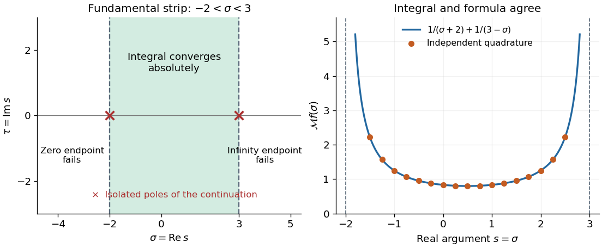

# Fundamental strip of a Mellin transform

↑ **Parent:** [Mellin transform](mellin-transform.md)

The fundamental strip of a [Mellin transform](mellin-transform.md) is the interior of the [set](set-split.md) of [real parts](real-part.md) $\sigma$ for which

$$
\int_0^\infty x^{\sigma-1}|f(x)|\,dx<\infty.
$$

Viewed in the [complex plane](complex-plane.md), it is a vertical strip $\alpha<\operatorname{Re}s<\beta$; either bound may be infinite, and the interior may be empty. Both endpoints of the [improper integral](improper-integral.md) must be checked. Convergence on a boundary line, whether [absolute convergence](absolute-convergence.md) or [conditional convergence](conditional-convergence.md), requires a separate test. The [Mellin transform](mellin-transform.md) is [holomorphic](holomorphic-function.md) throughout a nonempty fundamental strip.[Chapter 2, §2.5(i), equation 2.5.1 and the following description of the vertical domain of analyticity](nist-digital-library-of-mathematical-functions.md)

A practical sufficient test uses [Big O notation](big-o-notation.md): if $f(x)=O(x^p)$ near zero and $f(x)=O(x^{-q})$ near infinity, with real $p,q$, then comparison with elementary [improper integrals](improper-integral.md) gives

$$
\int_0^1x^{\sigma+p-1}\,dx<\infty\ \Longleftrightarrow\ \sigma>-p,\qquad
\int_1^\infty x^{\sigma-q-1}\,dx<\infty\ \Longleftrightarrow\ \sigma<q.
$$

Thus $-p<\sigma<q$ guarantees [absolute convergence](absolute-convergence.md). These upper bounds on $|f|$ need not locate the maximal [Mellin fundamental strip](fundamental-strip-of-a-mellin-transform.md); faster actual decay can widen it. The strip property itself follows by bounding the weight at any intermediate $\sigma$ by the sum of two weights already known to be integrable. On a closed narrower strip, neighboring integrable weights also dominate the [natural logarithm](natural-logarithm.md) factors introduced by [differentiation under the integral sign](differentiation-under-the-integral-sign.md), making the transform a [holomorphic function](holomorphic-function.md).

An exact two-endpoint example is

$$
f(x)=\begin{cases}x^2,&0<x\leq1,\\x^{-3},&x>1,\end{cases}\qquad
\mathcal Mf(s)=\frac1{s+2}+\frac1{3-s},\qquad -2<\operatorname{Re}s<3.
$$

Here both bounds are sharp: at $\sigma=-2$ the zero-end [absolute convergence](absolute-convergence.md) test contains $\int_0^1dx/x$, and at $\sigma=3$ the infinity-end test contains $\int_1^\infty dx/x$. The displayed [rational function](rational-function.md) continues meromorphically outside the [Mellin fundamental strip](fundamental-strip-of-a-mellin-transform.md) and has [simple poles](simple-pole.md) at $-2$ and $3$. Its other finite continued values outside the strip are values of a [meromorphic continuation](meromorphic-continuation.md), not of a convergent defining [integral](integral.md). More general endpoint information leads to [meromorphic continuation of a Mellin transform from an asymptotic expansion](meromorphic-continuation-of-a-mellin-transform-from-an-asymptotic-expansion.md).

**[Figure 2](#image-two-endpoint-conditions-define-the-mellin-fundamental-strip). Two endpoint conditions define the Mellin fundamental strip**. Left: the [Mellin fundamental strip](fundamental-strip-of-a-mellin-transform.md) for $x^2$ below one and $x^{-3}$ above one is $-2<\operatorname{Re}s<3$. Crosses mark the two [poles](pole.md) of the continued [rational function](rational-function.md), not whole lines of [isolated singularities](isolated-singularity-split.md). Right: the formula and independently computed [integrals](integral.md) agree on the real slice inside the strip. The curve is drawn only where the defining [integral](integral.md) converges.

## ↑ Ancestors (6)

1. [Mellin transform](mellin-transform.md)
2. [Integral transform](integral-transform.md)
3. [Analysis](analysis-split.md)
4. [Area of mathematics](area-of-mathematics.md)
5. [Mathematics](mathematics-split.md)
6. [Codex Wiki](split.md)
