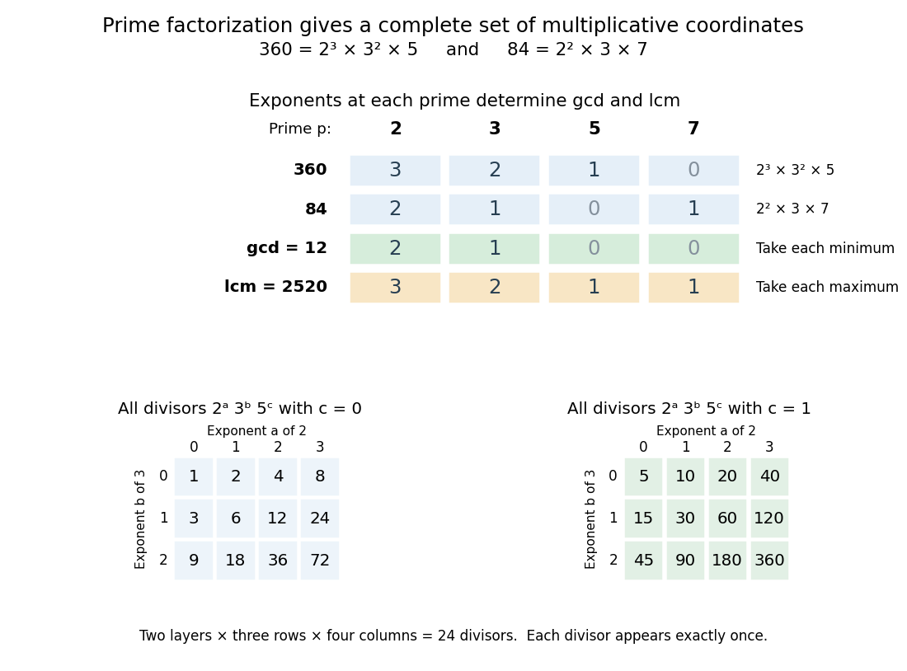
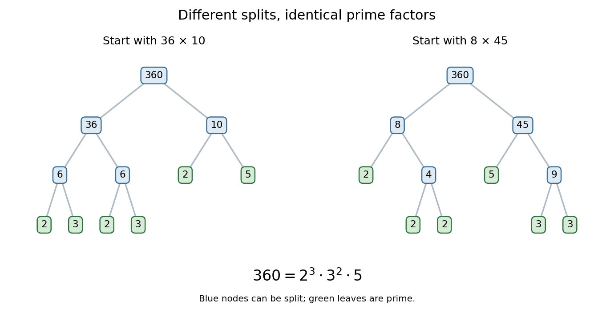

# Fundamental theorem of arithmetic

↑ **Parent:** [Prime number](prime-number-split.md)  
ⓦ [Wiki](https://en.wikipedia.org/wiki/Fundamental_theorem_of_arithmetic)

Every [integer](integer-split.md) $n>1$ is a [product](product-of-numbers.md) of [prime numbers](prime-number-split.md), uniquely up to reordering the factors. More precisely, there are unique distinct [prime numbers](prime-number-split.md) $p_1<\cdots<p_r$ and unique positive [integer](integer-split.md) exponents $a_1,\ldots,a_r$ such that

$$
n=p_1^{a_1}\cdots p_r^{a_r}.
$$

In the header's displayed form, $v_p(n)$ is the [prime valuation](prime-valuation.md), the exponent of $p$ in this [prime factorization](fundamental-theorem-of-arithmetic.md); it is zero when $p$ does not divide $n$. Reordering or regrouping the [prime factors](prime-factor.md) does not give a different [prime factorization](fundamental-theorem-of-arithmetic.md).

For $360$, repeated [division](division-mathematics.md) gives $360/2=180$, $180/2=90$, $90/2=45$, then $45/3=15$, $15/3=5$, and $5/5=1$. Thus

$$
360=2\cdot2\cdot2\cdot3\cdot3\cdot5=2^3\cdot3^2\cdot5,
\qquad 2^3\cdot3^2\cdot5=8\cdot9\cdot5=360.
$$

Its nonzero [prime valuations](prime-valuation.md) are $v_2(360)=3$, $v_3(360)=2$ and $v_5(360)=1$. Recording only the distinct [prime factors](prime-factor.md) $2,3,5$ would lose the difference between $30$ and $360$.

This turns [divisibility](divisibility-split.md) into coordinatewise comparison of nonnegative exponents. A positive [divisor](divisor.md) of $360$ chooses an exponent from $0,1,2,3$ for $2$, from $0,1,2$ for $3$, and from $0,1$ for $5$, giving $4\cdot3\cdot2=24$ positive [divisors](divisor.md). The [greatest common divisor](greatest-common-divisor.md) takes the smaller exponent at each [prime number](prime-number-split.md); the [least common multiple](least-common-multiple.md) takes the larger. The theorem is a structural description, not an assertion that finding the factors of every large [integer](integer-split.md) is computationally easy.

In general, for [positive integers](positive-integer.md) $d,n$, the exact [divisibility](divisibility-split.md) criterion is

$$
d\mid n\quad\Longleftrightarrow\quad v_p(d)\leq v_p(n)\ \text{for every prime }p.
$$

For example, $72=2^3\cdot3^2$ divides $360$, with quotient $5$, whereas $48=2^4\cdot3$ does not: it requires four factors of two, but $360$ supplies only three. Both use only [prime factors](prime-factor.md) of $360$, so membership in that list alone does not establish [divisibility](divisibility-split.md). Every positive [divisor](divisor.md) of $360$ is uniquely $2^a3^b5^c$ with $0\leq a\leq3$, $0\leq b\leq2$, $0\leq c\leq1$. Sorted, all 24 positive [divisors](divisor.md) are

$$
\begin{gathered}
1,2,3,4,5,6,8,9,10,12,15,18,\\
20,24,30,36,40,45,60,72,90,120,180,360.
\end{gathered}
$$

Thus the [divisor function](divisor-function.md) gives $\tau(360)=(3+1)(2+1)(1+1)=24$. These include [divisors](divisor.md) that are [composite numbers](composite-number.md), as well as the [prime factors](prime-factor.md) and one.

For another [positive integer](positive-integer.md) $m$, the [prime valuations](prime-valuation.md) give exact formulas for the [greatest common divisor](greatest-common-divisor.md) and [least common multiple](least-common-multiple.md):

$$
\begin{aligned}
v_p(\gcd(n,m))&=\min\{v_p(n),v_p(m)\},\\
v_p(\operatorname{lcm}(n,m))&=\max\{v_p(n),v_p(m)\}.
\end{aligned}
$$

With $n=360$ and $m=84=2^2\cdot3\cdot7$, their [prime valuations](prime-valuation.md) at $2,3,5,7$ are $(3,2,1,0)$ and $(2,1,0,1)$. The smaller exponents give $(2,1,0,0)$, and the larger give $(3,2,1,1)$, hence

$$
\gcd(360,84)=2^2\cdot3=12,\qquad
\operatorname{lcm}(360,84)=2^3\cdot3^2\cdot5\cdot7=2520.
$$

Indeed, $360/12=30$, $84/12=7$, $2520/360=7$ and $2520/84=30$. The same rules also explain $\gcd(n,m)\operatorname{lcm}(n,m)=nm$: the smaller and larger exponents sum to the two original exponents. Here $12\cdot2520=360\cdot84=30240$.

**[Figure 3](#image-prime-valuations-compute-the-greatest-common-divisor-least-common-multiple-and-all-24-positive-divisors-of-360). Prime valuations compute the greatest common divisor, least common multiple and all 24 positive divisors of 360**. The upper table compares exponents at the [prime numbers](prime-number-split.md) $2,3,5,7$ for $360$ and $84$, then takes their columnwise minimum and maximum. The lower tables enumerate $2^a3^b5^c$ for $c=0$ and $c=1$; each cell gives one positive [divisor](divisor.md).

The useful change of viewpoint is that [multiplication](multiplication.md) becomes [addition](addition.md) of [prime valuations](prime-valuation.md), $v_p(nm)=v_p(n)+v_p(m)$, and [divisibility](divisibility-split.md) becomes comparison. Many different-looking calculations therefore share one representation. The [prime valuations](prime-valuation.md) are coordinates for [multiplication](multiplication.md), rather than digits in [positional notation](positional-notation.md): they do not turn ordinary [addition](addition.md) of [integers](integer-split.md) into coordinatewise [addition](addition.md).

Different intermediate splits lead to the same prime ingredients. Starting with $360=36\cdot10$ gives $36=6\cdot6$ and $10=2\cdot5$; starting with $360=8\cdot45$ gives $8=2\cdot4$ and $45=5\cdot9$. Continuing to split the [composite numbers](composite-number.md) produces the same [multiset](multiset.md) of [prime factors](prime-factor.md): three twos, two threes, and one five. The [factorization tree](factorization-tree.md) records choices in the calculation, while the [prime factorization](fundamental-theorem-of-arithmetic.md) records the invariant result.

**[Figure 4](#image-two-factorization-trees-for-360-give-the-same-prime-factorization-2-3-cdot3-2-cdot5). Two factorization trees for $360$ give the same prime factorization $2^3\cdot3^2\cdot5$**.

The proof outline explains the uniqueness. Existence follows by splitting a [composite number](composite-number.md) into smaller factors until only [prime numbers](prime-number-split.md) remain. For uniqueness, [Euclid's lemma](euclid-s-lemma.md) says that a [prime factor](prime-factor.md) of one [product](product-of-numbers.md) must divide one factor of any other prime [product](product-of-numbers.md) equal to it. That factor must be the same [prime number](prime-number-split.md); cancel it and repeat. The crucial [divisibility](divisibility-split.md) step appears in Book VII, Proposition 30 of [Euclid's Elements](euclid-s-elements.md). [Euclid, Elements VII.30: a prime divisor of a product](https://mathcs.clarku.edu/~djoyce/java/elements/bookVII/propVII30.html)

The ancient text supplies specific precursors to the modern statement: Book VII, Proposition 31 establishes that every [composite number](composite-number.md) has a [prime factor](prime-factor.md), and Book IX, Proposition 14 excludes any new [prime factor](prime-factor.md) from the [least common multiple](least-common-multiple.md) of given [prime numbers](prime-number-split.md). These are the propositions being cited, rather than the complete modern exponent formulation of the [fundamental theorem of arithmetic](fundamental-theorem-of-arithmetic.md). [Euclid, Elements VII.31: every composite number has a prime divisor](https://mathcs.clarku.edu/~djoyce/java/elements/bookVII/propVII31.html) [Euclid, Elements IX.14: prime divisors of a least common multiple of primes](https://mathcs.clarku.edu/~djoyce/java/elements/bookIX/propIX14.html)

Excluding one from the [prime numbers](prime-number-split.md) keeps uniqueness meaningful: otherwise $360=2^3\cdot3^2\cdot5=1\cdot2^3\cdot3^2\cdot5=1\cdot1\cdot2^3\cdot3^2\cdot5$ would give different collections of supposed [prime factors](prime-factor.md). For $n=1$, the natural convention is the [empty product](empty-product.md), equal to one, with no [prime factors](prime-factor.md) and all [prime valuations](prime-valuation.md) zero.

**Table of contents**

- [Prime signature](prime-signature.md)
- [Factorization tree](factorization-tree.md)

## ↑ Ancestors (5)

1. [Prime number](prime-number-split.md)
2. [Number theory](number-theory-split.md)
3. [Area of mathematics](area-of-mathematics.md)
4. [Mathematics](mathematics-split.md)
5. [Codex Wiki](split.md)

## ← Incoming links (15)

- [Euclid's lemma](euclid-s-lemma.md)
- [Euclid's theorem](euclid-s-theorem.md)
- [Factorization tree](factorization-tree.md)
- [Fundamental theorem of arithmetic](fundamental-theorem-of-arithmetic.md)
- [Solution](past-exam-of-the-mathematics-course-of-the-university-of-cambridge/2007/ia/paper-4/8e/i/solution.md)
- [Solution](past-exam-of-the-mathematics-course-of-the-university-of-cambridge/2007/ia/paper-5/12/i/solution.md)
- [Solution](past-exam-of-the-mathematics-course-of-the-university-of-cambridge/2008/ii/paper-3/1h/solution.md)
- [Solution](past-exam-of-the-mathematics-course-of-the-university-of-cambridge/2014/iii/paper-25/2/a/solution.md)
- [Solution](past-exam-of-the-mathematics-course-of-the-university-of-cambridge/2016/iii/paper-124/1/a/solution.md)
- [Prime number](prime-number-split.md)
- [Prime valuation](prime-valuation.md)
- [Strong induction for factorization existence](strong-induction-for-factorization-existence.md)
- [Sum-of-divisors function](sum-of-divisors-function.md)
- [Total number of prime factors](total-number-of-prime-factors.md)
- [Von Mangoldt divisor identity](von-mangoldt-divisor-identity.md)
