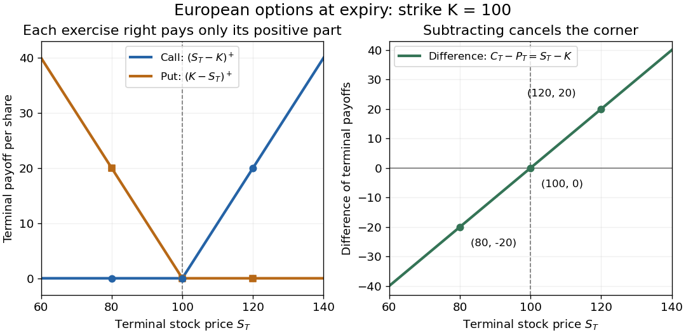
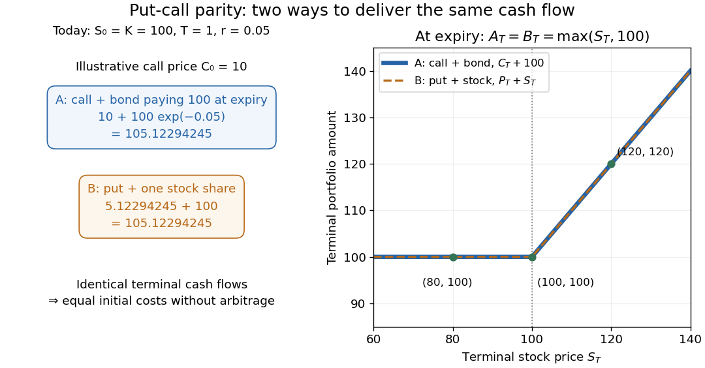

# Fundamental theorem of asset pricing

↑ **Parent:** [Mathematical finance](mathematical-finance.md)  
ⓦ [Wiki](https://en.wikipedia.org/wiki/Fundamental_theorem_of_asset_pricing)

In a finite market, absence of arbitrage is equivalent to the existence of an equivalent martingale measure. If that measure is unique, every contingent claim has a unique no-arbitrage price given by its discounted expectation.

**Table of contents**

- [Positive-density separation proof of the one-period asset-pricing theorem](#positive-density-separation-proof-of-the-one-period-asset-pricing-theorem)
- [Gaussian-damped martingale density construction](#gaussian-damped-martingale-density-construction)
- [Positive state-price density alternative](#positive-state-price-density-alternative)
- [Complete market](#complete-market)
  - [Completeness and uniqueness of dominated martingale measures](#completeness-and-uniqueness-of-dominated-martingale-measures)
  - [Complete markets have unique state-price densities](#complete-markets-have-unique-state-price-densities)
  - [Complete two-state market](#complete-two-state-market)
  - [Uniqueness of a one-period pricing density](#uniqueness-of-a-one-period-pricing-density)
  - [Finite branching bound in a complete market](#finite-branching-bound-in-a-complete-market)
- [Finite-state superhedging alternative](#finite-state-superhedging-alternative)
- [European call option](#european-call-option)
  - [Down-and-out European call](#down-and-out-european-call)
    - [Zero-rate barrier-strike call hedge](#zero-rate-barrier-strike-call-hedge)
  - [Convexity of a European call price in strike](#convexity-of-a-european-call-price-in-strike)
  - [Maturity monotonicity of calls with nonnegative strikes](#maturity-monotonicity-of-calls-with-nonnegative-strikes)
  - [Power payoff static call representation](#power-payoff-static-call-representation)
    - [Sharp power-call inequality](#sharp-power-call-inequality)
    - [Call-price decay and moment threshold](#call-price-decay-and-moment-threshold)
  - [Call-price density recovery](#call-price-density-recovery)
    - [Finite-strike nonidentification of a pricing density](#finite-strike-nonidentification-of-a-pricing-density)
    - [Power call-curve pricing density](#power-call-curve-pricing-density)
  - [Butterfly-spread arbitrage for nonconvex call prices](#butterfly-spread-arbitrage-for-nonconvex-call-prices)
  - [Vertical-spread arbitrage for increasing call prices](#vertical-spread-arbitrage-for-increasing-call-prices)
  - [One-period call price bounds](#one-period-call-price-bounds)
  - [Contour inversion for call prices](#contour-inversion-for-call-prices)
  - [Discrete Dupire equation](#discrete-dupire-equation)
  - [Discrete call-price curvature](#discrete-call-price-curvature)
  - [Monotonicity of a European call price in strike](#monotonicity-of-a-european-call-price-in-strike)
  - [Static replication on a finite terminal support](#static-replication-on-a-finite-terminal-support)
    - [Discrete realized-variance replication identity](#discrete-realized-variance-replication-identity)
  - [Put-call parity](#put-call-parity)
    - [Power put-call parity](#power-put-call-parity)
    - [Put-call symmetry in the Black-Scholes model](#put-call-symmetry-in-the-black-scholes-model)
  - [Binomial call-price recursion](#binomial-call-price-recursion)
  - [Forward-start call option](#forward-start-call-option)
- [Contingent claim](#contingent-claim)
  - [Contingent claim payoff](#contingent-claim-payoff)
  - [Path-dependent contingent claim](#path-dependent-contingent-claim)
    - [Lookback option](#lookback-option)
      - [Running-maximum boundary for a lookback option](#running-maximum-boundary-for-a-lookback-option)
  - [Put option](#put-option)
    - [European put option](#european-put-option)
    - [American put option](#american-put-option)
      - [Perpetual put option](#perpetual-put-option)
        - [Dividend-yield sensitivity of the perpetual put trigger](#dividend-yield-sensitivity-of-the-perpetual-put-trigger)
  - [Barrier option](#barrier-option)
    - [Up-and-in claim](#up-and-in-claim)
      - [Reflected European payoff for an up-and-in option](#reflected-european-payoff-for-an-up-and-in-option)
    - [Up-and-out power claim](#up-and-out-power-claim)
    - [Down-and-out claim](#down-and-out-claim)
    - [Down-and-in claim](#down-and-in-claim)
      - [Delta jump at activation of a down-and-in call](#delta-jump-at-activation-of-a-down-and-in-call)
      - [Static terminal-payoff representation of a down-and-in claim](#static-terminal-payoff-representation-of-a-down-and-in-claim)
  - [One-touch option](#one-touch-option)
  - [Forward contract](#forward-contract)
  - [Futures contract](#futures-contract)
    - [Futures pricing](#futures-pricing)
      - [Backwardation](#backwardation)
      - [Contango](#contango)
  - [Square-root stock claim](#square-root-stock-claim)
    - [Square-root stock implied volatility](#square-root-stock-implied-volatility)
      - [Half-volatility measure for a square-root stock claim](#half-volatility-measure-for-a-square-root-stock-claim)
    - [Forward drift restriction for square-root stock claims](#forward-drift-restriction-for-square-root-stock-claims)
    - [Conditional square-root price under independent volatility](#conditional-square-root-price-under-independent-volatility)
  - [Claim replication](#claim-replication)
    - [One-period quadratic hedge](#one-period-quadratic-hedge)
      - [Fixed-capital quadratic hedge in a one-period market](#fixed-capital-quadratic-hedge-in-a-one-period-market)
      - [Minimal martingale measure in a one-period market](#minimal-martingale-measure-in-a-one-period-market)
        - [Negative minimal density in an arbitrage-free one-period market](#negative-minimal-density-in-an-arbitrage-free-one-period-market)
      - [Signed martingale measure](#signed-martingale-measure)
      - [Gaussian quadratic hedge](#gaussian-quadratic-hedge)
      - [Minimum-norm one-period pricing weight](#minimum-norm-one-period-pricing-weight)
    - [One-period Gram-matrix replication formula](#one-period-gram-matrix-replication-formula)
    - [Telescoping replication of a stock-price sum](#telescoping-replication-of-a-stock-price-sum)
    - [Superhedging](#superhedging)
      - [Superhedging price](#superhedging-price)
  - [Replicating strategy](#replicating-strategy)
  - [European contingent claim](#european-contingent-claim)
    - [Attainable European contingent claim](#attainable-european-contingent-claim)
    - [Asian option](#asian-option)
      - [Geometric Asian option](#geometric-asian-option)
        - [Conditional geometric-average Asian option formula](#conditional-geometric-average-asian-option-formula)
        - [Discrete geometric average under the stock-numeraire measure](#discrete-geometric-average-under-the-stock-numeraire-measure)
          - [Stock-delivery option with a geometric average](#stock-delivery-option-with-a-geometric-average)
    - [Chooser option](#chooser-option)
    - [Power option](#power-option)
    - [Binary option](#binary-option)
      - [Barrier digital call](#barrier-digital-call)
      - [Barrier digital put](#barrier-digital-put)
      - [Digital call option](#digital-call-option)
        - [Cash-at-hit digital call](#cash-at-hit-digital-call)
      - [Digital put option](#digital-put-option)

## Positive-density separation proof of the one-period asset-pricing theorem

↑ **Parent:** [Fundamental theorem of asset pricing](fundamental-theorem-of-asset-pricing.md)

Let $Y$ be the discounted gains of finitely many [financial assets](mathematical-finance.md#financial-asset) on any [probability space](probability-space.md). Tilting the physical [probability measure](probability-space.md#probability-measure) by a normalized multiple of $(1+\|Y\|)^{-1}$ makes $Y$ [integrable](measure-theory.md#integrability) without changing null events. The [positive-weight expectation cone](convex-set.md#positive-weight-expectation-cone) alternative then says either a bounded strictly positive weight makes the weighted gain [expectation](expected-value.md) zero, or a deterministic risky holding gives an [arbitrage](mathematical-finance.md#arbitrage). Normalizing the weight yields an [equivalent martingale measure](mathematical-finance.md#risk-neutral-measure). Conversely, under such a measure a nonnegative terminal gain with zero initial price has zero [expectation](expected-value.md), and must vanish [almost surely](convergence-of-random-variables.md#almost-sure-convergence). This proves the one-period [fundamental theorem of asset pricing](fundamental-theorem-of-asset-pricing.md) without assuming physical integrability of asset gains.

## Gaussian-damped martingale density construction

↑ **Parent:** [Fundamental theorem of asset pricing](fundamental-theorem-of-asset-pricing.md)

For a finite-dimensional discounted gain [random vector](random-variable.md#random-vector) $X$, absence of [arbitrage](mathematical-finance.md#arbitrage) means $h\cdot X\geq0$ almost surely only when $h\cdot X=0$ almost surely. Let $N=\{h:h\cdot X=0\text{ almost surely}\}$ and minimize $F(h)=\mathbb E e^{-|X|^2-h\cdot X}$ on the [orthogonal complement](hilbert-space.md#orthogonal-complement) $N^\perp$. The Gaussian damping makes $F$ finite and differentiable without physical integrability assumptions on $X$. Every nonzero direction in $N^\perp$ has negative gains on an event of positive [probability](probability-theory.md#probability); compactness of directions proves [coercivity](real-analysis.md#coercive-function). At a minimizer, differentiation gives $\mathbb E[Xe^{-|X|^2-h_*\cdot X}]=0$. Normalizing the positive weight produces an [equivalent martingale measure](mathematical-finance.md#risk-neutral-measure) with integrable gains. This is a constructive one-period proof of the [fundamental theorem of asset pricing](fundamental-theorem-of-asset-pricing.md) even on an infinite [probability space](probability-space.md).

## Positive state-price density alternative

↑ **Parent:** [Fundamental theorem of asset pricing](fundamental-theorem-of-asset-pricing.md)

For deterministic initial asset values $A_0$ and a finite-dimensional terminal [random vector](random-variable.md#random-vector) $A_1$, exactly one possibility holds: a portfolio has nonpositive initial cost and nonnegative payoff with strict gain at at least one date, or there is a strictly positive integrable [state-price density](mathematical-finance.md#state-price-density) pricing $A_1$ as displayed. Apply the [strictly positive barycentre cone lemma](convex-set.md#strictly-positive-barycentre-cone-lemma). Outside the closed support cone, strict separation gives a negative-cost portfolio. On its relative boundary, a supporting functional gives a zero-cost portfolio with positive payoff on a set of positive probability. With a traded positive bank account, normalize its discounted density to obtain an [equivalent martingale measure](mathematical-finance.md#risk-neutral-measure).

## Complete market

↑ **Parent:** [Fundamental theorem of asset pricing](fundamental-theorem-of-asset-pricing.md)  
ⓦ [Wiki](https://en.wikipedia.org/wiki/Complete_market)

A complete market is a financial market in which every contingent claim in the chosen class can be replicated by an admissible [self-financing portfolio](mathematical-finance.md#self-financing-portfolio). In an arbitrage-free finite market, completeness is equivalent to uniqueness of the [equivalent martingale measure](mathematical-finance.md#risk-neutral-measure).

### Completeness and uniqueness of dominated martingale measures

↑ **Parent:** [Complete market](#complete-market)

In an arbitrage-free one-period market with finitely many assets and an [equivalent martingale measure](mathematical-finance.md#risk-neutral-measure), [market completeness](#complete-market) is equivalent to uniqueness of the [dominated martingale measure](mathematical-finance.md#dominated-martingale-measure). Completeness prices every [indicator function](measure-theory.md#indicator-function), forcing two measures to agree on every event. Conversely, if the attainable payoff span has dimension $k$ but is not the whole payoff space, choose $k+1$ disjoint positive-probability events. Their moment vectors against a basis of attainable payoffs are linearly dependent. A nonzero bounded linear combination $h$ of their indicators consequently has zero pricing moments. Multiplying an existing equivalent density by $1+\varepsilon h$, for sufficiently small positive and negative $\varepsilon$, constructs distinct [equivalent martingale measures](mathematical-finance.md#risk-neutral-measure). This proves the converse without assuming that the original space was finite. On a general probability space, completeness here means replication of all bounded claims, or equivalently all square-integrable claims when asset payoffs are square-integrable.

### Complete markets have unique state-price densities

↑ **Parent:** [Complete market](#complete-market)

In a one-period [complete market](#complete-market) with a strictly positive [numéraire](mathematical-finance.md#numeraire), at most one positive [state-price density](mathematical-finance.md#state-price-density) prices every traded asset. Suppose $\rho,\rho'$ do so. For each event $A$, replicate the [contingent claim](#contingent-claim) $S_1^{(0)}\mathbf1_A$. Linearity of the pricing equations gives

$$
\mathbb E[(\rho-\rho')S_1^{(0)}\mathbf1_A]=0.
$$

Both weighted densities are integrable because they price the [numéraire](mathematical-finance.md#numeraire). An integrable random variable whose integral over every event is zero vanishes almost surely: take the events where it is positive and negative. Therefore $(\rho-\rho')S_1^{(0)}=0$, and strict positivity of the [numéraire](mathematical-finance.md#numeraire) gives $\rho=\rho'$. This argument avoids assuming that the unweighted densities themselves are integrable.

### Complete two-state market

↑ **Parent:** [Complete market](#complete-market)

Two assets with linearly independent payoff vectors across two positive-probability states span all terminal payoffs. The state-price equations have a unique solution. A positive solution gives the [state-price density](mathematical-finance.md#state-price-density) after division by physical state probabilities. [Arrow state prices](mathematical-finance.md#arrow-debreu-state-price) sum to the riskless [discount factor](mathematical-finance.md#discount-factor), while normalized [Arrow state prices](mathematical-finance.md#arrow-debreu-state-price) are [risk-neutral probabilities](mathematical-finance.md#risk-neutral-probability); these three quantities must not be confused.

### Uniqueness of a one-period pricing density

↑ **Parent:** [Complete market](#complete-market)

In a one-period [complete market](#complete-market) with deterministic initial holdings, two integrable positive pricing variables assigning the same prices to every traded asset are equal almost surely. Replicate [indicator functions](measure-theory.md#indicator-function) to obtain equality of their integrals on every event, then apply this to the event where one density exceeds the other.

### Finite branching bound in a complete market

↑ **Parent:** [Complete market](#complete-market)

With $n$ assets and a trivial initial sigma-field, [market completeness](#complete-market) forces at most $n$ positive-probability successors per current atom. Indicators of disjoint successor events are independent payoffs, whereas terminal holdings on a parent atom span at most $n$ asset-price functions. Iterating yields at most $n^t$ atoms at time $t$.

## Finite-state superhedging alternative

↑ **Parent:** [Fundamental theorem of asset pricing](fundamental-theorem-of-asset-pricing.md)

Let $P$ be the state-by-asset matrix of discounted gains. There exists $\theta$ with $Y-P\theta\geq0$ exactly when

$$
q^TY\geq0
$$

for every $q\geq0$ satisfying $P^Tq=0$. This is the finite-dimensional cone-separation, or Farkas-duality, form of superhedging.

## European call option

↑ **Parent:** [Fundamental theorem of asset pricing](fundamental-theorem-of-asset-pricing.md)  
ⓦ [Wiki](https://en.wikipedia.org/wiki/European_call_option)

A [European call option](#european-call-option) gives its holder the right, without an obligation, to buy one unit of an underlying [financial asset](mathematical-finance.md#financial-asset) at the [strike price](mathematical-finance.md#strike-price) $K$ on the expiry date $T$. European describes exercise timing, not geography: exercise is allowed only at $T$. Here the underlying is one [stock](mathematical-finance.md#stock) share, $S_T$ is its price at expiry, and the [financial payoff](#contingent-claim-payoff) is expressed as a cash amount. Physical exercise delivers a share against payment of $K$; immediate resale gives the same net amount under the assumed [frictionless market](mathematical-finance.md#frictionless-market).

The holder exercises only when buying at the [strike price](mathematical-finance.md#strike-price) is advantageous. Writing $x^+=\max(x,0)$ for the [positive part](function.md#positive-part-of-a-real-valued-function), the terminal [financial payoff](#contingent-claim-payoff) is

$$
C_T=(S_T-K)^+=\begin{cases}0,&S_T\leq K,\\S_T-K,&S_T>K.\end{cases}
$$

The [European call option](#european-call-option) is a reusable building block for [claim replication](#claim-replication): its [financial payoff](#contingent-claim-payoff) is zero below the [strike price](mathematical-finance.md#strike-price) and rises by one unit for each unit of [stock](mathematical-finance.md#stock) price above it. The corner at $K$ lets combinations of [European call options](#european-call-option) construct other payoff shapes, as in [static replication on a finite terminal support](#static-replication-on-a-finite-terminal-support).

For [strike price](mathematical-finance.md#strike-price) $K=100$, the following are deterministic calculations conditional on each displayed terminal [stock](mathematical-finance.md#stock) price. They assign no [probabilities](probability-theory.md#probability) to the three scenarios. The [European put option](#european-put-option) has the opposite exercise right and the [financial payoff](#contingent-claim-payoff) $(K-S_T)^+$.

| Terminal [stock](mathematical-finance.md#stock) price $S_T$ | [European call option](#european-call-option) $C_T$ | [European put option](#european-put-option) $P_T$ | Difference $C_T-P_T$ |
| --- | --- | --- | --- |
| $80$ | $0$ | $20$ | $-20$ |
| $100$ | $0$ | $0$ | $0$ |
| $120$ | $20$ | $0$ | $20$ |

**[Figure 1](#image-european-call-and-put-terminal-payoffs-at-strike-100-with-their-linear-difference). European call and put terminal payoffs at strike 100, with their linear difference**.

A [financial payoff](#contingent-claim-payoff) excludes the initial contract price. If the illustrative [European call option](#european-call-option) costs $C_0=10$, its [financial payoff](#contingent-claim-payoff) at $S_T=120$ is $20$, and subtracting its initial cost gives $10$. If that cost is instead borrowed for one year at the constant continuously compounded [interest rate](mathematical-finance.md#interest-rate) $r=0.05$, the terminal net amount is $20-10e^{0.05}\approx9.48728904$. At $S_T=80$ or $100$, the corresponding net amount is $-10e^{0.05}\approx-10.51271096$. Keeping all cash amounts at the same date avoids confusing a [financial payoff](#contingent-claim-payoff) with a financed gain.

Robert Shiller's [Options Markets lecture, Yale ECON 252 (2011)](https://oyc.yale.edu/economics/econ-252-11/lecture-17) introduces these exercise rights and payoff shapes.

### Down-and-out European call

↑ **Parent:** [European call option](#european-call-option)

A [down-and-out European call](#down-and-out-european-call) pays the usual [European call option](#european-call-option) payoff only if a lower barrier has not been hit before maturity. In the zero-interest, zero-dividend [Black-Scholes model](mathematical-finance.md#black-scholes-model), for $0<B\le K<S$, its value is $C(S,K)-(S/B)C(B^2/S,K)$. This follows from reflection of the drifted logarithmic price killed at the barrier.

#### Zero-rate barrier-strike call hedge

↑ **Parent:** [Down-and-out European call](#down-and-out-european-call)

For a [down-and-out European call](#down-and-out-european-call) with barrier equal to strike, zero interest and no dividends, hold one share and borrow the strike until barrier hitting or maturity. At continuous hitting the share price is exactly the debt, so liquidating leaves zero; on survival the portfolio pays $S_T-K$. Hence the contract has value $S-K$ and delta one before knock-out. The pathwise replication works beyond constant-volatility [Black-Scholes model](mathematical-finance.md#black-scholes-model), but can fail through downward jumps or execution gaps, and nonzero carry, transaction costs or discrete monitoring require changes.

### Convexity of a European call price in strike

↑ **Parent:** [European call option](#european-call-option)

For any fixed maturity, a [European call option](#european-call-option) price is convex in its strike because $K\mapsto(s-K)^+$ is convex for every terminal stock value $s$. Specifically, for $0\leq a\leq1$, $(s-aK_1-(1-a)K_2)^+\leq a(s-K_1)^++(1-a)(s-K_2)^+$. Multiplication by the positive discount factor and expectation under the pricing measure preserve this inequality. This also explains why a violation of convexity creates a butterfly-spread arbitrage.

### Maturity monotonicity of calls with nonnegative strikes

↑ **Parent:** [European call option](#european-call-option)

If the [bank account](mathematical-finance.md#bank-account) $B$ is positive and nondecreasing and $S/B$ is a [martingale](martingale.md) under an [equivalent martingale measure](mathematical-finance.md#risk-neutral-measure) $Q$, then for $K\geq0$ the European call price $C(T,K)$ is nondecreasing in $T$. Put $M_t=S_t/B_t$. For $u\geq t$, $K/B_u\leq K/B_t$ and hence $(M_u-K/B_u)^+\geq(M_u-K/B_t)^+$. Conditional convexity gives $\mathbb E_Q[(M_u-K/B_t)^+\mid\mathcal F_t]\geq(M_t-K/B_t)^+$. Taking expectations and multiplying by $B_0$ proves the claim. The result is not generally true for negative strikes: with $S_t=B_t=e^{rt}$ and $r>0$, a negative-strike call costs $1-Ke^{-rT}$, decreasing in maturity.

### Power payoff static call representation

↑ **Parent:** [European call option](#european-call-option)

For $s\ge0$ and $\varepsilon>0$, integrate over $0\le K\le s$ to obtain the displayed identity. [Tonelli theorem](measure-theory.md#tonelli-theorem) then expresses the moment of a nonnegative random variable as the same integral of expected call payoffs, even when the moment is infinite. This is a static representation across strikes rather than a dynamic [replicating strategy](#replicating-strategy) in a restricted finite-asset market.

#### Sharp power-call inequality

↑ **Parent:** [Power payoff static call representation](#power-payoff-static-call-representation)

For $K>0$ and $s>K$, minimize $(s/K)^{1+\varepsilon}/(s/K-1)$. Its minimum occurs at $s/K=(1+\varepsilon)/\varepsilon$, giving the sharp constant. Taking [expected values](expected-value.md) yields a uniform bound on $K^\varepsilon C(K)$ from a finite moment of order $1+\varepsilon$.

#### Call-price decay and moment threshold

↑ **Parent:** [Power payoff static call representation](#power-payoff-static-call-representation)

For $C(K)=\mathbb E(S-K)_+$ and $\mathbb ES<\infty$, split the static call integral at a fixed positive strike. The first moment bounds the integrand near zero; polynomial call decay controls the integral at infinity for $0<\varepsilon<\delta$. The endpoint can fail, as shown by a [Pareto distribution](continuous-probability-distribution.md#pareto-distribution) with survival exponent $1+\delta$.

### Call-price density recovery

↑ **Parent:** [European call option](#european-call-option)

In a zero-interest one-period market with a continuous terminal [stock](mathematical-finance.md#stock) law under a pricing measure, $C(K)=\mathbb E_Q(S-K)^+$ implies $-C'(K)=Q(S>K)$ and $C''(K)=f_Q(K)$. Thus a full differentiable call curve determines its pricing density. A finite collection of strikes generally does not. With a deterministic nonunit [discount factor](mathematical-finance.md#discount-factor), divide the call curve by that factor before recovering the probability density.

#### Finite-strike nonidentification of a pricing density

↑ **Parent:** [Call-price density recovery](#call-price-density-recovery)

Finitely many call prices impose finitely many payoff-moment constraints. They do not require a continuous terminal law or determine prices of arbitrary new claims. For example, $S_0=1$, terminal values $1/2$ and $2+\sqrt2$, and upper-state probability $3-2\sqrt2$ give $C(1)=\sqrt2-1$, matching the $p=2$ power curve. A payoff vanishing on these two states must cost zero, whereas integration against the power curve's strictly positive density can assign it a positive cost. A pricing density intended for arbitrary claims must be compatible with an equivalent law on the actual state space.

#### Power call-curve pricing density

↑ **Parent:** [Call-price density recovery](#call-price-density-recovery)

For $p>1$, the zero-interest curve $C(K)=(1+K^p)^{1/p}-K$ has positive second derivative $f_p$. Its mass and first moment are both one, and $\int(u-K)^+f_p(u)du=C(K)$. It prices an [integrable](measure-theory.md#integrability) payoff by $\int g(u)f_p(u)du$ when this law is equivalent to the physical terminal [stock](mathematical-finance.md#stock) law, or on a canonical model with this pricing law. Finite-strike consistency alone is insufficient for that equivalence.

### Butterfly-spread arbitrage for nonconvex call prices

↑ **Parent:** [European call option](#european-call-option)

The midpoint butterfly buys half a call at each outer strike and sells one at the middle strike. [Convexity](real-analysis.md#convex-function) of $K\mapsto(S-K)^+$ makes its terminal payoff nonnegative. A violation of the displayed price inequality makes its cost negative and creates [arbitrage](mathematical-finance.md#arbitrage). The payoff is triangular between the outer strikes and zero elsewhere.

### Vertical-spread arbitrage for increasing call prices

↑ **Parent:** [European call option](#european-call-option)

Buying the lower-strike call and selling the higher-strike call gives a strictly negative initial cost and terminal payoff $(S-K_1)^+-(S-K_2)^+\geq0$. Hence an arbitrage-free call-price curve is decreasing in strike. The positive initial receipt may be consumed immediately or invested in cash.

### One-period call price bounds

↑ **Parent:** [European call option](#european-call-option)

A positive [one-period martingale deflator](mathematical-finance.md#one-period-martingale-deflator) applied to $C=(S-B)^+$ gives $(s-b)^+\leq c\leq s$. If both strict payoff regions $S>B$ and $S<B$ have positive probability, then $c>0$ and $c-(s-b)>0$, proving the strict lower bound. No normalization of the positive pricing variable is needed.

### Contour inversion for call prices

↑ **Parent:** [European call option](#european-call-option)

The [Mellin transform of call prices](integral-transform.md#mellin-transform-of-call-prices) can be inverted along a vertical contour with real part $x_0>1$: $C(k)=\frac1{2\pi i}\int_{x_0-i\infty}^{x_0+i\infty}\mathbb Ee^{z\xi}/(z(z-1)e^{(z-1)k})\,dz$. A finite [exponential moment](probability-distribution.md#exponential-moment) at $x_0$ and the quadratic denominator give absolute convergence.

### Discrete Dupire equation

↑ **Parent:** [European call option](#european-call-option)

For a [martingale](martingale.md) with increments in $\{-1,0,1\}$, [European call option](#european-call-option) prices satisfy $C(T+1,K)-C(T,K)=\frac12\sigma^2(T,K)(C(T,K+1)-2C(T,K)+C(T,K-1))$. At positive-probability states, the [variance](variance.md) and the upward/downward conditional transitions are determined by this identity; transitions at zero-probability states cannot be recovered.

### Discrete call-price curvature

↑ **Parent:** [European call option](#european-call-option)

For an integer-valued underlying with [European call option](#european-call-option) prices $C(T,K)=\mathbb E(S_T-K)^+$, the second strike difference equals $\mathbb P(S_T=K)$. It is the discrete counterpart of recovering a payoff [probability distribution](probability-distribution.md) from strike derivatives.

### Monotonicity of a European call price in strike

↑ **Parent:** [European call option](#european-call-option)

At a fixed maturity, no arbitrage makes a European call price nonincreasing in its strike because the lower-strike payoff dominates the higher-strike payoff state by state.

### Static replication on a finite terminal support

↑ **Parent:** [European call option](#european-call-option)

When terminal stock price takes finitely many ordered values, every payoff function of that price can be represented on the support by cash plus a linear combination of adjacent-strike call spreads.

#### Discrete realized-variance replication identity

↑ **Parent:** [Static replication on a finite terminal support](#static-replication-on-a-finite-terminal-support)

The pathwise identity $\sum_{t=1}^T(\Delta S_t)^2=S_T^2-S_0^2-2\sum_{t=1}^TS_{t-1}\Delta S_t$ turns a squared-increment claim into a terminal-square claim and predictable stock gains. On integer terminal support $\{0,\ldots,N\}$, $S_T^2=S_T+2\sum_{K=1}^N(S_T-K)^+$, so a static call strip plus a dynamic stock hedge replicates the claim.

### Put-call parity

↑ **Parent:** [European call option](#european-call-option)  
ⓦ [Wiki](https://en.wikipedia.org/wiki/Put-call_parity)

[Put-call parity](#put-call-parity) fixes the price difference between a [European call option](#european-call-option) and a [European put option](#european-put-option) on the same underlying [stock](mathematical-finance.md#stock), with the same [strike price](mathematical-finance.md#strike-price) $K$ and expiry $T$. Assume no dividends or other payments from the [stock](mathematical-finance.md#stock) before or at expiry, a known constant continuously compounded [interest rate](mathematical-finance.md#interest-rate) $r$, and a [frictionless market](mathematical-finance.md#frictionless-market). Borrowing and lending are available at that same [interest rate](mathematical-finance.md#interest-rate); [short selling](mathematical-finance.md#short-finance) of the [stock](mathematical-finance.md#stock), [European call option](#european-call-option), [European put option](#european-put-option), and [zero-coupon bond](mathematical-finance.md#zero-coupon-bond) is permitted. Settlement is certain, and the buy-and-hold [portfolios](mathematical-finance.md#investment-portfolio) below may be held until $T$ without interim funding restrictions or forced liquidation. These assumptions exclude transaction costs, taxes, borrowing fees, and execution or settlement risks from the [arbitrage](mathematical-finance.md#arbitrage) argument.

At expiry, the two [positive parts](function.md#positive-part-of-a-real-valued-function) cancel their corners:

$$
C_T-P_T=(S_T-K)^+-(K-S_T)^+=S_T-K.
$$

Thus a [European call option](#european-call-option) and a short [European put option](#european-put-option) together have the same terminal [financial payoff](#contingent-claim-payoff) as one [stock](mathematical-finance.md#stock) share with a debt of $K$. A particularly readable [claim replication](#claim-replication) uses two [portfolios](mathematical-finance.md#investment-portfolio) with nonnegative terminal amounts: portfolio A holds one [European call option](#european-call-option) and a risk-free [zero-coupon bond](mathematical-finance.md#zero-coupon-bond) paying $K$ at $T$; portfolio B holds one [European put option](#european-put-option) and one [stock](mathematical-finance.md#stock) share. The [zero-coupon bond](mathematical-finance.md#zero-coupon-bond) costs $Ke^{-rT}$ today, since the [discount factor](mathematical-finance.md#discount-factor) is $e^{-rT}$. There are no intermediate cash flows. For every terminal [stock](mathematical-finance.md#stock) price,

$$
A_T=C_T+K=\max(S_T,K)=P_T+S_T=B_T.
$$

For the [strike price](mathematical-finance.md#strike-price) $K=100$, even the following very different outcomes leave the two [portfolios](mathematical-finance.md#investment-portfolio) equal:

| Terminal [stock](mathematical-finance.md#stock) price $S_T$ | A: [European call option](#european-call-option) + [zero-coupon bond](mathematical-finance.md#zero-coupon-bond) | B: [European put option](#european-put-option) + [stock](mathematical-finance.md#stock) |
| --- | --- | --- |
| $80$ | $0+100=100$ | $20+80=100$ |
| $100$ | $0+100=100$ | $0+100=100$ |
| $120$ | $20+100=120$ | $0+120=120$ |

The [law of one price](mathematical-finance.md#law-of-one-price) forces $A_0=B_0$ in this setting: otherwise buy the cheaper [portfolio](mathematical-finance.md#investment-portfolio) and sell the more expensive [portfolio](mathematical-finance.md#investment-portfolio) using [short selling](mathematical-finance.md#short-finance). Their terminal obligations cancel in every scenario, while the initial price difference can grow in the [bank account](mathematical-finance.md#bank-account). Hence absence of [arbitrage](mathematical-finance.md#arbitrage) gives

$$
C_0+Ke^{-rT}=P_0+S_0,\qquad C_0-P_0=S_0-Ke^{-rT}.
$$

With a constant per-period [interest rate](mathematical-finance.md#interest-rate) $i$ over $N$ discrete periods, the same reasoning gives $C_0-P_0=S_0-K(1+i)^{-N}$. This is a different compounding convention; $i$ is not the continuously compounded [interest rate](mathematical-finance.md#interest-rate) $r$.

For an illustrative [stock](mathematical-finance.md#stock) price $S_0=100$, [strike price](mathematical-finance.md#strike-price) $K=100$, expiry one year away, [interest rate](mathematical-finance.md#interest-rate) $r=0.05$ per year, and given [European call option](#european-call-option) price $C_0=10$, [put-call parity](#put-call-parity) requires

$$
Ke^{-rT}=100e^{-0.05}\approx95.12294245,\qquad P_0=10+100e^{-0.05}-100\approx5.12294245.
$$

Both [portfolios](mathematical-finance.md#investment-portfolio) therefore cost approximately $105.12294245$. The inputs specify no [stock](mathematical-finance.md#stock) price dynamics: $C_0=10$ is supplied for illustration, not calculated from the [Black-Scholes model](mathematical-finance.md#black-scholes-model). [Put-call parity](#put-call-parity) determines the [European put option](#european-put-option) price conditional on that [European call option](#european-call-option) price; it does not determine both prices by itself. At zero [interest rate](mathematical-finance.md#interest-rate), the same $S_0=K=100$ and $C_0=10$ give the exact result $P_0=10$.

**[Figure 2](#image-two-portfolios-with-identical-terminal-cash-flows-and-equal-initial-costs-under-put-call-parity). Two portfolios with identical terminal cash flows and equal initial costs under put-call parity**.

To compute both directions of [arbitrage](mathematical-finance.md#arbitrage), keep all the preceding inputs except the quoted [European put option](#european-put-option) price. If it is $6$, portfolio B costs $106$ while portfolio A costs $105.12294245$. Buy A, sell B, and place the initial surplus $6-(10+100e^{-0.05}-100)\approx0.87705755$ in the [bank account](mathematical-finance.md#bank-account). At expiry, A and the obligations from selling B cancel exactly, leaving $96e^{0.05}-100\approx0.92202525$ in every scenario. If the [European put option](#european-put-option) instead costs $4$, buy B for $104$ and sell A for $105.12294245$; the initial surplus is approximately $1.12294245$, growing to $100-94e^{0.05}\approx1.18051694$. Both constructions start with zero external capital. They are model calculations under the stated [frictionless market](mathematical-finance.md#frictionless-market) assumptions.

The beauty of [put-call parity](#put-call-parity) is that uncertain individual [financial payoffs](#contingent-claim-payoff) produce an exact relation between today's prices. No forecast of the terminal [stock](mathematical-finance.md#stock) price and no [probability distribution](probability-distribution.md) are needed. It provides a consistency check and lets [claim replication](#claim-replication) exchange one contract for a combination of others. Dividends introduce extra cash flows, and [American put options](#american-put-option) can be exercised early, so the displayed European equality cannot simply be transferred to those contracts. K. Foster's [CCNY lecture notes on option values (2010), Put-Call Parity section](https://kfoster.ccny.cuny.edu/classes/spring2010/eco275/lecturenotes5.html) explain the matching [portfolios](mathematical-finance.md#investment-portfolio); Jun Pan's [MIT Financial Markets teaching notes, Arbitrage Pricing and Dynamic Replication section (PDF p. 130)](https://www.mit.edu/~junpan/Jun_Pan_Teaching_Notes.pdf) discuss [put-call parity](#put-call-parity) and its dividend adjustment.

An original modern research source is Hans R. Stoll's [The Relationship Between Put and Call Option Prices](https://doi.org/10.1111/j.1540-6261.1969.tb01694.x), _The Journal of Finance_ 24(5), 801-824 (December 1969). Stoll studied the relation between contract prices and tested it against market data; this was a relation between prices rather than a formula fixing each price individually. Robert C. Merton's [1973 comment](https://doi.org/10.1111/j.1540-6261.1973.tb01357.x), 28(1), 183-184, highlighted the importance of excluding premature exercise for an exact [arbitrage](mathematical-finance.md#arbitrage) equality. This distinction explains why the exercise assumption belongs in the statement of [put-call parity](#put-call-parity).

#### Power put-call parity

↑ **Parent:** [Put-call parity](#put-call-parity)

The difference of the terminal power-call and power-put payoffs is $S_T^\beta-K^\beta$. [Risk-neutral pricing](mathematical-finance.md#risk-neutral-pricing) and the [geometric Brownian motion](stochastic-calculus.md#geometric-brownian-motion) moment formula therefore give the displayed parity, with $\lambda_\beta=\beta(r-q)+\sigma^2\beta(\beta-1)/2$. At $\beta=1$ this reduces to dividend-adjusted [put-call parity](#put-call-parity).

#### Put-call symmetry in the Black-Scholes model

↑ **Parent:** [Put-call parity](#put-call-parity)

For the [normalized Black-Scholes call function](mathematical-finance.md#normalized-black-scholes-call-function), completing the square gives $F(v,m)=\Phi(d_1)-m\Phi(d_2)$, with $d_1=(-\log m+v/2)/\sqrt v$ and $d_2=d_1-\sqrt v$. The identities $d_1(v,1/m)=-d_2(v,m)$ and $\Phi(-x)=1-\Phi(x)$ imply

$$
F(v,m)=1-m+mF(v,1/m).
$$

For a [stock](mathematical-finance.md#stock) with risk-neutral drift $r$, maturity difference $\tau$, and positive strike $K$, [put-call parity](#put-call-parity) then gives

$$
P_t(T,K)=Ke^{-r\tau}F\left(\sigma^2\tau,\frac{S_te^{r\tau}}K\right).
$$

The positive sign of $r\tau$ in the reciprocal argument is forced by taking the reciprocal of $Ke^{-r\tau}/S_t$. The identity includes $v=0$ by continuity and requires $m>0$.

### Binomial call-price recursion

↑ **Parent:** [European call option](#european-call-option)

Conditioning on the first binomial move expresses a call with $N+1$ periods as a positive weighted sum of two $N$-period calls with rescaled strikes.

### Forward-start call option

↑ **Parent:** [European call option](#european-call-option)  
ⓦ [Wiki](https://en.wikipedia.org/wiki/Forward-start_call_option)

A forward-start call fixes its strike at a future time as a multiple of the stock price then. In a homogeneous binomial model, its time-zero price reduces to that of an ordinary call over the remaining periods.

## Contingent claim

↑ **Parent:** [Fundamental theorem of asset pricing](fundamental-theorem-of-asset-pricing.md)  
ⓦ [Wiki](https://en.wikipedia.org/wiki/Contingent_claim)

A contingent claim is a future payoff whose value depends on uncertain market outcomes. A replicable claim has the unique no-arbitrage price of its replicating portfolio.

### Contingent claim payoff

↑ **Parent:** [Contingent claim](#contingent-claim)

The monetary amount delivered by a [contingent claim](#contingent-claim) at its payment time, represented by a [random variable](random-variable.md) measurable with respect to the information then available. For a [European call option](#european-call-option) it is $(S_T-K)^+$, and for a [European put option](#european-put-option) it is $(K-S_T)^+$. A payoff is the delivered amount, whereas the claim is the contract and its current price is the cost of acquiring or replicating that contract.

### Path-dependent contingent claim

↑ **Parent:** [Contingent claim](#contingent-claim)

A [contingent claim](#contingent-claim) whose payoff depends on the underlying price history, rather than only its terminal price. [Asian options](#asian-option) use averages, [barrier options](#barrier-option) use whether a threshold has been crossed, and [lookback options](#lookback-option) use running extrema. In the [Black-Scholes model](mathematical-finance.md#black-scholes-model), the Brownian [Martingale representation theorem](brownian-motion.md#martingale-representation-theorem) still gives a [replicating strategy](#replicating-strategy); its [portfolio wealth](mathematical-finance.md#portfolio-wealth) need not be a function of the current stock price alone. Adding a running integral or extremum can give a finite-dimensional state for pricing.

#### Lookback option

↑ **Parent:** [Path-dependent contingent claim](#path-dependent-contingent-claim)  
ⓦ [Wiki](https://en.wikipedia.org/wiki/Lookback_option)

A [path-dependent contingent claim](#path-dependent-contingent-claim) whose payoff depends on the running minimum or maximum of the underlying [stock](mathematical-finance.md#stock). Floating-strike calls and puts pay $S_T-\min_{u\le T}S_u$ and $\max_{u\le T}S_u-S_T$, respectively. Fixed-strike versions use positive parts of the difference between a running extremum and a specified strike. A sufficient pricing state contains the current price and the relevant running extremum.

##### Running-maximum boundary for a lookback option

↑ **Parent:** [Lookback option](#lookback-option)

For running maximum $M_t=\max_{u\le t}S_u$, a smooth price $v(t,S_t,M_t)$ has an [Itô formula](stochastic-calculus.md#ito-s-lemma) term $v_m\,dM_t$. The maximum increases only when $S_t=M_t$. A [self-financing portfolio](mathematical-finance.md#self-financing-portfolio) in stock and bank account cannot supply an extra singular finite-variation term there, so the smooth price must satisfy the displayed boundary condition. Inside $0<s<m$, it obeys the [Black-Scholes equation](mathematical-finance.md#black-scholes-equation) in the price variable. The condition need only hold before maturity, where terminal corners may destroy differentiability.

### Put option

↑ **Parent:** [Contingent claim](#contingent-claim)  
ⓦ [Wiki](https://en.wikipedia.org/wiki/Put_option)

A put option gives its holder the right to sell an underlying asset at a specified strike price. A [European put option](#european-put-option) may be exercised only at maturity, whereas an [American put option](#american-put-option) permits earlier exercise.

#### European put option

↑ **Parent:** [Put option](#put-option)

A [European put option](#european-put-option) gives its holder the right, without an obligation, to sell one unit of an underlying [financial asset](mathematical-finance.md#financial-asset) at the [strike price](mathematical-finance.md#strike-price) $K$ only on the expiry date $T$. For one [stock](mathematical-finance.md#stock) share, its terminal [financial payoff](#contingent-claim-payoff) is the [positive part](function.md#positive-part-of-a-real-valued-function)

$$
P_T=(K-S_T)^+=\begin{cases}K-S_T,&S_T<K,\\0,&S_T\geq K.\end{cases}
$$

For [strike price](mathematical-finance.md#strike-price) $K=100$, terminal [stock](mathematical-finance.md#stock) prices $80$, $100$, and $120$ give [financial payoffs](#contingent-claim-payoff) $20$, $0$, and $0$, respectively. At $S_T=80$, selling for $100$ rather than the market price $80$ supplies the difference $20$; at $S_T=120$, the holder can let the right expire. Equality at $S_T=100$ gives zero net exercise value. The [European call option](#european-call-option) example plots both [financial payoffs](#contingent-claim-payoff) on the same axes.

Combining a [European put option](#european-put-option) with the underlying [stock](mathematical-finance.md#stock) share produces the terminal amount $S_T+(K-S_T)^+=\max(S_T,K)$. Its floor at the [strike price](mathematical-finance.md#strike-price) is why a [European put option](#european-put-option) can describe protection against a fall in terminal [stock](mathematical-finance.md#stock) value. The protection has an initial cost and lasts to the specified expiry; the terminal floor alone says nothing about the [financial return](mathematical-finance.md#financial-return). [Put-call parity](#put-call-parity) replicates this same amount with a [European call option](#european-call-option) and a [zero-coupon bond](mathematical-finance.md#zero-coupon-bond).

Using the [put-call parity](#put-call-parity) example's price $P_0=10+100e^{-0.05}-100\approx5.12294245$, the cost financed for one year at [interest rate](mathematical-finance.md#interest-rate) $r=0.05$ grows to $P_0e^{0.05}=100-90e^{0.05}\approx5.38560133$. The terminal net amount is therefore approximately $14.61439867$ when $S_T=80$, and $-5.38560133$ when $S_T=100$ or $120$. These computations use the unrounded price and distinguish the [financial payoff](#contingent-claim-payoff) from the financed gain. Unlike an [American put option](#american-put-option), a [European put option](#european-put-option) supplies no right to exercise before $T$.

#### American put option

↑ **Parent:** [Put option](#put-option)

An American put has exercise payoff $(K-S_n)^+$. In a finite binomial market, [backward option pricing](mathematical-finance.md#backward-option-pricing) compares that payoff with the discounted risk-neutral continuation value at every node.

##### Perpetual put option

↑ **Parent:** [American put option](#american-put-option)

For risk-neutral [stock](mathematical-finance.md#stock) dynamics $dS=(r-\delta)Sdt+\sigma S dW$, with $r>0$ and $\sigma>0$, let $\beta_-<0$ solve $\sigma^2\beta(\beta-1)/2+(r-\delta)\beta-r=0$. A fixed downward trigger $L\in(0,X)$ gives continuation value $(X-L)(S/L)^{\beta_-}$ for $S>L$. Optimizing over the trigger, or imposing [smooth fit](martingale.md#smooth-pasting), gives the displayed boundary. The optimal value equals $X-S$ below $S^*$ and the continuation expression above. A verification argument uses its payoff majorization and nonpositive discounted generator. At $r=0$ and $\delta\ge0$, the perpetual value is $X$ for positive spot, approached by triggers tending to zero rather than attained at a positive finite trigger.

###### Dividend-yield sensitivity of the perpetual put trigger

↑ **Parent:** [Perpetual put option](#perpetual-put-option)

Here $\Delta=\sqrt{(r-\delta-\sigma^2/2)^2+2r\sigma^2}$. Implicit differentiation of the negative-root equation gives $d\beta_-/d\delta=-\beta_-/\Delta>0$. Differentiating $S^*=X\beta_-/(\beta_--1)$ gives the displayed negative derivative. A higher proportional dividend yield lowers risk-neutral [stock](mathematical-finance.md#stock) growth and makes waiting for lower [stock](mathematical-finance.md#stock) prices more attractive to the put holder.

### Barrier option

↑ **Parent:** [Contingent claim](#contingent-claim)  
ⓦ [Wiki](https://en.wikipedia.org/wiki/Barrier_option)

A [barrier option](#barrier-option) activates or expires according to whether the underlying price reaches a prescribed level during its lifetime. Its state must include whether the barrier has already been reached; the current price alone generally does not determine its remaining payoff.

#### Up-and-in claim

↑ **Parent:** [Barrier option](#barrier-option)

An [up-and-in claim](#up-and-in-claim) activates when the [stock](mathematical-finance.md#stock) reaches an upper barrier $b>S_0$ during its lifetime. After activation its terminal payoff is the prescribed function $f(S_T)$; without activation it pays zero. Under continuous [stock](mathematical-finance.md#stock) paths the barrier event is described by the displayed running maximum.

##### Reflected European payoff for an up-and-in option

↑ **Parent:** [Up-and-in claim](#up-and-in-claim)

For an [up-and-in claim](#up-and-in-claim) in the dividend-free [Black-Scholes model](mathematical-finance.md#black-scholes-model), set $\nu=(\rho-\sigma^2/2)/\sigma$, $\kappa=(S_0/b)^2$ and assume finite absolute payoff expectations. Its initial price equals the [risk-neutral pricing](mathematical-finance.md#risk-neutral-pricing) value of the displayed [European option](#european-contingent-claim). To prove this, express the log-price as $\sigma(W_t+\nu t)$ and apply the [joint endpoint and maximum law for drifted Brownian motion](brownian-motion.md#joint-endpoint-and-maximum-law-for-drifted-brownian-motion). Above the logarithmic barrier $a=\log(b/S_0)/\sigma$, use the unrestricted endpoint density. Below it, the density of paths which hit the barrier is $e^{2a\nu}\phi_T(y-2a-\nu T)$. Substitution $z=y-2a$ gives the scaled payoff, the threshold $\kappa b$, and the factor $\kappa^{-\nu/\sigma}$. This is an initial-price identity, not a pathwise equality of terminal payoffs.

#### Up-and-out power claim

↑ **Parent:** [Barrier option](#barrier-option)

An [up-and-out power claim](#up-and-out-power-claim) pays a power of the terminal [stock](mathematical-finance.md#stock) price provided an upper barrier has never been reached. In the [Black-Scholes model](mathematical-finance.md#black-scholes-model), set $A=\log(c/S_0)/\sigma$ and $m_p=(\rho+(p-\tfrac12)\sigma^2)/\sigma$, where $\sigma>0$, $c>S_0$ and $T>0$. The [risk-neutral pricing](mathematical-finance.md#risk-neutral-pricing) value is

$$
S_0^p e^{[(p-1)\rho+p(p-1)\sigma^2/2]T}\left[\Phi\left(\frac{A-m_pT}{\sqrt T}\right)-e^{2m_pA}\Phi\left(\frac{-A-m_pT}{\sqrt T}\right)\right].
$$

Here $\Phi$ is the [standard normal distribution function](probability-distribution.md#standard-normal-distribution-function). Weighting the [Brownian motion](brownian-motion.md) endpoint by $e^{p\sigma W_T-p^2\sigma^2T/2}$ changes the logarithmic drift to $m_p$; the [finite-horizon maximum of Brownian motion with drift](brownian-motion.md#finite-horizon-maximum-of-brownian-motion-with-drift) then supplies the survival factor.

#### Down-and-out claim

↑ **Parent:** [Barrier option](#barrier-option)

A [down-and-out claim](#down-and-out-claim) expires worthless if the [stock](mathematical-finance.md#stock) reaches a lower barrier before maturity. A matching [down-and-in claim](#down-and-in-claim) plus a [down-and-out claim](#down-and-out-claim) pays the ordinary terminal claim on every path; this is in-out parity.

#### Down-and-in claim

↑ **Parent:** [Barrier option](#barrier-option)

A [down-and-in claim](#down-and-in-claim) with lower barrier $b$ pays a specified terminal payoff only if the [stock](mathematical-finance.md#stock) reaches $b$ before maturity. Before activation its value solves a killed-domain pricing problem; at activation its value equals the ordinary terminal-payoff claim value.

##### Delta jump at activation of a down-and-in call

↑ **Parent:** [Down-and-in claim](#down-and-in-claim)

For strike $c>b$, write $C(s,c,\tau)$ for the ordinary [European call option](#european-call-option) value. Before activation the [down-and-in claim](#down-and-in-claim) is $I(s,\tau)=(b/s)^\alpha C(b^2/s,c,\tau)$, where $\alpha=2\rho/\sigma^2-1$. Consequently its left-limit [option delta](mathematical-finance.md#option-delta) at the barrier is $-\alpha C(b,c,\tau)/b-C_s(b,c,\tau)$, whereas after activation it is $C_s(b,c,\tau)$. Their difference is strictly positive for $\tau>0$: differentiating the killed normal transition density at its boundary gives the integral of a strictly positive function against the positive call payoff. The value is continuous, so changing the bank holding finances the [stock](mathematical-finance.md#stock) rebalance.

##### Static terminal-payoff representation of a down-and-in claim

↑ **Parent:** [Down-and-in claim](#down-and-in-claim)

For initial spot $s>b$ in the [Black-Scholes model](mathematical-finance.md#black-scholes-model), put $\nu=(\rho-\sigma^2/2)/\sigma$ and $\kappa=(s/b)^2$. A [down-and-in claim](#down-and-in-claim) with terminal payoff $f$ has the same initial price as the terminal claim $g(x)=f(x)\mathbf1_{x\le b}+\kappa^{-\nu/\sigma}f(x/\kappa)\mathbf1_{x>\kappa b}$. Reflection of the log-price endpoint above the lower barrier changes its [normal probability density](probability-distribution.md#normal-density) to $e^{2\nu\ell}\phi_T(y-2\ell-\nu T)$, where $\ell=\log(b/s)/\sigma$. Substitution $z=y-2\ell$ gives the payoff identity. This is price equality, not pathwise equality of payments.

### One-touch option

↑ **Parent:** [Contingent claim](#contingent-claim)

A barrier contract paying a specified fixed amount if the underlying touches a specified barrier before expiry. Payment at touch and payment at expiry are different conventions. For payment at touch, valuation uses the [truncated discounted Brownian first passage](markov-chain.md#truncated-discounted-brownian-first-passage) after converting a geometric stock barrier to a log-price level; discounting solely at expiry would price a different contract.

### Forward contract

↑ **Parent:** [Contingent claim](#contingent-claim)  
ⓦ [Wiki](https://en.wikipedia.org/wiki/Forward_contract)

An agreement to exchange an underlying at a fixed delivery price on a specified maturity, without the futures convention of repeated settlement. Its fair delivery quote is $\mathbb E_Q[D_{tT}S_T\mid\mathcal F_t]/\mathbb E_Q[D_{tT}\mid\mathcal F_t]$. It may differ from a [futures contract](#futures-contract) quote when rates are stochastic.

### Futures contract

↑ **Parent:** [Contingent claim](#contingent-claim)  
ⓦ [Wiki](https://en.wikipedia.org/wiki/Futures_contract)

A standardized maturity-and-quantity agreement whose quote changes generate margin payments as gains and losses are marked to market. A newly settled contract has zero value, while its quoted delivery price is generally nonzero. In the continuous-settlement idealization, [futures pricing](#futures-pricing) uses a pricing-measure [martingale](martingale.md) quote.

#### Futures pricing

↑ **Parent:** [Futures contract](#futures-contract)

With continuous cash settlement and a money-market [risk-neutral measure](mathematical-finance.md#risk-neutral-measure), discounted futures gains have zero drift; under the necessary true-[martingale](martingale.md) [integrability](measure-theory.md#integrability), the futures quote is a [martingale](martingale.md) ending at the terminal spot price. The [forward contract](#forward-contract) discount-weighted [expectation](expected-value.md) is a different valuation expression.

##### Backwardation

↑ **Parent:** [Futures pricing](#futures-pricing)

A [futures contract](#futures-contract) delivery quote below current spot for the maturity considered, or a falling futures curve across maturities. This spot comparison should be distinguished from comparisons with the future physical-measure expected spot.

##### Contango

↑ **Parent:** [Futures pricing](#futures-pricing)  
ⓦ [Wiki](https://en.wikipedia.org/wiki/Contango)

A [futures contract](#futures-contract) delivery quote above the current spot price for the maturity considered; a rising quoted curve across maturities is also described as contango. This compares delivery prices rather than the current zero value of a newly settled contract.

### Square-root stock claim

↑ **Parent:** [Contingent claim](#contingent-claim)

The payout $\sqrt{S_T}$ is a concave stock payoff. Its conditional expected value has a discount-like dependence on future variance. The [square-root stock supermartingale](martingale.md#square-root-stock-supermartingale) explains the negative variance drift.

#### Square-root stock implied volatility

↑ **Parent:** [Square-root stock claim](#square-root-stock-claim)

For a [square-root stock claim](#square-root-stock-claim) priced by $C(t,T)=\mathbb E[\sqrt{S_T}\mid\mathcal F_t]$, the constant-volatility [geometric Brownian motion](stochastic-calculus.md#geometric-brownian-motion) price is $\sqrt{S_t}\exp(-\sigma^2(T-t)/8)$. If $t<T$, $S_t>0$ and $0<C(t,T)\leq\sqrt{S_t}$, its unique nonnegative inverse volatility is the displayed $\Sigma(t,T)$. For bounded predictable volatility in $dS=S\sigma\,dW$, bounds $0\leq a\leq\sigma\leq b$ give $a\leq\Sigma\leq b$, without independence from the [Brownian motion](brownian-motion.md). At zero stock price the claim price is also zero and no volatility is identified by this equation; a separate convention is needed.

##### Half-volatility measure for a square-root stock claim

↑ **Parent:** [Square-root stock implied volatility](#square-root-stock-implied-volatility)

For bounded [predictable](martingale.md#predictable-process) $\sigma$ on $[0,T]$, the [stochastic exponential](stochastic-calculus.md#doleans-dade-exponential) $Z_s=\exp(\tfrac12\int_0^s\sigma_u\,dW_u-\tfrac18\int_0^s\sigma_u^2du)$ is a positive [martingale](martingale.md) by the [Novikov condition](stochastic-calculus.md#novikov-s-condition). Under $dQ/dP=Z_T$, the [Bayes formula for conditional expectation](probability-theory.md#bayes-formula-for-conditional-expectation) gives

$$
\mathbb E_P[\sqrt{S_T}\mid\mathcal F_t]=\sqrt{S_t}\,\mathbb E_Q\left[\exp\left(-\frac18\int_t^T\sigma_u^2du\right)\middle|\mathcal F_t\right].
$$

Indeed, the square-root stock ratio is $(Z_T/Z_t)\exp(-\tfrac18\int_t^T\sigma_u^2du)$. This exact identity gives the bounds on [square-root stock implied volatility](#square-root-stock-implied-volatility) by bounding integrated variance pathwise. The [Girsanov theorem](stochastic-calculus.md#girsanov-theorem) gives $W^Q=W-\tfrac12\int\sigma\,du$. The measure is an auxiliary pricing identity for this payoff, not a claim that it is an [equivalent martingale measure](mathematical-finance.md#risk-neutral-measure) for the original stock.

#### Forward drift restriction for square-root stock claims

↑ **Parent:** [Square-root stock claim](#square-root-stock-claim)

If $\mathbb E[\sqrt{S_T}\mid\mathcal F_t]=\sqrt{S_t}\exp(-\int_t^Tf_t(u)du)$ and $df_t(T)=A_t(T)dt+B_t(T)dW_t$, the [stochastic Fubini theorem](stochastic-calculus.md#stochastic-fubini-theorem) and [Itô formula](stochastic-calculus.md#ito-s-lemma) give $f_t(t)=\sigma_t^2/8$ and $A_t(T)=B_t(T)(\int_t^TB_t(u)du-\sigma_t/2)$. The final term comes from the product cross-variation. Continuity extends the drift equality to the specified continuous versions.

#### Conditional square-root price under independent volatility

↑ **Parent:** [Square-root stock claim](#square-root-stock-claim)

In the joint filtration of Brownian history and an independent volatility history, conditioning on the entire volatility path and then using the tower property gives $\mathbb E[\sqrt{S_T}\mid\mathcal F_t]=\sqrt{S_t}\mathbb E[\exp(-\tfrac18\int_t^T\sigma_u^2du)\mid\mathcal F_t]$. Removing the outer conditional expectation requires the integrated variance to be known at time $t$. Independence alone does not give this measurability; a volatility parameter disclosed later supplies a counterexample.

### Claim replication

↑ **Parent:** [Contingent claim](#contingent-claim)

A [contingent claim](#contingent-claim) is replicated when an admissible [self-financing portfolio](mathematical-finance.md#self-financing-portfolio) has exactly its terminal payoff. In the absence of [arbitrage](mathematical-finance.md#arbitrage), two [replicating strategies](#replicating-strategy) for the same payoff have the same initial cost.

#### One-period quadratic hedge

↑ **Parent:** [Claim replication](#claim-replication)

A one-period quadratic hedge minimizes $\mathbb E[(\xi-\phi R-\pi\cdot S_1)^2]$ over deterministic holdings, where $R\ne0$ is the riskless gross return, $\mu=\mathbb E S_1$, and the [covariance matrix](variance.md#covariance-matrix) $V$ is invertible. For a square-integrable claim, the unique solution is $\pi^*=V^{-1}\operatorname{Cov}(S_1,\xi)$ and $\phi^*=(\mathbb E\xi-\pi^*\cdot\mu)/R$. Centering separates the squared bias from the quadratic error. Completing the square gives the excess error as $(\pi-\pi^*)^TV(\pi-\pi^*)$ after the bias is minimized. Unlike [claim replication](#claim-replication), the residual need not vanish.

##### Fixed-capital quadratic hedge in a one-period market

↑ **Parent:** [One-period quadratic hedge](#one-period-quadratic-hedge)

For a discounted [contingent claim](#contingent-claim) $H$ and gain vector $Y$, fix initial capital $v$ and minimize $\mathbb E(H-v-\theta^TY)^2$. Differentiation gives the [least-squares normal equations](linear-regression.md#normal-equations-for-linear-least-squares) $G\theta=\mathbb E[Y(H-v)]$, where $G=\mathbb E[YY^T]$ is assumed invertible. This gives the displayed hedge. Optimizing capital as well instead centers the gains and uses their [covariance matrix](variance.md#covariance-matrix): $\theta^*=\operatorname{Cov}(Y)^{-1}\operatorname{Cov}(Y,H)$ and $v^*=\mathbb EH-(\theta^*)^T\mathbb EY$. Fixing the initial capital is therefore a different quadratic problem.

##### Minimal martingale measure in a one-period market

↑ **Parent:** [One-period quadratic hedge](#one-period-quadratic-hedge)

Let $m=\mathbb EY$ and $C=\operatorname{Cov}(Y)$ be an invertible [covariance matrix](variance.md#covariance-matrix) of discounted gains. The displayed [signed martingale measure](#signed-martingale-measure) leaves unchanged the mean-zero [random variables](random-variable.md) orthogonal to the martingale part $Y-m$: if $\mathbb EL=0$ and $\mathbb E[(Y-m)L]=0$, then $\mathbb E[Z_*L]=0$. Conversely, preservation of all these orthogonal directions forces the density to lie in the span of $1,Y-m$, and its pricing constraints give the displayed formula. If $Z_*>0$ it is an [equivalent martingale measure](mathematical-finance.md#risk-neutral-measure); if $Z_*\geq0$ it is a [dominated martingale measure](mathematical-finance.md#dominated-martingale-measure). Positivity is an extra condition, not a consequence of absence of [arbitrage](mathematical-finance.md#arbitrage) alone. In one period this density also minimizes $\mathbb EZ^2$ among square-integrable signed pricing densities, because every other such density differs by a vector orthogonal to $1,Y-m$. The initial capital in the unrestricted [one-period quadratic hedge](#one-period-quadratic-hedge) of a discounted payoff $H$ is $\mathbb E[Z_*H]$.

###### Negative minimal density in an arbitrage-free one-period market

↑ **Parent:** [Minimal martingale measure in a one-period market](#minimal-martingale-measure-in-a-one-period-market)

Let a discounted gain $Y$ take values $-1,1,10$ with physical probabilities $1/10,4/5,1/10$. Then $m=17/10$ and $C=801/100$, so the [minimal martingale measure in a one-period market](#minimal-martingale-measure-in-a-one-period-market) has signed density $Z_*(10)=-610/801$. Nevertheless $(109/200,89/200,1/100)$ is a strictly positive pricing probability with zero mean gain. Thus absence of [arbitrage](mathematical-finance.md#arbitrage) does not ensure positivity of the minimal density. The minimum-norm identity holds for signed pricing densities; interpretation as a [dominated martingale measure](mathematical-finance.md#dominated-martingale-measure) requires nonnegativity.

##### Signed martingale measure

↑ **Parent:** [One-period quadratic hedge](#one-period-quadratic-hedge)

A finite [signed measure](measure.md#signed-measure) with total mass one under which discounted asset gains have zero integrals. Its density can be negative, so it need not be a [probability measure](probability-space.md#probability-measure) or give arbitrage-free prices to every nonnegative [contingent claim](#contingent-claim). A square-integrable signed density is useful in [one-period least-squares hedging](#one-period-quadratic-hedge), even when it is not an [equivalent martingale measure](mathematical-finance.md#risk-neutral-measure).

##### Gaussian quadratic hedge

↑ **Parent:** [One-period quadratic hedge](#one-period-quadratic-hedge)

If $S_1$ has a [multivariate normal distribution](probability-and-statistics.md#multivariate-normal-distribution) with mean $\mu$ and invertible covariance $V$, and $g$ has bounded gradient, [Gaussian integration by parts](probability-distribution.md#stein-s-lemma-probability) gives $\operatorname{Cov}(S_1,g(S_1))=V\mathbb E[\nabla g(S_1)]$. Consequently the risky holdings of its [one-period quadratic hedge](#one-period-quadratic-hedge) equal the expected payoff gradient. The initial cost is $R^{-1}\mathbb E[g(S_1)]+(S_0-R^{-1}\mu)\cdot\mathbb E[\nabla g(S_1)]$. Bounded gradient ensures linear growth and square integrability, even if the payoff is not bounded.

##### Minimum-norm one-period pricing weight

↑ **Parent:** [One-period quadratic hedge](#one-period-quadratic-hedge)

The initial cost of the [one-period quadratic hedge](#one-period-quadratic-hedge) is $\mathbb E[\rho^*\xi]$. This pricing weight satisfies $\mathbb E[\rho^*R]=1$ and $\mathbb E[\rho^*S_1]=S_0$. Among square-integrable weights satisfying these equations it has the smallest squared norm:

$$
\mathbb E[(\rho^*)^2]=R^{-2}+(S_0-R^{-1}\mu)^TV^{-1}(S_0-R^{-1}\mu).
$$

For another admissible weight $\rho$, its difference from $\rho^*$ is orthogonal to $1$ and all coordinates of $S_1$, hence to $\rho^*$. The [Pythagorean theorem in an inner-product space](inner-product.md#pythagorean-theorem-in-an-inner-product-space) gives $\mathbb E[\rho^2]=\mathbb E[(\rho^*)^2]+\mathbb E[(\rho-\rho^*)^2]$. This weight can be signed; positivity, and hence interpretation as a [state-price density](mathematical-finance.md#state-price-density), requires additional assumptions.

#### One-period Gram-matrix replication formula

↑ **Parent:** [Claim replication](#claim-replication)

In a one-period [complete market](#complete-market), an invertible payoff [Gram matrix](inner-product.md#gram-matrix) identifies the unique holdings replicating each claim. The pricing weight is $Z=P_0^TQ^{-1}P_1$ and the random portfolio kernel is $W=Q^{-1}P_1$. Positive definiteness gives uniqueness of holdings; positivity of $Z$ requires an additional no-arbitrage condition.

#### Telescoping replication of a stock-price sum

↑ **Parent:** [Claim replication](#claim-replication)

With a constant cash account, holding $T-t+1$ shares during interval $(t-1,t]$ and selling one share at each endpoint replicates $\sum_{t=1}^TS_t$. Each sale is retained in cash; the initial cost is $TS_0$. The proof is a pathwise telescoping identity.

#### Superhedging

↑ **Parent:** [Claim replication](#claim-replication)

An admissible [self-financing portfolio](mathematical-finance.md#self-financing-portfolio) superhedges a [contingent claim](#contingent-claim) when its terminal wealth is at least the claim payoff [almost surely](convergence-of-random-variables.md#almost-sure-convergence). The least permitted initial cost is the [superhedging price](#superhedging-price). Exact [claim replication](#claim-replication) requires equality.

##### Superhedging price

↑ **Parent:** [Superhedging](#superhedging)

The infimum of initial costs of admissible [superhedging](#superhedging) portfolios. Positive [pricing kernels](mathematical-finance.md#state-price-density) supply lower bounds: if $\mathbb E[ZP]=p$ and $H\cdot P\geq X$, then $H\cdot p\geq\mathbb E[ZX]$ whenever these [expectations](expected-value.md) exist.

### Replicating strategy

↑ **Parent:** [Contingent claim](#contingent-claim)

A replicating strategy is a [self-financing portfolio](mathematical-finance.md#self-financing-portfolio) whose terminal wealth equals the prescribed payoff of a [contingent claim](#contingent-claim). Admissibility specifies the permitted wealth bounds and integrability of its holdings.

### European contingent claim

↑ **Parent:** [Contingent claim](#contingent-claim)

A European contingent claim pays a specified function of market variables at one fixed maturity. Under an equivalent martingale measure, an attainable claim is priced by the discounted conditional expectation of its payoff.

#### Attainable European contingent claim

↑ **Parent:** [European contingent claim](#european-contingent-claim)

A maturity-$T$ claim is attainable if a [predictable](martingale.md#predictable-process) [self-financing strategy](mathematical-finance.md#self-financing-portfolio) with fixed initial capital has terminal wealth equal to the claim payoff almost surely. In discrete time its wealth is $X_t=x+\sum_{s=1}^tH_s\cdot(P_s-P_{s-1})$. The strategy replicates the claim; attainability is a statement about exact pathwise replication, not only equality of [expectations](expected-value.md).

#### Asian option

↑ **Parent:** [European contingent claim](#european-contingent-claim)  
ⓦ [Wiki](https://en.wikipedia.org/wiki/Asian_option)

An option whose payoff depends on an average of the underlying [stock](mathematical-finance.md#stock) prices over time. The displayed arithmetic-average call differs from a geometric-average call, which uses the geometric mean. A [convex](real-analysis.md#convex-function) payoff and a nondecreasing positive [numéraire](mathematical-finance.md#numeraire) give an upper bound by the average costs of same-strike [European call options](#european-call-option) at the averaging dates.

##### Geometric Asian option

↑ **Parent:** [Asian option](#asian-option)

An [Asian option](#asian-option) whose averaging uses the [geometric mean](arithmetic.md#geometric-mean). In the constant-coefficient [Black-Scholes model](mathematical-finance.md#black-scholes-model), the logarithm of the continuous geometric average is Gaussian with mean $\log S_0+(r-\sigma^2/2)T/2$ and variance $\sigma^2T/3$, because $\operatorname{Var}(\int_0^TW_t\,dt)=T^3/3$. Its forward mean is $S_0e^{rT/2-\sigma^2T/12}$. The discounted lognormal call formula gives its price. It is strictly cheaper than the terminal European call when $\sigma,K,T>0$ and $r\geq-\sigma^2/6$, since both its forward mean and log-variance are no larger, with strictly smaller variance. No unconditional comparison holds for arbitrary negative interest rates: for $r<-\sigma^2/6$, sufficiently small positive strikes reverse the inequality.

###### Conditional geometric-average Asian option formula

↑ **Parent:** [Geometric Asian option](#geometric-asian-option)

For $I_t=\int_0^t\log S_u\,du$ and $G_T=\exp(T^{-1}I_T)$ in the [Black-Scholes model](mathematical-finance.md#black-scholes-model), the conditional law of $\log G_T$ under the [risk-neutral measure](mathematical-finance.md#risk-neutral-measure) has a [normal distribution](probability-distribution.md#normal-distribution) with mean $m_t$ and variance $q_t$. The future Brownian integral equals $\int_t^T(T-u)\,dW_u$, so the [Itô isometry](stochastic-calculus.md#ito-isometry) gives the variance. For strike $K>0$ and $t<T$, the call price is $e^{-\rho(T-t)}[e^{m_t+q_t/2}\Phi(d_1)-K\Phi(d_2)]$, where $d_2=(m_t-\log K)/\sqrt{q_t}$ and $d_1=d_2+\sqrt{q_t}$. This follows by completing the square in the truncated normal exponential moment; the known past integral must be included in the mean.

###### Discrete geometric average under the stock-numeraire measure

↑ **Parent:** [Geometric Asian option](#geometric-asian-option)

For sampling times $t_i$ and $\bar t=n^{-1}\sum_it_i$, the [geometric mean](arithmetic.md#geometric-mean) $A=(\prod_i S_{t_i})^{1/n}$ has $\log A$ normally distributed under the [stock-numeraire measure in the Black-Scholes model](mathematical-finance.md#stock-numeraire-measure-in-the-black-scholes-model). Its mean is $\log S_0+(\rho+\sigma^2/2)\bar t$, and its [variance](variance.md) is $v=\sigma^2n^{-2}\sum_{i,j}\min(t_i,t_j)$. For descending times the sum is $\sum_i(2i-1)t_i$. The drift shift comes from exponential tilting, and must be included when the delivered payment contains a factor $S_T$.

###### Stock-delivery option with a geometric average

↑ **Parent:** [Discrete geometric average under the stock-numeraire measure](#discrete-geometric-average-under-the-stock-numeraire-measure)

A delivery $S_T\max(r,c/A)$ has value $S_0[r\Phi(d)+ce^{-m+v/2}\Phi(-d+\sqrt v)]$, where $m,v$ are the mean and [variance](variance.md) of $\log A$ under the [stock-numeraire measure in the Black-Scholes model](mathematical-finance.md#stock-numeraire-measure-in-the-black-scholes-model), and $d=(m-\log(c/r))/\sqrt v$. Split the normal integral at $\log(c/r)$ and complete the square in $e^{-y}$ times its [normal probability density](probability-distribution.md#normal-density).

#### Chooser option

↑ **Parent:** [European contingent claim](#european-contingent-claim)  
ⓦ [Wiki](https://en.wikipedia.org/wiki/Chooser_option)

The holder chooses at a specified time between a [European call option](#european-call-option) and a [European put option](#european-put-option) with the same later maturity and strike. [Put-call parity](#put-call-parity) makes its value equal to a call of the original maturity plus a put of the choice-time maturity with appropriately discounted strike.

#### Power option

↑ **Parent:** [European contingent claim](#european-contingent-claim)

A power option is a [European contingent claim](#european-contingent-claim) whose payoff is a fixed power of the terminal underlying price. In the [Black-Scholes model](mathematical-finance.md#black-scholes-model), its value is $S_t^p\exp((p-1)r(T-t)+\frac12p(p-1)\sigma^2(T-t))$ when the required [moments](expected-value.md#moment) are finite.

#### Binary option

↑ **Parent:** [European contingent claim](#european-contingent-claim)  
ⓦ [Wiki](https://en.wikipedia.org/wiki/Binary_option)

A binary option pays one fixed amount when a specified event occurs at maturity and zero otherwise.

##### Barrier digital call

↑ **Parent:** [Binary option](#binary-option)

A cash-at-maturity upper-barrier [digital option](#binary-option) pays a fixed amount if the stock touches an upper barrier by maturity. In the [Black-Scholes model](mathematical-finance.md#black-scholes-model), write $a=\log(c/S_0)/\sigma$ and $b=-(r-\sigma^2/2)/\sigma$. Its unit-payoff price is $e^{-rT}$ times the [linear-boundary Brownian first-passage distribution](markov-chain.md#linear-boundary-brownian-first-passage-distribution) at $T$. This differs from paying at the hitting time, when the discount factor is random, and from an ordinary terminal-price [digital option](#binary-option).

##### Barrier digital put

↑ **Parent:** [Binary option](#binary-option)

A [contingent claim](#contingent-claim) paying one at maturity if a specified price path has remained below an upper barrier, and zero otherwise. This survival payoff differs from a terminal [digital put option](#digital-put-option), which tests only the terminal price. In the dividend-free [Black-Scholes model](mathematical-finance.md#black-scholes-model), its value is the [discount factor](mathematical-finance.md#discount-factor) times the [risk-neutral probability](mathematical-finance.md#risk-neutral-probability) of avoiding the barrier, obtainable from the [linear-boundary Brownian first-passage distribution](markov-chain.md#linear-boundary-brownian-first-passage-distribution).

##### Digital call option

↑ **Parent:** [Binary option](#binary-option)

A digital call option with strike $K$ pays one unit if $S_T\geq K$ and zero otherwise.

###### Cash-at-hit digital call

↑ **Parent:** [Digital call option](#digital-call-option)

A barrier claim paying a fixed cash amount at the first time the [stock](mathematical-finance.md#stock) reaches a higher level, provided this happens before expiry. In the [Black-Scholes model](mathematical-finance.md#black-scholes-model), take $a=\log(c/S_0)/\sigma$ and $b=(\sigma^2/2-\rho)/\sigma$. Its unit-cash price is $\mathbb E_Q[e^{-\rho T_{a,b}}\mathbf1_{\{T_{a,b}\leq T\}}]$, given by [truncated discounted Brownian first passage](markov-chain.md#truncated-discounted-brownian-first-passage). The effective square root $\sqrt{b^2+2\rho}=|\rho+\sigma^2/2|/\sigma$ is real for every real interest rate.

##### Digital put option

↑ **Parent:** [Binary option](#binary-option)

A digital put option with strike $K$ pays one unit if $S_T<K$ and zero otherwise. With these complementary boundary conventions, one digital call plus one digital put equals a zero-coupon bond paying one unit at maturity.

## ↑ Ancestors (5)

1. [Mathematical finance](mathematical-finance.md)
2. [Mathematical optimization](mathematical-optimization.md)
3. [Area of mathematics](mathematics.md#area-of-mathematics)
4. [Mathematics](mathematics.md)
5. [Codex Wiki](README.md)

## ← Incoming links (36)

- [Equivalent local martingale measure](mathematical-finance.md#equivalent-local-martingale-measure)
- [Gaussian-damped martingale density construction](#gaussian-damped-martingale-density-construction)
- [Solution](past-exam-of-the-mathematics-course-of-the-university-of-cambridge/2001/iii/paper-22.md#1/solution)
- [Solution](past-exam-of-the-mathematics-course-of-the-university-of-cambridge/2002/iii/paper-29.md#1/solution)
- [Solution](past-exam-of-the-mathematics-course-of-the-university-of-cambridge/2007/iii/paper-41.md#1/solution)
- [Solution](past-exam-of-the-mathematics-course-of-the-university-of-cambridge/2007/iii/paper-42.md#1/solution)
- [Solution](past-exam-of-the-mathematics-course-of-the-university-of-cambridge/2007/iii/paper-42.md#4/solution)
- [Solution](past-exam-of-the-mathematics-course-of-the-university-of-cambridge/2009/iii/paper-32.md#2/solution)
- [Solution](past-exam-of-the-mathematics-course-of-the-university-of-cambridge/2009/iii/paper-32.md#3/solution)
- [Solution](past-exam-of-the-mathematics-course-of-the-university-of-cambridge/2009/iii/paper-32.md#4/solution)
- [Solution](past-exam-of-the-mathematics-course-of-the-university-of-cambridge/2009/iii/paper-32.md#5/solution)
- [Solution](past-exam-of-the-mathematics-course-of-the-university-of-cambridge/2010/ii/paper-3.md#29i/solution)
- [Solution](past-exam-of-the-mathematics-course-of-the-university-of-cambridge/2013/iii/paper-39.md#5/a/solution)
- [Solution](past-exam-of-the-mathematics-course-of-the-university-of-cambridge/2014/iii/paper-38.md#4/d/solution)
- [Solution](past-exam-of-the-mathematics-course-of-the-university-of-cambridge/2015/iii/paper-40.md#2/a/2/solution)
- [Solution](past-exam-of-the-mathematics-course-of-the-university-of-cambridge/2015/iii/paper-40.md#3/c/solution)
- [Solution](past-exam-of-the-mathematics-course-of-the-university-of-cambridge/2017/ii/paper-3.md#27j/a/solution)
- [Solution](past-exam-of-the-mathematics-course-of-the-university-of-cambridge/2018/ii/paper-3.md#29k/b/solution)
- [Solution](past-exam-of-the-mathematics-course-of-the-university-of-cambridge/2018/iii/paper-211.md#5/c/solution)
- [Solution](past-exam-of-the-mathematics-course-of-the-university-of-cambridge/2019/ii/paper-2.md#29k/b/solution)
- [Solution](past-exam-of-the-mathematics-course-of-the-university-of-cambridge/2019/ii/paper-2.md#29k/c/solution)
- [Solution](past-exam-of-the-mathematics-course-of-the-university-of-cambridge/2019/iii/paper-211.md#6/a/solution)
- [Solution](past-exam-of-the-mathematics-course-of-the-university-of-cambridge/2020/ii/paper-2.md#29k/iv/solution)
- [Solution](past-exam-of-the-mathematics-course-of-the-university-of-cambridge/2022/iii/paper-211.md#2/a/solution)
- [Solution](past-exam-of-the-mathematics-course-of-the-university-of-cambridge/2022/iii/paper-211.md#3/d/solution)
- [Solution](past-exam-of-the-mathematics-course-of-the-university-of-cambridge/2023/ii/paper-4.md#29k/c/solution)
- [Solution](past-exam-of-the-mathematics-course-of-the-university-of-cambridge/2023/iii/paper-211.md#2/b/solution)
- [Solution](past-exam-of-the-mathematics-course-of-the-university-of-cambridge/2024/ii/paper-1.md#30l/a/solution)
- [Solution](past-exam-of-the-mathematics-course-of-the-university-of-cambridge/2024/iii/paper-211.md#1/c/solution)
- [Solution](past-exam-of-the-mathematics-course-of-the-university-of-cambridge/2024/iii/paper-211.md#1/d/solution)
- [Solution](past-exam-of-the-mathematics-course-of-the-university-of-cambridge/2024/iii/paper-211.md#3/a/solution)
- [Solution](past-exam-of-the-mathematics-course-of-the-university-of-cambridge/2025/ii/paper-3.md#29k/a/solution)
- [Solution](past-exam-of-the-mathematics-course-of-the-university-of-cambridge/2026/iii/paper-202.md#4/b/solution)
- [Positive-density separation proof of the one-period asset-pricing theorem](#positive-density-separation-proof-of-the-one-period-asset-pricing-theorem)
- [Positive regression deflator in a complete finite market](mathematical-finance.md#positive-regression-deflator-in-a-complete-finite-market)
- [Risk-neutral measure](mathematical-finance.md#risk-neutral-measure)
