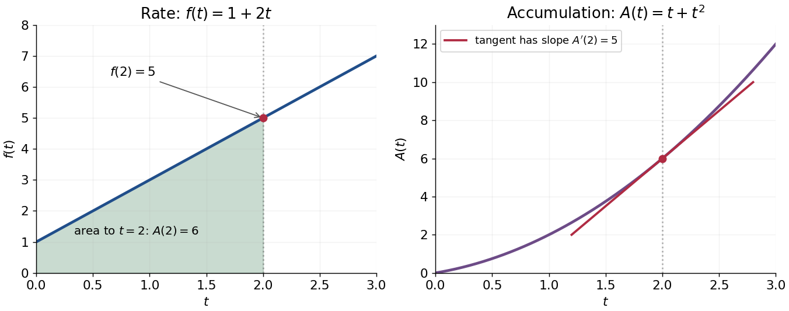

# Fundamental theorem of calculus

↑ **Parent:** [Calculus](calculus-split.md)  
ⓦ [Wiki](https://en.wikipedia.org/wiki/Fundamental_theorem_of_calculus)

The fundamental theorem of calculus says that **accumulation and local change undo one another**, under appropriate regularity conditions. If $f$ is a [continuous function](continuous-function.md) on $[a,b]$ and

$$
A(x)=\int_a^x f(t)\,dt,
$$

then $A$ is [differentiable](differentiable-function.md) for $a<x<b$ and $A'(x)=f(x)$. Conversely, if $G$ is an [antiderivative](antiderivative.md) of $f$ on this [interval](interval-mathematics.md), continuous at its endpoints, then

$$
\boxed{\int_a^b f(x)\,dx=G(b)-G(a).}
$$

The first statement turns an [integral](integral.md) into a [function](function-split.md) with a known [derivative](derivative.md); the second turns an entire accumulation into two endpoint values.

For $f(t)=1+2t$, accumulation from zero gives $A(x)=x+x^2$. At $x=2$, its [derivative](derivative.md) is $A'(2)=5$, exactly the current value $f(2)$. The accumulated value there is $A(2)=6$, and by $x=3$ it has reached $A(3)=12$. The accumulated quantity and its rate are different [functions](function-split.md), linked by [differentiation](differentiation.md).

**[Figure 18](#image-the-instantaneous-rate-determines-the-tangent-to-the-accumulation-curve). The instantaneous rate determines the tangent to the accumulation curve**.

This connection makes the theorem useful far beyond geometric [area](surface-area.md). It recovers [displacement](displacement.md) from [velocity](velocity.md), gives a [probability](probability.md) from a [probability density function](probability-density-function.md), and converts many [differential equations](differential-equation-split.md) into [integral equations](integral-equation.md). The striking economy is that information spread across a whole [interval](interval-mathematics.md) can sometimes be recovered from an [antiderivative](antiderivative.md) at its two boundaries.

A short explanation of the first part is that

$$
\frac{A(x+h)-A(x)}h=\frac1h\int_x^{x+h}f(t)\,dt
$$

is the local average of $f$. [Continuity](continuous-function.md) makes this average approach $f(x)$. For the second part, $G-A$ has zero [derivative](derivative.md) and is constant by the [mean value theorem](mean-value-theorem.md). These are the ideas behind the proof; the endpoint and regularity conditions make them valid.

An early geometric form of this connection appears in Isaac Barrow's _Lectiones geometricae_ (1670), Lecture X, Proposition 11. The original volume is catalogued by CESIMA, and Michael Nauenberg's historical research reproduces and examines the geometric argument.[Isaac Barrow, Lectiones geometricae, 1670](https://cesimadigital.pucsp.br/handle/bcd/3675)[Michael Nauenberg, Barrow and Leibniz on the fundamental theorem of the calculus, 2011](https://arxiv.org/abs/1111.6145)

**Table of contents**

- [Fundamental theorem of calculus for Lebesgue integration](fundamental-theorem-of-calculus-for-lebesgue-integration.md)

## ↑ Ancestors (6)

1. [Calculus](calculus-split.md)
2. [Real analysis](real-analysis-split.md)
3. [Analysis](analysis-split.md)
4. [Area of mathematics](area-of-mathematics.md)
5. [Mathematics](mathematics-split.md)
6. [Codex Wiki](split.md)

## ← Incoming links (92)

- [Antiderivative](antiderivative.md)
- [Calculus](calculus-split.md)
- [Cube mean-gradient inequality](cube-mean-gradient-inequality.md)
- [Definite integral](definite-integral.md)
- [Derivative seminorms on a compact interval](derivative-seminorms-on-a-compact-interval.md)
- [Differential form](differential-form-split.md)
- [Differentiation under the integral sign](differentiation-under-the-integral-sign.md)
- [Fundamental theorem for line integrals](fundamental-theorem-for-line-integrals.md)
- [Hadamard's lemma](hadamard-s-lemma.md)
- [Impulse-momentum theorem](impulse-momentum-theorem.md)
- [Initial value problem](initial-value-problem.md)
- [Integral](integral.md)
- [Integral first-order Taylor formula for a vector map](integral-first-order-taylor-formula-for-a-vector-map.md)
- [Integrating factor](integrating-factor.md)
- [Integration by parts](integration-by-parts.md)
- [Mean-square fundamental theorem of calculus](mean-square-fundamental-theorem-of-calculus.md)
- [Monotone mean-value point of an integral average](monotone-mean-value-point-of-an-integral-average.md)
- [Natural logarithm](natural-logarithm.md)
- [Solution](past-exam-of-the-mathematics-course-of-the-university-of-cambridge/2001/ia/paper-1/11d/i/solution.md)
- [Solution](past-exam-of-the-mathematics-course-of-the-university-of-cambridge/2001/ia/paper-3/4a/solution.md)
- [Solution](past-exam-of-the-mathematics-course-of-the-university-of-cambridge/2002/ia/paper-1/11c/solution.md)
- [Solution](past-exam-of-the-mathematics-course-of-the-university-of-cambridge/2002/ia/paper-1/12c/solution.md)
- [Solution](past-exam-of-the-mathematics-course-of-the-university-of-cambridge/2002/iii/paper-8/5/i/solution.md)
- [Solution](past-exam-of-the-mathematics-course-of-the-university-of-cambridge/2003/ia/paper-1/12c/solution.md)
- [Solution](past-exam-of-the-mathematics-course-of-the-university-of-cambridge/2003/iii/paper-33/1/c/solution.md)
- [Solution](past-exam-of-the-mathematics-course-of-the-university-of-cambridge/2003/iii/paper-57/1/a/solution.md)
- [Solution](past-exam-of-the-mathematics-course-of-the-university-of-cambridge/2004/iii/paper-71/5/solution.md)
- [Solution](past-exam-of-the-mathematics-course-of-the-university-of-cambridge/2005/ia/paper-1/10d/solution.md)
- [Solution](past-exam-of-the-mathematics-course-of-the-university-of-cambridge/2005/ib/paper-4/13b/solution.md)
- [Solution](past-exam-of-the-mathematics-course-of-the-university-of-cambridge/2006/ia/paper-1/10e/solution.md)
- [Solution](past-exam-of-the-mathematics-course-of-the-university-of-cambridge/2006/ib/paper-1/11f/solution.md)
- [Solution](past-exam-of-the-mathematics-course-of-the-university-of-cambridge/2007/ia/paper-3/9a/ii/solution.md)
- [Solution](past-exam-of-the-mathematics-course-of-the-university-of-cambridge/2007/ib/paper-4/13h/solution.md)
- [Solution](past-exam-of-the-mathematics-course-of-the-university-of-cambridge/2007/iii/paper-45/3/solution.md)
- [Solution](past-exam-of-the-mathematics-course-of-the-university-of-cambridge/2008/ia/paper-1/4e/solution.md)
- [Solution](past-exam-of-the-mathematics-course-of-the-university-of-cambridge/2008/iii/paper-13/1/a/solution.md)
- [Solution](past-exam-of-the-mathematics-course-of-the-university-of-cambridge/2009/iii/paper-10/5/e/solution.md)
- [Solution](past-exam-of-the-mathematics-course-of-the-university-of-cambridge/2009/iii/paper-12/1/iv/solution.md)
- [Solution](past-exam-of-the-mathematics-course-of-the-university-of-cambridge/2010/ii/paper-4/9d/solution.md)
- [Solution](past-exam-of-the-mathematics-course-of-the-university-of-cambridge/2011/ia/paper-1/12d/solution.md)
- [Solution](past-exam-of-the-mathematics-course-of-the-university-of-cambridge/2013/ib/paper-1/11f/solution.md)
- [Solution](past-exam-of-the-mathematics-course-of-the-university-of-cambridge/2013/ib/paper-2/12f/solution.md)
- [Solution](past-exam-of-the-mathematics-course-of-the-university-of-cambridge/2013/iii/paper-6/5/b/solution.md)
- [Solution](past-exam-of-the-mathematics-course-of-the-university-of-cambridge/2014/iii/paper-5/2/f/solution.md)
- [Solution](past-exam-of-the-mathematics-course-of-the-university-of-cambridge/2014/iii/paper-68/1/solution.md)
- [Solution](past-exam-of-the-mathematics-course-of-the-university-of-cambridge/2015/iii/paper-5/3/1/c/solution.md)
- [Solution](past-exam-of-the-mathematics-course-of-the-university-of-cambridge/2015/iii/paper-69/3/solution.md)
- [Solution](past-exam-of-the-mathematics-course-of-the-university-of-cambridge/2015/iii/paper-8/3/e/solution.md)
- [Solution](past-exam-of-the-mathematics-course-of-the-university-of-cambridge/2015/iii/paper-8/3/f/solution.md)
- [Solution](past-exam-of-the-mathematics-course-of-the-university-of-cambridge/2016/ia/paper-3/9c/a/solution.md)
- [Solution](past-exam-of-the-mathematics-course-of-the-university-of-cambridge/2016/ia/paper-4/9b/a/solution.md)
- [Solution](past-exam-of-the-mathematics-course-of-the-university-of-cambridge/2016/iii/paper-326/1/v/solution.md)
- [Solution](past-exam-of-the-mathematics-course-of-the-university-of-cambridge/2017/ia/paper-1/12e/solution.md)
- [Solution](past-exam-of-the-mathematics-course-of-the-university-of-cambridge/2017/ia/paper-1/9d/c/solution.md)
- [Solution](past-exam-of-the-mathematics-course-of-the-university-of-cambridge/2017/iii/paper-217/1/solution.md)
- [Solution](past-exam-of-the-mathematics-course-of-the-university-of-cambridge/2017/iii/paper-217/2/solution.md)
- [Solution](past-exam-of-the-mathematics-course-of-the-university-of-cambridge/2017/iii/paper-326/1/3/c/solution.md)
- [Solution](past-exam-of-the-mathematics-course-of-the-university-of-cambridge/2017/iii/paper-341/3/i/solution.md)
- [Solution](past-exam-of-the-mathematics-course-of-the-university-of-cambridge/2018/ia/paper-1/12d/b/solution.md)
- [Solution](past-exam-of-the-mathematics-course-of-the-university-of-cambridge/2018/ib/paper-3/14g/solution.md)
- [Solution](past-exam-of-the-mathematics-course-of-the-university-of-cambridge/2018/ii/paper-2/11f/b/v/solution.md)
- [Solution](past-exam-of-the-mathematics-course-of-the-university-of-cambridge/2018/ii/paper-4/23f/b/solution.md)
- [Solution](past-exam-of-the-mathematics-course-of-the-university-of-cambridge/2018/iii/paper-336/2/iii/solution.md)
- [Solution](past-exam-of-the-mathematics-course-of-the-university-of-cambridge/2019/ib/paper-3/12e/b/ii/solution.md)
- [Solution](past-exam-of-the-mathematics-course-of-the-university-of-cambridge/2019/iii/paper-105/1/a/solution.md)
- [Solution](past-exam-of-the-mathematics-course-of-the-university-of-cambridge/2020/ia/paper-1/3e/a/solution.md)
- [Solution](past-exam-of-the-mathematics-course-of-the-university-of-cambridge/2020/ii/paper-4/22i/c/ii/solution.md)
- [Solution](past-exam-of-the-mathematics-course-of-the-university-of-cambridge/2021/ib/paper-4/10f/a/solution.md)
- [Solution](past-exam-of-the-mathematics-course-of-the-university-of-cambridge/2021/ib/paper-4/4c/solution.md)
- [Solution](past-exam-of-the-mathematics-course-of-the-university-of-cambridge/2021/iii/paper-115/2/d/solution.md)
- [Solution](past-exam-of-the-mathematics-course-of-the-university-of-cambridge/2021/iii/paper-352/1/e/solution.md)
- [Solution](past-exam-of-the-mathematics-course-of-the-university-of-cambridge/2022/ia/paper-1/12d/solution.md)
- [Solution](past-exam-of-the-mathematics-course-of-the-university-of-cambridge/2022/iii/paper-115/2/a/solution.md)
- [Solution](past-exam-of-the-mathematics-course-of-the-university-of-cambridge/2023/ii/paper-1/23f/c/solution.md)
- [Solution](past-exam-of-the-mathematics-course-of-the-university-of-cambridge/2023/ii/paper-4/15d/solution.md)
- [Solution](past-exam-of-the-mathematics-course-of-the-university-of-cambridge/2023/iii/paper-202/5/b/solution.md)
- [Solution](past-exam-of-the-mathematics-course-of-the-university-of-cambridge/2025/ib/paper-2/2g/iv/solution.md)
- [Solution](past-exam-of-the-mathematics-course-of-the-university-of-cambridge/2025/iii/paper-105/2/e/solution.md)
- [Solution](past-exam-of-the-mathematics-course-of-the-university-of-cambridge/2025/iii/paper-318/2/c/solution.md)
- [Solution](past-exam-of-the-mathematics-course-of-the-university-of-cambridge/2026/iii/paper-202/3/c/solution.md)
- [Picard iteration](picard-iteration.md)
- [Second-difference integral formula](second-difference-integral-formula.md)
- [Seminorm](seminorm.md)
- [Signed area under a graph](signed-area-under-a-graph.md)
- [Single-point changes preserve Riemann integrals](single-point-changes-preserve-riemann-integrals.md)
- [Sobolev–Gallagher inequality](sobolev-gallagher-inequality.md)
- [Symmetry of second derivatives](symmetry-of-second-derivatives.md)
- [Time integrability of an entropy-dissipation product](time-integrability-of-an-entropy-dissipation-product.md)
- [Total derivative](total-derivative.md)
- [Unbounded derivative obstruction to Riemann integrability](unbounded-derivative-obstruction-to-riemann-integrability.md)
- [Uniform derivative convergence with an anchored value](uniform-derivative-convergence-with-an-anchored-value.md)
- [W1p trace theorem on a half-space](w1p-trace-theorem-on-a-half-space.md)
