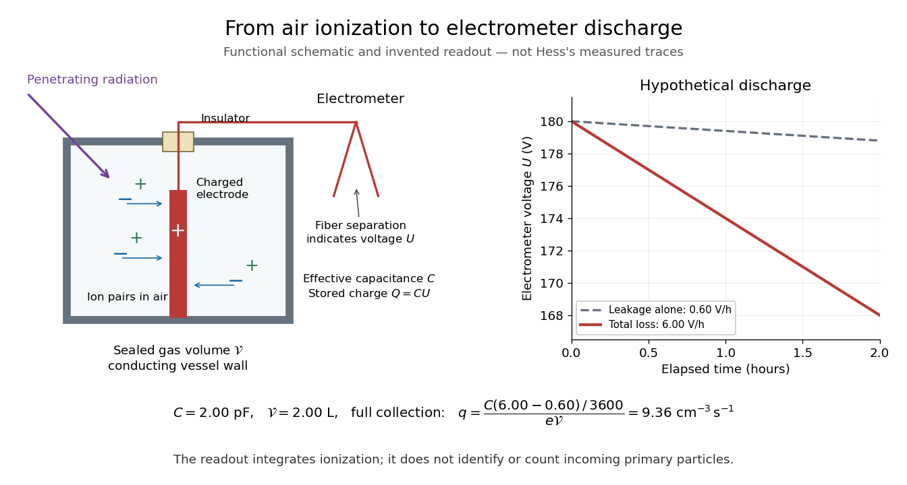
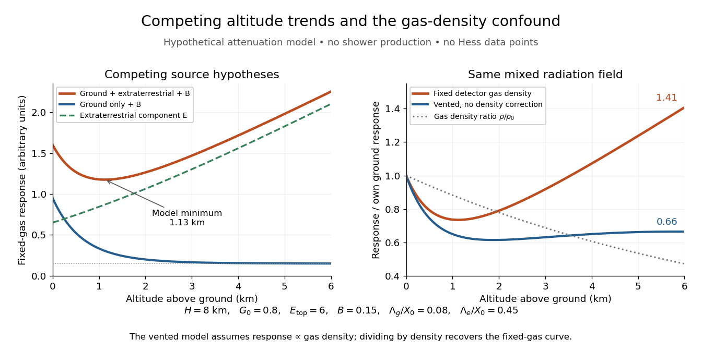

# Galaxy

↑ **Parent:** [Astrophysics](astrophysics.md)  
ⓦ [Wiki](https://en.wikipedia.org/wiki/Galaxy)

A galaxy is a gravitationally bound system of stars, interstellar gas and dust, stellar remnants, and dark matter.

**Table of contents**

- [Large Magellanic Cloud](#large-magellanic-cloud)
- [NGC 4258](#ngc-4258)
- [Circumgalactic medium](#circumgalactic-medium)
- [Galactic bulge](#galactic-bulge)
- [Stellar halo](#stellar-halo)
  - [Intracluster light](#intracluster-light)
  - [Stellar stream](#stellar-stream)
- [Star-forming galaxy](#star-forming-galaxy)
- [Irregular galaxy](#irregular-galaxy)
- [Spiral galaxy](#spiral-galaxy)
- [Galactic disk](#galactic-disk)
  - [Spiral density wave](#spiral-density-wave)
    - [Razor-thin fluid disk dispersion relation](#razor-thin-fluid-disk-dispersion-relation)
    - [Collisionless correction to the fluid spiral-wave dispersion relation](#collisionless-correction-to-the-fluid-spiral-wave-dispersion-relation)
    - [Material-arm winding in a differentially rotating galaxy](#material-arm-winding-in-a-differentially-rotating-galaxy)
    - [Swing amplification](#swing-amplification)
    - [Pattern speed](#pattern-speed)
  - [Thin galactic disk](#thin-galactic-disk)
  - [Galactic disk heating](#galactic-disk-heating)
  - [Galactic disk flaring](#galactic-disk-flaring)
  - [Self-gravitating isothermal slab](#self-gravitating-isothermal-slab)
    - [Orbits in a self-gravitating isothermal slab](#orbits-in-a-self-gravitating-isothermal-slab)
    - [Isothermal displacement energy of a self-gravitating slab](#isothermal-displacement-energy-of-a-self-gravitating-slab)
      - [Marginal fragmentation mode of an isothermal slab](#marginal-fragmentation-mode-of-an-isothermal-slab)
- [Galaxy stellar mass](#galaxy-stellar-mass)
  - [Mass-to-light ratio](#mass-to-light-ratio)
    - [Aperture dependence of mass-to-light ratio](#aperture-dependence-of-mass-to-light-ratio)
    - [Mass-to-light ratio of a power-law stellar population](#mass-to-light-ratio-of-a-power-law-stellar-population)
  - [Galaxy stellar mass function](#galaxy-stellar-mass-function)
    - [Cosmic stellar mass density](#cosmic-stellar-mass-density)
    - [Stellar mass function with a square-root exponential cutoff](#stellar-mass-function-with-a-square-root-exponential-cutoff)
      - [Stellar mass density from a square-root exponential cutoff](#stellar-mass-density-from-a-square-root-exponential-cutoff)
  - [Schechter function](#schechter-function)
- [Gas-to-stellar mass ratio](#gas-to-stellar-mass-ratio)
- [Galaxy evolution](#galaxy-evolution)
  - [Galactic feedback](#galactic-feedback)
  - [Quiescent galaxy assembly](#quiescent-galaxy-assembly)
  - [Galactic gas regulator](#galactic-gas-regulator)
    - [Constant-inflow gas regulator solution](#constant-inflow-gas-regulator-solution)
      - [Time-dependent-inflow convolution for a linear gas regulator](#time-dependent-inflow-convolution-for-a-linear-gas-regulator)
      - [Stellar mass in a constant-inflow gas regulator](#stellar-mass-in-a-constant-inflow-gas-regulator)
    - [Gas-balance nullcline](#gas-balance-nullcline)
    - [Eddington-regulated galactic gas balance](#eddington-regulated-galactic-gas-balance)
  - [Galaxy morphological evolution](#galaxy-morphological-evolution)
  - [Galaxy size evolution](#galaxy-size-evolution)
  - [Galaxy red sequence](#galaxy-red-sequence)
  - [Starburst galaxy](#starburst-galaxy)
  - [Galaxy merger](#galaxy-merger)
    - [Gas-rich galaxy merger](#gas-rich-galaxy-merger)
      - [Gas dissipation in a galaxy merger](#gas-dissipation-in-a-galaxy-merger)
    - [Major galaxy merger](#major-galaxy-merger)
    - [Geometric galaxy-encounter rate](#geometric-galaxy-encounter-rate)
    - [Tidal capture of galaxies](#tidal-capture-of-galaxies)
      - [Equal-mass tidal-capture threshold](#equal-mass-tidal-capture-threshold)
    - [Dry galaxy merger](#dry-galaxy-merger)
      - [Parabolic dry-merger energy accounting](#parabolic-dry-merger-energy-accounting)
      - [Minor galaxy merger](#minor-galaxy-merger)
        - [Cold minor-merger size growth](#cold-minor-merger-size-growth)
  - [Stellar feedback](#stellar-feedback)
    - [Radiative losses in unresolved stellar feedback](#radiative-losses-in-unresolved-stellar-feedback)
    - [Independent-volume supernova quenching](#independent-volume-supernova-quenching)
      - [Shell-energy quenching prescription](#shell-energy-quenching-prescription)
      - [Quenching front in a fixed galactic potential](#quenching-front-in-a-fixed-galactic-potential)
    - [Radiation-pressure limit of a dusty starburst](#radiation-pressure-limit-of-a-dusty-starburst)
    - [Impulsive mass-loss expansion law](#impulsive-mass-loss-expansion-law)
      - [Impulsive disruption by stellar mass loss](#impulsive-disruption-by-stellar-mass-loss)
        - [Critical initial mass function slope for impulsive disruption](#critical-initial-mass-function-slope-for-impulsive-disruption)
    - [Adiabatic mass-loss expansion law](#adiabatic-mass-loss-expansion-law)
  - [Galactic outflow](#galactic-outflow)
    - [Galactic fountain](#galactic-fountain)
    - [Local binding-energy allocation in galactic feedback](#local-binding-energy-allocation-in-galactic-feedback)
    - [Escape-speed scaling of wind mass loading](#escape-speed-scaling-of-wind-mass-loading)
    - [Mass-loading factor](#mass-loading-factor)
  - [Galactic gas inflow](#galactic-gas-inflow)
  - [Galactic chemical evolution](#galactic-chemical-evolution)
    - [Alpha element](#alpha-element)
      - [Delayed iron enrichment](#delayed-iron-enrichment)
    - [Proportional-infall model of galactic chemical evolution](#proportional-infall-model-of-galactic-chemical-evolution)
      - [Metallicity distribution in the half-rate infall model](#metallicity-distribution-in-the-half-rate-infall-model)
    - [Gas fraction of a galaxy](#gas-fraction-of-a-galaxy)
    - [Galactic metallicity](#galactic-metallicity)
      - [Gas-phase metallicity](#gas-phase-metallicity)
      - [Stellar metallicity](#stellar-metallicity)
        - [Cumulative and birth stellar metallicities](#cumulative-and-birth-stellar-metallicities)
      - [Galaxy mass--metallicity relation](#galaxy-mass-metallicity-relation)
    - [Instantaneous recycling approximation](#instantaneous-recycling-approximation)
      - [Retained-ejecta chemical evolution](#retained-ejecta-chemical-evolution)
        - [Quadratic gas-history enrichment model](#quadratic-gas-history-enrichment-model)
      - [Stellar yield](#stellar-yield)
        - [Locked-mass and returned-mass yield conventions](#locked-mass-and-returned-mass-yield-conventions)
    - [Closed-box model of galactic chemical evolution](#closed-box-model-of-galactic-chemical-evolution)
      - [Galactic gas fraction](#galactic-gas-fraction)
      - [Saturating closed-box enrichment law](#saturating-closed-box-enrichment-law)
      - [Closed-box metallicity distribution](#closed-box-metallicity-distribution)
      - [Exponential closed-box gas consumption](#exponential-closed-box-gas-consumption)
        - [Backward extrapolation of exponential closed-box star formation](#backward-extrapolation-of-exponential-closed-box-star-formation)
      - [Leaky-box model of galactic chemical evolution](#leaky-box-model-of-galactic-chemical-evolution)
        - [Metallicity distribution in a leaky box](#metallicity-distribution-in-a-leaky-box)
        - [Effective yield](#effective-yield)
      - [G-dwarf problem](#g-dwarf-problem)
        - [Metallicity distribution function](#metallicity-distribution-function)
          - [Logarithmic metallicity distribution](#logarithmic-metallicity-distribution)
- [Dwarf galaxy](#dwarf-galaxy)
  - [Dwarf spheroidal galaxy](#dwarf-spheroidal-galaxy)
  - [Dark-matter core](#dark-matter-core)
- [Elliptical galaxy](#elliptical-galaxy)
  - [Fundamental plane (elliptical galaxies)](#fundamental-plane-elliptical-galaxies)
  - [Faber-Jackson relation](#faber-jackson-relation)
  - [Core and power-law elliptical galaxies](#core-and-power-law-elliptical-galaxies)
  - [Oblate isotropic rotator](#oblate-isotropic-rotator)
    - [Rotation-anisotropy diagram](#rotation-anisotropy-diagram)
      - [Oblate-rotator flattening proxy](#oblate-rotator-flattening-proxy)
  - [Fast and slow rotator galaxy](#fast-and-slow-rotator-galaxy)
- [Local Group](#local-group)
  - [Local Group timing argument](#local-group-timing-argument)
- [Milky Way](#milky-way)
  - [Galactic Center](#galactic-center)
  - [Interstellar medium](#interstellar-medium)
    - [Multiphase interstellar medium](#multiphase-interstellar-medium)
      - [Heating and cooling balance in the interstellar medium](#heating-and-cooling-balance-in-the-interstellar-medium)
      - [Hot ionized medium](#hot-ionized-medium)
      - [Warm ionized medium](#warm-ionized-medium)
      - [Warm neutral medium](#warm-neutral-medium)
      - [Cold neutral medium](#cold-neutral-medium)
    - [Superbubble](#superbubble)
      - [Adiabatic superbubble similarity solution](#adiabatic-superbubble-similarity-solution)
        - [Central energy input in a similarity solution](#central-energy-input-in-a-similarity-solution)
        - [Energy normalization of a continuously driven spherical shock](#energy-normalization-of-a-continuously-driven-spherical-shock)
        - [Continuity equation for a superbubble similarity solution](#continuity-equation-for-a-superbubble-similarity-solution)
    - [Supernova remnant](#supernova-remnant)
      - [Momentum-conserving supernova-remnant expansion](#momentum-conserving-supernova-remnant-expansion)
      - [Sedov-Taylor blast wave](#sedov-taylor-blast-wave)
      - [Adiabatic phase of a supernova remnant](#adiabatic-phase-of-a-supernova-remnant)
    - [Molecular cloud](#molecular-cloud)
      - [Carbon-monoxide tracer of molecular hydrogen](#carbon-monoxide-tracer-of-molecular-hydrogen)
    - [Interstellar dust](#interstellar-dust)
      - [Interstellar extinction](#interstellar-extinction)
        - [Color excess](#color-excess)
    - [H II region](#h-ii-region)
      - [Ionization front](#ionization-front)
        - [Ionization-front growth from an exponentially brightening source](#ionization-front-growth-from-an-exponentially-brightening-source)
      - [Photoionization equilibrium](#photoionization-equilibrium)
        - [Photoionization-recombination thermal balance](#photoionization-recombination-thermal-balance)
        - [Ionization-bounded nebula](#ionization-bounded-nebula)
        - [Recombination integral for a power-law nebula](#recombination-integral-for-a-power-law-nebula)
          - [Critical ionizing photon rate of a cored power-law nebula](#critical-ionizing-photon-rate-of-a-cored-power-law-nebula)
        - [Recombination time](#recombination-time)
        - [Case B recombination](#case-b-recombination)
      - [Hydrogen-ionizing photon production rate](#hydrogen-ionizing-photon-production-rate)
        - [Blackbody ionizing photon function](#blackbody-ionizing-photon-function)
        - [Ionizing photon escape fraction](#ionizing-photon-escape-fraction)
        - [Mean ionizing photon energy of a power-law spectrum](#mean-ionizing-photon-energy-of-a-power-law-spectrum)
      - [Strömgren sphere](#stromgren-sphere)
        - [Nested hydrogen-helium ionization zones](#nested-hydrogen-helium-ionization-zones)
        - [Strömgren radius](#stromgren-radius)
        - [Ionization-front growth of a Strömgren sphere](#ionization-front-growth-of-a-stromgren-sphere)
        - [Dusty Strömgren sphere](#dusty-stromgren-sphere)
    - [Neutral-hydrogen 21-centimeter line](#neutral-hydrogen-21-centimeter-line)
    - [Cosmic ray](#cosmic-ray)
      - [Photopion threshold on a photon background](#photopion-threshold-on-a-photon-background)
      - [Primary cosmic ray](#primary-cosmic-ray)
      - [Secondary cosmic ray](#secondary-cosmic-ray)
      - [Air shower](#air-shower)
      - [Hess cosmic-ray balloon experiment](#hess-cosmic-ray-balloon-experiment)
        - [Ionization-chamber charge-loss model](#ionization-chamber-charge-loss-model)
        - [Cosmic-ray altitude attenuation model](#cosmic-ray-altitude-attenuation-model)
  - [Galactic multiwavelength astronomy](#galactic-multiwavelength-astronomy)
    - [Galactic thermal dust emission](#galactic-thermal-dust-emission)
    - [Galactic synchrotron emission](#galactic-synchrotron-emission)
    - [Galactic gamma-ray emission](#galactic-gamma-ray-emission)
    - [Galactic scale height](#galactic-scale-height)
  - [Galactic bar](#galactic-bar)
    - [Rotating-frame relative effective potential](#rotating-frame-relative-effective-potential)
- [Star formation rate](#star-formation-rate)
  - [Linear gas-consumption law](#linear-gas-consumption-law)
- [Galaxy rotation curve](#galaxy-rotation-curve)
  - [Baryonic Tully-Fisher relation](#baryonic-tully-fisher-relation)
  - [Angular-momentum estimate of a self-gravitating galactic disk](#angular-momentum-estimate-of-a-self-gravitating-galactic-disk)
  - [Enclosed mass does not determine a disc rotation curve](#enclosed-mass-does-not-determine-a-disc-rotation-curve)
  - [Interior gravitational force of an exterior thin ring](#interior-gravitational-force-of-an-exterior-thin-ring)
  - [Circular speed](#circular-speed)
  - [Flat galaxy rotation curve](#flat-galaxy-rotation-curve)
    - [Spherical mass profile for a flat rotation curve](#spherical-mass-profile-for-a-flat-rotation-curve)
  - [Exponential galactic disk](#exponential-galactic-disk)
    - [Exponential-disk Keplerian asymptotic](#exponential-disk-keplerian-asymptotic)
    - [Maximum disk](#maximum-disk)
  - [Disk--halo degeneracy](#disk-halo-degeneracy)
- [Galaxy dynamics](#galaxy-dynamics)
  - [Stellar asymmetric drift](#stellar-asymmetric-drift)
    - [Midplane tilt contribution to asymmetric drift](#midplane-tilt-contribution-to-asymmetric-drift)
    - [Exponential-disk asymmetric drift](#exponential-disk-asymmetric-drift)
  - [Galactic dynamical time](#galactic-dynamical-time)
  - [Violent relaxation](#violent-relaxation)
  - [Oort constants](#oort-constants)
  - [Cusped logarithmic spherical galaxy model](#cusped-logarithmic-spherical-galaxy-model)
  - [Galactic tide](#galactic-tide)
    - [Tidal bridges and tails](#tidal-bridges-and-tails)
  - [Impulse approximation](#impulse-approximation)
    - [Complete-flyby gravitational impulse](#complete-flyby-gravitational-impulse)
      - [Satellite impulse normalization](#satellite-impulse-normalization)
        - [One-sided impulse torque on a disk](#one-sided-impulse-torque-on-a-disk)
          - [Density-slope satellite torque](#density-slope-satellite-torque)
    - [Integrated tidal tensor of a straight-line flyby](#integrated-tidal-tensor-of-a-straight-line-flyby)
      - [Tidal impulse heating of a spherical galaxy](#tidal-impulse-heating-of-a-spherical-galaxy)
    - [Adiabatic shielding of tidal encounters](#adiabatic-shielding-of-tidal-encounters)
  - [Chandrasekhar dynamical friction](#chandrasekhar-dynamical-friction)
    - [Slow circular inspiral under tangential drag](#slow-circular-inspiral-under-tangential-drag)
    - [Velocity-shell identity for dynamical friction](#velocity-shell-identity-for-dynamical-friction)
    - [Finite-test-mass dynamical friction coefficient](#finite-test-mass-dynamical-friction-coefficient)
  - [Tidal radius](#tidal-radius)
    - [Differential-gravity disruption limit of a uniform satellite](#differential-gravity-disruption-limit-of-a-uniform-satellite)
      - [Tidal-gravity coefficient versus rotating Jacobi coefficient](#tidal-gravity-coefficient-versus-rotating-jacobi-coefficient)
    - [Jacobi tidal radius](#jacobi-tidal-radius)
      - [Jacobi truncation of two singular isothermal spheres](#jacobi-truncation-of-two-singular-isothermal-spheres)
    - [Tidal stripping](#tidal-stripping)
      - [Tidal tail](#tidal-tail)
      - [Dynamical-friction stalling by tidal stripping](#dynamical-friction-stalling-by-tidal-stripping)
  - [Stellar dynamics](#stellar-dynamics)
    - [Stellar collision cross-section](#stellar-collision-cross-section)
    - [Loss cone](#loss-cone)
      - [Keplerian cluster radius evolution under stellar capture](#keplerian-cluster-radius-evolution-under-stellar-capture)
      - [Empty and full loss-cone capture rates](#empty-and-full-loss-cone-capture-rates)
    - [Chaotic stellar orbit](#chaotic-stellar-orbit)
    - [Jaffe model](#jaffe-model)
    - [Gravothermal catastrophe](#gravothermal-catastrophe)
      - [Two-dimensional self-gravitating rod equilibrium](#two-dimensional-self-gravitating-rod-equilibrium)
        - [Energy-temperature curve of a two-dimensional self-gravitating rod gas](#energy-temperature-curve-of-a-two-dimensional-self-gravitating-rod-gas)
    - [Spherical density projection](#spherical-density-projection)
      - [Strip density of a spherical system](#strip-density-of-a-spherical-system)
        - [Gravitational binding energy from strip density](#gravitational-binding-energy-from-strip-density)
      - [Spherical Abel deprojection](#spherical-abel-deprojection)
        - [Power-law spherical projection kernel](#power-law-spherical-projection-kernel)
        - [Isotropic stellar pressure deprojection](#isotropic-stellar-pressure-deprojection)
    - [Plummer model](#plummer-model)
    - [Hernquist model](#hernquist-model)
    - [N-body simulation](#n-body-simulation)
    - [Gravitational softening](#gravitational-softening)
      - [Height-evaluation gravitational softening](#height-evaluation-gravitational-softening)
        - [Vertical-profile softening match](#vertical-profile-softening-match)
    - [Stellar crossing time](#stellar-crossing-time)
    - [Star cluster](#star-cluster)
      - [Open cluster](#open-cluster)
      - [Stellar evaporation](#stellar-evaporation)
        - [Virial contraction under stellar evaporation](#virial-contraction-under-stellar-evaporation)
      - [Globular cluster](#globular-cluster)
    - [Oblate spheroid](#oblate-spheroid)
      - [Projected axis ratio of an oblate spheroid](#projected-axis-ratio-of-an-oblate-spheroid)
        - [Random-orientation distribution of an apparent oblate axis ratio](#random-orientation-distribution-of-an-apparent-oblate-axis-ratio)
    - [Spherical isochrone model](#spherical-isochrone-model)
      - [Radial action of the spherical isochrone model](#radial-action-of-the-spherical-isochrone-model)
      - [Frequency ratio of the spherical isochrone model](#frequency-ratio-of-the-spherical-isochrone-model)
    - [Hypervirial model](#hypervirial-model)
      - [Global binding integral of the hypervirial model](#global-binding-integral-of-the-hypervirial-model)
      - [Hypervirial density-potential family](#hypervirial-density-potential-family)
      - [Hypervirial distribution function](#hypervirial-distribution-function)
        - [Normalization of the hypervirial distribution function](#normalization-of-the-hypervirial-distribution-function)
      - [Local virial relation of the hypervirial model](#local-virial-relation-of-the-hypervirial-model)
    - [Galactic distribution function](#galactic-distribution-function)
      - [Lowered Maxwellian velocity distribution](#lowered-maxwellian-velocity-distribution)
      - [Stellar velocity moment](#stellar-velocity-moment)
      - [Gaussian angular-momentum suppression in a stellar distribution](#gaussian-angular-momentum-suppression-in-a-stellar-distribution)
        - [Radially anisotropic isothermal halo asymptotics](#radially-anisotropic-isothermal-halo-asymptotics)
      - [Two-integral galactic distribution function](#two-integral-galactic-distribution-function)
        - [Logarithmic-potential two-integral distribution](#logarithmic-potential-two-integral-distribution)
          - [Nonnegativity bound for a prolate logarithmic-potential distribution](#nonnegativity-bound-for-a-prolate-logarithmic-potential-distribution)
        - [Meridional velocity isotropy of a two-integral distribution](#meridional-velocity-isotropy-of-a-two-integral-distribution)
      - [Streaming velocity](#streaming-velocity)
        - [Maximally prograde stellar distribution](#maximally-prograde-stellar-distribution)
      - [Planar isotropic stellar distribution function](#planar-isotropic-stellar-distribution-function)
        - [Planar isotropic distribution inversion](#planar-isotropic-distribution-inversion)
      - [Osipkov-Merritt distribution function](#osipkov-merritt-distribution-function)
        - [Anisotropic Plummer distribution with unit anisotropy radius](#anisotropic-plummer-distribution-with-unit-anisotropy-radius)
      - [Nonuniqueness of spherical galactic distribution functions](#nonuniqueness-of-spherical-galactic-distribution-functions)
      - [Augmented stellar density](#augmented-stellar-density)
        - [Jeans moments from an augmented density](#jeans-moments-from-an-augmented-density)
      - [Velocity-ellipsoid alignment in a Stäckel potential](#velocity-ellipsoid-alignment-in-a-stackel-potential)
      - [Eddington inversion](#eddington-inversion)
        - [Untruncated Eddington inversion](#untruncated-eddington-inversion)
      - [Action-based galactic distribution function](#action-based-galactic-distribution-function)
      - [Schwarzschild orbit-superposition model](#schwarzschild-orbit-superposition-model)
      - [Made-to-measure stellar-dynamical model](#made-to-measure-stellar-dynamical-model)
      - [Velocity dispersion](#velocity-dispersion)
        - [Velocity ellipsoid](#velocity-ellipsoid)
        - [Heliocentric projection of a spherical velocity dispersion](#heliocentric-projection-of-a-spherical-velocity-dispersion)
          - [Geometric correction for heliocentric velocity dispersion](#geometric-correction-for-heliocentric-velocity-dispersion)
        - [Velocity-anisotropy parameter](#velocity-anisotropy-parameter)
      - [Relative potential](#relative-potential)
        - [Relative energy](#relative-energy)
      - [Constant-anisotropy distribution function](#constant-anisotropy-distribution-function)
        - [Inverse-angular-momentum velocity integration](#inverse-angular-momentum-velocity-integration)
        - [Half-anisotropic distribution function](#half-anisotropic-distribution-function)
        - [Scale-free density-potential component](#scale-free-density-potential-component)
      - [Jeans theorem](#jeans-theorem)
        - [Vertical-energy Abel inversion of a stellar distribution](#vertical-energy-abel-inversion-of-a-stellar-distribution)
    - [Two-body relaxation](#two-body-relaxation)
      - [Finite-thickness disk relaxation](#finite-thickness-disk-relaxation)
      - [Razor-thin disk relaxation](#razor-thin-disk-relaxation)
      - [Small-angle gravitational encounter](#small-angle-gravitational-encounter)
      - [Collisionless stellar system](#collisionless-stellar-system)
      - [Stellar relaxation time](#stellar-relaxation-time)
        - [Relaxation time conventions in stellar dynamics](#relaxation-time-conventions-in-stellar-dynamics)
        - [Random-walk derivation of stellar relaxation](#random-walk-derivation-of-stellar-relaxation)
      - [Coulomb logarithm in stellar dynamics](#coulomb-logarithm-in-stellar-dynamics)
      - [Collisional stellar system](#collisional-stellar-system)
    - [Collisionless Boltzmann equation](#collisionless-boltzmann-equation)
      - [Rotating-frame collisionless Boltzmann equation](#rotating-frame-collisionless-boltzmann-equation)
        - [Cylindrical continuity equation for a rotating stellar system](#cylindrical-continuity-equation-for-a-rotating-stellar-system)
      - [Collisionless Jeans dispersion relation](#collisionless-jeans-dispersion-relation)
        - [Cauchy velocity distribution](#cauchy-velocity-distribution)
      - [Jeans equation](#jeans-equation)
        - [Vertical Jeans equation](#vertical-jeans-equation)
          - [Dynamical surface density from vertical stellar motions](#dynamical-surface-density-from-vertical-stellar-motions)
        - [Cylindrical Jeans equations in a rotating frame](#cylindrical-jeans-equations-in-a-rotating-frame)
        - [Spherical Jeans equation](#spherical-jeans-equation)
          - [Boundary dependence of an isotropic self-gravitating cusp](#boundary-dependence-of-an-isotropic-self-gravitating-cusp)
          - [Projected spherical Jeans residual](#projected-spherical-jeans-residual)
            - [Projected velocity dispersion of a Keplerian cusp](#projected-velocity-dispersion-of-a-keplerian-cusp)
            - [Global projected virial estimate of a mass-to-light ratio](#global-projected-virial-estimate-of-a-mass-to-light-ratio)
          - [Isothermal collisionless tracer](#isothermal-collisionless-tracer)
            - [Isothermal stellar and gas density equivalence](#isothermal-stellar-and-gas-density-equivalence)
            - [Gaussian line-of-sight velocity distribution](#gaussian-line-of-sight-velocity-distribution)
          - [Scale-free spherical Jeans solution](#scale-free-spherical-jeans-solution)
          - [Mass--anisotropy--density degeneracy](#mass-anisotropy-density-degeneracy)
        - [Tensor virial theorem](#tensor-virial-theorem)
          - [Inertia-tensor acceleration of a steadily rotating stellar pattern](#inertia-tensor-acceleration-of-a-steadily-rotating-stellar-pattern)
          - [Oblate tensor-virial shape factor](#oblate-tensor-virial-shape-factor)
          - [Flattening–anisotropy virial relation](#flattening-anisotropy-virial-relation)
            - [Scale-free tracer virial ratio](#scale-free-tracer-virial-ratio)
          - [Planar virial trace](#planar-virial-trace)
          - [Stellar potential-energy tensor](#stellar-potential-energy-tensor)
          - [Stellar pressure-energy tensor](#stellar-pressure-energy-tensor)
            - [Inclination projection of an axisymmetric stellar velocity tensor](#inclination-projection-of-an-axisymmetric-stellar-velocity-tensor)
          - [Stellar kinetic-energy tensor](#stellar-kinetic-energy-tensor)
          - [Magnetized-fluid tensor virial theorem](#magnetized-fluid-tensor-virial-theorem)
            - [Horizontal virial balance of a cold magnetized fluid](#horizontal-virial-balance-of-a-cold-magnetized-fluid)
  - [Singular isothermal sphere](#singular-isothermal-sphere)
    - [Pressure-confined singular isothermal gas sphere](#pressure-confined-singular-isothermal-gas-sphere)
    - [Pressure-truncated singular isothermal gas sphere](#pressure-truncated-singular-isothermal-gas-sphere)
    - [Gravitational potential of a truncated singular isothermal sphere](#gravitational-potential-of-a-truncated-singular-isothermal-sphere)
    - [Binding energy of a truncated singular isothermal sphere](#binding-energy-of-a-truncated-singular-isothermal-sphere)
    - [Singular isothermal sphere lens](#singular-isothermal-sphere-lens)
    - [Circular and isotropic speed comparison in a singular isothermal sphere](#circular-and-isotropic-speed-comparison-in-a-singular-isothermal-sphere)
    - [Boundary virial term of a singular isothermal sphere](#boundary-virial-term-of-a-singular-isothermal-sphere)

## Large Magellanic Cloud

↑ **Parent:** [Galaxy](galaxy.md)

## NGC 4258

↑ **Parent:** [Galaxy](galaxy.md)

[NGC 4258](#ngc-4258) hosts a resolved nuclear water-maser disk used as an independent nearby-galaxy distance anchor through orbital dynamics.[abstract](physics-bibliography.md#a-4-percent-geometric-distance-to-the-galaxy-ngc4258-from-orbital-motions-in-a-nuclear-gas-disk-by-j-r-herrnstein-and-others)

## Circumgalactic medium

↑ **Parent:** [Galaxy](galaxy.md)

The [circumgalactic medium](#circumgalactic-medium) is gas surrounding a galaxy's main stellar body and interstellar gas, typically associated with its halo. [accretion](astrophysics.md#accretion), outflow and recycling exchange matter through it. Its observational boundary and inferred [mass](classical-mechanics.md#mass) depend on the adopted halo convention and the gas phases sampled by absorption or emission.

## Galactic bulge

↑ **Parent:** [Galaxy](galaxy.md)  
ⓦ [Wiki](https://en.wikipedia.org/wiki/Galactic_bulge)

A [galactic bulge](#galactic-bulge) is a centrally concentrated [stellar population](stellar-astrophysics.md#stellar-population) in a [galaxy](galaxy.md), usually thicker than its disk. Its origin, rotation and random stellar motions can differ from those of the disk; bulge light is often described by a [Sérsic profile](astrophysics.md#sersic-profile).

## Stellar halo

↑ **Parent:** [Galaxy](galaxy.md)  
ⓦ [Wiki](https://en.wikipedia.org/wiki/Stellar_halo)

A [stellar halo](#stellar-halo) is the extended, approximately spheroidal [stellar population](stellar-astrophysics.md#stellar-population) surrounding a [galaxy](galaxy.md). It differs from the total [dark matter halo](large-scale-structure-of-the-universe.md#dark-matter-halo). If its outer luminosity density is $r^{-p}$, its projected light follows the [projection of a spherical power-law emissivity](astrophysics.md#projection-of-a-spherical-power-law-emissivity) and scales as $R^{1-p}$ away from breaks and outer truncation.

### Intracluster light

↑ **Parent:** [Stellar halo](#stellar-halo)  
ⓦ [Wiki](https://en.wikipedia.org/wiki/Intracluster_light)

[Intracluster light](#intracluster-light) comes from [stars](stellar-astrophysics.md#star) bound to a cluster rather than an individual [galaxy](galaxy.md). [Tidal stripping](#tidal-stripping) and disruption of member systems can create extended diffuse light and substructure. Distinguishing this component from the outer envelope of the central galaxy depends on the adopted dynamical or photometric definition.

### Stellar stream

↑ **Parent:** [Stellar halo](#stellar-halo)  
ⓦ [Wiki](https://en.wikipedia.org/wiki/Stellar_stream)

A [stellar stream](#stellar-stream) is a correlated collection of [stars](stellar-astrophysics.md#star) commonly originating in the disruption of a bound progenitor. [Phase mixing](planetary-science.md#phase-mixing) can erase spatial contrast while leaving coherence in orbital integrals. Such fossil debris constrains a [galaxy](galaxy.md)'s past accretion, although not every stream is from a galaxy: star clusters also produce streams.

## Star-forming galaxy

↑ **Parent:** [Galaxy](galaxy.md)

A star-forming galaxy is a [galaxy](galaxy.md) with ongoing [star formation](stellar-astrophysics.md#star-formation). Its hot young stars can supply hydrogen-ionizing radiation to the [intergalactic medium](astrophysics.md#intergalactic-medium), with the contribution controlled by the [ionizing photon escape fraction](#ionizing-photon-escape-fraction).

## Irregular galaxy

↑ **Parent:** [Galaxy](galaxy.md)  
ⓦ [Wiki](https://en.wikipedia.org/wiki/Irregular_galaxy)

An [irregular galaxy](#irregular-galaxy) lacks a regular spiral or elliptical outline. Many contain substantial gas and recent [star formation](stellar-astrophysics.md#star-formation); irregular appearance alone does not determine a [stellar population](stellar-astrophysics.md#stellar-population)'s age.

## Spiral galaxy

↑ **Parent:** [Galaxy](galaxy.md)  
ⓦ [Wiki](https://en.wikipedia.org/wiki/Spiral_galaxy)

A [spiral galaxy](#spiral-galaxy) has a [galactic disk](#galactic-disk) with spiral structure, commonly cold interstellar gas and ongoing [star formation](stellar-astrophysics.md#star-formation) as well as an older [stellar population](stellar-astrophysics.md#stellar-population).

## Galactic disk

↑ **Parent:** [Galaxy](galaxy.md)

A [galactic disk](#galactic-disk) is a flattened stellar or gaseous component of a [galaxy](galaxy.md), commonly supported mainly by ordered rotation. Its radial mass profile determines its [galaxy rotation curve](#galaxy-rotation-curve); thickness, truncation and external forces also matter. A [galactic disk](#galactic-disk) need not be an [exponential galactic disk](#exponential-galactic-disk), and its neutral-gas absorption radius need not equal a stellar scale length.

### Spiral density wave

↑ **Parent:** [Galactic disk](#galactic-disk)

A collective perturbation of [surface density](astrophysical-disk.md#surface-density-of-a-disk) and [gravitational potential](newton-s-law-of-universal-gravitation.md#newtonian-potential-of-a-point-mass) in a [galactic disk](#galactic-disk). Material can cross its spiral-shaped crests; the pattern angular speed need not equal the local material angular speed. A tightly wound fluid approximation has $(\omega-m\Omega)^2=\kappa^2+c_s^2k^2-2\pi G\Sigma|k|$, while a collisionless stellar disk requires its own response function.

#### Razor-thin fluid disk dispersion relation

↑ **Parent:** [Spiral density wave](#spiral-density-wave)

For tightly wound perturbations in a locally uniform, razor-thin [gas](thermodynamics.md#gas) disk, [continuity equation](mathematical-physics.md#continuity-equation) and rotating-fluid [momentum](momentum.md) equations couple the surface-density perturbation to radial and azimuthal velocities. The sheet potential is $\delta\Phi=-2\pi G\delta\Sigma/|k|$. Eliminating these perturbations gives the displayed [dispersion relation](dispersion-relation.md). [radial epicyclic frequency](astrophysical-disk.md#radial-epicyclic-frequency) supplies the [rotation](riemannian-geometry.md#rotation-mathematics) term, the sound-speed term resists short waves, and [self-gravity](newton-s-law-of-universal-gravitation.md#self-gravity) supplies the negative term. For an axisymmetric mode $n=0$, use $\omega^2$ directly; the [pattern speed](#pattern-speed) $\omega/n$ is undefined.

#### Collisionless correction to the fluid spiral-wave dispersion relation

↑ **Parent:** [Spiral density wave](#spiral-density-wave)

#### Material-arm winding in a differentially rotating galaxy

↑ **Parent:** [Spiral density wave](#spiral-density-wave)

Two radii with different orbital frequencies develop a relative angular displacement $\Delta\phi=\Delta\Omega\,t$. A spiral made of a fixed set of stars therefore winds increasingly tightly. A [density](fluid-mechanics.md#density) pattern need not follow that material winding because matter can pass through it.

#### Swing amplification

↑ **Parent:** [Spiral density wave](#spiral-density-wave)

A self-gravitating disk can transiently amplify a leading disturbance as [differential rotation](astrophysical-fluid-dynamics.md#differential-rotation) shears it into a trailing disturbance. Its strength depends on disk self-gravity, random motions and disturbance wavelength. Amplification does not by itself establish one indefinitely steady spiral.

#### Pattern speed

↑ **Parent:** [Spiral density wave](#spiral-density-wave)

For a perturbation phase $m\phi+\int k\,dr-\omega t$, a constant-phase pattern rotates at $\Omega_p=\omega/m$. At corotation the local orbit angular speed equals this value. One observed galaxy can contain several patterns with distinct angular speeds and lifetimes.

### Thin galactic disk

↑ **Parent:** [Galactic disk](#galactic-disk)

A thin galactic disk is a stellar component whose vertical extent is small compared with its radial size. Small vertical [velocity dispersion](#velocity-dispersion) and substantial [specific angular momentum](celestial-mechanics.md#specific-angular-momentum) are characteristic. Its survival constrains cumulative [galactic disk heating](#galactic-disk-heating), but its stars need not all have the same formation epoch.

### Galactic disk heating

↑ **Parent:** [Galactic disk](#galactic-disk)

[Galactic disk heating](#galactic-disk-heating) increases the random velocities of [stars](stellar-astrophysics.md#star) through encounters with [molecular clouds](#molecular-cloud), nonaxisymmetric gravitational disturbances, and other perturbations. Older [stellar populations](stellar-astrophysics.md#stellar-population) usually have larger [velocity dispersions](#velocity-dispersion) and greater vertical thickness, although birth conditions and migration also affect the relation.

### Galactic disk flaring

↑ **Parent:** [Galactic disk](#galactic-disk)

[Galactic disk flaring](#galactic-disk-flaring) is an outward increase of vertical thickness. A constant vertical [velocity dispersion](#velocity-dispersion) in an approximately thin-sheet stellar [Newtonian gravitational field](newton-s-law-of-universal-gravitation.md#newtonian-gravitational-field) gives $h\propto1/\Sigma_*$. An [exponential galactic disk](#exponential-galactic-disk) then predicts $h\propto e^{R/R_d}$ for a gas tracer. Inside a thick stellar layer the potential is instead approximately harmonic, and the tracer width is $\sigma_z/\nu_z$ with [vertical epicyclic frequency](astrophysical-disk.md#vertical-epicyclic-frequency) $\nu_z$.

### Self-gravitating isothermal slab

↑ **Parent:** [Galactic disk](#galactic-disk)

A plane-symmetric, self-gravitating [stellar population](stellar-astrophysics.md#stellar-population) with constant vertical [velocity dispersion](#velocity-dispersion) satisfies the [vertical Jeans equation](#vertical-jeans-equation) and the [Poisson equation for Newtonian gravity](newton-s-law-of-universal-gravitation.md#poisson-equation-for-newtonian-gravity). With $\Phi'(0)=0$, their solution is

$$
\rho=\rho_0\operatorname{sech}^2(z/z_0),\quad \Phi-\Phi(0)=2\sigma_z^2\log\cosh(z/z_0),\quad z_0^2=\frac{\sigma_z^2}{2\pi G\rho_0}.
$$

Its [surface density](astrophysical-disk.md#surface-density-of-a-disk) is $\Sigma=2\rho_0z_0$, so $z_0=\sigma_z^2/(\pi G\Sigma)$. Its outer density tail is exponential with [scale height](statistical-physics.md#scale-height) $z_0/2$; its central profile is not exponential.

#### Orbits in a self-gravitating isothermal slab

↑ **Parent:** [Self-gravitating isothermal slab](#self-gravitating-isothermal-slab)

For a [self-gravitating isothermal slab](#self-gravitating-isothermal-slab) with $\rho=\rho_0\operatorname{sech}^2(z/H)$ and $H^2=\sigma^2/(2\pi G\rho_0)$, [hydrostatic equilibrium](statistical-physics.md#hydrostatic-equilibrium) gives the displayed [Newtonian gravitational potential](newton-s-law-of-universal-gravitation.md#newtonian-gravitational-potential). A test particle has constant in-plane velocity and conserved vertical energy $E_z=\dot z^2/2+\Phi(z)-\Phi(0)$. Its vertical motion is periodic for every finite $E_z>0$, with turning height $H\operatorname{arcosh}\exp[E_z/(2\sigma^2)]$. Near the plane it is a [harmonic oscillator](classical-mechanics.md#simple-harmonic-motion) of squared frequency $4\pi G\rho_0$; at large height the force tends to the constant $2\pi G\Sigma$, where $\Sigma=2\rho_0H$. The ideal infinite slab has no finite vertical escape energy.

#### Isothermal displacement energy of a self-gravitating slab

↑ **Parent:** [Self-gravitating isothermal slab](#self-gravitating-isothermal-slab)

For an isothermal gas slab, a horizontal [Fourier mode](fourier-analysis.md#fourier-mode) has $\delta\rho=-ik\rho\xi_x-(\rho\xi_z)_z$, $W=c_s^2\delta\rho/\rho+\phi$, $\omega^2\xi_x=ikW$, $\omega^2\xi_z=W_z$ and $(\partial_z^2-k^2)\phi=4\pi G\delta\rho$. Multiply momentum by $\rho\boldsymbol\xi^*$ and integrate by parts, then use the [Poisson equation for Newtonian gravity](newton-s-law-of-universal-gravitation.md#poisson-equation-for-newtonian-gravity). Vanishing [pressure](pressure.md)-work and gravitational boundary terms give the displayed real quadratic identity, with $I=\int\rho|\boldsymbol\xi|^2dz>0$. Thus every admissible squared [eigenfrequency](wave-equation.md#eigenfrequency) is real; a negative value gives gravitational growth rather than an oscillatory instability.

##### Marginal fragmentation mode of an isothermal slab

↑ **Parent:** [Isothermal displacement energy of a self-gravitating slab](#isothermal-displacement-energy-of-a-self-gravitating-slab)

For [mass density](fluid-mechanics.md#density) $\rho=\rho_0\operatorname{sech}^2(z/H)$ with $H^2=c_s^2/(2\pi G\rho_0)$, a zero-frequency gravitational mode with $k\ne0$ obeys $W=0$. Its potential satisfies $\phi_{zz}+[2\operatorname{sech}^2(z/H)/H^2-k^2]\phi=0$. The substitution $\tau=\tanh(z/H)$ gives the [associated Legendre differential equation](linear-ordinary-differential-equation.md#associated-legendre-differential-equation) of degree one and order $|k|H$. Solutions decaying at both infinities exist only at $|k|H=1$, when $\phi\propto\operatorname{sech}(z/H)$. Longer horizontal wavelengths are unstable. Neutral mass-preserving relabeling displacements and the uniform vertical translation at $k=0$ are distinct from this fragmentation threshold.

## Galaxy stellar mass

↑ **Parent:** [Galaxy](galaxy.md)

Galaxy stellar mass is the total mass in a galaxy's stars and stellar remnants. It is usually inferred from luminosity and colour or a spectral-energy-distribution fit, so it depends on stellar-population models, dust treatment, and the adopted [initial mass function](stellar-astrophysics.md#initial-mass-function).

### Mass-to-light ratio

↑ **Parent:** [Galaxy stellar mass](#galaxy-stellar-mass)

The [mass-to-light ratio](#mass-to-light-ratio) compares the mass assigned to an astronomical system with its luminosity in a specified band, often in solar units. A stellar value uses only stellar mass and depends on the stellar population, age, composition and band. A dynamical value can include gas and [dark matter](cosmology.md#dark-matter), so it need not equal the stellar value. In a halo-to-galaxy mapping, $L=M_*/\Upsilon_*$ requires the stellar ratio and not the total [dark matter halo](large-scale-structure-of-the-universe.md#dark-matter-halo) ratio.

#### Aperture dependence of mass-to-light ratio

↑ **Parent:** [Mass-to-light ratio](#mass-to-light-ratio)

A dynamical [mass-to-light ratio](#mass-to-light-ratio) must specify its aperture and whether the mass includes [dark matter](cosmology.md#dark-matter). A growing dark halo can increase $\Upsilon(<R)$ outside the bright stellar body even when the stellar ratio is constant. Comparing a tidal-radius satellite mass with a large-aperture host mass is different from comparing both within their half-light radii. From $M\propto\sigma^2R$ and $L\propto\sigma^4$, the inferred ratio scales as $R/\sigma^2$, so equal ratios additionally require homologous radius scaling.

#### Mass-to-light ratio of a power-law stellar population

↑ **Parent:** [Mass-to-light ratio](#mass-to-light-ratio)

Write $x=m/M_\odot$, the [initial mass function](stellar-astrophysics.md#initial-mass-function) as $dN=A x^{-\alpha}dx$, and a main-sequence [mass-luminosity relation](stellar-structure.md#mass-luminosity-relation) as $L/L_\odot=x^\beta$. On $a<x<b$, the [mass-to-light ratio](#mass-to-light-ratio) in solar units is

$$
\frac{\Upsilon}{M_\odot/L_\odot}=\frac{\int_a^b x^{1-\alpha}dx}{\int_a^b x^{\beta-\alpha}dx}.
$$

For $\alpha=\beta=3$ this is exactly $1/(ab)$. The result concerns the specified unevolved [stellar population](stellar-astrophysics.md#stellar-population); [stellar remnants](stellar-astrophysics.md#stellar-remnant), evolved luminous stars and cooling substellar objects require different accounting.

### Galaxy stellar mass function

↑ **Parent:** [Galaxy stellar mass](#galaxy-stellar-mass)

The [galaxy stellar mass function](#galaxy-stellar-mass-function) counts galaxies per stellar-mass interval and volume, often using [comoving volume](cosmology.md#comoving-volume). Its stellar-mass moment gives the [cosmic stellar mass density](#cosmic-stellar-mass-density), while its number moment counts galaxies only if the low-mass population is integrable or truncated. It differs from the initial mass function of individual stars.

#### Cosmic stellar mass density

↑ **Parent:** [Galaxy stellar mass function](#galaxy-stellar-mass-function)

The [cosmic stellar mass density](#cosmic-stellar-mass-density) is the mass moment of a [galaxy stellar mass function](#galaxy-stellar-mass-function) in a stated volume convention. With a comoving mass function it is mass per [comoving volume](cosmology.md#comoving-volume), while proper density is larger by $(1+z)^3$. Comparing it to a critical or matter density requires keeping the epoch and volume convention explicit.

#### Stellar mass function with a square-root exponential cutoff

↑ **Parent:** [Galaxy stellar mass function](#galaxy-stellar-mass-function)

A generalized mass function with low-mass slope $-7/4$ and cutoff $e^{-\sqrt{M_*/M_{*,\rm ch}}}$ differs from the ordinary exponential Schechter cutoff. Its total stellar-mass density is finite, even though its untruncated total galaxy count diverges. This form arises from a scale-free Press-Schechter mass function with a constant stellar-to-halo mass mapping.

##### Stellar mass density from a square-root exponential cutoff

↑ **Parent:** [Stellar mass function with a square-root exponential cutoff](#stellar-mass-function-with-a-square-root-exponential-cutoff)

Integrating [galactic stellar mass](#galaxy-stellar-mass) against a $x^{-7/4}e^{-\sqrt x}$ mass function requires $\int_0^\infty x^{-3/4}e^{-\sqrt x}dx$. Substitution $u=\sqrt x$ turns it into $2\Gamma(1/2)=2\sqrt\pi$. Thus the stellar density is $2\sqrt\pi$ times characteristic number density times characteristic [galactic stellar mass](#galaxy-stellar-mass), in the same volume convention as the mass function.

### Schechter function

↑ **Parent:** [Galaxy stellar mass](#galaxy-stellar-mass)  
ⓦ [Wiki](https://en.wikipedia.org/wiki/Schechter_function)

The Schechter function models a galaxy luminosity or mass distribution as a low-value power law with an exponential high-value cutoff. In stellar-mass form,

$$
\Phi(M)\,dM=\frac{\Phi_*}{M_*}
\left(\frac M{M_*}\right)^\alpha e^{-M/M_*}\,dM.
$$

## Gas-to-stellar mass ratio

↑ **Parent:** [Galaxy](galaxy.md)

The gas-to-stellar mass ratio compares a galaxy's gas reservoir with its stellar mass. Different observational definitions may include only molecular gas, only atomic gas, or both with a helium correction.

## Galaxy evolution

↑ **Parent:** [Galaxy](galaxy.md)  
ⓦ [Wiki](https://en.wikipedia.org/wiki/Galaxy_evolution)

Galaxy evolution studies how galaxies acquire mass, form stars, enrich their gas, exchange material with their surroundings, change morphology, and merge over cosmic time.

### Galactic feedback

↑ **Parent:** [Galaxy evolution](#galaxy-evolution)

[galactic feedback](#galactic-feedback) couples [star formation](stellar-astrophysics.md#star-formation) or [black-hole accretion](astrophysical-black-hole.md#black-hole-accretion) to the surrounding [gas](thermodynamics.md#gas) through [energy](energy.md), [momentum](momentum.md) and [mass](classical-mechanics.md#mass) exchange. It includes [stellar feedback](#stellar-feedback) and [active-galactic-nucleus feedback](astrophysical-black-hole.md#active-galactic-nucleus-feedback). A feedback loop may heat, stir, expel or compress [gas](thermodynamics.md#gas), so its sign depends on how the [gas](thermodynamics.md#gas) supply and cooling respond; [energy](energy.md) injection alone does not establish a lasting reduction of [star formation](stellar-astrophysics.md#star-formation).

### Quiescent galaxy assembly

↑ **Parent:** [Galaxy evolution](#galaxy-evolution)

A [galaxy](galaxy.md) with negligible present [star formation](stellar-astrophysics.md#star-formation) can still gain [stars](stellar-astrophysics.md#star) through mergers. Stellar mass assembly and in-situ [star formation](stellar-astrophysics.md#star-formation) therefore describe different histories; quenching the latter does not freeze the former.

### Galactic gas regulator

↑ **Parent:** [Galaxy evolution](#galaxy-evolution)

A gas-budget model in which inflow competes with [star formation](stellar-astrophysics.md#star-formation), gas return and outflows. A zero instantaneous gas derivative defines a balance [nullcline](dynamical-systems.md#nullcline); it need not define a [fixed point](function.md#fixed-point) of the evolving stellar and black-hole masses.

#### Constant-inflow gas regulator solution

↑ **Parent:** [Galactic gas regulator](#galactic-gas-regulator)

With constant inflow $\Phi$, no [mass](classical-mechanics.md#mass) return or outflow, and $\Psi=\epsilon M_g$, [mass](classical-mechanics.md#mass) conservation gives $M_g=\Phi/\epsilon+(M_0-\Phi/\epsilon)e^{-\epsilon t}$. Positive $\epsilon$ makes the [gas](thermodynamics.md#gas) equilibrium stable, with perturbations decaying on timescale $\epsilon^{-1}$. The [star formation rate](#star-formation-rate) tends to the inflow, not necessarily to zero.

##### Time-dependent-inflow convolution for a linear gas regulator

↑ **Parent:** [Constant-inflow gas regulator solution](#constant-inflow-gas-regulator-solution)

For $\dot M_g+\epsilon M_g=\Phi(t)$, multiplication by $e^{\epsilon t}$ and integration gives $M_g=M_0e^{-\epsilon t}+\int_0^t e^{-\epsilon(t-s)}\Phi(s)\,ds$. Exponential memory filters the past inflow; the constant-inflow equilibrium is one specialization.

##### Stellar mass in a constant-inflow gas regulator

↑ **Parent:** [Constant-inflow gas regulator solution](#constant-inflow-gas-regulator-solution)

For initially no stars, $M_\star=\Phi t+(M_0-\Phi/\epsilon)(1-e^{-\epsilon t})$. Adding the [gas](thermodynamics.md#gas) solution verifies $M_g+M_\star=M_0+\Phi t$. Thus equilibrium of the [gas](thermodynamics.md#gas) reservoir coexists with continuing linear growth of stellar [mass](classical-mechanics.md#mass).

#### Gas-balance nullcline

↑ **Parent:** [Galactic gas regulator](#galactic-gas-regulator)

In a system where gas and stellar masses both evolve, the locus $\dot M_g=0$ gives the instantaneous [gas-balance nullcline](#gas-balance-nullcline). Motion along the other state variables generally changes the [equilibrium](dynamical-systems.md#equilibrium-point-of-a-dynamical-system) reservoir, so the [nullcline](dynamical-systems.md#nullcline) is not itself an exact constant-gas trajectory.

#### Eddington-regulated galactic gas balance

↑ **Parent:** [Galactic gas regulator](#galactic-gas-regulator)

For an Eddington-luminous hole with $M_{\rm BH}=\beta M_s$ and wind mass flux $\lambda L$, define $A=\lambda\beta(4\pi Gm_pc/\sigma_T)$. The gas budget $\dot M_g=\Phi-\epsilon M_g-A M_s$ has positive instantaneous balance only for $M_s<\Phi/A$. A positive constant-gas trajectory is incompatible with ongoing $\dot M_s=\epsilon M_g$ unless the secular black-hole coupling is neglected.

### Galaxy morphological evolution

↑ **Parent:** [Galaxy evolution](#galaxy-evolution)

Galaxy morphological evolution changes the relative prevalence and internal structure of discs, spheroids, bars, and irregular systems over time. Comparing epochs requires consistent wavelength, spatial resolution, and selection. [Galaxy mergers](#galaxy-merger), gas accretion and internal instabilities can all contribute.

### Galaxy size evolution

↑ **Parent:** [Galaxy evolution](#galaxy-evolution)

The observed size distribution of [galaxies](galaxy.md) changes with epoch at a given [galaxy stellar mass](#galaxy-stellar-mass). Growth of an individual object and changes in which objects enter a selected sample both contribute. [Minor galaxy mergers](#minor-galaxy-merger) can deposit stars at large radii, increasing size while adding relatively little mass; stellar mass loss and dissipative evolution provide other mechanisms.

### Galaxy red sequence

↑ **Parent:** [Galaxy evolution](#galaxy-evolution)

A galaxy red sequence is the relatively narrow red locus in a galaxy colour-magnitude diagram, populated largely by systems with little recent [star formation](stellar-astrophysics.md#star-formation). Its colour, abundance, and [galaxy stellar mass](#galaxy-stellar-mass) evolve. Dust and selection must be distinguished from old stellar ages; growth can involve quenching and later assembly of existing stars.

### Starburst galaxy

↑ **Parent:** [Galaxy evolution](#galaxy-evolution)  
ⓦ [Wiki](https://en.wikipedia.org/wiki/Starburst_galaxy)

A starburst galaxy undergoes an episode of rapid [star formation](stellar-astrophysics.md#star-formation). An instantaneous-burst idealization places all newly formed [stars](stellar-astrophysics.md#star) at one [stellar age](stellar-astrophysics.md#stellar-age), so their present evolutionary-state fractions follow from the [initial mass function](stellar-astrophysics.md#initial-mass-function) at that fixed age rather than from an average over formation times.

### Galaxy merger

↑ **Parent:** [Galaxy evolution](#galaxy-evolution)  
ⓦ [Wiki](https://en.wikipedia.org/wiki/Galaxy_merger)

A galaxy merger combines two or more [galaxies](galaxy.md) into a remnant. Their orbital [angular momentum](momentum.md#angular-momentum) and energy are redistributed into internal stellar and halo motions, escaping matter, and, when present, dissipative gas. A bound pair produced by [tidal capture of galaxies](#tidal-capture-of-galaxies) need not coalesce immediately.

#### Gas-rich galaxy merger

↑ **Parent:** [Galaxy merger](#galaxy-merger)

A [gas-rich galaxy merger](#gas-rich-galaxy-merger) involves a substantial reservoir of gas capable of [radiative cooling](heat.md#radiative-cooling). Dissipation and gravitational torques permit gas inflow and enhanced [star formation](stellar-astrophysics.md#star-formation), unlike the nearly collisionless stellar evolution in a [dry galaxy merger](#dry-galaxy-merger). A surviving or replenished gas reservoir can subsequently form a [galactic disk](#galactic-disk).

##### Gas dissipation in a galaxy merger

↑ **Parent:** [Gas-rich galaxy merger](#gas-rich-galaxy-merger)

Gas can shock and radiate during a [galaxy](galaxy.md) encounter, allowing it to change orbital energy in ways unavailable to an ideal collisionless stellar component. Gravitational torques can transport its [angular momentum](momentum.md#angular-momentum) and fuel central [star formation](stellar-astrophysics.md#star-formation) or [accretion](astrophysics.md#accretion). The outcome depends on orbit, gas content and internal structure.

#### Major galaxy merger

↑ **Parent:** [Galaxy merger](#galaxy-merger)

A [major galaxy merger](#major-galaxy-merger) joins galaxies with comparable masses. Rapid changes in the gravitational potential can redistribute stellar orbital energies through [violent relaxation](#violent-relaxation), substantially disturbing preexisting [galactic disks](#galactic-disk). The outcome depends on gas content, orbit and subsequent accretion; a major merger does not universally prohibit disk rebuilding.

#### Geometric galaxy-encounter rate

↑ **Parent:** [Galaxy merger](#galaxy-merger)

A target [galaxy](galaxy.md) with geometric encounter cross section $\pi R^2$ in a population of number density $N$ has encounter rate $\Gamma=\pi R^2N\langle v_{\mathrm{rel}}\rangle$. A [Poisson process](poisson-process.md) gives merger probability $1-e^{-\Gamma T}$, approximated by $\Gamma T$ only for rare encounters. Counts of distinct pairs across the whole population additionally require a factor of one-half.

#### Tidal capture of galaxies

↑ **Parent:** [Galaxy merger](#galaxy-merger)

Tidal capture converts sufficient relative orbital energy into internal [tidal heating](planetary-science.md#tidal-heating) to leave two initially unbound [galaxies](galaxy.md) on a bound orbit. For identical spherical galaxies of mass $m_g$, a distant rapid flyby of [impact parameter](classical-mechanics.md#impact-parameter) $p$ and relative speed $v$ gives the approximate capture condition $pv<[(32/3)G^2m_g^2\langle r^2\rangle]^{1/4}$. This requires the [impulse approximation](#impulse-approximation) and weak [gravitational focusing](classical-mechanics.md#gravitational-focusing); it is not a general criterion for subsequent coalescence.

##### Equal-mass tidal-capture threshold

↑ **Parent:** [Tidal capture of galaxies](#tidal-capture-of-galaxies)

Two equal galaxies each receive the [tidal impulse heating of a spherical galaxy](#tidal-impulse-heating-of-a-spherical-galaxy), while their relative orbital energy at infinity is $m_gv^2/4$. Transfer of more internal energy than that orbital energy gives $pv<[32G^2m_g^2\langle r^2\rangle/3]^{1/4}$. Slow encounters require [adiabatic shielding of tidal encounters](#adiabatic-shielding-of-tidal-encounters), so the impulsive inequality does not apply there.

#### Dry galaxy merger

↑ **Parent:** [Galaxy merger](#galaxy-merger)

A dry galaxy merger joins galaxies with little cold gas, so dissipation and merger-triggered star formation are weak. Conservation of energy followed by [re-virialization](classical-mechanics.md#virial-theorem) can make repeated dry minor mergers increase a galaxy's radius faster than its mass.

##### Parabolic dry-merger energy accounting

↑ **Parent:** [Dry galaxy merger](#dry-galaxy-merger)

In a [dry galaxy merger](#dry-galaxy-merger), zero orbital energy at infinite separation and retention of all mass and energy give $E_F=E_I+E_A$. If the progenitors and remnant satisfy the [virial theorem](classical-mechanics.md#virial-theorem), their [gravitational radii](classical-mechanics.md#gravitational-radius) obey $R_F/R_I=(1+\eta)^2/(1+\epsilon\eta)$, where $\eta=M_A/M_I$ and $\epsilon=\langle v_A^2\rangle/\langle v_I^2\rangle$. The latter average is weighted by satellite mass. Nonzero orbital energy, escaping stars, or dissipative losses change the energy accounting.

##### Minor galaxy merger

↑ **Parent:** [Dry galaxy merger](#dry-galaxy-merger)

A minor galaxy merger has a small satellite-to-host mass ratio. Its stars are commonly deposited at large host radii after [tidal stripping](#tidal-stripping) and [Chandrasekhar dynamical friction](#chandrasekhar-dynamical-friction).

###### Cold minor-merger size growth

↑ **Parent:** [Minor galaxy merger](#minor-galaxy-merger)

For repeated [minor galaxy mergers](#minor-galaxy-merger) with negligible internal satellite binding energy and zero orbital energy at infinity, [parabolic dry-merger energy accounting](#parabolic-dry-merger-energy-accounting) leaves total energy nearly constant. The [virial theorem](classical-mechanics.md#virial-theorem) then gives [gravitational radius](classical-mechanics.md#gravitational-radius) $R_g\propto M^2$ and mean-square speed proportional to $M^{-1}$. Small satellite mass does not by itself imply negligible internal binding energy.

### Stellar feedback

↑ **Parent:** [Galaxy evolution](#galaxy-evolution)  
ⓦ [Wiki](https://en.wikipedia.org/wiki/Stellar_feedback)

Stellar feedback is the transfer of energy, momentum, mass, and newly formed elements from stars to surrounding matter through radiation, winds, supernovae, and cosmic rays.

#### Radiative losses in unresolved stellar feedback

↑ **Parent:** [Stellar feedback](#stellar-feedback)

Depositing [supernova](stellar-astrophysics.md#supernova) [energy](energy.md) into dense unresolved gas can radiate it away before a numerically resolved expansion develops. Equal injected [energy](energy.md) therefore need not imply equal outflow [momentum](momentum.md) or heating at different resolution. A feedback model should represent the coupling and cooling phase it intends to approximate, and comparisons should include gas recycling and the resulting stellar and circumgalactic properties.

#### Independent-volume supernova quenching

↑ **Parent:** [Stellar feedback](#stellar-feedback)

Before local expulsion, a linear star-formation law $\psi=\nu\rho_g$ without return gives $\rho_g=\rho_0e^{-\nu t}$. If $q=\gamma E_{\rm SN}$ is the energy supplied per unit stellar mass, accumulated energy is $q\rho_0(1-e^{-\nu t})$. A fixed [binding energy](energy.md#binding-energy) per unit remaining gas mass $B(r)$ gives the threshold $q(e^{\nu t}-1)=B(r)$. This assumes a specified retained gravitational profile and neglects exchange between volumes.

##### Shell-energy quenching prescription

↑ **Parent:** [Independent-volume supernova quenching](#independent-volume-supernova-quenching)

The local shell-energy prescription sets $B(r)=GM(<r)/r$ rather than the full escape work. It predicts simultaneous quenching for $M(<r)\propto r$, but a centre-to-edge front for $M(<r)\propto r^2$. Exterior-shell contributions explain why this ordering can differ from a true escape-potential calculation.

##### Quenching front in a fixed galactic potential

↑ **Parent:** [Independent-volume supernova quenching](#independent-volume-supernova-quenching)

With test-parcel escape work $B(r)=-\Phi(r)$, outer gas in a spherical isolated attractive potential is less tightly bound and quenches first under identical local specific heating. A truncated inverse-square density gives $r_q=r_0\exp[1-q(e^{\nu t}-1)/(2k)]$ after edge onset. The result is a fixed-potential closure, not a self-consistent potential update after mass loss.

#### Radiation-pressure limit of a dusty starburst

↑ **Parent:** [Stellar feedback](#stellar-feedback)

For [flux](mathematical-physics.md#flux) $F$ and effective dust [opacity](stellar-structure.md#opacity) $\kappa$, radiative acceleration is $\kappa F/c$. Comparing it with the gravitational acceleration gives an [Eddington luminosity](stellar-structure.md#eddington-luminosity) condition appropriate to dusty gas. In an optically thick [starburst galaxy](#starburst-galaxy), feedback can limit the [star formation rate](#star-formation-rate) per area and drive a [galactic outflow](#galactic-outflow), while the gas supply limits the duration. A surface-density limit is not a universal ceiling on total [star formation rate](#star-formation-rate): the star-forming area matters. [Radiation-supported starburst disk calculations](https://arxiv.org/abs/astro-ph/0503027) give characteristic optically thick infrared fluxes near $10^{13}L_\odot\,\mathrm{kpc}^{-2}$.

#### Impulsive mass-loss expansion law

↑ **Parent:** [Stellar feedback](#stellar-feedback)

If a virialized, well-mixed self-gravitating system instantaneously retains mass fraction $\epsilon>1/2$, homologous revirialization gives $R'/R=\epsilon/(2\epsilon-1)$. At or below one half, the idealized remnant is unbound.

##### Impulsive disruption by stellar mass loss

↑ **Parent:** [Impulsive mass-loss expansion law](#impulsive-mass-loss-expansion-law)

Take an initially isolated virialized self-gravitating [stellar population](stellar-astrophysics.md#stellar-population) with [kinetic energy](energy.md#kinetic-energy) $T=|W|/2$ and [Newtonian gravitational potential energy](newton-s-law-of-universal-gravitation.md#newtonian-gravitational-potential-energy) $W<0$. Instantaneous spatially uniform removal of mass, without kicks to surviving material, leaves fraction $f$ with $T'=fT$ and $W'=f^2W$. Hence $E'=|W|f(1/2-f)$: the homologous whole-system energy is negative only for $f>1/2$. Positive whole-system energy does not forbid a bound core after selective escape, and slow mass loss follows the [adiabatic mass-loss expansion law](#adiabatic-mass-loss-expansion-law) instead.

###### Critical initial mass function slope for impulsive disruption

↑ **Parent:** [Impulsive disruption by stellar mass loss](#impulsive-disruption-by-stellar-mass-loss)

For an [initial mass function](stellar-astrophysics.md#initial-mass-function) $dN\propto m^{-\alpha}dm$ on $0.1<m/M_\odot<100$, complete loss of material initially above $10M_\odot$ removes fraction

$$
F(\alpha)=\frac{100^{2-\alpha}-10^{2-\alpha}}{100^{2-\alpha}-0.1^{2-\alpha}},\qquad F(2)=\frac13.
$$

The [impulsive disruption by stellar mass loss](#impulsive-disruption-by-stellar-mass-loss) threshold is $F=1/2$, with unique finite root $\alpha\simeq1.79101236$. Decreasing $\alpha$ shifts mass to larger stars and increases $F$, so the idealized system is globally unbound for $\alpha<\alpha_{\rm crit}$. The derivation requires rapid, well-mixed loss and absence of a confining external potential.

#### Adiabatic mass-loss expansion law

↑ **Parent:** [Stellar feedback](#stellar-feedback)

If a self-gravitating system loses mass slowly compared with its orbital times, adiabatic invariance gives $MR=\text{constant}$ in the homologous approximation, so retaining fraction $\epsilon$ expands the system by $R'/R=1/\epsilon$.

### Galactic outflow

↑ **Parent:** [Galaxy evolution](#galaxy-evolution)

A galactic outflow carries gas, metals, energy, and momentum away from a galaxy under stellar or active-galactic-nucleus feedback. Whether the material escapes or later returns depends on its speed and the galactic potential.

#### Galactic fountain

↑ **Parent:** [Galactic outflow](#galactic-outflow)

Gas lifted out of a galactic disk can remain bound and return rather than escape into the [intergalactic medium](astrophysics.md#intergalactic-medium). This recycling carries metals and [angular momentum](momentum.md#angular-momentum) between the disk and its surroundings and delays the availability of gas for subsequent [star formation](stellar-astrophysics.md#star-formation).

#### Local binding-energy allocation in galactic feedback

↑ **Parent:** [Galactic outflow](#galactic-outflow)

Self-gravitating energy is nonlocal. Shell assembly assigns $-GM(<r)\,dM/r$ and counts pairs once; the density $\rho\Phi/2$ is another total-energy allocation. Removing a test parcel from a fixed potential instead requires $-\Phi\,dM$. These prescriptions need not give the same radial feedback threshold, even though their units agree.

#### Escape-speed scaling of wind mass loading

↑ **Parent:** [Galactic outflow](#galactic-outflow)

If [stellar feedback](#stellar-feedback) supplies energy $e_*$ per unit formed stellar mass, an [energy-driven outflow](astrophysical-black-hole.md#energy-driven-outflow) requires $\nu v_{\rm esc}^2/2\lesssim e_*$. Fixed energy coupling therefore suggests [mass-loading factor](#mass-loading-factor) $\nu\propto v_{\rm esc}^{-2}$. A fixed momentum supply $p_*$ instead gives $\nu v_{\rm esc}\lesssim p_*$ and [momentum-driven outflow](astrophysical-black-hole.md#momentum-driven-outflow) scaling $\nu\propto v_{\rm esc}^{-1}$. These are launch and escape estimates, not universal wind laws; subsequent entrainment, cooling and fallback change the escaping mass.

#### Mass-loading factor

↑ **Parent:** [Galactic outflow](#galactic-outflow)

The mass-loading factor is the ratio of outflow rate to star-formation rate, $\lambda=\dot M_{\rm out}/\dot M_*$. Its value can depend on galaxy mass, radius, gas phase, and the surface through which the flow is measured.

### Galactic gas inflow

↑ **Parent:** [Galaxy evolution](#galaxy-evolution)

Galactic gas inflow supplies a galaxy from its circumgalactic medium, cooling halo, or intergalactic filaments. It can sustain [star formation](stellar-astrophysics.md#star-formation) and dilute the metallicity of the existing interstellar gas.

### Galactic chemical evolution

↑ **Parent:** [Galaxy evolution](#galaxy-evolution)  
ⓦ [Wiki](https://en.wikipedia.org/wiki/Galactic_chemical_evolution)

Galactic chemical evolution follows the production, transport, dilution, locking, and loss of chemical elements as stars form and die and gas enters or leaves a galaxy.

#### Alpha element

↑ **Parent:** [Galactic chemical evolution](#galactic-chemical-evolution)

An alpha element is an element such as oxygen, neon or magnesium associated with nucleosynthesis involving helium nuclei and massive-star burning. [Core-collapse supernovae](stellar-astrophysics.md#core-collapse-supernova) promptly return substantial abundances of these elements. Their abundance relative to iron can distinguish a rapid enrichment history from one with substantial delayed [Type Ia supernova](stellar-astrophysics.md#type-ia-supernova) enrichment.

##### Delayed iron enrichment

↑ **Parent:** [Alpha element](#alpha-element)

Massive stars produce prompt enrichment through [core-collapse supernovae](stellar-astrophysics.md#core-collapse-supernova), whereas a [Type Ia supernova](stellar-astrophysics.md#type-ia-supernova) follows binary stellar evolution and contributes substantial iron after a distribution of delays. A [stellar population](stellar-astrophysics.md#stellar-population) formed rapidly before much delayed enrichment can have a larger alpha-element to iron ratio than a [stellar population](stellar-astrophysics.md#stellar-population) formed over a prolonged interval. Relative abundance also depends on the [initial mass function](stellar-astrophysics.md#initial-mass-function), [stellar yields](#stellar-yield), and gas exchange; this is a chemical clock with model assumptions.

#### Proportional-infall model of galactic chemical evolution

↑ **Parent:** [Galactic chemical evolution](#galactic-chemical-evolution)

With well-mixed [gas-phase metallicity](#gas-phase-metallicity) $Z$, zero mass return, [star formation rate](#star-formation-rate) $\psi$, pristine [galactic gas inflow](#galactic-gas-inflow) $\nu\psi$, and constant [stellar yield](#stellar-yield) $y$, [mass conservation](continuum-mechanics.md#mass-conservation) and metal accounting give $\dot M=-(1-\nu)\psi$ and $M\dot Z=(y-\nu Z)\psi$. Thus, for $0<\nu<1$,

$$
Z=\frac y\nu+\left(Z_0-\frac y\nu\right)(M/M_0)^{\nu/(1-\nu)}.
$$

The initial [gas-phase metallicity](#gas-phase-metallicity) $Z_0=0$ gives the usual pristine-infall expression. Neglecting returned bulk mass while retaining a nonzero metal yield is a trace-metal idealization.

##### Metallicity distribution in the half-rate infall model

↑ **Parent:** [Proportional-infall model of galactic chemical evolution](#proportional-infall-model-of-galactic-chemical-evolution)

For $\nu=1/2$ and initially pristine gas, $M=M_0(1-Z/(2y))$ and the formed stellar mass is $S=2(M_0-M)=M_0Z/y$. If a fixed [initial mass function](stellar-astrophysics.md#initial-mass-function) supplies $\kappa$ surviving tracers per unit formed mass, then $N(<Z)=\kappa M_0Z/y$ and $dN/dZ=\kappa M_0/y$ until the current gas abundance. Complete exhaustion gives a uniform normalized [metallicity distribution function](#metallicity-distribution-function) on $0<Z<2y$. This is uniform in linear metallicity, not in its logarithm.

#### Gas fraction of a galaxy

↑ **Parent:** [Galactic chemical evolution](#galactic-chemical-evolution)

The gas fraction of a [galaxy](galaxy.md) is commonly $\mu=M_g/(M_g+M_s)$, using the gas and stellar masses remaining in the system. In a [leaky-box model of galactic chemical evolution](#leaky-box-model-of-galactic-chemical-evolution), it differs from the fraction $g=M_g/M_{g,0}$ of the initial gas reservoir. For an initially star-free box with outflow rate $\alpha\dot M_s$, $\mu=(1+\alpha)g/(1+\alpha g)$. These different fractions give different-looking metallicity formulae and [effective yields](#effective-yield).

#### Galactic metallicity

↑ **Parent:** [Galactic chemical evolution](#galactic-chemical-evolution)

Galactic metallicity measures the abundance of elements heavier than helium in a galaxy. Gas and stars retain different time-weighted records of enrichment.

##### Gas-phase metallicity

↑ **Parent:** [Galactic metallicity](#galactic-metallicity)

Gas-phase metallicity is the heavy-element abundance of interstellar gas. In star-forming galaxies it is commonly inferred from nebular emission lines in [H II regions](#h-ii-region), often through oxygen abundance $12+\log_{10}(\mathrm O/\mathrm H)$.

##### Stellar metallicity

↑ **Parent:** [Galactic metallicity](#galactic-metallicity)

Stellar metallicity is the heavy-element abundance locked in stars. Integrated-light measurements are luminosity weighted unless a stellar-population reconstruction converts them to a mass-weighted quantity.

###### Cumulative and birth stellar metallicities

↑ **Parent:** [Stellar metallicity](#stellar-metallicity)

In a well-mixed [closed-box model of galactic chemical evolution](#closed-box-model-of-galactic-chemical-evolution), gas consumed into locked stellar mass supplies a natural cumulative mass coordinate $\delta$. The mean [stellar metallicity](#stellar-metallicity) is $\overline Z_*(\delta)=\delta^{-1}\int_0^\delta Z_{\rm birth}(s)\,ds$, giving the displayed derivative relation. If the birth abundance increases linearly, $Z_{\rm birth}=b\delta$, its cumulative mean is half the current maximum. More generally the maximum of any nonnegative abundance distribution cannot lie below its mean. A fixed [initial mass function](stellar-astrophysics.md#initial-mass-function) and the same survival selection are required to identify this mass-weighted distribution with a star-count distribution.

<h5 id="galaxy-mass-metallicity-relation">Galaxy mass--metallicity relation</h5>

↑ **Parent:** [Galactic metallicity](#galactic-metallicity)

The galaxy mass--metallicity relation is the empirical tendency for galaxies with greater [galaxy stellar mass](#galaxy-stellar-mass) to have higher [gas-phase metallicity](#gas-phase-metallicity) and [stellar metallicity](#stellar-metallicity). Mass-dependent metal loss, gas inflow, star-formation efficiency, and recycling all contribute.

#### Instantaneous recycling approximation

↑ **Parent:** [Galactic chemical evolution](#galactic-chemical-evolution)

The instantaneous recycling approximation treats short-lived stars as returning their ejecta immediately after formation while long-lived stars retain their mass indefinitely. It turns delayed chemical enrichment into local differential equations.

##### Retained-ejecta chemical evolution

↑ **Parent:** [Instantaneous recycling approximation](#instantaneous-recycling-approximation)

Under the [instantaneous recycling approximation](#instantaneous-recycling-approximation), forming mass $dM$ locks $ds=(1-\beta)dM$ into [stars](stellar-astrophysics.md#star). If a fraction $f$ of returned material remains in the [interstellar medium](#interstellar-medium), the retained original metal mass is $\beta fZ\,dM$, and retained newly made metal mass is $fy\,ds$, where $y$ is the [stellar yield](#stellar-yield) per locked mass. Subtracting the metal mass $Z\,dM$ initially consumed gives the displayed equation. Pristine [galactic gas inflow](#galactic-gas-inflow) adds gas but no metals; enriched inflow adds its metal mass separately. The retained fraction applies to both old and newly made metals in this idealization.

###### Quadratic gas-history enrichment model

↑ **Parent:** [Retained-ejecta chemical evolution](#retained-ejecta-chemical-evolution)

Let $S=s/s_\infty$, let the [interstellar medium](#interstellar-medium) have mass $g=s_\infty S(1-S)$, and retain fraction $f=S$ of returned material. For $0\leq\beta<1$ put $q=(2-\beta)/(1-\beta)$. The [integrating factor](linear-ordinary-differential-equation.md#integrating-factor) for the metal mass is $S^{1/(1-\beta)}/(1-S)$. A finite initial [gas-phase metallicity](#gas-phase-metallicity) removes the homogeneous solution and gives the displayed expression, equivalently $Z=y\sum_{n\geq1}S^n/(q+n)$ for $0\leq S<1$. The increasing initial gas mass requires pristine [galactic gas inflow](#galactic-gas-inflow): gas accounting gives $dM_{\rm in}/ds=q(1-S)$. A fixed [initial mass function](stellar-astrophysics.md#initial-mass-function) makes the birth [metallicity distribution function](#metallicity-distribution-function) proportional to $ds/dZ$ when enrichment is monotone.

##### Stellar yield

↑ **Parent:** [Instantaneous recycling approximation](#instantaneous-recycling-approximation)

The stellar yield is the newly synthesized metal mass returned to gas per unit mass locked into long-lived stars, under a specified recycling convention and [initial mass function](stellar-astrophysics.md#initial-mass-function).

###### Locked-mass and returned-mass yield conventions

↑ **Parent:** [Stellar yield](#stellar-yield)

Let a fraction $R$ of gross stellar birth [mass](classical-mechanics.md#mass) return immediately, and let the new metal source be $bR\Psi$. The yield per permanently locked [mass](classical-mechanics.md#mass) is then $y=bR/(1-R)$. Metal conservation in an initially pristine closed box gives $Z=y\ln(M_0/M_g)$. A coefficient defined by the metal source must not be confused with a yield normalized per locked stellar [mass](classical-mechanics.md#mass); the source convention must be stated, especially when taking $R\to0$ or $R\to1$ limits.

#### Closed-box model of galactic chemical evolution

↑ **Parent:** [Galactic chemical evolution](#galactic-chemical-evolution)

The closed-box model evolves a fixed total baryonic mass with no inflow or outflow. Under instantaneous recycling and constant yield it predicts $Z=y\log(1/\mu)$ for gas fraction $\mu$.

##### Galactic gas fraction

↑ **Parent:** [Closed-box model of galactic chemical evolution](#closed-box-model-of-galactic-chemical-evolution)

This fraction compares gas [mass](classical-mechanics.md#mass) with gas plus permanently locked stellar [mass](classical-mechanics.md#mass) in a stated galactic reservoir. Under instantaneous recycling with a constant locking fraction and [star formation](stellar-astrophysics.md#star-formation) proportional to gas [mass](classical-mechanics.md#mass), it decays as $e^{-\alpha\epsilon t}$. Gross cumulative [star formation](stellar-astrophysics.md#star-formation) is not the denominator's surviving stellar [mass](classical-mechanics.md#mass).

##### Saturating closed-box enrichment law

↑ **Parent:** [Closed-box model of galactic chemical evolution](#closed-box-model-of-galactic-chemical-evolution)

A finite-metal-fraction variant of the [closed-box model of galactic chemical evolution](#closed-box-model-of-galactic-chemical-evolution) uses effective [stellar yield](#stellar-yield) $Y(1-Z_g)$, rather than constant yield. With pristine initial gas and $Y>0$, metal accounting gives $dZ_g/d\log(1/\mu)=Y(1-Z_g)$ and hence $Z_g=1-\mu^Y$. The mass-weighted mean [stellar metallicity](#stellar-metallicity) is $[Y-(Y+1)\mu+\mu^{Y+1}]/[(Y+1)(1-\mu)]$. At final gas fraction $\mu_f$, the [metallicity distribution function](#metallicity-distribution-function) is $(1-z)^{1/Y-1}/[Y(1-\mu_f)]$ on $0<z<1-\mu_f^Y$. For trace abundances, $Z_g\simeq-Y\log\mu$ and the usual [closed-box metallicity distribution](#closed-box-metallicity-distribution) is recovered to leading order.

##### Closed-box metallicity distribution

↑ **Parent:** [Closed-box model of galactic chemical evolution](#closed-box-model-of-galactic-chemical-evolution)

For a pristine [closed-box model of galactic chemical evolution](#closed-box-model-of-galactic-chemical-evolution), $M_g\,dZ=Y\,dM_s$ and $dM_s=-dM_g$ imply $M_g=M_0e^{-Z/Y}$ independently of the [star formation rate](#star-formation-rate). The resulting [metallicity distribution function](#metallicity-distribution-function) is exponential on $0\le Z\le Z_f$. Its normalized density is $e^{-Z/Y}/[Y(1-e^{-Z_f/Y})]$. A fixed [initial mass function](stellar-astrophysics.md#initial-mass-function) and survival selection are needed to turn locked stellar mass into a stellar number distribution. Logarithmic abundance intervals have the additional factor $(\ln10)Z$.

##### Exponential closed-box gas consumption

↑ **Parent:** [Closed-box model of galactic chemical evolution](#closed-box-model-of-galactic-chemical-evolution)

With gross [star formation rate](#star-formation-rate) $\psi=kM_g$, constant returned mass fraction $F$, and the [instantaneous recycling approximation](#instantaneous-recycling-approximation), the net locked mass rate is $(1-F)\psi$. [Mass conservation](continuum-mechanics.md#mass-conservation) gives $\dot M_g=-(1-F)kM_g$. For constant [stellar yield](#stellar-yield) $Y$ per unit locked mass and initially pristine gas, metal conservation gives $M_g\dot Z=Y(1-F)\psi$, so [gas-phase metallicity](#gas-phase-metallicity) grows as $Z=Y(1-F)kt$. Gross star formation and permanent locking have different normalizations.

###### Backward extrapolation of exponential closed-box star formation

↑ **Parent:** [Exponential closed-box gas consumption](#exponential-closed-box-gas-consumption)

A fixed-efficiency closed box with permanent locking fraction $\alpha$ predicts exponential decay of gas and gross [star formation](stellar-astrophysics.md#star-formation). Backward extrapolation therefore grows exponentially with lookback time. It requires a stated present age and assumes the same gas reservoir and efficiency over the entire interval. Cosmological inflow, outflow, mergers and changing gas conditions generally invalidate such an extrapolation over many depletion times.

##### Leaky-box model of galactic chemical evolution

↑ **Parent:** [Closed-box model of galactic chemical evolution](#closed-box-model-of-galactic-chemical-evolution)

The leaky-box model adds a [galactic outflow](#galactic-outflow) to the closed box. If the outflow has the ambient gas metallicity and constant [mass-loading factor](#mass-loading-factor) $\lambda$, its effective yield is reduced to $y/(1+\lambda)$ when returned fractions are absorbed into the definitions.

###### Metallicity distribution in a leaky box

↑ **Parent:** [Leaky-box model of galactic chemical evolution](#leaky-box-model-of-galactic-chemical-evolution)

For initially pristine gas, zero bulk mass return, a constant [stellar yield](#stellar-yield) $y$ and a well-mixed [galactic outflow](#galactic-outflow) of [mass-loading factor](#mass-loading-factor) $\nu$, gas conservation gives $dM_g=-(1+\nu)dM_s$ and metal accounting gives $M_g\,dZ=y\,dM_s$. Consequently $M_g=M_{g,0}e^{-Z/y_e}$ with $y_e=y/(1+\nu)$. Since $dM_s/dZ=M_g/y$, complete depletion gives a normalized mass-weighted [metallicity distribution function](#metallicity-distribution-function) $p(Z)=e^{-Z/y_e}/y_e$ and mean [stellar metallicity](#stellar-metallicity) $y_e$. A time-independent [initial mass function](stellar-astrophysics.md#initial-mass-function) makes the distribution of surviving tracers proportional to this distribution; a sample selected by light need not have the same weights.

###### Effective yield

↑ **Parent:** [Leaky-box model of galactic chemical evolution](#leaky-box-model-of-galactic-chemical-evolution)

The effective yield is the yield that a simple closed-box relation would need to reproduce an observed gas fraction and metallicity. Outflow and pristine inflow generally lower it below the nucleosynthetic yield.

##### G-dwarf problem

↑ **Parent:** [Closed-box model of galactic chemical evolution](#closed-box-model-of-galactic-chemical-evolution)  
ⓦ [Wiki](https://en.wikipedia.org/wiki/G-dwarf_problem)

The G-dwarf problem is the deficit of low-metallicity long-lived G dwarfs near the Sun relative to the prediction of a constant-yield closed-box model. Prolonged accretion of metal-poor gas is a standard ingredient in its resolution.

###### Metallicity distribution function

↑ **Parent:** [G-dwarf problem](#g-dwarf-problem)

A metallicity distribution function gives the number or mass of stars per metallicity interval. Its interpretation depends on sample selection, stellar lifetimes, spatial migration, and whether metallicity means total heavy-element abundance or a particular abundance ratio.

###### Logarithmic metallicity distribution

↑ **Parent:** [Metallicity distribution function](#metallicity-distribution-function)

Changing from linear [stellar metallicity](#stellar-metallicity) to its logarithm multiplies the [metallicity distribution function](#metallicity-distribution-function) by its [Jacobian determinant](multivariable-calculus.md#jacobian-determinant). A flat distribution in linear metallicity rises exponentially in logarithmic metallicity. The commonly used iron abundance coordinate is equivalent to total-metallicity scaling only if relative element abundances are fixed.

## Dwarf galaxy

↑ **Parent:** [Galaxy](galaxy.md)  
ⓦ [Wiki](https://en.wikipedia.org/wiki/Dwarf_galaxy)

A dwarf galaxy has relatively low stellar mass and luminosity and is often strongly dark-matter dominated. Its shallow potential makes gas loss and stellar feedback dynamically important.

### Dwarf spheroidal galaxy

↑ **Parent:** [Dwarf galaxy](#dwarf-galaxy)  
ⓦ [Wiki](https://en.wikipedia.org/wiki/Dwarf_spheroidal_galaxy)

A [dwarf spheroidal galaxy](#dwarf-spheroidal-galaxy) is a faint, diffuse, largely pressure-supported [galaxy](galaxy.md) with little gas. A large dynamical [mass-to-light ratio](#mass-to-light-ratio) commonly indicates [dark matter](cosmology.md#dark-matter), subject to assumptions of equilibrium, member selection, and binary-star corrections. Its stellar light and total mass need not share one density profile.

### Dark-matter core

↑ **Parent:** [Dwarf galaxy](#dwarf-galaxy)

A dark-matter core is an inner halo region whose density approaches a finite value rather than continuing as a steep cusp. Repeated rapid potential fluctuations driven by bursty stellar feedback can transfer orbital energy to dark matter and create such a core.

## Elliptical galaxy

↑ **Parent:** [Galaxy](galaxy.md)  
ⓦ [Wiki](https://en.wikipedia.org/wiki/Elliptical_galaxy)

An elliptical galaxy has a smooth spheroidal stellar distribution and little cold gas. Low-mass systems are commonly flattened fast rotators, while the most massive systems are commonly slowly rotating, anisotropic, and triaxial.

### Fundamental plane (elliptical galaxies)

↑ **Parent:** [Elliptical galaxy](#elliptical-galaxy)  
ⓦ [Wiki](https://en.wikipedia.org/wiki/Fundamental_plane_(elliptical_galaxies))

The fundamental plane relates effective radius, stellar [velocity dispersion](#velocity-dispersion), and mean [surface brightness](astrophysics.md#surface-brightness) of [elliptical galaxies](#elliptical-galaxy). Homologous [virial equilibrium](classical-mechanics.md#virial-equilibrium) with constant [mass-to-light ratio](#mass-to-light-ratio) predicts $R_e\propto\sigma^2/I_e$; empirical exponents differ. The two-variable [Faber-Jackson relation](#faber-jackson-relation) is a projection, not the entire plane.

### Faber-Jackson relation

↑ **Parent:** [Elliptical galaxy](#elliptical-galaxy)  
ⓦ [Wiki](https://en.wikipedia.org/wiki/Faber-Jackson_relation)

The [Faber-Jackson relation](#faber-jackson-relation) is an empirical correlation between [luminosity](astrophysics.md#luminosity) and stellar [velocity dispersion](#velocity-dispersion) for [elliptical galaxies](#elliptical-galaxy), approximately $L\propto\sigma^4$ in its classical form. Slope, scatter, sample and band matter. A heuristic combines $M\propto\sigma^2R$, common [mass-to-light ratio](#mass-to-light-ratio), and common characteristic [surface brightness](astrophysics.md#surface-brightness) $L/R^2$. The luminosity-dispersion correlation alone does not imply those auxiliary assumptions, and extrapolation to a [dwarf spheroidal galaxy](#dwarf-spheroidal-galaxy) is not guaranteed.

### Core and power-law elliptical galaxies

↑ **Parent:** [Elliptical galaxy](#elliptical-galaxy)

Bright [elliptical galaxies](#elliptical-galaxy) commonly have a shallow central surface-brightness cusp inside a break radius, whereas many less luminous [elliptical galaxies](#elliptical-galaxy) have a steep cusp continuing inward. The latter can have many more luminous tracers at a fixed small radius, helping central [black hole](black-hole.md) dynamical measurements. This empirical distinction is not a universal classification by mass alone. [Measurements of central galaxy profiles](https://arxiv.org/abs/astro-ph/9610055) quantify the contrast.

### Oblate isotropic rotator

↑ **Parent:** [Elliptical galaxy](#elliptical-galaxy)

An oblate isotropic rotator is flattened primarily by ordered rotation while its random velocity dispersion is isotropic. Its location in a $v/\sigma$--ellipticity diagram provides a reference against which anisotropy is measured.

#### Rotation-anisotropy diagram

↑ **Parent:** [Oblate isotropic rotator](#oblate-isotropic-rotator)

A rotation-anisotropy diagram compares ordered rotation divided by [velocity dispersion](#velocity-dispersion) with a [galaxy](galaxy.md)'s flattening. An [oblate isotropic rotator](#oblate-isotropic-rotator) provides a reference curve. Falling below it can indicate anisotropic random support, but inclination, measurement apertures, and the definition of rotation change the interpretation. Intrinsic axis ratios and projected ellipticities are different observables.

##### Oblate-rotator flattening proxy

↑ **Parent:** [Rotation-anisotropy diagram](#rotation-anisotropy-diagram)

The simplified moment prescription $q=\sigma_z^2/(\sigma_x^2+v_p^2)$, with $e=1-q$ and $\beta=1-\sigma_z^2/\sigma_x^2$, gives the displayed relation by solving for $v_p^2$. The prescription is an approximation, not a consequence of the [tensor virial theorem](#tensor-virial-theorem) for arbitrary oblate density profiles. For constant azimuthal streaming $v_{\rm az}$, the one-component streaming second moment is $v_p^2=v_{\rm az}^2/2$.

### Fast and slow rotator galaxy

↑ **Parent:** [Elliptical galaxy](#elliptical-galaxy)

Fast rotators have substantial ordered stellar rotation and are often disky and nearly axisymmetric. Slow rotators have low specific angular momentum and are often massive, anisotropic, triaxial, and core-profiled.

## Local Group

↑ **Parent:** [Galaxy](galaxy.md)  
ⓦ [Wiki](https://en.wikipedia.org/wiki/Local_Group)

The Local Group is the gravitationally bound galaxy group containing the Milky Way, M31, and their satellite galaxies.

### Local Group timing argument

↑ **Parent:** [Local Group](#local-group)

The Local Group timing argument treats the Milky Way and M31 as a nearly radial two-body orbit whose present separation, approach speed, and cosmic age constrain their total mass.

## Milky Way

↑ **Parent:** [Galaxy](galaxy.md)  
ⓦ [Wiki](https://en.wikipedia.org/wiki/Milky_Way)

The Milky Way is the barred spiral galaxy containing the Solar System.

### Galactic Center

↑ **Parent:** [Milky Way](#milky-way)  
ⓦ [Wiki](https://en.wikipedia.org/wiki/Galactic_Center)

### Interstellar medium

↑ **Parent:** [Milky Way](#milky-way)  
ⓦ [Wiki](https://en.wikipedia.org/wiki/Interstellar_medium)

The interstellar medium is the gas, dust, magnetic field, and energetic-particle population between stars in a galaxy.

#### Multiphase interstellar medium

↑ **Parent:** [Interstellar medium](#interstellar-medium)

Interstellar gas occupies distinct thermal and [ionization](atomic-physics.md#ionization) regimes because heating, cooling and compression depend on [density](fluid-mechanics.md#density), radiation and composition. Cold and warm neutral gas can coexist over a finite [pressure](pressure.md) range, while ionized gas, [molecular clouds](#molecular-cloud) and hot shock-heated regions add further components. [turbulence](turbulence.md), magnetic stress and finite cooling times mean that these are dynamically exchanging phases, not necessarily a common global equilibrium.

##### Heating and cooling balance in the interstellar medium

↑ **Parent:** [Multiphase interstellar medium](#multiphase-interstellar-medium)

A useful optically thin model subtracts volumetric heating from [radiative cooling](heat.md#radiative-cooling). At equilibrium its net cooling vanishes. Pressure-confined [temperature](temperature.md) perturbations are governed by the [derivative](calculus.md#derivative) of net cooling per unit [mass](classical-mechanics.md#mass) at fixed [pressure](pressure.md), so a negative [derivative](calculus.md#derivative) is unstable. The heating law, species abundances and radiation field must be specified before predicting an equilibrium curve. [thermal conduction](heat.md#thermal-conduction) and finite sound-crossing times limit the isobaric approximation.

##### Hot ionized medium

↑ **Parent:** [Multiphase interstellar medium](#multiphase-interstellar-medium)

Dilute shock-heated interstellar plasma with characteristic [temperatures](temperature.md) around $10^6\ \mathrm K$. [supernova](stellar-astrophysics.md#supernova) [energy](energy.md) injection and subsequent cooling are important to its evolution; [temperature](temperature.md) alone does not determine its volume filling factor.

##### Warm ionized medium

↑ **Parent:** [Multiphase interstellar medium](#multiphase-interstellar-medium)

Diffuse ionized gas near $10^4\ \mathrm K$, maintained by [ionization](atomic-physics.md#ionization) and heating balanced by radiative losses. It is physically distinct from warm gas that remains mostly neutral despite a similar kinetic [temperature](temperature.md).

##### Warm neutral medium

↑ **Parent:** [Multiphase interstellar medium](#multiphase-interstellar-medium)

Diffuse mostly neutral atomic gas with [temperatures](temperature.md) below about $10^4\ \mathrm K$. It can share a [pressure](pressure.md) range with the [cold neutral medium](#cold-neutral-medium) where the [thermal equilibrium](thermal-equilibrium.md) curve has two stable branches.

##### Cold neutral medium

↑ **Parent:** [Multiphase interstellar medium](#multiphase-interstellar-medium)

The cold predominantly atomic neutral phase of interstellar gas, with characteristic [temperatures](temperature.md) of order $10^2\ \mathrm K$. It is denser than the warm neutral phase at comparable thermal [pressure](pressure.md). Its existence depends on radiation, grain heating and atomic-line cooling; one universal [density](fluid-mechanics.md#density) or [temperature](temperature.md) does not define every environment.

#### Superbubble

↑ **Parent:** [Interstellar medium](#interstellar-medium)  
ⓦ [Wiki](https://en.wikipedia.org/wiki/Superbubble)

A superbubble is an expanding cavity of hot gas driven by the combined energy input of stellar winds and multiple [supernova](stellar-astrophysics.md#supernova) explosions. Constant mechanical power and negligible radiative losses lead to a radius proportional to $t^{3/5}$ in a uniform ambient medium.

##### Adiabatic superbubble similarity solution

↑ **Parent:** [Superbubble](#superbubble)

For constant injected power $\dot E$ and ambient [mass density](fluid-mechanics.md#density) $\rho_1$, [dimensional analysis](mathematical-physics.md#dimensional-analysis) gives $R=\alpha(\dot E/\rho_1)^{1/5}t^{3/5}$. In a [similarity solution](partial-differential-equation.md#similarity-solution), set $\eta=r/R$, $\rho=\rho_1f(\eta)$, $p=\rho_1\dot R^2g(\eta)$ and $u=\dot Rh(\eta)$. The strong-shock values on the inner side of $\eta=1$ are $f=(\gamma+1)/(\gamma-1)$ and $g=h=2/(\gamma+1)$.

###### Central energy input in a similarity solution

↑ **Parent:** [Adiabatic superbubble similarity solution](#adiabatic-superbubble-similarity-solution)

For point injection of constant power, the outward [energy flux](mathematical-physics.md#energy-flux) through a sphere tending to the source must tend to $\dot E$. In the [adiabatic superbubble similarity solution](#adiabatic-superbubble-similarity-solution), this requires

$$
\lim_{\eta\downarrow0}\eta^2h\left(\frac12fh^2+\frac{\gamma g}{\gamma-1}\right)=\frac{125}{108\pi\alpha^5}.
$$

Imposing finite regular central pressure and density with $h=O(\eta)$ would instead give zero flux and fail to supply the prescribed power. A resolved source region or an inner contact-boundary model can replace the point-source condition.

###### Energy normalization of a continuously driven spherical shock

↑ **Parent:** [Adiabatic superbubble similarity solution](#adiabatic-superbubble-similarity-solution)

If the similarity profiles account for all kinetic and internal energy inside an adiabatic strong shock, let

$$
I=\int_0^1\left(\frac12fh^2+\frac{g}{\gamma-1}\right)\eta^2\,d\eta.
$$

The injected energy $\dot Et$ equals $4\pi\rho_1\dot R^2R^3I$. Consequently [conservation of energy](mathematical-physics.md#conservation-of-energy) fixes

$$
\alpha=\left(\frac{25}{36\pi I}\right)^{1/5}.
$$

An interior region not included in the profiles must have its energy added separately; a radiatively cooled shell changes this energy budget.

###### Continuity equation for a superbubble similarity solution

↑ **Parent:** [Adiabatic superbubble similarity solution](#adiabatic-superbubble-similarity-solution)

Substitution of the [adiabatic superbubble similarity solution](#adiabatic-superbubble-similarity-solution) into spherical [mass conservation](continuum-mechanics.md#mass-conservation) gives

$$
-\eta f'+\eta^{-2}(\eta^2fh)'=0,
\qquad\text{equivalently}\qquad(h-\eta)f'+fh'+2fh/\eta=0.
$$

#### Supernova remnant

↑ **Parent:** [Interstellar medium](#interstellar-medium)  
ⓦ [Wiki](https://en.wikipedia.org/wiki/Supernova_remnant)

A supernova remnant is the expanding ejecta and shocked ambient medium left by a supernova explosion.

##### Momentum-conserving supernova-remnant expansion

↑ **Parent:** [Supernova remnant](#supernova-remnant)

In the ideal cooled-shell limit with negligible continuing interior pressure, swept-up mass in a uniform medium scales as $R^3$. Constant radial shell [momentum](momentum.md) then gives $R^3\dot R={\rm const}$ and $R\propto t^{1/4}$. This differs from an energy-conserving blast wave or a pressure-driven snowplough.

##### Sedov-Taylor blast wave

↑ **Parent:** [Supernova remnant](#supernova-remnant)

A self-similar energy-conserving strong spherical explosion into a uniform ambient density has $R_s=\xi(Et^2/\rho_0)^{1/5}$ and $v_s=2R_s/(5t)$. The dimensionless coefficient depends on the equation of state. Radiative losses, nonuniform media or continuous energy injection alter the similarity solution.

##### Adiabatic phase of a supernova remnant

↑ **Parent:** [Supernova remnant](#supernova-remnant)

During its adiabatic phase, a supernova remnant loses little energy radiatively and expands as a hot, broad shocked flow rather than a thin cooled shell.

#### Molecular cloud

↑ **Parent:** [Interstellar medium](#interstellar-medium)  
ⓦ [Wiki](https://en.wikipedia.org/wiki/Molecular_cloud)

A molecular cloud is a cold dense region of the interstellar medium in which hydrogen is predominantly molecular and stars can form.

##### Carbon-monoxide tracer of molecular hydrogen

↑ **Parent:** [Molecular cloud](#molecular-cloud)

Rotational carbon-monoxide line emission traces cold molecular clouds because abundant molecular hydrogen is difficult to observe directly. A conversion factor $X_{\rm CO}$ relates integrated CO intensity to molecular-hydrogen column density.

#### Interstellar dust

↑ **Parent:** [Interstellar medium](#interstellar-medium)  
ⓦ [Wiki](https://en.wikipedia.org/wiki/Interstellar_dust)

Interstellar dust absorbs and scatters short-wavelength starlight and reradiates the absorbed energy thermally in the infrared.

##### Interstellar extinction

↑ **Parent:** [Interstellar dust](#interstellar-dust)  
ⓦ [Wiki](https://en.wikipedia.org/wiki/Interstellar_extinction)

Interstellar extinction is the attenuation of light by absorption and scattering from dust between a source and observer. Its wavelength dependence commonly reddens a source as well as dimming it.

###### Color excess

↑ **Parent:** [Interstellar extinction](#interstellar-extinction)

The observed colour minus the inferred intrinsic colour in specified [photometric passbands](astrophysics.md#photometric-passband); for B and V it is $E(B-V)=(B-V)_{\rm obs}-(B-V)_{\rm intrinsic}$.

#### H II region

↑ **Parent:** [Interstellar medium](#interstellar-medium)  
ⓦ [Wiki](https://en.wikipedia.org/wiki/H_II_region)

An H II region is a volume of ionized hydrogen surrounding one or more sources of ultraviolet photons. Photoionization heating, recombination, gas dynamics, and dust determine its structure and emission spectrum.

##### Ionization front

↑ **Parent:** [H II region](#h-ii-region)  
ⓦ [Wiki](https://en.wikipedia.org/wiki/Ionization_front)

An ionization front is the transition between predominantly ionized and predominantly neutral gas. Its motion and thickness depend on photon supply, recombination, gas density, and hydrodynamic response.

###### Ionization-front growth from an exponentially brightening source

↑ **Parent:** [Ionization front](#ionization-front)

In a homogeneous initially neutral medium, an isotropic source with [hydrogen-ionizing photon production rate](#hydrogen-ionizing-photon-production-rate) $Q(t)=Q_0e^{t/\tau}$ ionizes the displayed comoving inventory when every escaping photon produces one primary ionization and recombinations are absent. The physical front radius is $a(t)X$ in an expanding background. Retarded photon propagation prevents any instantaneous front from travelling faster than light. This photon-budget front is not the equilibrium [Strömgren radius](#stromgren-radius), which balances emission against recombinations.

##### Photoionization equilibrium

↑ **Parent:** [H II region](#h-ii-region)

Photoionization equilibrium holds when the local or integrated photoionization rate equals the radiative recombination rate, so the ionized fraction is stationary.

###### Photoionization-recombination thermal balance

↑ **Parent:** [Photoionization equilibrium](#photoionization-equilibrium)

When the number of [photoionizations](atomic-physics.md#photoionization) equals the number of recombinations, and only those processes exchange [thermal energy](thermodynamics.md#thermal-energy), [equilibrium](dynamical-systems.md#equilibrium-point-of-a-dynamical-system) requires $\langle h\nu-h\nu_0\rangle_{\rm abs}=\langle E_{\rm rec}(T)\rangle$. [Photon](quantum-mechanics.md#photon) absorption and [electron](physics.md#electron) capture have their own spectral weights. The density cancels from this event balance, but the actual [equilibrium](dynamical-systems.md#equilibrium-point-of-a-dynamical-system) temperature requires the two energy averages.[Photoionization heating and Recombination radiation sections](physics-bibliography.md#heating-and-cooling-of-hii-regions-by-ian-czekala)

###### Ionization-bounded nebula

↑ **Parent:** [Photoionization equilibrium](#photoionization-equilibrium)

An ionization-bounded nebula contains enough absorbing material to trap the relevant ionizing photons, unlike a density-bounded region that ends before its ionization front. In dust-free hydrogen at steady [photoionization equilibrium](#photoionization-equilibrium), the absorbed stellar photon rate equals the integrated [Case B recombination](#case-b-recombination) rate. Escape, absorption by dust, and competition from other species must be accounted for before identifying the absorbed hydrogen rate with the entire stellar ionizing luminosity.

###### Recombination integral for a power-law nebula

↑ **Parent:** [Photoionization equilibrium](#photoionization-equilibrium)

For fully ionized pure hydrogen of density $n(r)=n_0(r/r_0)^{-\beta}$ and constant [Case B recombination](#case-b-recombination) coefficient $\alpha$, the total recombination rate is

$$
\mathcal R(R;r_{\rm in})=4\pi\alpha n_0^2r_0^{2\beta}\int_{r_{\rm in}}^R r^{2-2\beta}\,dr.
$$

The central integral converges only for $\beta<3/2$; an envelope extending to infinity has finite recombination capacity only for $\beta>3/2$. At $\beta=3/2$, each logarithmic radius interval contributes equally. A [cored power-law density profile](analysis.md#cored-power-law-density-profile) removes the central singularity.

###### Critical ionizing photon rate of a cored power-law nebula

↑ **Parent:** [Recombination integral for a power-law nebula](#recombination-integral-for-a-power-law-nebula)

For the [cored power-law density profile](analysis.md#cored-power-law-density-profile) that is constant inside $r_c$ and falls as $r^{-\beta}$ outside, with $\beta>3/2$, the maximum integrated [Case B recombination](#case-b-recombination) rate is

$$
Q_{\rm crit}=4\pi\alpha n_0^2r_c^3\left(\frac13+\frac1{2\beta-3}\right).
$$

A [hydrogen-ionizing photon production rate](#hydrogen-ionizing-photon-production-rate) greater than this has no finite radius at [photoionization equilibrium](#photoionization-equilibrium). Equality requires an infinite ionized radius. Other core shapes change the coefficient but retain the convergence condition $\beta>3/2$.

###### Recombination time

↑ **Parent:** [Photoionization equilibrium](#photoionization-equilibrium)

The recombination time is the characteristic time for an ionized plasma to recombine after its ionizing source is removed. Uniform hydrogen with electron density $n_e$ and recombination coefficient $\alpha$ has $t_{\rm rec}=1/(\alpha n_e)$.

###### Case B recombination

↑ **Parent:** [Photoionization equilibrium](#photoionization-equilibrium)

Case B recombination excludes direct recombinations to the ground state because their ionizing photons are assumed to be absorbed locally. The coefficient $\alpha_B$ therefore counts recombinations to excited states.

##### Hydrogen-ionizing photon production rate

↑ **Parent:** [H II region](#h-ii-region)

The hydrogen-ionizing photon production rate is the number of photons emitted per unit time above the hydrogen ionization threshold:

$$
Q_{\rm H}=\int_{\nu_0}^{\infty}\frac{L_\nu}{h\nu}\,d\nu.
$$

###### Blackbody ionizing photon function

↑ **Parent:** [Hydrogen-ionizing photon production rate](#hydrogen-ionizing-photon-production-rate)

A spherical [blackbody](astrophysics.md#blackbody) star emits $Q(E_0)=8\pi^2R_s^2(kT_s)^3F(E_0/kT_s)/(h^3c^2)$ photons per time above threshold $E_0$. Integrating [specific intensity](radiometry.md#spectral-radiance) over the outward hemisphere gives flux $\pi B_\nu$; dividing the resulting [spectral luminosity](astrophysics.md#spectral-luminosity) by photon energy and substituting $x=h\nu/kT_s$ proves the formula. The convergent series $F(y)=\sum_{m\geq1}e^{-my}(y^2/m+2y/m^2+2/m^3)$ follows by integrating the geometric-series expansion termwise.

###### Ionizing photon escape fraction

↑ **Parent:** [Hydrogen-ionizing photon production rate](#hydrogen-ionizing-photon-production-rate)

The ionizing photon escape fraction is the fraction of photons capable of [photoionization](atomic-physics.md#photoionization) that leave their source environment. Only these escaping photons contribute to ionizing distant [intergalactic medium](astrophysics.md#intergalactic-medium). Its value can depend on frequency, source geometry, and time.

###### Mean ionizing photon energy of a power-law spectrum

↑ **Parent:** [Hydrogen-ionizing photon production rate](#hydrogen-ionizing-photon-production-rate)

For $L_\nu=A\nu^{-s}$ above an ionization threshold $\nu_0$, the energy luminosity is $A\nu_0^{1-s}/(s-1)$ and the photon rate is $A\nu_0^{-s}/(sh)$. Their ratio is the displayed emitted mean energy. For slope two it is twice the threshold energy. Absorption weighting, a high-energy cutoff and secondary ionizations can change the energy deposited per ionization; emitted and locally absorbed spectra must not be conflated.

<h5 id="stromgren-sphere">Strömgren sphere</h5>

↑ **Parent:** [H II region](#h-ii-region)  
ⓦ [Wiki](https://en.wikipedia.org/wiki/Strömgren_sphere)

A Strömgren sphere is the idealized ionized region around a steady source embedded in uniform hydrogen gas, bounded where integrated recombinations consume the source's ionizing-photon supply.

###### Nested hydrogen-helium ionization zones

↑ **Parent:** [Strömgren sphere](#stromgren-sphere)

In a uniform sharp-front approximation, an inner $\mathrm{He}^{++}$ zone of radius $R_2$ lies inside a $\mathrm{He}^{+}$ shell ending at $R_1$, within the hydrogen ionization front $R_H$. For nuclear densities $n_H,n_{He}$, the [electron](physics.md#electron) densities are $n_H+2n_{He}$, $n_H+n_{He}$ and $n_H$ in the three zones. Thus the hydrogen recombination integral is $(4\pi/3)\beta_Hn_H[n_HR_H^3+n_{He}(R_1^3+R_2^3)]$. The helium integrals are $(4\pi/3)\beta_{HeI}n_{He}(n_H+n_{He})(R_1^3-R_2^3)$ and $(4\pi/3)\beta_{HeII}n_{He}(n_H+2n_{He})R_2^3$. These are balanced against species-specific effective photon budgets, not three independently reused cumulative stellar photon counts.

<h6 id="stromgren-radius">Strömgren radius</h6>

↑ **Parent:** [Strömgren sphere](#stromgren-sphere)

For ionizing-photon rate $Q_{\rm H}$, uniform pure-hydrogen density $n$, and [Case B recombination](#case-b-recombination) coefficient $\alpha_B$, the Strömgren radius is

$$
R_S=\left(\frac{3Q_{\rm H}}{4\pi\alpha_Bn^2}\right)^{1/3}.
$$

<h6 id="ionization-front-growth-of-a-stromgren-sphere">Ionization-front growth of a Strömgren sphere</h6>

↑ **Parent:** [Strömgren sphere](#stromgren-sphere)

Before hydrodynamic expansion matters, photon counting in a uniform initially neutral medium gives

$$
R(t)=R_S\left(1-e^{-t/t_{\rm rec}}\right)^{1/3}.
$$

The ionization front approaches the Strömgren radius on the recombination time.

<h6 id="dusty-stromgren-sphere">Dusty Strömgren sphere</h6>

↑ **Parent:** [Strömgren sphere](#stromgren-sphere)

A dusty Strömgren sphere includes ionizing photons absorbed by dust before they can ionize hydrogen. Dust therefore decreases the ionized radius below the dust-free [Strömgren radius](#stromgren-radius) at fixed source luminosity and gas density.

#### Neutral-hydrogen 21-centimeter line

↑ **Parent:** [Interstellar medium](#interstellar-medium)  
ⓦ [Wiki](https://en.wikipedia.org/wiki/Neutral-hydrogen_21-centimeter_line)

The neutral-hydrogen 21-centimeter line is the ground-state hyperfine transition of atomic hydrogen. Its brightness and Doppler shift map atomic-gas column density and line-of-sight velocity.

#### Cosmic ray

↑ **Parent:** [Interstellar medium](#interstellar-medium)  
ⓦ [Wiki](https://en.wikipedia.org/wiki/Cosmic_ray)

A cosmic ray is a high-energy charged particle propagating through space. Galactic cosmic-ray electrons emit synchrotron and inverse-Compton radiation, while cosmic-ray nuclei produce gamma rays through collisions with gas.

In modern terminology, a [primary cosmic ray](#primary-cosmic-ray) arriving at Earth's atmosphere is usually a [proton](physics.md#proton) or another [atomic nucleus](atomic-nucleus.md), with an [electron](physics.md#electron) component as well. Atmospheric collisions generate [secondary cosmic rays](#secondary-cosmic-ray) and [air showers](#air-shower), including [muons](standard-model.md#muon), [electrons](physics.md#electron) and [photons](quantum-mechanics.md#photon). A [gamma ray](quantum-mechanics.md#gamma-ray) can also initiate an [air shower](#air-shower), although it is electrically neutral. Consequently, detecting atmospheric [ionization](atomic-physics.md#ionization) does not establish that an incoming [primary cosmic ray](#primary-cosmic-ray) passed through the detector. [Magnetic fields](magnetic-field.md) bend [charged particles](electric-charge.md#charged-particle), while [gamma rays](quantum-mechanics.md#gamma-ray) provide a more direct directional connection to their sources.[Opening composition and atmospheric-interaction paragraphs; Cosmic accelerators, photon showers and magnetic deflection](physics-bibliography.md#cosmic-rays-particles-from-outer-space-by-cern)

The [Hess cosmic-ray balloon experiment](#hess-cosmic-ray-balloon-experiment) asks how atmospheric shielding and separation from the ground affect [ionization](atomic-physics.md#ionization). Its power comes from changing the environment around an enclosed detector instead of identifying each incoming particle.

##### Photopion threshold on a photon background

↑ **Parent:** [Cosmic ray](#cosmic-ray)

For an ultrarelativistic [proton](physics.md#proton) of [energy](energy.md) $E$ colliding head-on with a [photon](quantum-mechanics.md#photon) of [energy](energy.md) $\epsilon$, the invariant squared collision [energy](energy.md) is approximately $(m_pc^2)^2+4E\epsilon$. Producing a final [proton](physics.md#proton) and [neutral pion](standard-model.md#neutral-pion) requires at least $(m_pc^2+m_\pi c^2)^2$. Thus $E_{\rm th}=m_\pi c^2(2m_pc^2+m_\pi c^2)/(4\epsilon)$. A broad isotropic [photon](quantum-mechanics.md#photon) background turns this threshold into an energy-loss feature depending on the [photon](quantum-mechanics.md#photon) distribution and source distance, not an absolute ceiling for all arriving [protons](physics.md#proton).

##### Primary cosmic ray

↑ **Parent:** [Cosmic ray](#cosmic-ray)

Here a [primary cosmic ray](#primary-cosmic-ray) means a particle arriving from space before its first atmospheric collision.

##### Secondary cosmic ray

↑ **Parent:** [Cosmic ray](#cosmic-ray)

A [secondary cosmic ray](#secondary-cosmic-ray) here is a particle produced by an atmospheric interaction of a [primary cosmic ray](#primary-cosmic-ray) or its descendants. A [muon](standard-model.md#muon) at ground level need not have traveled from the original astronomical source.

##### Air shower

↑ **Parent:** [Cosmic ray](#cosmic-ray)  
ⓦ [Wiki](https://en.wikipedia.org/wiki/Air_shower)

An [air shower](#air-shower) is a cascade of secondary particles produced by an energetic particle interacting in the atmosphere. Both a [charged particle](electric-charge.md#charged-particle) and a [gamma ray](quantum-mechanics.md#gamma-ray) can start one.[A new world of particles, secondary showers; Cosmic accelerators, gamma-ray showers](physics-bibliography.md#cosmic-rays-particles-from-outer-space-by-cern)

##### Hess cosmic-ray balloon experiment

↑ **Parent:** [Cosmic ray](#cosmic-ray)

[Victor Franz Hess](physicist.md#victor-franz-hess)'s 1912 series used two sealed, 3-mm-walled [ionization chambers](physics.md#ionization-chamber) with [Theodor Wulf](physicist.md#theodor-wulf)'s fiber [electrometers](electric-charge.md#electrometer). [Karl Bergwitz](physicist.md#karl-bergwitz) suggested internal plating; Günther & Tegetmeyer improved focusing. Basket-mounted ground comparisons, insulation-loss measurements, simultaneous detectors and barograph-derived heights supplied checks. The highest flight reached 5350 m; its comparisons came from Vienna and after landing, without a launch-site baseline.[1912, pp.1084-1085 apparatus and preparations; pp.1087-1088 seventh flight; English primary-text translation [https://arxiv.org/pdf/1808.02927](https://arxiv.org/pdf/1808.02927) pp.1-2, 5-6](physics-bibliography.md#uber-beobachtungen-der-durchdringenden-strahlung-bei-sieben-freiballonfahrten-by-victor-franz-hess)

A third, thin-walled chamber admitted ambient air. Hess multiplied its readings by $750/b$, with [pressure](pressure.md) $b$ in millimeters of mercury, warning that vessel-wall contributions might violate this scaling. He recorded outside [temperature](temperature.md) but applied no absolute-temperature correction. Night flights, an eclipse and weather observations constrained alternatives to radiation from above; the eclipse argument addressed directly propagating solar radiation.[1912, p.1085 pressure reduction; p.1086 eclipse; p.1088 temperature footnote; pp.1090-1091 inference; English translation pp.2-3, 6-8](physics-bibliography.md#uber-beobachtungen-der-durchdringenden-strahlung-bei-sieben-freiballonfahrten-by-victor-franz-hess)

The [electrometers](electric-charge.md#electrometer) read gradual [electric potential](electric-field.md#electric-potential) loss caused by continuing air [ionization](atomic-physics.md#ionization). The low-altitude dip and strong high-altitude rise favored an extraterrestrial contribution, without measuring [proton](physics.md#proton) composition.[1912, pp.1089-1091 altitude averages and interpretation; English translation pp.7-8](physics-bibliography.md#uber-beobachtungen-der-durchdringenden-strahlung-bei-sieben-freiballonfahrten-by-victor-franz-hess) An [ionization chamber](physics.md#ionization-chamber) integrates [electric charge](electric-charge.md): one energetic particle may create many [ion pairs](ionic-bonding.md#ion-pair), several particles may contribute to one reading, and a [photon](quantum-mechanics.md#photon) can create [charged particles](electric-charge.md#charged-particle) in the gas or walls. A voltage-loss reading is therefore neither a count of [primary cosmic rays](#primary-cosmic-ray) nor a chemical analysis of them.

[Domenico Pacini](physicist.md#domenico-pacini) supplied independent evidence: in June 1911 he compared a copper-box-enclosed [electroscope](electric-charge.md#electroscope) at the sea surface and 3 m underwater, more than 300 m offshore above an 8-m-deep seabed. Reduced underwater [ionization](atomic-physics.md#ionization), stable electrical loss between runs, and a lake comparison supported an external contribution independent of soil [radioactive decay](physics.md#radioactive-decay). Water provided shielding; this established a different constraint from Hess's altitude comparison.[Pacini's 1912 report, English translation pp.3-5, especially surface/underwater comparison and residual-ionization discussion; original Italian facsimile pp.9-14](physics-bibliography.md#la-radiazione-penetrante-alla-superficie-ed-in-seno-alle-acque-by-domenico-pacini)

**[Figure 1](#image-from-air-ionization-to-electrometer-discharge). From air ionization to electrometer discharge**. Original functional schematic and invented readout example for the [ionization-chamber charge-loss model](#ionization-chamber-charge-loss-model). The chamber drawing is not a dimensional reconstruction, and the plotted voltage traces are not Hess's measurements.

###### Ionization-chamber charge-loss model

↑ **Parent:** [Hess cosmic-ray balloon experiment](#hess-cosmic-ray-balloon-experiment)

An elementary [ionization-chamber charge-loss model](#ionization-chamber-charge-loss-model) makes the inference explicit. Let a positively charged [electrode](electrochemistry.md#electrode) and its [electrometer](electric-charge.md#electrometer) have effective [capacitance](electromagnetism.md#capacitance) $C$, [electric potential difference](electric-field.md#electric-potential-difference) $U$, and enclosed gas volume $\mathcal V$. Assume constant $C$, a short enough interval that collection conditions remain stable, and no multiplication of charge in the gas. If [ionization](atomic-physics.md#ionization) produces $q$ [ion pairs](ionic-bonding.md#ion-pair) per unit volume per unit time and a fraction $\eta$ is collected, then

$$
Q=CU,\qquad s=-\frac{dU}{dt},\qquad Cs=e\eta\mathcal Vq+I_{\rm leak},\qquad q=\frac{Cs-I_{\rm leak}}{e\eta\mathcal V}.
$$

Here $e$ is the [elementary charge](electric-charge.md#elementary-charge) and $I_{\rm leak}$ is the parasitic [electric current](electric-charge.md#electric-current) through imperfect insulation. Each fully collected [ion pair](ionic-bonding.md#ion-pair) transfers one elementary charge through the measuring circuit; counting its two opposite carriers as two transfers would introduce a factor-of-two error. The relation follows from [charge conservation](electric-charge.md#charge-conservation), rather than from a model of the incoming particle's identity.

For an invented example, take $C=2.00\,\mathrm{pF}$, $\mathcal V=2.00\,\mathrm{L}$, $\eta=1$, a measured fall of $6.00\,\mathrm{V\,h^{-1}}$, and a separately determined leakage-equivalent fall of $0.60\,\mathrm{V\,h^{-1}}$. The leakage-subtracted fall is $5.40\,\mathrm{V\,h^{-1}}$, so

$$
I_{\rm ion}=2.00\times10^{-12}\frac{5.40}{3600}\,\mathrm A=3.00\times10^{-15}\,\mathrm A,\qquad q\approx9.36\,\mathrm{cm^{-3}\,s^{-1}}.
$$

This is about $1.87\times10^4$ collected [ion pairs](ionic-bonding.md#ion-pair) per second throughout the chamber, not that many [primary cosmic rays](#primary-cosmic-ray). Unknown collection losses make $\eta<1$ another uncertainty; changes in [capacitance](electromagnetism.md#capacitance) would require differentiating $Q=CU$ with both factors variable.

Gas [density](fluid-mechanics.md#density) is a separate issue. Under a fixed radiation field, fixed gas composition and approximately constant energy deposited per unit gas mass, the volume-based [ionization](atomic-physics.md#ionization) rate scales as $q\propto\rho$. For a vented [ionization chamber](physics.md#ionization-chamber), the [ideal gas law](ideal-gas.md#ideal-gas-law) gives the illustrative correction

$$
q_{\rm ref}=q\frac{\rho_{\rm ref}}{\rho}=q\frac{p_{\rm ref}}p\frac{T}{T_{\rm ref}},
$$

where $T$ is absolute [temperature](temperature.md). A pressure-only correction presumes equal [temperature](temperature.md). A sealed rigid chamber instead fixes gas [number density](statistical-physics.md#number-density) as it rises: its internal [pressure](pressure.md) may change with [temperature](temperature.md) without losing gas. This does not make its insulation, [electrometer](electric-charge.md#electrometer) calibration or collection efficiency insensitive to [temperature](temperature.md). Nor can dividing by gas [density](fluid-mechanics.md#density) correct arbitrary radiation from the vessel walls or changing particle energies. Those are distinct effects, not a universal normalization recipe.

###### Cosmic-ray altitude attenuation model

↑ **Parent:** [Hess cosmic-ray balloon experiment](#hess-cosmic-ray-balloon-experiment)

An original [cosmic-ray altitude attenuation model](#cosmic-ray-altitude-attenuation-model) illustrates how competing origins can produce a dip followed by a rise. It is a hypothetical absorption calculation, not a reconstruction or fit of Hess's measurements, and it excludes [air shower](#air-shower) production. Put $z$ for height above a flat ground surface and assume gas [density](fluid-mechanics.md#density) $\rho(z)=\rho_0e^{-z/H}$ with constant scale $H$. The overlying atmospheric mass per unit area is

$$
X(z)=\int_z^\infty\rho(h)\,dh=\rho_0H e^{-z/H},\qquad X_0=\rho_0H.
$$

Let $G$ denote a ground-origin contribution attenuated by material below the chamber, and $E$ a downward extraterrestrial contribution attenuated by material above it. Assume constant attenuation mass columns $\Lambda_g,\Lambda_e>0$:

$$
G(z)=G_0\exp\left[-\frac{X_0-X(z)}{\Lambda_g}\right],\qquad E(z)=E_{\rm top}\exp\left[-\frac{X(z)}{\Lambda_e}\right],\qquad q_{\rm fixed}(z)=B+G(z)+E(z).
$$

These are rates at a fixed detector gas [density](fluid-mechanics.md#density), in arbitrary common units. The constant $B$ represents residual background. The equation $dI/dX=-I/\Lambda$ gives [exponential function](calculus.md#exponential-function) attenuation along each propagation direction. Thus $G$ decreases and $E$ increases as $z$ increases; their sum need not be monotone. The different arguments of the two [exponential functions](calculus.md#exponential-function) encode the entire geometric idea.

**[Figure 2](#image-competing-altitude-trends-and-the-gas-density-confound). Competing altitude trends and the gas-density confound**. Original hypothetical curves for the [cosmic-ray altitude attenuation model](#cosmic-ray-altitude-attenuation-model), with no historical data points. Left: ground-only and ground-plus-extraterrestrial explanations at fixed detector gas [density](fluid-mechanics.md#density). Right: the same mixed radiation field with fixed gas [density](fluid-mechanics.md#density) or a vented chamber, each normalized to its own ground value.

The figure chooses $H=8\,\mathrm{km}$, $G_0=0.8$, $E_{\rm top}=6$, $B=0.15$, $\Lambda_g=0.08X_0$ and $\Lambda_e=0.45X_0$, all for illustration. Differentiation gives

$$
\frac{dq_{\rm fixed}}{dz}=\frac{X(z)}H\left(\frac{E(z)}{\Lambda_e}-\frac{G(z)}{\Lambda_g}\right).
$$

The minimum occurs where $E/\Lambda_e=G/\Lambda_g$, at approximately $1.13\,\mathrm{km}$ for these invented parameters. At $6\,\mathrm{km}$ the fixed-gas response is about $1.41$ times its ground value, but multiplying by $\rho(z)/\rho_0$ gives an uncorrected vented-chamber response of only $0.66$ times its ground value. A real increase in radiation response per gas mass can therefore be hidden by a decrease in target gas [density](fluid-mechanics.md#density). This is the reason to distinguish radiation from the amount of gas being irradiated.

The model treats propagation as attenuation without generating new particles. Real [primary cosmic rays](#primary-cosmic-ray) interact, redistribute energy and produce [air showers](#air-shower); an atmospheric profile need not follow either simple [exponential function](calculus.md#exponential-function). The model also holds backgrounds and detector response fixed. Its value is to expose the sign of competing effects and the [density](fluid-mechanics.md#density) confound, while Hess's experimental argument depends on his actual comparisons and instrument limitations.

### Galactic multiwavelength astronomy

↑ **Parent:** [Milky Way](#milky-way)

Galactic multiwavelength astronomy combines spectral bands that respond differently to stars, gas, dust, magnetic fields, temperature, and energetic particles.

#### Galactic thermal dust emission

↑ **Parent:** [Galactic multiwavelength astronomy](#galactic-multiwavelength-astronomy)

Interstellar grains heated by starlight emit a modified [blackbody](astrophysics.md#blackbody) spectrum, with a frequency-dependent emissivity multiplying the [Planck law](statistical-physics.md#planck-s-law). This [Galactic thermal dust emission](#galactic-thermal-dust-emission) rises across much of the microwave/submillimeter band and contaminates high-frequency [cosmic microwave background](cosmic-microwave-background.md) measurements. Its strength and effective emissivity vary across the sky, so the frequency at which it exceeds cosmological anisotropy is not a universal constant.

#### Galactic synchrotron emission

↑ **Parent:** [Galactic multiwavelength astronomy](#galactic-multiwavelength-astronomy)

Galactic synchrotron emission is nonthermal radio radiation from relativistic electrons spiralling in the Galactic magnetic field. Its broad latitude distribution reflects cosmic-ray transport and the magnetic halo.

#### Galactic gamma-ray emission

↑ **Parent:** [Galactic multiwavelength astronomy](#galactic-multiwavelength-astronomy)

Diffuse Galactic gamma rays arise mainly from neutral-pion decay after cosmic-ray nuclear collisions, electron bremsstrahlung in gas, and inverse-Compton scattering from radiation fields.

#### Galactic scale height

↑ **Parent:** [Galactic multiwavelength astronomy](#galactic-multiwavelength-astronomy)

The Galactic scale height measures the vertical thickness of a tracer. Gravity, velocity dispersion, thermal pressure, magnetic and cosmic-ray support, particle transport, and source lifetime determine its value.

### Galactic bar

↑ **Parent:** [Milky Way](#milky-way)  
ⓦ [Wiki](https://en.wikipedia.org/wiki/Galactic_bar)

The Galactic bar is the elongated central stellar structure of the Milky Way. Extinction-corrected near-infrared standard candles and gas position--velocity maps constrain its distance, orientation, and three-dimensional shape.

#### Rotating-frame relative effective potential

↑ **Parent:** [Galactic bar](#galactic-bar)

For a bar rotating with constant pattern speed $\Omega_b$, use $\psi_{\mathrm{eff}}=\psi+\Omega_b^2R^2/2$ in the force convention $+\nabla\psi$. The centrifugal acceleration is its added gradient. This is the negative of the usual physical effective potential $\Phi_{\mathrm{eff}}$; Coriolis acceleration is separate.

## Star formation rate

↑ **Parent:** [Galaxy](galaxy.md)  
ⓦ [Wiki](https://en.wikipedia.org/wiki/Star_formation_rate)

The star formation rate is the mass converted into stars per unit time. Infrared luminosity traces dust-reprocessed light from young stars, while molecular-gas tracers locate their cold fuel.

### Linear gas-consumption law

↑ **Parent:** [Star formation rate](#star-formation-rate)

A linear gas-consumption law assumes that the net rate of locking mass into long-lived stars is proportional to the gas mass, $\psi=\epsilon M_g$, with constant $\epsilon$. In a [leaky-box model of galactic chemical evolution](#leaky-box-model-of-galactic-chemical-evolution) with ambient-metallicity outflow $\alpha\psi$, gas mass decays as $M_g=M_{g,0}e^{-(1+\alpha)\epsilon t}$, while [gas-phase metallicity](#gas-phase-metallicity) grows as $Z=Z_0+p\epsilon t$. The wind changes the time to consume gas but, under these assumptions, not the enrichment rate at a given time.

## Galaxy rotation curve

↑ **Parent:** [Galaxy](galaxy.md)  
ⓦ [Wiki](https://en.wikipedia.org/wiki/Galaxy_rotation_curve)

A galaxy rotation curve gives circular speed as a function of radius. Its decomposition into stellar, gaseous, and dark-matter contributions is generally nonunique.

### Baryonic Tully-Fisher relation

↑ **Parent:** [Galaxy rotation curve](#galaxy-rotation-curve)

An empirical scaling between a disk [galaxy](galaxy.md)'s total baryonic [mass](classical-mechanics.md#mass) and its characteristic flat rotation speed. The ideal isolated deep-[MOND](einstein-field-equations.md#modified-newtonian-dynamics) limit predicts $v_f^4=GM_ba_0$. Observational tests must specify the speed estimator, distances, gas masses and stellar [mass-to-light ratios](#mass-to-light-ratio); the empirical relation alone does not determine a unique theory of gravity.

### Angular-momentum estimate of a self-gravitating galactic disk

↑ **Parent:** [Galaxy rotation curve](#galaxy-rotation-curve)

Let a disk contain fraction $f_d$ of its host mass and let its edge [specific angular momentum](celestial-mechanics.md#specific-angular-momentum) be $f_jR_hv_h$. With halo relation $v_h^2=GM_h/R_h$ and disk geometry coefficient $\kappa=v_d^2R_d/(GM_d)$, combining centrifugal balance and the edge [angular momentum](momentum.md#angular-momentum) gives the displayed estimates. The coefficient records the radial mass profile and thickness: [enclosed mass does not determine a disc rotation curve](#enclosed-mass-does-not-determine-a-disc-rotation-curve). Treating $\kappa=1$ as a monopole estimate must not be mistaken for an exact thin-disk theorem.

### Enclosed mass does not determine a disc rotation curve

↑ **Parent:** [Galaxy rotation curve](#galaxy-rotation-curve)

The [spherical shell theorem](mathematical-physics.md#spherical-shell-theorem) yields $v_c^2=GM(<r)/r$ only in spherical geometry. A razor-thin axisymmetric disc instead requires $v_c^2=R\partial_R\Phi(R,0)$, including forces from exterior annuli. The [interior gravitational force of an exterior thin ring](#interior-gravitational-force-of-an-exterior-thin-ring) gives a concrete counterexample with identical enclosed mass but different circular speeds.

### Interior gravitational force of an exterior thin ring

↑ **Parent:** [Galaxy rotation curve](#galaxy-rotation-curve)

A thin ring of mass $m$ and radius $a$ has interior relative potential $Gm[1+R^2/(4a^2)+\cdots]/a$. Its leading radial acceleration is outward, $GmR/(2a^3)$, unlike the zero interior force of a spherical shell. Exterior disc annuli therefore affect a [galaxy rotation curve](#galaxy-rotation-curve).

### Circular speed

↑ **Parent:** [Galaxy rotation curve](#galaxy-rotation-curve)

In a spherical potential, the circular speed satisfies

$$
v_c^2(r)=r\frac{d\Phi}{dr}=\frac{GM(<r)}r.
$$

It measures the gravitational field even when the system itself is not supported by circular motion.

### Flat galaxy rotation curve

↑ **Parent:** [Galaxy rotation curve](#galaxy-rotation-curve)

A flat galaxy rotation curve has approximately constant circular speed $v_c$ over a radial interval. Under spherical symmetry it implies $M(\lt r)=v_c^2r/G$ and mass density $\rho(r)=v_c^2/(4\pi Gr^2)$.

#### Spherical mass profile for a flat rotation curve

↑ **Parent:** [Flat galaxy rotation curve](#flat-galaxy-rotation-curve)

In a spherically dominated [Newtonian gravitational field](newton-s-law-of-universal-gravitation.md#newtonian-gravitational-field), the [circular orbit](classical-mechanics.md#circular-orbit) speed satisfies $v_c^2=GM(<r)/r$. A flat [galaxy rotation curve](#galaxy-rotation-curve) therefore implies $M(<r)=v_0^2r/G$. Differentiating the enclosed mass gives $\rho=(4\pi r^2)^{-1}dM/dr$, yielding the inverse-square density profile. This is a halo-region approximation, not a mass inversion for a flattened stellar disk. A flat curve extending to infinite radius would imply infinite mass, so a real halo profile must eventually change or truncate.

### Exponential galactic disk

↑ **Parent:** [Galaxy rotation curve](#galaxy-rotation-curve)

A thin exponential galactic disk has surface density $\Sigma(R)=\Sigma_0e^{-R/R_d}$ and total mass $2\pi\Sigma_0R_d^2$.

#### Exponential-disk Keplerian asymptotic

↑ **Parent:** [Exponential galactic disk](#exponential-galactic-disk)

For an [exponential galactic disk](#exponential-galactic-disk), the first nonspherical term in the [Legendre expansion of thin-disk gravity](astrophysical-disk.md#legendre-expansion-of-thin-disk-gravity) is positive and proportional to $R^{-3}$ in $v_c^2$. The missing enclosed mass and exterior-ring terms are exponentially small at large radius. Hence the [galaxy rotation curve](#galaxy-rotation-curve) approaches the point-mass Keplerian curve from above.

#### Maximum disk

↑ **Parent:** [Exponential galactic disk](#exponential-galactic-disk)  
ⓦ [Wiki](https://en.wikipedia.org/wiki/Maximum_disk)

The maximum disk hypothesis assigns the largest stellar mass-to-light ratio compatible with a measured rotation curve, conventionally making the disk supply about $85\%$ of the circular speed near $2.2R_d$.

<h3 id="disk-halo-degeneracy">Disk--halo degeneracy</h3>

↑ **Parent:** [Galaxy rotation curve](#galaxy-rotation-curve)

The disk--halo degeneracy is the ability of different stellar mass-to-light ratios and dark-halo profiles to reproduce nearly the same total galaxy rotation curve.

## Galaxy dynamics

↑ **Parent:** [Galaxy](galaxy.md)  
ⓦ [Wiki](https://en.wikipedia.org/wiki/Galaxy_dynamics)

Galaxy dynamics studies the gravitational motions and evolution of stars, gas, dark matter, and satellite systems in galaxies.

### Stellar asymmetric drift

↑ **Parent:** [Galaxy dynamics](#galaxy-dynamics)

[Stellar asymmetric drift](#stellar-asymmetric-drift) is the lag of a pressure-supported [stellar population](stellar-astrophysics.md#stellar-population)'s mean rotation behind the local [circular speed](#circular-speed). Neglecting the tilted [velocity ellipsoid](#velocity-ellipsoid), radial [Jeans equation](#jeans-equation) balance gives

$$
v_c^2-\overline v_\phi^2=\sigma_R^2\left[-\frac{d\log(n\sigma_R^2)}{d\log R}-1+\frac{\sigma_\phi^2}{\sigma_R^2}\right].
$$

A declining density and larger random velocities generally increase the lag; gravitational balance is supplied partly by random-motion stresses.

#### Midplane tilt contribution to asymmetric drift

↑ **Parent:** [Stellar asymmetric drift](#stellar-asymmetric-drift)

Reflection symmetry makes $\overline{v_Rv_z}$ odd in height, so its value at the midplane vanishes while its derivative need not vanish. The radial [Jeans equation](#jeans-equation) includes this derivative in the [stellar asymmetric drift](#stellar-asymmetric-drift). For a [velocity ellipsoid](#velocity-ellipsoid) locally aligned with spherical coordinates, $\overline{v_Rv_z}\simeq(\sigma_R^2-\sigma_z^2)z/R$, and its midplane contribution is $-(\sigma_R^2-\sigma_z^2)$. Dropping a mixed moment at the symmetry plane does not justify dropping its derivative.

#### Exponential-disk asymmetric drift

↑ **Parent:** [Stellar asymmetric drift](#stellar-asymmetric-drift)

For a stationary axisymmetric tracer with isotropic [velocity dispersion](#velocity-dispersion), vanishing tilted stress, density $\nu\propto e^{-R/R_d}$, and $\sigma^2\propto e^{-R/R_\sigma}$, the radial [Jeans equation](#jeans-equation) gives the displayed expression. More generally its right side is $-\sigma^2 d\ln(\nu\sigma^2)/d\ln R$. It requires a nonnegative streaming-speed square; the density and dispersion laws must describe the same tracer and the chosen height or consistent vertical average.

### Galactic dynamical time

↑ **Parent:** [Galaxy dynamics](#galaxy-dynamics)

A [galaxy](galaxy.md) of characteristic radius $R$ and [velocity dispersion](#velocity-dispersion) $\sigma$ has crossing time $R/\sigma$. Gravitational balance gives $GM/R\sim\sigma^2$, hence $t_{\rm dyn}\sim GM/\sigma^3$. A numerical coefficient depends on the radius definition, density profile, and whether one uses a crossing, orbital, or free-fall time; these are not identical clocks.

### Violent relaxation

↑ **Parent:** [Galaxy dynamics](#galaxy-dynamics)

[Violent relaxation](#violent-relaxation) is rapid redistribution of the orbital energies of collisionless matter in a time-dependent collective gravitational potential. It can occur during collapse or a [major galaxy merger](#major-galaxy-merger). It differs from collisional two-body relaxation and from [phase mixing](planetary-science.md#phase-mixing) in a stationary potential; it does not imply perfect final thermal equilibrium.

### Oort constants

↑ **Parent:** [Galaxy dynamics](#galaxy-dynamics)  
ⓦ [Wiki](https://en.wikipedia.org/wiki/Oort_constants)

The Oort constants describe local differential galactic rotation: $A=-R\Omega'/2$ and $B=-\Omega-R\Omega'/2$. Thus $\Omega=A-B$, the [radial epicyclic frequency](astrophysical-disk.md#radial-epicyclic-frequency) obeys $\kappa^2=-4\Omega B$, and the [epicyclic ellipse](astrophysical-disk.md#epicyclic-ellipse) has axis ratio $\sqrt{-B/(A-B)}$.

### Cusped logarithmic spherical galaxy model

↑ **Parent:** [Galaxy dynamics](#galaxy-dynamics)

This spherical [gravitational potential](newton-s-law-of-universal-gravitation.md#newtonian-potential-of-a-point-mass), with $a,v_0>0$, has density $\rho=v_0^2(2a+r)/(4\pi Gr(a+r)^2)$ and [circular speed](#circular-speed) $v_c=v_0\sqrt{r/(a+r)}$. It combines a central $1/r$ density cusp with an outer [flat galaxy rotation curve](#flat-galaxy-rotation-curve), but its total mass is infinite. It differs from a logarithmic potential with a constant-density core.

### Galactic tide

↑ **Parent:** [Galaxy dynamics](#galaxy-dynamics)

The differential [Newtonian gravitational field](newton-s-law-of-universal-gravitation.md#newtonian-gravitational-field) of a [galaxy](galaxy.md) across a smaller bound system. Its [tidal tensor](newton-s-law-of-universal-gravitation.md#tidal-tensor) can slowly change the [angular momentum](momentum.md#angular-momentum) of distant [comets](planetary-science.md#comet), changing their [periapses](celestial-mechanics.md#periapsis) and their access to planetary encounters.

#### Tidal bridges and tails

↑ **Parent:** [Galactic tide](#galactic-tide)

Extended [stellar structures](stellar-structure.md) drawn out by time-dependent gravitational interactions between [galaxies](galaxy.md). Close, prograde encounters can coherently perturb rotating discs. Restricted particle calculations demonstrate that the structures need not be evidence of direct star-star impacts.[1972 abstract and §II](physics-bibliography.md#galactic-bridges-and-tails-by-alar-toomre-and-juri-toomre)

### Impulse approximation

↑ **Parent:** [Galaxy dynamics](#galaxy-dynamics)

In a rapid encounter, the impulse approximation holds stellar positions fixed while integrating an external acceleration over time. A stellar velocity kick is $\Delta\mathbf v=\int\mathbf a_{\rm tidal}(t)\,dt$. If the encounter time $p/v$ is much shorter than the orbital time $\Omega^{-1}$, this gives reliable leading [tidal heating](planetary-science.md#tidal-heating) for a weak, distant encounter. Slow perturbations require [adiabatic shielding of tidal encounters](#adiabatic-shielding-of-tidal-encounters) instead.

#### Complete-flyby gravitational impulse

↑ **Parent:** [Impulse approximation](#impulse-approximation)

Integrate the transverse force along a complete straight path: $\int_{-\infty}^{\infty}(1+s^2)^{-3/2}ds=2$. This gives the transverse kick. Conservation of relative speed gives longitudinal speed reduction $\Delta v_\perp^2/(2V)$ at second order. As an independent check, exact weak hyperbolic scattering has angle $2\arctan\eta$, where $\eta=GM/(bV^2)$, and reduction $V(1-\cos(2\arctan\eta))=2V\eta^2/(1+\eta^2)$. The small-$\eta$ coefficient agrees. Keeping only one half of the encounter in the transverse kick makes this quadratic reduction four times too small.

##### Satellite impulse normalization

↑ **Parent:** [Complete-flyby gravitational impulse](#complete-flyby-gravitational-impulse)

For a straight shearing-sheet encounter, $V=S|x|$, and the outer and inner longitudinal changes have opposite signs. The [complete-flyby gravitational impulse](#complete-flyby-gravitational-impulse) gives $\chi=2$. Some simplified prescribed kick models use a different coefficient; carrying it explicitly makes the corresponding [one-sided impulse torque on a disk](#one-sided-impulse-torque-on-a-disk) and migration rates unambiguous. This coefficient does not assert an exact solution of the full rotating Hill encounter.

###### One-sided impulse torque on a disk

↑ **Parent:** [Satellite impulse normalization](#satellite-impulse-normalization)

Multiply encounter mass flux $\Sigma(x)Sx\,dx$ by specific angular-momentum gain $r_0\Delta v_y$. The net disk [torque](momentum.md#torque) replaces $\Sigma(x)$ by $\Sigma(x)-\Sigma(-x)$, so a symmetric [mass density](fluid-mechanics.md#density) gives zero net [torque](momentum.md#torque). For constant [surface density](astrophysical-disk.md#surface-density-of-a-disk), [Keplerian shear](planetary-science.md#keplerian-shear) and the full-flyby value $\chi=2$, the one-sided coefficient is $8/27$ in $q^2\Sigma r_0^4\Omega^2(r_0/H)^3$, matching [the primary coplanar impulse normalization](https://academic.oup.com/mnras/article/468/4/4610/3098191).

###### Density-slope satellite torque

↑ **Parent:** [One-sided impulse torque on a disk](#one-sided-impulse-torque-on-a-disk)

A local odd [mass density](fluid-mechanics.md#density) slope $\Sigma(x)-\Sigma(-x)=2\Sigma_0\beta x/r_0$ changes the cancelling one-sided [torques](momentum.md#torque) into this net [torque](momentum.md#torque). A local outer cutoff $L$ adds the factor $1-(H/L)^2$. Positive slope transfers net [angular momentum](momentum.md#angular-momentum) from satellite to disk. An infinite linear [mass density](fluid-mechanics.md#density) law is only a formal local extension, since it cannot remain nonnegative on both sides.

#### Integrated tidal tensor of a straight-line flyby

↑ **Parent:** [Impulse approximation](#impulse-approximation)

For a perturber following $(p,0,vt)$, the [impulse approximation](#impulse-approximation) integrates its [tidal tensor](newton-s-law-of-universal-gravitation.md#tidal-tensor) to $2Gm_p\operatorname{diag}(1,-1,0)/(vp^2)$. A fixed target position therefore receives $\Delta\mathbf v=2Gm_p(x,-y,0)/(vp^2)$. The longitudinal kick vanishes after integrating the symmetric trajectory.

##### Tidal impulse heating of a spherical galaxy

↑ **Parent:** [Integrated tidal tensor of a straight-line flyby](#integrated-tidal-tensor-of-a-straight-line-flyby)

If the initial stellar velocities are uncorrelated with the [impulse approximation](#impulse-approximation) kicks, mean specific heating is $|\Delta\mathbf v|^2/2$. Spherical position averaging gives total heating $4G^2m_p^2m_g\langle r^2\rangle/(3v^2p^4)$, where the mass-weighted mean square radius must be finite.

#### Adiabatic shielding of tidal encounters

↑ **Parent:** [Impulse approximation](#impulse-approximation)

Adiabatic shielding suppresses the heating of an orbit when an external [tidal tensor](newton-s-law-of-universal-gravitation.md#tidal-tensor) varies slowly compared with its orbital frequency. In a nonresonant slow encounter, [adiabatic invariance of an orbital action](hamiltonian-mechanics.md#adiabatic-invariance-of-an-orbital-action) lets the orbit adjust approximately reversibly, so a frozen-position [impulse approximation](#impulse-approximation) overestimates the energy transfer. An [orbital resonance](celestial-mechanics.md#orbital-resonance) can invalidate the simple slow-variation argument.

### Chandrasekhar dynamical friction

↑ **Parent:** [Galaxy dynamics](#galaxy-dynamics)  
ⓦ [Wiki](https://en.wikipedia.org/wiki/Chandrasekhar_dynamical_friction)

Chandrasekhar dynamical friction is the drag on a massive body produced by its gravitational wake in a background of lighter particles. Its magnitude is proportional to the body's mass and the background density.

#### Slow circular inspiral under tangential drag

↑ **Parent:** [Chandrasekhar dynamical friction](#chandrasekhar-dynamical-friction)

For a slowly evolving [circular orbit](classical-mechanics.md#circular-orbit) with tangential deceleration $D>0$, the [specific angular momentum](celestial-mechanics.md#specific-angular-momentum) is $j=rV_c(r)$ and its [torque](momentum.md#torque) is $\dot j=-rD$. Differentiating $j$ gives the displayed drift when $1+q\ne0$. The positive local decay time $r/(2|\dot r|)$ is $(1+q)V_c/(2D)$. In a uniform-density core $q=1$, so it is $V_c/D$; for a flat [galaxy rotation curve](#galaxy-rotation-curve) $q=0$, it is $V_c/(2D)$. Simply setting $\dot V_c=-D$ neglects the radial contribution to [angular momentum](momentum.md#angular-momentum) change.

#### Velocity-shell identity for dynamical friction

↑ **Parent:** [Chandrasekhar dynamical friction](#chandrasekhar-dynamical-friction)

For an isotropic, integrable background [phase-space distribution function](statistical-physics.md#phase-space-distribution-function), [rotational symmetry](linear-algebra.md#rotational-symmetry) makes the integral radial in [velocity](classical-mechanics.md#velocity) space. Its divergence with respect to $\mathbf V$ is $4\pi f(V)$ by the [Dirac delta](distribution-theory.md#dirac-delta-function) identity for the divergence of the inverse-square [vector field](multivariable-calculus.md#vector-field). Integrating over a velocity-space sphere and using the [divergence theorem](multivariable-calculus.md#divergence-theorem) proves the displayed identity. Exterior [velocity](classical-mechanics.md#velocity) shells have zero contribution, just as in the [spherical shell theorem](mathematical-physics.md#spherical-shell-theorem). This explains why the leading-log [Chandrasekhar dynamical friction](#chandrasekhar-dynamical-friction) integral contains only particles slower than the test body.

#### Finite-test-mass dynamical friction coefficient

↑ **Parent:** [Chandrasekhar dynamical friction](#chandrasekhar-dynamical-friction)

For a test [mass](classical-mechanics.md#mass) $M$ and isotropic background particles of [mass](classical-mechanics.md#mass) $m$, the hyperbolic [two-body problem](celestial-mechanics.md#two-body-problem) uses the relative deflection scale $b_{90}=G(M+m)/w^2$. The test body's longitudinal [velocity](classical-mechanics.md#velocity) change in one encounter is $-2mw/[(M+m)(1+b^2/b_{90}^2)]$. Integrating the encounter rate over [impact parameter](classical-mechanics.md#impact-parameter) gives a logarithm; replacing its velocity-dependent value by a common [Coulomb logarithm in stellar dynamics](#coulomb-logarithm-in-stellar-dynamics) gives the displayed systematic drag. The approximation $M+m\simeq M$ requires $M\gg m$, not merely $M>m$. [Velocity](classical-mechanics.md#velocity) diffusion and exact cutoff dependence are distinct effects omitted by this leading-log drag model.

### Tidal radius

↑ **Parent:** [Galaxy dynamics](#galaxy-dynamics)  
ⓦ [Wiki](https://en.wikipedia.org/wiki/Tidal_radius)

The tidal radius bounds material that remains gravitationally attached to a satellite in the differential gravitational field of its host.

#### Differential-gravity disruption limit of a uniform satellite

↑ **Parent:** [Tidal radius](#tidal-radius)

A point-[mass](classical-mechanics.md#mass) host creates radial differential acceleration $2GMx/D^3$, while a uniform satellite restores with $4\pi G\rho x/3$. Equality gives $D=[3M/(2\pi\rho)]^{1/3}$. The displacement cancels; the robust scaling is $(M/\rho)^{1/3}$. A rotating circular-orbit Jacobi calculation changes the radial coefficient from two to three.

##### Tidal-gravity coefficient versus rotating Jacobi coefficient

↑ **Parent:** [Differential-gravity disruption limit of a uniform satellite](#differential-gravity-disruption-limit-of-a-uniform-satellite)

#### Jacobi tidal radius

↑ **Parent:** [Tidal radius](#tidal-radius)

For a low-mass satellite of mass $M_s$ on a circular orbit of radius $r_o$ in a spherical host,

$$
r_t=r_o\left[
\frac{M_s}{(3-d\log M_h/d\log r_o)M_h(r_o)}
\right]^{1/3}.
$$

This local approximation requires $r_t\ll r_o$.

##### Jacobi truncation of two singular isothermal spheres

↑ **Parent:** [Jacobi tidal radius](#jacobi-tidal-radius)

For a low-mass [singular isothermal sphere](#singular-isothermal-sphere) satellite on a circular orbit of radius $D$ in a [singular isothermal sphere](#singular-isothermal-sphere) host, $\Omega^2=2\sigma_h^2/D^2$ and $\Phi_h''=-2\sigma_h^2/D^2$. The radial differential effective acceleration is $(\Omega^2-\Phi_h'')r$. Balancing it with satellite gravity $2\sigma_d^2/r$ gives the displayed [Jacobi tidal radius](#jacobi-tidal-radius) and bound mass $m_t=\sqrt2D\sigma_d^3/(G\sigma_h)$. Equal mean density gives a different order-one approximation, $r_t=D\sigma_d/\sigma_h$; eccentric orbits require an orbital-history prescription.

#### Tidal stripping

↑ **Parent:** [Tidal radius](#tidal-radius)  
ⓦ [Wiki](https://en.wikipedia.org/wiki/Tidal_stripping)

Tidal stripping removes satellite material outside the tidal radius. The resulting mass loss weakens dynamical friction and can greatly delay or prevent a merger.

##### Tidal tail

↑ **Parent:** [Tidal stripping](#tidal-stripping)  
ⓦ [Wiki](https://en.wikipedia.org/wiki/Tidal_tail)

A tidal tail is an elongated stream of material removed by a differential gravitational field. A satellite generally produces one leading and one trailing tail as stripped material enters nearby orbits with slightly different energy and angular momentum.

##### Dynamical-friction stalling by tidal stripping

↑ **Parent:** [Tidal stripping](#tidal-stripping)

Dynamical-friction stalling by tidal stripping occurs when inward motion shrinks a satellite's tidal radius so rapidly that its remaining mass and frictional drag tend to zero before it reaches the host center.

### Stellar dynamics

↑ **Parent:** [Galaxy dynamics](#galaxy-dynamics)  
ⓦ [Wiki](https://en.wikipedia.org/wiki/Stellar_dynamics)

Stellar dynamics studies the collective gravitational motion of stars in galaxies and star clusters.

#### Stellar collision cross-section

↑ **Parent:** [Stellar dynamics](#stellar-dynamics)

For two approximately spherical [stars](stellar-astrophysics.md#star) approaching with speed $v_\infty$, contact at separation $R_1+R_2$ has gravitationally focused [cross section](physics.md#cross-section-physics) $\pi(R_1+R_2)^2[1+2G(m_1+m_2)/((R_1+R_2)v_\infty^2)]$. This measures direct stellar encounters, not the probability of a collective encounter between their host [galaxies](galaxy.md).

#### Loss cone

↑ **Parent:** [Stellar dynamics](#stellar-dynamics)

A loss cone consists of low-[angular momentum](momentum.md#angular-momentum) stellar trajectories whose next pericentre enters a central absorbing region. For capture radius $r_c$ in a [black hole](black-hole.md)-dominated potential, the Newtonian near-parabolic estimate is $J_{\rm lc}^2\simeq2GM_Hr_c$. At radius $r$ and speed $v$, its angular half-width is $J_{\rm lc}/(rv)$. [Two-body relaxation](#two-body-relaxation) can refill this depleted part of phase space.

##### Keplerian cluster radius evolution under stellar capture

↑ **Parent:** [Loss cone](#loss-cone)

For a homologous [black hole](black-hole.md)-dominated cluster, write $E=-bGM_HNm/(2R)$, and let a captured star's specific orbital energy be $\epsilon_{\rm cap}=\xi E/(Nm)$. Removing negative orbital energy raises the remaining cluster energy, while growth $\dot M_H=m\Gamma$ deepens its potential. The energy budget gives the displayed radius response. Preferentially removing strongly bound stars can drive expansion; representative-energy removal instead gives the adiabatic contraction due to black-hole growth. The sign is not fixed by the [loss cone](#loss-cone) angle alone.

##### Empty and full loss-cone capture rates

↑ **Parent:** [Loss cone](#loss-cone)

Here $\mathcal R_{\rm lc}=J_{\rm lc}^2/J_c^2$ is the orbital [loss cone](#loss-cone) fraction, $P$ an [orbital period](celestial-mechanics.md#orbital-period), and $t_{\rm rel}$ a [stellar relaxation time](#stellar-relaxation-time). When angular diffusion per orbit is small relative to the cone, a steady two-dimensional diffusion solution is logarithmic and gives the empty-cone flux. Rapid refilling maintains an approximately isotropic full cone and gives the second rate. Numerical total rates need a stellar density and orbital-energy distribution, not merely a star count.

#### Chaotic stellar orbit

↑ **Parent:** [Stellar dynamics](#stellar-dynamics)

A stellar orbit with sensitive dependence on its initial phase-space point, often diagnosed by a positive [Lyapunov exponent](dynamical-systems.md#lyapunov-exponent). It need not explore the whole energy hypersurface: regular islands and disconnected chaotic regions can coexist. If an orbit is dense in a connected energy-shell region, every continuous [integral of motion](hamiltonian-mechanics.md#integral-of-motion) is constant on its closure; that stronger condition excludes further independent continuous constraints within that region.

#### Jaffe model

↑ **Parent:** [Stellar dynamics](#stellar-dynamics)

A spherical stellar model with total [mass](classical-mechanics.md#mass) $M$, scale radius $a$, inner density proportional to $r^{-2}$ and outer density proportional to $r^{-4}$. Integrating its [mass density](fluid-mechanics.md#density) gives $M(r)=Mr/(r+a)$, hence [Newtonian gravitational potential](newton-s-law-of-universal-gravitation.md#newtonian-gravitational-potential) $\Phi=(GM/a)\log[r/(r+a)]$, normalized to zero at infinity. Its [circular speed](#circular-speed) satisfies $v_c^2=GM/(r+a)$: it tends to a constant inside the scale radius and becomes Keplerian outside. The central density cusp has vanishing enclosed [mass](classical-mechanics.md#mass) as $r\to0$ and does not imply a central point mass.

#### Gravothermal catastrophe

↑ **Parent:** [Stellar dynamics](#stellar-dynamics)  
ⓦ [Wiki](https://en.wikipedia.org/wiki/Gravothermal_catastrophe)

A collisional self-gravitating stellar core can lose heat to its halo, contract and become hotter because it has [negative heat capacity of a virialized gravitational system](classical-mechanics.md#negative-heat-capacity-of-a-virialized-gravitational-system). The increased temperature contrast drives further outward heat flow and further contraction. The classical gravothermal catastrophe is the loss of a finite-density thermodynamic equilibrium at a finite total energy along the confined three-dimensional Newtonian isothermal sequence. It concerns slow [two-body relaxation](#two-body-relaxation), not simply a collisionless instability. The dimensional form of the gravitational interaction and the thermodynamic ensemble matter: a two-dimensional logarithmic gravitational gas need not have the same finite-energy instability.

##### Two-dimensional self-gravitating rod equilibrium

↑ **Parent:** [Gravothermal catastrophe](#gravothermal-catastrophe)

For a mean-field gas of parallel infinite rods with total mass per unit length $M=Nm$ confined to radius $R_e$, put $q=GM\beta/2$, $\beta=m/(kT)$ and $F=1-q+qR^2/R_e^2$. The isothermal solution is $\psi=\psi(R_e)-2\log F/\beta$ with [mass density](fluid-mechanics.md#density) $\rho=M(1-q)/(\pi R_e^2F^2)$ and enclosed line mass $M(<R)=M(R^2/R_e^2)/F$. Direct differentiation verifies the cylindrical [Poisson equation for Newtonian gravity](newton-s-law-of-universal-gravitation.md#poisson-equation-for-newtonian-gravity). Regularity requires $q<1$, or $T>T_{\min}$; equality is a singular core-concentration limit, not a regular equilibrium.

###### Energy-temperature curve of a two-dimensional self-gravitating rod gas

↑ **Parent:** [Two-dimensional self-gravitating rod equilibrium](#two-dimensional-self-gravitating-rod-equilibrium)

With $\Theta=T/T_{\min}>1$, the [two-dimensional self-gravitating rod equilibrium](#two-dimensional-self-gravitating-rod-equilibrium) has the displayed energy per unit length for the potential reference $\psi(R_e)=-GM\log(V/V_0)$. Integration of $-\rho\psi/2$ gives its gravitational energy; its two-dimensional [Maxwell-Boltzmann velocity distribution](quantum-ideal-gas-statistics.md#maxwell-boltzmann-velocity-distribution) has kinetic energy $NkT$. At fixed area, differentiation gives $C=Nk[2+2\Theta\log(1-\Theta^{-1})+\Theta/(\Theta-1)]$. Expanding the logarithm shows $C/(Nk)=1+\sum_{j\geq3}(j-2)/(j\Theta^{j-1})>1$. The energy increases continuously from $-\infty$ to $+\infty$, so there is no finite-energy endpoint or turning point of the regular sequence. This excludes the classical [gravothermal catastrophe](#gravothermal-catastrophe) in this model, while leaving a distinct canonical collapse at or below its minimum temperature.

#### Spherical density projection

↑ **Parent:** [Stellar dynamics](#stellar-dynamics)

A spherical [mass density](fluid-mechanics.md#density) $\rho$ gives projected [surface density](astrophysical-disk.md#surface-density-of-a-disk) $\Sigma(R)=\int_{-\infty}^{\infty}\rho(\sqrt{R^2+z^2})\,dz$. On the positive half of the [line of sight](astrophysics.md#line-of-sight), substitute $r=\sqrt{R^2+z^2}$ to obtain the displayed [Abel transform](functional-analysis.md#abel-transform). Spherical symmetry is essential: a general three-dimensional density cannot be reconstructed uniquely from one projection.

##### Strip density of a spherical system

↑ **Parent:** [Spherical density projection](#spherical-density-projection)

The strip density is the mass per unit projected Cartesian coordinate $x$: $S(x)=\int_{-\infty}^{\infty}\Sigma(\sqrt{x^2+y^2})\,dy$. It is even in $x$. For $x\geq0$, changing variables to projected radius gives $S(x)=2\int_x^\infty\Sigma(R)R/\sqrt{R^2-x^2}\,dR$. Alternatively integrate the three-dimensional [mass density](fluid-mechanics.md#density) over the plane of coordinates $y,z$ to obtain the displayed expression. Consequently $S'(x)=-2\pi x\rho(x)$ for $x>0$.

###### Gravitational binding energy from strip density

↑ **Parent:** [Strip density of a spherical system](#strip-density-of-a-spherical-system)

For an isolated spherical distribution, shell assembly gives [gravitational potential energy](energy.md#gravitational-energy) $W=-\int_0^\infty GM(r)r^{-1}\,dM(r)$. Use $S'=-2\pi r\rho$ and $M'=-2rS'$ to write $W=2G\int MS'\,dr=-2G\int SM'\,dr=4G\int rSS'\,dr$. A second [integration by parts](calculus.md#integration-by-parts) gives the displayed negative quadratic functional. The boundary terms $MS$ and $rS^2$ must vanish; finite-mass regular profiles with finite binding energy satisfy the usual sufficient decay conditions.

##### Spherical Abel deprojection

↑ **Parent:** [Spherical density projection](#spherical-density-projection)

Put $F(u)=\Sigma(\sqrt u)$ and $g(v)=\rho(\sqrt v)$. Then $F(u)=\int_u^\infty g(v)/\sqrt{v-u}\,dv$. Composing this [Abel transform](functional-analysis.md#abel-transform) with itself and exchanging convergent [integrals](integral.md) gives $\int_t^\infty F(u)/\sqrt{u-t}\,du=\pi\int_t^\infty g(v)\,dv$, because the inner integral from $t$ to $v$ is $\pi$. Differentiate after writing $u=t+s$ to obtain $g(t)=-\pi^{-1}\int_t^\infty F'(u)/\sqrt{u-t}\,du$. Substituting $t=r^2,u=R^2$ yields the displayed reconstruction. Decay and regularity sufficient for the exchanges and derivatives are required.

###### Power-law spherical projection kernel

↑ **Parent:** [Spherical Abel deprojection](#spherical-abel-deprojection)

For $A,b>0$ and $\alpha>1/2$, the projected profile $F(R)=A(R^2+b^2)^{-\alpha}$ has the displayed spherical [Abel transform](functional-analysis.md#abel-transform) inverse. Indeed its composed transform is $A(r^2+b^2)^{1/2-\alpha}I_\alpha$, with $I_\alpha=\int_1^\infty s^{-\alpha}(s-1)^{-1/2}\,ds=B(1/2,\alpha-1/2)$. Differentiate in $r$, divide by $-2\pi r$, and use the [Gamma function recurrence](complex-analysis.md#gamma-function-recurrence) to obtain the coefficient. The same kernel reconstructs tracer [number density](statistical-physics.md#number-density) or isotropic random pressure from their respective projected profiles.

###### Isotropic stellar pressure deprojection

↑ **Parent:** [Spherical Abel deprojection](#spherical-abel-deprojection)

For a spherical, nonstreaming [stellar population](stellar-astrophysics.md#stellar-population) with isotropic [velocity dispersion](#velocity-dispersion), each component of the random [pressure tensor](pressure.md#pressure-tensor) equals $p=n\langle v_r^2\rangle$. The observed second [stellar velocity moment](#stellar-velocity-moment) satisfies $N(R)\sigma_{\rm los}^2(R)=2\int_R^\infty p(r)r/\sqrt{r^2-R^2}\,dr$. Composing this [Abel transform](functional-analysis.md#abel-transform) with itself gives the displayed inverse under sufficient decay and regularity. The [Spherical Jeans equation](#spherical-jeans-equation) then gives $\psi'=p'/n$, with [gravitational acceleration](newton-s-law-of-universal-gravitation.md#gravitational-acceleration) $\nabla\psi$. The [Poisson equation for Newtonian gravity](newton-s-law-of-universal-gravitation.md#poisson-equation-for-newtonian-gravity) recovers total gravitating [mass density](fluid-mechanics.md#density), not just the tracer density. Without velocity isotropy the same projected moment also contains anisotropic stresses.

#### Plummer model

↑ **Parent:** [Stellar dynamics](#stellar-dynamics)

The spherical [Plummer model](#plummer-model) has $\psi=GM/\sqrt{a^2+r^2}$ and $\rho=3Ma^2/[4\pi(a^2+r^2)^{5/2}]$. It is the $p=2$ [hypervirial model](#hypervirial-model). In unit scales its isotropic distribution is $24\sqrt2E^{7/2}/(7\pi^3)$ for positive [relative energy](#relative-energy).

#### Hernquist model

↑ **Parent:** [Stellar dynamics](#stellar-dynamics)

The [Hernquist model](#hernquist-model) has [relative potential](#relative-potential) $\psi=GM/(r+a)$ and density $\rho=Ma/[2\pi r(r+a)^3]$. It has enclosed [mass](classical-mechanics.md#mass) $Mr^2/(r+a)^2$, a central $r^{-1}$ cusp and an outer $r^{-4}$ tail. Since $r\rho=a\psi^3/(2\pi G^3M^2)$, the [half-anisotropic distribution function](#half-anisotropic-distribution-function) is $f(E,L)=3aE^2/(4\pi^3G^3M^2L)$ for $0<E<GM/a$. Its moments are $\langle v_r^2\rangle=\psi/4$ and each tangential moment $\psi/8$. Isotropic and other admissible anisotropic distributions can also support this same density; the [gravitational potential](newton-s-law-of-universal-gravitation.md#newtonian-potential-of-a-point-mass) does not select a unique [velocity](classical-mechanics.md#velocity) anisotropy.

#### N-body simulation

↑ **Parent:** [Stellar dynamics](#stellar-dynamics)

An [N-body simulation](#n-body-simulation) approximates a dynamical system by evolving $N$ interacting particles. In a collisionless [galaxy](galaxy.md) calculation these particles sample a smooth [mass](classical-mechanics.md#mass) distribution rather than represent individual physical [stars](stellar-astrophysics.md#star). Their larger individual [masses](classical-mechanics.md#mass) enhance artificial [two-body relaxation](#two-body-relaxation); softening, [force](force.md) accuracy and convergence with particle number must be checked over the intended duration.

#### Gravitational softening

↑ **Parent:** [Stellar dynamics](#stellar-dynamics)

[Gravitational softening](#gravitational-softening) regularizes a simulation particle's short-distance [force](force.md), for example by replacing $-Gm/r$ by $-Gm/\sqrt{r^2+\epsilon^2}$. It suppresses artificial close encounters and effectively raises the diffusion cutoff to order $\max(\epsilon,Gm/u^2)$, but alters the resolved [force](force.md) below $\epsilon$. Particle number, softening and duration must be chosen together; a point-particle relaxation estimate alone does not specify a simulation's accuracy.

##### Height-evaluation gravitational softening

↑ **Parent:** [Gravitational softening](#gravitational-softening)

Evaluating the potential of a [razor-thin disk](astrophysical-disk.md#razor-thin-disk-approximation) at height $\epsilon$ gives a softened horizontal force. Its Fourier multiplier is $e^{-k\epsilon}$ times the [razor-thin disk Poisson kernel](astrophysical-disk.md#razor-thin-disk-poisson-kernel). This suppresses short [wavelengths](wave-equation.md#wavelength) while retaining the long-wave potential. A real finite-thickness profile generally has a different full reduction factor.

###### Vertical-profile softening match

↑ **Parent:** [Height-evaluation gravitational softening](#height-evaluation-gravitational-softening)

For a vertically separable perturbation with normalized height profile $h(z)$, the midplane gravity reduction factor is $\int h(z)e^{-k|z|}dz$. Its small-$k$ expansion is $1-k\langle|z|\rangle+o(k)$ when this first moment is finite. Match it to $e^{-k\epsilon}$ to get the displayed choice. For $h=e^{-|z|/H}/(2H)$ the exact factor is $(1+kH)^{-1}$, demonstrating why no single exponential matches every [wavelength](wave-equation.md#wavelength).

#### Stellar crossing time

↑ **Parent:** [Stellar dynamics](#stellar-dynamics)

The [stellar crossing time](#stellar-crossing-time) is a characteristic [time](classical-mechanics.md#time-in-physics) to traverse a system, $t_{\rm dyn}\sim R/v$. In a virialized self-gravitating system, $v^2\sim GM/R$, so $t_{\rm dyn}\sim\sqrt{R^3/(GM)}$. It is distinct from the much longer spherical [stellar relaxation time](#stellar-relaxation-time). Radius versus diameter and characteristic-speed conventions change order-one factors.

#### Star cluster

↑ **Parent:** [Stellar dynamics](#stellar-dynamics)  
ⓦ [Wiki](https://en.wikipedia.org/wiki/Star_cluster)

A star cluster is a gravitationally associated population of stars formed in a compact region.

##### Open cluster

↑ **Parent:** [Star cluster](#star-cluster)  
ⓦ [Wiki](https://en.wikipedia.org/wiki/Open_cluster)

An [open cluster](#open-cluster) is a relatively low-mass group of [stars](stellar-astrophysics.md#star) formed together, typically in a [galactic disk](#galactic-disk). [Two-body relaxation](#two-body-relaxation), [stellar evaporation](#stellar-evaporation), and external tidal disturbances disperse many [open clusters](#open-cluster) on much shorter times than the lifetimes of their low-mass member [stars](stellar-astrophysics.md#star).

##### Stellar evaporation

↑ **Parent:** [Star cluster](#star-cluster)

[Two-body relaxation](#two-body-relaxation) redistributes stellar energies and feeds stars above the escape threshold. The escaping population removes mass and generally nonnegative energy at infinity. Radius evolution and external tidal limits must be considered before inferring the change in cluster density.

###### Virial contraction under stellar evaporation

↑ **Parent:** [Stellar evaporation](#stellar-evaporation)

For an isolated quasistatic cluster with near-zero escape energies, the bound negative energy is approximately fixed. The [virial theorem](classical-mechanics.md#virial-theorem) and [gravitational radius](classical-mechanics.md#gravitational-radius) then imply $R_g\propto M^2$. A homologous mean density scales as $M^{-5}$ and increases as mass evaporates. Tidal limitation or finite positive escape energies modifies this simple model.

##### Globular cluster

↑ **Parent:** [Star cluster](#star-cluster)  
ⓦ [Wiki](https://en.wikipedia.org/wiki/Globular_cluster)

A globular cluster is an old, dense, approximately spheroidal star cluster whose long-term evolution is shaped by two-body relaxation and the tidal field of its host galaxy.

#### Oblate spheroid

↑ **Parent:** [Stellar dynamics](#stellar-dynamics)

An oblate spheroid is the flattened case of a [spheroid](euclidean-geometry.md#spheroid), with polar semiaxis no greater than its equatorial semiaxis.

An oblate spheroid is obtained by rotating an ellipse about its shorter axis. If its equatorial semiaxis is one and its polar semiaxis is $q\leq1$, then $q$ is its intrinsic axis ratio.

##### Projected axis ratio of an oblate spheroid

↑ **Parent:** [Oblate spheroid](#oblate-spheroid)

If the symmetry axis of an [oblate spheroid](#oblate-spheroid) makes angle $i$ with the line of sight, its projected axis ratio satisfies

$$
Q^2=\cos^2i+q^2\sin^2i.
$$

Thus a face-on spheroid appears round and an edge-on spheroid reveals its intrinsic axis ratio.

###### Random-orientation distribution of an apparent oblate axis ratio

↑ **Parent:** [Projected axis ratio of an oblate spheroid](#projected-axis-ratio-of-an-oblate-spheroid)

For an unoriented symmetry axis chosen uniformly on the sphere, $\cos i$ is uniform on $[0,1]$. At fixed intrinsic ratio $q$, the [change-of-variables formula for a probability density](continuous-probability-distribution.md#change-of-variables-formula-for-a-probability-density) gives

$$
p(Q\mid q)=\frac{Q}{\sqrt{1-q^2}\sqrt{Q^2-q^2}},
\qquad q\leq Q\leq1.
$$

#### Spherical isochrone model

↑ **Parent:** [Stellar dynamics](#stellar-dynamics)

The spherical isochrone model has potential

$$
\Phi(r)=-\frac{GM}{b+\sqrt{b^2+r^2}}.
$$

Its radial period depends only on orbital energy, while its [radial action](hamiltonian-mechanics.md#radial-action) and frequencies are elementary functions of the integrals of motion.

##### Radial action of the spherical isochrone model

↑ **Parent:** [Spherical isochrone model](#spherical-isochrone-model)

For specific energy $E<0$ and specific angular momentum $L$,

$$
J_r=\frac{GM}{\sqrt{-2E}}
-\frac12\left(L+\sqrt{L^2+4GMb}\right).
$$

Consequently the Hamiltonian in actions is

$$
H(J_r,L)=-\frac{2(GM)^2}
{\left(2J_r+L+\sqrt{L^2+4GMb}\right)^2}.
$$

##### Frequency ratio of the spherical isochrone model

↑ **Parent:** [Spherical isochrone model](#spherical-isochrone-model)

The radial and azimuthal frequencies obey

$$
\frac{\Omega_\phi}{\Omega_r}
=\frac12\left(1+\frac{L}{\sqrt{L^2+4GMb}}\right).
$$

The ratio tends to one half in the harmonic core and to one in the Keplerian exterior.

#### Hypervirial model

↑ **Parent:** [Stellar dynamics](#stellar-dynamics)

The hypervirial family has relative potential

$$
\Psi(r)=\frac{GM}{(r^p+a^p)^{1/p}},
\qquad 0<p\leq2,
$$

and density

$$
\rho(r)=\frac{(p+1)Ma^p}{4\pi}
\frac{r^{p-2}}{(r^p+a^p)^{2+1/p}}.
$$

Its name comes from satisfying the scalar virial relation pointwise.

##### Global binding integral of the hypervirial model

↑ **Parent:** [Hypervirial model](#hypervirial-model)

In unit scales $I=\int\rho\psi d^3x=(p+1)\Gamma(1+1/p)^2/[p\Gamma(2+2/p)]$. The [local virial relation of the hypervirial model](#local-virial-relation-of-the-hypervirial-model) gives global energies $T=I/4$ and $W=-I/2$. Restoring physical scales multiplies each integral by $GM^2/a$.

##### Hypervirial density-potential family

↑ **Parent:** [Hypervirial model](#hypervirial-model)

For $p>0$, the relative potential $GM/(a^p+r^p)^{1/p}$ generates density $(p+1)Ma^pr^{p-2}/[4\pi(a^p+r^p)^{2+1/p}]$. In unit scales the separable [augmented density](#augmented-stellar-density) is $(p+1)r^{p-2}\psi^{2p+1}/(4\pi)$. Its [Jeans moments from an augmented density](#jeans-moments-from-an-augmented-density) give constant anisotropy $\beta=1-p/2$.

##### Hypervirial distribution function

↑ **Parent:** [Hypervirial model](#hypervirial-model)

The [hypervirial model](#hypervirial-model) is generated self-consistently by a [constant-anisotropy distribution function](#constant-anisotropy-distribution-function) proportional to

$$
L^{p-2}\mathcal E^{(3p+1)/2}.
$$

Its [velocity-anisotropy parameter](#velocity-anisotropy-parameter) is $\beta=1-p/2$.

###### Normalization of the hypervirial distribution function

↑ **Parent:** [Hypervirial distribution function](#hypervirial-distribution-function)

In units $G=M=a=1$, velocity integration of $F=CL^{p-2}E^{(3p+1)/2}$ gives $C=(p+1)\Gamma(2p+2)/[2^{(p+5)/2}\pi^{5/2}\Gamma(p/2)\Gamma((3p+3)/2)]$. The [beta function](complex-analysis.md#beta-function) separates the radial-speed and angular integrals. This constant is positive for every $p>0$.

##### Local virial relation of the hypervirial model

↑ **Parent:** [Hypervirial model](#hypervirial-model)

For the [hypervirial model](#hypervirial-model), $\langle v^2\rangle=\Psi/2=-\Phi/2$. The local kinetic- and potential-energy densities

$$
K=\frac12\rho\langle v^2\rangle,
\qquad
W=\frac12\rho\Phi
$$

therefore obey $2K+W=0$ at every radius, a stronger statement than the integrated [virial theorem](classical-mechanics.md#virial-theorem).

#### Galactic distribution function

↑ **Parent:** [Stellar dynamics](#stellar-dynamics)

A galactic distribution function gives stellar mass or number per [phase space](hamiltonian-mechanics.md#phase-space) volume. Integrating over velocity gives spatial density, while velocity moments and projection along the line of sight predict kinematic observables.

##### Lowered Maxwellian velocity distribution

↑ **Parent:** [Galactic distribution function](#galactic-distribution-function)

A [lowered Maxwellian velocity distribution](#lowered-maxwellian-velocity-distribution) subtracts the value of a [Maxwell-Boltzmann velocity distribution](quantum-ideal-gas-statistics.md#maxwell-boltzmann-velocity-distribution) at the [escape velocity](energy.md#escape-velocity) and sets the result to zero beyond escape. This gives a nonnegative [phase-space distribution function](statistical-physics.md#phase-space-distribution-function) vanishing continuously at the boundary. If $A=n_0/(2\pi\sigma^2)^{3/2}$ and $x_e=v_e/(\sqrt2\sigma)$, its actual [number density](statistical-physics.md#number-density) is $n=n_0[\operatorname{erf}x_e-2x_ee^{-x_e^2}/\sqrt\pi-4x_e^3e^{-x_e^2}/(3\sqrt\pi)]$. Thus $n_0$ is a normalization parameter, not generally the integrated density. Integrating only speeds below $V<v_e$ gives the same bracket with the first two terms at $X=V/(\sqrt2\sigma)$ and the last term $-4X^3e^{-x_e^2}/(3\sqrt\pi)$.

##### Stellar velocity moment

↑ **Parent:** [Galactic distribution function](#galactic-distribution-function)

For a [galactic distribution function](#galactic-distribution-function) $f(\mathbf x,\mathbf v)$ with tracer [number density](statistical-physics.md#number-density) $\nu=\int f\,d^3v$, a velocity moment is the weighted [integral](integral.md) of a velocity monomial. The first moment gives the mean [velocity](classical-mechanics.md#velocity) $\overline v_i$; the second moment satisfies $\overline{v_iv_j}=\overline v_i\overline v_j+\sigma_{ij}^2$, separating ordered motion from the random [velocity dispersion](#velocity-dispersion) tensor. Multiplying the [Collisionless Boltzmann equation](#collisionless-boltzmann-equation) by $v_i$ and integrating yields the [Jeans equation](#jeans-equation), with vanishing velocity-space boundary terms when the distribution decays sufficiently rapidly.

##### Gaussian angular-momentum suppression in a stellar distribution

↑ **Parent:** [Galactic distribution function](#galactic-distribution-function)

In a spherical [Newtonian gravitational potential](newton-s-law-of-universal-gravitation.md#newtonian-gravitational-potential), use binding energy $E=\psi-v^2/2$ and [specific angular momentum](celestial-mechanics.md#specific-angular-momentum) $L$. The displayed stationary [galactic distribution function](#galactic-distribution-function) has locally Gaussian radial and transverse velocities: $\sigma_r^2=\sigma^2$, $\sigma_\theta^2=\sigma_\phi^2=\sigma^2/(1+r^2/r_a^2)$. Its [mass density](fluid-mechanics.md#density) is $\rho=\rho_c e^{[\psi(r)-\psi(0)]/\sigma^2}/(1+r^2/r_a^2)$. The [velocity-anisotropy parameter](#velocity-anisotropy-parameter) is $\beta_{\mathrm{an}}=r^2/(r^2+r_a^2)$, so the core is nearly isotropic and the halo nearly radial. These exact Gaussian integrals use the untruncated distribution over all velocities; imposing an escape-energy cutoff changes them.

###### Radially anisotropic isothermal halo asymptotics

↑ **Parent:** [Gaussian angular-momentum suppression in a stellar distribution](#gaussian-angular-momentum-suppression-in-a-stellar-distribution)

For a self-consistent [Gaussian angular-momentum suppression in a stellar distribution](#gaussian-angular-momentum-suppression-in-a-stellar-distribution), put $y=[\psi(r)-\psi(0)]/\sigma^2$ and $s=\log(r/r_a)$. At large radius the [Poisson equation for Newtonian gravity](newton-s-law-of-universal-gravitation.md#poisson-equation-for-newtonian-gravity) reduces to $y_{ss}+y_s\sim-\lambda e^y$, where $\lambda=4\pi G\rho_c r_a^2/\sigma^2$. The asymptotic balance $y_s\sim-1/s$ gives $e^y\sim1/(\lambda s)$, the displayed density, and [circular speed](#circular-speed) $v_c^2\sim\sigma^2/\log(r/r_*)$. A sufficiently small regular core can have an intermediate isotropic [singular isothermal sphere](#singular-isothermal-sphere) envelope with $\rho\simeq\sigma^2/(2\pi Gr^2)$ and $v_c^2\simeq2\sigma^2$. At the actual regular centre, however, $\rho\to\rho_c$ and $v_c\propto r$; the intermediate power law must not be mistaken for a central limit.

##### Two-integral galactic distribution function

↑ **Parent:** [Galactic distribution function](#galactic-distribution-function)

A stationary axisymmetric [galactic distribution function](#galactic-distribution-function) depending on the [specific orbital energy](celestial-mechanics.md#specific-orbital-energy) and axial [specific angular momentum](celestial-mechanics.md#specific-angular-momentum) is a two-integral distribution. These quantities are conserved in a time-independent axisymmetric [Newtonian gravitational potential](newton-s-law-of-universal-gravitation.md#newtonian-gravitational-potential), so the [Collisionless Boltzmann equation](#collisionless-boltzmann-equation) holds by the chain rule. Even dependence on $L_z$ removes net azimuthal [streaming velocity](#streaming-velocity); an odd part can supply rotation without changing the [mass density](fluid-mechanics.md#density).

###### Logarithmic-potential two-integral distribution

↑ **Parent:** [Two-integral galactic distribution function](#two-integral-galactic-distribution-function)

The singular [axisymmetric logarithmic gravitational potential](newton-s-law-of-universal-gravitation.md#axisymmetric-logarithmic-gravitational-potential) admits this stationary [galactic distribution function](#galactic-distribution-function) with

$$
A=\frac{4\sqrt2(1-q^2)}{\pi^{5/2}Gq^2V^3},\qquad B=\frac{2q^2-1}{4\pi^{5/2}Gq^2V}.
$$

The zero of [specific orbital energy](celestial-mechanics.md#specific-orbital-energy) is the printed logarithmic convention. Products of [Gaussian integrals](integral.md#gaussian-integral) normalize its two spatial density terms. For $1/2\le q^2\le1$ the two terms are separately nonnegative; mildly prolate models require a bound on their sum.

###### Nonnegativity bound for a prolate logarithmic-potential distribution

↑ **Parent:** [Logarithmic-potential two-integral distribution](#logarithmic-potential-two-integral-distribution)

For the [logarithmic-potential two-integral distribution](#logarithmic-potential-two-integral-distribution), $q^2>1$ makes $A<0$. Accessible phase space satisfies $L_z^2e^{-2E/V^2}\le V^2/e$, attained by equatorial circular motion. Hence the [galactic distribution function](#galactic-distribution-function) is nonnegative precisely when $B+AV^2/e\ge0$, giving the displayed upper bound. A larger prolate flattening parameter produces negative phase-space density even though the spatial [mass density](fluid-mechanics.md#density) remains positive.

###### Meridional velocity isotropy of a two-integral distribution

↑ **Parent:** [Two-integral galactic distribution function](#two-integral-galactic-distribution-function)

At fixed position a [two-integral distribution](#two-integral-galactic-distribution-function) depends on $v_R,v_z$ only through $v_R^2+v_z^2$. Swapping these integration variables makes their second moments equal. Their odd moments and mixed second moments vanish by reflection symmetry. For an even function of $L_z$ the azimuthal [velocity](classical-mechanics.md#velocity) is also centered, so all mixed entries of the [velocity ellipsoid](#velocity-ellipsoid) vanish.

##### Streaming velocity

↑ **Parent:** [Galactic distribution function](#galactic-distribution-function)

The streaming [velocity](classical-mechanics.md#velocity) is the local mean stellar [velocity](classical-mechanics.md#velocity) obtained by averaging with the [galactic distribution function](#galactic-distribution-function). In an axisymmetric disk it usually denotes $\langle v_\phi\rangle$. It differs from the [circular speed](#circular-speed), which is set by the [force](force.md) field, and from the [velocity dispersion](#velocity-dispersion), which measures fluctuations about the mean.

###### Maximally prograde stellar distribution

↑ **Parent:** [Streaming velocity](#streaming-velocity)

For a nonrotating axisymmetric [galactic distribution function](#galactic-distribution-function) even in $L_z$, reverse every retrograde azimuthal [velocity](classical-mechanics.md#velocity). The resulting distribution is $F_+(E,L_z)=2F(E,L_z)\Theta(L_z)$: it preserves density and even [velocity](classical-mechanics.md#velocity) moments but makes the [streaming velocity](#streaming-velocity) $\langle|v_\phi|\rangle$. Dependence on conserved $E,L_z$ preserves stationarity. A centered [Gaussian distribution](probability-distribution.md#normal-distribution) of width $\sigma$ becomes a [half-normal distribution](probability-distribution.md#half-normal-distribution), with mean $\sqrt{2/\pi}\sigma$.

##### Planar isotropic stellar distribution function

↑ **Parent:** [Galactic distribution function](#galactic-distribution-function)

For a stationary [collisionless stellar system](#collisionless-stellar-system) confined to a plane, [velocity](classical-mechanics.md#velocity) isotropy makes the [galactic distribution function](#galactic-distribution-function) depend on [speed](classical-mechanics.md#speed) through $u=v^2/2$. The [Collisionless Boltzmann equation](#collisionless-boltzmann-equation) implies $\nabla_x f=f_u\nabla_x\Phi$, hence $f=F(E)$ with [specific orbital energy](celestial-mechanics.md#specific-orbital-energy) $E=u+\Phi$. This conclusion requires stationarity as well as isotropy.

###### Planar isotropic distribution inversion

↑ **Parent:** [Planar isotropic stellar distribution function](#planar-isotropic-stellar-distribution-function)

The [surface density of a disk](astrophysical-disk.md#surface-density-of-a-disk) associated with a [planar isotropic distribution](#planar-isotropic-stellar-distribution-function) is $S(\Phi)=2\pi\int_\Phi^\infty F(E)dE$. Differentiation gives $F(E)=-(2\pi)^{-1}dS/d\Phi|_{\Phi=E}$. A vanishing upper-limit boundary value recovers the original integral; monotonic decrease of $S(\Phi)$ ensures a nonnegative distribution.

##### Osipkov-Merritt distribution function

↑ **Parent:** [Galactic distribution function](#galactic-distribution-function)

An Osipkov-Merritt spherical distribution has $F=f(Q)$ for $Q=E-L^2/(2r_a^2)>0$ and vanishes otherwise. Rescaling transverse velocities by $\sqrt{1+r^2/r_a^2}$ makes its velocity integral isotropic in the rescaled variables. Its [velocity-anisotropy parameter](#velocity-anisotropy-parameter) is $\beta=r^2/(r^2+r_a^2)$.

###### Anisotropic Plummer distribution with unit anisotropy radius

↑ **Parent:** [Osipkov-Merritt distribution function](#osipkov-merritt-distribution-function)

In unit [Plummer model](#plummer-model) scales, $F=3Q^{3/2}/(\sqrt2\pi^3)$ for $Q=E-L^2/2>0$ gives $\rho=3\psi^3/[4\pi(1+r^2)]=3\psi^5/(4\pi)$. It reproduces the isotropic Plummer density but has anisotropy $r^2/(1+r^2)$ and different second velocity moments.

##### Nonuniqueness of spherical galactic distribution functions

↑ **Parent:** [Galactic distribution function](#galactic-distribution-function)

The density and self-consistent potential of a spherical galaxy need not determine its [galactic distribution function](#galactic-distribution-function). Different angular-momentum dependence can reproduce the same density with different [velocity-anisotropy parameters](#velocity-anisotropy-parameter). An isotropic [Plummer model](#plummer-model) and its positive [anisotropic Plummer distribution with unit anisotropy radius](#anisotropic-plummer-distribution-with-unit-anisotropy-radius) provide an explicit example. A chosen full [augmented density](#augmented-stellar-density) is additional information.

##### Augmented stellar density

↑ **Parent:** [Galactic distribution function](#galactic-distribution-function)

An augmented density $\rho(r,\psi)$ treats radius and [relative potential](#relative-potential) as independent variables and reduces to the physical density on $\psi=\psi(r)$. Its extension away from that curve contains additional orbital-anisotropy information. Different extensions can give the same physical density; physical realizability additionally requires a nonnegative [galactic distribution function](#galactic-distribution-function).

###### Jeans moments from an augmented density

↑ **Parent:** [Augmented stellar density](#augmented-stellar-density)

With radial pressure zero at $\psi=0$, an [augmented density](#augmented-stellar-density) supplies $\rho\langle v_r^2\rangle=\int_0^\psi\rho(r,q)dq$ and $\rho\langle v_\theta^2\rangle=(2r)^{-1}\int_0^\psi\partial_r[r^2\rho(r,q)]dq$. The derivative holds $q$ fixed. Their chain-rule combination satisfies the [Spherical Jeans equation](#spherical-jeans-equation), but the physical density alone does not choose an augmented extension.

<h5 id="velocity-ellipsoid-alignment-in-a-stackel-potential">Velocity-ellipsoid alignment in a Stäckel potential</h5>

↑ **Parent:** [Galactic distribution function](#galactic-distribution-function)

A regular phase-mixed distribution $F(H,p_\phi,I)$ in an axisymmetric [Stäckel potential](hamiltonian-mechanics.md#stackel-potential) is even separately in $v_\lambda$ and $v_\mu$, because these [integrals](integral.md) depend on those components only through squares. Odd [integration](integral.md) then gives all three mixed [second moments](expected-value.md#second-moment) zero, even if the $p_\phi$ dependence produces azimuthal streaming. Bare stationarity alone is insufficient in degenerate resonant potentials with additional [integrals](integral.md). For example the isotropic harmonic [Hamiltonian](hamiltonian-mechanics.md#hamiltonian) has the extra conserved $K=v_xv_y+\omega^2xy$; a positive Gaussian $\exp(-aH+\epsilon K)$ with $a>|\epsilon|>0$ is a steady tracer and has nonzero $\langle v_xv_y\rangle$. Its harmonic [gravitational potential](newton-s-law-of-universal-gravitation.md#newtonian-potential-of-a-point-mass) is a [Stäckel potential](hamiltonian-mechanics.md#stackel-potential) in these spheroidal coordinates. This tracer need not itself source that harmonic [gravitational potential](newton-s-law-of-universal-gravitation.md#newtonian-potential-of-a-point-mass). The alignment claim thus needs the phase-mixed three-integral hypothesis, not merely the weak form of [Jeans theorem](#jeans-theorem).

##### Eddington inversion

↑ **Parent:** [Galactic distribution function](#galactic-distribution-function)

For a spherical isotropic bound distribution $f(E)$ with $E=\psi-v^2/2$, no unbound population and $\rho(0)=0$, [velocity](classical-mechanics.md#velocity) [integration](integral.md) gives $\rho(\psi)=4\pi\sqrt2\int_0^\psi f(E)\sqrt{\psi-E}\,dE$. Differentiation followed by [Abel transform](functional-analysis.md#abel-transform) inversion yields $f(E)=(\sqrt8\pi^2)^{-1}(d/dE)\int_0^E\rho'(\psi)/\sqrt{E-\psi}\,d\psi$. The factor is $1/(\sqrt8\,\pi^2)$, with $\pi^2$ outside the square root. Regularity sufficient for these operations and nonnegativity of the resulting distribution are separate requirements; an arbitrary density-potential pair need not give a physical distribution.

###### Untruncated Eddington inversion

↑ **Parent:** [Eddington inversion](#eddington-inversion)

If the [galactic distribution function](#galactic-distribution-function) is not restricted to positive [relative energy](#relative-energy), isotropic [velocity](classical-mechanics.md#velocity) integration gives $\rho(\psi)=4\pi\sqrt2\int_{-\infty}^{\psi}f(E)\sqrt{\psi-E}\,dE$. The same [Abel transform](functional-analysis.md#abel-transform) argument as [Eddington inversion](#eddington-inversion) yields the displayed formula, with lower limit $-\infty$. For $\rho=\rho_0e^{\psi/\sigma_0^2}$, substitution $\psi=E-\sigma_0^2s^2$ gives $f(E)=\rho_0(2\pi\sigma_0^2)^{-3/2}e^{E/\sigma_0^2}$. An escape-energy truncation changes both the density law and the velocity tails.

##### Action-based galactic distribution function

↑ **Parent:** [Galactic distribution function](#galactic-distribution-function)

An action-based galactic distribution function is a nonnegative function of orbital actions. Actions are integrals of motion in an integrable potential, so $f(\mathbf J)$ automatically gives a steady collisionless model and can represent flattened or rotating systems.

##### Schwarzschild orbit-superposition model

↑ **Parent:** [Galactic distribution function](#galactic-distribution-function)

A Schwarzschild orbit-superposition model integrates a library of orbits in a trial gravitational potential and chooses nonnegative orbit weights to reproduce observed density and kinematics.

##### Made-to-measure stellar-dynamical model

↑ **Parent:** [Galactic distribution function](#galactic-distribution-function)

A made-to-measure stellar-dynamical model evolves particles in a trial potential while adjusting their weights so that projected observables approach measured constraints.

##### Velocity dispersion

↑ **Parent:** [Galactic distribution function](#galactic-distribution-function)  
ⓦ [Wiki](https://en.wikipedia.org/wiki/Velocity_dispersion)

Velocity dispersion is the standard deviation of velocities about their mean. Its tensor form records anisotropy, while a line-of-sight measurement combines intrinsic kinematics with projection and observational weighting.

###### Velocity ellipsoid

↑ **Parent:** [Velocity dispersion](#velocity-dispersion)

The [velocity ellipsoid](#velocity-ellipsoid) represents the positive [velocity](classical-mechanics.md#velocity) [covariance](variance.md#covariance) tensor by its orthogonal principal axes and eigenvalue square roots. The uncentered second-moment tensor differs from [covariance](variance.md#covariance) when a population streams. Vanishing mixed [second moments](expected-value.md#second-moment) align the second-moment [ellipsoid](euclidean-geometry.md#ellipsoid) with the chosen frame; for pure azimuthal streaming in a phase-mixed axisymmetric model, the off-diagonal [covariance](variance.md#covariance) also vanishes.

###### Heliocentric projection of a spherical velocity dispersion

↑ **Parent:** [Velocity dispersion](#velocity-dispersion)

For a non-streaming spherical tracer population, the [line of sight](astrophysics.md#line-of-sight) makes angle $\chi$ with the Galactocentric radial direction. The projected [velocity dispersion](#velocity-dispersion) is

$$
\sigma_{\rm los}^2=\sigma_r^2\cos^2\chi+\sigma_t^2\sin^2\chi
=\sigma_r^2(1-\beta\sin^2\chi),
$$

where $\sigma_t^2$ is one tangential variance and $\beta=1-\sigma_t^2/\sigma_r^2$ is the [velocity-anisotropy parameter](#velocity-anisotropy-parameter). At a fixed radius, averaging with the observational angular weights gives $\sigma_\odot=\sigma_r\sqrt{1-\beta A}$, where $A=\langle\sin^2\chi\rangle$.

###### Geometric correction for heliocentric velocity dispersion

↑ **Parent:** [Heliocentric projection of a spherical velocity dispersion](#heliocentric-projection-of-a-spherical-velocity-dispersion)

For tracers sampled uniformly on a Galactocentric shell of radius $r$, with the Sun at radius $R_\odot$, the correction in the [heliocentric projection of a spherical velocity dispersion](#heliocentric-projection-of-a-spherical-velocity-dispersion) is

$$
A=\frac{r^2+R_\odot^2}{4r^2}
-\frac{(r^2-R_\odot^2)^2}{8r^3R_\odot}
\ln\left|\frac{r+R_\odot}{r-R_\odot}\right|.
$$

The limiting value at $r=R_\odot$ is $1/2$; it tends to $2/3$ as $r/R_\odot\to0$ and to $2R_\odot^2/(3r^2)$ at large radius. Uniform heliocentric [solid angle](euclidean-geometry.md#solid-angle) at fixed $r>R_\odot$ instead gives $A=2R_\odot^2/(3r^2)$ exactly. Specify the selection measure when applying the correction.

###### Velocity-anisotropy parameter

↑ **Parent:** [Velocity dispersion](#velocity-dispersion)

For spherical radial dispersion $\sigma_r^2$ and total two-component tangential dispersion $\sigma_t^2$, the velocity-anisotropy parameter is

$$
\beta=1-\frac{\sigma_t^2}{2\sigma_r^2}.
$$

Positive values are radially biased, zero is isotropic, and negative values are tangentially biased.

##### Relative potential

↑ **Parent:** [Galactic distribution function](#galactic-distribution-function)

In a bounded stellar system, a relative potential shifts the gravitational potential so that $\Psi$ vanishes at a chosen escape boundary. A common sign convention is $\Psi=\Phi_0-\Phi$.

###### Relative energy

↑ **Parent:** [Relative potential](#relative-potential)

Relative energy is the binding energy per unit mass measured from the chosen escape level, commonly $\mathcal E=\Psi-v^2/2$. Bound phase-space points have $\mathcal E>0$ in this convention.

##### Constant-anisotropy distribution function

↑ **Parent:** [Galactic distribution function](#galactic-distribution-function)

A spherical constant-anisotropy distribution function has

$$
f(\mathcal E,L)=L^{-2\beta}f_E(\mathcal E).
$$

Its velocity moments have the radius-independent [velocity-anisotropy parameter](#velocity-anisotropy-parameter) $\beta$.

###### Inverse-angular-momentum velocity integration

↑ **Parent:** [Constant-anisotropy distribution function](#constant-anisotropy-distribution-function)

In a spherical [galactic distribution function](#galactic-distribution-function) with $F=L^{-1}f_E(E)$, write $L=rv_T$ and $d^3v=dv_r\,v_Tdv_T\,d\psi$. The velocity Jacobian cancels the apparent singularity at $v_T=0$. Integration of Gaussian energy components then reduces to one full-line and one half-line [Gaussian integral](integral.md#gaussian-integral). The angular average makes each tangential [velocity dispersion](#velocity-dispersion) half the radial one, so the [velocity-anisotropy parameter](#velocity-anisotropy-parameter) is $1/2$.

###### Half-anisotropic distribution function

↑ **Parent:** [Constant-anisotropy distribution function](#constant-anisotropy-distribution-function)

For $f(E,L)=f_E(E)/L$, with $L=rv\sin\eta$ and $E=\psi-v^2/2$, [velocity](classical-mechanics.md#velocity) [integration](integral.md) gives $r\rho=2\pi^2\int_0^\psi f_E(E)\,dE$. Thus $f_E(E)=(2\pi^2)^{-1}d(r\rho)/d\psi$ at $\psi=E$. The factor $1/L$ is locally integrable under the velocity-volume measure. Its angular measure is uniform in $\eta$; averages of $\cos^2\eta$ and $\sin^2\eta$ are both $1/2$, so the total tangential [second moment](expected-value.md#second-moment) equals the radial [second moment](expected-value.md#second-moment) and the [velocity-anisotropy parameter](#velocity-anisotropy-parameter) is $\beta=1/2$. At the largest allowed radius $\psi(r_E)=E$, the [derivative](calculus.md#derivative) becomes $[\rho+r(d\rho/dr)]/(d\psi/dr)$, not $[\rho+d\rho/d\psi]/(d\psi/dr)$. Positivity requires $d(r\rho)/d\psi\geq0$.

###### Scale-free density-potential component

↑ **Parent:** [Constant-anisotropy distribution function](#constant-anisotropy-distribution-function)

For $f=f_0L^{-2\beta}\mathcal E^n$, velocity integration gives

$$
\rho=A r^{-2\beta}\Psi^{n+3/2-\beta}.
$$

Thus a scale-free monomial in radius and relative potential corresponds directly to a power-law constant-anisotropy distribution function.

##### Jeans theorem

↑ **Parent:** [Galactic distribution function](#galactic-distribution-function)  
ⓦ [Wiki](https://en.wikipedia.org/wiki/Jeans_theorem)

Jeans theorem states that a steady [Collisionless Boltzmann equation](#collisionless-boltzmann-equation) solution depends on phase-space coordinates only through [integrals of motion](hamiltonian-mechanics.md#integral-of-motion), and that a nonnegative function of isolating integrals gives a steady collisionless distribution function on its domain.

###### Vertical-energy Abel inversion of a stellar distribution

↑ **Parent:** [Jeans theorem](#jeans-theorem)

For a phase-mixed one-dimensional [collisionless stellar system](#collisionless-stellar-system), $E=v_z^2/2+\psi(z)$ is an [integral of motion](hamiltonian-mechanics.md#integral-of-motion) and $f_z=F(E)$. Integrating both signs of velocity gives $\nu(\psi)=\sqrt2\int_\psi^\infty F(E)(E-\psi)^{-1/2}\,dE$. Applying the [Abel transform](functional-analysis.md#abel-transform) a second time gives $\int_E^\infty\nu(\psi)(\psi-E)^{-1/2}\,d\psi=\pi\sqrt2\int_E^\infty F(t)\,dt$; differentiating proves the inverse. Sufficient convergence, regularity, and correct escape-energy boundary conditions are essential. An arbitrary tracer-density/potential pair is physical only if the reconstructed [phase-space distribution function](statistical-physics.md#phase-space-distribution-function) is nonnegative. Applying this inversion to a [galactic disk](#galactic-disk) requires a locally separable vertical dynamics or a justified approximation to it, and control of radial mixing and the tilted [velocity ellipsoid](#velocity-ellipsoid).

#### Two-body relaxation

↑ **Parent:** [Stellar dynamics](#stellar-dynamics)  
ⓦ [Wiki](https://en.wikipedia.org/wiki/Two-body_relaxation)

Two-body relaxation is the cumulative randomization of stellar velocities by many weak gravitational encounters. Its timescale in a system of $N$ comparable stars is of order $N/\log N$ crossing times.

##### Finite-thickness disk relaxation

↑ **Parent:** [Two-body relaxation](#two-body-relaxation)

For a disk with thickness $z_0$, random relative speeds $u=\lambda v$ and small-impact cutoff $b_0\ll z_0\ll R$, the leading three-dimensional logarithmic encounter term has upper cutoff of order $z_0$. At fixed [mass](classical-mechanics.md#mass) and radius, its number [volume](geometry-and-topology.md#volume) density exceeds the spherical density by order $R/z_0$. Hence $t_{\rm disk}/t_{\rm sphere}\sim\lambda^3(z_0/R)\log(R/b_0)/\log(z_0/b_0)$ when the same cutoff is used for comparison. Different speed-dependent cutoffs must be distinguished in numerical applications. Distant planar encounters contribute a convergent, non-logarithmic correction. This scaling ceases to apply if thickness is comparable to the cutoff.

##### Razor-thin disk relaxation

↑ **Parent:** [Two-body relaxation](#two-body-relaxation)

In an unsoftened [plane](geometry-and-topology.md#plane) with number surface density $n_2$ and relative [speed](classical-mechanics.md#speed) $u$, an encounter strip has area $2u\,dt\,db$. Thus the [velocity](classical-mechanics.md#velocity) diffusion rate is $8G^2m^2n_2/u\int db/b^2$, dominated by the small-impact cutoff. Setting this cutoff to $Gm/u^2$ and requiring a change of order $u^2$ gives $t_{\rm rel}\sim u/(Gmn_2)$. With $u=\lambda v$, $n_2\sim N/R^2$ and $v^2\sim GNm/R$, this is of order $\lambda R/v$, independent of $N$ at fixed total [mass](classical-mechanics.md#mass). The point-particle, zero-thickness limit is singular; fixed softening or nonzero thickness changes it. Numerical coefficients are not controlled by extending weak kicks down to order-one deflections.

##### Small-angle gravitational encounter

↑ **Parent:** [Two-body relaxation](#two-body-relaxation)

For a [mass](classical-mechanics.md#mass) $m$ passing at relative [speed](classical-mechanics.md#speed) $u$ and [impact parameter](classical-mechanics.md#impact-parameter) $b$, [integration](integral.md) of $Gmb/(b^2+u^2t^2)^{3/2}$ gives the transverse kick $2Gm/(bu)$. Weak deflection requires $b\gg Gm/u^2$, up to the equal-mass order-one factor. This scale supplies a small-impact cutoff for the weak-scattering diffusion approximation, not a physical exclusion of stronger encounters.

##### Collisionless stellar system

↑ **Parent:** [Two-body relaxation](#two-body-relaxation)

A [collisionless stellar system](#collisionless-stellar-system) is one for which discrete gravitational encounters change its distribution negligibly over the [time](classical-mechanics.md#time-in-physics) under study, usually $T\ll t_{\rm rel}$. [Stars](stellar-astrophysics.md#star) can [orbit](dynamical-systems.md#orbit-dynamical-system) and respond collectively to a varying smooth [gravitational potential](newton-s-law-of-universal-gravitation.md#newtonian-potential-of-a-point-mass) even in this regime; collisionless does not mean force-free or stable against collective gravitational instabilities. Its smooth distribution follows the [Collisionless Boltzmann equation](#collisionless-boltzmann-equation).

##### Stellar relaxation time

↑ **Parent:** [Two-body relaxation](#two-body-relaxation)

The [stellar relaxation time](#stellar-relaxation-time) is the [time](classical-mechanics.md#time-in-physics) on which random gravitational encounters change a [star](stellar-astrophysics.md#star)'s [velocity](classical-mechanics.md#velocity) by an amount comparable to its characteristic random [velocity](classical-mechanics.md#velocity). A weak straight-line encounter at relative [speed](classical-mechanics.md#speed) $u$ and [impact parameter](classical-mechanics.md#impact-parameter) $b$ gives a kick $2Gm/(bu)$. Three-dimensional encounter counting gives $d\langle|\Delta\mathbf v|^2\rangle/dt=8\pi G^2m^2n\log(b_{\max}/b_{\min})/u$. Definitions of relaxation, [velocity](classical-mechanics.md#velocity) averaging and system structure alter order-one coefficients; the robust spherical scaling is $t_{\rm rel}\sim v^3/(G^2m^2n\log\Lambda)\sim(N/\log N)t_{\rm dyn}$. Collisionless simulation requirements depend on the duration and permitted fractional relaxation, not a universal minimum particle number.

###### Relaxation time conventions in stellar dynamics

↑ **Parent:** [Stellar relaxation time](#stellar-relaxation-time)

Weak equal-mass [small-angle gravitational encounters](#small-angle-gravitational-encounter) give a single-star transverse kick $2Gm/(bu)$ and a relative-velocity kick twice as large. With encounter rate $2\pi b\,db\,nu$, the single-star squared-velocity diffusion rate is the displayed $D_v$, while the relative rate is $4D_v$. A chosen reference squared velocity divided by either rate defines a relaxation estimate; specifying which rate and reference are used is essential to a numerical prefactor. If $u=\sqrt2\sigma$, the convention $3\sigma^2/(4D_v)$ gives $3\sigma^3/(16\pi\sqrt2\,nG^2m^2\ln\Lambda)$. The single-star convention $3\sigma^2/D_v$ is four times larger. Velocity-distribution averaging further changes numerical coefficients, while the scaling and [Coulomb logarithm in stellar dynamics](#coulomb-logarithm-in-stellar-dynamics) persist. The factor $n$ must be [number density](statistical-physics.md#number-density), not a dimensionless population count.

###### Random-walk derivation of stellar relaxation

↑ **Parent:** [Stellar relaxation time](#stellar-relaxation-time)

[Small-angle gravitational encounters](#small-angle-gravitational-encounter) occur at rate $2\pi b\,db\,nu$ and supply kicks $2Gm/(bu)$. Independent kick variances add to $d\langle\Delta v^2\rangle/dt=8\pi G^2m^2n\ln\Lambda/u$. Setting the accumulated variance to $u^2$ and using virial scaling gives a [stellar relaxation time](#stellar-relaxation-time) of order $0.1N/\ln N$ [stellar crossing times](#stellar-crossing-time), with the coefficient dependent on profile and crossing convention.

##### Coulomb logarithm in stellar dynamics

↑ **Parent:** [Two-body relaxation](#two-body-relaxation)

The Coulomb logarithm $\log\Lambda=\log(b_{\max}/b_{\min})$ collects the logarithmically equal contributions of gravitational encounters over a wide range of impact parameters. For a self-gravitating system of $N$ comparable stars, $\Lambda$ is of order $N$.

##### Collisional stellar system

↑ **Parent:** [Two-body relaxation](#two-body-relaxation)

A stellar system is collisional on a timescale of interest when its two-body relaxation time is shorter than that timescale, so discrete encounters materially alter its distribution function.

#### Collisionless Boltzmann equation

↑ **Parent:** [Stellar dynamics](#stellar-dynamics)  
ⓦ [Wiki](https://en.wikipedia.org/wiki/Collisionless_Boltzmann_equation)

The collisionless Boltzmann equation states that the phase-space distribution function is constant along trajectories in a smooth gravitational potential: $dF/dt=0$.

##### Rotating-frame collisionless Boltzmann equation

↑ **Parent:** [Collisionless Boltzmann equation](#collisionless-boltzmann-equation)

In physical polar velocity components, a planar rotating system has accelerations $\dot v_R=2\Omega_bv_\phi+v_\phi^2/R+\psi_{\mathrm{eff},R}$ and $\dot v_\phi=-2\Omega_bv_R-v_Rv_\phi/R+\psi_{\mathrm{eff},\phi}/R$. The [Collisionless Boltzmann equation](#collisionless-boltzmann-equation) is constant distribution along these characteristics. Its physical phase-space measure includes the spatial Jacobian $R$.

###### Cylindrical continuity equation for a rotating stellar system

↑ **Parent:** [Rotating-frame collisionless Boltzmann equation](#rotating-frame-collisionless-boltzmann-equation)

The zeroth velocity moment gives $\partial_t\rho+R^{-1}\partial_R(R\rho\langle v_R\rangle)+R^{-1}\partial_\phi(\rho\langle v_\phi\rangle)=0$. In the [rotating-frame collisionless Boltzmann equation](#rotating-frame-collisionless-boltzmann-equation), velocity integration by parts supplies the geometric $\rho\langle v_R\rangle/R$ term. This equation expresses conservation of planar mass.

##### Collisionless Jeans dispersion relation

↑ **Parent:** [Collisionless Boltzmann equation](#collisionless-boltzmann-equation)

Linearize the [Collisionless Boltzmann equation](#collisionless-boltzmann-equation) and the perturbation Poisson equation about a homogeneous [velocity](classical-mechanics.md#velocity) distribution $f_0$. A [plane wave](wave-function.md#plane-wave) gives $f_1=\phi_1\mathbf k\cdot\nabla_vf_0/(\mathbf k\cdot\mathbf v-\omega)$. Integrating this density and using $-k^2\phi_1=4\pi G\int f_1d^3v$ yields $1+(4\pi G/k^2)\int[\mathbf k\cdot\nabla_vf_0/(\mathbf k\cdot\mathbf v-\omega)]d^3v=0$. Growing modes have $\operatorname{Im}\omega>0$ and no real-velocity pole; real and damped frequencies require the causal continuation prescription. The Newtonian homogeneous background requires the [Jeans swindle](linear-cosmological-density-perturbation.md#jeans-swindle).

###### Cauchy velocity distribution

↑ **Parent:** [Collisionless Jeans dispersion relation](#collisionless-jeans-dispersion-relation)

The isotropic three-dimensional [Cauchy velocity distribution](#cauchy-velocity-distribution) $f_0=\rho_0b/[\pi^2(v^2+b^2)^2]$, $b>0$, has density $\rho_0$ and one-dimensional marginal $F(u)=\rho_0b/[\pi(u^2+b^2)]$. Its second [velocity](classical-mechanics.md#velocity) moment diverges, so $b$ is a scale rather than a finite [velocity dispersion](#velocity-dispersion). At zero phase [speed](classical-mechanics.md#speed), $\int F'(u)/u\,du=-\rho_0/b^2$, giving $k_J=\sqrt{4\pi G\rho_0}/b$. In the upper-half frequency [plane](geometry-and-topology.md#plane), the marginal response is $\rho_0/(\omega/k+ib)^2$; the growing branch has $\omega=i(\sqrt{4\pi G\rho_0}-kb)$ for $0<k<k_J$.

##### Jeans equation

↑ **Parent:** [Collisionless Boltzmann equation](#collisionless-boltzmann-equation)  
ⓦ [Wiki](https://en.wikipedia.org/wiki/Jeans_equation)

The Jeans equations are velocity moments of the [Collisionless Boltzmann equation](#collisionless-boltzmann-equation). They relate density, mean motion, velocity dispersion, and gravitational acceleration without requiring a closed fluid equation of state.

###### Vertical Jeans equation

↑ **Parent:** [Jeans equation](#jeans-equation)

For a steady axisymmetric [stellar population](stellar-astrophysics.md#stellar-population) with no mean vertical motion, the vertical [Jeans equation](#jeans-equation) balances the gradient of the vertical random-motion stress and the radial gradient of the tilted [velocity ellipsoid](#velocity-ellipsoid) against the vertical [Newtonian gravitational field](newton-s-law-of-universal-gravitation.md#newtonian-gravitational-field). Neglecting the mixed moment gives $\partial_z(n\sigma_z^2)=-n\partial_z\Phi$. A tracer density $n$ need not equal the density sourcing the [gravitational potential](newton-s-law-of-universal-gravitation.md#newtonian-potential-of-a-point-mass).

###### Dynamical surface density from vertical stellar motions

↑ **Parent:** [Vertical Jeans equation](#vertical-jeans-equation)

The [vertical Jeans equation](#vertical-jeans-equation) determines $K_z=\partial_z\Phi$ from a tracer's density and [velocity dispersion](#velocity-dispersion), with a correction for the tilted [velocity ellipsoid](#velocity-ellipsoid). Integrating the axisymmetric [Poisson equation for Newtonian gravity](newton-s-law-of-universal-gravitation.md#poisson-equation-for-newtonian-gravity) gives

$$
2\pi G\Sigma_{\rm dyn}(<|z|)=K_z(z)+\int_0^z\frac1R\partial_R(R\partial_R\Phi)\,dz'
$$

for $z>0$ and reflection symmetry. Subtracting independently estimated stellar and gas [surface densities](astrophysical-disk.md#surface-density-of-a-disk) constrains any additional gravitating component; a [dark matter halo](large-scale-structure-of-the-universe.md#dark-matter-halo) also contributes, so an excess is not automatically a dark disk.

###### Cylindrical Jeans equations in a rotating frame

↑ **Parent:** [Jeans equation](#jeans-equation)

The first moments of the [rotating-frame collisionless Boltzmann equation](#rotating-frame-collisionless-boltzmann-equation) express radial and azimuthal momentum balance. Coriolis terms enter as $-2\Omega_b\rho\langle v_\phi\rangle$ and $+2\Omega_b\rho\langle v_R\rangle$ on the left. Geometric stress terms are $\rho(\langle v_R^2\rangle-\langle v_\phi^2\rangle)/R$ and $2\rho\langle v_Rv_\phi\rangle/R$. Second moments include random stress and streaming flux.

###### Spherical Jeans equation

↑ **Parent:** [Jeans equation](#jeans-equation)

For a steady nonrotating spherical system,

$$
\frac{d(\rho\sigma_r^2)}{dr}
+\frac{2\beta}{r}\rho\sigma_r^2
=-\rho\frac{d\Phi}{dr}.
$$

It relates radial pressure, velocity anisotropy, and the gravitational field.

###### Boundary dependence of an isotropic self-gravitating cusp

↑ **Parent:** [Spherical Jeans equation](#spherical-jeans-equation)

For an isotropic self-gravitating [collisionless stellar system](#collisionless-stellar-system) with $k<3$ and no central point [mass](classical-mechanics.md#mass), $M(r)=4\pi Ar^{3-k}/(3-k)$. Integrating the [Spherical Jeans equation](#spherical-jeans-equation) to an outer radius $b$ gives the displayed pressure, with $P_b=\rho(b)\sigma_r^2(b)$. For $k<1$ the inner pressure is set by outer radii and $\sigma_r^2\sim Cr^k$, with $C$ depending on the boundary. An unbounded pure power law has divergent pressure in this case. For $1<k<3$, inner radii dominate and $\sigma_r^2\sim2\pi GA r^{2-k}/[(3-k)(k-1)]$. At $k=1$ a logarithm appears. For $k\geq3$ the enclosed central [mass](classical-mechanics.md#mass) diverges unless the density law is modified at small radii.

###### Projected spherical Jeans residual

↑ **Parent:** [Spherical Jeans equation](#spherical-jeans-equation)

For a spherical nonrotating tracer with [luminosity density](astrophysics.md#luminosity-density) $\lambda$, radial [velocity dispersion](#velocity-dispersion) $\sigma_r$, enclosed [luminosity](astrophysics.md#luminosity) $L(r)$, and constant [mass-to-light ratio](#mass-to-light-ratio) $\Upsilon$, let $q=\lambda\sigma_r^2$ and $\gamma=G\Upsilon$. Define

$$
A(R)=\int_R^\infty\frac{q(r)r\,dr}{\sqrt{r^2-R^2}},\qquad p(R)=\mu(R)\sigma_p^2(R)-\gamma R^2\int_R^\infty\frac{\lambda(r)L(r)\,dr}{r^2\sqrt{r^2-R^2}}.
$$

The [Spherical Jeans equation](#spherical-jeans-equation) and the projected second [stellar velocity moment](#stellar-velocity-moment) give $p=2A+RA'$. To differentiate without a singular lower-end contribution, write $A(R)=\int_0^\infty q(\sqrt{R^2+z^2})\,dz$. If $R^2A$ vanishes at both endpoints, $\int_0^\infty Rp(R)\,dR=0$. A finite outer aperture instead retains its boundary stress term.

###### Projected velocity dispersion of a Keplerian cusp

↑ **Parent:** [Projected spherical Jeans residual](#projected-spherical-jeans-residual)

For a scale-free tracer $\nu\propto r^{-k}$ in a point-mass [gravitational potential](newton-s-law-of-universal-gravitation.md#newtonian-potential-of-a-point-mass), with $k>1$ and constant [velocity-anisotropy parameter](#velocity-anisotropy-parameter), the [Spherical Jeans equation](#spherical-jeans-equation) gives $\sigma_r^2=GM_\bullet/[(k+1-2\beta)r]$ when the outer pressure term vanishes. Project the tracer density and its second [stellar velocity moment](#stellar-velocity-moment) along the [line of sight](astrophysics.md#line-of-sight). The substitution $r=R\sec\chi$ reduces both integrals to powers of $\cos\chi$ and hence the [beta function](complex-analysis.md#beta-function), yielding the displayed expression. The ratio of the two numerator angular integrals is $k/(k+1)$. This makes the mass-anisotropy ambiguity explicit. At $k=2$ the [velocity-anisotropy parameter](#velocity-anisotropy-parameter) dependence cancels and $\sigma_{\rm los}^2=2GM_\bullet/(3\pi R)$; that special slope does not remove the degeneracy in general. Physical use also requires a nonnegative tracer distribution and control of outer departures from the power law.

###### Global projected virial estimate of a mass-to-light ratio

↑ **Parent:** [Projected spherical Jeans residual](#projected-spherical-jeans-residual)

For an isolated spherical stellar system in equilibrium with constant [mass-to-light ratio](#mass-to-light-ratio), the [virial theorem](classical-mechanics.md#virial-theorem) gives $2K+W=0$. Spherical averaging gives $K=3\pi\Upsilon\int R\mu\sigma_p^2\,dR$, while $W=-4\pi G\Upsilon^2\int r\lambda L\,dr$. Dividing yields the displayed estimator, independent of the radial [velocity-anisotropy parameter](#velocity-anisotropy-parameter). It requires the full aperture and negligible boundary stress. A radially varying [mass-to-light ratio](#mass-to-light-ratio) or an independent [dark matter halo](large-scale-structure-of-the-universe.md#dark-matter-halo) prevents interpreting this expression as a general reconstruction of the mass profile.

###### Isothermal collisionless tracer

↑ **Parent:** [Spherical Jeans equation](#spherical-jeans-equation)

A steady [galactic distribution function](#galactic-distribution-function) depending only on [relative energy](#relative-energy) $E=\psi-v^2/2$ is isotropic and has zero mean [velocity](classical-mechanics.md#velocity). If its one-dimensional [velocity dispersion](#velocity-dispersion) is constant, the [Spherical Jeans equation](#spherical-jeans-equation) reduces to $\sigma_0^2\rho'=\rho\psi'$, yielding the displayed density. This is a tracer relation in a specified [gravitational potential](newton-s-law-of-universal-gravitation.md#newtonian-potential-of-a-point-mass), not a requirement that the tracer generate that potential. With no escape-energy cutoff its local [velocity](classical-mechanics.md#velocity) distribution is [Maxwell-Boltzmann velocity distribution](quantum-ideal-gas-statistics.md#maxwell-boltzmann-velocity-distribution).

###### Isothermal stellar and gas density equivalence

↑ **Parent:** [Isothermal collisionless tracer](#isothermal-collisionless-tracer)

Without an escape-energy cutoff, a [galactic distribution function](#galactic-distribution-function) proportional to $\exp[(\Psi-v^2/2)/\sigma^2]$ gives $\rho\propto e^{\Psi/\sigma^2}$ and a constant one-dimensional [velocity dispersion](#velocity-dispersion). Since $\Psi=\Phi_0-\Phi$, differentiation gives the displayed hydrostatic relation. An [ideal gas](ideal-gas.md) at constant [temperature](temperature.md) has pressure $P=\rho k_BT/m_0$, so its [hydrostatic equilibrium](statistical-physics.md#hydrostatic-equilibrium) equation is identical at the displayed dispersion-temperature identification. Coupling either relation to the same [Poisson equation for Newtonian gravity](newton-s-law-of-universal-gravitation.md#poisson-equation-for-newtonian-gravity), with matched central density and boundary data, therefore gives the same density structure. Truncating the stellar [velocities](classical-mechanics.md#velocity) at escape changes this equivalence.

###### Gaussian line-of-sight velocity distribution

↑ **Parent:** [Isothermal collisionless tracer](#isothermal-collisionless-tracer)

For an [isothermal collisionless tracer](#isothermal-collisionless-tracer) without streaming or an escape cutoff, integrate its three-dimensional [Maxwell-Boltzmann velocity distribution](quantum-ideal-gas-statistics.md#maxwell-boltzmann-velocity-distribution) over the two transverse [velocities](classical-mechanics.md#velocity). The remaining marginal is the displayed [normal distribution](probability-distribution.md#normal-distribution). Its width and mean do not depend on position. Integrating along the [line of sight](astrophysics.md#line-of-sight) therefore only multiplies the marginal by the projected [surface density](astrophysical-disk.md#surface-density-of-a-disk); the normalized observed velocity distribution remains the same Gaussian at every projected radius.

###### Scale-free spherical Jeans solution

↑ **Parent:** [Spherical Jeans equation](#spherical-jeans-equation)

For tracer density $\nu\propto r^{-\alpha}$, circular speed $V_c\propto r^\gamma$, and constant anisotropy $\beta$, the boundary-free scale-free solution is

$$
\sigma_r^2=\frac{V_c^2}{\alpha-2\beta-2\gamma},
$$

which requires a positive denominator.

<h6 id="mass-anisotropy-density-degeneracy">Mass--anisotropy--density degeneracy</h6>

↑ **Parent:** [Spherical Jeans equation](#spherical-jeans-equation)

The mass--anisotropy--density degeneracy is the ability of different gravitational mass profiles, tracer-density profiles, and orbital-anisotropy profiles to predict similar projected tracer kinematics through the Jeans equation.

###### Tensor virial theorem

↑ **Parent:** [Jeans equation](#jeans-equation)  
ⓦ [Wiki](https://en.wikipedia.org/wiki/Tensor_virial_theorem)

For an isolated collisionless system, the tensor virial theorem is $\frac12\ddot I_{jk}=2T_{jk}+\Pi_{jk}+W_{jk}$, separating ordered kinetic, random kinetic, and gravitational potential-energy tensors.

###### Inertia-tensor acceleration of a steadily rotating stellar pattern

↑ **Parent:** [Tensor virial theorem](#tensor-virial-theorem)

Use the position second-moment tensor $I_{ij}=\int\rho x_ix_j\,d^3x$, not the engineering moment-of-inertia convention. If a density pattern rotates steadily about its third principal axis, $I(t)=R(\Omega t)I(0)R(\Omega t)^T$. Differentiating twice at a principal-axis instant gives the displayed tensor. The [tensor virial theorem](#tensor-virial-theorem) then determines the pattern speed from the difference of its first two diagonal components. This density-pattern speed is distinct from stellar mean streaming; in the axisymmetric limit $I_{11}=I_{22}$, this difference cannot determine it.

###### Oblate tensor-virial shape factor

↑ **Parent:** [Tensor virial theorem](#tensor-virial-theorem)

For a finite stationary axisymmetric self-gravitating system with similar oblate density surfaces, let $q=b/a$, $s=\sqrt{1-q^2}$, $A_1=q\arccos(q)/s^3-q^2/s^2$, and $A_3=2/s^2-2q\arccos(q)/s^3$. Its [stellar potential-energy tensor](#stellar-potential-energy-tensor) has $Q=A_1/(q^2A_3)$; the common radial integral cancels. The spherical limit has $A_1=A_3=2/3$ and $Q=1$. With mass-weighted in-plane [velocity dispersion](#velocity-dispersion) $\sigma_x$ and constant azimuthal streaming $v$, the [tensor virial theorem](#tensor-virial-theorem) gives $v^2/\sigma_x^2=2[(1-\beta)Q-1]$, where $\sigma_z^2=(1-\beta)\sigma_x^2$. Neither $Q=1/q$ nor the omission of the Cartesian streaming factor is exact.

<h6 id="flattening-anisotropy-virial-relation">Flattening–anisotropy virial relation</h6>

↑ **Parent:** [Tensor virial theorem](#tensor-virial-theorem)

For a pressure-supported scale-free tracer $\rho\propto(R^2+z^2/q^2)^{-\gamma/2}$ in a spherical [Newtonian gravitational potential](newton-s-law-of-universal-gravitation.md#newtonian-gravitational-potential), the [tensor virial theorem](#tensor-virial-theorem) constrains integrated directional [velocity dispersions](#velocity-dispersion). Modest oblate flattening and a decreasing radial [mass density](fluid-mechanics.md#density) require greater in-plane random support per direction. The displayed expansion assumes finite global virial integrals; the corresponding ratio of force moments also has a cutoff-independent angular interpretation.

###### Scale-free tracer virial ratio

↑ **Parent:** [Flattening–anisotropy virial relation](#flattening-anisotropy-virial-relation)

For $h=(\sin^2\theta+q^{-2}\cos^2\theta)^{-\gamma/2}$, separation in [spherical coordinates](multivariable-calculus.md#spherical-coordinate-system) makes both [stellar potential-energy tensor](#stellar-potential-energy-tensor) integrals contain $\int r^{3-\gamma}\Phi'(r)dr$. Their ratio is the displayed positive finite angular expression. If the radial integrals diverge, identical spherical cutoffs give this same ratio of force moments, but there is no finite global pressure-energy ratio without further hypotheses. A finite-aperture [tensor virial theorem](#tensor-virial-theorem) retains its surface tensor.

###### Planar virial trace

↑ **Parent:** [Tensor virial theorem](#tensor-virial-theorem)

The planar trace of the [stellar pressure-energy tensor](#stellar-pressure-energy-tensor) is the sum of its two Cartesian in-plane components. For an axisymmetric nonstreaming population it equals $\int\rho(\langle v_R^2\rangle+\langle v_\phi^2\rangle)d^3x$, not merely the cylindrical radial second moment. A spherical isotropic population has $\Pi_\perp=2\Pi_{zz}$.

###### Stellar potential-energy tensor

↑ **Parent:** [Tensor virial theorem](#tensor-virial-theorem)

This force-moment tensor enters the [tensor virial theorem](#tensor-virial-theorem). For an isolated self-gravitating population it is symmetric by pairwise interchange of the Newtonian interaction; for a tracer in an external field use the force-moment definition directly, with the appropriate symmetric combination in a time-dependent inertia identity.

###### Stellar pressure-energy tensor

↑ **Parent:** [Tensor virial theorem](#tensor-virial-theorem)

This tensor integrates the local [pressure tensor](pressure.md#pressure-tensor), where $\sigma_{ij}=\langle(v_i-u_i)(v_j-u_j)\rangle$ is the [velocity](classical-mechanics.md#velocity) [covariance](variance.md#covariance). Half its trace is the random [kinetic energy](energy.md#kinetic-energy). It enters the [tensor virial theorem](#tensor-virial-theorem) with coefficient one.

###### Inclination projection of an axisymmetric stellar velocity tensor

↑ **Parent:** [Stellar pressure-energy tensor](#stellar-pressure-energy-tensor)

For an axisymmetric random [velocity dispersion](#velocity-dispersion) tensor with $\Pi_{11}=\Pi_{22}=M\sigma_0^2$ and $\Pi_{33}=M\sigma_0^2(1-\delta)$, contracting with the line-of-sight unit vector $(\sin i,0,\cos i)$ gives the displayed mass-weighted [velocity dispersion](#velocity-dispersion). A major-axis rotation amplitude projects as $V_r=V\sin i$. By contrast, an azimuthally averaged line-of-sight streaming root-mean-square is $V\sin i/\sqrt2$ when $V^2$ is the full in-plane streaming mean square. Aperture weights and the definition of the measured rotation statistic must match the intrinsic statistic.

###### Stellar kinetic-energy tensor

↑ **Parent:** [Tensor virial theorem](#tensor-virial-theorem)

This tensor records the ordered [kinetic energy](energy.md#kinetic-energy) of the [streaming velocity](#streaming-velocity) $u_i=\langle v_i\rangle$. It excludes random motion; its vanishing is compatible with a nonzero [stellar pressure-energy tensor](#stellar-pressure-energy-tensor).

###### Magnetized-fluid tensor virial theorem

↑ **Parent:** [Tensor virial theorem](#tensor-virial-theorem)

For an isolated self-gravitating fluid obeying [ideal magnetohydrodynamics](ideal-magnetohydrodynamics.md), let $I_{ij}=\int\rho x_ix_jdV$ and $K_{ij}=\frac12\int\rho u_iu_jdV$. Use the force-stress convention $\rho D_tu_i=\partial_jT_{ij}$, with [pressure](pressure.md), magnetic and negative [Newtonian gravitational stress tensor](newton-s-law-of-universal-gravitation.md#newtonian-gravitational-stress-tensor) contributions. Two time derivatives of $I$ give $4K_{ij}$ plus $\int(x_i\partial_kT_{jk}+x_j\partial_kT_{ik})dV$. Integration by parts and symmetry yield the theorem when surface terms vanish. This fluid version complements the collisionless formulation of the [tensor virial theorem](#tensor-virial-theorem).

###### Horizontal virial balance of a cold magnetized fluid

↑ **Parent:** [Magnetized-fluid tensor virial theorem](#magnetized-fluid-tensor-virial-theorem)

At an initially resting instant with negligible [pressure](pressure.md), sum the horizontal components of the [magnetized-fluid tensor virial theorem](#magnetized-fluid-tensor-virial-theorem). The horizontal magnetic trace is $-B_z^2/\mu_0$ and the gravitational force-stress trace is $(\partial_z\Phi)^2/(4\pi G)$. Their negatives give the displayed radial second-moment balance. Vacuum field stresses contribute too; being initially at rest does not imply zero acceleration.

### Singular isothermal sphere

↑ **Parent:** [Galaxy dynamics](#galaxy-dynamics)  
ⓦ [Wiki](https://en.wikipedia.org/wiki/Singular_isothermal_sphere)

A singular isothermal sphere with one-dimensional velocity dispersion $\sigma$ has $\rho(r)=\sigma^2/(2\pi Gr^2)$, enclosed mass $M(<r)=2\sigma^2r/G$, and constant circular speed $\sqrt2\sigma$.

#### Pressure-confined singular isothermal gas sphere

↑ **Parent:** [Singular isothermal sphere](#singular-isothermal-sphere)

Truncating the singular isothermal gas profile at radius $r_0$ gives $M=2c_s^2r_0/G$ and boundary [pressure](pressure.md) $p_0=c_s^4/(2\pi Gr_0^2)$. The [internal energy](internal-energy.md) of a [monatomic gas](ideal-gas.md#monatomic-gas) is $U=3Mc_s^2/2$, while shell integration gives gravitational self-energy $\Omega=-GM^2/r_0=-2Mc_s^2$. Thus $2U+\Omega=3p_0\mathcal V$, with $\mathcal V=4\pi r_0^3/3$. The confining [pressure](pressure.md) supplies the virial surface term. This singular-central-density model differs from a regular pressure-confined isothermal sphere.

#### Pressure-truncated singular isothermal gas sphere

↑ **Parent:** [Singular isothermal sphere](#singular-isothermal-sphere)

For $p=a_T^2\rho$, spherical [hydrostatic equilibrium](statistical-physics.md#hydrostatic-equilibrium) admits $\rho=a_T^2/(2\pi Gr^2)$ with $M(r)=2a_T^2r/G$. Matching an external [pressure](pressure.md) $p_0$ fixes $r_s=a_T^2/\sqrt{2\pi Gp_0}$. The central [density](fluid-mechanics.md#density) is singular although the enclosed [mass](classical-mechanics.md#mass) tends to zero; this is one branch, not every finite-centred isothermal cloud.

#### Gravitational potential of a truncated singular isothermal sphere

↑ **Parent:** [Singular isothermal sphere](#singular-isothermal-sphere)

With potential zero at infinity, a truncated profile $\rho=k/(2\pi Gr^2)$ has $\Phi(r)=-2k[1+\ln(r_0/r)]$ inside the truncation. Exterior spherical shells have zero force inside but contribute a nonzero constant potential there; omitting them changes escape work.

#### Binding energy of a truncated singular isothermal sphere

↑ **Parent:** [Singular isothermal sphere](#singular-isothermal-sphere)

For $\rho=k/(2\pi Gr^2)$ truncated at $r_0$, the [enclosed mass](stellar-structure.md#enclosed-mass) is $M(r)=2kr/G$. The shell-assembly integral gives $W=-\int GM(r)\,dM/r=-GM_0^2/r_0$. The origin has divergent density but finite total mass and [binding energy](energy.md#binding-energy).

#### Singular isothermal sphere lens

↑ **Parent:** [Singular isothermal sphere](#singular-isothermal-sphere)

The projected density $\Sigma(R)=\sigma^2/(2GR)$ gives cylindrical mass $\pi\sigma^2R/G$, so the reduced deflection magnitude is the constant displayed angular [Einstein radius](gravitational-lensing.md#einstein-radius). The signed [thin gravitational lens equation](gravitational-lensing.md#thin-gravitational-lens-equation) is $\beta=\theta-\theta_E\operatorname{sgn}\theta$. A source with $0<\beta<\theta_E$ has two images; one with $\beta>\theta_E$ has one. The [lensing convergence](gravitational-lensing.md#lensing-convergence) and [lensing shear](gravitational-lensing.md#lensing-shear) magnitude are both $\theta_E/(2|\theta|)$.

#### Circular and isotropic speed comparison in a singular isothermal sphere

↑ **Parent:** [Singular isothermal sphere](#singular-isothermal-sphere)

For the $r^{-2}$ [singular isothermal sphere](#singular-isothermal-sphere), the isotropic [Spherical Jeans equation](#spherical-jeans-equation) gives $\sigma_r^2=\sigma_\theta^2=\sigma_\phi^2=v_0^2/2$, so $\langle v^2\rangle=3v_0^2/2$. Randomly oriented circular orbits instead have $\sigma_r^2=0$, each transverse second moment $v_0^2/2$, and total mean square speed $v_0^2$.

#### Boundary virial term of a singular isothermal sphere

↑ **Parent:** [Singular isothermal sphere](#singular-isothermal-sphere)

A finite spherical subvolume has radial-pressure virial surface term $4\pi R^3\rho(R)\sigma_r^2$. The infinite [singular isothermal sphere](#singular-isothermal-sphere) has divergent total mass and energies, so a finite isolated [virial theorem](classical-mechanics.md#virial-theorem) cannot omit this term. Different orbital distributions with the same density can have different radial boundary pressures.

## ↑ Ancestors (4)

1. [Astrophysics](astrophysics.md)
2. [Branches of physics](physics.md#branches-of-physics)
3. [Physics](physics.md)
4. [Codex Wiki](README.md)

## ← Incoming links (95)

- [Accelerating expansion of the universe](cosmology.md#accelerating-expansion-of-the-universe)
- [Accretion output relative to galactic binding energy](astrophysical-black-hole.md#accretion-output-relative-to-galactic-binding-energy)
- [Astronomy](astronomy.md)
- [Astrophysics](astrophysics.md)
- [Baryonic Tully-Fisher relation](#baryonic-tully-fisher-relation)
- [Core condensation in heavy halos by Simon D. M. White and Martin J. Rees](physics-bibliography.md#core-condensation-in-heavy-halos-by-simon-d-m-white-and-martin-j-rees)
- [Cosmic shear](gravitational-lensing.md#cosmic-shear)
- [Cosmological principle](cosmology.md#cosmological-principle)
- [Damped Lyman-alpha system](mathematical-physics.md#damped-lyman-alpha-system)
- [Dwarf spheroidal galaxy](#dwarf-spheroidal-galaxy)
- [Flux-limited galaxy selection](astrophysics.md#flux-limited-galaxy-selection)
- [Galactic Bridges and Tails by Alar Toomre and Juri Toomre](physics-bibliography.md#galactic-bridges-and-tails-by-alar-toomre-and-juri-toomre)
- [Galactic bulge](#galactic-bulge)
- [Galactic disk](#galactic-disk)
- [Galactic dynamical time](#galactic-dynamical-time)
- [Galactic tide](#galactic-tide)
- [Galaxy cluster](large-scale-structure-of-the-universe.md#galaxy-cluster)
- [Galaxy clustering](large-scale-structure-of-the-universe.md#galaxy-clustering)
- [Galaxy-conditioned neighbour count](large-scale-structure-of-the-universe.md#galaxy-conditioned-neighbour-count)
- [Galaxy merger](#galaxy-merger)
- [Galaxy size evolution](#galaxy-size-evolution)
- [Galaxy two-point correlation function](large-scale-structure-of-the-universe.md#galaxy-two-point-correlation-function)
- [Gas dissipation in a galaxy merger](#gas-dissipation-in-a-galaxy-merger)
- [Gas fraction of a galaxy](#gas-fraction-of-a-galaxy)
- [Geometric galaxy-encounter rate](#geometric-galaxy-encounter-rate)
- [Hubble's law](cosmology.md#hubble-s-law)
- [Intergalactic medium](astrophysics.md#intergalactic-medium)
- [Intracluster light](#intracluster-light)
- [Intracluster medium](large-scale-structure-of-the-universe.md#intracluster-medium)
- [Isophote](astrophysics.md#isophote)
- [Isothermal-galaxy momentum-balance shell threshold](astrophysical-black-hole.md#isothermal-galaxy-momentum-balance-shell-threshold)
- [Monolithic galaxy formation](large-scale-structure-of-the-universe.md#monolithic-galaxy-formation)
- [N-body simulation](#n-body-simulation)
- [Solution](past-exam-of-the-formation-of-structure-in-the-universe-course-of-the-university-of-cambridge/2016/paper-1.md#2/b/solution)
- [Solution](past-exam-of-the-formation-of-structure-in-the-universe-course-of-the-university-of-cambridge/2016/paper-1.md#2/c/solution)
- [Solution](past-exam-of-the-formation-of-structure-in-the-universe-course-of-the-university-of-cambridge/2016/paper-1.md#3/b/solution)
- [Solution](past-exam-of-the-formation-of-structure-in-the-universe-course-of-the-university-of-cambridge/2016/paper-1.md#3/c/solution)
- [Solution](past-exam-of-the-frontiers-of-observational-astrophysics-course-of-the-university-of-cambridge/2014/paper-1.md#1/solution)
- [Solution](past-exam-of-the-frontiers-of-observational-astrophysics-course-of-the-university-of-cambridge/2014/paper-1.md#3/c/solution)
- [Solution](past-exam-of-the-frontiers-of-observational-astrophysics-course-of-the-university-of-cambridge/2016/paper-1.md#2/a/solution)
- [Solution](past-exam-of-the-frontiers-of-observational-astrophysics-course-of-the-university-of-cambridge/2016/paper-1.md#2/d/solution)
- [Solution](past-exam-of-the-mathematics-course-of-the-university-of-cambridge/2001/iii/paper-40.md#1/i/solution)
- [Solution](past-exam-of-the-mathematics-course-of-the-university-of-cambridge/2001/iii/paper-41.md#3/i/solution)
- [Solution](past-exam-of-the-mathematics-course-of-the-university-of-cambridge/2001/iii/paper-41.md#3/iii/solution)
- [Solution](past-exam-of-the-mathematics-course-of-the-university-of-cambridge/2001/iii/paper-41.md#4/i/solution)
- [Solution](past-exam-of-the-mathematics-course-of-the-university-of-cambridge/2003/iii/paper-66.md#1/a/solution)
- [Solution](past-exam-of-the-mathematics-course-of-the-university-of-cambridge/2003/iii/paper-66.md#4/a/i/solution)
- [Solution](past-exam-of-the-mathematics-course-of-the-university-of-cambridge/2003/iii/paper-66.md#4/a/iii/solution)
- [Solution](past-exam-of-the-mathematics-course-of-the-university-of-cambridge/2004/iii/paper-67.md#4/d/solution)
- [Solution](past-exam-of-the-mathematics-course-of-the-university-of-cambridge/2005/iii/paper-72.md#3/a/solution)
- [Solution](past-exam-of-the-mathematics-course-of-the-university-of-cambridge/2005/iii/paper-72.md#3/b/solution)
- [Solution](past-exam-of-the-mathematics-course-of-the-university-of-cambridge/2005/iii/paper-74.md#4/iii/b/solution)
- [Solution](past-exam-of-the-mathematics-course-of-the-university-of-cambridge/2006/iii/paper-72.md#4/i/solution)
- [Solution](past-exam-of-the-mathematics-course-of-the-university-of-cambridge/2006/iii/paper-72.md#4/ii/b/solution)
- [Solution](past-exam-of-the-mathematics-course-of-the-university-of-cambridge/2006/iii/paper-73.md#3/solution)
- [Solution](past-exam-of-the-mathematics-course-of-the-university-of-cambridge/2007/iii/paper-67.md#3/iv/solution)
- [Solution](past-exam-of-the-mathematics-course-of-the-university-of-cambridge/2008/iii/paper-72.md#2/i/solution)
- [Solution](past-exam-of-the-mathematics-course-of-the-university-of-cambridge/2008/iii/paper-72.md#2/ii/solution)
- [Solution](past-exam-of-the-mathematics-course-of-the-university-of-cambridge/2008/iii/paper-72.md#4/i/solution)
- [Solution](past-exam-of-the-mathematics-course-of-the-university-of-cambridge/2008/iii/paper-73.md#3/i/solution)
- [Solution](past-exam-of-the-mathematics-course-of-the-university-of-cambridge/2009/iii/paper-65.md#4/i/solution)
- [Solution](past-exam-of-the-mathematics-course-of-the-university-of-cambridge/2009/iii/paper-65.md#4/v/solution)
- [Solution](past-exam-of-the-mathematics-course-of-the-university-of-cambridge/2010/iii/paper-60.md#3/ii/solution)
- [Solution](past-exam-of-the-mathematics-course-of-the-university-of-cambridge/2010/iii/paper-60.md#3/iv/solution)
- [Solution](past-exam-of-the-mathematics-course-of-the-university-of-cambridge/2014/iii/paper-58.md#2/solution)
- [Solution](past-exam-of-the-mathematics-course-of-the-university-of-cambridge/2016/iii/paper-320.md#1/solution)
- [Solution](past-exam-of-the-mathematics-course-of-the-university-of-cambridge/2016/iii/paper-320.md#3/solution)
- [Solution](past-exam-of-the-mathematics-course-of-the-university-of-cambridge/2016/iii/paper-320.md#4/e/solution)
- [Solution](past-exam-of-the-mathematics-course-of-the-university-of-cambridge/2017/iii/paper-320.md#1/c/solution)
- [Solution](past-exam-of-the-mathematics-course-of-the-university-of-cambridge/2017/iii/paper-322.md#1/iii/solution)
- [Solution](past-exam-of-the-mathematics-course-of-the-university-of-cambridge/2019/iii/paper-346.md#2/solution)
- [Solution](past-exam-of-the-mathematics-course-of-the-university-of-cambridge/2019/iii/paper-347.md#2/b/solution)
- [Solution](past-exam-of-the-particle-astrophysics-course-of-the-university-of-cambridge/2015/paper-1.md#1/solution)
- [Solution](past-exam-of-the-particle-astrophysics-course-of-the-university-of-cambridge/2015/paper-1.md#3/c/solution)
- [Solution](past-exam-of-the-relativistic-astrophysics-and-cosmology-course-of-the-university-of-cambridge/2015/paper-1.md#1/solution)
- [Solution](past-exam-of-the-relativistic-astrophysics-and-cosmology-course-of-the-university-of-cambridge/2015/paper-1.md#3/a/solution)
- [Solution](past-exam-of-the-relativistic-astrophysics-and-cosmology-course-of-the-university-of-cambridge/2015/paper-1.md#3/e/solution)
- [Solution](past-exam-of-the-relativistic-astrophysics-and-cosmology-course-of-the-university-of-cambridge/2016/paper-1.md#1/solution)
- [Solution](past-exam-of-the-relativistic-astrophysics-and-cosmology-course-of-the-university-of-cambridge/2016/paper-1.md#2/solution)
- [Solution](past-exam-of-the-relativistic-astrophysics-and-cosmology-course-of-the-university-of-cambridge/2016/paper-1.md#3/b/solution)
- [Quiescent galaxy assembly](#quiescent-galaxy-assembly)
- [Rotation-anisotropy diagram](#rotation-anisotropy-diagram)
- [Scale factor (cosmology)](cosmology.md#scale-factor-cosmology)
- [Spectroscopic test of the Twin Quasar lens](gravitational-lensing.md#spectroscopic-test-of-the-twin-quasar-lens)
- [Star-forming galaxy](#star-forming-galaxy)
- [Stellar collision cross-section](#stellar-collision-cross-section)
- [Stellar halo](#stellar-halo)
- [Stellar stream](#stellar-stream)
- [Structure formation](cosmology.md#structure-formation)
- [Sunyaev-Zeldovich effect](cosmic-microwave-background.md#sunyaev-zeldovich-effect)
- [Supernova calibration and population tests](cosmology.md#supernova-calibration-and-population-tests)
- [Supernova discovery of accelerating expansion](cosmology.md#supernova-discovery-of-accelerating-expansion)
- [Surface-brightness selection](causal-inference.md#surface-brightness-selection)
- [Tidal bridges and tails](#tidal-bridges-and-tails)
- [Tidal capture of galaxies](#tidal-capture-of-galaxies)
