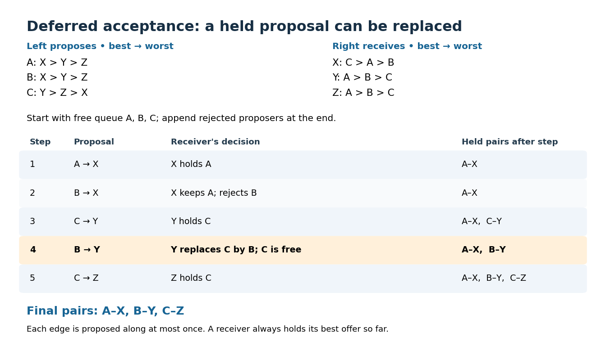

# Gale-Shapley algorithm

↑ **Parent:** [Stable matching in a bipartite graph](stable-matching-in-a-bipartite-graph.md)

The [Gale-Shapley algorithm](gale-shapley-algorithm.md) constructs a [stable matching](stable-matching-in-a-bipartite-graph.md) by letting one side propose and the other hold its best offer so far. The word "deferred" is essential: a held proposal is tentative and can be replaced. [David Gale](david-gale.md) and [Lloyd Shapley](lloyd-shapley.md) presented this construction in their 1962 paper, [College Admissions and the Stability of Marriage](https://iqua.ece.toronto.edu/baochun/ece1771f/papers/Gale-Shapley-1962.pdf), §3, printed pp. 12–13; §4 extends it to college quotas and unacceptable pairs.

For the one-partner [bipartite graph](bipartite-graph-split.md) model, designate $L$ as proposers and $R$ as receivers:
- Start with the empty [matching in a graph](matching-graph-theory-split.md). Each proposer keeps a pointer to its first untried acceptable partner.
- Choose an [unmatched vertex in a matching](unmatched-vertex-in-a-matching.md) $\ell\in L$ whose list is not exhausted. It proposes to its highest-ranked untried [neighbour of a vertex](neighbour-of-a-vertex.md) $r$ and advances its pointer permanently.
- If $r$ holds nobody, it holds $\ell$. Otherwise $r$ compares $\ell$ with its currently held proposer, keeps the one it prefers, and rejects the other. A displaced proposer becomes unmatched and may propose again later.
- Stop when every unmatched proposer has exhausted its list. The held pairs are the output [matching in a graph](matching-graph-theory-split.md).

Held proposers wait; only unmatched proposers act. A receiver can replace its held partner, whereas a proposer never tries the same [edge](edge-of-a-graph.md) twice. Isolated [vertices](vertex-graph-theory.md) simply remain unmatched. These rules also describe incomplete acceptable lists and unequal sides without adding fictitious acceptable partners.

For the preference lists under [stable matching](stable-matching-in-a-bipartite-graph.md), choose available proposers in [queue data structure](fifo-queue.md) order, initially $A,B,C$, adding rejected proposers at the end. The proposals are $A\to X$, $B\to X$, $C\to Y$, $B\to Y$, $C\to Z$. At the fourth proposal, $Y$ replaces its held $C$ by $B$ because $B\succ_Y C$. This frees $C$ to try $Z$, producing $M_L$.

**[Figure 2](#image-five-proposals-in-the-gale-shapley-algorithm-y-replaces-a-tentative-partner-before-the-final-stable-matching). Five proposals in the Gale-Shapley algorithm: Y replaces a tentative partner before the final stable matching**.

Reverse the proposing side. Starting in the order $X,Y,Z$, the proposals are $X\to C$, $Y\to A$, $Z\to A$, $Z\to B$. Now $A$ rejects $Z$ because it already holds $Y$. The result is $M_R$. Thus the choice of proposing side can change the output even with [strict preferences](strict-preference.md) and complete lists.

Why does the procedure work? Each [edge](edge-of-a-graph.md) receives at most one proposal, so at most $|E|$ proposals occur. At all times, the held [edges](edge-of-a-graph.md) form a [matching in a graph](matching-graph-theory-split.md), and each receiver holds its favourite proposer among all proposals received. A receiver's held partner can only improve according to its [strict preference](strict-preference.md). If a proposer prefers $r$ to its final partner, or ends unmatched while $r$ is acceptable, it must already have proposed to $r$. A rejection means $r$ then held someone better, and its final partner is at least as good. Such an [edge](edge-of-a-graph.md) cannot be a [blocking pair in stable matching](blocking-pair-in-stable-matching.md). This covers every possible [blocking pair in stable matching](blocking-pair-in-stable-matching.md), proving stability at termination.

With a [queue data structure](fifo-queue.md) of unmatched proposers, a next-choice pointer for each list, and constant-time receiver-rank lookups, each proposal takes constant work. Using [Big O notation](big-o-notation.md), the [time complexity](time-complexity.md) is $O(|E|+|V|)$ including initialization, provided list construction and rank preprocessing also take $O(|E|+|V|)$. Edge-indexed ranks with cross-referenced list entries, or expected constant-time hash lookups, allow sparse storage proportional to $|E|+|V|$. Repeatedly scanning a receiver's preference list to compare offers would lose this bound. For complete lists with $n$ [vertices](vertex-graph-theory.md) per side, $|E|=n^2$ and the bound is $O(n^2)$. Initializing full $n\times n$ rank tables itself costs $\Theta(n^2)$ time and space, even when only a sparse [set](set-split.md) of pairs is acceptable.

The [Gale-Shapley algorithm](gale-shapley-algorithm.md) does more than establish existence: with [strict preferences](strict-preference.md), its output is a [proposer-optimal stable matching](proposer-optimal-stable-matching.md).[§5, printed p. 14, Theorem 2: applicant optimality and the rejection induction](college-admissions-and-the-stability-of-marriage-by-david-gale-and-lloyd-shapley.md) It is also a [receiver-pessimal stable matching](receiver-pessimal-stable-matching.md), as proved below. Both qualifications compare partners across [stable matchings](stable-matching-in-a-bipartite-graph.md).

**Table of contents**

- [Proposer-optimal stable matching](proposer-optimal-stable-matching.md)
  - [Receiver-pessimal stable matching](receiver-pessimal-stable-matching.md)

## ↑ Ancestors (7)

1. [Stable matching in a bipartite graph](stable-matching-in-a-bipartite-graph.md)
2. [Matching (graph theory)](matching-graph-theory-split.md)
3. [Graph theory](graph-theory-split.md)
4. [Foundations of mathematics](foundations-of-mathematics-split.md)
5. [Area of mathematics](area-of-mathematics.md)
6. [Mathematics](mathematics-split.md)
7. [Codex Wiki](split.md)

## ← Incoming links (5)

- [Gale-Shapley algorithm](gale-shapley-algorithm.md)
- [Solution](past-exam-of-the-mathematics-course-of-the-university-of-cambridge/2002/iii/paper-9/2/solution.md)
- [Proposer-optimal stable matching](proposer-optimal-stable-matching.md)
- [Receiver-pessimal stable matching](receiver-pessimal-stable-matching.md)
- [Stable matching in a bipartite graph](stable-matching-in-a-bipartite-graph.md)
