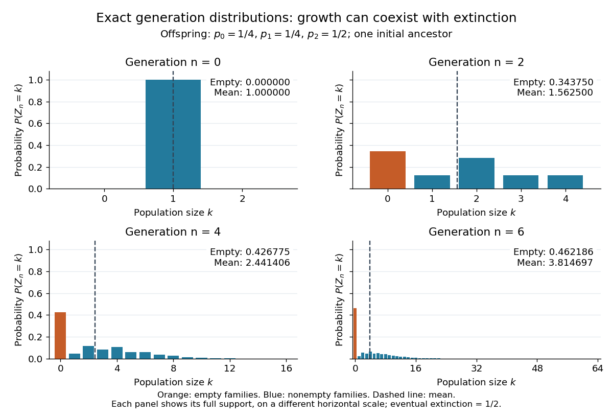

# Galton-Watson process

↑ **Parent:** [Probability and statistics](probability-and-statistics-split.md)  
ⓦ [Wiki](https://en.wikipedia.org/wiki/Galton-Watson_process)

A [Galton-Watson process](galton-watson-process-split.md) is a [branching process](branching-process.md) that counts individuals by generation. Start with one ancestor, $Z_0=1$, and let all offspring counts $\xi_{n,j}$ be [independent and identically distributed random variables](independent-and-identically-distributed-random-variables.md) taking nonnegative [integer](integer-split.md) values with a common [offspring distribution](offspring-distribution-of-a-branching-process.md). Then

$$
Z_{n+1}=\sum_{j=1}^{Z_n}\xi_{n,j},\qquad \mathbb P(\xi_{n,j}=k)=p_k,\quad k\geq0.
$$

The [empty sum](empty-sum.md) is zero: zero is an [absorbing state](absorbing-state.md), so once a generation is empty every later generation is empty. The same [offspring distribution](offspring-distribution-of-a-branching-process.md) applies to every individual in every generation. [Hao Wu, MIT 18.445, Lecture 19, slides 3–4](https://ocw.mit.edu/courses/18-445-introduction-to-stochastic-processes-spring-2015/27aaeb9eb9a9cecce93d9ad74413ddf5_MIT18_445S15_lecture19.pdf)

For a concrete [offspring distribution](offspring-distribution-of-a-branching-process.md), take $p_0=1/4$, $p_1=1/4$, $p_2=1/2$, and $p_k=0$ for $k\geq3$. An individual has no children with [probability](probability.md) $1/4$, one with [probability](probability.md) $1/4$, and two with [probability](probability.md) $1/2$. The offspring [expected value](expected-value-split.md) is $\mu=5/4$. A possible sequence of generation sizes is $1,2,1,0,0,\ldots$: two children need not lead to a permanently growing family.

The [probability generating function](probability-generating-function.md) $F(s)=1/4+s/4+s^2/2$ gives the exact generation [probability distributions](probability-distribution-split.md) through [branching-process generating-function iteration](branching-process-generating-function-iteration.md). With $G_0(s)=s$ and $G_{n+1}(s)=F(G_n(s))$, the second generation has

$$
G_2(s)=\frac{11}{32}+\frac18s+\frac9{32}s^2+\frac18s^3+\frac18s^4.
$$

Thus $\mathbb P(Z_2=0)=11/32$ and $\mathbb E[Z_2]=25/16$. The figure shows full generation [probability mass functions](probability-mass-function.md), computed by [polynomial](polynomial-split.md) [function composition](function-composition.md), through generation six; no simulated frequencies are used.

**[Figure 1](#image-exact-galton-watson-generation-distributions-growing-means-and-increasing-extinction-mass). Exact Galton-Watson generation distributions: growing means and increasing extinction mass**.

The contrast is striking: the [expected generation size in a Galton-Watson process](expected-generation-size-in-a-galton-watson-process.md) grows as $(5/4)^n$, while the [branching extinction probability](extinction-probability-of-a-branching-process.md) is $1/2$. By generation six, $\mathbb P(Z_6=0)\approx0.462186$ although $\mathbb E[Z_6]\approx3.814697$. Larger surviving families carry the rising [expected value](expected-value-split.md); that [mean](expected-value-split.md) is an average over possible families, not a forecast of one family's path. The [Galton-Watson extinction fixed point](galton-watson-extinction-fixed-point.md) turns an unbounded number of future generations into a single equation for this [probability](probability.md).

The historical question was the disappearance of surnames passed through male descendants. In [Watson and Galton, On the Probability of the Extinction of Families, pages 139–140](https://math.uchicago.edu/~shmuel/Modeling/Galton%20Watson.pdf), [Francis Galton](francis-galton.md) formulates a constant-law model counting sons who reach adulthood, and Watson computes later generation [probability distributions](probability-distribution-split.md) by composing [generating functions](generating-function.md). Those are assumptions of their model, rather than a claim that actual human reproduction follows this [offspring distribution](offspring-distribution-of-a-branching-process.md).

**Table of contents**

- [Multi-type Galton-Watson process](multi-type-galton-watson-process.md)
- [Offspring distribution of a branching process](offspring-distribution-of-a-branching-process.md)
  - [Fractional-power offspring generating function](fractional-power-offspring-generating-function.md)
- [Branching process conditioned on extinction](branching-process-conditioned-on-extinction.md)
- [Poisson branching process](poisson-branching-process.md)
  - [Bounded information in a subcritical Poisson branching process](bounded-information-in-a-subcritical-poisson-branching-process.md)
- [Binomial branching process](binomial-branching-process.md)
  - [Binomial branching survival correction](binomial-branching-survival-correction.md)
- [Total progeny of a branching process](total-progeny-of-a-branching-process.md)
  - [Finite-horizon total progeny generating function](finite-horizon-total-progeny-generating-function.md)
- [Geometric-offspring critical branching process](geometric-offspring-critical-branching-process.md)
  - [Exponential limit of surviving geometric branching](exponential-limit-of-surviving-geometric-branching.md)
- [Branching-process generating-function iteration](branching-process-generating-function-iteration.md)
- [Mean and variance of a Galton-Watson generation](mean-and-variance-of-a-galton-watson-generation.md)
- [Galton-Watson extinction fixed point](galton-watson-extinction-fixed-point.md)
  - [Laziness invariance of branching extinction](laziness-invariance-of-branching-extinction.md)
  - [Extinction probability of a branching process](extinction-probability-of-a-branching-process.md)
    - [Survival probability of a branching process](survival-probability-of-a-branching-process.md)
- [Expected generation size in a Galton-Watson process](expected-generation-size-in-a-galton-watson-process.md)
- [Quadratic Galton-Watson extinction bound](quadratic-galton-watson-extinction-bound.md)

## ↑ Ancestors (4)

1. [Probability and statistics](probability-and-statistics-split.md)
2. [Area of mathematics](area-of-mathematics.md)
3. [Mathematics](mathematics-split.md)
4. [Codex Wiki](split.md)

## ← Incoming links (31)

- [Binomial branching process](binomial-branching-process.md)
- [Branching process conditioned on extinction](branching-process-conditioned-on-extinction.md)
- [Empty sum](empty-sum.md)
- [Expected generation size in a Galton-Watson process](expected-generation-size-in-a-galton-watson-process.md)
- [Extinction probability of a branching process](extinction-probability-of-a-branching-process.md)
- [Finite-horizon total progeny generating function](finite-horizon-total-progeny-generating-function.md)
- [Fractional-power offspring generating function](fractional-power-offspring-generating-function.md)
- [Galton-Watson extinction fixed point](galton-watson-extinction-fixed-point.md)
- [Galton-Watson process](galton-watson-process-split.md)
- [Geometric-arrival single-service queue](geometric-arrival-single-service-queue.md)
- [Laziness invariance of branching extinction](laziness-invariance-of-branching-extinction.md)
- [Mean and variance of a Galton-Watson generation](mean-and-variance-of-a-galton-watson-generation.md)
- [Offspring distribution of a branching process](offspring-distribution-of-a-branching-process.md)
- [Solution](past-exam-of-the-mathematics-course-of-the-university-of-cambridge/2002/ia/paper-2/12f/a/solution.md)
- [Solution](past-exam-of-the-mathematics-course-of-the-university-of-cambridge/2002/iii/paper-28/2/solution.md)
- [Solution](past-exam-of-the-mathematics-course-of-the-university-of-cambridge/2003/ia/paper-2/11f/solution.md)
- [Solution](past-exam-of-the-mathematics-course-of-the-university-of-cambridge/2007/ib/paper-2/20c/solution.md)
- [Solution](past-exam-of-the-mathematics-course-of-the-university-of-cambridge/2008/ia/paper-2/9f/solution.md)
- [Solution](past-exam-of-the-mathematics-course-of-the-university-of-cambridge/2012/ia/paper-2/11f/i/solution.md)
- [Solution](past-exam-of-the-mathematics-course-of-the-university-of-cambridge/2012/iii/paper-9/3/i/solution.md)
- [Solution](past-exam-of-the-mathematics-course-of-the-university-of-cambridge/2012/iii/paper-9/3/ii/solution.md)
- [Solution](past-exam-of-the-mathematics-course-of-the-university-of-cambridge/2013/ia/paper-2/10f/solution.md)
- [Solution](past-exam-of-the-mathematics-course-of-the-university-of-cambridge/2018/ia/paper-2/11f/a/solution.md)
- [Solution](past-exam-of-the-mathematics-course-of-the-university-of-cambridge/2019/iii/paper-214/2/b/solution.md)
- [Solution](past-exam-of-the-mathematics-course-of-the-university-of-cambridge/2020/ia/paper-1/4f/solution.md)
- [Solution](past-exam-of-the-mathematics-course-of-the-university-of-cambridge/2022/iii/paper-204/2/c/solution.md)
- [Poisson branching process](poisson-branching-process.md)
- [Sharp subcritical largest-component scale](sharp-subcritical-largest-component-scale.md)
- [Survival probability of a branching process](survival-probability-of-a-branching-process.md)
- [Total progeny of a branching process](total-progeny-of-a-branching-process.md)
- [Two-vertex branching comparison for contact-process survival](two-vertex-branching-comparison-for-contact-process-survival.md)
