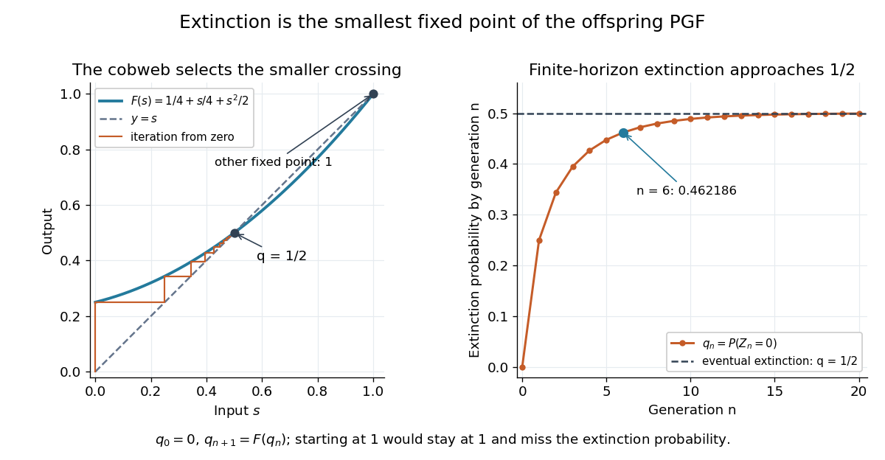

# Galton-Watson process

↑ **Parent:** [Probability and statistics](probability-and-statistics.md)  
ⓦ [Wiki](https://en.wikipedia.org/wiki/Galton-Watson_process)

A [Galton-Watson process](galton-watson-process.md) is a [branching process](stochastic-process.md#branching-process) that counts individuals by generation. Start with one ancestor, $Z_0=1$, and let all offspring counts $\xi_{n,j}$ be [independent and identically distributed random variables](random-variable.md#independent-and-identically-distributed-random-variables) taking nonnegative [integer](integer.md) values with a common [offspring distribution](#offspring-distribution-of-a-branching-process). Then

$$
Z_{n+1}=\sum_{j=1}^{Z_n}\xi_{n,j},\qquad \mathbb P(\xi_{n,j}=k)=p_k,\quad k\geq0.
$$

The [empty sum](arithmetic.md#empty-sum) is zero: zero is an [absorbing state](markov-chain.md#absorbing-state), so once a generation is empty every later generation is empty. The same [offspring distribution](#offspring-distribution-of-a-branching-process) applies to every individual in every generation. [Hao Wu, MIT 18.445, Lecture 19, slides 3–4](https://ocw.mit.edu/courses/18-445-introduction-to-stochastic-processes-spring-2015/27aaeb9eb9a9cecce93d9ad74413ddf5_MIT18_445S15_lecture19.pdf)

For a concrete [offspring distribution](#offspring-distribution-of-a-branching-process), take $p_0=1/4$, $p_1=1/4$, $p_2=1/2$, and $p_k=0$ for $k\geq3$. An individual has no children with [probability](probability-theory.md#probability) $1/4$, one with [probability](probability-theory.md#probability) $1/4$, and two with [probability](probability-theory.md#probability) $1/2$. The offspring [expected value](expected-value.md) is $\mu=5/4$. A possible sequence of generation sizes is $1,2,1,0,0,\ldots$: two children need not lead to a permanently growing family.

The [probability generating function](probability-distribution.md#probability-generating-function) $F(s)=1/4+s/4+s^2/2$ gives the exact generation [probability distributions](probability-distribution.md) through [branching-process generating-function iteration](#branching-process-generating-function-iteration). With $G_0(s)=s$ and $G_{n+1}(s)=F(G_n(s))$, the second generation has

$$
G_2(s)=\frac{11}{32}+\frac18s+\frac9{32}s^2+\frac18s^3+\frac18s^4.
$$

Thus $\mathbb P(Z_2=0)=11/32$ and $\mathbb E[Z_2]=25/16$. The figure shows full generation [probability mass functions](probability-distribution.md#probability-mass-function), computed by [polynomial](polynomial.md) [function composition](function.md#function-composition), through generation six; no simulated frequencies are used.

**[Figure 1](#image-exact-galton-watson-generation-distributions-growing-means-and-increasing-extinction-mass). Exact Galton-Watson generation distributions: growing means and increasing extinction mass**.

The contrast is striking: the [expected generation size in a Galton-Watson process](#expected-generation-size-in-a-galton-watson-process) grows as $(5/4)^n$, while the [branching extinction probability](#extinction-probability-of-a-branching-process) is $1/2$. By generation six, $\mathbb P(Z_6=0)\approx0.462186$ although $\mathbb E[Z_6]\approx3.814697$. Larger surviving families carry the rising [expected value](expected-value.md); that [mean](expected-value.md) is an average over possible families, not a forecast of one family's path. The [Galton-Watson extinction fixed point](#galton-watson-extinction-fixed-point) turns an unbounded number of future generations into a single equation for this [probability](probability-theory.md#probability).

The historical question was the disappearance of surnames passed through male descendants. In [Watson and Galton, On the Probability of the Extinction of Families, pages 139–140](https://math.uchicago.edu/~shmuel/Modeling/Galton%20Watson.pdf), [Francis Galton](probability-and-statistics.md#francis-galton) formulates a constant-law model counting sons who reach adulthood, and Watson computes later generation [probability distributions](probability-distribution.md) by composing [generating functions](sequence-and-series.md#generating-function). Those are assumptions of their model, rather than a claim that actual human reproduction follows this [offspring distribution](#offspring-distribution-of-a-branching-process).

**Table of contents**

- [Multi-type Galton-Watson process](#multi-type-galton-watson-process)
- [Offspring distribution of a branching process](#offspring-distribution-of-a-branching-process)
  - [Fractional-power offspring generating function](#fractional-power-offspring-generating-function)
- [Branching process conditioned on extinction](#branching-process-conditioned-on-extinction)
- [Poisson branching process](#poisson-branching-process)
  - [Bounded information in a subcritical Poisson branching process](#bounded-information-in-a-subcritical-poisson-branching-process)
- [Binomial branching process](#binomial-branching-process)
  - [Binomial branching survival correction](#binomial-branching-survival-correction)
- [Total progeny of a branching process](#total-progeny-of-a-branching-process)
  - [Finite-horizon total progeny generating function](#finite-horizon-total-progeny-generating-function)
- [Geometric-offspring critical branching process](#geometric-offspring-critical-branching-process)
  - [Exponential limit of surviving geometric branching](#exponential-limit-of-surviving-geometric-branching)
- [Branching-process generating-function iteration](#branching-process-generating-function-iteration)
- [Mean and variance of a Galton-Watson generation](#mean-and-variance-of-a-galton-watson-generation)
- [Galton-Watson extinction fixed point](#galton-watson-extinction-fixed-point)
  - [Laziness invariance of branching extinction](#laziness-invariance-of-branching-extinction)
  - [Extinction probability of a branching process](#extinction-probability-of-a-branching-process)
    - [Survival probability of a branching process](#survival-probability-of-a-branching-process)
- [Expected generation size in a Galton-Watson process](#expected-generation-size-in-a-galton-watson-process)
- [Quadratic Galton-Watson extinction bound](#quadratic-galton-watson-extinction-bound)

## Multi-type Galton-Watson process

↑ **Parent:** [Galton-Watson process](galton-watson-process.md)

## Offspring distribution of a branching process

↑ **Parent:** [Galton-Watson process](galton-watson-process.md)

The offspring [probability distribution](probability-distribution.md) of a [Galton-Watson process](galton-watson-process.md) is the law of one individual's number of children: $p_k=\mathbb P(\xi=k)$ for $k\geq0$, with $p_k\geq0$ and $\sum_{k\geq0}p_k=1$. Its [probability generating function](probability-distribution.md#probability-generating-function) and, when finite, its [expected value](expected-value.md) are

$$
F(s)=\mathbb E[s^\xi]=\sum_{k\geq0}p_ks^k,\quad 0\leq s\leq1,\qquad \mu=\mathbb E[\xi]=\sum_{k\geq0}kp_k=F'(1-).
$$

Use $0^0=1$ when evaluating the [probability generating function](probability-distribution.md#probability-generating-function) at zero: $F(0)=p_0$ and $F(1)=1$.

For $p_0=p_1=1/4$ and $p_2=1/2$, $F(s)=1/4+s/4+s^2/2$, $\mu=5/4$, and the offspring [variance](variance.md) is $11/16$: $\mathbb E[\xi^2]=9/4$ and $\operatorname{Var}(\xi)=9/4-(5/4)^2$. The generation [probability mass functions](probability-distribution.md#probability-mass-function) pictured under [Galton-Watson process](galton-watson-process.md) come from repeatedly composing this [probability generating function](probability-distribution.md#probability-generating-function). They describe the whole generation, whereas $(p_k)$ describes one individual's reproduction. [University of Münster branching-process notes, Section 1.3, Proposition 1.4](https://www.uni-muenster.de/Stochastik/lehre/WS1011/SpezielleStochastischeProzesse/Ch_1.pdf)

The whole [offspring distribution](#offspring-distribution-of-a-branching-process) matters for extinction. Another law, $p_0=3/8$ and $p_2=5/8$, has the same offspring [mean](expected-value.md) $5/4$ but [branching extinction probability](#extinction-probability-of-a-branching-process) $3/5$, since $3/8+5s^2/8=s$ has [roots of a polynomial](polynomial.md#root-of-a-polynomial) $3/5$ and $1$. Consequently the two laws have the same [expected generation size in a Galton-Watson process](#expected-generation-size-in-a-galton-watson-process) at each generation but different survival chances. A [binomial branching process](#binomial-branching-process) and a [Poisson branching process](#poisson-branching-process) likewise specify different [offspring distributions](#offspring-distribution-of-a-branching-process); a common [mean](expected-value.md) does not make their [probability generating functions](probability-distribution.md#probability-generating-function) identical.

### Fractional-power offspring generating function

↑ **Parent:** [Offspring distribution of a branching process](#offspring-distribution-of-a-branching-process)

For $0<\alpha,\beta<1$, this [probability generating function](probability-distribution.md#probability-generating-function) has probabilities $p_0=1-\alpha$ and $p_k=\alpha\beta(1-\beta)\cdots(k-1-\beta)/k!$ for $k\ge1$, where the product after $\beta$ is empty for $k=1$. All probabilities are positive and sum to one, while the [expected value](expected-value.md) is infinite. In a [Galton-Watson process](galton-watson-process.md) starting with one individual, the generation-$n$ [probability generating function](probability-distribution.md#probability-generating-function) is $G_n(s)=1-\alpha^{(1-\beta^n)/(1-\beta)}(1-s)^{\beta^n}$. The [branching extinction probability](#extinction-probability-of-a-branching-process) is $1-\alpha^{1/(1-\beta)}$, obtained by taking the limit of $G_n(0)$ and using that extinction by generation $n$ is an increasing sequence of [events](probability-space.md#event).

## Branching process conditioned on extinction

↑ **Parent:** [Galton-Watson process](galton-watson-process.md)

Let $q\in(0,1]$ be the [branching extinction probability](#extinction-probability-of-a-branching-process) of a [Galton-Watson process](galton-watson-process.md) with offspring [probability generating function](probability-distribution.md#probability-generating-function) $f$. Conditional on extinction, the probability of $j$ children is multiplied by $q^j/q$: every child's descendants must also become extinct. Hence the new [probability generating function](probability-distribution.md#probability-generating-function) is $f_q$ and its mean is $f'(q)$. If $f'(q)<1$, the [total progeny of a branching process](#total-progeny-of-a-branching-process) has conditional [expected value](expected-value.md) $1/(1-f'(q))$, and unconditionally $\mathbb E[T;T<\infty]=q/(1-f'(q))$. The [Markov inequality](probability-inequality.md#markov-s-inequality) gives a finite-total-progeny tail bound without discarding the survival mass.

## Poisson branching process

↑ **Parent:** [Galton-Watson process](galton-watson-process.md)

A [Galton-Watson process](galton-watson-process.md) with a [Poisson distribution](discrete-probability-distribution.md#poisson-distribution) of offspring of mean $\mu$ has this [probability generating function](probability-distribution.md#probability-generating-function). For $\mu=1+\varepsilon>1$ its [branching survival probability](#survival-probability-of-a-branching-process) $r$ satisfies $-\log(1-r)=(1+\varepsilon)r$, and $2\varepsilon/(1+2\varepsilon)\leq r\leq2\varepsilon$. Indeed $\varepsilon=\sum_{j\geq1}r^j/(j+1)$ lies between $r/2$ and $r/[2(1-r)]$. These exact inequalities belong to the [Poisson branching process](#poisson-branching-process), not to every finite [binomial branching process](#binomial-branching-process).

### Bounded information in a subcritical Poisson branching process

↑ **Parent:** [Poisson branching process](#poisson-branching-process)

Start with $Y_0\sim\operatorname{Poisson}(\theta)$ and conditionally let $Y_i\sim\operatorname{Poisson}(\theta Y_{i-1})$. The mean generation size is $\theta^{i+1}$. The log-likelihood is $S_n\log\theta-\theta T_n$ plus a parameter-free term, where $S_n=\sum_{i=0}^nY_i$ and $T_n=1+\sum_{i=0}^{n-1}Y_i$. Expected negative curvature gives the displayed [Fisher information](statistical-modelling.md#fisher-information-matrix), bounded as the horizon grows. Extinction makes the observations eventually all zero, so one longer observed family does not supply indefinitely increasing information.

// Target: convergence-of-random-variables.bigb

## Binomial branching process

↑ **Parent:** [Galton-Watson process](galton-watson-process.md)

A [Galton-Watson process](galton-watson-process.md) whose offspring law is a [binomial distribution](discrete-probability-distribution.md#binomial-distribution) $\operatorname{Bin}(n,p)$ has mean $np$ and the displayed offspring [probability generating function](probability-distribution.md#probability-generating-function). Its [branching extinction probability](#extinction-probability-of-a-branching-process) is the smallest root of $q=f(q)$ in $[0,1]$. It dominates a [breadth-first exploration of a binomial random graph](random-graph.md#breadth-first-exploration-of-a-binomial-random-graph) by allowing each explored [vertex](graph.md#vertex-graph-theory) up to $n$ independent possible children, including previously exposed or already discovered [vertices](graph.md#vertex-graph-theory) as phantom children.

### Binomial branching survival correction

↑ **Parent:** [Binomial branching process](#binomial-branching-process)

For $p=(1+\varepsilon)/n$, the [branching survival probability](#survival-probability-of-a-branching-process) satisfies $1-\rho=(1-p\rho)^n$. If $(1+\varepsilon)^2<n$, comparison with a [Poisson branching process](#poisson-branching-process) and expansion of the [logarithm](calculus.md#logarithm) give

$$
\frac{2\varepsilon}{1+2\varepsilon}\leq\rho\leq\frac{2\varepsilon}{1-(1+\varepsilon)^2/n}.
$$

For the upper bound use $\varepsilon=\sum_{j\geq1}(1-np^{j+1})\rho^j/(j+1)$ and retain its first nonnegative term. For fixed $n>1$, the leading term is instead $2n\varepsilon/(n-1)$. In particular $n=2$ gives $\rho=4\varepsilon/(1+\varepsilon)^2$, showing that the uncorrected exact bound $\rho\leq2\varepsilon$ is false for small positive $\varepsilon$.

For $0<\varepsilon\leq1/4$ and $n\varepsilon\geq2$, the uncorrected exact upper bound does hold for the [binomial branching process](#binomial-branching-process). Here $np^2\leq\varepsilon$ and $np^3\leq1/4$, so at $x=2\varepsilon$ the first two terms of the nonnegative series give $\varepsilon(1-np^2)+(4/3)\varepsilon^2(1-np^3)\geq\varepsilon$. Monotonicity of that series yields $\rho\leq2\varepsilon$. This recovers the intended large-$n$ bracket without claiming it for every finite reproduction law.

## Total progeny of a branching process

↑ **Parent:** [Galton-Watson process](galton-watson-process.md)

The total progeny counts all individuals, including the initial ancestor, in a [Galton-Watson process](galton-watson-process.md). It is infinite on survival. If the offspring mean is $m<1$, the [expected generation size in a Galton-Watson process](#expected-generation-size-in-a-galton-watson-process) and the [monotone convergence theorem](measure-theory.md#monotone-convergence-theorem) give $\mathbb ET=1/(1-m)$.

### Finite-horizon total progeny generating function

↑ **Parent:** [Total progeny of a branching process](#total-progeny-of-a-branching-process)

Count the ancestor and the next $n-1$ generations of a [Galton-Watson process](galton-watson-process.md). Conditioning on the ancestor's offspring, their independent descendant trees each have the preceding finite-horizon [probability generating function](probability-distribution.md#probability-generating-function), proving the displayed recursion. If the count instead excludes the ancestor, the recursion is $\widehat H_{n+1}(s)=G(s\widehat H_n(s))$ with $\widehat H_0=1$. The indexing convention must be specified.

## Geometric-offspring critical branching process

↑ **Parent:** [Galton-Watson process](galton-watson-process.md)

The offspring [probabilities](probability-theory.md#probability) $P(K=j)=2^{-j-1}$ for $j\geq0$ have [expected value](expected-value.md) one. For one initial individual, the [branching-process generating-function iteration](#branching-process-generating-function-iteration) gives

$$
G_n(s)=\frac{n-(n-1)s}{n+1-ns},\quad P(X_n=0)=\frac n{n+1},\quad
P(X_n=j)=\frac1{(n+1)^2}\left(\frac n{n+1}\right)^{j-1}\ (j\geq1).
$$

For $n\geq1$ the [PGF](probability-distribution.md#probability-generating-function) disk is $|s|<1+1/n$; $G_0(s)=s$ separately. Conditional on survival, the population is positive geometric with success [probability](probability-theory.md#probability) $1/(n+1)$, leading to the [exponential limit of surviving geometric branching](#exponential-limit-of-surviving-geometric-branching).

### Exponential limit of surviving geometric branching

↑ **Parent:** [Geometric-offspring critical branching process](#geometric-offspring-critical-branching-process)

For the stated critical geometric offspring law, the conditional upper tail is exactly $[n/(n+1)]^{\lfloor nx\rfloor}$ for $x\geq0$. Its logarithm tends to $-x$, proving an [exponential distribution](continuous-probability-distribution.md#exponential-distribution) limit of rate one without a transform continuity theorem. The unconditional mass at zero tends to one, so survival conditioning changes the relevant limiting population scale.

## Branching-process generating-function iteration

↑ **Parent:** [Galton-Watson process](galton-watson-process.md)

Conditioning on the initial individual's children gives independent copies of the population $n$ generations later. Their [PGFs](probability-distribution.md#probability-generating-function) multiply, and averaging the product over the offspring number yields $G(G_n(s))$. Conditioning on the last generation gives $G_n(G(s))$ as well; both agree because $G_n$ is the $n$fold iterate of $G$.

## Mean and variance of a Galton-Watson generation

↑ **Parent:** [Galton-Watson process](galton-watson-process.md)

With one initial ancestor and independent offspring counts of finite mean and [variance](variance.md), conditioning on the current generation gives the displayed recurrences. For $\mu\ne1$ the [variance](variance.md) is $\sigma^2\mu^{n-1}(\mu^n-1)/(\mu-1)$ for positive generation index. At $\mu=1$ it is $n\sigma^2$. At zero offspring mean the distribution is concentrated at zero and later generations vanish. These formulas are for the [Galton-Watson process](galton-watson-process.md), not arbitrary dependent reproduction.

## Galton-Watson extinction fixed point

↑ **Parent:** [Galton-Watson process](galton-watson-process.md)

For a [Galton-Watson process](galton-watson-process.md) with one ancestor and offspring [probability generating function](probability-distribution.md#probability-generating-function) $F$, the [branching extinction probability](#extinction-probability-of-a-branching-process) $q$ is the smallest [fixed point](function.md#fixed-point) of $F$ in $[0,1]$. A direct way to find it is to compute extinction by generation $n$:

$$
q_0=0,\qquad q_n=\mathbb P(Z_n=0),\qquad q_{n+1}=F(q_n),\qquad q_n\uparrow q.
$$

Zero is an [absorbing state](markov-chain.md#absorbing-state), so extinction by generation $n$ is exactly the [event](probability-space.md#event) $Z_n=0$. [Hao Wu, MIT 18.445, Lecture 19, slide 4](https://ocw.mit.edu/courses/18-445-introduction-to-stochastic-processes-spring-2015/27aaeb9eb9a9cecce93d9ad74413ddf5_MIT18_445S15_lecture19.pdf)

For $F(s)=1/4+s/4+s^2/2$, the equation is

$$
F(s)-s=\frac12\left(s-\frac12\right)(s-1)=0.
$$

Both $1/2$ and $1$ are [fixed points](function.md#fixed-point), but iteration from zero selects $q=1/2$. The first values are $q_1=1/4$, $q_2=11/32$, $q_3=809/2048\approx0.395020$, and $q_6\approx0.462186$. Iteration started at $1$ would stay at $1$ forever and would give the wrong extinction answer for this [offspring distribution](#offspring-distribution-of-a-branching-process).

**[Figure 2](#image-the-smallest-extinction-fixed-point-selected-by-iteration-from-zero). The smallest extinction fixed point selected by iteration from zero**.

The vertical steps in the figure apply the offspring [probability generating function](probability-distribution.md#probability-generating-function); horizontal steps return to the diagonal to start the next iteration. This gives a useful numerical calculation even when solving $F(s)=s$ explicitly is difficult. For the displayed law, every finite iteration is a lower bound for the eventual [branching extinction probability](#extinction-probability-of-a-branching-process); at generation six, about $0.037814$ additional extinction [probability](probability-theory.md#probability) remains beyond the current empty families.

Why the smallest [fixed point](function.md#fixed-point)? The ancestor's children's descendant families are [independent](random-variable.md#independent-random-variables); given $k$ children, all are empty $n$ generations later with [probability](probability-theory.md#probability) $q_n^k$. Averaging gives $q_{n+1}=\sum_kp_kq_n^k=F(q_n)$. The increasing extinction [events](probability-space.md#event) give the [limit](calculus.md#limit-of-a-function) $q$, and [continuity](calculus.md#continuous-function) of the [probability generating function](probability-distribution.md#probability-generating-function) yields $F(q)=q$. For any other [fixed point](function.md#fixed-point) $r\in[0,1]$, $q_0\leq r$ and [monotonicity](calculus.md#monotonic-function) of $F$ imply $q_n\leq r$ at every step; hence $q\leq r$. [University of Münster branching-process notes, Section 1.4, Theorem 1.7](https://www.uni-muenster.de/Stochastik/lehre/WS1011/SpezielleStochastischeProzesse/Ch_1.pdf)

### Laziness invariance of branching extinction

↑ **Parent:** [Galton-Watson extinction fixed point](#galton-watson-extinction-fixed-point)

For a [Galton-Watson process](galton-watson-process.md), replacing an individual's reproduction by a one-descendant uneventful step with probability $q<1$ changes its offspring [probability generating function](probability-distribution.md#probability-generating-function) to the displayed mixture. Its fixed-point equation reduces to $G(z)=z$, so the smallest fixed point and hence the [extinction probability of a branching process](#extinction-probability-of-a-branching-process) are unchanged. The mean is $q+(1-q)G'(1)$, which also preserves the subcritical/critical/supercritical classification. The excluded case $q=1$ never reproduces or dies and need not share the extinction probability.

### Extinction probability of a branching process

↑ **Parent:** [Galton-Watson extinction fixed point](#galton-watson-extinction-fixed-point)

For a [Galton-Watson process](galton-watson-process.md) with one ancestor, the [branching extinction probability](#extinction-probability-of-a-branching-process) is the [probability](probability-theory.md#probability) that some generation is empty:

$$
q=\mathbb P\left(\bigcup_{n\geq0}\{Z_n=0\}\right)=\lim_{n\to\infty}\mathbb P(Z_n=0).
$$

The equality uses the [absorbing state](markov-chain.md#absorbing-state) at zero. The complementary [branching survival probability](#survival-probability-of-a-branching-process) $1-q$ is the [probability](probability-theory.md#probability) that every generation is nonempty. The [Galton-Watson extinction fixed point](#galton-watson-extinction-fixed-point) computes $q$ from the [offspring distribution](#offspring-distribution-of-a-branching-process).

For $p_0=p_1=1/4$, $p_2=1/2$, one ancestor has $q=1/2$. Starting instead from $m$ ancestors with [independent](random-variable.md#independent-random-variables) descendant families gives

$$
\mathbb P(\text{eventual extinction}\mid Z_0=m)=q^m,\qquad \mathbb P(Z_n=0\mid Z_0=m)=q_n^m.
$$

All $m$ families must die out. With three ancestors, eventual extinction has [probability](probability-theory.md#probability) $1/8$ and survival has [probability](probability-theory.md#probability) $7/8$; by generation two, extinction has [probability](probability-theory.md#probability) $(11/32)^3=1331/32768\approx0.040619$. Extra ancestors change the extinction [probability](probability-theory.md#probability) without changing the [offspring distribution](#offspring-distribution-of-a-branching-process). [University of Münster branching-process notes, Lemma 1.2 and equation (1.10)](https://www.uni-muenster.de/Stochastik/lehre/WS1011/SpezielleStochastischeProzesse/Ch_1.pdf)

For finite offspring [mean](expected-value.md) $\mu$, the extinction classification is:
- If $\mu<1$, extinction has [probability](probability-theory.md#probability) $1$. For example $p_0=3/4$, $p_2=1/4$ gives $\mu=1/2$ and $F(s)=3/4+s^2/4$; its only [fixed point](function.md#fixed-point) in $[0,1]$ is $1$.
- If $\mu=1$ and $p_1\ne1$, extinction also has [probability](probability-theory.md#probability) $1$. For example $p_0=p_2=1/2$ gives $F(s)-s=(s-1)^2/2$ and $q=1$, despite [expected generation size in a Galton-Watson process](#expected-generation-size-in-a-galton-watson-process) remaining one.
- If $1<\mu<\infty$, extinction has [probability](probability-theory.md#probability) $q<1$. The value can be zero: if $p_0=0$, every individual has at least one child, so an initially nonempty family never becomes empty. In particular $p_2=1$ gives $Z_n=2^n$ and $q=0$.

The critical exception is $p_1=1$: every individual has exactly one child, $F(s)=s$, and $Z_n=1$ forever from one ancestor. Thus $\mu=1$ but $q=0$; a blanket claim that every critical [Galton-Watson process](galton-watson-process.md) becomes extinct would be false. These cases concern the [Galton-Watson process](galton-watson-process.md) with its common [offspring distribution](#offspring-distribution-of-a-branching-process) and [independence](random-variable.md#independent-random-variables) assumptions. [University of Münster branching-process notes, Section 1.4, trivial cases and Theorem 1.7](https://www.uni-muenster.de/Stochastik/lehre/WS1011/SpezielleStochastischeProzesse/Ch_1.pdf)

This [probability](probability-theory.md#probability) answers whether any lineage persists, which the offspring [mean](expected-value.md) alone cannot quantify in the supercritical case. A [branching process conditioned on extinction](#branching-process-conditioned-on-extinction) uses the same [fixed point](function.md#fixed-point) to reweight reproduction and describe families known eventually to die out.

#### Survival probability of a branching process

↑ **Parent:** [Extinction probability of a branching process](#extinction-probability-of-a-branching-process)

For a [Galton-Watson process](galton-watson-process.md) started from one ancestor, this is the [probability](probability-theory.md#probability) that every generation is nonempty. It is the complement of the [branching extinction probability](#extinction-probability-of-a-branching-process). The [binomial branching survival correction](#binomial-branching-survival-correction) distinguishes finite-binomial reproduction from the [Poisson branching process](#poisson-branching-process) near mean one.

## Expected generation size in a Galton-Watson process

↑ **Parent:** [Galton-Watson process](galton-watson-process.md)

For a [Galton-Watson process](galton-watson-process.md) starting with one ancestor and finite offspring [mean](expected-value.md) $\mu$, the [expected value](expected-value.md) of the generation size is $\mathbb E[Z_n]=\mu^n$. At $n=0$ it is one, including when $\mu=0$; zero offspring [mean](expected-value.md) forces every later generation to be empty. With $m$ initial ancestors, the [expected value](expected-value.md) is $m\mu^n$.

For $p_0=p_1=1/4$, $p_2=1/2$, the offspring [mean](expected-value.md) is $5/4$. The exact calculations used in the generation [probability mass function](probability-distribution.md#probability-mass-function) figure under [Galton-Watson process](galton-watson-process.md) give:

| Generation $n$ | Possible sizes | Extinction by $n$: $q_n$ | [Expected value](expected-value.md) $\mathbb E[Z_n]$ |
| --- | --- | --- | --- |
| 0 | 1 | 0 | 1 |
| 1 | 0–2 | 0.2500000000 | 1.25 |
| 2 | 0–4 | 0.3437500000 | 1.5625 |
| 3 | 0–8 | 0.3950195313 | 1.953125 |
| 4 | 0–16 | 0.4267750978 | 2.44140625 |
| 5 | 0–32 | 0.4477622665 | 3.0517578125 |
| 6 | 0–64 | 0.4621860903 | 3.814697265625 |

Nearly half the families are already empty at generation six, yet the [expected value](expected-value.md) exceeds three. Since empty families contribute zero,

$$
\mathbb E[Z_n\mid Z_n>0]=\frac{\mu^n}{1-q_n}
$$

whenever $q_n<1$. At generation six this [conditional expectation](measure-theory.md#conditional-expectation) is about $7.092969$. Conditioning on being nonempty now differs from conditioning on eventual survival: some presently nonempty families will still die out. The eventual [branching extinction probability](#extinction-probability-of-a-branching-process) is $1/2$, even as the unconditional [expected value](expected-value.md) grows without bound.

The [expected value](expected-value.md) is useful for computing average population counts and, in the subcritical case, the [expected value](expected-value.md) of the [total progeny of a branching process](#total-progeny-of-a-branching-process). Its simple formula comes from one local calculation: [linearity of expectation](expected-value.md#linearity-of-expectation) and the [independent and identically distributed](random-variable.md#independent-and-identically-distributed-random-variables) offspring counts give

$$
\mathbb E[Z_{n+1}\mid Z_n]=\mu Z_n,\qquad \mathbb E[Z_{n+1}]=\mu\mathbb E[Z_n].
$$

The [tower property of conditional expectation](measure-theory.md#law-of-total-expectation) gives the second equality; starting from $\mathbb E[Z_0]=1$ gives the formula. It describes an average over the generation [probability distribution](probability-distribution.md), not deterministic growth of an individual family. [University of Münster branching-process notes, Section 1.3, Proposition 1.4](https://www.uni-muenster.de/Stochastik/lehre/WS1011/SpezielleStochastischeProzesse/Ch_1.pdf)

## Quadratic Galton-Watson extinction bound

↑ **Parent:** [Galton-Watson process](galton-watson-process.md)

For offspring mean $\mu>1$ and variance $\sigma^2$, Taylor expansion at one gives

$$
d\leq1-\frac{2(\mu-1)}{\sigma^2+\mu^2-\mu}
$$

for the extinction probability $d$.

## ↑ Ancestors (4)

1. [Probability and statistics](probability-and-statistics.md)
2. [Area of mathematics](mathematics.md#area-of-mathematics)
3. [Mathematics](mathematics.md)
4. [Codex Wiki](README.md)

## ← Incoming links (31)

- [Binomial branching process](#binomial-branching-process)
- [Branching process conditioned on extinction](#branching-process-conditioned-on-extinction)
- [Empty sum](arithmetic.md#empty-sum)
- [Expected generation size in a Galton-Watson process](#expected-generation-size-in-a-galton-watson-process)
- [Extinction probability of a branching process](#extinction-probability-of-a-branching-process)
- [Finite-horizon total progeny generating function](#finite-horizon-total-progeny-generating-function)
- [Fractional-power offspring generating function](#fractional-power-offspring-generating-function)
- [Galton-Watson extinction fixed point](#galton-watson-extinction-fixed-point)
- [Galton-Watson process](galton-watson-process.md)
- [Geometric-arrival single-service queue](queueing-theory.md#geometric-arrival-single-service-queue)
- [Laziness invariance of branching extinction](#laziness-invariance-of-branching-extinction)
- [Mean and variance of a Galton-Watson generation](#mean-and-variance-of-a-galton-watson-generation)
- [Offspring distribution of a branching process](#offspring-distribution-of-a-branching-process)
- [Solution](past-exam-of-the-mathematics-course-of-the-university-of-cambridge/2002/ia/paper-2.md#12f/a/solution)
- [Solution](past-exam-of-the-mathematics-course-of-the-university-of-cambridge/2002/iii/paper-28.md#2/solution)
- [Solution](past-exam-of-the-mathematics-course-of-the-university-of-cambridge/2003/ia/paper-2.md#11f/solution)
- [Solution](past-exam-of-the-mathematics-course-of-the-university-of-cambridge/2007/ib/paper-2.md#20c/solution)
- [Solution](past-exam-of-the-mathematics-course-of-the-university-of-cambridge/2008/ia/paper-2.md#9f/solution)
- [Solution](past-exam-of-the-mathematics-course-of-the-university-of-cambridge/2012/ia/paper-2.md#11f/i/solution)
- [Solution](past-exam-of-the-mathematics-course-of-the-university-of-cambridge/2012/iii/paper-9.md#3/i/solution)
- [Solution](past-exam-of-the-mathematics-course-of-the-university-of-cambridge/2012/iii/paper-9.md#3/ii/solution)
- [Solution](past-exam-of-the-mathematics-course-of-the-university-of-cambridge/2013/ia/paper-2.md#10f/solution)
- [Solution](past-exam-of-the-mathematics-course-of-the-university-of-cambridge/2018/ia/paper-2.md#11f/a/solution)
- [Solution](past-exam-of-the-mathematics-course-of-the-university-of-cambridge/2019/iii/paper-214.md#2/b/solution)
- [Solution](past-exam-of-the-mathematics-course-of-the-university-of-cambridge/2020/ia/paper-1.md#4f/solution)
- [Solution](past-exam-of-the-mathematics-course-of-the-university-of-cambridge/2022/iii/paper-204.md#2/c/solution)
- [Poisson branching process](#poisson-branching-process)
- [Sharp subcritical largest-component scale](probabilistic-combinatorics.md#sharp-subcritical-largest-component-scale)
- [Survival probability of a branching process](#survival-probability-of-a-branching-process)
- [Total progeny of a branching process](#total-progeny-of-a-branching-process)
- [Two-vertex branching comparison for contact-process survival](stochastic-process.md#two-vertex-branching-comparison-for-contact-process-survival)
