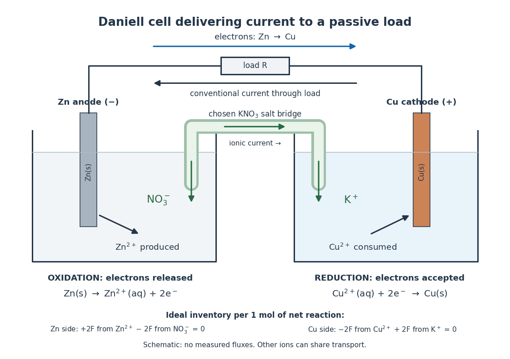

# Galvanic cell

↑ **Parent:** [Electrochemistry](electrochemistry.md)  
ⓦ [Wiki](https://en.wikipedia.org/wiki/Galvanic_cell)

A [galvanic cell](galvanic-cell.md) supplies electrical [work](work.md) from a spontaneous [redox](redox.md) [chemical reaction](chemical-reaction.md) under the specified conditions. In discharge through a passive load, [oxidation](oxidation.md) occurs at its negative [anode](anode.md) and [reduction](reduction-chemistry.md) at its positive [cathode](cathode.md). Separating the reacting compartments makes the [Electrons](electron.md) take an external route, where their transport can deliver useful [work](work.md). See [Flowers et al., Chemistry 2e, §17.2: separated reactions and electrical work](https://openstax.org/books/chemistry-2e/pages/17-2-galvanic-cells).

**[Figure 45](#image-daniell-cell-discharge-electron-flow-outside-and-ion-transport-inside). Daniell cell discharge: Electron flow outside and ion transport inside**. Original schematic of a [zinc](zinc.md)/[copper](copper.md) [galvanic cell](galvanic-cell.md) connected to a passive load. A chosen [potassium](potassium.md) [nitrate](nitrate.md) [salt bridge](salt-bridge.md) supplies compensating [anions](anion.md) to the [anode](anode.md) compartment and [cations](cation.md) to the [cathode](cathode.md) compartment. The arrows represent charge-balance roles, not measured trajectories or relative fluxes. The bottom inventory is an ideal accounting example for one [mole](mole-unit.md) of net cell reaction.

In the metallic external [electrical circuit](electrical-circuit.md), [Electrons](electron.md) move from [anode](anode.md) to [cathode](cathode.md), while [conventional current](conventional-current.md) goes from [cathode](cathode.md) through the load to [anode](anode.md). Inside the cell, net ionic [conventional current](conventional-current.md) closes the loop from the [anode](anode.md) compartment toward the [cathode](cathode.md) compartment. Oppositely moving [cations](cation.md) and [anions](anion.md) can both contribute to that direction; see [electrolyte](electrolyte.md) for the signed [current density](current-density.md) calculation. A cell can maintain a nonzero terminal [electric potential difference](electric-potential-difference.md) near open circuit while delivering almost no [power](power.md); the [Daniell cell voltage and load experiment](daniell-cell-voltage-and-load-experiment.md) makes this distinction concrete.

**Table of contents**

- [Daniell cell](daniell-cell.md)
  - [Daniell cell voltage and load experiment](daniell-cell-voltage-and-load-experiment.md)

## ↑ Ancestors (3)

1. [Electrochemistry](electrochemistry.md)
2. [Chemistry](chemistry-split.md)
3. [Codex Wiki](split.md)

## ← Incoming links (4)

- [Electrochemistry](electrochemistry.md)
- [Electrode](electrode.md)
- [Electrolysis](electrolysis.md)
- [Galvanic cell](galvanic-cell.md)
