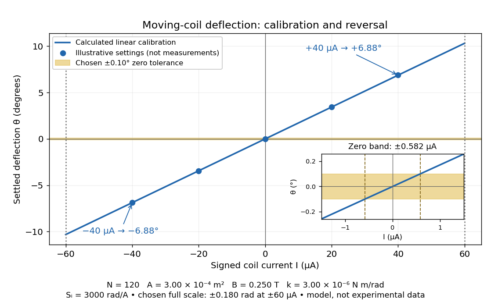

# Galvanometer current sensitivity

↑ **Parent:** [Moving-coil galvanometer](moving-coil-galvanometer.md)

The [galvanometer current sensitivity](galvanometer-current-sensitivity.md) is the change in settled deflection [angle](angle.md) per change in [electric current](electric-current.md). In the linear model its [derivative](derivative.md) is constant, $S_I=NAB/k$. The illustrative design has $S_I=3000\,\mathrm{rad/A}$, or $0.1719^\circ$ per $\mathrm{\mu A}$. A chosen full-scale [angle](angle.md) $\theta_{\max}=0.180\,\mathrm{rad}$ corresponds to $|I|=60.0\,\mathrm{\mu A}$; a straight-line extrapolation beyond that range does not establish real instrument behavior.

**[Figure 8](#galvanometer-calibrated-deflection-current). Illustrative moving-coil calibration, current reversal and finite zero resolution**. [Source](galvanometer-calibrated-deflection-current.py). Calculated deflection for the original design, with selected calibration points and a close view of zero. The shaded band is a stipulated $\pm0.10^\circ$ readout tolerance, corresponding to about $\pm0.582\,\mathrm{\mu A}$; it is not measured noise. Values and points are illustrative model predictions, not observations from a real instrument.

Finite sensitivity and finite readable [angle](angle.md) set different limits. Under the stipulated $0.10^\circ$ tolerance, a reading indistinguishable from zero means $|I|\lesssim0.582\,\mathrm{\mu A}$ only if the zero is stable and the model applies. More turns can increase [galvanometer current sensitivity](galvanometer-current-sensitivity.md) while also increasing winding [electrical resistance](electrical-resistance.md); the response to an applied [electric potential difference](electric-potential-difference.md) depends on both. [Friction](friction.md), zero drift, departures from the radial [magnetic field](magnetic-field-split.md), and spring nonlinearity can spoil the calibration. [Damping](damping.md) sets how long one must wait for a settled reading. A rapidly reversing [electric current](electric-current.md) can produce little mean pointer deflection even when its instantaneous magnitude is large.

## ↑ Ancestors (8)

1. [Moving-coil galvanometer](moving-coil-galvanometer.md)
2. [Galvanometer](galvanometer.md)
3. [Electric current](electric-current.md)
4. [Electric charge](electric-charge-split.md)
5. [Electromagnetism](electromagnetism-split.md)
6. [Branches of physics](branches-of-physics.md)
7. [Physics](physics-split.md)
8. [Codex Wiki](split.md)

## ← Incoming links (2)

- [Galvanometer calibration by half deflection](galvanometer-calibration-by-half-deflection.md)
- [Galvanometer current sensitivity](galvanometer-current-sensitivity.md)
