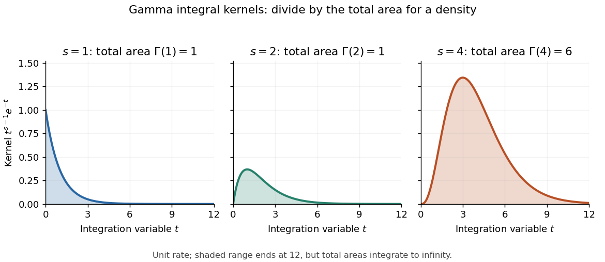

# Gamma integral

↑ **Parent:** [Gamma function](gamma-function.md)

For real $a>0$ and $\operatorname{Re}s>0$, the [change of variables](change-of-variables-formula.md) $u=at$ in the defining [improper integral](improper-integral.md) for the [Gamma function](gamma-function.md) gives

$$
\int_0^\infty t^{s-1}e^{-at}\,dt=a^{-s}\Gamma(s).
$$

The [improper integral](improper-integral.md) converges absolutely: near zero its absolute [integrand](integrand.md) behaves like $t^{\operatorname{Re}s-1}$, and at infinity the [exponential function](exponential-function.md) overcomes every fixed power.[NIST DLMF, equation 5.2.1: Euler's integral and its domain](https://dlmf.nist.gov/5.2#E1)

For real $s=1,2,4$ and $a=1$, the [integrands](integrand.md) are $e^{-t}$, $te^{-t}$, and $t^3e^{-t}$, with total areas $\Gamma(1)=1$, $\Gamma(2)=1$, and $\Gamma(4)=6$. The third [integrand](integrand.md) is taller and has six times the area of the first, although the [exponential function](exponential-function.md) makes each tail decay.

**[Figure 11](#image-gamma-integral-kernels-for-shapes-1-2-and-4-have-total-areas-1-1-and-6-before-probability-normalization). Gamma integral kernels for shapes 1, 2, and 4 have total areas 1, 1, and 6 before probability normalization**.

For real $s>0$, the kernel $t^{s-1}e^{-t}$ becomes the [probability density function](probability-density-function.md) of a [Gamma distribution](gamma-distribution.md) with shape $s$ and unit rate only after division by its [normalizing constant](normalizing-constant.md) $\Gamma(s)$. In particular, the shape-four [probability density function](probability-density-function.md) is $t^3e^{-t}/6$. More generally, the [Gamma integral](gamma-integral.md) verifies that $a^st^{s-1}e^{-at}/\Gamma(s)$ integrates to one for shape $s>0$ and rate $a>0$.

For the half-integer evaluation, the [change of variables](change-of-variables-formula.md) $t=u^2$ reduces the [Gamma integral](gamma-integral.md) to the [Gaussian integral](gaussian-integral.md):

$$
\Gamma\left(\frac12\right)=2\int_0^\infty e^{-u^2}\,du=\sqrt\pi.
$$

Consequently, for real $u>0$,

$$
u^{-1/2}=\frac1{\sqrt\pi}\int_0^\infty t^{-1/2}e^{-ut}\,dt.
$$

**Table of contents**

- [Cubic oscillatory Gamma integral](cubic-oscillatory-gamma-integral.md)

## ↑ Ancestors (6)

1. [Gamma function](gamma-function.md)
2. [Complex analysis](complex-analysis-split.md)
3. [Analysis](analysis-split.md)
4. [Area of mathematics](area-of-mathematics.md)
5. [Mathematics](mathematics-split.md)
6. [Codex Wiki](split.md)

## ← Incoming links (28)

- [Cubic Laplace transition integral](cubic-laplace-transition-integral.md)
- [Degenerate endpoint in Laplace's method](degenerate-endpoint-in-laplace-s-method.md)
- [Gamma function](gamma-function.md)
- [Gamma function recurrence](gamma-function-recurrence.md)
- [Gamma integral](gamma-integral.md)
- [Gaussian peak behind Stirling's formula](gaussian-peak-behind-stirling-s-formula.md)
- [Mellin transform](mellin-transform.md)
- [Solution](past-exam-of-the-mathematics-course-of-the-university-of-cambridge/2002/iii/paper-26/6/solution.md)
- [Solution](past-exam-of-the-mathematics-course-of-the-university-of-cambridge/2002/iii/paper-35/4/a/solution.md)
- [Solution](past-exam-of-the-mathematics-course-of-the-university-of-cambridge/2003/iii/paper-24/3/i/solution.md)
- [Solution](past-exam-of-the-mathematics-course-of-the-university-of-cambridge/2003/iii/paper-39/3/iii/solution.md)
- [Solution](past-exam-of-the-mathematics-course-of-the-university-of-cambridge/2005/ii/paper-4/33b/solution.md)
- [Solution](past-exam-of-the-mathematics-course-of-the-university-of-cambridge/2010/ii/paper-1/31c/b/solution.md)
- [Solution](past-exam-of-the-mathematics-course-of-the-university-of-cambridge/2010/iii/paper-68/1/b/solution.md)
- [Solution](past-exam-of-the-mathematics-course-of-the-university-of-cambridge/2012/iii/paper-51/1/solution.md)
- [Solution](past-exam-of-the-mathematics-course-of-the-university-of-cambridge/2015/ii/paper-1/5e/solution.md)
- [Solution](past-exam-of-the-mathematics-course-of-the-university-of-cambridge/2015/iii/paper-34/4/solution.md)
- [Solution](past-exam-of-the-mathematics-course-of-the-university-of-cambridge/2018/ib/paper-2/17b/solution.md)
- [Solution](past-exam-of-the-mathematics-course-of-the-university-of-cambridge/2018/iii/paper-137/1/solution.md)
- [Solution](past-exam-of-the-mathematics-course-of-the-university-of-cambridge/2019/iii/paper-336/1/b/iii/solution.md)
- [Solution](past-exam-of-the-mathematics-course-of-the-university-of-cambridge/2019/iii/paper-336/1/b/solution.md)
- [Solution](past-exam-of-the-mathematics-course-of-the-university-of-cambridge/2020/ii/paper-3/35a/ii/solution.md)
- [Solution](past-exam-of-the-mathematics-course-of-the-university-of-cambridge/2022/iii/paper-319/1/b/solution.md)
- [Solution](past-exam-of-the-mathematics-course-of-the-university-of-cambridge/2022/iii/paper-327/1/c/solution.md)
- [Solution](past-exam-of-the-mathematics-course-of-the-university-of-cambridge/2023/iii/paper-205/1/a/iii/solution.md)
- [Solution](past-exam-of-the-mathematics-course-of-the-university-of-cambridge/2023/iii/paper-312/1/iii/solution.md)
- [Radial moments of an isotropic Gaussian vector](radial-moments-of-an-isotropic-gaussian-vector.md)
- [Stirling formula](stirling-formula.md)
