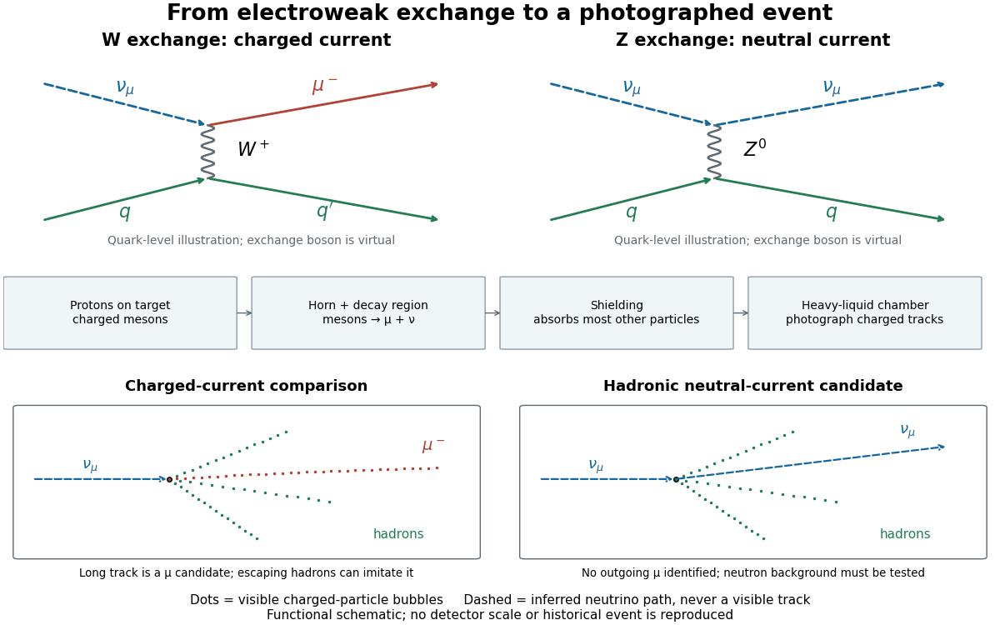

# Gargamelle

↑ **Parent:** [Neutral current](neutral-current.md)  
ⓦ [Wiki](https://en.wikipedia.org/wiki/Gargamelle)

[Gargamelle](gargamelle.md) was a heavy-liquid [bubble chamber](bubble-chamber.md) at CERN. Its 1973 collaboration report, Observation of neutrino-like interactions without muon or electron in the Gargamelle neutrino experiment, by [F. J. Hasert](f-j-hasert.md) and colleagues, described hadronic events with no identified [muon](muon.md) or [electron](electron.md) and evaluated rates relative to [charged current](charged-current.md) events. This is evidence for a [neutral current](neutral-current.md), rather than direct production or photography of a [Z boson](z-boson.md).[Physics Letters B 46 (1973), pp. 138–140, title, abstract and author list](observation-of-neutrino-like-interactions-without-muon-or-electron-in-the-gargamelle-neutrino-experiment-by-f-j-hasert.md)

CERN's [Gargamelle](gargamelle.md) account identifies the target liquid as $\mathrm{CF_3Br}$ and distinguishes hadronic events from the separate isolated-[electron](electron.md) signal. The latter is an [antineutrino](antineutrino.md) transferring [momentum](momentum-split.md) to an [electron](electron.md), whose electromagnetic [particle shower](particle-shower.md) supplies visible tracks. These are different final states, not two names for one event.[Forty years of neutral currents, 19 July 2013, chamber description and isolated-electron caption](forty-years-of-neutral-currents-by-cian-o%E2%80%99luanaigh.md)

A [neutrino beam](neutrino-beam.md) uses [protons](proton.md) striking a target to produce charged [pions](pion.md) and [kaons](kaon.md); focusing selects parents that undergo [particle decay](particle-decay.md) in flight. Their [neutrinos](neutrino.md) pass through shielding into the target. Scanning photographs locates vertices and classifies outgoing tracks.[§2, printed pp. 3–4: beam and scanning](the-discovery-of-weak-neutral-currents-by-dieter-haidt.md)

Expansion prepares a [bubble chamber](bubble-chamber.md)'s [superheated liquid](superheated-liquid.md); [ionization](ionization.md) by charged secondaries seeds bubbles for [photography](photography-split.md).[Operating sequence](how-it-works-bubble-chamber-cern-teaching-archive.md)

The recorded light reveals bubbles, not a directly visible incoming or outgoing [neutrino](neutrino.md). Reconstructing a vertex and classifying [bubble-chamber tracks](bubble-chamber-track.md) connects that optical record to a hypothesis about a [particle](particle-physics.md) interaction.

**[Figure 3](#image-charged-current-and-neutral-current-exchange-process-versus-visible-bubble-chamber-tracks). Charged current and neutral current: exchange process versus visible bubble-chamber tracks**. Original functional schematic. The upper processes are quark-level illustrations; the lower panels represent possible hadronic readouts. Dashed neutrino paths are inferred and virtual exchange bosons are not photographed. Dots denote visible charged-particle trails. No historical photograph or measured geometry is reproduced.

The collaboration compared samples with matched hadronic cuts. A flat longitudinal vertex distribution resembled [neutrino](neutrino.md) interactions, but sideways [neutrons](neutron-split.md) and multi-step cascades could also flatten it. The background estimate combined visible parent-interaction/secondary-[neutron](neutron-split.md) pairs with a cascade calculation including surrounding material. Later [proton](proton.md) exposures tested the predicted cascade lengths. Escaping charged [hadrons](hadron.md) could imitate [muons](muon.md); there was no independent perfect [muon](muon.md) tag.[§§2–5, printed pp. 3–9; Fig. 4, side-entry and cascade objections, associated-event normalization, Figs. 5–8, later proton control](the-discovery-of-weak-neutral-currents-by-dieter-haidt.md)

The inference combines positive evidence for an interaction with controlled alternatives for its visible final state. Shielding suppresses unwanted beam components, yet interactions in surrounding material can generate secondary [neutrons](neutron-split.md); shielding alone cannot certify a [neutral current](neutral-current.md). Nor does a successful [neutral current](neutral-current.md) search by itself establish every coupling or the [Higgs mechanism](higgs-mechanism.md). Its importance for the [electroweak interaction](electroweak-interaction.md) is that the theory predicts an additional weak channel, with coupling relations that further [cross section](cross-section-physics.md) measurements can test.

## ↑ Ancestors (7)

1. [Neutral current](neutral-current.md)
2. [Weak interaction](weak-interaction.md)
3. [Standard Model](standard-model-split.md)
4. [Quantum field theory](quantum-field-theory-split.md)
5. [Branches of physics](branches-of-physics.md)
6. [Physics](physics-split.md)
7. [Codex Wiki](split.md)

## ← Incoming links (4)

- [Electroweak interaction](electroweak-interaction.md)
- [Electroweak unification history](electroweak-unification-history.md)
- [From renormalizability to electroweak predictions](from-renormalizability-to-electroweak-predictions.md)
- [Gargamelle](gargamelle.md)
