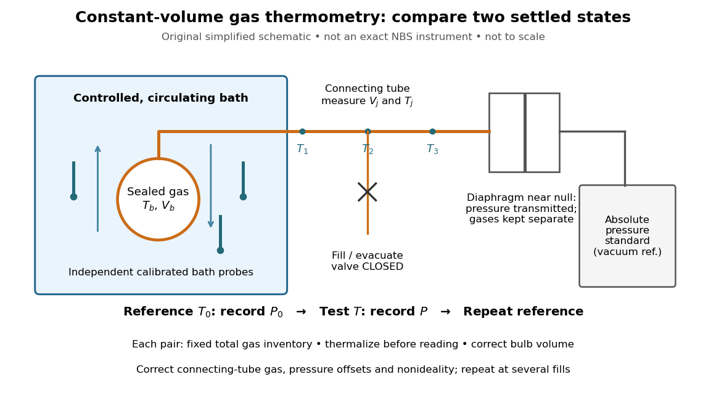
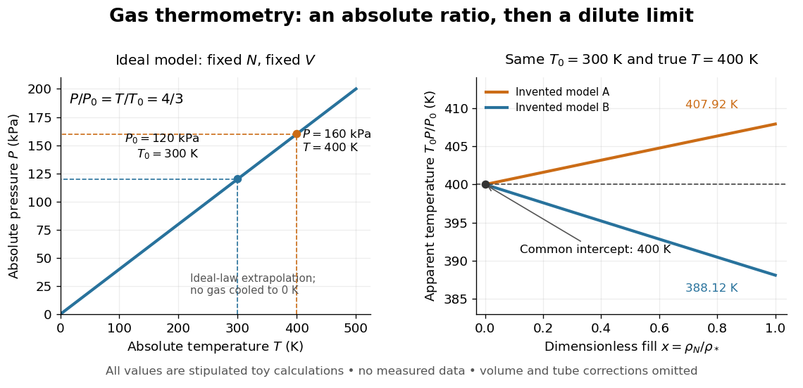

# Gas thermometer

↑ **Parent:** [Thermometer](thermometer.md)

A gas thermometer infers [temperature](temperature.md) from the [equation of state](equation-of-state.md) of a confined [gas](gas.md). The constant-[volume](volume-thermodynamics.md) version measures [pressure](pressure.md); the constant-[pressure](pressure.md) version measures [volume](volume-thermodynamics.md). For an [ideal gas](ideal-gas.md),

$$
PV=Nk_BT=nRT,\qquad
\frac{T}{T_0}=\frac{P}{P_0}\quad(N,V\text{ fixed}),\qquad
\frac{T}{T_0}=\frac{V}{V_0}\quad(N,P\text{ fixed}).
$$

Here $N$ is particle number, $n$ is [amount of substance](amount-of-substance.md), $k_B$ is the [Boltzmann constant](boltzmann-constant.md), and $R$ is the [molar gas constant](molar-gas-constant.md). The reference and test states must be internally equilibrated, and $T_0$ must be known on the absolute [thermodynamic temperature](thermodynamic-temperature.md) scale. A pressure ratio cancels the unknown gas inventory and bulb size in the ideal constant-volume limit. This cancellation is the method's appeal: a mechanical measurement transfers an absolute [temperature](temperature.md) scale between different materials. The [Maxwell speed distribution](maxwell-speed-distribution.md) and [ideal gas pressure from wall collisions](ideal-gas-pressure-from-wall-collisions.md) explain the microscopic origin of the response. [OpenStax, University Physics Volume 2, section 2.1: the ideal gas law](https://openstax.org/books/university-physics-volume-2/pages/2-1-molecular-model-of-an-ideal-gas)

For an original ideal-model calculation, choose $T_0=300\,\mathrm K$, $P_0=120\,\mathrm{kPa}$ and $P=160\,\mathrm{kPa}$. Then $T=400\,\mathrm K$. These are stipulated values, not observations. Both [pressures](pressure.md) must be absolute, referred to vacuum. If the surrounding [atmospheric pressure](atmospheric-pressure.md) were $100\,\mathrm{kPa}$, the corresponding [gauge pressures](gauge-pressure.md) would be $20$ and $60\,\mathrm{kPa}$; their ratio is three, which would incorrectly predict $900\,\mathrm K$. A pressure difference from the atmosphere cannot be substituted into the [ideal gas law](ideal-gas-law.md).

**[Figure 21](#image-an-original-schematic-of-constant-volume-gas-thermometer-measurements). An original schematic of constant-volume gas thermometer measurements**. Simplified measurement layout inspired by the NBS apparatus, not a replica or a report of measurements. A controlled bath thermalizes the bulb, separate calibrated [thermometers](thermometer.md) check its surroundings, and a diaphragm transmits [pressure](pressure.md) to an absolute-pressure standard without mixing gases. The connecting tube contains gas at other [temperatures](temperature.md); its inventory belongs in the [gas thermometer dead-space correction](gas-thermometer-dead-space-correction.md).

**A motivating calibration experiment.** Schooley's account of the NBS/NIST work describes a [helium](helium.md)-filled metal bulb, a capillary, a [capacitance diaphragm gauge](capacitance-diaphragm-gauge.md), and a mercury pressure standard. Circulating bath liquid passed the bulb assembly and platinum resistance [thermometers](thermometer.md). The resistance probes checked the surrounding [temperature](temperature.md); gas [pressure](pressure.md) supplied the independent thermodynamic comparison. In an early series, workers filled the cleaned bulb with purified [helium](helium.md) at the highest test [temperature](temperature.md), checked [pressure](pressure.md) over three hours, then measured at lower [temperatures](temperature.md) and near a reference at $0\,{}^\circ\mathrm C$. Six filling pressures allowed extrapolation toward zero pressure. [J. F. Schooley (1990), NBS/NIST Gas Thermometry From 0 to 660 °C, sections 4–5](https://nvlpubs.nist.gov/nistpubs/jres/095/jresv95n3p255_A1b.pdf)

To turn this principle into a readable measurement protocol, use the following controls. These steps are a proposed teaching interpretation of the cited apparatus, rather than additional reported NBS observations:
- **Define the inventory.** Evacuate and clean the bulb and connecting tube, fill with a known pure [gas](gas.md), close the filling valve, and keep the same total particle number during each reference/test comparison. Monitor [pressure](pressure.md) at a maintained [temperature](temperature.md) before and after a run. A leak changes $N$; a slow drift can also reflect contamination, sorption, or imperfect equilibration, so pressure stability alone does not identify its cause.
- **Measure the reference.** Place the bulb in a controlled environment with independently assigned $T_0$. Record $P_0$ after thermalization, together with the independent [thermometer](thermometer.md) readings and their spread. A reference near $0\,{}^\circ\mathrm C$ has an absolute [temperature](temperature.md) near $273.15\,\mathrm K$, rather than zero [temperature](temperature.md). Repeating reference readings tests whether the inventory or apparatus changed during the comparison.
- **Measure the test state.** Change the bath setting, allow the bulb and [gas](gas.md) to settle, and record $P$ only when the surrounding [thermometers](thermometer.md) and [pressure](pressure.md) are sufficiently stable for the intended accuracy. Compare readings at different positions and vary the settling time. Record the connecting tube's [temperature](temperature.md) profile too: uniform bath [temperature](temperature.md) does not make the entire connecting tube isothermal.
- **Measure the volume changes.** Determine the bulb's [thermal expansion](thermal-expansion.md) and its deformation from differences between inside and outside [pressure](pressure.md). Measure the connecting tube's dimensions and the effective valve volume. “Constant volume” is the ideal model; a real vessel expands. These measurements supply corrections, even though the absolute bulb volume cancels in the simplest pressure ratio.
- **Measure pressure against a reference.** For a liquid-column pressure standard, measure the vertical column height, the liquid's [temperature](temperature.md)-dependent [mass density](density.md), local gravitational acceleration, and the reference-side [pressure](pressure.md). Include diaphragm offsets and the gas's [hydrostatic pressure](hydrostatic-pressure.md) change between the sensor and bulb. The pressure needed in the [equation of state](equation-of-state.md) is at the bulb, not automatically at the remote gauge.

The corresponding NBS apparatus used a protective case with an outer [helium](helium.md) layer held close to the bulb [pressure](pressure.md), reducing pressure deformation while aiding thermal contact. [Thermal expansion](thermal-expansion.md) was measured on bulb material. Gas in the capillary remained partly outside the hot region, requiring a measured tube [temperature](temperature.md) profile and geometry. Pure working [gas](gas.md) also mattered: contaminants that sorb on surfaces can change the freely circulating inventory. These are physical effects to measure or bound, rather than scatter that disappears by averaging. [J. F. Schooley, Thermometry, NBS IR 85-3133, chapter V, gas thermometry and the NBS experiment](https://nvlpubs.nist.gov/nistpubs/Legacy/IR/nbsir85-3133.pdf)

For illustration, neglect connecting-tube gas and describe a uniform bulb with a dilute [virial expansion](virial-expansion.md) in particle [number density](number-density.md) $\rho_N=N/V$:

$$
PV=Nk_BT\left[1+B_2(T)\rho_N+O(\rho_N^2)\right],\qquad
\frac{T}{T_0}=\frac{P}{P_0}\frac{V(T)}{V(T_0)}\frac{Z(T_0)}{Z(T)}.
$$

Here $Z=PV/(Nk_BT)$ and $B_2$ is the [second virial coefficient](second-virial-coefficient.md) in the particle-density convention; a molar-density convention rescales the coefficient. The second relation follows exactly from the definition of $Z$ for the same $N$, and shows the signs of the corrections. If the bulb expands by $0.1\%$ and $Z=1$ at both states, the toy pressure ratio above gives $400.4\,\mathrm K$, rather than $400\,\mathrm K$. Improved expansion and [helium](helium.md) nonideality models really changed the temperatures inferred from the 1989 NIST data: Harvey's 2023 reanalysis found expansion updates of roughly $1$–$3\,\mathrm{mK}$ and nonideality updates of roughly $-0.1$ to $-0.5\,\mathrm{mK}$. Those are reported corrections to historical results, not the much larger illustrative correction just calculated. [Allan H. Harvey (2023), Small Corrections to 1989 NIST Constant-Volume Gas Thermometry Data, sections 2–3](https://tsapps.nist.gov/publication/get_pdf.cfm?pub_id=956523)

With equal corrected bulb [volumes](volume.md), negligible or corrected connecting-tube gas, fixed reference and test [temperatures](temperature.md), and a dilute classical single gas phase,

$$
\frac{P}{P_0}=\frac{T}{T_0}\left[1+\bigl(B_2(T)-B_2(T_0)\bigr)\rho_N+O(\rho_N^2)\right],\qquad
\lim_{\rho_N\to0}\frac{P}{P_0}=\frac{T}{T_0}.
$$

Repeat the reference/test comparison for several sealed fills, reducing $N$ between comparisons but keeping it fixed within each pair. The extrapolation varies density at fixed endpoint [temperatures](temperature.md); it does not cool one fill toward zero [temperature](temperature.md). Real gases have different finite-density corrections but share the classical [ideal gas](ideal-gas.md) intercept under these assumptions. The limit does not remove leaks, bulb expansion, gauge offsets, or the [gas thermometer dead-space correction](gas-thermometer-dead-space-correction.md). At very low [pressures](pressure.md), [thermal transpiration](thermal-transpiration.md) can make remote sensor and bulb [pressures](pressure.md) differ through a nonisothermal capillary; this must be corrected too. The NBS work measured this pressure correction using a separate comparison of narrow and wider tubes. [Schooley (1990), sections 7.3–7.6: pressure, volume, dead space and gas nonideality](https://nvlpubs.nist.gov/nistpubs/jres/095/jresv95n3p255_A1b.pdf)

**[Figure 22](#image-ideal-pressure-ratios-and-a-dilute-limit-gas-thermometer-comparison-in-two-toy-gas-models). Ideal pressure ratios and a dilute-limit gas thermometer comparison in two toy gas models**. Left: the stipulated ideal constant-volume calibration $P=0.4\,\mathrm{kPa\,K^{-1}}T$. Right: apparent [temperature](temperature.md) $T_{\rm app}=300\,\mathrm K\,P/P_0$ for invented dimensionless fill $x=\rho_N/\rho_*$, with $P/P_0=(4/3)(1+0.03x)/(1+0.01x)$ for model A and $(4/3)(1-0.02x)/(1+0.01x)$ for model B. Both approach the stipulated $400\,\mathrm K$ intercept; neither curve represents a named gas or measured data.

At $x=1$, the toy models give $T_{\rm app}=407.92\,\mathrm K$ and $388.12\,\mathrm K$, respectively, although their imposed true test [temperature](temperature.md) is the same. Their zero-density intercept is the reusable quantity. Measuring several low-density points permits a fit and a check for curvature; asserting a straight line from one finite-density point supplies neither. A practical fit must balance nonideality against increasing relative pressure error and the capillary corrections, and keep its extrapolation uncertainty.

**Table of contents**

- [Gas thermometer dead-space correction](gas-thermometer-dead-space-correction.md)

## ↑ Ancestors (7)

1. [Thermometer](thermometer.md)
2. [Temperature](temperature.md)
3. [Thermodynamics](thermodynamics-split.md)
4. [Statistical physics](statistical-physics-split.md)
5. [Branches of physics](branches-of-physics.md)
6. [Physics](physics-split.md)
7. [Codex Wiki](split.md)

## ← Incoming links (6)

- [Gas thermometer](gas-thermometer.md)
- [Gas thermometer dead-space correction](gas-thermometer-dead-space-correction.md)
- [Maxwell-Boltzmann distribution](maxwell-boltzmann-distribution.md)
- [Temperature](temperature.md)
- [Thermometer](thermometer.md)
- [Thermometer calibration](thermometer-calibration.md)
