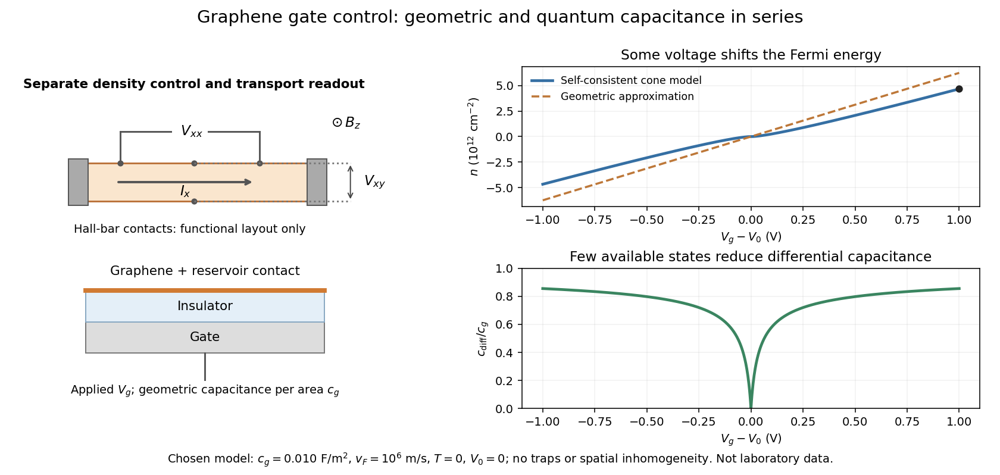

# Gate control of graphene carrier density

↑ **Parent:** [Graphene](graphene.md)

Consider an ideal uniform [graphene](graphene.md) sheet connected to an [electron](electron.md) reservoir, with an insulated gate. Let $c_g>0$ be geometric [capacitance](capacitance.md) per unit [area](surface-area.md), $e>0$ the [elementary charge](elementary-charge.md), and $V_0$ the neutral-point offset. Neglect [temperature](temperature-split.md), trapped [electric charge](electric-charge-split.md) and spatial inhomogeneity. A change in gate voltage pays for both the electrostatic potential drop, $en/c_g$, and the change in the sheet's [Fermi energy](fermi-energy.md), $E_F/e$. Here $E_F$ is measured relative to the band crossing; it is negative for excess [electron holes](electron-hole.md).

Combine this relation with the [carrier density in a graphene cone](carrier-density-in-a-graphene-cone.md). Write $u=|E_F|/e$, measured in volts, $V=|V_g-V_0|$, and $\alpha=e^3/[\pi(\hbar v_F)^2c_g]$. Then

$$
V=u+\alpha u^2,\qquad u=\frac{2V}{1+\sqrt{1+4\alpha V}},\qquad
n=\operatorname{sgn}(V_g-V_0)\frac{e^2u^2}{\pi(\hbar v_F)^2}.
$$

The positive root is unique because $u+\alpha u^2$ is strictly increasing for $u\ge0$. The often useful geometric approximation $n\simeq c_g(V_g-V_0)/e$ neglects the [Fermi energy](fermi-energy.md) term. It overestimates $|n|$ in this model, especially near neutrality where relatively few states are available.

For a deliberately chosen model with $c_g=0.010\,\mathrm{F/m^2}$, $v_F=10^6\,\mathrm{m/s}$, $V_0=0$ and $V_g=1\,\mathrm V$, the formulas give **$E_F\simeq0.252\,\mathrm{eV}$ and $n\simeq4.67\times10^{12}\,\mathrm{cm^{-2}}$**. The purely geometric value would be $6.24\times10^{12}\,\mathrm{cm^{-2}}$. These are chosen-model predictions, not measurements of the historical devices. Numerical conversion uses the exact [Planck constant](planck-constant.md) and [elementary charge](elementary-charge.md).[Exact h and e entries; material parameters in this example are stipulated](fundamental-physical-constants-complete-listing-by-national-institute-of-standards-and-technology-and-others.md)

**[Figure 16](#image-gate-control-changes-graphene-s-carrier-population-and-differential-capacitance). Gate control changes graphene's carrier population and differential capacitance**. [Source](graphene-gate-control-and-quantum-capacitance.py). Original functional device sketch and calculated zero-temperature curves for the explicitly chosen model. Signed $n$ counts excess electrons; negative $n$ counts holes. The dashed density curve neglects the change in Fermi energy. These are not historical transport data.

**Table of contents**

- [Quantum capacitance of a graphene cone](quantum-capacitance-of-a-graphene-cone.md)

## ↑ Ancestors (6)

1. [Graphene](graphene.md)
2. [Carbon](carbon.md)
3. [Chemical element](chemical-element.md)
4. [Chemical substance](chemical-substance-split.md)
5. [Chemistry](chemistry-split.md)
6. [Codex Wiki](split.md)
