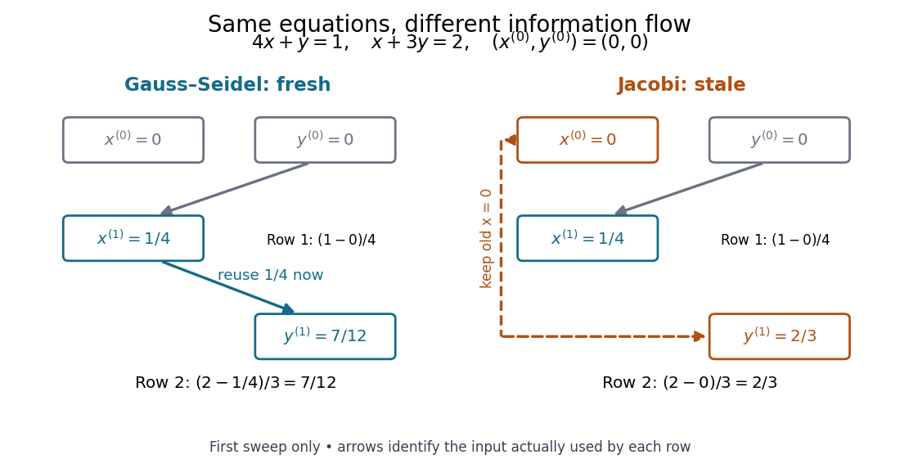

# Gauss-Seidel iteration for a two-variable positive-definite system

↑ **Parent:** [Gauss-Seidel method](gauss-seidel-method.md)

Consider the original [linear system](system-of-linear-equations.md)

$$
A\begin{pmatrix}x\\y\end{pmatrix}=b,\qquad A=\begin{pmatrix}4&1\\1&3\end{pmatrix},\qquad b=\begin{pmatrix}1\\2\end{pmatrix},\qquad \begin{pmatrix}x_*\\y_*\end{pmatrix}=\begin{pmatrix}1/11\\7/11\end{pmatrix}.
$$

Direct substitution verifies the solution. The [matrix](matrix.md) is a [symmetric positive-definite matrix](symmetric-positive-definite-matrix.md): [completing the square](completing-the-square.md) in its [quadratic form](quadratic-form-split.md) gives $4x^2+2xy+3y^2=4(x+y/4)^2+11y^2/4>0$ for every nonzero [vector](vector.md). It is also a [strictly diagonally dominant matrix](strictly-diagonally-dominant-matrix.md).

Starting from $(x^{(0)},y^{(0)})=(0,0)$, update the first row and then the second:

$$
x^{(k+1)}=\frac{1-y^{(k)}}4,\qquad y^{(k+1)}=\frac{2-x^{(k+1)}}3.
$$

The first sweep gives $x^{(1)}=1/4$ and $y^{(1)}=(2-1/4)/3=7/12$. The next gives $x^{(2)}=(1-7/12)/4=5/48$ and $y^{(2)}=(2-5/48)/3=91/144$. The second row uses $1/4$ during the first sweep, even though the initial first coordinate was zero.

**[Figure 13](#image-fresh-and-stale-inputs-in-the-first-sweep-of-the-original-two-variable-linear-system). Fresh and stale inputs in the first sweep of the original two-variable linear system**.

With a stale first coordinate, the [Jacobi method](jacobi-method.md) would instead give $(1/4,2/3)$ after the first sweep. Both methods have the same [fixed point](fixed-point.md), but changing when coordinates become available changes the entire sequence of [vectors](vector.md).

**Table of contents**

- [Exact error contraction of a two-variable Gauss-Seidel iteration](exact-error-contraction-of-a-two-variable-gauss-seidel-iteration.md)

## ↑ Ancestors (8)

1. [Gauss-Seidel method](gauss-seidel-method.md)
2. [Stationary iterative method for a linear system](stationary-iterative-method-for-a-linear-system.md)
3. [Numerical linear algebra](numerical-linear-algebra-split.md)
4. [Numerical analysis](numerical-analysis-split.md)
5. [Analysis](analysis-split.md)
6. [Area of mathematics](area-of-mathematics.md)
7. [Mathematics](mathematics-split.md)
8. [Codex Wiki](split.md)

## ← Incoming links (1)

- [Exact error contraction of a two-variable Gauss-Seidel iteration](exact-error-contraction-of-a-two-variable-gauss-seidel-iteration.md)
