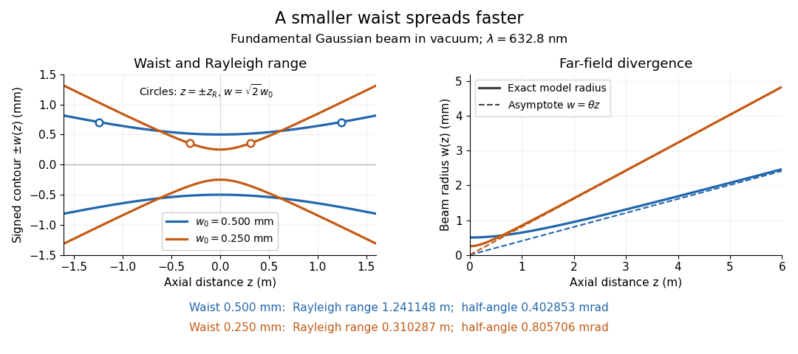
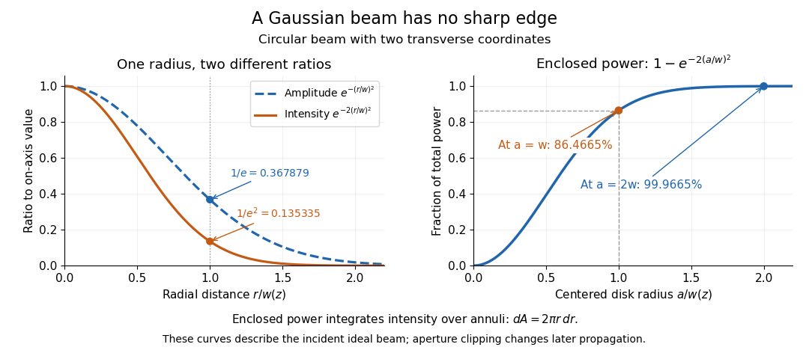

# Gaussian beam

↑ **Parent:** [Physical optics](physical-optics-split.md)  
ⓦ [Wiki](https://en.wikipedia.org/wiki/Gaussian_beam)

A fundamental [Gaussian beam](gaussian-beam.md) is an ideal beam of [light](light.md) whose transverse [wave amplitude](wave-amplitude.md) has a [Gaussian function](gaussian-function.md) profile. Here consider a circularly symmetric beam in [vacuum](vacuum.md), with propagation along $z$, two transverse coordinates $x,y$, and [radius](radius.md) $r=\sqrt{x^2+y^2}$ from the [optical axis](optical-axis.md). With the [beam waist](beam-waist.md) at $z=0$, total [power](power.md) $P>0$, and [vacuum](vacuum.md) [wavelength](wavelength.md) $\lambda$, its time-averaged [light intensity](light-intensity.md), meaning [irradiance](irradiance.md) in $\mathrm{W\,m^{-2}}$, is

$$
I(r,z)=\frac{2P}{\pi w(z)^2}\exp\!\left(-\frac{2r^2}{w(z)^2}\right),
\qquad w(z)=w_0\sqrt{1+\left(\frac{z}{z_R}\right)^2},
\qquad z_R=\frac{\pi w_0^2}{\lambda}.
$$

Here $w_0$ is the minimum beam [radius](radius.md), and $z_R$ is the [Rayleigh range](rayleigh-length.md). Far from the [beam waist](beam-waist.md), $w(z)\sim\theta|z|$ with [beam divergence](beam-divergence.md) half-angle $\theta=\lambda/(\pi w_0)$. These are the fundamental circular [Gaussian beam](gaussian-beam.md) laws within the scalar [paraxial approximation](paraxial-approximation.md), appropriate when $w_0\gg\lambda$ and the [beam divergence](beam-divergence.md) is small. The underlying envelope solves the [parabolic wave equation](parabolic-wave-equation.md) exactly; this does not make it an exact vector solution of [Maxwell equations](maxwell-equations-split.md). [Franz Kärtner, MIT 6.974 notes, 2006, §2.4, equations 2.219 and 2.227–2.238](https://ocw.mit.edu/courses/6-974-fundamentals-of-photonics-quantum-electronics-spring-2006/8e54d1625e9e71eb5b4e4998e6967e4e_chapter2.pdf).

The [radius](radius.md) convention matters. Writing $U$ for the complex [wave amplitude](wave-amplitude.md) envelope, the same $w(z)$ is the [wave amplitude](wave-amplitude.md) $1/e$ [radius](radius.md) and the [light intensity](light-intensity.md) $1/e^2$ [radius](radius.md):

$$
\frac{|U(r,z)|}{|U(0,z)|}=e^{-r^2/w(z)^2},
\qquad \frac{I(r,z)}{I(0,z)}=e^{-2r^2/w(z)^2}.
$$

At $r=w(z)$ these ratios are $e^{-1}\approx0.367879$ and $e^{-2}\approx0.135335$, respectively. The [light intensity](light-intensity.md) $1/e$ [radius](radius.md) is instead $w(z)/\sqrt2$. None of these radii is a sharp edge: the ideal [Gaussian function](gaussian-function.md) has nonzero tails at every finite [radius](radius.md). Kogelnik and Li explicitly use the [wave amplitude](wave-amplitude.md) $1/e$ [radius](radius.md) in their fundamental-mode treatment. [Herwig Kogelnik and Tingye Li, Laser Beams and Resonators, Applied Optics 5, 1550–1567, 1966, §3.2](https://dielslab.unm.edu/sites/default/files/Kogelnik66_0.pdf).

For a numerical example, take [vacuum](vacuum.md) [wavelength](wavelength.md) $\lambda=632.8\,\mathrm{nm}$ and [beam waist](beam-waist.md) [radius](radius.md) $w_0=0.500\,\mathrm{mm}$. Substitution gives [Rayleigh range](rayleigh-length.md) $z_R\approx1.24114754\,\mathrm m$ and far-field [beam divergence](beam-divergence.md) half-angle $\theta\approx0.402852992\,\mathrm{mrad}$. At $z=z_R$, the beam [radius](radius.md) is $w=\sqrt2w_0\approx0.707107\,\mathrm{mm}$ and the on-axis [irradiance](irradiance.md) is half its waist value. At the same [wavelength](wavelength.md), halving the [beam waist](beam-waist.md) [radius](radius.md) to $0.250\,\mathrm{mm}$ quarters the [Rayleigh range](rayleigh-length.md) to $0.310286885\,\mathrm m$ and doubles the [beam divergence](beam-divergence.md) half-angle to $0.805705984\,\mathrm{mrad}$. At fixed [power](power.md), that smaller [beam waist](beam-waist.md) also quadruples the peak [irradiance](irradiance.md).

**[Figure 3](#image-gaussian-beam-radii-at-632-8-nm-a-smaller-beam-waist-gives-a-shorter-rayleigh-range-and-greater-beam-divergence). Gaussian beam radii at 632.8 nm: a smaller beam waist gives a shorter Rayleigh range and greater beam divergence**.

The contours in the left panel are $r=\pm w(z)$ in a plane through the [optical axis](optical-axis.md); they mark an [light intensity](light-intensity.md) level, not an outer boundary. The right panel compares the exact model radii with the far-field asymptotes $w=\theta z$. The horizontal and vertical axes use different length units, so the drawn slopes are not physical [angles](angle.md).

The normalization expresses conserved [power](power.md) during free propagation. In transverse [polar coordinates](polar-coordinates.md), an [annulus](annulus-mathematics.md) has [area](surface-area.md) $2\pi r\,dr$, so

$$
\int_{\mathbb R^2}I\,dx\,dy
=2\pi\int_0^\infty I(r,z)r\,dr=P,
\qquad \frac{P(r<a)}{P}=1-e^{-2a^2/w(z)^2}.
$$

A proof outline is the substitution $s=2r^2/w(z)^2$ in this [integral](integral-split.md). Spreading reduces peak [irradiance](irradiance.md) as $w^{-2}$ while increasing transverse [area](surface-area.md) as $w^2$, leaving [power](power.md) unchanged. In particular, the [disk](disk-mathematics.md) of [radius](radius.md) $w(z)$ contains $1-e^{-2}\approx0.8646647168$, or $86.4665\%$, of the total [power](power.md); the local [light intensity](light-intensity.md) at its rim is only $13.5335\%$ of the on-axis [light intensity](light-intensity.md). These are different quantities.

**[Figure 4](#image-gaussian-beam-radius-conventions-and-the-fraction-of-power-inside-a-centered-disk). Gaussian beam radius conventions and the fraction of power inside a centered disk**.

The left panel compares normalized [wave amplitude](wave-amplitude.md) magnitude and [irradiance](irradiance.md); the right panel integrates the transverse [area](surface-area.md) to show enclosed [power](power.md). For an ideal absorbing circular [aperture](aperture.md) of [radius](radius.md) $a$ centered on the [optical axis](optical-axis.md), the same fraction gives the [power](power.md) passing the [aperture](aperture.md) at that plane. An [aperture](aperture.md) of [radius](radius.md) $w$ clips about $13.5335\%$ of the incident [power](power.md); [radius](radius.md) $2w$ clips only $e^{-8}\approx0.000335463$, or $0.0335463\%$. After clipping, extra [diffraction](diffraction.md) means the transmitted field no longer obeys the unmodified ideal [Gaussian beam](gaussian-beam.md) law. Every finite [aperture](aperture.md) cuts some ideal tail. Kogelnik and Li distinguish their large-[aperture](aperture.md) beam analysis from their finite-[aperture](aperture.md) [diffraction](diffraction.md) analysis. [Kogelnik and Li, 1966, §§3–4](https://dielslab.unm.edu/sites/default/files/Kogelnik66_0.pdf).

The useful tradeoff is that a small bright spot cannot remain narrow indefinitely. An [optical lens](lens-optics.md) can create a smaller [beam waist](beam-waist.md), but [diffraction](diffraction.md) then makes the beam spread faster. The particularly simple relation $w_0\theta=\lambda/\pi$ ties localization directly to [beam divergence](beam-divergence.md). A proof outline for the propagation law starts with $U(x,y,0)=U_0e^{-(x^2+y^2)/w_0^2}$. The [parabolic wave equation](parabolic-wave-equation.md) separates into two transverse factors, and a [Gaussian integral](gaussian-integral.md) in each coordinate gives

$$
U(x,y,z)=\frac{U_0}{q(z)}\exp\!\left(-\frac{x^2+y^2}{w_0^2q(z)}\right),
\qquad q(z)=1+i\frac{z}{z_R},\qquad k=\frac{2\pi}{\lambda}.
$$

Here $q$ is dimensionless and $k$ is the [wavenumber](wavenumber.md); the carrier convention is $e^{i(kz-\omega t)}$, with [angular frequency](angular-frequency.md) $\omega$. Taking the squared [complex modulus](complex-modulus.md) gives the stated $w(z)$ and its $w^{-2}$ [light intensity](light-intensity.md) scaling. Each transverse factor contributes $q^{-1/2}$, explaining the $q^{-1}$ prefactor here and the different prefactor in the preserved [Gaussian beam with one transverse coordinate](gaussian-beam-with-one-transverse-coordinate.md).

Historically, [Gaussian beam](gaussian-beam.md) theory developed alongside early [laser](laser-split.md) resonator theory and lens-guided transmission. In their 1966 review, Kogelnik and Li credit Boyd and Gordon, and Goubau and Schwering, with early beam treatments; they summarize earlier work rather than claim the whole construction as a new discovery. Their paper brings beam propagation, focusing and finite-[aperture](aperture.md) [diffraction](diffraction.md) into a common practical account. [Kogelnik and Li, 1966, introduction and §3](https://dielslab.unm.edu/sites/default/files/Kogelnik66_0.pdf).

**Table of contents**

- [Beam waist](beam-waist.md)
- [Rayleigh length](rayleigh-length.md)
- [Gaussian beam with one transverse coordinate](gaussian-beam-with-one-transverse-coordinate.md)

## ↑ Ancestors (5)

1. [Physical optics](physical-optics-split.md)
2. [Optics](optics-split.md)
3. [Branches of physics](branches-of-physics.md)
4. [Physics](physics-split.md)
5. [Codex Wiki](split.md)

## ← Incoming links (12)

- [Beam divergence](beam-divergence.md)
- [Beam waist](beam-waist.md)
- [Confocal excitation and detection point spread function](confocal-excitation-and-detection-point-spread-function.md)
- [Etendue concentration limit](etendue-concentration-limit.md)
- [Gaussian beam](gaussian-beam.md)
- [Gaussian beam with one transverse coordinate](gaussian-beam-with-one-transverse-coordinate.md)
- [Solution](past-exam-of-the-mathematics-course-of-the-university-of-cambridge/2015/iii/paper-76/1/a/solution.md)
- [Solution](past-exam-of-the-mathematics-course-of-the-university-of-cambridge/2015/iii/paper-76/1/c/solution.md)
- [Solution](past-exam-of-the-mathematics-course-of-the-university-of-cambridge/2018/iii/paper-335/2/i/solution.md)
- [Solution](past-exam-of-the-mphil-in-micro-and-nanotechnology-enterprise-course-of-the-university-of-cambridge/2023/paper-2/section-a-iii/19/ii/solution.md)
- [Rayleigh length](rayleigh-length.md)
- [Root mean square magnetic field from beam power](root-mean-square-magnetic-field-from-beam-power.md)
