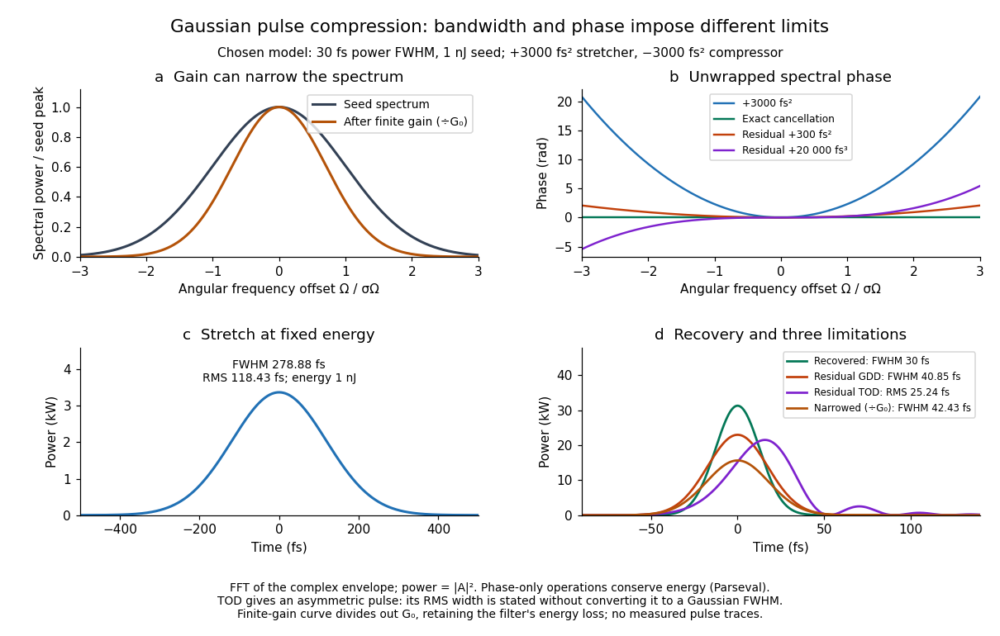

# Gaussian chirped pulse compression

↑ **Parent:** [Chirped pulse amplification](chirped-pulse-amplification.md)

Choose an initially [transform-limited pulse](transform-limited-pulse.md) with Gaussian [power](power.md) and complex envelope

$$
A_0(t)=\sqrt{\frac{U}{\sqrt{2\pi}\sigma_0}}\,e^{-t^2/(4\sigma_0^2)},\qquad
\tau_0=2\sqrt{2\ln2}\,\sigma_0.
$$

Here $\sigma_0$ is the standard deviation of the power-weighted time distribution; $\tau_0$ is its [full width at half maximum](full-width-at-half-maximum.md). Neither is a field-amplitude width. The spectral amplitude is proportional to $e^{-\sigma_0^2\Omega^2}$, so the spectral power has [standard deviation](standard-deviation.md) $\sigma_\Omega=1/(2\sigma_0)$. The Gaussian [time-bandwidth product](time-bandwidth-product.md) in ordinary [frequency](frequency.md) is $\tau_0\Delta\nu=2\ln2/\pi\simeq0.4413$, where both widths are power FWHMs.

Multiplication by $e^{i\phi_2\Omega^2/2}$ preserves spectral power and [energy](energy-split.md). Substituting $\phi'=\phi_2\Omega$ into the moment identity gives

$$
\sigma_t^2=\sigma_0^2+\frac{\phi_2^2}{4\sigma_0^2},\qquad
\tau(\phi_2)=\tau_0\sqrt{1+\left(\frac{4\ln2\,\phi_2}{\tau_0^2}\right)^2}.
$$

This is an exact result for a Gaussian spectrum with quadratic [spectral phase](spectral-phase.md). It also follows by completing the square in its inverse [Fourier transform](fourier-transform-split.md).

**[Figure 8](#image-phase-cancellation-recovers-a-gaussian-pulse-while-residual-phase-and-narrowed-bandwidth-limit-it). Phase cancellation recovers a Gaussian pulse, while residual phase and narrowed bandwidth limit it**. Original complex-envelope [Fast Fourier transform](fast-fourier-transform.md) calculations for a chosen $30\,\mathrm{fs}$ power FWHM, $1\,\mathrm{nJ}$ pulse. The stretcher adds $3000\,\mathrm{fs^2}$ of [group delay dispersion](group-delay-dispersion.md). Separate output cases show exact cancellation, $300\,\mathrm{fs^2}$ residual GDD, $20000\,\mathrm{fs^3}$ residual [third-order dispersion](third-order-dispersion.md), and a Gaussian [optical gain](optical-gain.md) profile. The finite-gain curve divides out the central-frequency gain $G_0$ and retains the resulting energy change. All curves are calculations, not measured pulse traces.

For these chosen inputs, $\sigma_0=12.7398\,\mathrm{fs}$. The stretched pulse has $\tau=278.88\,\mathrm{fs}$ and [root mean square](root-mean-square.md) width $118.4282\,\mathrm{fs}$. Adding $-3000\,\mathrm{fs^2}$ recovers $30\,\mathrm{fs}$; leaving $300\,\mathrm{fs^2}$ gives $40.85\,\mathrm{fs}$. All phase-only cases retain $1\,\mathrm{nJ}$.

If GDD is cancelled but $\phi_3=20000\,\mathrm{fs^3}$ remains, the pulse is asymmetric. Gaussian spectral moments give

$$
\bar t=\frac{\phi_3\sigma_\Omega^2}{2},\qquad
\sigma_t^2=\sigma_0^2+\frac{\phi_3^2\sigma_\Omega^4}{2}.
$$

Thus the centroid is $15.4033\,\mathrm{fs}$ and the [root mean square](root-mean-square.md) duration is $25.2354\,\mathrm{fs}$. Converting this last value to a FWHM with the Gaussian factor would be wrong: the power envelope is no longer Gaussian. The calculation's integrated [energy](energy-split.md) agrees in time and [frequency](frequency.md) through [Parseval's identity](parseval-identity.md), while its centroid and [variance](variance-split.md) agree with these independent moment formulas.

A real amplifier also changes spectral amplitude. For a simple small-signal example, stipulate an intensity gain profile

$$
G(\Omega)=G_0 e^{-\Omega^2/(2\sigma_g^2)},\qquad
\widetilde A_{\rm amplified}=\sqrt{G(\Omega)}\,\widetilde A_{\rm input}.
$$

This specifies finite [gain bandwidth](gain-bandwidth.md), with no saturation or extra amplifier [phase](phase-waves.md). Multiplying two Gaussian spectra gives

$$
\frac{1}{\sigma_{\Omega,\rm out}^2}=\frac{1}{\sigma_\Omega^2}+\frac{1}{\sigma_g^2}.
$$

For chosen $\sigma_g=\sigma_\Omega$, the amplified spectrum is narrower by $\sqrt2$, the shortest Gaussian power FWHM becomes $30\sqrt2=42.43\,\mathrm{fs}$, and the total [energy](energy-split.md) is $G_0U/\sqrt2$. Perfect [spectral phase](spectral-phase.md) correction cannot recreate the suppressed spectral amplitude. Real [gain narrowing](gain-narrowing.md) and saturation require a material-dependent amplifier model; a constant multiplier is only a limited idealization. [Gérard Mourou](gerard-mourou.md)'s 2018 lecture discusses [gain narrowing](gain-narrowing.md) as a limit on the shortest amplified pulses.[Extreme Light Physics and Application, p.105, §II.E: finite gain bandwidth and gain narrowing](extreme-light-physics-and-application-by-gerard-mourou.md)

## ↑ Ancestors (6)

1. [Chirped pulse amplification](chirped-pulse-amplification.md)
2. [Laser](laser-split.md)
3. [Optics](optics-split.md)
4. [Branches of physics](branches-of-physics.md)
5. [Physics](physics-split.md)
6. [Codex Wiki](split.md)
