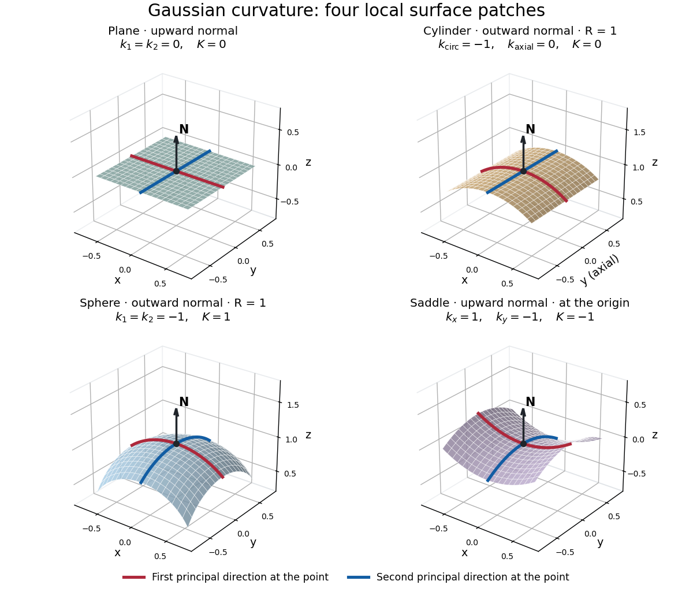

# Gaussian curvature

↑ **Parent:** [Second fundamental form](second-fundamental-form-split.md)  
ⓦ [Wiki](https://en.wikipedia.org/wiki/Gaussian_curvature)

Rolling a sheet into a [circular cylinder](circular-cylinder.md) bends it without changing its internal [lengths](length.md) and [angles](angle.md). Fitting that same sheet smoothly onto a [sphere](sphere.md) requires distortion of its [first fundamental form](first-fundamental-form.md). [Gaussian curvature](gaussian-curvature.md) distinguishes these situations: it measures the intrinsic [curvature](curvature.md) of a [smooth surface](smooth-surface.md), even though its simplest definition uses how the surface bends in [Euclidean space](euclidean-norm.md).

The [Gaussian curvature](gaussian-curvature.md) at a point is the [determinant](determinant.md) of the [shape operator](shape-operator.md), or the product of the two [principal curvatures](principal-curvature.md):

$$
K=\det S=k_1k_2=\frac{eg-f^2}{EG-F^2}.
$$

Here $I=E\,du^2+2F\,du\,dv+G\,dv^2$ is the [first fundamental form](first-fundamental-form.md) and $II=e\,du^2+2f\,du\,dv+g\,dv^2$ is the [second fundamental form](second-fundamental-form-split.md), with $S=-dN$. Regularity makes $EG-F^2>0$. Reversing the [unit normal](unit-normal.md) negates $e,f,g$ and both [principal curvatures](principal-curvature.md), leaving [Gaussian curvature](gaussian-curvature.md) unchanged. [Ghomi, Lecture Notes 9, §2.2: determinant formula and independence of normal choice](https://ghomi.math.gatech.edu/Classes/Math497C/LectureNotes9.pdf)

The sign describes bending at the point: positive [Gaussian curvature](gaussian-curvature.md) means the [principal curvatures](principal-curvature.md) have the same nonzero sign, as at an [elliptic point](elliptic-point.md); negative [Gaussian curvature](gaussian-curvature.md) means opposite signs, as on a saddle; zero [Gaussian curvature](gaussian-curvature.md) means at least one [principal curvature](principal-curvature.md) vanishes. Zero [Gaussian curvature](gaussian-curvature.md) at a single point does not imply that a neighborhood is a [plane](plane.md). [Ghomi, Lecture Notes 10, §2.3.1: the sign of Gaussian curvature](https://ghomi.math.gatech.edu/Classes/Math497C/LectureNotes10.pdf)

Four worked models make the signs concrete:
- On a [plane](plane.md), the [unit normal](unit-normal.md) is constant, so the [shape operator](shape-operator.md) is zero and $k_1=k_2=K=H=0$.
- On a [sphere](sphere.md) of [radius](radius.md) $R$, the outward [unit normal](unit-normal.md) gives $S=-\operatorname{Id}/R$. Thus $k_1=k_2=-1/R$, $K=1/R^2$, and $H=-1/R$.
- On the lateral surface of a [circular cylinder](circular-cylinder.md) of [radius](radius.md) $R$, the outward [unit normal](unit-normal.md) gives $k_{\mathrm{circ}}=-1/R$ and $k_{\mathrm{axial}}=0$. Hence $K=0$ but $H=-1/(2R)$: there is [extrinsic curvature](extrinsic-curvature.md) despite intrinsic flatness. The [shape operator](shape-operator.md) calculation above gives $E=G=1$, $F=f=g=0$, $e=-1/R$, so the determinant formula gives the same result.
- For the upward-oriented saddle $X(x,y)=(x,y,h(x,y))$ with $h=(x^2-y^2)/2$, the [gradient](gradient.md) vanishes at the origin. The [fundamental forms of a graph surface](fundamental-forms-of-a-graph-surface.md) therefore give$$
  A(0)=\begin{pmatrix}1&0\\0&1\end{pmatrix},\qquad B(0)=\operatorname{Hess}h(0)=\begin{pmatrix}1&0\\0&-1\end{pmatrix}.
  $$

  The [shape operator](shape-operator.md) has [eigenvalues](eigenvalue.md) $1,-1$, giving $K(0)=-1$ and $H(0)=0$. Away from the origin, [Gaussian curvature of a graph surface](gaussian-curvature-of-a-graph-surface.md) gives $K(x,y)=-1/(1+x^2+y^2)^2$; the label $K=-1$ applies only at the marked point.

**[Figure 2](#image-plane-outward-cylinder-outward-sphere-and-upward-saddle-compared-by-their-principal-curvatures-and-gaussian-curvature). Plane, outward cylinder, outward sphere, and upward saddle compared by their principal curvatures and Gaussian curvature**.

The patches use a common length unit, with $R=1$ for the [sphere](sphere.md) and [circular cylinder](circular-cylinder.md). The marked red and blue curves have [principal directions](principal-direction.md) at the black point; the arrow is the chosen [unit normal](unit-normal.md). For physical [lengths](length.md), [principal curvature](principal-curvature.md) and [mean curvature](mean-curvature.md) have units of inverse [length](length.md), while [Gaussian curvature](gaussian-curvature.md) has units of inverse squared [length](length.md). Rescaling a surface by $\lambda>0$ divides its [principal curvatures](principal-curvature.md) by $\lambda$ and its [Gaussian curvature](gaussian-curvature.md) by $\lambda^2$. Writing the saddle as $h=(x^2-y^2)/(2L)$ restores an explicit [length](length.md) scale: $K(0)=-1/L^2$.

The [Theorema Egregium](theorema-egregium.md) says that [Gaussian curvature](gaussian-curvature.md) depends only on the [first fundamental form](first-fundamental-form.md) and its first two coordinate [derivatives](derivative.md). A [local isometry](local-isometry.md) therefore preserves [Gaussian curvature](gaussian-curvature.md), even if the [shape operator](shape-operator.md) and the [principal curvatures](principal-curvature.md) change. [Ghomi, Lecture Notes 11, §2.5: Theorema Egregium](https://ghomi.math.gatech.edu/Classes/Math497C/LectureNotes11.pdf)

Here is the outline, rather than a full proof. The [Gauss formula](gauss-formula.md) splits second [derivatives](derivative.md) of a [parametric surface](parametric-surface.md) into tangential [Christoffel symbols](christoffel-symbol.md) and the [second fundamental form](second-fundamental-form-split.md). The [Christoffel symbols](christoffel-symbol.md) are determined by the [first fundamental form](first-fundamental-form.md) and its first [derivatives](derivative.md). Commuting the next [partial derivatives](partial-derivative.md) gives the [Gauss equation](gauss-equation.md), which identifies $\det S$ with the intrinsic [sectional curvature](sectional-curvature.md) computed from the [Riemann curvature tensor](riemann-curvature-tensor.md). Thus the apparently extrinsic product $k_1k_2$ is determined by the [Riemannian metric](riemannian-metric.md). [Ghomi, Lecture Notes 12, §§2.6–2.7: Gauss formula and metric-based curvature](https://ghomi.math.gatech.edu/Classes/Math497C/LectureNotes12.pdf)

One can see the distinction directly by rolling a [plane](plane.md) strip with coordinates $(u,v)$ into the [circular cylinder](circular-cylinder.md) $X(u,v)=(R\cos(u/R),R\sin(u/R),v)$. Both have $I=du^2+dv^2$, so the map is a [local isometry](local-isometry.md), and is one-to-one on an open strip of width less than $2\pi R$. Extending $u$ over all real numbers wraps around periodically; it does not give a global [isometry](isometry.md) between the entire [plane](plane.md) and the entire [circular cylinder](circular-cylinder.md). A nonempty open patch of a [sphere](sphere.md) cannot be flattened by a [local isometry](local-isometry.md) into a [plane](plane.md), because its [Gaussian curvature](gaussian-curvature.md) $1/R^2$ cannot become zero. The obstruction concerns preservation of the [first fundamental form](first-fundamental-form.md), rather than a particular drawing or choice of seam.

**Table of contents**

- [Supporting sphere](supporting-sphere.md)
  - [Supporting-sphere curvature bound](supporting-sphere-curvature-bound.md)
    - [Elliptic point](elliptic-point.md)
- [Gaussian curvature of a cone away from its vertex](gaussian-curvature-of-a-cone-away-from-its-vertex.md)

## ↑ Ancestors (6)

1. [Second fundamental form](second-fundamental-form-split.md)
2. [Differential geometry](differential-geometry-split.md)
3. [Geometry and topology](geometry-and-topology-split.md)
4. [Area of mathematics](area-of-mathematics.md)
5. [Mathematics](mathematics-split.md)
6. [Codex Wiki](split.md)

## ← Incoming links (102)

- [Catenoid is a minimal surface](catenoid-is-a-minimal-surface.md)
- [Coercive-height intersection lemma for a minimal surface](coercive-height-intersection-lemma-for-a-minimal-surface.md)
- [Complete positively curved paraboloid](complete-positively-curved-paraboloid.md)
- [Constant-angle geodesic coordinate grids are locally flat](constant-angle-geodesic-coordinate-grids-are-locally-flat.md)
- [Curvature](curvature.md)
- [Curvature-blowup criterion for inextendibility of a surface](curvature-blowup-criterion-for-inextendibility-of-a-surface.md)
- [Curvature comparison for a geodesically ruled surface](curvature-comparison-for-a-geodesically-ruled-surface.md)
- [Curvature markers distinguishing finite-cover quotients](curvature-markers-distinguishing-finite-cover-quotients.md)
- [Differential geometry of surfaces](differential-geometry-of-surfaces.md)
- [Elliptic point](elliptic-point.md)
- [Euclidean invariance of the shape operator](euclidean-invariance-of-the-shape-operator.md)
- [Euler formula for normal curvature](euler-formula-for-normal-curvature.md)
- [Flat circular metrics with trivial holonomy](flat-circular-metrics-with-trivial-holonomy.md)
- [Fundamental forms of an elliptic ring torus](fundamental-forms-of-an-elliptic-ring-torus.md)
- [Gauss equation with reversed curvature convention](gauss-equation-with-reversed-curvature-convention.md)
- [Gaussian curvature](gaussian-curvature.md)
- [Gaussian curvature has no tangential-contact comparison principle](gaussian-curvature-has-no-tangential-contact-comparison-principle.md)
- [Gaussian curvature of a ring torus](gaussian-curvature-of-a-ring-torus.md)
- [Gaussian curvature of a ruled surface](gaussian-curvature-of-a-ruled-surface.md)
- [Geodesic triangle](geodesic-triangle.md)
- [Hyperbolic paraboloid](hyperbolic-paraboloid.md)
- [Hyperbolic surface](hyperbolic-surface.md)
- [Incomplete positively curved strip with infinite diameter](incomplete-positively-curved-strip-with-infinite-diameter.md)
- [Integrated second scalar heat coefficient](integrated-second-scalar-heat-coefficient.md)
- [Mean curvature](mean-curvature.md)
- [Mean curvature of a catenoid](mean-curvature-of-a-catenoid.md)
- [Mean curvature of a sphere and cylinder](mean-curvature-of-a-sphere-and-cylinder.md)
- [Minimal surface](minimal-surface.md)
- [Orientation reversal of surface curvature](orientation-reversal-of-surface-curvature.md)
- [Orthogonal transformation](orthogonal-transformation.md)
- [Solution](past-exam-of-the-mathematics-course-of-the-university-of-cambridge/2002/iii/paper-14/5/solution.md)
- [Solution](past-exam-of-the-mathematics-course-of-the-university-of-cambridge/2004/iii/paper-18/2/solution.md)
- [Solution](past-exam-of-the-mathematics-course-of-the-university-of-cambridge/2004/iii/paper-19/4/b/solution.md)
- [Solution](past-exam-of-the-mathematics-course-of-the-university-of-cambridge/2005/ib/paper-4/12a/solution.md)
- [Solution](past-exam-of-the-mathematics-course-of-the-university-of-cambridge/2005/ii/paper-3/23h/iii/solution.md)
- [Solution](past-exam-of-the-mathematics-course-of-the-university-of-cambridge/2005/iii/paper-15/4/solution.md)
- [Solution](past-exam-of-the-mathematics-course-of-the-university-of-cambridge/2005/iii/paper-66/5/ii/solution.md)
- [Solution](past-exam-of-the-mathematics-course-of-the-university-of-cambridge/2005/iii/paper-66/6/ii/solution.md)
- [Solution](past-exam-of-the-mathematics-course-of-the-university-of-cambridge/2006/ib/paper-3/2h/solution.md)
- [Solution](past-exam-of-the-mathematics-course-of-the-university-of-cambridge/2006/ii/paper-3/23h/b/solution.md)
- [Solution](past-exam-of-the-mathematics-course-of-the-university-of-cambridge/2006/ii/paper-4/24h/b/solution.md)
- [Solution](past-exam-of-the-mathematics-course-of-the-university-of-cambridge/2007/ib/paper-2/12a/i/solution.md)
- [Solution](past-exam-of-the-mathematics-course-of-the-university-of-cambridge/2007/ib/paper-3/12a/solution.md)
- [Solution](past-exam-of-the-mathematics-course-of-the-university-of-cambridge/2007/ii/paper-2/24h/i/solution.md)
- [Solution](past-exam-of-the-mathematics-course-of-the-university-of-cambridge/2008/ib/paper-3/2g/solution.md)
- [Solution](past-exam-of-the-mathematics-course-of-the-university-of-cambridge/2008/ii/paper-3/23h/a/solution.md)
- [Solution](past-exam-of-the-mathematics-course-of-the-university-of-cambridge/2008/ii/paper-4/24h/d/solution.md)
- [Solution](past-exam-of-the-mathematics-course-of-the-university-of-cambridge/2008/iii/paper-17/1/c/solution.md)
- [Solution](past-exam-of-the-mathematics-course-of-the-university-of-cambridge/2009/ib/paper-4/12g/solution.md)
- [Solution](past-exam-of-the-mathematics-course-of-the-university-of-cambridge/2009/ii/paper-3/24h/a/solution.md)
- [Solution](past-exam-of-the-mathematics-course-of-the-university-of-cambridge/2009/ii/paper-4/24h/a/solution.md)
- [Solution](past-exam-of-the-mathematics-course-of-the-university-of-cambridge/2009/ii/paper-4/24h/c/solution.md)
- [Solution](past-exam-of-the-mathematics-course-of-the-university-of-cambridge/2009/iii/paper-22/5/solution.md)
- [Solution](past-exam-of-the-mathematics-course-of-the-university-of-cambridge/2010/ii/paper-3/24h/i/solution.md)
- [Solution](past-exam-of-the-mathematics-course-of-the-university-of-cambridge/2011/ii/paper-3/24i/solution.md)
- [Solution](past-exam-of-the-mathematics-course-of-the-university-of-cambridge/2011/ii/paper-4/24i/solution.md)
- [Solution](past-exam-of-the-mathematics-course-of-the-university-of-cambridge/2012/iii/paper-56/1/c/iii/solution.md)
- [Solution](past-exam-of-the-mathematics-course-of-the-university-of-cambridge/2014/ib/paper-1/3f/solution.md)
- [Solution](past-exam-of-the-mathematics-course-of-the-university-of-cambridge/2015/ii/paper-3/21g/solution.md)
- [Solution](past-exam-of-the-mathematics-course-of-the-university-of-cambridge/2016/ib/paper-1/3f/a/solution.md)
- [Solution](past-exam-of-the-mathematics-course-of-the-university-of-cambridge/2016/ib/paper-4/15f/a/solution.md)
- [Solution](past-exam-of-the-mathematics-course-of-the-university-of-cambridge/2016/ib/paper-4/15f/b/solution.md)
- [Solution](past-exam-of-the-mathematics-course-of-the-university-of-cambridge/2016/ib/paper-4/15f/c/solution.md)
- [Solution](past-exam-of-the-mathematics-course-of-the-university-of-cambridge/2017/ib/paper-3/14g/a/solution.md)
- [Solution](past-exam-of-the-mathematics-course-of-the-university-of-cambridge/2017/ib/paper-3/14g/b/solution.md)
- [Solution](past-exam-of-the-mathematics-course-of-the-university-of-cambridge/2017/ii/paper-2/23i/solution.md)
- [Solution](past-exam-of-the-mathematics-course-of-the-university-of-cambridge/2017/ii/paper-4/24i/solution.md)
- [Solution](past-exam-of-the-mathematics-course-of-the-university-of-cambridge/2017/iii/paper-132/1/c/solution.md)
- [Solution](past-exam-of-the-mathematics-course-of-the-university-of-cambridge/2017/iii/paper-132/4/a/solution.md)
- [Solution](past-exam-of-the-mathematics-course-of-the-university-of-cambridge/2018/ib/paper-4/15g/solution.md)
- [Solution](past-exam-of-the-mathematics-course-of-the-university-of-cambridge/2018/ii/paper-3/25i/a/solution.md)
- [Solution](past-exam-of-the-mathematics-course-of-the-university-of-cambridge/2018/ii/paper-4/25i/c/i/solution.md)
- [Solution](past-exam-of-the-mathematics-course-of-the-university-of-cambridge/2019/ib/paper-2/14e/solution.md)
- [Solution](past-exam-of-the-mathematics-course-of-the-university-of-cambridge/2019/ii/paper-4/25h/b/solution.md)
- [Solution](past-exam-of-the-mathematics-course-of-the-university-of-cambridge/2019/iii/paper-308/2/solution.md)
- [Solution](past-exam-of-the-mathematics-course-of-the-university-of-cambridge/2020/ib/paper-1/11e/solution.md)
- [Solution](past-exam-of-the-mathematics-course-of-the-university-of-cambridge/2020/ib/paper-1/2e/solution.md)
- [Solution](past-exam-of-the-mathematics-course-of-the-university-of-cambridge/2020/ii/paper-3/25i/c/solution.md)
- [Solution](past-exam-of-the-mathematics-course-of-the-university-of-cambridge/2020/ii/paper-4/25i/a/solution.md)
- [Solution](past-exam-of-the-mathematics-course-of-the-university-of-cambridge/2020/ii/paper-4/25i/c/solution.md)
- [Solution](past-exam-of-the-mathematics-course-of-the-university-of-cambridge/2021/ib/paper-1/11f/solution.md)
- [Solution](past-exam-of-the-mathematics-course-of-the-university-of-cambridge/2021/ib/paper-3/2e/solution.md)
- [Solution](past-exam-of-the-mathematics-course-of-the-university-of-cambridge/2021/ii/paper-1/26f/c/solution.md)
- [Solution](past-exam-of-the-mathematics-course-of-the-university-of-cambridge/2022/ib/paper-2/11f/a/solution.md)
- [Solution](past-exam-of-the-mathematics-course-of-the-university-of-cambridge/2022/ib/paper-2/11f/b/solution.md)
- [Solution](past-exam-of-the-mathematics-course-of-the-university-of-cambridge/2022/ii/paper-3/25i/b/solution.md)
- [Solution](past-exam-of-the-mathematics-course-of-the-university-of-cambridge/2023/ib/paper-2/11f/solution.md)
- [Solution](past-exam-of-the-mathematics-course-of-the-university-of-cambridge/2023/ib/paper-3/12e/iii/solution.md)
- [Solution](past-exam-of-the-mathematics-course-of-the-university-of-cambridge/2023/ii/paper-3/25g/b/solution.md)
- [Solution](past-exam-of-the-mathematics-course-of-the-university-of-cambridge/2023/ii/paper-4/25g/a/solution.md)
- [Solution](past-exam-of-the-mathematics-course-of-the-university-of-cambridge/2024/ii/paper-1/26j/a/solution.md)
- [Solution](past-exam-of-the-mathematics-course-of-the-university-of-cambridge/2025/ii/paper-3/25i/a/solution.md)
- [Principal curvature](principal-curvature.md)
- [Riemannian geometry](riemannian-geometry-split.md)
- [Shape operator](shape-operator.md)
- [Smooth nonnegative-curvature replacement of a flat disc is flat](smooth-nonnegative-curvature-replacement-of-a-flat-disc-is-flat.md)
- [Spectral determination of hyperbolic curvature on a surface](spectral-determination-of-hyperbolic-curvature-on-a-surface.md)
- [Spherical circle](spherical-circle.md)
- [Spherical geometry](spherical-geometry.md)
- [Subdivision surface interrogation](subdivision-surface-interrogation.md)
- [Supporting-sphere curvature bound](supporting-sphere-curvature-bound.md)
- [Theorema Egregium](theorema-egregium.md)
