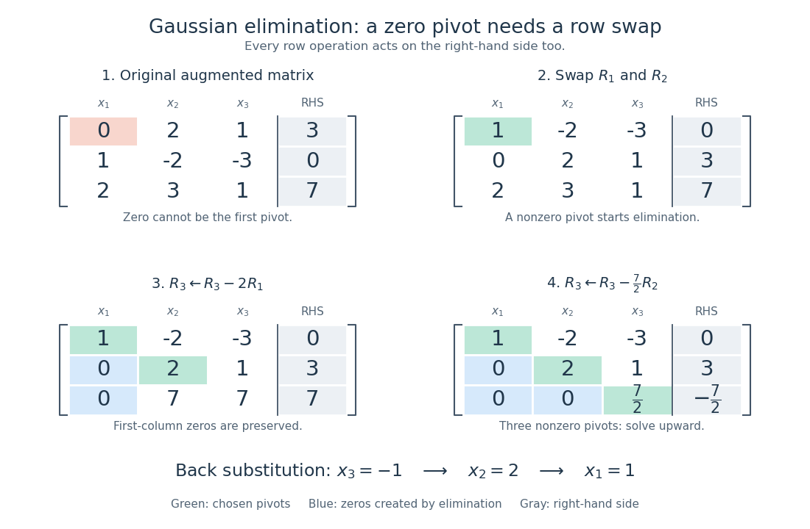

# Gaussian elimination with a row swap

↑ **Parent:** [Gaussian elimination](gaussian-elimination.md)

Consider this original [linear system](system-of-linear-equations.md) and its [augmented matrix](augmented-matrix.md):

$$
A=\begin{pmatrix}0&2&1\\1&-2&-3\\2&3&1\end{pmatrix},\qquad b=\begin{pmatrix}3\\0\\7\end{pmatrix},\qquad [A\mid b]=\left[\begin{array}{rrr|r}0&2&1&3\\1&-2&-3&0\\2&3&1&7\end{array}\right].
$$

The first diagonal entry is zero, so it cannot serve as a [pivot element](pivot-element.md). Interchange $R_1$ and $R_2$ to obtain a [pivot element](pivot-element.md) of one:

$$
\left[\begin{array}{rrr|r}1&-2&-3&0\\0&2&1&3\\2&3&1&7\end{array}\right].
$$

This chooses a convenient nonzero entry for exact arithmetic; [partial pivoting](columnwise-partial-pivoting.md) would instead interchange $R_1$ and $R_3$, selecting the largest [absolute value](absolute-value.md), two. For our chosen ordering, the first-column [elimination multipliers](elimination-multiplier.md) are $m_2=0$ and $m_3=2$. The [elementary row operation](elementary-row-operation.md) $R_3\leftarrow R_3-2R_1$ gives

$$
\left[\begin{array}{rrr|r}1&-2&-3&0\\0&2&1&3\\0&7&7&7\end{array}\right].
$$

The next [pivot element](pivot-element.md) is two and the next [elimination multiplier](elimination-multiplier.md) is $7/2$. Applying $R_3\leftarrow R_3-\tfrac72R_2$ gives the [upper triangular matrix](upper-triangular-matrix.md) system

$$
\left[\begin{array}{rrr|r}1&-2&-3&0\\0&2&1&3\\0&0&\tfrac72&-\tfrac72\end{array}\right].
$$

Every operation also changed the right-hand side. [Back substitution](back-substitution.md) now gives

$$
x_3=\frac{-7/2}{7/2}=-1,\qquad x_2=\frac{3-x_3}{2}=2,\qquad x_1=2x_2+3x_3=1.
$$

Checking the original equations, rather than only the reduced ones, verifies the answer by [matrix multiplication](matrix-multiplication.md):

$$
A\begin{pmatrix}1\\2\\-1\end{pmatrix}=\begin{pmatrix}4-1\\1-4+3\\2+6-1\end{pmatrix}=b.
$$

Thus a zero first diagonal entry was a row-order obstruction, not a [singular matrix](singular-matrix.md). Indeed, the diagonal product of the final [upper triangular matrix](upper-triangular-matrix.md) is $7$; the single row interchange makes $\det A=-7$, since the two row additions preserve the [determinant](determinant.md).

**[Figure 5](#image-a-row-interchange-supplies-the-first-pivot-element-successive-elementary-row-operations-create-zeros-then-back-substitution-gives-1-2-1-t). A row interchange supplies the first pivot element; successive elementary row operations create zeros, then back substitution gives $(1,2,-1)^T$**.

## ↑ Ancestors (7)

1. [Gaussian elimination](gaussian-elimination.md)
2. [Numerical linear algebra](numerical-linear-algebra-split.md)
3. [Numerical analysis](numerical-analysis-split.md)
4. [Analysis](analysis-split.md)
5. [Area of mathematics](area-of-mathematics.md)
6. [Mathematics](mathematics-split.md)
7. [Codex Wiki](split.md)
