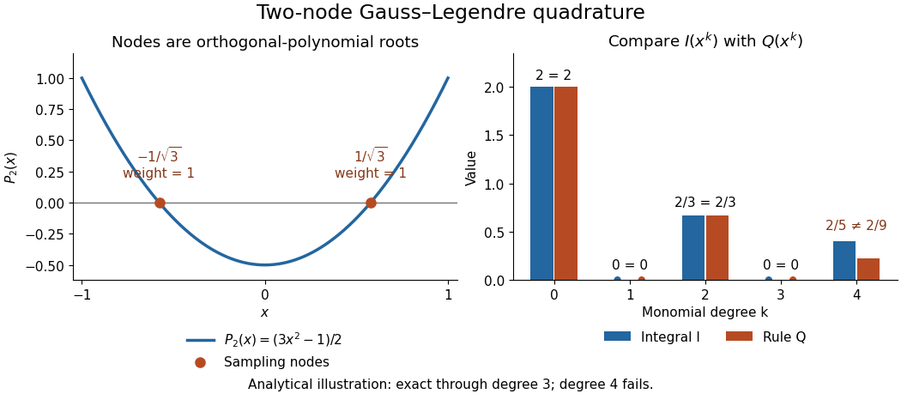

# Gaussian quadrature

↑ **Parent:** [Numerical analysis](numerical-analysis-split.md)  
ⓦ [Wiki](https://en.wikipedia.org/wiki/Gaussian_quadrature)

[Gaussian quadrature](gaussian-quadrature.md) is a [quadrature rule](quadrature-rule.md) that chooses both sample locations and coefficients to achieve unusually high [polynomial](polynomial-split.md) exactness. For a finite [interval](interval-mathematics.md) $[a,b]$ with $a<b$, assume the integration weight $w$ is integrable and positive almost everywhere. Define

$$
I_w(f)=\int_a^b f(x)w(x)\,dx,\qquad Q_n(f)=\sum_{i=1}^n A_i f(x_i),\qquad n\geq1.
$$

Let $p_n$ be the [monic orthogonal polynomial](monic-orthogonal-polynomial.md) of [polynomial degree](degree-of-a-polynomial.md) $n$ for the [inner product](inner-product.md) $\langle u,v\rangle_w=\int_a^b u(x)v(x)w(x)\,dx$: it satisfies $\langle p_n,q\rangle_w=0$ for every [polynomial](polynomial-split.md) $q$ of [polynomial degree](degree-of-a-polynomial.md) below $n$. The [polynomial roots](root-of-a-polynomial.md) of $p_n$ are distinct and inside $(a,b)$; take them as the nodes $x_i$. Integrate the [Lagrange cardinal polynomials](lagrange-cardinal-polynomial.md) $\ell_i$ to obtain $A_i=I_w(\ell_i)$. These coefficients are positive, and

$$
Q_n(f)=I_w(f)\qquad\text{for every polynomial }f\text{ with }\deg f\leq2n-1.
$$

The integration weight $w(x)$ and the discrete coefficients $A_i$ play different roles: $w$ specifies the [integral](integral.md) being approximated, while $A_i$ tell us how much each sample contributes.[Nico M. Temme, NIST Digital Library of Mathematical Functions, §3.5(v), Gauss quadrature: nodes, coefficients and exactness](https://dlmf.nist.gov/3.5#v)

A proof outline explains the gain over simply integrating an arbitrary [polynomial interpolation](polynomial-interpolation.md). Use [polynomial division](polynomial-division.md) to write $f=p_nq+r$, with $\deg q\leq n-1$ and $\deg r\leq n-1$. [Orthogonality](orthogonal-vectors.md) makes $I_w(p_nq)=0$, and sampling at the [polynomial roots](root-of-a-polynomial.md) of $p_n$ makes $Q_n(p_nq)=0$. The [Lagrange cardinal polynomials](lagrange-cardinal-polynomial.md) recover $r$ exactly, so both expressions agree. Also $A_i=Q_n(\ell_i^2)=I_w(\ell_i^2)>0$, since $\ell_i^2$ has [polynomial degree](degree-of-a-polynomial.md) $2n-2$. This is the mechanism behind [positive weights of Gaussian quadrature](positive-weights-of-gaussian-quadrature.md).

For a concrete two-node example, set $w=1$ on $[-1,1]$. The [Legendre polynomial](legendre-polynomial.md) $P_2(x)=(3x^2-1)/2$ has [polynomial roots](root-of-a-polynomial.md) $x=\pm1/\sqrt3$. Its [monic polynomial](monic-polynomial.md) version $p_2=x^2-1/3$ has zero [integral](integral.md) against both $1$ and $x$, as required. Symmetry and exactness for the constant [polynomial](polynomial-split.md) give $A_1=A_2=1$. Thus the Gauss–Legendre instance of [Gaussian quadrature](gaussian-quadrature.md) is

$$
\int_{-1}^1 f(x)\,dx\ \approx\ f(-1/\sqrt3)+f(1/\sqrt3).
$$

Direct evaluation on $1,x,x^2,x^3$ gives $2,0,2/3,0$, exactly their [integrals](integral.md). For the [polynomial](polynomial-split.md) $f(x)=1+x+x^2+x^3$, two samples therefore give $8/3$ exactly. But for $x^4$ the rule gives $2/9$, whereas the [integral](integral.md) is $2/5$: the error $I_1-Q_2$ is $8/45$.

**[Figure 35](#image-analytical-illustration-of-two-node-gauss-legendre-sampling-exact-monomial-integrals-through-degree-three-and-failure-at-degree-four). Analytical illustration of two-node Gauss–Legendre sampling: exact monomial integrals through degree three and failure at degree four**.

The ceiling $2n-1$ is sharp for $n$ distinct real nodes under the positive-weight assumptions. Their squared nodal [polynomial](polynomial-split.md) $\prod_i(x-x_i)^2$ has [polynomial degree](degree-of-a-polynomial.md) $2n$, is zero at every sample, and has a strictly positive weighted [integral](integral.md). Thus no such [quadrature rule](quadrature-rule.md) integrates every [polynomial](polynomial-split.md) of [polynomial degree](degree-of-a-polynomial.md) $2n$ exactly. Nor does [Gaussian quadrature](gaussian-quadrature.md) integrate every nonpolynomial [function](function-split.md) exactly: the same two-node example gives $Q_2(|x|)=2/\sqrt3$, while $I_1(|x|)=1$.

[Gaussian quadrature](gaussian-quadrature.md) is useful when evaluations are costly and a modest [polynomial](polynomial-split.md) captures the integrand well. More precisely, for a [continuous function](continuous-function.md) $f$ and any [polynomial](polynomial-split.md) $r$ of [polynomial degree](degree-of-a-polynomial.md) at most $2n-1$, positivity and constant exactness give

$$
|I_w(f)-Q_n(f)|\leq2I_w(1)\,\|f-r\|_\infty.
$$

The [uniform norm](supremum-norm.md) on $[a,b]$ measures the approximation between samples. This bound connects [quadrature rule](quadrature-rule.md) accuracy to [uniform approximation](uniform-approximation-split.md), rather than promising an error from sample count alone. Corners, sharp unresolved features and [roundoff error](round-off-error.md) require their own assessment; the [absolute value function](absolute-value.md) example already shows why [polynomial](polynomial-split.md) exactness is a qualified guarantee.

**Table of contents**

- [Orthogonal-node criterion for Gaussian quadrature](orthogonal-node-criterion-for-gaussian-quadrature.md)
- [Two-node Gaussian quadrature with quadratic weight](two-node-gaussian-quadrature-with-quadratic-weight.md)
- [Chebyshev–Gauss quadrature](chebyshev-gauss-quadrature.md)
- [Gauss-Laguerre quadrature](gauss-laguerre-quadrature.md)
- [Two-node Gaussian quadrature with linear weight](two-node-gaussian-quadrature-with-linear-weight.md)
- [Two-node Gaussian quadrature with sine weight](two-node-gaussian-quadrature-with-sine-weight.md)
- [Positive weights of Gaussian quadrature](positive-weights-of-gaussian-quadrature.md)
- [Gauss-Hermite quadrature](gauss-hermite-quadrature.md)

## ↑ Ancestors (5)

1. [Numerical analysis](numerical-analysis-split.md)
2. [Analysis](analysis-split.md)
3. [Area of mathematics](area-of-mathematics.md)
4. [Mathematics](mathematics-split.md)
5. [Codex Wiki](split.md)

## ← Incoming links (29)

- [Chebyshev polynomial](chebyshev-polynomial.md)
- [Gauss collocation coefficient construction](gauss-collocation-coefficient-construction.md)
- [Gaussian quadrature](gaussian-quadrature.md)
- [Solution](past-exam-of-the-mathematics-course-of-the-university-of-cambridge/2002/ib/paper-3/6b/solution.md)
- [Solution](past-exam-of-the-mathematics-course-of-the-university-of-cambridge/2004/ib/paper-2/9a/solution.md)
- [Solution](past-exam-of-the-mathematics-course-of-the-university-of-cambridge/2005/ib/paper-4/8f/solution.md)
- [Solution](past-exam-of-the-mathematics-course-of-the-university-of-cambridge/2005/ii/paper-3/2f/iii/solution.md)
- [Solution](past-exam-of-the-mathematics-course-of-the-university-of-cambridge/2006/ib/paper-2/18d/a/solution.md)
- [Solution](past-exam-of-the-mathematics-course-of-the-university-of-cambridge/2006/iii/paper-68/1/b/solution.md)
- [Solution](past-exam-of-the-mathematics-course-of-the-university-of-cambridge/2008/ib/paper-4/8d/solution.md)
- [Solution](past-exam-of-the-mathematics-course-of-the-university-of-cambridge/2009/ib/paper-4/8c/solution.md)
- [Solution](past-exam-of-the-mathematics-course-of-the-university-of-cambridge/2009/ii/paper-1/2f/ii/solution.md)
- [Solution](past-exam-of-the-mathematics-course-of-the-university-of-cambridge/2013/ib/paper-1/6c/solution.md)
- [Solution](past-exam-of-the-mathematics-course-of-the-university-of-cambridge/2014/ib/paper-4/8c/solution.md)
- [Solution](past-exam-of-the-mathematics-course-of-the-university-of-cambridge/2015/ii/paper-2/2i/i/solution.md)
- [Solution](past-exam-of-the-mathematics-course-of-the-university-of-cambridge/2015/ii/paper-2/2i/ii/solution.md)
- [Solution](past-exam-of-the-mathematics-course-of-the-university-of-cambridge/2015/ii/paper-2/2i/iii/solution.md)
- [Solution](past-exam-of-the-mathematics-course-of-the-university-of-cambridge/2015/ii/paper-2/2i/solution.md)
- [Solution](past-exam-of-the-mathematics-course-of-the-university-of-cambridge/2017/ib/paper-3/19c/solution.md)
- [Solution](past-exam-of-the-mathematics-course-of-the-university-of-cambridge/2020/ib/paper-1/18c/b/solution.md)
- [Solution](past-exam-of-the-mathematics-course-of-the-university-of-cambridge/2020/ii/paper-2/2h/solution.md)
- [Solution](past-exam-of-the-mathematics-course-of-the-university-of-cambridge/2021/ii/paper-2/11h/d/solution.md)
- [Solution](past-exam-of-the-mathematics-course-of-the-university-of-cambridge/2022/ib/paper-4/6c/a/solution.md)
- [Solution](past-exam-of-the-mathematics-course-of-the-university-of-cambridge/2026/ii/paper-4/2i/ii/solution.md)
- [Positive weights of Gaussian quadrature](positive-weights-of-gaussian-quadrature.md)
- [Quadrature rule](quadrature-rule.md)
- [Two-node Gaussian quadrature with linear weight](two-node-gaussian-quadrature-with-linear-weight.md)
- [Two-node Gaussian quadrature with quadratic weight](two-node-gaussian-quadrature-with-quadratic-weight.md)
- [Two-node Gaussian quadrature with sine weight](two-node-gaussian-quadrature-with-sine-weight.md)
