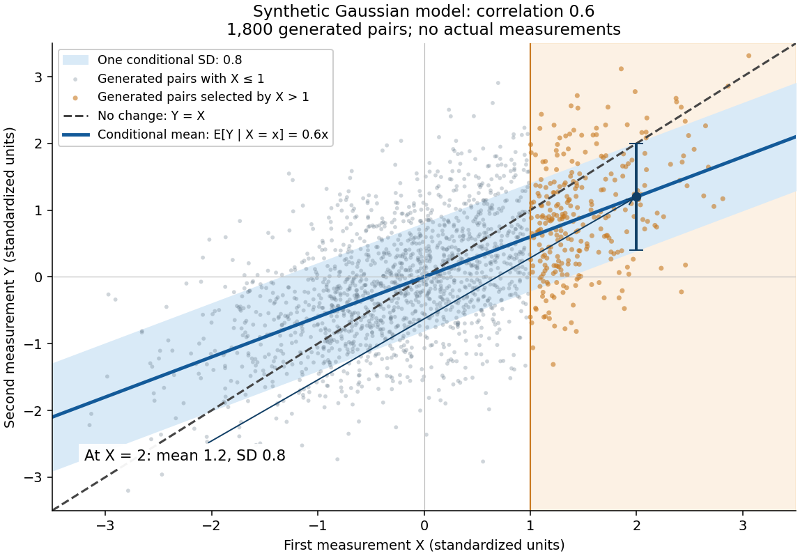

# Gaussian regression toward the mean

↑ **Parent:** [Repeated-measurement latent signal model](repeated-measurement-latent-signal-model.md)

Take the original synthetic model $T\sim N(0,0.6)$ and $\varepsilon_1,\varepsilon_2\sim N(0,0.4)$, mutually [independent random variables](independent-random-variables.md), with the second argument denoting [variance](variance-split.md). The pair $(X,Y)$ has a [multivariate normal distribution](multivariate-normal-distribution.md) with [mean](expected-value-split.md) zero, unit marginal [variances](variance-split.md), and [Pearson correlation coefficient](pearson-correlation-coefficient.md) $0.6$. Its [conditional multivariate normal distribution](conditional-multivariate-normal-distribution.md) is

$$
Y\mid X=x\sim N(0.6x,1-0.6^2)=N(0.6x,0.64).
$$

For a first reading $x=2$, the second reading has [conditional expectation](conditional-expectation.md) $1.2$ and [conditional variance](conditional-variance.md) $0.64$, hence [standard deviation](standard-deviation.md) $0.8$. There is still [conditional probability](conditional-probability.md) $1-\Phi(1)\approx0.1587$ of $Y>2$, a movement farther from zero, where $\Phi$ is the [standard normal distribution function](standard-normal-distribution-function.md). The line $0.6x$ describes a [conditional mean](conditional-expectation.md), not an individual trajectory.

**[Figure 7](#image-an-extreme-first-reading-predicts-a-less-extreme-conditional-mean-with-substantial-scatter). An extreme first reading predicts a less extreme conditional mean, with substantial scatter**. Original synthetic [scatter plot](scatter-plot.md) of 1,800 generated pairs, explicitly not actual measurements. Each pair has unit marginal [variances](variance-split.md) and [Pearson correlation coefficient](pearson-correlation-coefficient.md) $0.6$; orange points satisfy $X>1$. The blue line is the [conditional expectation](conditional-expectation.md) $0.6x$, the band is one conditional [standard deviation](standard-deviation.md) $0.8$ on either side, and the dashed line denotes $Y=X$. The band is not a [confidence interval](confidence-interval.md) for an estimated line. The axes show a finite display window.

A short derivation isolates $R=Y-0.6X$. Its [covariance](covariance.md) with $X$ is zero and its [variance](variance-split.md) is $0.64$. Because $(X,R)$ has a [multivariate normal distribution](multivariate-normal-distribution.md), zero [covariance](covariance.md) implies independence: $R\sim N(0,0.64)$ independently of $X$. This also explains why reversing the two measurements gives $\mathbb E[X\mid Y=y]=0.6y$. The [statistical association](statistical-association.md) does not identify a direction of [causal effect](causal-effect.md).

**Table of contents**

- [Selection on an extreme first measurement](selection-on-an-extreme-first-measurement.md)

## ↑ Ancestors (6)

1. [Repeated-measurement latent signal model](repeated-measurement-latent-signal-model.md)
2. [Regression toward the mean](regression-toward-the-mean.md)
3. [Probability and statistics](probability-and-statistics-split.md)
4. [Area of mathematics](area-of-mathematics.md)
5. [Mathematics](mathematics-split.md)
6. [Codex Wiki](split.md)
