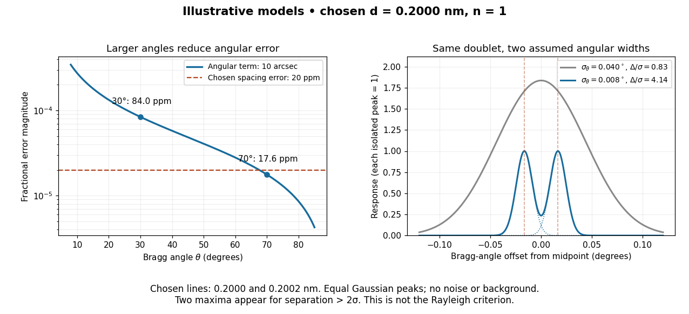

# Gaussian spectral doublet resolution

↑ **Parent:** [Crystal X-ray spectrometer](crystal-x-ray-spectrometer.md)

A [spectral doublet](spectral-doublet.md) comprises two neighbouring [spectral lines](spectral-line.md). Resolving it requires information about the line response, relative strengths and [noise](noise-signal-processing.md), not only precision in reading an angle. Choose two equal angular responses shaped as [Gaussian functions](gaussian-function.md) with common [standard deviation](standard-deviation.md) $\sigma$ and separation $\Delta$. If $x$ is angular displacement from their midpoint, their summed signal is

$$
f(x)=\exp\left(-\frac{(x-\Delta/2)^2}{2\sigma^2}\right)
+\exp\left(-\frac{(x+\Delta/2)^2}{2\sigma^2}\right).
$$

These are assumed response shapes, not a measured Siegbahn [frequency spectrum](frequency-spectrum.md). By symmetry $f'(0)=0$, and

$$
f''(0)=\frac{2e^{-\Delta^2/(8\sigma^2)}}{\sigma^2}
\left(\frac{\Delta^2}{4\sigma^2}-1\right).
$$

The midpoint changes from a maximum to a minimum at $\Delta=2\sigma$. For this particular equal-width, equal-height model, two distinct maxima occur when $\Delta>2\sigma$. Each isolated [Gaussian function](gaussian-function.md) has [full width at half maximum](full-width-at-half-maximum.md) $2\sqrt{2\ln2}\,\sigma\simeq2.355\sigma$; the two-maxima threshold is therefore about $0.849$ times that width.

**[Figure 8](#image-bragg-angular-error-doublet-resolution). Angular error and the visibility of a chosen spectral doublet**. Original calculated models. Left: magnitude of the angular term in [Bragg wavelength error propagation](bragg-wavelength-error-propagation.md), alongside a separately chosen fractional spacing error of $20$ parts per million; the curves are not added. Right: explicitly chosen [interplanar spacing](interplanar-spacing.md) $d=0.2000\,\mathrm{nm}$, first [diffraction order](diffraction-order.md), and lines at $0.2000$ and $0.2002\,\mathrm{nm}$. Equal [Gaussian function](gaussian-function.md) responses use angular [standard deviations](standard-deviation.md) $0.040^\circ$ and $0.008^\circ$; dotted curves show the narrower isolated components. None of these numbers is a historical crystal calibration or measured spectrum.

In this chosen model, the two [Bragg angles](bragg-angle.md) are $30.000000^\circ$ and $30.033085^\circ$. Their separation is $0.827$ times $\sigma$ for $\sigma=0.040^\circ$, giving one maximum, and $4.136$ times $\sigma$ for $\sigma=0.008^\circ$, giving two. Sharpening the response can reveal the doublet without changing either emitted [wavelength](wavelength.md).

The [Rayleigh criterion](rayleigh-criterion.md) uses a first-zero convention for specified [diffraction](diffraction.md) patterns. A [Gaussian function](gaussian-function.md) has no finite zero, so its two-maxima threshold is not the [Rayleigh criterion](rayleigh-criterion.md). Neither convention is a universal inference limit: known response shapes and adequate [signal-to-noise ratio](signal-to-noise-ratio.md) can support estimating a separation before two visible maxima appear. Unequal strengths, background, finite sampling and uncertainty in the response can make that inference much harder. [Measurement resolution](measurement-resolution.md), the precision of an isolated line's centre and absolute [wavelength](wavelength.md) accuracy should therefore be reported separately.

## ↑ Ancestors (11)

1. [Crystal X-ray spectrometer](crystal-x-ray-spectrometer.md)
2. [Siegbahn precision X-ray wavelength spectroscopy](siegbahn-precision-x-ray-wavelength-spectroscopy.md)
3. [X-ray emission spectroscopy](x-ray-emission-spectroscopy.md)
4. [Characteristic X-ray](characteristic-x-ray.md)
5. [X-ray tube](x-ray-tube.md)
6. [X-ray](x-ray.md)
7. [Electromagnetic radiation](electromagnetic-radiation-split.md)
8. [Electromagnetism](electromagnetism-split.md)
9. [Branches of physics](branches-of-physics.md)
10. [Physics](physics-split.md)
11. [Codex Wiki](split.md)
