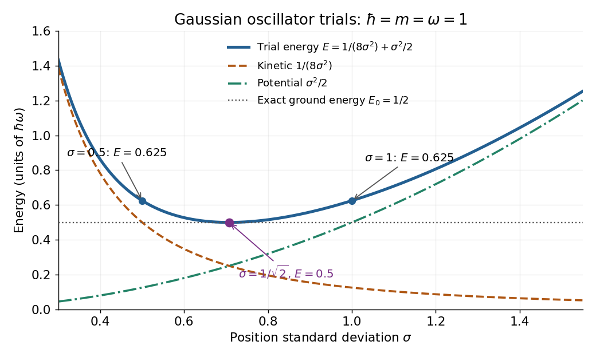

# Gaussian variational energy for the harmonic oscillator

↑ **Parent:** [Variational method](variational-method.md)

Use the [quantum harmonic oscillator](quantum-harmonic-oscillator-split.md) in units with reduced [Planck constant](planck-constant.md) $\hbar=1$, [mass](mass.md) $m=1$, and [angular frequency](angular-frequency.md) $\omega=1$. Its [Hamiltonian operator](hamiltonian-quantum-mechanics.md) and trial [Gaussian wave packet](gaussian-wave-packet.md) are

$$
H=-\frac12\frac{d^2}{dx^2}+\frac{x^2}{2},\qquad \psi_\sigma(x)=(2\pi\sigma^2)^{-1/4}\exp\!\left(-\frac{x^2}{4\sigma^2}\right),\qquad \sigma>0.
$$

This is the same [Gaussian wave packet](gaussian-wave-packet.md) used for the [Heisenberg uncertainty relation](heisenberg-uncertainty-relation.md): $|\psi_\sigma|^2$ is a [normal distribution](normal-distribution.md) with mean zero and [variance](variance-split.md) $\sigma^2$. The [Gaussian integral](gaussian-integral.md) gives [wavefunction normalization](wavefunction-normalization.md) and $\langle x^2\rangle=\sigma^2$. These smooth, rapidly decaying trials lie in the [one-dimensional harmonic oscillator form domain](one-dimensional-harmonic-oscillator-form-domain.md) and even in the [operator domain](operator-domain.md).

Since $\psi_\sigma'=-x\psi_\sigma/(2\sigma^2)$, [integration by parts](integration-by-parts.md) with vanishing boundary terms gives the [kinetic energy](kinetic-energy.md) and [potential energy](potential-energy.md):

$$
\langle T\rangle=\frac12\int_{\mathbb R}|\psi_\sigma'|^2\,dx=\frac{1}{8\sigma^2},\qquad \langle V\rangle=\frac12\langle x^2\rangle=\frac{\sigma^2}{2},\qquad E(\sigma)=\frac{1}{8\sigma^2}+\frac{\sigma^2}{2}.
$$

Narrow trials cost [kinetic energy](kinetic-energy.md), while broad trials cost [potential energy](potential-energy.md). The exact difference

$$
E(\sigma)-\frac12=\frac{(2\sigma^2-1)^2}{8\sigma^2}\geq0
$$

shows that the unique optimal width is $\sigma^2=1/2$, with $E=1/2$. At $\sigma=1/2$ and $\sigma=1$, the trial [energies](energy-split.md) are both $5/8=0.625$; the [kinetic energy](kinetic-energy.md) and [potential energy](potential-energy.md) contributions exchange places.

**[Figure 8](#image-gaussian-oscillator-trial-energies-widths-0-5-and-1-both-give-0-625-while-the-optimal-width-gives-0-5). Gaussian oscillator trial energies: widths 0.5 and 1 both give 0.625, while the optimal width gives 0.5**. The [kinetic energy](kinetic-energy.md) decreases and the [potential energy](potential-energy.md) increases with the width of the [Gaussian wave packet](gaussian-wave-packet.md). Their sum touches the exact [ground-state energy](ground-state-energy.md) only at $\sigma=1/\sqrt2$.

Minimizing within this trial family alone establishes $E_0\leq1/2$. To establish exactness, use the [Heisenberg uncertainty relation](heisenberg-uncertainty-relation.md) to obtain $E_\psi\geq1/2$ for every admissible [quantum state](quantum-state.md), as in its existing oscillator example. Together the bounds give $E_0=1/2$. Direct substitution also yields $H\psi_{1/\sqrt2}=\psi_{1/\sqrt2}/2$, agreeing with the [Gaussian eigenstate for a quadratic potential](gaussian-eigenstate-for-a-quadratic-potential.md). This is a useful distinction: the [variational method](variational-method.md) supplies the upper bound, while the [Heisenberg uncertainty relation](heisenberg-uncertainty-relation.md) supplies the complementary lower bound.

## ↑ Ancestors (5)

1. [Variational method](variational-method.md)
2. [Quantum theory](quantum-theory-split.md)
3. [Branches of physics](branches-of-physics.md)
4. [Physics](physics-split.md)
5. [Codex Wiki](split.md)

## ← Incoming links (2)

- [Solution](past-exam-of-the-advanced-quantum-physics-course-of-the-university-of-cambridge/2015/paper-1/2/a/solution.md)
- [Variational method](variational-method.md)
