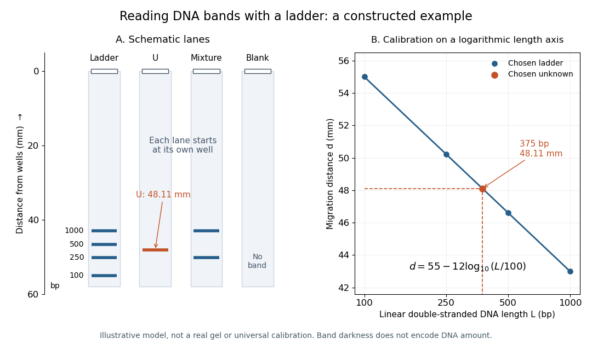

# Gel electrophoresis size calibration

↑ **Parent:** [Agarose gel electrophoresis](agarose-gel-electrophoresis.md)

A [gel electrophoresis size calibration](gel-electrophoresis-size-calibration.md) relates migration distance to known fragment lengths on the same gel. Here is an explicitly chosen model for linear double-stranded [DNA](deoxyribonucleic-acid.md), not measured data or a universal law. Let $L$ be the numerical length in [base pairs](base-pair.md) and $d$ the numerical migration distance in millimetres from the wells:

$$
d=55-12\log_{10}(L/100).
$$

The [logarithm](logarithm.md) has a dimensionless argument: $L/100$ is the length divided by 100 [base pairs](base-pair.md). The chosen [DNA ladder](dna-ladder.md) fragments $L=100,250,500,1000$ give $d=55.00,50.22,46.61,43.00$, respectively. The [gel bands](gel-band.md) therefore appear in the reverse order of length along the direction of migration.

**[Figure 40](#image-constructed-dna-ladder-unknown-mixture-and-blank-lanes-with-a-logarithm-calibration-all-positions-follow-the-chosen-model-the-unknown-is-375-base-pairs-at-48-11-mm-and-darkness-does-not-represent-dna-quantity). Constructed DNA ladder, unknown, mixture and blank lanes with a logarithm calibration. All positions follow the chosen model; the unknown is 375 base pairs at 48.11 mm, and darkness does not represent DNA quantity**.

To invert the calibration, rearrange the [logarithm](logarithm.md):

$$
L=100\,10^{(55-d)/12}.
$$

Our chosen unknown $L=375$ gives $d=48.1116248\ldots$, between the 250-[base pair](base-pair.md) and 500-[base pair](base-pair.md) references. Inserting that distance into the inverse recovers 375; retaining only $d=48.11$ gives about $375.12$ [base pairs](base-pair.md). The extra digits reflect rounding in this model, not the resolving power of a real gel.

For [linear interpolation](linear-interpolation.md) between those two reference [gel bands](gel-band.md), use the [logarithm](logarithm.md) of length. Here the fraction of the distance from the 500-[base pair](base-pair.md) reference toward the 250-[base pair](base-pair.md) reference is $t=\log_{10}(500/375)/\log_{10}2\approx0.4150$, giving $L=500(250/500)^t=375$. Direct [linear interpolation](linear-interpolation.md) of lengths instead gives approximately $396.24$ [base pairs](base-pair.md). This difference explains why the choice of calibration coordinates matters. A real calibration must be checked over its usable range; folded [RNA](ribonucleic-acid.md) or circular [DNA](deoxyribonucleic-acid.md) does not automatically share the linear double-stranded [DNA](deoxyribonucleic-acid.md) calibration.

## ↑ Ancestors (4)

1. [Agarose gel electrophoresis](agarose-gel-electrophoresis.md)
2. [Gel electrophoresis](gel-electrophoresis.md)
3. [Biology](biology-split.md)
4. [Codex Wiki](split.md)

## ← Incoming links (3)

- [Electrophoretic mobility](electrophoretic-mobility.md)
- [Gel electrophoresis size calibration](gel-electrophoresis-size-calibration.md)
- [Solution](past-exam-of-the-soft-condensed-matter-course-of-the-university-of-cambridge/2021/section-a/1/solution.md)
