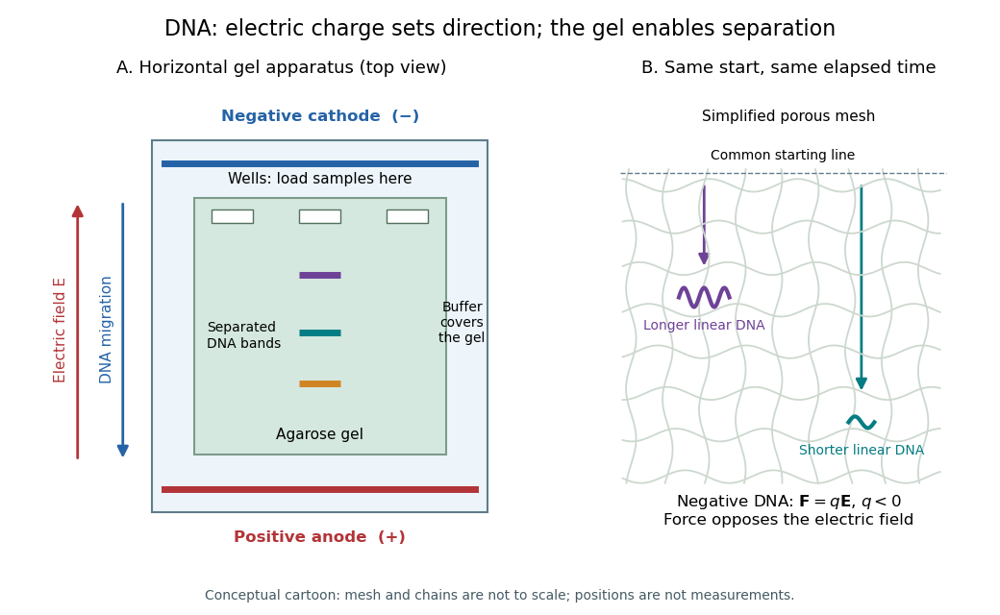

# Gel electrophoresis

↑ **Parent:** [Biology](biology-split.md)  
ⓦ [Wiki](https://en.wikipedia.org/wiki/Gel_electrophoresis)

Separation of charged [molecules](molecule-split.md) through a gel in an [electric field](electric-field-split.md). Denaturing conditions suppress folded structures, helping compare [RNA](ribonucleic-acid.md) lengths; matching migration alone does not establish an identical [nucleotide sequence](nucleic-acid-sequence.md) or identical [covalent bonds](covalent-bond-split.md). In the [ribozyme](ribozyme.md) experiments, labelled [RNA](ribonucleic-acid.md) was detected after separation by exposing photographic film.

In [DNA](deoxyribonucleic-acid.md) [agarose gel electrophoresis](agarose-gel-electrophoresis.md), the backbone [phosphate](phosphate.md) groups carry negative [electric charge](electric-charge-split.md) under the usual mildly alkaline [buffer solution](buffer-solution.md) conditions. [DNA](deoxyribonucleic-acid.md) therefore moves toward the positive [anode](anode.md), away from the negative [cathode](cathode.md).[Introduction; Loading Samples and Running an Agarose Gel, step 6: DNA migration toward the positive electrode](agarose-gel-electrophoresis-by-addgene.md)

The [electric field](electric-field-split.md) points the other way: the [electric force](electric-force.md) $\mathbf F=q\mathbf E$ reverses direction when $q<0$. The apparatus is driven by an external source of [electric potential difference](electric-potential-difference.md); the positive [anode](anode.md) convention here belongs to that operating mode. Direction follows [electric charge](electric-charge-split.md), so it is not a rule that all [molecules](molecule-split.md) move toward the same [electrode](electrode.md).

The useful result is a spatial comparison: a mixture becomes separated [gel bands](gel-band.md), which can be compared with a [DNA ladder](dna-ladder.md) or recovered for subsequent analysis. [Agarose gel electrophoresis](agarose-gel-electrophoresis.md) of linear double-stranded [DNA](deoxyribonucleic-acid.md), [gel electrophoresis](gel-electrophoresis.md) of denatured [RNA](ribonucleic-acid.md), and [SDS-PAGE](sds-page.md) of [proteins](protein-split.md) use different conditions to make migration informative about chain size. An [electric field](electric-field-split.md) supplies motion; the gel supplies a porous obstacle course.

**[Figure 39](#image-dna-migrates-toward-the-positive-anode-opposite-to-the-electric-field-the-agarose-mesh-separates-linear-dna-fragments-conceptual-apparatus-and-mesh-not-measured-trajectories-or-a-drawing-to-scale). DNA migrates toward the positive anode, opposite to the electric field; the agarose mesh separates linear DNA fragments. Conceptual apparatus and mesh, not measured trajectories or a drawing to scale**.

**Table of contents**

- [Polyacrylamide gel electrophoresis](polyacrylamide-gel-electrophoresis.md)
- [Electrophoretic mobility shift assay](electrophoretic-mobility-shift-assay.md)
- [Gel band](gel-band.md)
- [Agarose gel electrophoresis](agarose-gel-electrophoresis.md)
  - [DNA ladder](dna-ladder.md)
  - [Gel electrophoresis size calibration](gel-electrophoresis-size-calibration.md)
- [UV transilluminator](uv-transilluminator.md)
- [SDS-PAGE](sds-page.md)
- [Starch gel electrophoresis](starch-gel-electrophoresis.md)
- [Denaturing polyacrylamide gel electrophoresis](denaturing-polyacrylamide-gel-electrophoresis.md)

## ↑ Ancestors (2)

1. [Biology](biology-split.md)
2. [Codex Wiki](split.md)

## ← Incoming links (17)

- [Denaturing polyacrylamide gel electrophoresis](denaturing-polyacrylamide-gel-electrophoresis.md)
- [Electrophoresis](electrophoresis.md)
- [Gel electrophoresis](gel-electrophoresis.md)
- [IgG chain reduction experiment](igg-chain-reduction-experiment.md)
- [Isoelectric point](isoelectric-point.md)
- [Nuclear pore localization experiment](nuclear-pore-localization-experiment.md)
- [Solution](past-exam-of-the-soft-matter-and-biological-physics-course-of-the-university-of-cambridge/2013/paper-1/3/a/solution.md)
- [PCR controls](pcr-controls.md)
- [PCR thermal cycle](pcr-thermal-cycle.md)
- [Peptide mapping](peptide-mapping.md)
- [Reptation](reptation.md)
- [Ribozyme](ribozyme.md)
- [Sanger sequencing](sanger-sequencing.md)
- [SDS-PAGE](sds-page.md)
- [TAE buffer](tae-buffer.md)
- [UV transilluminator](uv-transilluminator.md)
- [Western blot](western-blot.md)
