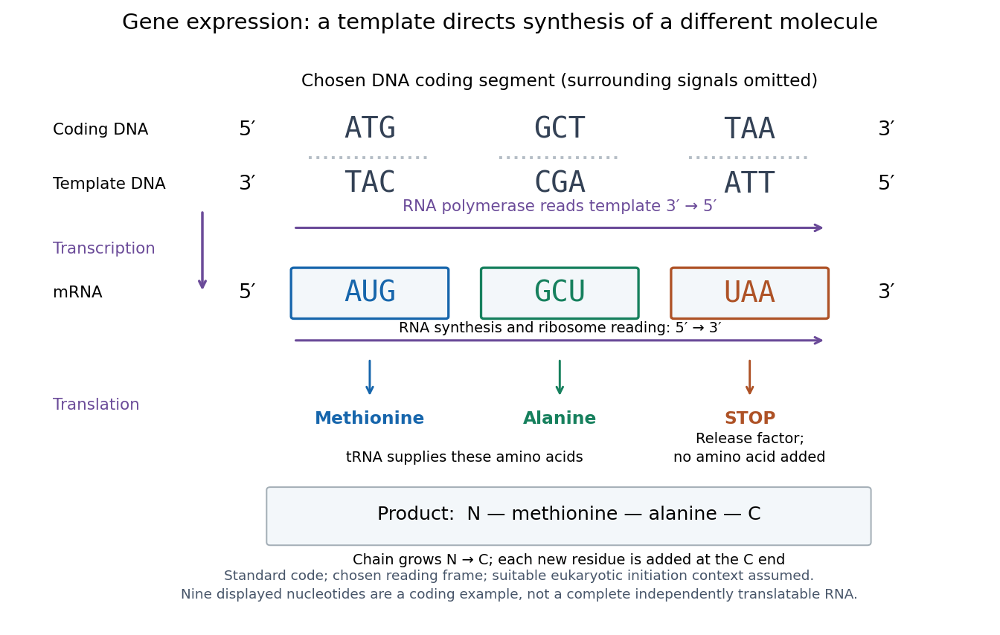

# Gene expression

↑ **Parent:** [Molecular genetics](molecular-genetics-split.md)  
ⓦ [Wiki](https://en.wikipedia.org/wiki/Gene_expression)

[Gene expression](gene-expression.md) uses a [gene](gene.md)'s information to produce functional [RNA](ribonucleic-acid.md) or a [protein](protein-split.md). [Transcription](transcription-biology.md) makes [RNA](ribonucleic-acid.md) from a [DNA](deoxyribonucleic-acid.md) template; for a [protein](protein-split.md)-coding [gene](gene.md), [biological translation](translation-biology.md) then uses [messenger RNA](messenger-rna.md) to specify an [amino acid](amino-acid.md) chain. Many [genes](gene.md) instead produce functional [RNA](ribonucleic-acid.md), including [transfer RNA](transfer-rna.md) and [ribosomal RNA](ribosomal-rna.md), without a translated [protein](protein-split.md) product. See [Alberts et al., Molecular Biology of the Cell, 4th edition (2002): from DNA to RNA](https://www.ncbi.nlm.nih.gov/books/NBK26887/).

Follow the chosen [coding strand](coding-strand.md) $5'\text{-}\mathrm{ATGGCTTAA}\text{-}3'$: [transcription](transcription-biology.md) of its complementary template gives $5'\text{-}\mathrm{AUGGCUUAA}\text{-}3'$ in [messenger RNA](messenger-rna.md). In the stated [reading frame](reading-frame.md), its three [codons](codon.md) are AUG, GCU and UAA: [methionine](methionine.md), [alanine](alanine.md) and a [stop codon](stop-codon.md). Thus nine [nucleotides](nucleotide.md) specify two [amino acid](amino-acid.md) residues followed by termination, not three residues. This is an illustrative coding segment embedded in suitable expression and initiation context, not a claim that an isolated nine-[nucleotide](nucleotide.md) [RNA](ribonucleic-acid.md) is sufficient to initiate [biological translation](translation-biology.md).

**[Figure 12](#image-gene-expression-oriented-dna-template-messenger-rna-codons-and-the-resulting-amino-acid-order). Gene expression: oriented DNA template, messenger RNA codons and the resulting amino acid order**. The [coding strand](coding-strand.md) matches the displayed [messenger RNA](messenger-rna.md) after T is replaced by U; [RNA polymerase](rna-polymerase.md) uses the opposite, complementary [DNA](deoxyribonucleic-acid.md) strand. The [ribosome](ribosome.md) reads AUG, GCU and UAA from $5'$ to $3'$. AUG and GCU specify [methionine](methionine.md) and [alanine](alanine.md); UAA signals termination without supplying an [amino acid](amino-acid.md). The chain is shown from its [N-terminus](n-terminus.md) to its [C-terminus](c-terminus.md). The labels summarize successive operations, not simultaneous binding of all depicted components; flanking signals and machinery are omitted.

The distinction between copying and use explains how [biological cells](biological-cell-split.md) can preserve the same [DNA](deoxyribonucleic-acid.md) yet produce different products. [DNA replication](dna-replication.md) duplicates the record; [gene expression](gene-expression.md) selects and uses parts of it. [Transcription](transcription-biology.md) does not use all [DNA](deoxyribonucleic-acid.md) at once, and [gene expression](gene-expression.md) can be controlled at several steps, including [transcription](transcription-biology.md), [RNA](ribonucleic-acid.md) processing and [biological translation](translation-biology.md). See [Clark, Douglas and Choi, Biology 2e: regulation of gene expression](https://openstax.org/books/biology-2e/pages/16-1-regulation-of-gene-expression). The arrows describe template-directed synthesis: the [DNA](deoxyribonucleic-acid.md) does not physically turn into a [protein](protein-split.md), and the [messenger RNA](messenger-rna.md) does not supply the [amino acids](amino-acid.md) from which that [protein](protein-split.md) is assembled.

**Table of contents**

- [Differential gene expression](differential-gene-expression.md)
- [Trans-regulation](trans-regulation.md)
- [Regulation of gene expression](regulation-of-gene-expression.md)
  - [Post-transcriptional regulation](post-transcriptional-regulation.md)
    - [RNA export](rna-export.md)
    - [Messenger RNA localization](messenger-rna-localization.md)
      - [RNA partition coefficient](rna-partition-coefficient.md)
    - [RNA decay](rna-decay.md)
      - [AU-rich element](au-rich-element.md)
    - [RNA half-life](rna-half-life.md)
    - [RNA tethering assay](rna-tethering-assay.md)
    - [Translational regulation](translational-regulation.md)
      - [Translation efficiency](translation-efficiency.md)
      - [Nascent-chain imaging](nascent-chain-imaging.md)
  - [Inducer exclusion](inducer-exclusion.md)
  - [Lac operon](lac-operon.md)
    - [Lac operator](lac-operator.md)
- [Transcription corepressor](transcription-corepressor.md)
- [Transcription coactivator](transcription-coactivator.md)
- [Attenuation in bacterial gene regulation](attenuation-in-bacterial-gene-regulation.md)
- [RNA thermometer](rna-thermometer.md)
- [Riboswitch](riboswitch.md)
- [T7 expression system](t7-expression-system.md)
- [RNA editing](rna-editing.md)
- [Stringent response](stringent-response.md)
- [Integrated stress response](integrated-stress-response.md)
- [RNA interference](rna-interference.md)
  - [Dicer-independent small RNA biogenesis](dicer-independent-small-rna-biogenesis.md)
  - [RNA-induced silencing complex](rna-induced-silencing-complex.md)
  - [Small interfering RNA](small-interfering-rna.md)
    - [22G RNA](22g-rna.md)
  - [RITS complex](rits-complex.md)
- [Preinitiation complex](preinitiation-complex.md)
  - [TFIIH](tfiih.md)
    - [XPB](xpb.md)
  - [TFIIB](tfiib.md)
  - [TFIID](tfiid.md)
- [Transcription start site](transcription-start-site.md)
- [Polyadenylation](polyadenylation.md)
- [Reporter gene](reporter-gene.md)
- [Cis-regulatory element](cis-regulatory-element.md)
  - [Hormone response element](hormone-response-element.md)
- [Nonsense-mediated decay](nonsense-mediated-decay.md)
  - [UPF protein](upf-protein.md)
    - [UPF3](upf3.md)
    - [UPF2](upf2.md)
    - [UPF1](upf1.md)
- [Transcript isoform](transcript-isoform.md)
- [Gene overexpression](gene-overexpression.md)
- [Allele-specific expression](allele-specific-expression.md)
- [RNA sequencing](rna-sequencing.md)
  - [Sequencing depth](sequencing-depth.md)
  - [Read coverage](read-coverage.md)
  - [RNA-seq differential expression](rna-seq-differential-expression.md)
  - [Transcript assembly](transcript-assembly.md)
  - [Nanopore sequencing](nanopore-sequencing.md)
    - [xPore](xpore.md)
  - [GRO-cap](gro-cap.md)
  - [CAGE](cage.md)
  - [SLAM-seq](slam-seq.md)
  - [Single-nucleus RNA sequencing](single-nucleus-rna-sequencing.md)
  - [Long-read RNA sequencing](long-read-rna-sequencing.md)
- [Enhancer](enhancer.md)
  - [Enhancer-promoter contact](enhancer-promoter-contact.md)
- [Cis-regulatory evolution](cis-regulatory-evolution.md)
- [Genomic imprinting](genomic-imprinting.md)
  - [Kinship theory of genomic imprinting](kinship-theory-of-genomic-imprinting.md)
- [Zygotic genome activation](zygotic-genome-activation.md)
- [Galactose induction](galactose-induction.md)
- [Promoter (genetics)](promoter-genetics.md)
  - [psbD gene promoter](psbd-gene-promoter.md)
  - [Core promoter](core-promoter.md)
    - [Initiator element](initiator-element.md)
    - [TATA box](tata-box.md)
- [Transcription factor](transcription-factor.md)
  - [Hunchback](hunchback.md)
  - [Bicoid](bicoid.md)
  - [FOXA2](foxa2.md)
  - [SMAD3](smad3.md)
  - [SMAD2](smad2.md)
  - [TEAD4](tead4.md)
  - [PAL-1](pal-1.md)
  - [SYS-1](sys-1.md)
  - [POP-1](pop-1.md)
  - [ELT-7](elt-7.md)
  - [ELT-2](elt-2.md)
  - [END-3](end-3.md)
  - [END-1](end-1.md)
  - [MED-2](med-2.md)
  - [MED-1](med-1.md)
  - [SKN-1](skn-1.md)
  - [GATA transcription factor](gata-transcription-factor.md)
  - [Phytochrome-interacting factor](phytochrome-interacting-factor.md)
    - [PIF4](pif4.md)
  - [DNA-binding motif](dna-binding-motif.md)
  - [CTCF](ctcf.md)
  - [ASCL1](ascl1.md)
  - [Pioneer transcription factor](pioneer-transcription-factor.md)
  - [E2F](e2f.md)
  - [LacI](laci.md)
  - [KRAB](krab.md)
  - [Myc](myc.md)
  - [TBX5](tbx5.md)
  - [NKX2-5](nkx2-5.md)
  - [Engrailed-1](engrailed-1.md)
  - [Lmx1b](lmx1b.md)
  - [CncC](cncc.md)
  - [NRF2](nrf2.md)
  - [ATOH1](atoh1.md)
  - [RccR](rccr.md)
  - [HNF1β](hnf1-beta.md)
  - [TCF transcription factor](tcf-transcription-factor.md)
  - [Transcription activator](transcription-activator.md)
  - [NEEDLY](needly.md)
  - [LEAFY](leafy.md)
  - [MADS-box transcription factor](mads-box-transcription-factor.md)
  - [SEPALLATA](sepallata.md)
  - [AGAMOUS](agamous.md)
  - [PISTILLATA](pistillata.md)
  - [APETALA3](apetala3.md)
  - [CYCLOIDEA](cycloidea.md)
  - [KNOX2](knox2.md)
  - [Catabolite activator protein](catabolite-activator-protein.md)
  - [Eukaryotic transcriptional activator](eukaryotic-transcriptional-activator.md)
  - [DNA shape readout](dna-shape-readout.md)
  - [Twist1](twist1.md)
  - [ZEB1](zeb1.md)
  - [GCN4](gcn4.md)
  - [ATF4](atf4.md)
  - [KRAB zinc-finger protein](krab-zinc-finger-protein.md)
  - [TATA-binding protein](tata-binding-protein.md)
  - [TFAP2C](tfap2c.md)
  - [PRDM14](prdm14.md)
  - [BLIMP1](blimp1.md)
  - [Dichaete](dichaete.md)
  - [Caudal](caudal.md)
  - [Odd-paired](odd-paired.md)
  - [Hes/Her transcription factor](hes-her-transcription-factor.md)
  - [KLF17](klf17.md)
  - [SOX17](sox17.md)
  - [GATA4](gata4.md)
  - [GATA6](gata6.md)
  - [NANOG](nanog.md)
  - [OCT4](oct4.md)
  - [CDX2](cdx2.md)
  - [TEAD](tead.md)
  - [YAP](yap.md)
  - [Dorsal protein](dorsal-protein.md)
  - [Snail](snail.md)
  - [Twist](twist.md)
  - [Tbx6](tbx6.md)
  - [Brachyury](brachyury.md)
  - [Sox2](sox2.md)
- [Transcription (biology)](transcription-biology.md)
  - [Transcriptional quiescence](transcriptional-quiescence.md)
  - [RNA polymerase](rna-polymerase.md)
    - [RNA polymerase V](rna-polymerase-v.md)
    - [RNA polymerase IV](rna-polymerase-iv.md)
    - [Sigma factor](sigma-factor.md)
      - [SIG5](sig5.md)
    - [RNA-dependent RNA polymerase](rna-dependent-rna-polymerase.md)
      - [RDR2](rdr2.md)
    - [RNA polymerase II](rna-polymerase-ii.md)
      - [Mediator complex](mediator-complex.md)
  - [Coding strand](coding-strand.md)
- [Translation (biology)](translation-biology.md)
  - [Translational repression](translational-repression.md)
  - [Translation initiation](translation-initiation.md)
    - [Lactimidomycin](lactimidomycin.md)
    - [Harringtonine](harringtonine.md)
    - [Translation reinitiation](translation-reinitiation.md)
    - [Leaky scanning](leaky-scanning.md)
  - [Puromycin](puromycin.md)
  - [Stop-codon readthrough](stop-codon-readthrough.md)
  - [Ribosomal translocation](ribosomal-translocation.md)
  - [RF3](rf3.md)
  - [eEF2](eef2.md)
  - [EF-G](ef-g.md)
  - [eEF1A](eef1a.md)
  - [Kinetic proofreading](kinetic-proofreading.md)
  - [EF-Tu](ef-tu.md)
  - [Translational coupling](translational-coupling.md)
  - [Shine-Dalgarno sequence](shine-dalgarno-sequence.md)
  - [Ribosome-binding site](ribosome-binding-site.md)
  - [eIF4F](eif4f.md)
  - [eIF4G](eif4g.md)
  - [eIF4E](eif4e.md)
  - [4E-BP protein](4e-bp-protein.md)
  - [Upstream open reading frame](upstream-open-reading-frame.md)
  - [eIF2B](eif2b.md)
  - [eIF2](eif2.md)
  - [Ribosome-associated quality control](ribosome-associated-quality-control.md)
  - [Amino acid starvation](amino-acid-starvation.md)
  - [Genetic code](genetic-code.md)
    - [Codon](codon.md)
      - [Start codon](start-codon.md)
      - [Degenerate codon](degenerate-codon.md)
        - [NNS codon](nns-codon.md)
        - [NNK codon](nnk-codon.md)
      - [Stop codon](stop-codon.md)
        - [Release factor](release-factor.md)
    - [Reading frame](reading-frame.md)
      - [Open reading frame](open-reading-frame.md)
        - [Small open reading frame](small-open-reading-frame.md)
      - [Ribosomal frameshifting](ribosomal-frameshifting.md)
      - [Programmed ribosomal frameshifting](programmed-ribosomal-frameshifting.md)
      - [Frameshift mutation](frameshift-mutation.md)
    - [Degeneracy of the genetic code](degeneracy-of-the-genetic-code.md)
    - [Nirenberg and Matthaei experiment](nirenberg-and-matthaei-experiment.md)
  - [Cell-free translation](cell-free-translation.md)

## ↑ Ancestors (4)

1. [Molecular genetics](molecular-genetics-split.md)
2. [Genetics](genetics-split.md)
3. [Biology](biology-split.md)
4. [Codex Wiki](split.md)

## ← Incoming links (80)

- [Alanine](alanine.md)
- [C-terminus](c-terminus.md)
- [Cell cycle](cell-cycle-split.md)
- [Cell line](cell-line.md)
- [Cell nucleus](cell-nucleus.md)
- [Cell state](cell-state.md)
- [Cellular differentiation](cellular-differentiation.md)
- [Cis-regulatory evolution](cis-regulatory-evolution.md)
- [CRISPR activation](crispr-activation.md)
- [CRISPR interference](crispr-interference.md)
- [Degeneracy of the genetic code](degeneracy-of-the-genetic-code.md)
- [Deoxyribonucleic acid](deoxyribonucleic-acid.md)
- [Enamel](enamel.md)
- [Endosymbiosis](endosymbiosis.md)
- [Endosymbiotic gene transfer](endosymbiotic-gene-transfer.md)
- [Endosymbiotic theory](endosymbiotic-theory.md)
- [Enhancer](enhancer.md)
- [Escherichia coli](escherichia-coli.md)
- [Evolutionary developmental biology](evolutionary-developmental-biology.md)
- [eyeless](eyeless.md)
- [Functional plastid-to-nucleus gene transfer experiment](functional-plastid-to-nucleus-gene-transfer-experiment.md)
- [G0 phase](g0-phase.md)
- [Galactose induction](galactose-induction.md)
- [GATA transcription factor](gata-transcription-factor.md)
- [Gene co-option](gene-co-option.md)
- [Gene expression](gene-expression.md)
- [Genomic imprinting](genomic-imprinting.md)
- [GUN1](gun1.md)
- [Insulin](insulin.md)
- [Kinship theory of genomic imprinting](kinship-theory-of-genomic-imprinting.md)
- [Maternal-to-zygotic transition](maternal-to-zygotic-transition.md)
- [Metabotropic receptor](metabotropic-receptor.md)
- [Methionine](methionine.md)
- [Mitotic daughter chromosome accounting](mitotic-daughter-chromosome-accounting.md)
- [Model organism evidence transfer](model-organism-evidence-transfer.md)
- [Morphogen](morphogen.md)
- [Morphogen response threshold](morphogen-response-threshold.md)
- [Multicellular organism](multicellular-organism.md)
- [Mutation](mutation.md)
- [N-terminus](n-terminus.md)
- [Solution](past-exam-of-the-biochemistry-and-molecular-biology-course-of-the-university-of-cambridge/2024/paper-1/section-a/2/solution.md)
- [Solution](past-exam-of-the-biochemistry-and-molecular-biology-course-of-the-university-of-cambridge/2024/paper-1/section-d/11/solution.md)
- [Solution](past-exam-of-the-biochemistry-course-of-the-university-of-cambridge/2025/paper-2/section-ii/3/solution.md)
- [Solution](past-exam-of-the-biochemistry-course-of-the-university-of-cambridge/2025/paper-2/section-ii/6/solution.md)
- [Solution](past-exam-of-the-biochemistry-course-of-the-university-of-cambridge/2025/paper-2/section-ii/7/solution.md)
- [Solution](past-exam-of-the-biochemistry-course-of-the-university-of-cambridge/2025/paper-4/section-i/2/solution.md)
- [Solution](past-exam-of-the-biochemistry-course-of-the-university-of-cambridge/2025/paper-4/section-iv/10/solution.md)
- [Solution](past-exam-of-the-genetics-course-of-the-university-of-cambridge/2024/paper-2/5/solution.md)
- [Solution](past-exam-of-the-genetics-course-of-the-university-of-cambridge/2024/paper-2/7/solution.md)
- [Solution](past-exam-of-the-genetics-course-of-the-university-of-cambridge/2025/paper-2/4/solution.md)
- [Solution](past-exam-of-the-genetics-course-of-the-university-of-cambridge/2025/paper-4/2/solution.md)
- [Solution](past-exam-of-the-genetics-course-of-the-university-of-cambridge/2025/paper-4/5/solution.md)
- [Solution](past-exam-of-the-plant-sciences-course-of-the-university-of-cambridge/2024/paper-plm1/1/solution.md)
- [Solution](past-exam-of-the-plant-sciences-course-of-the-university-of-cambridge/2024/paper-plm1/2/solution.md)
- [Solution](past-exam-of-the-plant-sciences-course-of-the-university-of-cambridge/2024/paper-plm1/3/solution.md)
- [Solution](past-exam-of-the-plant-sciences-course-of-the-university-of-cambridge/2024/paper-plm1/4/solution.md)
- [Solution](past-exam-of-the-plant-sciences-course-of-the-university-of-cambridge/2025/paper-plm3/3/solution.md)
- [Solution](past-exam-of-the-systems-biology-course-of-the-university-of-cambridge/2024/paper-2/1/solution.md)
- [Solution](past-exam-of-the-systems-biology-course-of-the-university-of-cambridge/2024/paper-2/2/i/solution.md)
- [Solution](past-exam-of-the-systems-biology-course-of-the-university-of-cambridge/2024/paper-2/2/iv/solution.md)
- [Solution](past-exam-of-the-zoology-course-of-the-university-of-cambridge/2024/paper-zl3/4/solution.md)
- [Solution](past-exam-of-the-zoology-course-of-the-university-of-cambridge/2025/paper-zl6/3/a/solution.md)
- [Solution](past-exam-of-the-zoology-course-of-the-university-of-cambridge/2025/paper-zl6/4/solution.md)
- [Plasmid feature map](plasmid-feature-map.md)
- [Plasmid insert](plasmid-insert.md)
- [Polypeptide](polypeptide.md)
- [Promoter (genetics)](promoter-genetics.md)
- [PTBP protein](ptbp-protein.md)
- [Receptor (biochemistry)](receptor-biochemistry.md)
- [Retrograde signaling](retrograde-signaling.md)
- [RNA sequencing](rna-sequencing.md)
- [Signal transduction](signal-transduction-split.md)
- [Spatial transcriptomics](spatial-transcriptomics.md)
- [Steroid hormone](steroid-hormone.md)
- [Transcription (biology)](transcription-biology.md)
- [Transcription factor](transcription-factor.md)
- [Translation (biology)](translation-biology.md)
- [Unicellular organism](unicellular-organism.md)
- [Wnt signalling](wnt-signalling.md)
- [Yeast cross-species complementation experiment](yeast-cross-species-complementation-experiment.md)
