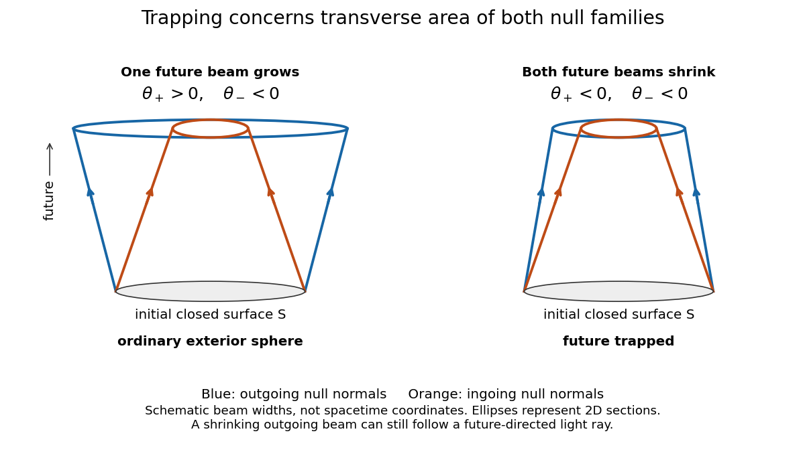
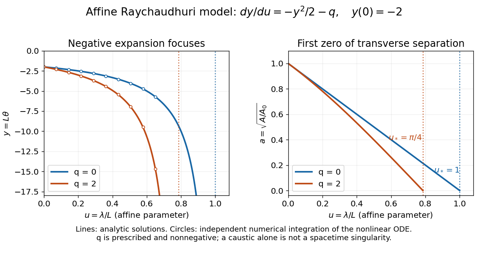

# General relativity

↑ **Parent:** [Branches of physics](physics.md#branches-of-physics)  
ⓦ [Wiki](https://en.wikipedia.org/wiki/General_relativity)

[General relativity](general-relativity.md) describes [gravity](physics.md#gravity) through the geometry of [spacetime](special-relativity.md#spacetime). Its [metric tensor](#metric-tensor) specifies distances, [proper time](special-relativity.md#proper-time) measured by clocks, and the [causal structure](#causal-structure) that limits communication. Matter and radiation affect this geometry through the [Einstein field equations](einstein-field-equations.md); freely falling [test particles](classical-mechanics.md#test-particle) follow [geodesics](riemannian-geometry.md#geodesic) of the resulting geometry. A [planet](planetary-science.md#planet)'s orbit and a falling apple therefore belong to the same geometric story. The [Newtonian limit](linearized-gravity.md#newtonian-limit) recovers familiar [Newtonian gravity](newton-s-law-of-universal-gravitation.md#gravitational-acceleration) when fields are weak and speeds are small compared with the [speed of light](special-relativity.md#speed-of-light). See [David Tong's introduction to general relativity](https://www.damtp.cam.ac.uk/user/tong/gr/grhtml/S0.html).

The most direct way to understand [spacetime](special-relativity.md#spacetime) [curvature](differential-geometry.md#curvature) is to compare neighboring freely falling bodies. Even when each body feels weightless, their separation can change: this is [geodesic deviation](riemann-curvature-tensor.md#geodesic-deviation), observed as a [tidal force](newton-s-law-of-universal-gravitation.md#tidal-force). [Curvature](differential-geometry.md#curvature) concerns these relative measurements, rather than the shape of a drawing in an imagined surrounding space. A second accessible measurement is [gravitational time dilation](#gravitational-time-dilation): identical clocks maintained at different heights accumulate different [proper times](special-relativity.md#proper-time). Together, tides and clocks turn an abstract geometry into laboratory questions.

**Table of contents**

- [Parametrized post-Newtonian formalism](#parametrized-post-newtonian-formalism)
  - [Parametrized post-Newtonian light deflection](#parametrized-post-newtonian-light-deflection)
- [Synchronous coordinates](#synchronous-coordinates)
- [Gravitational singularity theorem](#gravitational-singularity-theorem)
- [Israel junction conditions](#israel-junction-conditions)
- [Trapping horizon](#trapping-horizon)
- [Congruence (general relativity)](#congruence-general-relativity)
- [Causal structure](#causal-structure)
- [Flat-background scalar-force theory of gravity](#flat-background-scalar-force-theory-of-gravity)
  - [Scalar-force gravitational redshift](#scalar-force-gravitational-redshift)
- [Taub–NUT space](#taub-nut-space)
- [Near-horizon limit](#near-horizon-limit)
  - [Rindler limit of a Schwarzschild horizon](#rindler-limit-of-a-schwarzschild-horizon)
- [Einstein-Maxwell theory](#einstein-maxwell-theory)
  - [Majumdar–Papapetrou solution](#majumdar-papapetrou-solution)
    - [Analytic extension of a Majumdar–Papapetrou horizon](#analytic-extension-of-a-majumdar-papapetrou-horizon)
- [Twistor theory](#twistor-theory)
  - [Twistor correspondence](#twistor-correspondence)
    - [Penrose-Ward correspondence](#penrose-ward-correspondence)
      - [Abelian Ward splitting by Laurent series](#abelian-ward-splitting-by-laurent-series)
        - [Contour potential for an anti-self-dual Maxwell field](#contour-potential-for-an-anti-self-dual-maxwell-field)
      - [Line-trivial bundles in the Ward correspondence](#line-trivial-bundles-in-the-ward-correspondence)
      - [Holomorphic splitting of a twistor patching matrix](#holomorphic-splitting-of-a-twistor-patching-matrix)
    - [Alpha-plane](#alpha-plane)
    - [Twistor line](#twistor-line)
    - [Complexified compactified Minkowski space](#complexified-compactified-minkowski-space)
  - [Twistor space](#twistor-space)
    - [Euclidean reality structure on twistor space](#euclidean-reality-structure-on-twistor-space)
    - [Twistor Hermitian form](#twistor-hermitian-form)
      - [Lorentzian reality structure on twistor space](#lorentzian-reality-structure-on-twistor-space)
      - [Null twistor](#null-twistor)
        - [Projective null twistor space](#projective-null-twistor-space)
    - [Twistor incidence relation](#twistor-incidence-relation)
    - [Projective twistor space](#projective-twistor-space)
      - [Affine projective twistor space](#affine-projective-twistor-space)
- [Analytic extension of a spacetime](#analytic-extension-of-a-spacetime)
  - [Two-sheeted extension of superextremal Kerr spacetime](#two-sheeted-extension-of-superextremal-kerr-spacetime)
- [Gravitational redshift](#gravitational-redshift)
  - [Static-surface Schwarzschild redshift](#static-surface-schwarzschild-redshift)
  - [Gravitational time dilation](#gravitational-time-dilation)
    - [Geostationary gravitational clock gain](#geostationary-gravitational-clock-gain)
  - [Outgoing pulse redshift from a radial Schwarzschild infaller](#outgoing-pulse-redshift-from-a-radial-schwarzschild-infaller)
  - [Pound-Rebka experiment](#pound-rebka-experiment)
- [Planar warped spacetime](#planar-warped-spacetime)
  - [Cartan curvature of a planar warped spacetime](#cartan-curvature-of-a-planar-warped-spacetime)
- [Diffeomorphism invariance of general relativity](#diffeomorphism-invariance-of-general-relativity)
- [Timelike geodesic](#timelike-geodesic)
  - [Timelike geodesics of a quadratic-time conformal metric](#timelike-geodesics-of-a-quadratic-time-conformal-metric)
  - [Odd radial perturbations preserve timelike-geodesic periods](#odd-radial-perturbations-preserve-timelike-geodesic-periods)
  - [Timelike geodesics of an inverse-time conformal metric](#timelike-geodesics-of-an-inverse-time-conformal-metric)
- [Coordinate singularity](#coordinate-singularity)
- [Areal radius](#areal-radius)
- [Geometrized units](#geometrized-units)
  - [Geometrized luminosity](#geometrized-luminosity)
- [Vaidya metric](#vaidya-metric)
  - [Teleological response of a Vaidya event horizon](#teleological-response-of-a-vaidya-event-horizon)
  - [Radial null geodesics of the Vaidya metric](#radial-null-geodesics-of-the-vaidya-metric)
    - [Reconstructing Vaidya mass from a radial null geodesic](#reconstructing-vaidya-mass-from-a-radial-null-geodesic)
  - [Christoffel symbols of the Vaidya metric](#christoffel-symbols-of-the-vaidya-metric)
- [Equivalence principle](#equivalence-principle)
  - [Comma-to-semicolon prescription](#comma-to-semicolon-prescription)
  - [Einstein equivalence principle](#einstein-equivalence-principle)
    - [Equivalence principle does not uniquely fix field equations](#equivalence-principle-does-not-uniquely-fix-field-equations)
    - [Local position invariance](#local-position-invariance)
    - [Local Lorentz invariance](#local-lorentz-invariance)
  - [Weak equivalence principle](#weak-equivalence-principle)
    - [Eötvös experiment](#eotvos-experiment)
  - [Strong equivalence principle](#strong-equivalence-principle)
    - [Nordtvedt effect](#nordtvedt-effect)
  - [Absence of a local gravitational stress-energy tensor](#absence-of-a-local-gravitational-stress-energy-tensor)
- [Spacetime dimension](#spacetime-dimension)
- [Killing vector field](killing-vector-field.md)
  - [Two-dimensional Killing algebra with a periodic generator is abelian](killing-vector-field.md#two-dimensional-killing-algebra-with-a-periodic-generator-is-abelian)
  - [Bochner identity for Killing vector fields](killing-vector-field.md#bochner-identity-for-killing-vector-fields)
  - [Killing fields on incomplete manifolds need not generate global isometries](killing-vector-field.md#killing-fields-on-incomplete-manifolds-need-not-generate-global-isometries)
  - [Killing transport](killing-vector-field.md#killing-transport)
    - [Dimension bound for Killing vector fields](killing-vector-field.md#dimension-bound-for-killing-vector-fields)
  - [Killing field is determined by its value and first covariant derivative](killing-vector-field.md#killing-field-is-determined-by-its-value-and-first-covariant-derivative)
  - [Killing-flow four-acceleration](killing-vector-field.md#killing-flow-four-acceleration)
  - [Papapetrou electromagnetic field](killing-vector-field.md#papapetrou-electromagnetic-field)
  - [Kaluza-Klein decomposition along a Killing field](killing-vector-field.md#kaluza-klein-decomposition-along-a-killing-field)
    - [Kaluza-Klein geodesic Lorentz force](killing-vector-field.md#kaluza-klein-geodesic-lorentz-force)
      - [Sign of the projected Kaluza-Klein Lorentz force](killing-vector-field.md#sign-of-the-projected-kaluza-klein-lorentz-force)
      - [Affine normalization in a Kaluza-Klein geodesic reduction](killing-vector-field.md#affine-normalization-in-a-kaluza-klein-geodesic-reduction)
    - [Heisenberg metric Kaluza-Klein reduction](killing-vector-field.md#heisenberg-metric-kaluza-klein-reduction)
  - [Euclidean Killing vector field](killing-vector-field.md#euclidean-killing-vector-field)
    - [Helical orbit of a Euclidean Killing vector](killing-vector-field.md#helical-orbit-of-a-euclidean-killing-vector)
  - [Killing equation](killing-vector-field.md#killing-equation)
    - [Killing derivative contraction identity](killing-vector-field.md#killing-derivative-contraction-identity)
    - [Second covariant derivative of a Killing vector](killing-vector-field.md#second-covariant-derivative-of-a-killing-vector)
      - [Curvature-sign convention in Killing derivative identities](killing-vector-field.md#curvature-sign-convention-in-killing-derivative-identities)
      - [Killing vector preserves scalar curvature](killing-vector-field.md#killing-vector-preserves-scalar-curvature)
  - [Geodesic conserved quantity from a Killing vector](killing-vector-field.md#geodesic-conserved-quantity-from-a-killing-vector)
    - [Killing energy](killing-vector-field.md#killing-energy)
      - [Killing energy with positive time signature](killing-vector-field.md#killing-energy-with-positive-time-signature)
    - [Charged-particle conserved quantity from a Killing symmetry](killing-vector-field.md#charged-particle-conserved-quantity-from-a-killing-symmetry)
  - [Stress-energy current from a Killing vector](killing-vector-field.md#stress-energy-current-from-a-killing-vector)
  - [Komar charge](killing-vector-field.md#komar-charge)
    - [Komar current from trace-reversed stress-energy](killing-vector-field.md#komar-current-from-trace-reversed-stress-energy)
    - [Komar angular momentum](killing-vector-field.md#komar-angular-momentum)
      - [Angular momentum conservation in an axisymmetric vacuum region](killing-vector-field.md#angular-momentum-conservation-in-an-axisymmetric-vacuum-region)
      - [Komar angular momentum with inner boundaries](killing-vector-field.md#komar-angular-momentum-with-inner-boundaries)
    - [Komar mass](killing-vector-field.md#komar-mass)
      - [Komar mass normalization in higher dimensions](killing-vector-field.md#komar-mass-normalization-in-higher-dimensions)
      - [Static spherical Komar mass in reciprocal radial gauge](killing-vector-field.md#static-spherical-komar-mass-in-reciprocal-radial-gauge)
    - [Background-subtracted Komar energy](killing-vector-field.md#background-subtracted-komar-energy)
- [Conformal Killing vector field](#conformal-killing-vector-field)
  - [Conformal Killing equation](#conformal-killing-equation)
    - [Flat conformal Killing integrability](#flat-conformal-killing-integrability)
- [Gravitational wave](gravitational-wave.md)
  - [GW150914](gravitational-wave.md#gw150914)
    - [LIGO differential strain measurement](gravitational-wave.md#ligo-differential-strain-measurement)
      - [LIGO displacement readout and control](gravitational-wave.md#ligo-displacement-readout-and-control)
    - [Coincidence and noise controls for GW150914](gravitational-wave.md#coincidence-and-noise-controls-for-gw150914)
    - [Inferring a binary from a detector network](gravitational-wave.md#inferring-a-binary-from-a-detector-network)
  - [Newtonian binary chirp](gravitational-wave.md#newtonian-binary-chirp)
    - [Chirp mass](gravitational-wave.md#chirp-mass)
    - [Stipulated chirps and detector projections](gravitational-wave.md#stipulated-chirps-and-detector-projections)
  - [Averaged stress-energy of transverse gravitational waves](gravitational-wave.md#averaged-stress-energy-of-transverse-gravitational-waves)
  - [Axisymmetric radiation carries no axial angular momentum](gravitational-wave.md#axisymmetric-radiation-carries-no-axial-angular-momentum)
  - [Gravitational-wave frequency](gravitational-wave.md#gravitational-wave-frequency)
  - [Mass quadrupole moment](gravitational-wave.md#mass-quadrupole-moment)
    - [Stress-energy quadrupole identity](gravitational-wave.md#stress-energy-quadrupole-identity)
    - [Second mass moment tensor](gravitational-wave.md#second-mass-moment-tensor)
      - [Scalar second mass moment](gravitational-wave.md#scalar-second-mass-moment)
    - [Quadrupole formula](gravitational-wave.md#quadrupole-formula)
      - [Far-zone quadrupole strain](gravitational-wave.md#far-zone-quadrupole-strain)
        - [Quadrupole strain scaling of a weak self-gravitating source](gravitational-wave.md#quadrupole-strain-scaling-of-a-weak-self-gravitating-source)
        - [Circular-binary quadrupole radiation](gravitational-wave.md#circular-binary-quadrupole-radiation)
      - [Orbital compactness](gravitational-wave.md#orbital-compactness)
      - [Equal-mass circular-binary quadrupole luminosity](gravitational-wave.md#equal-mass-circular-binary-quadrupole-luminosity)
      - [Head-on quadrupole radiation from equal masses](gravitational-wave.md#head-on-quadrupole-radiation-from-equal-masses)
      - [Quadrupole radiation from a harmonically oscillating point mass](gravitational-wave.md#quadrupole-radiation-from-a-harmonically-oscillating-point-mass)
      - [Gravitational-wave energy and angular-momentum balance](gravitational-wave.md#gravitational-wave-energy-and-angular-momentum-balance)
      - [Instantaneous quadrupole luminosity of a Kepler binary](gravitational-wave.md#instantaneous-quadrupole-luminosity-of-a-kepler-binary)
      - [Gravitational radiation from a rotating triaxial body](gravitational-wave.md#gravitational-radiation-from-a-rotating-triaxial-body)
  - [Gravitational-wave energy flux](gravitational-wave.md#gravitational-wave-energy-flux)
  - [Newman-Penrose formalism](gravitational-wave.md#newman-penrose-formalism)
    - [Complex null tetrad](gravitational-wave.md#complex-null-tetrad)
    - [Newman--Penrose scalar Psi4](gravitational-wave.md#newman-penrose-scalar-psi4)
  - [Plane-fronted gravitational wave](gravitational-wave.md#plane-fronted-gravitational-wave)
    - [Ricci tensor of a Brinkmann plane wave](gravitational-wave.md#ricci-tensor-of-a-brinkmann-plane-wave)
    - [Homogeneous wavefront of a plane gravitational wave](gravitational-wave.md#homogeneous-wavefront-of-a-plane-gravitational-wave)
    - [Rosen coordinates for a plane gravitational wave](gravitational-wave.md#rosen-coordinates-for-a-plane-gravitational-wave)
      - [Curvature of a diagonal plane wave in Rosen coordinates](gravitational-wave.md#curvature-of-a-diagonal-plane-wave-in-rosen-coordinates)
    - [Gravitational-wave pulse](gravitational-wave.md#gravitational-wave-pulse)
      - [Gravitational-wave memory effect](gravitational-wave.md#gravitational-wave-memory-effect)
        - [Displacement memory](gravitational-wave.md#displacement-memory)
        - [Velocity memory](gravitational-wave.md#velocity-memory)
- [Covariant derivative](#covariant-derivative)
  - [Ordinary covector derivative under nonlinear coordinate changes](#ordinary-covector-derivative-under-nonlinear-coordinate-changes)
  - [Covariant divergence formula](#covariant-divergence-formula)
  - [Covariant divergence](#covariant-divergence)
  - [Tensor type](#tensor-type)
    - [Tensor component transformation law](#tensor-component-transformation-law)
      - [Tensor density](#tensor-density)
    - [Identity tensor](#identity-tensor)
  - [Covariant derivative of a covariant tensor](#covariant-derivative-of-a-covariant-tensor)
  - [Levi-Civita connection](#levi-civita-connection)
    - [Variation of Levi-Civita connection](#variation-of-levi-civita-connection)
    - [Parallel metrics with a common Levi-Civita connection](#parallel-metrics-with-a-common-levi-civita-connection)
    - [Fundamental theorem of Riemannian geometry](#fundamental-theorem-of-riemannian-geometry)
    - [Lie derivative of an affine connection](#lie-derivative-of-an-affine-connection)
- [Riemann curvature tensor](riemann-curvature-tensor.md)
  - [Curvature sign convention](riemann-curvature-tensor.md#curvature-sign-convention)
  - [Double divergence of a contravariant tensor](riemann-curvature-tensor.md#double-divergence-of-a-contravariant-tensor)
  - [Pair symmetry from the normal-coordinate curvature formula](riemann-curvature-tensor.md#pair-symmetry-from-the-normal-coordinate-curvature-formula)
  - [Bianchi identities from covariant derivative commutators](riemann-curvature-tensor.md#bianchi-identities-from-covariant-derivative-commutators)
  - [Curvature commutator is a tensor derivation](riemann-curvature-tensor.md#curvature-commutator-is-a-tensor-derivation)
  - [Three-dimensional curvature from the Ricci tensor](riemann-curvature-tensor.md#three-dimensional-curvature-from-the-ricci-tensor)
  - [Kretschmann scalar](riemann-curvature-tensor.md#kretschmann-scalar)
  - [Curvature commutator on a covariant tensor](riemann-curvature-tensor.md#curvature-commutator-on-a-covariant-tensor)
  - [Curvature commutator on a contravariant tensor](riemann-curvature-tensor.md#curvature-commutator-on-a-contravariant-tensor)
  - [Geodesic deviation](riemann-curvature-tensor.md#geodesic-deviation)
    - [Local tidal acceleration scaling](riemann-curvature-tensor.md#local-tidal-acceleration-scaling)
    - [Conserved deviation energy in constant curvature](riemann-curvature-tensor.md#conserved-deviation-energy-in-constant-curvature)
      - [Exponential and oscillatory geodesic deviation](riemann-curvature-tensor.md#exponential-and-oscillatory-geodesic-deviation)
    - [Orthogonality of proper-time deviation vectors](riemann-curvature-tensor.md#orthogonality-of-proper-time-deviation-vectors)
    - [Jacobi field](riemann-curvature-tensor.md#jacobi-field)
      - [Jacobi fields vanishing at their initial point](riemann-curvature-tensor.md#jacobi-fields-vanishing-at-their-initial-point)
      - [Jacobi curvature operator](riemann-curvature-tensor.md#jacobi-curvature-operator)
      - [Jacobi fields from conjugation at a central endpoint](riemann-curvature-tensor.md#jacobi-fields-from-conjugation-at-a-central-endpoint)
      - [Endpoint-vanishing normal Jacobi fields have dimension at most n-1](riemann-curvature-tensor.md#endpoint-vanishing-normal-jacobi-fields-have-dimension-at-most-n-1)
  - [Symmetric Hessian of a scalar field](riemann-curvature-tensor.md#symmetric-hessian-of-a-scalar-field)
    - [Third covariant derivatives of a scalar](riemann-curvature-tensor.md#third-covariant-derivatives-of-a-scalar)
  - [First Bianchi identity](riemann-curvature-tensor.md#first-bianchi-identity)
  - [Second Bianchi identity](riemann-curvature-tensor.md#second-bianchi-identity)
  - [Weyl tensor](riemann-curvature-tensor.md#weyl-tensor)
    - [Magnetic part of the Weyl tensor](riemann-curvature-tensor.md#magnetic-part-of-the-weyl-tensor)
    - [Electric part of the Weyl tensor](riemann-curvature-tensor.md#electric-part-of-the-weyl-tensor)
    - [Trace-free property of the Weyl tensor](riemann-curvature-tensor.md#trace-free-property-of-the-weyl-tensor)
    - [Weyl tensor of a conformally flat metric](riemann-curvature-tensor.md#weyl-tensor-of-a-conformally-flat-metric)
  - [First-pair antisymmetry of the Riemann tensor](riemann-curvature-tensor.md#first-pair-antisymmetry-of-the-riemann-tensor)
  - [Ricci tensor](riemann-curvature-tensor.md#ricci-tensor)
    - [Schouten tensor](riemann-curvature-tensor.md#schouten-tensor)
    - [Ricci tensor in two dimensions](riemann-curvature-tensor.md#ricci-tensor-in-two-dimensions)
      - [Two-dimensional general relativity](riemann-curvature-tensor.md#two-dimensional-general-relativity)
    - [Contracted Bianchi identity](riemann-curvature-tensor.md#contracted-bianchi-identity)
      - [Double divergence of the Riemann tensor](riemann-curvature-tensor.md#double-divergence-of-the-riemann-tensor)
      - [Einstein tensor](riemann-curvature-tensor.md#einstein-tensor)
        - [Flat FLRW Einstein-tensor divergence](riemann-curvature-tensor.md#flat-flrw-einstein-tensor-divergence)
          - [de Sitter scale factor in flat slicing](riemann-curvature-tensor.md#de-sitter-scale-factor-in-flat-slicing)
            - [Vacuum-dominated doubling time](riemann-curvature-tensor.md#vacuum-dominated-doubling-time)
    - [Constant sectional curvature](riemann-curvature-tensor.md#constant-sectional-curvature)
      - [Schur theorem in pseudo-Riemannian geometry](riemann-curvature-tensor.md#schur-theorem-in-pseudo-riemannian-geometry)
  - [Penrose wave equation](riemann-curvature-tensor.md#penrose-wave-equation)
- [Normal coordinates](#normal-coordinates)
  - [Fermi coordinates](#fermi-coordinates)
  - [Lorentz frame](#lorentz-frame)
- [Orthonormal frame in spacetime](#orthonormal-frame-in-spacetime)
  - [Parallel-propagated orthonormal frame](#parallel-propagated-orthonormal-frame)
  - [Orthonormal coframe in spacetime](#orthonormal-coframe-in-spacetime)
    - [Curved spacetime gamma matrices](#curved-spacetime-gamma-matrices)
    - [Zweibein](#zweibein)
    - [Connection 1-form](connection-1-form.md)
      - [Lorentzian connection-form antisymmetry](connection-1-form.md#lorentzian-connection-form-antisymmetry)
      - [Spin connection](connection-1-form.md#spin-connection)
        - [Spin connection of a conformally flat metric](connection-1-form.md#spin-connection-of-a-conformally-flat-metric)
        - [Tetrad postulate](connection-1-form.md#tetrad-postulate)
        - [Spinor covariant derivative](connection-1-form.md#spinor-covariant-derivative)
          - [Twistor spinor](connection-1-form.md#twistor-spinor)
            - [Conformal rescaling of a parallel spinor to a twistor spinor](connection-1-form.md#conformal-rescaling-of-a-parallel-spinor-to-a-twistor-spinor)
          - [Two-component spinor calculus](connection-1-form.md#two-component-spinor-calculus)
            - [Two-component spinor](connection-1-form.md#two-component-spinor)
            - [Weyl curvature spinor](connection-1-form.md#weyl-curvature-spinor)
            - [Chiral spinor curvature operator](connection-1-form.md#chiral-spinor-curvature-operator)
              - [Chiral Riemann curvature spinor decomposition](connection-1-form.md#chiral-riemann-curvature-spinor-decomposition)
              - [Contracted chiral curvature identity](connection-1-form.md#contracted-chiral-curvature-identity)
          - [Parallel spinor](connection-1-form.md#parallel-spinor)
            - [Polar-frame parallel spinor](connection-1-form.md#polar-frame-parallel-spinor)
          - [Spinor curvature identity](connection-1-form.md#spinor-curvature-identity)
            - [Killing-spinor integrability with rescaled gamma matrices](connection-1-form.md#killing-spinor-integrability-with-rescaled-gamma-matrices)
              - [Maximal Killing spinors force constant negative curvature](connection-1-form.md#maximal-killing-spinors-force-constant-negative-curvature)
            - [Einstein tensor contraction of spin curvature](connection-1-form.md#einstein-tensor-contraction-of-spin-curvature)
      - [Cartan's first structure equation](connection-1-form.md#cartan-s-first-structure-equation)
      - [Cartan's second structure equation](connection-1-form.md#cartan-s-second-structure-equation)
      - [Curvature 2-form](connection-1-form.md#curvature-2-form)
        - [Cartan curvature forms for a static spherical metric](connection-1-form.md#cartan-curvature-forms-for-a-static-spherical-metric)
        - [Diagonal curvature operator](connection-1-form.md#diagonal-curvature-operator)
          - [Diagonal curvature operator implies diagonal Ricci tensor](connection-1-form.md#diagonal-curvature-operator-implies-diagonal-ricci-tensor)
- [Einstein field equations](einstein-field-equations.md)
  - [Trace coefficient fixed by stress-energy conservation](einstein-field-equations.md#trace-coefficient-fixed-by-stress-energy-conservation)
  - [Einstein equation in the sequential-derivative curvature convention](einstein-field-equations.md#einstein-equation-in-the-sequential-derivative-curvature-convention)
  - [Newtonian normalization of the Einstein field equations](einstein-field-equations.md#newtonian-normalization-of-the-einstein-field-equations)
  - [Einstein-equation coupling under reversed curvature](einstein-field-equations.md#einstein-equation-coupling-under-reversed-curvature)
  - [Planar Einstein metric with cubic radial function](einstein-field-equations.md#planar-einstein-metric-with-cubic-radial-function)
  - [Lovelock's theorem](einstein-field-equations.md#lovelock-s-theorem)
  - [Vacuum Einstein equations](einstein-field-equations.md#vacuum-einstein-equations)
    - [Vacuum spacetime](einstein-field-equations.md#vacuum-spacetime)
  - [Einstein-Hilbert action](einstein-field-equations.md#einstein-hilbert-action)
    - [Einstein-Cartan theory](einstein-field-equations.md#einstein-cartan-theory)
      - [1.5-order formalism](einstein-field-equations.md#1-5-order-formalism)
      - [Algebraic torsion of a Dirac field](einstein-field-equations.md#algebraic-torsion-of-a-dirac-field)
    - [First-order three-dimensional gravity](einstein-field-equations.md#first-order-three-dimensional-gravity)
    - [Einstein-Proca theory](einstein-field-equations.md#einstein-proca-theory)
      - [Proca stress-energy tensor](einstein-field-equations.md#proca-stress-energy-tensor)
    - [Einstein-Maxwell-dilaton theory](einstein-field-equations.md#einstein-maxwell-dilaton-theory)
      - [Magnetically charged dilaton black hole](einstein-field-equations.md#magnetically-charged-dilaton-black-hole)
        - [Causal structure of the magnetic dilaton black hole](einstein-field-equations.md#causal-structure-of-the-magnetic-dilaton-black-hole)
        - [Geodesic potential of the magnetic dilaton black hole](einstein-field-equations.md#geodesic-potential-of-the-magnetic-dilaton-black-hole)
          - [Extremal dilaton metric photon capture](einstein-field-equations.md#extremal-dilaton-metric-photon-capture)
        - [Komar mass of the magnetic dilaton black hole](einstein-field-equations.md#komar-mass-of-the-magnetic-dilaton-black-hole)
  - [Trace-reversed Einstein field equations in D dimensions](einstein-field-equations.md#trace-reversed-einstein-field-equations-in-d-dimensions)
    - [Ricci curvature sourced by a Klein-Gordon scalar field](einstein-field-equations.md#ricci-curvature-sourced-by-a-klein-gordon-scalar-field)
  - [Metric variation](einstein-field-equations.md#metric-variation)
    - [Palatini identity](einstein-field-equations.md#palatini-identity)
    - [Metric variation of scalar curvature](einstein-field-equations.md#metric-variation-of-scalar-curvature)
  - [Modified gravity](einstein-field-equations.md#modified-gravity)
    - [Tensor-vector-scalar gravity](einstein-field-equations.md#tensor-vector-scalar-gravity)
    - [Modified Newtonian dynamics](einstein-field-equations.md#modified-newtonian-dynamics)
    - [Scalar-tensor theory](einstein-field-equations.md#scalar-tensor-theory)
      - [Metric variation of a scalar-curvature coupling](einstein-field-equations.md#metric-variation-of-a-scalar-curvature-coupling)
      - [Brans-Dicke theory](einstein-field-equations.md#brans-dicke-theory)
        - [Scalar equation of Brans-Dicke theory](einstein-field-equations.md#scalar-equation-of-brans-dicke-theory)
          - [Degenerate coupling of Brans-Dicke theory](einstein-field-equations.md#degenerate-coupling-of-brans-dicke-theory)
    - [f(R) gravity](einstein-field-equations.md#f-r-gravity)
      - [Einstein-frame representation of metric f(R) gravity](einstein-field-equations.md#einstein-frame-representation-of-metric-f-r-gravity)
      - [Einstein metric condition in f(R) gravity](einstein-field-equations.md#einstein-metric-condition-in-f-r-gravity)
      - [Normalization of the metric f(R) field equation](einstein-field-equations.md#normalization-of-the-metric-f-r-field-equation)
      - [Linearized f(R) gravity about Minkowski spacetime](einstein-field-equations.md#linearized-f-r-gravity-about-minkowski-spacetime)
- [Linearized gravity](linearized-gravity.md)
  - [Gauge-invariant scalar-vector-tensor perturbations of Minkowski spacetime](linearized-gravity.md#gauge-invariant-scalar-vector-tensor-perturbations-of-minkowski-spacetime)
    - [Vacuum constraints for gauge-invariant Minkowski perturbations](linearized-gravity.md#vacuum-constraints-for-gauge-invariant-minkowski-perturbations)
  - [Static scalar perturbation of Minkowski spacetime](linearized-gravity.md#static-scalar-perturbation-of-minkowski-spacetime)
  - [Linearized Schwarzschild metric](linearized-gravity.md#linearized-schwarzschild-metric)
    - [Weak-field photon-orbit validity](linearized-gravity.md#weak-field-photon-orbit-validity)
    - [Isotropic-to-areal weak-field radius change](linearized-gravity.md#isotropic-to-areal-weak-field-radius-change)
  - [Quadratic gravitational effective stress-energy tensor](linearized-gravity.md#quadratic-gravitational-effective-stress-energy-tensor)
  - [Massless Fierz-Pauli action](linearized-gravity.md#massless-fierz-pauli-action)
  - [Linearized coordinate gauge transformation](linearized-gravity.md#linearized-coordinate-gauge-transformation)
    - [Affine transverse trace in a diagonal linearized plane wave is pure gauge](linearized-gravity.md#affine-transverse-trace-in-a-diagonal-linearized-plane-wave-is-pure-gauge)
  - [Weak-field approximation](linearized-gravity.md#weak-field-approximation)
  - [Linearized Einstein equations](linearized-gravity.md#linearized-einstein-equations)
    - [Parallel photon beams in linearized gravity](linearized-gravity.md#parallel-photon-beams-in-linearized-gravity)
    - [Radiation boundary condition for linearized gravity](linearized-gravity.md#radiation-boundary-condition-for-linearized-gravity)
    - [Retarded quadrupole field](linearized-gravity.md#retarded-quadrupole-field)
      - [Long-wavelength source approximation](linearized-gravity.md#long-wavelength-source-approximation)
  - [Linearized inverse metric](linearized-gravity.md#linearized-inverse-metric)
  - [Linearized Levi-Civita connection](linearized-gravity.md#linearized-levi-civita-connection)
  - [Linearized Riemann curvature operator](linearized-gravity.md#linearized-riemann-curvature-operator)
    - [Gauge invariance of the linearized Riemann tensor](linearized-gravity.md#gauge-invariance-of-the-linearized-riemann-tensor)
      - [Flat linearized metric perturbations are locally pure gauge](linearized-gravity.md#flat-linearized-metric-perturbations-are-locally-pure-gauge)
  - [Trace-reversed metric perturbation](linearized-gravity.md#trace-reversed-metric-perturbation)
    - [Lorenz gauge in linearized gravity](linearized-gravity.md#lorenz-gauge-in-linearized-gravity)
      - [Residual gauge symmetry of linearized gravity](linearized-gravity.md#residual-gauge-symmetry-of-linearized-gravity)
        - [Pure-gauge plane wave in linearized gravity](linearized-gravity.md#pure-gauge-plane-wave-in-linearized-gravity)
      - [Plane gravitational wave in linearized gravity](linearized-gravity.md#plane-gravitational-wave-in-linearized-gravity)
        - [Transverse-traceless gauge](linearized-gravity.md#transverse-traceless-gauge)
          - [Explicit plane-wave reduction to transverse-traceless gauge](linearized-gravity.md#explicit-plane-wave-reduction-to-transverse-traceless-gauge)
          - [TT coordinate separation and measured separation](linearized-gravity.md#tt-coordinate-separation-and-measured-separation)
            - [Angular response of a gravitational-wave separation](linearized-gravity.md#angular-response-of-a-gravitational-wave-separation)
            - [Sliding-bead gravitational wave detector](linearized-gravity.md#sliding-bead-gravitational-wave-detector)
          - [Gravitational wave polarization](linearized-gravity.md#gravitational-wave-polarization)
            - [Plus-polarized gravitational wave](linearized-gravity.md#plus-polarized-gravitational-wave)
            - [Transverse-traceless tensor](linearized-gravity.md#transverse-traceless-tensor)
            - [Plus polarization](linearized-gravity.md#plus-polarization)
            - [Cross polarization](linearized-gravity.md#cross-polarization)
            - [Transverse-traceless projector](linearized-gravity.md#transverse-traceless-projector)
              - [Polarization completeness relation](linearized-gravity.md#polarization-completeness-relation)
  - [Linearized Ricci tensor and scalar](linearized-gravity.md#linearized-ricci-tensor-and-scalar)
  - [Newtonian limit](linearized-gravity.md#newtonian-limit)
    - [Newtonian connection from an exponential lapse](linearized-gravity.md#newtonian-connection-from-an-exponential-lapse)
    - [Static radius](linearized-gravity.md#static-radius)
    - [Linearized point-mass metric in radial Cartesian form](linearized-gravity.md#linearized-point-mass-metric-in-radial-cartesian-form)
  - [Slowly rotating weak-field metric](linearized-gravity.md#slowly-rotating-weak-field-metric)
- [Stress-energy tensor](stress-energy-tensor.md)
  - [Hilbert stress-energy tensor](stress-energy-tensor.md#hilbert-stress-energy-tensor)
  - [Stress-energy tensor of a canonical scalar field](stress-energy-tensor.md#stress-energy-tensor-of-a-canonical-scalar-field)
  - [Stress-energy tensor improvement](stress-energy-tensor.md#stress-energy-tensor-improvement)
    - [Improved stress-energy tensor of a free massless scalar](stress-energy-tensor.md#improved-stress-energy-tensor-of-a-free-massless-scalar)
    - [Stress-energy superpotential](stress-energy-tensor.md#stress-energy-superpotential)
  - [Dust stress-energy tensor](stress-energy-tensor.md#dust-stress-energy-tensor)
    - [Null dust](stress-energy-tensor.md#null-dust)
  - [Momentum density](stress-energy-tensor.md#momentum-density)
  - [Anisotropic stress](stress-energy-tensor.md#anisotropic-stress)
  - [Stress-energy tensor of a nonminimally coupled scalar field](stress-energy-tensor.md#stress-energy-tensor-of-a-nonminimally-coupled-scalar-field)
  - [Stress-energy conservation](stress-energy-tensor.md#stress-energy-conservation)
    - [Noether identity](stress-energy-tensor.md#noether-identity)
      - [Diffeomorphism identity for a metric action](stress-energy-tensor.md#diffeomorphism-identity-for-a-metric-action)
      - [Diffeomorphism Noether identity for a scalar field](stress-energy-tensor.md#diffeomorphism-noether-identity-for-a-scalar-field)
  - [Perfect fluid in general relativity](stress-energy-tensor.md#perfect-fluid-in-general-relativity)
    - [Relativistic dust](stress-energy-tensor.md#relativistic-dust)
      - [Geodesic motion of uncharged dust](stress-energy-tensor.md#geodesic-motion-of-uncharged-dust)
      - [Charged relativistic dust](stress-energy-tensor.md#charged-relativistic-dust)
    - [Canonical scalar stress as a perfect fluid](stress-energy-tensor.md#canonical-scalar-stress-as-a-perfect-fluid)
      - [Conformal density of a canonical scalar field](stress-energy-tensor.md#conformal-density-of-a-canonical-scalar-field)
    - [Canonical vorticity of a relativistic fluid](stress-energy-tensor.md#canonical-vorticity-of-a-relativistic-fluid)
    - [Variational action for relativistic potential flow](stress-energy-tensor.md#variational-action-for-relativistic-potential-flow)
    - [Particle number conservation in a relativistic fluid](stress-energy-tensor.md#particle-number-conservation-in-a-relativistic-fluid)
    - [Specific enthalpy per particle](stress-energy-tensor.md#specific-enthalpy-per-particle)
      - [Barotropic relativistic sound speed](stress-energy-tensor.md#barotropic-relativistic-sound-speed)
    - [Perfect-fluid alignment in a static spacetime](stress-energy-tensor.md#perfect-fluid-alignment-in-a-static-spacetime)
    - [Stiff fluid](stress-energy-tensor.md#stiff-fluid)
      - [Homogeneous free scalar as a stiff fluid](stress-energy-tensor.md#homogeneous-free-scalar-as-a-stiff-fluid)
        - [Cosmological contraction with a free homogeneous scalar](stress-energy-tensor.md#cosmological-contraction-with-a-free-homogeneous-scalar)
          - [Newtonian-potential Hankel modes in stiff contraction](stress-energy-tensor.md#newtonian-potential-hankel-modes-in-stiff-contraction)
            - [Vacuum-normalized Newtonian spectrum in stiff contraction](stress-energy-tensor.md#vacuum-normalized-newtonian-spectrum-in-stiff-contraction)
    - [Relativistic perfect-fluid energy equation](stress-energy-tensor.md#relativistic-perfect-fluid-energy-equation)
    - [Relativistic Euler equation](stress-energy-tensor.md#relativistic-euler-equation)
      - [Weak-field slow-motion equations for a relativistic fluid](stress-energy-tensor.md#weak-field-slow-motion-equations-for-a-relativistic-fluid)
      - [Hydrostatic equilibrium along a Killing vector](stress-energy-tensor.md#hydrostatic-equilibrium-along-a-killing-vector)
        - [Stationary radiation density](stress-energy-tensor.md#stationary-radiation-density)
          - [Radiation fluid has no regular free surface](stress-energy-tensor.md#radiation-fluid-has-no-regular-free-surface)
        - [Barotropic hydrostatic first integral](stress-energy-tensor.md#barotropic-hydrostatic-first-integral)
    - [Tolman–Oppenheimer–Volkoff equation](stress-energy-tensor.md#tolman-oppenheimer-volkoff-equation)
      - [Stellar compactness](stress-energy-tensor.md#stellar-compactness)
      - [Regular central expansion of the TOV equations](stress-energy-tensor.md#regular-central-expansion-of-the-tov-equations)
      - [Interior Schwarzschild metric](stress-energy-tensor.md#interior-schwarzschild-metric)
        - [Central pressure of a constant-density relativistic star](stress-energy-tensor.md#central-pressure-of-a-constant-density-relativistic-star)
          - [Dominant-energy compactness bound for an incompressible star](stress-energy-tensor.md#dominant-energy-compactness-bound-for-an-incompressible-star)
      - [Buchdahl's theorem](stress-energy-tensor.md#buchdahl-s-theorem)
        - [High-density core bound from TOV compactness](stress-energy-tensor.md#high-density-core-bound-from-tov-compactness)
  - [Null energy condition](stress-energy-tensor.md#null-energy-condition)
    - [Perfect-fluid null energy condition](stress-energy-tensor.md#perfect-fluid-null-energy-condition)
    - [Null energy condition for a canonical scalar field](stress-energy-tensor.md#null-energy-condition-for-a-canonical-scalar-field)
    - [Null energy condition for a planar warped spacetime](stress-energy-tensor.md#null-energy-condition-for-a-planar-warped-spacetime)
    - [Null convergence condition](stress-energy-tensor.md#null-convergence-condition)
      - [Cosmological constant preserves null convergence](stress-energy-tensor.md#cosmological-constant-preserves-null-convergence)
    - [Averaged null energy condition](stress-energy-tensor.md#averaged-null-energy-condition)
      - [Averaged null energy condition for a nonminimally coupled scalar](stress-energy-tensor.md#averaged-null-energy-condition-for-a-nonminimally-coupled-scalar)
  - [Conserved Klein-Gordon scalar stress-energy ansatz](stress-energy-tensor.md#conserved-klein-gordon-scalar-stress-energy-ansatz)
  - [Klein-Gordon scalar stress-energy tensor](stress-energy-tensor.md#klein-gordon-scalar-stress-energy-tensor)
  - [Weak energy condition](stress-energy-tensor.md#weak-energy-condition)
    - [Weak energy condition for a quadratic scalar stress-energy ansatz](stress-energy-tensor.md#weak-energy-condition-for-a-quadratic-scalar-stress-energy-ansatz)
  - [Strong energy condition](stress-energy-tensor.md#strong-energy-condition)
  - [Dominant energy condition](stress-energy-tensor.md#dominant-energy-condition)
    - [Dominant energy condition for a kinetic scalar field](stress-energy-tensor.md#dominant-energy-condition-for-a-kinetic-scalar-field)
- [Curvature singularity](#curvature-singularity)
- [Schwarzschild spacetime](schwarzschild-spacetime.md)
  - [Coordinate invariance of the Schwarzschild photon radial potential](schwarzschild-spacetime.md#coordinate-invariance-of-the-schwarzschild-photon-radial-potential)
  - [Schwarzschild static observer](schwarzschild-spacetime.md#schwarzschild-static-observer)
    - [Local radial speed of a Schwarzschild geodesic](schwarzschild-spacetime.md#local-radial-speed-of-a-schwarzschild-geodesic)
      - [Radial Schwarzschild escape with asymptotic speed](schwarzschild-spacetime.md#radial-schwarzschild-escape-with-asymptotic-speed)
      - [Marginal escape geodesic in Schwarzschild spacetime](schwarzschild-spacetime.md#marginal-escape-geodesic-in-schwarzschild-spacetime)
  - [Timelike circular Schwarzschild geodesic](schwarzschild-spacetime.md#timelike-circular-schwarzschild-geodesic)
    - [Marginally bound circular Schwarzschild orbit](schwarzschild-spacetime.md#marginally-bound-circular-schwarzschild-orbit)
    - [Schwarzschild circular-orbit local speed](schwarzschild-spacetime.md#schwarzschild-circular-orbit-local-speed)
    - [Face-on frequency shift of a circular Schwarzschild source](schwarzschild-spacetime.md#face-on-frequency-shift-of-a-circular-schwarzschild-source)
    - [Comparison of circular-orbit and static Schwarzschild clocks](schwarzschild-spacetime.md#comparison-of-circular-orbit-and-static-schwarzschild-clocks)
      - [Schwarzschild circular-ring energy shift](schwarzschild-spacetime.md#schwarzschild-circular-ring-energy-shift)
        - [Edge-on Schwarzschild ISCO redshift envelope](schwarzschild-spacetime.md#edge-on-schwarzschild-isco-redshift-envelope)
  - [Schwarzschild radial fall from rest at a finite radius](schwarzschild-spacetime.md#schwarzschild-radial-fall-from-rest-at-a-finite-radius)
    - [Finite pulse count for a falling Schwarzschild beacon](schwarzschild-spacetime.md#finite-pulse-count-for-a-falling-schwarzschild-beacon)
  - [Proper-time bound inside a Schwarzschild black hole](schwarzschild-spacetime.md#proper-time-bound-inside-a-schwarzschild-black-hole)
  - [Horizon redshift of a Schwarzschild infaller](schwarzschild-spacetime.md#horizon-redshift-of-a-schwarzschild-infaller)
  - [Schwarzschild time](schwarzschild-spacetime.md#schwarzschild-time)
  - [Kruskal spacetime](schwarzschild-spacetime.md#kruskal-spacetime)
    - [Non-traversability of the Schwarzschild bridge](schwarzschild-spacetime.md#non-traversability-of-the-schwarzschild-bridge)
    - [Kruskal diagram](schwarzschild-spacetime.md#kruskal-diagram)
    - [Radial timelike incompleteness in Kruskal spacetime](schwarzschild-spacetime.md#radial-timelike-incompleteness-in-kruskal-spacetime)
  - [Negative heat capacity of a Schwarzschild black hole](schwarzschild-spacetime.md#negative-heat-capacity-of-a-schwarzschild-black-hole)
  - [Ultrarelativistic limit of the boosted Schwarzschild metric away from the null plane](schwarzschild-spacetime.md#ultrarelativistic-limit-of-the-boosted-schwarzschild-metric-away-from-the-null-plane)
  - [Schwarzschild-de Sitter spacetime](schwarzschild-spacetime.md#schwarzschild-de-sitter-spacetime)
    - [Radial geodesic acceleration in Schwarzschild-de Sitter spacetime](schwarzschild-spacetime.md#radial-geodesic-acceleration-in-schwarzschild-de-sitter-spacetime)
  - [Geodetic effect](schwarzschild-spacetime.md#geodetic-effect)
  - [Painlevé–Gullstrand coordinates](schwarzschild-spacetime.md#painleve-gullstrand-coordinates)
    - [Domain of the ingoing Painleve-Gullstrand chart](schwarzschild-spacetime.md#domain-of-the-ingoing-painleve-gullstrand-chart)
    - [Free-fall proper time in Schwarzschild spacetime](schwarzschild-spacetime.md#free-fall-proper-time-in-schwarzschild-spacetime)
      - [Schwarzschild horizon-to-singularity proper time for fall from infinity](schwarzschild-spacetime.md#schwarzschild-horizon-to-singularity-proper-time-for-fall-from-infinity)
    - [Orthonormal coframe in Painlevé–Gullstrand coordinates](schwarzschild-spacetime.md#orthonormal-coframe-in-painleve-gullstrand-coordinates)
  - [Radial Weyl curvature of Schwarzschild spacetime](schwarzschild-spacetime.md#radial-weyl-curvature-of-schwarzschild-spacetime)
    - [Schwarzschild tidal force](schwarzschild-spacetime.md#schwarzschild-tidal-force)
    - [Tidal gravity and the equivalence principle](schwarzschild-spacetime.md#tidal-gravity-and-the-equivalence-principle)
  - [Equatorial null orbit in Schwarzschild spacetime](schwarzschild-spacetime.md#equatorial-null-orbit-in-schwarzschild-spacetime)
    - [Finite-azimuth Schwarzschild photon plunge](schwarzschild-spacetime.md#finite-azimuth-schwarzschild-photon-plunge)
      - [Affine-time scaling of a nonradial Schwarzschild photon plunge](schwarzschild-spacetime.md#affine-time-scaling-of-a-nonradial-schwarzschild-photon-plunge)
    - [Null effective potential in Schwarzschild spacetime](schwarzschild-spacetime.md#null-effective-potential-in-schwarzschild-spacetime)
    - [Critical photon orbits of Schwarzschild spacetime](schwarzschild-spacetime.md#critical-photon-orbits-of-schwarzschild-spacetime)
    - [Circular null geodesic](schwarzschild-spacetime.md#circular-null-geodesic)
      - [Photon sphere](schwarzschild-spacetime.md#photon-sphere)
        - [Schwarzschild photon escape cone](schwarzschild-spacetime.md#schwarzschild-photon-escape-cone)
        - [Photon capture cross-section of a Reissner-Nordstrom black hole](schwarzschild-spacetime.md#photon-capture-cross-section-of-a-reissner-nordstrom-black-hole)
  - [Schwarzschild radius](schwarzschild-spacetime.md#schwarzschild-radius)
  - [Schwarzschild tortoise coordinate](schwarzschild-spacetime.md#schwarzschild-tortoise-coordinate)
    - [Outgoing Eddington-Finkelstein coordinates](schwarzschild-spacetime.md#outgoing-eddington-finkelstein-coordinates)
    - [Ingoing Eddington-Finkelstein coordinates](schwarzschild-spacetime.md#ingoing-eddington-finkelstein-coordinates)
      - [Finkelstein diagram](schwarzschild-spacetime.md#finkelstein-diagram)
      - [Radial null trajectories in ingoing Eddington-Finkelstein coordinates](schwarzschild-spacetime.md#radial-null-trajectories-in-ingoing-eddington-finkelstein-coordinates)
  - [Schwarzschild event horizon](schwarzschild-spacetime.md#schwarzschild-event-horizon)
    - [Schwarzschild horizon collision energy](schwarzschild-spacetime.md#schwarzschild-horizon-collision-energy)
  - [Schwarzschild singularity](schwarzschild-spacetime.md#schwarzschild-singularity)
  - [Kruskal–Szekeres coordinates](schwarzschild-spacetime.md#kruskal-szekeres-coordinates)
    - [Kruskal extension across a simple static horizon](schwarzschild-spacetime.md#kruskal-extension-across-a-simple-static-horizon)
    - [Schwarzschild geodesic from the bifurcation sphere to the singularity](schwarzschild-spacetime.md#schwarzschild-geodesic-from-the-bifurcation-sphere-to-the-singularity)
  - [Gravitational redshift between static Schwarzschild observers](schwarzschild-spacetime.md#gravitational-redshift-between-static-schwarzschild-observers)
  - [Proper acceleration of a static Schwarzschild observer](schwarzschild-spacetime.md#proper-acceleration-of-a-static-schwarzschild-observer)
  - [Birkhoff's theorem](schwarzschild-spacetime.md#birkhoff-s-theorem)
    - [Redshifted gravitational mass of a static thin shell](schwarzschild-spacetime.md#redshifted-gravitational-mass-of-a-static-thin-shell)
  - [Schwarzschild light deflection](schwarzschild-spacetime.md#schwarzschild-light-deflection)
    - [Eddington experiment](schwarzschild-spacetime.md#eddington-experiment)
    - [Perturbative derivation of Schwarzschild light deflection](schwarzschild-spacetime.md#perturbative-derivation-of-schwarzschild-light-deflection)
- [Nordström's theory of gravitation](#nordstrom-s-theory-of-gravitation)
  - [Newtonian limit of Nordstrom gravity](#newtonian-limit-of-nordstrom-gravity)
  - [Conformally flat metric](#conformally-flat-metric)
    - [Tolman wormhole](#tolman-wormhole)
    - [Curvature of a conformally Euclidean metric](#curvature-of-a-conformally-euclidean-metric)
    - [Conformal factor](#conformal-factor)
      - [Conformal preservation of null geodesic paths](#conformal-preservation-of-null-geodesic-paths)
  - [Geodesic equation for a conformally flat metric](#geodesic-equation-for-a-conformally-flat-metric)
- [de Sitter spacetime](#de-sitter-spacetime)
  - [Open slicing of de Sitter spacetime](#open-slicing-of-de-sitter-spacetime)
  - [Two-dimensional de Sitter spacetime](#two-dimensional-de-sitter-spacetime)
    - [Universal cover of two-dimensional de Sitter spacetime](#universal-cover-of-two-dimensional-de-sitter-spacetime)
    - [Conformal cylinder of two-dimensional de Sitter spacetime](#conformal-cylinder-of-two-dimensional-de-sitter-spacetime)
      - [Observer horizons in two-dimensional de Sitter spacetime](#observer-horizons-in-two-dimensional-de-sitter-spacetime)
    - [Geodesics of two-dimensional de Sitter spacetime](#geodesics-of-two-dimensional-de-sitter-spacetime)
  - [Closed slicing of de Sitter spacetime](#closed-slicing-of-de-sitter-spacetime)
    - [Cosmological horizons in global de Sitter spacetime](#cosmological-horizons-in-global-de-sitter-spacetime)
  - [Static patch of de Sitter spacetime](#static-patch-of-de-sitter-spacetime)
    - [Euclidean de Sitter action and entropy](#euclidean-de-sitter-action-and-entropy)
    - [de Sitter horizon temperature](#de-sitter-horizon-temperature)
  - [de Sitter isometry](#de-sitter-isometry)
    - [Spatial translation](#spatial-translation)
    - [Spatial rotation](#spatial-rotation)
    - [de Sitter dilation](#de-sitter-dilation)
    - [Special conformal transformation](#special-conformal-transformation)
  - [Expanding flat slicing of de Sitter spacetime](#expanding-flat-slicing-of-de-sitter-spacetime)
    - [Timelike geodesic in the expanding flat slicing of de Sitter spacetime](#timelike-geodesic-in-the-expanding-flat-slicing-of-de-sitter-spacetime)
      - [Past incompleteness of the expanding flat slicing of de Sitter spacetime](#past-incompleteness-of-the-expanding-flat-slicing-of-de-sitter-spacetime)
- [Einstein static universe](#einstein-static-universe)
- [Anti-de Sitter spacetime](#anti-de-sitter-spacetime)
  - [Anti-de Sitter timelike geodesic refocusing](#anti-de-sitter-timelike-geodesic-refocusing)
  - [Matrix model of anti-de Sitter three-space](#matrix-model-of-anti-de-sitter-three-space)
    - [Left-right double cover of SO0(2,2)](#left-right-double-cover-of-so0-2-2)
  - [Poincare coordinates on anti-de Sitter spacetime](#poincare-coordinates-on-anti-de-sitter-spacetime)
    - [Timelike geodesics in a warped Poincaré patch](#timelike-geodesics-in-a-warped-poincare-patch)
    - [Poincaré horizon](#poincare-horizon)
  - [Two-dimensional anti-de Sitter spacetime](#two-dimensional-anti-de-sitter-spacetime)
    - [Geodesics of two-dimensional anti-de Sitter spacetime](#geodesics-of-two-dimensional-anti-de-sitter-spacetime)
    - [Conformal strip of two-dimensional anti-de Sitter spacetime](#conformal-strip-of-two-dimensional-anti-de-sitter-spacetime)
  - [Group model of three-dimensional anti-de Sitter spacetime](#group-model-of-three-dimensional-anti-de-sitter-spacetime)
  - [Static coordinates on anti-de Sitter spacetime](#static-coordinates-on-anti-de-sitter-spacetime)
    - [Radial timelike geodesic in anti-de Sitter spacetime](#radial-timelike-geodesic-in-anti-de-sitter-spacetime)
    - [Radial null geodesic in anti-de Sitter spacetime](#radial-null-geodesic-in-anti-de-sitter-spacetime)
    - [Stable circular timelike geodesic in anti-de Sitter spacetime](#stable-circular-timelike-geodesic-in-anti-de-sitter-spacetime)
- [Planarity of geodesics in spherical symmetry](#planarity-of-geodesics-in-spherical-symmetry)
- [Timelike geodesic effective potential](#timelike-geodesic-effective-potential)
  - [Effective-potential stability of a circular orbit](#effective-potential-stability-of-a-circular-orbit)
  - [Effective potential for timelike Schwarzschild geodesics](#effective-potential-for-timelike-schwarzschild-geodesics)
    - [Schwarzschild marginally bound capture](#schwarzschild-marginally-bound-capture)
      - [Energy-dependent Schwarzschild material capture threshold](#energy-dependent-schwarzschild-material-capture-threshold)
    - [Angular velocity of a circular Schwarzschild geodesic](#angular-velocity-of-a-circular-schwarzschild-geodesic)
      - [Proper period of a circular Schwarzschild geodesic](#proper-period-of-a-circular-schwarzschild-geodesic)
    - [Schwarzschild perihelion precession](#schwarzschild-perihelion-precession)
- [Metric tensor](#metric-tensor)
  - [Degenerate metric tensor](#degenerate-metric-tensor)
  - [Variation of metric volume density](#variation-of-metric-volume-density)
  - [Variation of inverse metric](#variation-of-inverse-metric)
  - [Inverse metric volume variation](#inverse-metric-volume-variation)
  - [Prolate spheroidal coordinates](#prolate-spheroidal-coordinates)
    - [Hyperbolic parametrization of prolate spheroidal coordinates](#hyperbolic-parametrization-of-prolate-spheroidal-coordinates)
  - [Lorentzian metric](#lorentzian-metric)
    - [Spacetime metric](#spacetime-metric)
    - [Null coordinate](#null-coordinate)
      - [Schwarzschild retarded null coordinate](#schwarzschild-retarded-null-coordinate)
    - [Spacelike vector](#spacelike-vector)
    - [Lorentzian inner product](#lorentzian-inner-product)
      - [Null covector](#null-covector)
    - [Causal vector](#causal-vector)
    - [Timelike vector](#timelike-vector)
      - [Timelike vector field](#timelike-vector-field)
  - [Oblate spheroidal coordinates](#oblate-spheroidal-coordinates)
    - [Hyperbolic parametrization of oblate spheroidal coordinates](#hyperbolic-parametrization-of-oblate-spheroidal-coordinates)
    - [Outgoing null oblate spheroidal coordinates](#outgoing-null-oblate-spheroidal-coordinates)
  - [Inverse metric](#inverse-metric)
- [Two-dimensional hyperbolic metric in polar coordinates](#two-dimensional-hyperbolic-metric-in-polar-coordinates)
  - [Coordinate geodesics of the hyperbolic polar metric](#coordinate-geodesics-of-the-hyperbolic-polar-metric)
  - [Curvature of the two-dimensional hyperbolic polar metric](#curvature-of-the-two-dimensional-hyperbolic-polar-metric)
- [Ricci scalar](#ricci-scalar)
- [Geodesic congruence](geodesic-congruence.md)
  - [Timelike geodesic vector field](geodesic-congruence.md#timelike-geodesic-vector-field)
    - [Spatial projector of a timelike congruence](geodesic-congruence.md#spatial-projector-of-a-timelike-congruence)
    - [Deformation tensor of a timelike geodesic congruence](geodesic-congruence.md#deformation-tensor-of-a-timelike-geodesic-congruence)
      - [Kinematic decomposition of a timelike geodesic congruence](geodesic-congruence.md#kinematic-decomposition-of-a-timelike-geodesic-congruence)
      - [Riccati equation for a timelike geodesic congruence](geodesic-congruence.md#riccati-equation-for-a-timelike-geodesic-congruence)
    - [Expansion scalar](geodesic-congruence.md#expansion-scalar)
    - [Shear tensor of a timelike congruence](geodesic-congruence.md#shear-tensor-of-a-timelike-congruence)
    - [Vorticity tensor of a timelike congruence](geodesic-congruence.md#vorticity-tensor-of-a-timelike-congruence)
    - [Focal point of a hypersurface](geodesic-congruence.md#focal-point-of-a-hypersurface)
  - [Timelike geodesic completeness](geodesic-congruence.md#timelike-geodesic-completeness)
    - [Timelike geodesic incompleteness](geodesic-congruence.md#timelike-geodesic-incompleteness)
  - [Null geodesic congruence](geodesic-congruence.md#null-geodesic-congruence)
    - [Screen space of a null congruence](geodesic-congruence.md#screen-space-of-a-null-congruence)
    - [Optical matrix of a null congruence](geodesic-congruence.md#optical-matrix-of-a-null-congruence)
      - [Sachs optical equations](geodesic-congruence.md#sachs-optical-equations)
    - [Parallel null partner for ingoing Schwarzschild rays](geodesic-congruence.md#parallel-null-partner-for-ingoing-schwarzschild-rays)
    - [Affine rescaling of a null normal](geodesic-congruence.md#affine-rescaling-of-a-null-normal)
    - [Parallel auxiliary null vector](geodesic-congruence.md#parallel-auxiliary-null-vector)
    - [Null-gradient affine-geodesic identity](geodesic-congruence.md#null-gradient-affine-geodesic-identity)
    - [Screen-space projector](geodesic-congruence.md#screen-space-projector)
      - [Optical tensor](geodesic-congruence.md#optical-tensor)
        - [Null expansion](geodesic-congruence.md#null-expansion)
          - [Spherical null expansion in ingoing coordinates](geodesic-congruence.md#spherical-null-expansion-in-ingoing-coordinates)
          - [Spherical null expansions in double-null coordinates](geodesic-congruence.md#spherical-null-expansions-in-double-null-coordinates)
            - [Double-null focusing identity](geodesic-congruence.md#double-null-focusing-identity)
              - [Persistence of spherical trapping](geodesic-congruence.md#persistence-of-spherical-trapping)
        - [Null shear](geodesic-congruence.md#null-shear)
          - [Null-shear propagation equation](geodesic-congruence.md#null-shear-propagation-equation)
        - [Null twist](geodesic-congruence.md#null-twist)
          - [Null twist vanishes exactly for hypersurface-orthogonal geodesics](geodesic-congruence.md#null-twist-vanishes-exactly-for-hypersurface-orthogonal-geodesics)
          - [Null-twist propagation equation](geodesic-congruence.md#null-twist-propagation-equation)
    - [Null Raychaudhuri equation](geodesic-congruence.md#null-raychaudhuri-equation)
      - [Area-square-root optical focusing equation](geodesic-congruence.md#area-square-root-optical-focusing-equation)
        - [Flat-space anisotropic beam shear focusing](geodesic-congruence.md#flat-space-anisotropic-beam-shear-focusing)
      - [Null focusing theorem](geodesic-congruence.md#null-focusing-theorem)
        - [Conjugate point to a spacelike surface](geodesic-congruence.md#conjugate-point-to-a-spacelike-surface)
- [Null hypersurface](#null-hypersurface)
  - [Null hypersurface normal generates null geodesics](#null-hypersurface-normal-generates-null-geodesics)
  - [Killing horizon](#killing-horizon)
    - [Horizon angular velocity](#horizon-angular-velocity)
    - [Bifurcate Killing horizon](#bifurcate-killing-horizon)
    - [Degenerate Killing horizon](#degenerate-killing-horizon)
    - [Optical scalars on a Killing horizon](#optical-scalars-on-a-killing-horizon)
    - [Cosmological horizon](#cosmological-horizon)
    - [Surface gravity](#surface-gravity)
      - [Signed surface gravity of a de Sitter horizon](#signed-surface-gravity-of-a-de-sitter-horizon)
      - [Surface gravity of a static spherical horizon](#surface-gravity-of-a-static-spherical-horizon)
        - [Surface gravity of a five-dimensional charged black hole](#surface-gravity-of-a-five-dimensional-charged-black-hole)
      - [Surface gravity from the Killing derivative](#surface-gravity-from-the-killing-derivative)
      - [Affine horizon-generator scaling](#affine-horizon-generator-scaling)
      - [Schwarzschild surface gravity](#schwarzschild-surface-gravity)
    - [Bifurcation surface](#bifurcation-surface)
  - [Gaussian null coordinates](#gaussian-null-coordinates)
  - [Trapped surface](#trapped-surface)
    - [Marginally outer trapped surface](#marginally-outer-trapped-surface)
    - [Apparent horizon](#apparent-horizon)
    - [Anti-trapped surface](#anti-trapped-surface)
- [Null geodesic completeness](#null-geodesic-completeness)
  - [Null geodesic incompleteness](#null-geodesic-incompleteness)
  - [Penrose singularity theorem](#penrose-singularity-theorem)
    - [Penrose theorem at a Cauchy horizon](#penrose-theorem-at-a-cauchy-horizon)
    - [Compactness of the future horismos of a trapped surface](#compactness-of-the-future-horismos-of-a-trapped-surface)
    - [Trapped spheres as a model for nonspherical collapse](#trapped-spheres-as-a-model-for-nonspherical-collapse)
    - [Affine focusing model for the Penrose theorem](#affine-focusing-model-for-the-penrose-theorem)
    - [Global causal step in the Penrose theorem](#global-causal-step-in-the-penrose-theorem)
- [Causal hierarchy](#causal-hierarchy)
  - [Observer event horizon](#observer-event-horizon)
    - [Cosmological event horizon](#cosmological-event-horizon)
      - [Cosmological round-trip communication horizon](#cosmological-round-trip-communication-horizon)
  - [Time orientation](#time-orientation)
  - [Causal curve](#causal-curve)
  - [Causal past](#causal-past)
  - [Causal future](#causal-future)
    - [Future horismos](#future-horismos)
  - [Chronological future](#chronological-future)
    - [Chronologically saturated subset](#chronologically-saturated-subset)
  - [Chronological past](#chronological-past)
  - [Closed timelike curve](#closed-timelike-curve)
    - [Closed timelike circles in negative-radius Kerr spacetime](#closed-timelike-circles-in-negative-radius-kerr-spacetime)
  - [Stable causality](#stable-causality)
  - [Strong causality](#strong-causality)
    - [Future-distinguishing spacetime](#future-distinguishing-spacetime)
  - [Globally hyperbolic spacetime](#globally-hyperbolic-spacetime)
    - [Initial data in general relativity](#initial-data-in-general-relativity)
      - [Maximal Cauchy development](#maximal-cauchy-development)
        - [Strong cosmic censorship conjecture](#strong-cosmic-censorship-conjecture)
    - [Achronal set](#achronal-set)
      - [Achronal boundary](#achronal-boundary)
    - [Cauchy surface](#cauchy-surface)
      - [Future domain of dependence](#future-domain-of-dependence)
      - [Cauchy horizon](#cauchy-horizon)
        - [Dependence of a Cauchy horizon on the initial hypersurface](#dependence-of-a-cauchy-horizon-on-the-initial-hypersurface)
        - [Inner-horizon blueshift coordinate](#inner-horizon-blueshift-coordinate)
        - [Mass inflation](#mass-inflation)
- [Black hole](black-hole.md)
  - [Primordial black hole](black-hole.md#primordial-black-hole)
  - [Kerr-Newman metric](black-hole.md#kerr-newman-metric)
    - [First law for the Kerr-Newman family](black-hole.md#first-law-for-the-kerr-newman-family)
    - [Kerr-Newman horizon temperature](black-hole.md#kerr-newman-horizon-temperature)
  - [Oppenheimer-Snyder model](black-hole.md#oppenheimer-snyder-model)
    - [Oppenheimer-Snyder cloud](black-hole.md#oppenheimer-snyder-cloud)
    - [Event horizon inside an Oppenheimer-Snyder cloud](black-hole.md#event-horizon-inside-an-oppenheimer-snyder-cloud)
    - [Proper-time horizon crossing in homogeneous dust collapse](black-hole.md#proper-time-horizon-crossing-in-homogeneous-dust-collapse)
    - [Homogeneous dust-ball matching](black-hole.md#homogeneous-dust-ball-matching)
  - [Schwarzschild-Tangherlini metric](black-hole.md#schwarzschild-tangherlini-metric)
    - [Kruskal extension of the five-dimensional Schwarzschild-Tangherlini metric](black-hole.md#kruskal-extension-of-the-five-dimensional-schwarzschild-tangherlini-metric)
  - [Penrose inequality](black-hole.md#penrose-inequality)
    - [Riemannian Penrose inequality](black-hole.md#riemannian-penrose-inequality)
    - [Apparent-horizon area comparison](black-hole.md#apparent-horizon-area-comparison)
  - [Reissner-Nordstrom spacetime](black-hole.md#reissner-nordstrom-spacetime)
    - [Reissner-Nordstrom Hawking temperature](black-hole.md#reissner-nordstrom-hawking-temperature)
      - [Charge-preserving Reissner-Nordstrom evaporation endpoint](black-hole.md#charge-preserving-reissner-nordstrom-evaporation-endpoint)
      - [Fixed-charge Reissner-Nordstrom temperature maximum](black-hole.md#fixed-charge-reissner-nordstrom-temperature-maximum)
    - [Extremal Reissner-Nordstrom causal crossing](black-hole.md#extremal-reissner-nordstrom-causal-crossing)
    - [Extremal Reissner-Nordstrom isotropic coordinates](black-hole.md#extremal-reissner-nordstrom-isotropic-coordinates)
    - [Reissner-Nordstrom horizon surface gravity](black-hole.md#reissner-nordstrom-horizon-surface-gravity)
    - [Global structure of a charged spherical black hole](black-hole.md#global-structure-of-a-charged-spherical-black-hole)
    - [Reissner-Nordstrom trapped spheres](black-hole.md#reissner-nordstrom-trapped-spheres)
  - [White hole](black-hole.md#white-hole)
  - [Black-hole uniqueness theorem](black-hole.md#black-hole-uniqueness-theorem)
    - [Black-hole rigidity theorem](black-hole.md#black-hole-rigidity-theorem)
    - [Black-hole no-hair theorem](black-hole.md#black-hole-no-hair-theorem)
  - [Extremal black hole](black-hole.md#extremal-black-hole)
    - [Extremal Euclidean throat](black-hole.md#extremal-euclidean-throat)
  - [Naked singularity](black-hole.md#naked-singularity)
    - [Weak cosmic censorship conjecture](black-hole.md#weak-cosmic-censorship-conjecture)
  - [Five-dimensional Reissner--Nordstrom black hole](black-hole.md#five-dimensional-reissner-nordstrom-black-hole)
    - [Kretschmann scalar of a five-dimensional charged black hole](black-hole.md#kretschmann-scalar-of-a-five-dimensional-charged-black-hole)
    - [Causal trapping between two spherical horizons](black-hole.md#causal-trapping-between-two-spherical-horizons)
    - [Tortoise coordinate of a five-dimensional charged black hole](black-hole.md#tortoise-coordinate-of-a-five-dimensional-charged-black-hole)
    - [Komar integral of a five-dimensional Reissner--Nordstrom metric](black-hole.md#komar-integral-of-a-five-dimensional-reissner-nordstrom-metric)
  - [Event horizon](black-hole.md#event-horizon)
    - [Horizon-free Minkowski spacetime](black-hole.md#horizon-free-minkowski-spacetime)
  - [Strong asymptotic predictability](black-hole.md#strong-asymptotic-predictability)
  - [Black-hole non-splitting theorem](black-hole.md#black-hole-non-splitting-theorem)
  - [Myers-Perry black hole](black-hole.md#myers-perry-black-hole)
    - [Five-dimensional equal-spin Myers-Perry black hole](black-hole.md#five-dimensional-equal-spin-myers-perry-black-hole)
    - [Singly rotating six-dimensional Myers-Perry black hole](black-hole.md#singly-rotating-six-dimensional-myers-perry-black-hole)
  - [BTZ black hole](black-hole.md#btz-black-hole)
    - [Conical singularity of negative-mass BTZ geometry](black-hole.md#conical-singularity-of-negative-mass-btz-geometry)
    - [Ingoing BTZ coordinates](black-hole.md#ingoing-btz-coordinates)
    - [Trapped circle inside a nonrotating BTZ black hole](black-hole.md#trapped-circle-inside-a-nonrotating-btz-black-hole)
    - [BTZ causal singularity](black-hole.md#btz-causal-singularity)
  - [Schwarzschild--anti-de Sitter black hole](black-hole.md#schwarzschild-anti-de-sitter-black-hole)
    - [Five-dimensional Schwarzschild--anti-de Sitter black hole](black-hole.md#five-dimensional-schwarzschild-anti-de-sitter-black-hole)
    - [Canonical stability of a Schwarzschild--anti-de Sitter black hole](black-hole.md#canonical-stability-of-a-schwarzschild-anti-de-sitter-black-hole)
  - [Black string](black-hole.md#black-string)
  - [Penrose diagram](black-hole.md#penrose-diagram)
    - [Schwarzschild conformal compactification](black-hole.md#schwarzschild-conformal-compactification)
    - [Spacelike infinity](black-hole.md#spacelike-infinity)
    - [Timelike infinity](black-hole.md#timelike-infinity)
      - [Past timelike infinity](black-hole.md#past-timelike-infinity)
      - [Future timelike infinity](black-hole.md#future-timelike-infinity)
    - [Null infinity](black-hole.md#null-infinity)
      - [Past null infinity](black-hole.md#past-null-infinity)
    - [Causal projection along a spacelike circular fiber](black-hole.md#causal-projection-along-a-spacelike-circular-fiber)
    - [Tortoise coordinate](black-hole.md#tortoise-coordinate)
  - [Black-hole thermodynamics](black-hole.md#black-hole-thermodynamics)
    - [Black-hole energy extraction](black-hole.md#black-hole-energy-extraction)
    - [Laws of black-hole mechanics](black-hole.md#laws-of-black-hole-mechanics)
    - [Zeroth law of black-hole mechanics](black-hole.md#zeroth-law-of-black-hole-mechanics)
    - [Hawking temperature](black-hole.md#hawking-temperature)
      - [Euclidean black-hole regularity condition](black-hole.md#euclidean-black-hole-regularity-condition)
        - [Euclidean metric near a simple static horizon](black-hole.md#euclidean-metric-near-a-simple-static-horizon)
        - [Euclidean temperature and signed horizon surface gravity](black-hole.md#euclidean-temperature-and-signed-horizon-surface-gravity)
        - [Euclidean horizon period under a regular radial conformal factor](black-hole.md#euclidean-horizon-period-under-a-regular-radial-conformal-factor)
      - [Hawking radiation](black-hole.md#hawking-radiation)
        - [Collapse vacuum for Hawking radiation](black-hole.md#collapse-vacuum-for-hawking-radiation)
        - [Black-hole evaporation](black-hole.md#black-hole-evaporation)
          - [Semiclassical cubic mass law for Schwarzschild evaporation](black-hole.md#semiclassical-cubic-mass-law-for-schwarzschild-evaporation)
          - [Stefan-Boltzmann estimate of Schwarzschild evaporation time](black-hole.md#stefan-boltzmann-estimate-of-schwarzschild-evaporation-time)
        - [Hawking exponential ray map](black-hole.md#hawking-exponential-ray-map)
          - [Thermal ratio of Hawking Bogoliubov coefficients](black-hole.md#thermal-ratio-of-hawking-bogoliubov-coefficients)
        - [Greybody factor](black-hole.md#greybody-factor)
        - [Black hole information paradox](black-hole.md#black-hole-information-paradox)
    - [Bekenstein-Hawking entropy](black-hole.md#bekenstein-hawking-entropy)
      - [Conical-singularity derivation of black-hole entropy](black-hole.md#conical-singularity-derivation-of-black-hole-entropy)
    - [Gibbons–Hawking–York boundary term](black-hole.md#gibbons-hawking-york-boundary-term)
    - [First law of black-hole mechanics](black-hole.md#first-law-of-black-hole-mechanics)
      - [Physical-process first law of black-hole mechanics](black-hole.md#physical-process-first-law-of-black-hole-mechanics)
        - [First-order horizon-area response to matter flux](black-hole.md#first-order-horizon-area-response-to-matter-flux)
        - [Physical-process first law for a rotating black hole](black-hole.md#physical-process-first-law-for-a-rotating-black-hole)
    - [Second law of black-hole mechanics](black-hole.md#second-law-of-black-hole-mechanics)
      - [Hawking's area theorem](black-hole.md#hawking-s-area-theorem)
        - [Area bound on equal-mass Schwarzschild merger radiation](black-hole.md#area-bound-on-equal-mass-schwarzschild-merger-radiation)
        - [Future-complete horizon focusing proof of the area theorem](black-hole.md#future-complete-horizon-focusing-proof-of-the-area-theorem)
    - [Third law of black-hole mechanics](black-hole.md#third-law-of-black-hole-mechanics)
    - [Generalized second law](black-hole.md#generalized-second-law)
  - [Kerr black hole](black-hole.md#kerr-black-hole)
    - [Lense-Thirring precession](black-hole.md#lense-thirring-precession)
      - [Frame dragging inside a slowly rotating spherical shell](black-hole.md#frame-dragging-inside-a-slowly-rotating-spherical-shell)
        - [Inertial coordinates inside a slowly rotating spherical shell](black-hole.md#inertial-coordinates-inside-a-slowly-rotating-spherical-shell)
      - [Black-hole and disk alignment under internal torque](black-hole.md#black-hole-and-disk-alignment-under-internal-torque)
        - [Counteralignment of a black hole and accretion disk](black-hole.md#counteralignment-of-a-black-hole-and-accretion-disk)
        - [Persistent-torque criterion for asymptotic spin alignment](black-hole.md#persistent-torque-criterion-for-asymptotic-spin-alignment)
    - [Kerr axial analytic extension](black-hole.md#kerr-axial-analytic-extension)
      - [Kerr axial timelike effective potential](black-hole.md#kerr-axial-timelike-effective-potential)
    - [Kerr ring singularity](black-hole.md#kerr-ring-singularity)
    - [Scalar wave separation in Kerr spacetime](black-hole.md#scalar-wave-separation-in-kerr-spacetime)
      - [Scalar spheroidal harmonic](black-hole.md#scalar-spheroidal-harmonic)
    - [Kerr horizon angular velocity](black-hole.md#kerr-horizon-angular-velocity)
    - [Ingoing Kerr coordinates](black-hole.md#ingoing-kerr-coordinates)
    - [Irreducible mass](black-hole.md#irreducible-mass)
      - [Area bound for an axisymmetric Kerr merger](black-hole.md#area-bound-for-an-axisymmetric-kerr-merger)
    - [Boyer-Lindquist coordinates](black-hole.md#boyer-lindquist-coordinates)
    - [Kerr ergoregion](black-hole.md#kerr-ergoregion)
      - [Kerr stationary-limit surface is generically timelike](black-hole.md#kerr-stationary-limit-surface-is-generically-timelike)
      - [Superradiance](black-hole.md#superradiance)
      - [Causal angular velocity bounds in Kerr spacetime](black-hole.md#causal-angular-velocity-bounds-in-kerr-spacetime)
      - [Penrose process](black-hole.md#penrose-process)
        - [Horizon flux inequality for causal matter](black-hole.md#horizon-flux-inequality-for-causal-matter)
    - [Kerr polar tortoise coordinate](black-hole.md#kerr-polar-tortoise-coordinate)
    - [Kerr black-hole heat capacity at fixed angular momentum](black-hole.md#kerr-black-hole-heat-capacity-at-fixed-angular-momentum)
- [Stationary spacetime](#stationary-spacetime)
  - [Ergoregion of a stationary spacetime](#ergoregion-of-a-stationary-spacetime)
  - [Nonstationary spacetime](#nonstationary-spacetime)
  - [Strictly stationary spacetime](#strictly-stationary-spacetime)
  - [Static spacetime](#static-spacetime)
    - [Static Killing field is a Ricci eigenvector](#static-killing-field-is-a-ricci-eigenvector)
    - [Static vacuum conformal spatial metric](#static-vacuum-conformal-spatial-metric)
      - [Horizonless static vacuum rigidity](#horizonless-static-vacuum-rigidity)
    - [Conserved scalar-field energy in a static spacetime](#conserved-scalar-field-energy-in-a-static-spacetime)
  - [Stationary axisymmetric spacetime](#stationary-axisymmetric-spacetime)
- [Arnowitt-Deser-Misner energy](#arnowitt-deser-misner-energy)
  - [Arnowitt-Deser-Misner mass](#arnowitt-deser-misner-mass)
  - [ADM momentum](#adm-momentum)
  - [Positive energy theorem](#positive-energy-theorem)
    - [Parallel spinors and vanishing ADM mass](#parallel-spinors-and-vanishing-adm-mass)
    - [Static zero-energy parallel-spinor rigidity](#static-zero-energy-parallel-spinor-rigidity)
    - [Nester two-form](#nester-two-form)
      - [ADM boundary term of the Nester two-form](#adm-boundary-term-of-the-nester-two-form)
      - [Witten-Nester identity](#witten-nester-identity)
      - [Witten spinor equation](#witten-spinor-equation)
        - [Elliptic existence of a Witten spinor](#elliptic-existence-of-a-witten-spinor)
        - [Sen spinor connection](#sen-spinor-connection)
  - [Differentiability of the gravitational Hamiltonian at spatial infinity](#differentiability-of-the-gravitational-hamiltonian-at-spatial-infinity)
- [Numerical relativity](numerical-relativity.md)
  - [3+1 decomposition of spacetime](numerical-relativity.md#3-plus-1-decomposition-of-spacetime)
    - [Normal scalar-field momentum](numerical-relativity.md#normal-scalar-field-momentum)
      - [Scalar-field stress projections](numerical-relativity.md#scalar-field-stress-projections)
    - [Unimodular spatial metric](numerical-relativity.md#unimodular-spatial-metric)
    - [Metric determinant in a 3+1 decomposition](numerical-relativity.md#metric-determinant-in-a-3-plus-1-decomposition)
    - [Hamiltonian formulation of general relativity](numerical-relativity.md#hamiltonian-formulation-of-general-relativity)
      - [Vanishing canonical Hamiltonian of a closed universe](numerical-relativity.md#vanishing-canonical-hamiltonian-of-a-closed-universe)
      - [Momentum constraint](numerical-relativity.md#momentum-constraint)
        - [Scalar momentum constraint with positive extrinsic curvature](numerical-relativity.md#scalar-momentum-constraint-with-positive-extrinsic-curvature)
      - [Canonical momentum of the spatial metric](numerical-relativity.md#canonical-momentum-of-the-spatial-metric)
    - [Spatial projection tensor](numerical-relativity.md#spatial-projection-tensor)
      - [Spatial projector derivative identity](numerical-relativity.md#spatial-projector-derivative-identity)
      - [Spatial metric sign for a unit timelike normal](numerical-relativity.md#spatial-metric-sign-for-a-unit-timelike-normal)
      - [Spatial covariant derivative](numerical-relativity.md#spatial-covariant-derivative)
        - [Metric compatibility of the spatial covariant derivative](numerical-relativity.md#metric-compatibility-of-the-spatial-covariant-derivative)
      - [Normal acceleration](numerical-relativity.md#normal-acceleration)
    - [Lapse function](numerical-relativity.md#lapse-function)
    - [Shift vector](numerical-relativity.md#shift-vector)
    - [Extrinsic curvature of a spatial hypersurface](numerical-relativity.md#extrinsic-curvature-of-a-spatial-hypersurface)
      - [Positive-expansion convention for extrinsic curvature](numerical-relativity.md#positive-expansion-convention-for-extrinsic-curvature)
      - [Spatial volume evolution identity](numerical-relativity.md#spatial-volume-evolution-identity)
      - [Extrinsic curvature with a negative shift](numerical-relativity.md#extrinsic-curvature-with-a-negative-shift)
        - [Trace of extrinsic curvature with a negative shift](numerical-relativity.md#trace-of-extrinsic-curvature-with-a-negative-shift)
      - [Gauss–Codazzi equations for a spatial hypersurface](numerical-relativity.md#gauss-codazzi-equations-for-a-spatial-hypersurface)
        - [Contracted Codazzi equation with positive expansion](numerical-relativity.md#contracted-codazzi-equation-with-positive-expansion)
        - [Vacuum Weyl tensors from hypersurface data](numerical-relativity.md#vacuum-weyl-tensors-from-hypersurface-data)
      - [Hypersurface orthogonality implies symmetric extrinsic curvature](numerical-relativity.md#hypersurface-orthogonality-implies-symmetric-extrinsic-curvature)
      - [Scalar Gauss equation](numerical-relativity.md#scalar-gauss-equation)
        - [Hamiltonian constraint](numerical-relativity.md#hamiltonian-constraint)
          - [Time-symmetric conformally flat vacuum initial data](numerical-relativity.md#time-symmetric-conformally-flat-vacuum-initial-data)
          - [Linearized cosmological Hamiltonian constraint](numerical-relativity.md#linearized-cosmological-hamiltonian-constraint)
    - [Z4 formulation](numerical-relativity.md#z4-formulation)
    - [3+1 Noether-current conservation law](numerical-relativity.md#3-plus-1-noether-current-conservation-law)
    - [3+1 decomposition of the stress-energy tensor](numerical-relativity.md#3-plus-1-decomposition-of-the-stress-energy-tensor)
      - [Scalar-field matter projections](numerical-relativity.md#scalar-field-matter-projections)
      - [Momentum equation in a 3+1 decomposition](numerical-relativity.md#momentum-equation-in-a-3-plus-1-decomposition)
    - [Geodesic slicing](numerical-relativity.md#geodesic-slicing)
    - [Baumgarte–Shapiro–Shibata–Nakamura formulation](numerical-relativity.md#baumgarte-shapiro-shibata-nakamura-formulation)
      - [Finite-time blow-up of mean curvature in geodesic slicing](numerical-relativity.md#finite-time-blow-up-of-mean-curvature-in-geodesic-slicing)
  - [Harmonic coordinate](numerical-relativity.md#harmonic-coordinate)
    - [Harmonic reduction of the vacuum Einstein equations](numerical-relativity.md#harmonic-reduction-of-the-vacuum-einstein-equations)
    - [Harmonic slicing](numerical-relativity.md#harmonic-slicing)
      - [Harmonic lapse evolution](numerical-relativity.md#harmonic-lapse-evolution)
      - [Bona--Masso slicing condition](numerical-relativity.md#bona-masso-slicing-condition)
        - [Stationary Schwarzschild Bona--Masso slicing function](numerical-relativity.md#stationary-schwarzschild-bona-masso-slicing-function)
    - [Hyperbolic reduction of Einstein's equations](numerical-relativity.md#hyperbolic-reduction-of-einstein-s-equations)
  - [ADM formalism](numerical-relativity.md#adm-formalism)
- [Kasner metric](#kasner-metric)
- [Bondi--Sachs formalism](#bondi-sachs-formalism)
  - [Bondi news function](#bondi-news-function)
- [Asymptotically flat spacetime](#asymptotically-flat-spacetime)
  - [Asymptotic simplicity](#asymptotic-simplicity)
  - [Conformal completion](#conformal-completion)
    - [Minkowski conformal compactification](#minkowski-conformal-compactification)
      - [Geodesic endpoints in Minkowski conformal compactification](#geodesic-endpoints-in-minkowski-conformal-compactification)
      - [Projective Minkowski compactification](#projective-minkowski-compactification)
    - [Future null infinity](#future-null-infinity)
- [Gravitational lensing](gravitational-lensing.md)
  - [Gravitational lensing by a galaxy cluster](gravitational-lensing.md#gravitational-lensing-by-a-galaxy-cluster)
  - [Thin-lens approximation for gravitational lensing](gravitational-lensing.md#thin-lens-approximation-for-gravitational-lensing)
  - [Bullet Cluster dark-matter separation](gravitational-lensing.md#bullet-cluster-dark-matter-separation)
  - [Surface-brightness conservation in gravitational lensing](gravitational-lensing.md#surface-brightness-conservation-in-gravitational-lensing)
  - [Mass-sheet degeneracy](gravitational-lensing.md#mass-sheet-degeneracy)
  - [Gravitational lens](gravitational-lensing.md#gravitational-lens)
  - [Lensing magnification](gravitational-lensing.md#lensing-magnification)
    - [Image parity in gravitational lensing](gravitational-lensing.md#image-parity-in-gravitational-lensing)
  - [Thin gravitational lens equation](gravitational-lensing.md#thin-gravitational-lens-equation)
    - [Point-mass gravitational lens](gravitational-lensing.md#point-mass-gravitational-lens)
      - [Two images of a point-mass lens](gravitational-lensing.md#two-images-of-a-point-mass-lens)
      - [Point-mass lens deflection and focusing](gravitational-lensing.md#point-mass-lens-deflection-and-focusing)
    - [Softened isothermal lensing potential](gravitational-lensing.md#softened-isothermal-lensing-potential)
      - [Multiple-image caustic of a softened isothermal lensing potential](gravitational-lensing.md#multiple-image-caustic-of-a-softened-isothermal-lensing-potential)
  - [Einstein radius](gravitational-lensing.md#einstein-radius)
    - [Einstein angular radius](gravitational-lensing.md#einstein-angular-radius)
  - [Weak gravitational lensing](gravitational-lensing.md#weak-gravitational-lensing)
    - [Intrinsic galaxy alignment](gravitational-lensing.md#intrinsic-galaxy-alignment)
    - [Cosmic shear](gravitational-lensing.md#cosmic-shear)
    - [Lensing shear](gravitational-lensing.md#lensing-shear)
      - [Reduced shear](gravitational-lensing.md#reduced-shear)
      - [Reduced gravitational shear](gravitational-lensing.md#reduced-gravitational-shear)
    - [Lensing convergence](gravitational-lensing.md#lensing-convergence)
      - [Critical surface density for gravitational lensing](gravitational-lensing.md#critical-surface-density-for-gravitational-lensing)
    - [Angular deflection kernel for cosmological lensing](gravitational-lensing.md#angular-deflection-kernel-for-cosmological-lensing)
  - [Born approximation in cosmological lensing](gravitational-lensing.md#born-approximation-in-cosmological-lensing)
  - [Strong gravitational lensing](gravitational-lensing.md#strong-gravitational-lensing)
    - [Gravitational-lensing time delay](gravitational-lensing.md#gravitational-lensing-time-delay)
      - [Time-delay distance](gravitational-lensing.md#time-delay-distance)
    - [Spectroscopic test of the Twin Quasar lens](gravitational-lensing.md#spectroscopic-test-of-the-twin-quasar-lens)
    - [Gravitational-lensing critical curve](gravitational-lensing.md#gravitational-lensing-critical-curve)
      - [Radial critical curve of an axisymmetric lens](gravitational-lensing.md#radial-critical-curve-of-an-axisymmetric-lens)
      - [Tangential critical curve of an axisymmetric lens](gravitational-lensing.md#tangential-critical-curve-of-an-axisymmetric-lens)
      - [Gravitational-lensing caustic](gravitational-lensing.md#gravitational-lensing-caustic)
    - [Einstein ring](gravitational-lensing.md#einstein-ring)
  - [Gravitational microlensing](gravitational-lensing.md#gravitational-microlensing)
    - [Microlensing optical depth](gravitational-lensing.md#microlensing-optical-depth)
- [Perfect fluid](#perfect-fluid)
- [Eddington-Finkelstein coordinates](#eddington-finkelstein-coordinates)
  - [Ingoing Kerr-Schild coordinates for Schwarzschild spacetime](#ingoing-kerr-schild-coordinates-for-schwarzschild-spacetime)
- [Conformally flat manifold](#conformally-flat-manifold)
- [Kerr metric](#kerr-metric)
- [Ergosphere](#ergosphere)

## Parametrized post-Newtonian formalism

↑ **Parent:** [General relativity](general-relativity.md)

The [parametrized post-Newtonian formalism](#parametrized-post-newtonian-formalism) expresses a weak-field [metric tensor](#metric-tensor) using phenomenological parameters so that different gravitational theories can be compared with the same observations. Its spatial-curvature parameter $\gamma_{\rm PPN}$ is one in [general relativity](general-relativity.md); it is distinct from the kinematic [Lorentz factor](special-relativity.md#lorentz-factor).

### Parametrized post-Newtonian light deflection

↑ **Parent:** [Parametrized post-Newtonian formalism](#parametrized-post-newtonian-formalism)

The leading [Schwarzschild light deflection](schwarzschild-spacetime.md#schwarzschild-light-deflection) of a distant ray passing an isolated spherical [mass](classical-mechanics.md#mass) is $\alpha=2(1+\gamma_{\rm PPN})GM/(bc^2)$. Thus measurements of angular displacement can constrain $\gamma_{\rm PPN}$ rather than merely detect a nonzero [gravitational field](physics.md#gravitational-field). In [general relativity](general-relativity.md) this becomes the [Schwarzschild light deflection](schwarzschild-spacetime.md#schwarzschild-light-deflection) $4GM/(bc^2)$.

## Synchronous coordinates

↑ **Parent:** [General relativity](general-relativity.md)

In [synchronous coordinates](#synchronous-coordinates), fixed spatial-coordinate worldlines are [timelike geodesics](#timelike-geodesic), and $t$ is their [proper time](special-relativity.md#proper-time). The metric has unit [lapse function](numerical-relativity.md#lapse-function) and zero [shift vector](numerical-relativity.md#shift-vector) in time units consistent with the displayed factor $c^2$. Indeed $g_{tt}=c^2$ and $g_{ti}=0$ give $\Gamma^\mu{}_{tt}=0$. Locally, an irrotational freely falling congruence permits this construction before crossings of the coordinate worldlines. [Comoving observers](cosmology.md#comoving-observer) in a [Friedmann-Lemaître-Robertson-Walker metric](cosmology.md#friedmann-lemaitre-robertson-walker-metric) provide the standard cosmological example.

## Gravitational singularity theorem

↑ **Parent:** [General relativity](general-relativity.md)

A theorem giving conditions under which some [geodesic](riemannian-geometry.md#geodesic) is incomplete. The [Penrose singularity theorem](#penrose-singularity-theorem) is one example.

## Israel junction conditions

↑ **Parent:** [General relativity](general-relativity.md)

Across a thin timelike matter layer, the induced metric is continuous while the jump in its [extrinsic curvature](smooth-manifold.md#extrinsic-curvature) is determined by the surface [stress-energy tensor](stress-energy-tensor.md). Choose one common spacelike normal and $K_{ab}=\tfrac12\partial_yh_{ab}$ in Gaussian normal coordinates. The singular tangential [Einstein tensor](riemann-curvature-tensor.md#einstein-tensor) is $-([K_{ab}]-h_{ab}[K])\delta(y)$; equating it to $\kappa_D^2S_{ab}\delta(y)$ gives the displayed conditions. Reversing the normal or the sign convention for [extrinsic curvature](smooth-manifold.md#extrinsic-curvature) changes the corresponding jump signs consistently. These conditions determine the cosmological expansion law of a thin gravitating [brane](string-theory.md#brane).

## Trapping horizon

↑ **Parent:** [General relativity](general-relativity.md)

A trapping horizon is a hypersurface foliated by marginal two-surfaces with one [null expansion](geodesic-congruence.md#null-expansion) zero and the other nonzero. A future outer trapping horizon has $\theta_+=0$, $\theta_-<0$ and $\mathcal L_{n}\theta_+<0$ for a future ingoing null normal $n$. Unlike an [event horizon](black-hole.md#event-horizon), this is a quasi-local definition. Under the [null energy condition](stress-energy-tensor.md#null-energy-condition), a regular future outer horizon is spacelike or null. The ingoing derivative condition distinguishes its outer type from an inner trapping horizon.

## Congruence (general relativity)

↑ **Parent:** [General relativity](general-relativity.md)  
ⓦ [Wiki](https://en.wikipedia.org/wiki/Congruence_(general_relativity))

A congruence in [general relativity](general-relativity.md) is a family of curves through an open spacetime region such that each point lies on exactly one member. Its tangent field describes the family locally. A [geodesic congruence](geodesic-congruence.md) is the special case in which every member is a [geodesic](riemannian-geometry.md#geodesic).

## Causal structure

↑ **Parent:** [General relativity](general-relativity.md)  
ⓦ [Wiki](https://en.wikipedia.org/wiki/Causal_structure)

The [causal structure](#causal-structure) of a spacetime classifies separations and tangent directions as timelike, null or spacelike through its light cones. It determines which events can communicate by causal curves. A [null curve](special-relativity.md#null-curve) is one member of this broader geometric structure.

## Flat-background scalar-force theory of gravity

↑ **Parent:** [General relativity](general-relativity.md)

This covariant scalar-force model uses the [Minkowski metric](special-relativity.md#minkowski-metric) and the displayed momentum law, with $\Box\Phi=-4\pi G T^i{}_i$. For a massive [test particle](classical-mechanics.md#test-particle), write $p^i=mu^i$, $u^iu_i=1$. Contracting the force law with $p_i$ gives constant [rest mass](special-relativity.md#invariant-mass); the acceleration is $du^i/d\tau=\partial^i\Phi-u^i(u^j\partial_j\Phi)$, independent of the mass. A static weak field obeys the [Poisson equation](partial-differential-equation.md#poisson-s-equation) and yields Newtonian acceleration $-\boldsymbol\nabla\Phi$. For a [photon](quantum-mechanics.md#photon), $p\cdot dx=0$ and $dx$ is parallel to $p$, so $dp^i=-p^i d\Phi$: photon energies change but their unparametrized paths remain straight. The motion law has the same unparametrized curves as the conformal metric $e^{2\Phi}\eta$, but the field equation must not be silently identified with a different scalar-gravity theory.

### Scalar-force gravitational redshift

↑ **Parent:** [Flat-background scalar-force theory of gravity](#flat-background-scalar-force-theory-of-gravity)

For a [photon](quantum-mechanics.md#photon) in the [flat-background scalar-force theory of gravity](#flat-background-scalar-force-theory-of-gravity), $e^\Phi p^i$ is constant along its path. In a static field, energies measured by stationary laboratories therefore satisfy the displayed ratio. At first order, $\Delta\nu/\nu=-\Delta\Phi$ in units $c=1$, matching the weak-field [Pound-Rebka experiment](#pound-rebka-experiment). This agreement does not imply light bending: a momentum change parallel to the original null tangent changes its scale, not its direction.

<h2 id="taub-nut-space">Taub–NUT space</h2>

↑ **Parent:** [General relativity](general-relativity.md)

The single-centre Euclidean Taub–NUT geometry is a gravitational instanton with a circle fibre over three-dimensional space. Its fibre shrinks smoothly at the centre when its period is chosen appropriately. Adding flat worldvolume directions gives the local geometry of a [Kaluza-Klein monopole](mathematical-physics.md#kaluza-klein-monopole).

// Target: algebra.bigb

## Near-horizon limit

↑ **Parent:** [General relativity](general-relativity.md)

A limit retaining the geometry near a horizon while discarding terms describing its distant asymptotic region. For a regular extremal brane throat, removing the constant from its harmonic function can yield an [Anti-de Sitter spacetime](#anti-de-sitter-spacetime) factor. Local symmetries and supersymmetries of the limiting geometry need not extend to the full original spacetime.

### Rindler limit of a Schwarzschild horizon

↑ **Parent:** [Near-horizon limit](#near-horizon-limit)

Outside a [Schwarzschild metric](schwarzschild-spacetime.md) horizon $r_s$, write $r-r_s=\rho^2/(4r_s)$. To leading order the radial metric is

$$
ds^2\simeq\left(\frac{c\rho}{2r_s}\right)^2dt^2-d\rho^2.
$$

It has [Rindler coordinates](special-relativity.md#rindler-coordinates) with $\alpha=c/(2r_s)$. The proper-distance-like coordinate $\rho$ has null paths exponential in $\pm ct/(2r_s)$; the Schwarzschild coordinate difference $r-r_s\propto\rho^2$ is exponential in $\pm ct/r_s$.

Inside, writing $r_s-r=\rho^2/(4r_s)$ instead gives $ds^2\simeq d\rho^2-[c\rho/(2r_s)]^2dt^2$, where the radial coordinate is timelike. The negative-$x$ Rindler wedge is therefore not the black-hole interior: its time coordinate retains the same causal type as in the positive-$x$ wedge. The flat radial limit does not remove the genuine curvature of the full Schwarzschild spacetime.

## Einstein-Maxwell theory

↑ **Parent:** [General relativity](general-relativity.md)

The Einstein-Maxwell system couples the metric to an electromagnetic field. In geometrized units its source-free equations are $G_{ab}=8\pi T_{ab}^{\mathrm{EM}}$, $\nabla_aF^{ab}=0$ and $dF=0$, with $T_{ab}^{\mathrm{EM}}=(F_{ac}F_b{}^c-\tfrac14g_{ab}F_{cd}F^{cd})/(4\pi)$. Electrovacuum need not have vanishing Ricci tensor, so a Komar integral need not be unchanged between different enclosing surfaces.

<h3 id="majumdar-papapetrou-solution">Majumdar–Papapetrou solution</h3>

↑ **Parent:** [Einstein-Maxwell theory](#einstein-maxwell-theory)

The four-dimensional [Majumdar–Papapetrou solution](#majumdar-papapetrou-solution) is a static multi-black-hole Einstein-Maxwell solution with $H=1+\sum_iM_i/|\mathbf x-\mathbf x_i|$ and positive geometrized masses $M_i$. The electromagnetic potential can be written $A=\pm(H^{-1}-1)dt$, with a common sign of charge. Its mass at infinity is $\sum_iM_i$. Each distinct centre is an extremal horizon of zero surface gravity rather than a pointlike naked metric singularity.

<h4 id="analytic-extension-of-a-majumdar-papapetrou-horizon">Analytic extension of a Majumdar–Papapetrou horizon</h4>

↑ **Parent:** [Majumdar–Papapetrou solution](#majumdar-papapetrou-solution)

Near a distinct centre of mass $M$, write $H=M/r+h+rF(r,\theta,\phi)$, where $h$ is the regular part evaluated at that centre and $F$ is analytic in local angular charts. Set $A=M+hr$, $Q=rH=A+r^2F$ and $dv=dt+(h+M/r)^2dr$. The metric becomes

$$
ds^2=-\frac{r^2}{Q^2}dv^2+2\frac{A^2}{Q^2}dv\,dr+F\frac{(Q+A)(Q^2+A^2)}{Q^2}dr^2+Q^2d\Omega_2^2.
$$

All coefficients extend analytically across $r=0$, with $Q(0)=M>0$ and two-dimensional determinant $-1$. The surface is null, its generator is $\partial_v$, and the double zero of its squared norm gives zero surface gravity. The construction uses a constant $h$ so that the coordinate differential is integrable despite the nonspherical regular part of $H$.

## Twistor theory

↑ **Parent:** [General relativity](general-relativity.md)  
ⓦ [Wiki](https://en.wikipedia.org/wiki/Twistor_theory)

[Twistor theory](#twistor-theory) encodes the [conformal geometry](geometry-and-topology.md#conformal-geometry) of four-dimensional spacetime using incidence geometry in a complex vector space. In the flat correspondence, a spacetime point is a two-plane in a four-dimensional [twistor space](#twistor-space), and hence a projective line in [projective twistor space](#projective-twistor-space). Null separation becomes intersection of these lines. Choosing a spacetime signature is an additional reality condition on the complex geometry.

### Twistor correspondence

↑ **Parent:** [Twistor theory](#twistor-theory)

The [flag manifold](differential-geometry.md#flag-manifold) of a line $\ell$ contained in a two-plane $W$ has projections $(\ell,W)\mapsto W$ and $(\ell,W)\mapsto\ell$. Their fibers are respectively $\mathbb{CP}^1$ and $\mathbb{CP}^2$. This is the flat [twistor correspondence](#twistor-correspondence): [complexified compactified Minkowski space](#complexified-compactified-minkowski-space) is the [Grassmannian](differential-geometry.md#grassmannian) of two-planes in [twistor space](#twistor-space), while [projective twistor space](#projective-twistor-space) is its projective space of lines.

#### Penrose-Ward correspondence

↑ **Parent:** [Twistor correspondence](#twistor-correspondence)

A [holomorphic vector bundle](complex-geometry.md#holomorphic-vector-bundle) on an appropriate twistor domain, trivial on its space-time incidence lines, determines a complex anti-self-dual gauge [gauge connection](vector-bundle.md#connection-vector-bundle). Split its patching [matrix](vector-space.md#matrix) on each line and apply the tangent vector fields $\pi^{A'}\partial_{AA'}$. They annihilate the unsplit twistor patching [matrix](vector-space.md#matrix), so the two logarithmic [derivatives](calculus.md#derivative) of the factors agree and define a global degree-one [function](function.md) of $\pi$. It is consequently $\pi^{A'}A_{AA'}$. The inverse splitting [bundle frame](vector-bundle.md#frame-of-a-vector-bundle) is parallel along each [alpha-plane](#alpha-plane); commuting these parallel equations proves that the primed [gauge curvature](relativistic-quantum-field.md#gauge-field-strength) [two-component spinor](connection-1-form.md#two-component-spinor) vanishes. Reality conditions recover unitary Euclidean [gauge fields](relativistic-quantum-field.md#gauge-field); Euclidean [instanton](quantum-field-theory.md#instanton) bundles need triviality on the real [twistor lines](#twistor-line), not on every possible complex line.

##### Abelian Ward splitting by Laurent series

↑ **Parent:** [Penrose-Ward correspondence](#penrose-ward-correspondence)

On a [twistor line](#twistor-line) use $\pi_{0'}=\zeta,\pi_{1'}=1$ and $\omega^A=x^{A0'}\zeta+x^{A1'}$. For a degree-zero [holomorphic](holomorphic-function.md) patching logarithm, its [Laurent series](analysis.md#laurent-series) splits as $h_0=-\sum_{n\ge0}f_n\zeta^n$, $h_1=\sum_{n<0}f_n\zeta^n$. The [twistor incidence relation](#twistor-incidence-relation) implies $\partial_{A0'}f_n=\partial_{A1'}f_{n-1}$. Hence $(-\partial_{A0'}+\zeta\partial_{A1'})h_\alpha=\partial_{A1'}f_{-1}$ on both patches. The [gauge potential](relativistic-quantum-field.md#gauge-field) is $A_{A0'}=-\partial_{A1'}f_{-1}$, $A_{A1'}=0$. Exponentiating the two additive factors produces the linewise [holomorphic](holomorphic-function.md) splitting of $e^f$.

###### Contour potential for an anti-self-dual Maxwell field

↑ **Parent:** [Abelian Ward splitting by Laurent series](#abelian-ward-splitting-by-laurent-series)

The [Abelian Ward splitting by Laurent series](#abelian-ward-splitting-by-laurent-series) gives this [gauge potential](relativistic-quantum-field.md#gauge-field) through the [Cauchy integral formula](analysis.md#cauchy-integral-formula), with $f_{,B}=\partial f/\partial\omega^B$ evaluated on the [twistor line](#twistor-line). The integrand has total projective degree zero. Holding the contour fixed locally and differentiating gives $F_{AA'BB'}=\epsilon_{A'B'}(2\pi i)^{-1}\oint_\Gamma f_{,AB}\,\pi_{D'}d\pi^{D'}$, using $\pi_{A'}\iota_{B'}-\pi_{B'}\iota_{A'}=\epsilon_{A'B'}(\iota_{C'}\pi^{C'})$. Its unprimed [two-component spinor](connection-1-form.md#two-component-spinor) is symmetric, so the primed [gauge curvature](relativistic-quantum-field.md#gauge-field-strength) vanishes and the field obeys the [anti-self-dual Maxwell equations](maxwell-equations.md#anti-self-dual-maxwell-equations). These signs use $\epsilon_{0'1'}=1$, $\epsilon^{0'1'}=-1$ and raising by left multiplication; other consistent raising conventions can reverse both displayed overall signs.

##### Line-trivial bundles in the Ward correspondence

↑ **Parent:** [Penrose-Ward correspondence](#penrose-ward-correspondence)

On a twistor domain containing the lines $L_x$ for $x$ in a space-time domain $U$, the Ward construction uses a [holomorphic vector bundle](complex-geometry.md#holomorphic-vector-bundle) $E$ with $E|_{L_x}\cong\mathcal O^{\oplus r}$ for every $x\in U$. A degree-zero restriction is not sufficient: $\mathcal O(1)\oplus\mathcal O(-1)$ has degree zero but is not holomorphically trivial. A trivial restriction has $r$ independent global [holomorphic](holomorphic-function.md) sections; their evaluations give a linewise [bundle frame](vector-bundle.md#frame-of-a-vector-bundle) and hence a factorization of its patching [matrix](vector-space.md#matrix). Nearby factors can be chosen holomorphically because $H^1(\mathbb{CP}^1,\mathcal O)^{r^2}=0$. Lines on which the splitting type is nontrivial are called jumping lines and obstruct this regular reconstruction there. For a globally regular field on affine [complexified Minkowski space](special-relativity.md#complexified-minkowski-spacetime) the condition is needed on all its incidence lines; on a smaller domain only those lines are required.

##### Holomorphic splitting of a twistor patching matrix

↑ **Parent:** [Penrose-Ward correspondence](#penrose-ward-correspondence)

A bundle trivial on a [twistor line](#twistor-line) has a global holomorphic [bundle frame](vector-bundle.md#frame-of-a-vector-bundle) there. Comparing it with the given two patch [bundle frames](vector-bundle.md#frame-of-a-vector-bundle) produces invertible [matrices](vector-space.md#matrix) $H,\widetilde H$, holomorphic on their respective affine patches, with $F=\widetilde H H^{-1}$. The obstruction to varying such a [bundle frame](vector-bundle.md#frame-of-a-vector-bundle) locally with space-time is $H^1(\mathbb{CP}^1,\mathcal O)^{n^2}=0$, so the splitting factors can be chosen holomorphically in a neighbourhood. If two splittings differ by $H\mapsto Hg$ and $\widetilde H\mapsto\widetilde Hg$, then $g$ is holomorphic on the compact [complex projective line](algebraic-topology.md#complex-projective-line) and hence independent of its projective coordinate. It is the space-time gauge freedom.

#### Alpha-plane

↑ **Parent:** [Twistor correspondence](#twistor-correspondence)

An alpha-plane in the compact [twistor correspondence](#twistor-correspondence) is the set of two-planes containing a fixed line $\ell$ in [twistor space](#twistor-space). Its affine portion has tangent vectors $u^A\pi^{A'}$ for fixed primed spinor $\pi$, so any two tangent vectors are orthogonal and null. Two distinct compact alpha-planes meet at the unique two-plane spanned by their defining lines; that point can lie at conformal infinity.

#### Twistor line

↑ **Parent:** [Twistor correspondence](#twistor-correspondence)

The projective line associated to a two-plane $W_x$ representing a point of [complexified compactified Minkowski space](#complexified-compactified-minkowski-space). Two distinct [twistor lines](#twistor-line) intersect precisely when their spacetime points are null separated. On the Lorentzian real slice, the line lies entirely in [projective null twistor space](#projective-null-twistor-space) and parametrizes the null geodesics through the point.

#### Complexified compactified Minkowski space

↑ **Parent:** [Twistor correspondence](#twistor-correspondence)

The four-complex-dimensional [Grassmannian](differential-geometry.md#grassmannian) of two-planes in [twistor space](#twistor-space). Its [Plücker embedding](differential-geometry.md#plucker-embedding) is the [Klein quadric](differential-geometry.md#klein-quadric). An affine chart consists of graphs $W_x=\{(ix\pi,\pi)\}$. A [Lorentzian reality structure on twistor space](#lorentzian-reality-structure-on-twistor-space) or an [Euclidean reality structure on twistor space](#euclidean-reality-structure-on-twistor-space) selects different four-real-dimensional compact spacetimes inside this same complex manifold.

### Twistor space

↑ **Parent:** [Twistor theory](#twistor-theory)  
ⓦ [Wiki](https://en.wikipedia.org/wiki/Twistor_space)

In flat [twistor theory](#twistor-theory), a twistor is a pair $Z=(\omega^A,\pi_{A'})$ of two-component spinors. The [twistor incidence relation](#twistor-incidence-relation) with a spacetime point is $\omega^A=ix^{AA'}\pi_{A'}$. The nonzero vector $Z$ and its projective class play different roles: the latter belongs to [projective twistor space](#projective-twistor-space).

#### Euclidean reality structure on twistor space

↑ **Parent:** [Twistor space](#twistor-space)

Choose an antilinear quaternionic structure $J$ on $\mathbb C^4$. It induces a fixed-point-free involution on [projective twistor space](#projective-twistor-space). A real Euclidean spacetime point is a $J$-invariant complex two-plane, equivalently a quaternionic line in $\mathbb H^2$. These form $\mathbb{HP}^1\cong S^4$, the [conformal compactification of Euclidean space](geometry-and-topology.md#conformal-compactification-of-euclidean-space). Every projective twistor lies on the unique invariant line $\mathbb P\operatorname{span}_{\mathbb C}(Z,JZ)$, giving a fibration $\mathbb{CP}^3\to S^4$ with fiber $\mathbb{CP}^1$.

#### Twistor Hermitian form

↑ **Parent:** [Twistor space](#twistor-space)

For $Z=(\omega,\pi)$ and $W=(\eta,\rho)$ the displayed [Hermitian form](linear-algebra.md#hermitian-form) has signature $(2,2)$. It is zero on every pair of vectors in $W_x=\{(ix\pi,\pi)\}$ when $x$ is Hermitian, that is, Lorentzian real. Conversely a transverse totally isotropic two-plane is such a graph with $x$ Hermitian. This gives the [Lorentzian reality structure on twistor space](#lorentzian-reality-structure-on-twistor-space).

##### Lorentzian reality structure on twistor space

↑ **Parent:** [Twistor Hermitian form](#twistor-hermitian-form)

Real compactified Minkowski points are the two-dimensional [totally isotropic subspaces](quadratic-form.md#totally-isotropic-subspace) for the signature-$(2,2)$ [twistor Hermitian form](#twistor-hermitian-form). In a graph chart this is the usual Hermitian reality condition on $x^{AA'}$. Their [twistor lines](#twistor-line) lie in [projective null twistor space](#projective-null-twistor-space). On the [Klein quadric](differential-geometry.md#klein-quadric) the same real form is the projectivized null cone of a real quadratic form of signature $(2,4)$.

##### Null twistor

↑ **Parent:** [Twistor Hermitian form](#twistor-hermitian-form)

A nonzero twistor null for the [twistor Hermitian form](#twistor-hermitian-form). Its projective class determines a real [null geodesic](special-relativity.md#null-geodesic) in compactified Minkowski space. For nonzero $\pi$, its affine real solutions of the [twistor incidence relation](#twistor-incidence-relation) have the form $x=x_0+r\overline\pi^A\pi^{A'}$, $r\in\mathbb R$. Twistors with $\pi=0$ encode generators at infinity rather than finite affine solutions.

###### Projective null twistor space

↑ **Parent:** [Null twistor](#null-twistor)

The five-real-dimensional space of projective [null twistors](#null-twistor). A projective line lies entirely in it precisely when its corresponding two-plane is totally isotropic for the [twistor Hermitian form](#twistor-hermitian-form). Such lines represent real points of [Minkowski conformal compactification](#minkowski-conformal-compactification). Two independent null twistors lie on one such line exactly when $h(X,Y)=0$.

#### Twistor incidence relation

↑ **Parent:** [Twistor space](#twistor-space)

For a fixed affine spacetime point $x$, this linear relation cuts out a two-dimensional subspace $W_x=\{(ix\pi,\pi)\}$ of [twistor space](#twistor-space). Projectivizing gives its [twistor line](#twistor-line). For a fixed projective twistor with $\pi\ne0$, its solutions are $x=x_0+u^A\pi^{A'}$, a totally null affine [alpha-plane](#alpha-plane). The compact description replaces affine solutions by the two-planes containing the fixed twistor line in the vector space.

#### Projective twistor space

↑ **Parent:** [Twistor space](#twistor-space)

The [projective space](projective-space.md) of one-dimensional complex subspaces of [twistor space](#twistor-space). A point corresponds to an [alpha-plane](#alpha-plane) in [complexified compactified Minkowski space](#complexified-compactified-minkowski-space); a projective line corresponds to a spacetime point.

##### Affine projective twistor space

↑ **Parent:** [Projective twistor space](#projective-twistor-space)

For affine [complexified Minkowski space](special-relativity.md#complexified-minkowski-spacetime), the relevant twistor domain is

$$
PT_{\rm aff}=\{[\omega^A,\pi_{A'}]\in\mathbb{CP}^3:\pi\ne0\}
=\mathbb{CP}^3\setminus\mathbb{CP}^1_\infty
\cong\operatorname{Tot}(\mathcal O(1)\oplus\mathcal O(1)).
$$

Incidence can be written $\omega^A=x^{AA'}\pi_{A'}$, absorbing the conventional factor $i$ into the definition of $x$. Each space-time point gives a [twistor line](#twistor-line) $L_x\cong\mathbb{CP}^1$. On charts $\pi_{0'}\ne0$ and $\pi_{1'}\ne0$, the fibre coordinates transform by $\omega/\pi_{1'}=(\omega/\pi_{0'})/\lambda$, with $\lambda=\pi_{1'}/\pi_{0'}$, giving the two $\mathcal O(1)$ summands. The full [projective twistor space](#projective-twistor-space) corresponds to [complexified compactified Minkowski space](#complexified-compactified-minkowski-space).

## Analytic extension of a spacetime

↑ **Parent:** [General relativity](general-relativity.md)

An analytic extension embeds a spacetime isometrically as a proper open region in a larger analytic [Lorentzian manifold](topological-manifold.md#lorentzian-manifold) with a nondegenerate [metric tensor](#metric-tensor). A divergence of coordinate components does not obstruct extension if a new chart makes all metric coefficients analytic and the determinant nonzero. For a static spherical metric with an analytic lapse $f$ and a positive simple horizon radius, ingoing coordinates replace $-f\,dt^2+dr^2/f$ by $-f\,dv^2+2\,dv\,dr$. This removes the [coordinate singularity](#coordinate-singularity) at $f=0$; transverse metric coefficients must also remain regular. An extension across such a horizon is distinct from extending through a [curvature singularity](#curvature-singularity).

### Two-sheeted extension of superextremal Kerr spacetime

↑ **Parent:** [Analytic extension of a spacetime](#analytic-extension-of-a-spacetime)

For $0<M<a$, $\Delta=(r-M)^2+a^2-M^2>0$, so no horizon blocks need adjoining. The oblate Cartesian coordinates of the [Kerr metric](#kerr-metric) satisfy the displayed relation, where $\rho^2=x^2+y^2$. Keeping only the positive root $r$ leaves a cut along the disk $z=0$, $\rho<a$. Continue $r$ through zero away from its boundary, the [Kerr ring singularity](black-hole.md#kerr-ring-singularity), onto a negative-radius sheet. Equivalently cut two Cartesian sheets along the disk and join opposite banks, so $r$ changes sign continuously. The metric is analytic at the disk interior in signed oblate coordinates since $\Sigma=a^2\cos^2\theta\ne0$ there. The extension has asymptotically flat ends at $r\to+\infty$ and $r\to-\infty$; only the singular ring remains inextendible by an analytic Lorentz metric.

## Gravitational redshift

↑ **Parent:** [General relativity](general-relativity.md)  
ⓦ [Wiki](https://en.wikipedia.org/wiki/Gravitational_redshift)

In a static spacetime with $g_{tt}=-N^2$, a photon has conserved [Killing energy](killing-vector-field.md#killing-energy) $E=-p_t$. A static observer with four-velocity $N^{-1}\partial_t$ measures frequency proportional to $E/N$. Hence light emitted at one lapse and received at another obeys the displayed ratio. For $N=1+\Phi/c^2+O(\Phi^2/c^4)$ it gives the weak-field shift $(\nu_{\mathrm r}-\nu_{\mathrm e})/\nu_{\mathrm e}=(\Phi_{\mathrm e}-\Phi_{\mathrm r})/c^2$. This local clock effect does not require light-ray bending.

An upward [photon](quantum-mechanics.md#photon) has lower received frequency when compared with the receiver's local clock: $\Phi_{\mathrm r}>\Phi_{\mathrm e}$ makes the shift negative. The corresponding upper clock runs faster in a comparison using the same static time coordinate. These are reciprocal descriptions of [gravitational redshift](#gravitational-redshift) and [gravitational time dilation](#gravitational-time-dilation), not opposite predictions. A locally measured [speed of light](special-relativity.md#speed-of-light) remains $c$.

### Static-surface Schwarzschild redshift

↑ **Parent:** [Gravitational redshift](#gravitational-redshift)

A static emitter at radius $R>2GM/c^2$ and a static receiver at infinity compare [photon](quantum-mechanics.md#photon) wavelengths with $1+z=(1-2GM/(Rc^2))^{-1/2}$. Conservation of the time-translation [Killing energy](killing-vector-field.md#killing-energy) and the static clock rate $d\tau=\sqrt{1-2GM/(rc^2)}\,dt$ prove the relation. Motion of the emitter adds a [Doppler factor](special-relativity.md#doppler-factor); a rotating stellar exterior may require a different metric.

### Gravitational time dilation

↑ **Parent:** [Gravitational redshift](#gravitational-redshift)  
ⓦ [Wiki](https://en.wikipedia.org/wiki/Gravitational_time_dilation)

In a static [spacetime](special-relativity.md#spacetime), a clock held at a fixed position records [proper time](special-relativity.md#proper-time) $d\tau=N\,dt$ for metric time component $-N^2c^2dt^2$. Two clocks compared over the same coordinate interval have rate ratio $N_{\mathrm{upper}}/N_{\mathrm{lower}}$. Each clock ticks normally in its own laboratory; the difference appears when their readings or transmitted frequencies are compared. For a weak [Newtonian gravitational potential](newton-s-law-of-universal-gravitation.md#newtonian-gravitational-potential), $N\simeq1+\Phi/c^2$, so the fractional excess of the upper rate is $\delta\simeq(\Phi_{\mathrm{upper}}-\Phi_{\mathrm{lower}})/c^2$.

Take two clocks maintained at rest above [Earth](planetary-science.md#earth), separated vertically by $h=1000\,\mathrm m$. Approximate the local [gravitational acceleration](newton-s-law-of-universal-gravitation.md#gravitational-acceleration) as constant, $g=9.81\,\mathrm{m\,s^{-2}}$, neglect rotation, and use the exact [speed of light](special-relativity.md#speed-of-light) $c=299792458\,\mathrm{m\,s^{-1}}$ from [NIST's constants database](https://physics.nist.gov/cgi-bin/cuu/Value?c). Then $\Delta\Phi\simeq gh=9810\,\mathrm{m^2\,s^{-2}}$ and

$$
\delta\simeq\frac{gh}{c^2}=1.09151\times10^{-13},\qquad
\Delta\tau\simeq\delta(86400\,\mathrm s)=9.43064\times10^{-9}\,\mathrm s.
$$

The upper clock gains about $9.4$ nanoseconds during one $86400$-second interval on the lower clock. This is a leading weak-field estimate with $h\ll R_\oplus$, not a precision prediction for a particular mountain: [Earth](planetary-science.md#earth)'s rotation and actual [gravitational potential](newton-s-law-of-universal-gravitation.md#newtonian-potential-of-a-point-mass) matter in accurate comparisons. The effect is experimentally accessible. Chou, Hume, Rosenband and Wineland raised an optical clock by $0.33\,\mathrm m$ and measured a fractional rate change $(4.1\pm1.6)\times10^{-17}$; the same formula with $g=9.80\,\mathrm{m\,s^{-2}}$ predicts $3.60\times10^{-17}$. See their [2010 paper, Optical Clocks and Relativity, equation (2) and figure 3](https://tsapps.nist.gov/publication/get_pdf.cfm?pub_id=905055). Such comparisons make clocks probes of [gravitational potential](newton-s-law-of-universal-gravitation.md#newtonian-potential-of-a-point-mass) as well as instruments for timekeeping.

For the ideal spherical, nonrotating [Schwarzschild spacetime](schwarzschild-spacetime.md), the exact static-clock factor relative to time at infinity is $N(r)=\sqrt{1-r_s/r}$, where $r_s=2GM/c^2$ is the [Schwarzschild radius](schwarzschild-spacetime.md#schwarzschild-radius). Its weak-field expansion is $1-r_s/(2r)$. The figure compares these factors only in a vacuum exterior with $r>r_s$; for a material body, the radius must also exceed its surface radius. It does not extend the exterior formula through the body's interior. See [Tong's lecture notes, section 6.1 on Schwarzschild exterior geometry](https://davidtong.org/pdfs/teaching/general-relativity/gr.pdf#page=240).

**[Figure 1](#image-clock-gain-at-1-km-above-earth-and-exact-versus-weak-field-schwarzschild-exterior-clock-factors). Clock gain at 1 km above Earth and exact versus weak-field Schwarzschild exterior clock factors**.

#### Geostationary gravitational clock gain

↑ **Parent:** [Gravitational time dilation](#gravitational-time-dilation)

For spherical weak-field [gravity](physics.md#gravity), a stationary clock at [radius](topology.md#radius) $r_g>R$ gains the displayed [proper time](special-relativity.md#proper-time) relative to a surface clock over coordinate interval $t$. A [geostationary orbit](celestial-mechanics.md#geostationary-orbit) has $r_g=(GM/\Omega_\oplus^2)^{1/3}$. This is the potential contribution only. Combining it with orbital and surface rotational special-relativistic terms requires a consistent reference frame and must not be silently included in a gravitational-only comparison.

### Outgoing pulse redshift from a radial Schwarzschild infaller

↑ **Parent:** [Gravitational redshift](#gravitational-redshift)

A radial infalling [geodesic](riemannian-geometry.md#geodesic) in [Schwarzschild spacetime](schwarzschild-spacetime.md) has $dt/ds=E/f$ and $dr/ds=-\sqrt{E^2-f}$, where $f=1-2M/r$. An outward [radial null geodesic](special-relativity.md#radial-null-geodesic) has fixed retarded time $u=t-r_*$ with $dr_*/dr=1/f$. Consequently $du/ds=(E+\sqrt{E^2-f})/f$. This factor stretches a short emitted pulse's duration, and its reciprocal multiplies the received frequency at infinity. Near horizon crossing $s_H$, it becomes $du/ds\sim4M/(s_H-s)$, including both [gravitational redshift](#gravitational-redshift) and the emitter's [Doppler shift](wave.md#doppler-effect). The local short-pulse approximation requires its emitted duration to be much smaller than $s_H-s$.

// Target: general-relativity.bigb

### Pound-Rebka experiment

↑ **Parent:** [Gravitational redshift](#gravitational-redshift)  
ⓦ [Wiki](https://en.wikipedia.org/wiki/Pound–Rebka_experiment)

The experiment compares gamma-ray emission and resonant absorption at different heights in Earth's field, using the [Mössbauer effect](mossbauer-effect.md) to resolve the small [gravitational redshift](#gravitational-redshift). Its weak-field result is the frequency shift $\Delta\nu/\nu=-gH/c^2$ for an upward ray over height $H$. Any metric theory with the corresponding static lapse predicts this leading effect; the test alone does not distinguish [general relativity](general-relativity.md) from the weak-field prediction of [Nordstrom theory of gravitation](#nordstrom-s-theory-of-gravitation).

## Planar warped spacetime

↑ **Parent:** [General relativity](general-relativity.md)

For positive smooth $A$, this [Lorentzian manifold](topological-manifold.md#lorentzian-manifold) has flat $(t,x,y)$ slices scaled by $A(z)^2$. Translation in each slice coordinate gives a [Killing vector field](killing-vector-field.md). An [orthonormal coframe](#orthonormal-coframe-in-spacetime) is $e^0=A\,dt$, $e^1=A\,dx$, $e^2=A\,dy$, $e^3=dz$. Its [Levi-Civita connection](#levi-civita-connection) and [Ricci tensor](riemann-curvature-tensor.md#ricci-tensor) are controlled by $a=A'/A$ and $q=A''/A=a'+a^2$.

### Cartan curvature of a planar warped spacetime

↑ **Parent:** [Planar warped spacetime](#planar-warped-spacetime)

For the [orthonormal coframe](#orthonormal-coframe-in-spacetime) of a [planar warped spacetime](#planar-warped-spacetime), [Cartan's first structure equation](connection-1-form.md#cartan-s-first-structure-equation) gives $\omega^i{}_3=a e^i$ and $\omega^3{}_i=-s_i a e^i$, where $i=0,1,2$ and $(s_0,s_1,s_2)=(-1,1,1)$. All other [connection 1-forms](connection-1-form.md) vanish. [Cartan's second structure equation](connection-1-form.md#cartan-s-second-structure-equation) gives $\Theta^i{}_3=-q e^i\wedge e^3$ and $\Theta^i{}_j=-s_j a^2e^i\wedge e^j$ for $i\ne j$. Lowering the first index makes both the [connection 1-forms](connection-1-form.md) and the [curvature 2-forms](connection-1-form.md#curvature-2-form) antisymmetric. Contraction yields $R_{00}=q+2a^2$, $R_{11}=R_{22}=-q-2a^2$, and $R_{33}=-3q$.

## Diffeomorphism invariance of general relativity

↑ **Parent:** [General relativity](general-relativity.md)

Transforming a [metric tensor](#metric-tensor) and all matter fields together by the pullback of a [diffeomorphism](geometry-and-topology.md#diffeomorphism) preserves the [Einstein field equations](einstein-field-equations.md) and covariant matter equations. Passive coordinate changes only change the description of the fields; active pullbacks produce another representative of the geometry. The treatment of transformations acting on a boundary depends on the boundary conditions and possible charges. A [diffeomorphism](geometry-and-topology.md#diffeomorphism) is not necessarily an [isometry](riemannian-geometry.md#isometry) of a fixed metric.

## Timelike geodesic

↑ **Parent:** [General relativity](general-relativity.md)

A [timelike geodesic](#timelike-geodesic) has timelike tangent and vanishing covariant acceleration in an [affine parameter](riemannian-geometry.md#affine-parameter). Choosing [proper time](special-relativity.md#proper-time) gives $g(\dot\gamma,\dot\gamma)=-1$.

Physically, an ideal massive [test particle](classical-mechanics.md#test-particle) in [free fall](newton-s-law-of-universal-gravitation.md#free-fall) follows a [timelike geodesic](#timelike-geodesic) when nongravitational forces and appreciable self-gravity can be neglected. The normalization above uses $c=1$; in SI units it is $g(u,u)=-c^2$. Zero covariant [acceleration](classical-mechanics.md#acceleration) does not mean constant coordinate velocity: a dropped object accelerates relative to the ground. Conversely, a person standing on the ground is pushed away from [free fall](newton-s-law-of-universal-gravitation.md#free-fall) by the supporting surface. A [photon](quantum-mechanics.md#photon) follows a [null geodesic](special-relativity.md#null-geodesic), whose parameter cannot be [proper time](special-relativity.md#proper-time). See [Tong's geodesics in spacetime](https://www.damtp.cam.ac.uk/user/tong/gr/grhtml/S1.html).

### Timelike geodesics of a quadratic-time conformal metric

↑ **Parent:** [Timelike geodesic](#timelike-geodesic)

For $\alpha>0$ and $t\ne0$, the [conformal factor](#conformal-factor) $t^2/\alpha$ makes spatial translation a [Killing vector field](killing-vector-field.md). Using [proper time](special-relativity.md#proper-time), its conserved momentum is $P=(t^2/\alpha)dx/d\tau$. With $v=dx/dt$ and $ds^2=-c^2d\tau^2$ this becomes

$$
P=\frac{|t|}{\sqrt\alpha}\frac{v}{\sqrt{1-v^2/c^2}}.
$$

Thus $v/\sqrt{1-v^2/c^2}$ alone is not constant. Set $b=\sqrt\alpha P/c$. Every unparametrized [timelike geodesic](#timelike-geodesic) in a connected nonzero-$t$ patch has the form

$$
x(t)=x_c+cb\operatorname{arsinh}(t/|b|)\quad(b\ne0),\qquad x(t)=x_c\quad(b=0).
$$

The nonvertical paths have $v=cb/\sqrt{t^2+b^2}$ and proper-time parametrization

$$
\tau-\tau_c=\frac{t\sqrt{t^2+b^2}-b^2\operatorname{arsinh}(t/|b|)}{2\sqrt\alpha}.
$$

The chart excludes $t=0$, where its metric is degenerate; a vertical family must not be lost by dividing by the conserved momentum.

### Odd radial perturbations preserve timelike-geodesic periods

↑ **Parent:** [Timelike geodesic](#timelike-geodesic)

For $ds^2=(1+f(x))^2dx^2/(1+x^2)-(1+x^2)dt^2$, with smooth odd $f$ and $|f|<1$, the conserved [energy](energy.md) gives $dt/d\tau=E/(1+x^2)$ and $(dx/d\tau)^2=(E^2-1-x^2)/(1+f)^2$. Both half-cycle [integrals](integral.md) over $[-\sqrt{E^2-1},\sqrt{E^2-1}]$ contain an even weight times $1+f$. The odd contribution vanishes, leaving the unperturbed half-period $\pi$ in each clock. The waveforms need not be sinusoidal, but both periods are unchanged for $E>1$.

### Timelike geodesics of an inverse-time conformal metric

↑ **Parent:** [Timelike geodesic](#timelike-geodesic)

In a positive-time patch, proper-time first integrals give $\dot x=pt^2$ and $\dot t^2=t^2+p^2t^4$. If $p\ne0$, the unparametrized [timelike geodesics](#timelike-geodesic) are $t^2=(x-x_c)^2-p^{-2}$ on an appropriate branch; in the expanded quadratic form their discriminant is positive. If $p=0$, there is the separate family $x=x_c$, $t=t_*e^{\pm\tau}$. A description using only the nonvertical quadratic family omits genuine timelike geodesics.

## Coordinate singularity

↑ **Parent:** [General relativity](general-relativity.md)

A [coordinate singularity](#coordinate-singularity) is a failure of a coordinate description which disappears in a regular chart. The horizon singularity of the [Schwarzschild metric](schwarzschild-spacetime.md) in $(t,r)$ coordinates is removable; its $r=0$ [curvature singularity](#curvature-singularity) is not.

## Areal radius

↑ **Parent:** [General relativity](general-relativity.md)

In a spherically symmetric [spacetime](special-relativity.md#spacetime), the [areal radius](#areal-radius) $r$ is defined by the area $A=4\pi r^2$ of each symmetry sphere. It is independent of which radial coordinate chart is used.

## Geometrized units

↑ **Parent:** [General relativity](general-relativity.md)

[Geometrized units](#geometrized-units) set $G=c=1$, allowing [mass](classical-mechanics.md#mass), length, and time to be expressed in common units. Restore $GM/c^2$ for a mass parameter in a radial [metric tensor](#metric-tensor).

### Geometrized luminosity

↑ **Parent:** [Geometrized units](#geometrized-units)

A [geometrized luminosity](#geometrized-luminosity) is dimensionless because in [geometrized units](#geometrized-units) an energy and a time have the same dimension. Starting from SI [luminosity](astrophysics.md#luminosity), multiply by $G/c^5$. The corresponding SI power unit is $c^5/G$. Radiating a fraction $f$ of a mass $M$ at constant SI [luminosity](astrophysics.md#luminosity) $L$ takes $fMc^2/L$, or $f(GM/c^3)/L_{\rm geom}$ in seconds.

## Vaidya metric

↑ **Parent:** [General relativity](general-relativity.md)

The ingoing Vaidya metric describes a spherically symmetric spacetime sourced by radial null matter, using advanced time $v$ and areal radius $r$. In geometrized units it is $ds^2=-(1-2M(v)/r)dv^2+2\,dv\,dr+r^2d\Omega^2$. A constant mass function reduces it to the [Schwarzschild metric](schwarzschild-spacetime.md) in ingoing null coordinates; a varying mass function changes the curvature and the radial [null geodesics](special-relativity.md#null-geodesic).

### Teleological response of a Vaidya event horizon

↑ **Parent:** [Vaidya metric](#vaidya-metric)

For a small bounded mass perturbation $m(v)=M_0+\mu(v)$ that becomes constant in the future, write the [event horizon](black-hole.md#event-horizon) radius as $r_H(v)=2M_0+\rho(v)$. The outgoing [radial null geodesics of the Vaidya metric](#radial-null-geodesics-of-the-vaidya-metric) give $\rho'-\rho/(4M_0)=-\mu/(2M_0)$ to first order. Future stationarity selects the displayed solution and removes the exponentially growing homogeneous solution. If $\mu'\geq0$, integration by parts gives $\rho-2\mu=2\int_v^\infty e^{-(s-v)/(4M_0)}\mu'(s)\,ds\geq0$. Thus the [event horizon](black-hole.md#event-horizon) can grow before local matter arrives, lying outside the instantaneous spherical [apparent horizon](#apparent-horizon) $r=2m(v)$. This is a consequence of the [event horizon](black-hole.md#event-horizon)'s global definition, not propagation of a local signal into the past.

### Radial null geodesics of the Vaidya metric

↑ **Parent:** [Vaidya metric](#vaidya-metric)

The two radial [null geodesic](special-relativity.md#null-geodesic) families are $v=\text{constant}$ and $dr/dv=(1-2M(v)/r)/2$. The first has affine radius, while the second has tangent $k=\partial_v+(f/2)\partial_r$ obeying $\nabla_kk=(M/r^2)k$, so advanced time is generally a nonaffine parameter. An [affine parameter](riemannian-geometry.md#affine-parameter) $\lambda$ for the outgoing family satisfies $d\log(dv/d\lambda)/dv=-M/r^2$.

#### Reconstructing Vaidya mass from a radial null geodesic

↑ **Parent:** [Radial null geodesics of the Vaidya metric](#radial-null-geodesics-of-the-vaidya-metric)

An outgoing [radial null geodesic of the Vaidya metric](#radial-null-geodesics-of-the-vaidya-metric) prescribed as $r=r_0(v)$ determines the mass along that curve by $M(v)=r_0(v)(1-2r'_0(v))/2$. This inverse relation comes from the radial [null condition](special-relativity.md#null-condition). It determines a function of advanced time wherever the prescribed curve is differentiable and has positive radius.

### Christoffel symbols of the Vaidya metric

↑ **Parent:** [Vaidya metric](#vaidya-metric)

Writing $f=1-2M(v)/r$, the radial [Christoffel symbols](riemannian-geometry.md#christoffel-symbol) are $\Gamma^v{}_{vv}=M/r^2$, $\Gamma^r{}_{vv}=fM/r^2+M'/r$ and $\Gamma^r{}_{vr}=-M/r^2$. The angular couplings are $\Gamma^v{}_{\theta\theta}=-r$, $\Gamma^r{}_{\theta\theta}=-fr$, with $\sin^2\theta$ factors for the corresponding $\phi\phi$ terms, $\Gamma^\theta{}_{r\theta}=\Gamma^\phi{}_{r\phi}=1/r$, $\Gamma^\theta{}_{\phi\phi}=-\sin\theta\cos\theta$ and $\Gamma^\phi{}_{\theta\phi}=\cot\theta$. The lower indices are symmetric. The plus sign of $M'/r$ follows from the ingoing $+2dv\,dr$ cross term.

## Equivalence principle

↑ **Parent:** [General relativity](general-relativity.md)  
ⓦ [Wiki](https://en.wikipedia.org/wiki/Equivalence_principle)

The equivalence principle states that gravity couples universally to energy-momentum and that a freely falling local frame removes uniform gravitational acceleration at a point. Tidal curvature remains measurable over a finite region.

Imagine releasing a ball inside a small falling elevator. Relative to the cabin it initially floats, because cabin and ball share the same [free fall](newton-s-law-of-universal-gravitation.md#free-fall). The [weak equivalence principle](#weak-equivalence-principle) says this trajectory is independent of the [test particle](classical-mechanics.md#test-particle)'s composition for identical initial conditions. The [Einstein equivalence principle](#einstein-equivalence-principle) further identifies local nongravitational experiments with those of [special relativity](special-relativity.md). It is a statement about experiments in a [local inertial frame](mathematical-physics.md#local-inertial-frame), not just equality of two masses.

The word local is essential. Coordinates can make the [metric tensor](#metric-tensor) equal to the [Minkowski metric](special-relativity.md#minkowski-metric) and its first [derivatives](calculus.md#derivative) vanish at one event. They generally cannot erase the [Riemann curvature tensor](riemann-curvature-tensor.md), which involves second [derivatives](calculus.md#derivative). Two separated balls can therefore approach or recede even inside the falling cabin. A sufficiently extended experiment detects these [tidal forces](newton-s-law-of-universal-gravitation.md#tidal-force); a long observation can accumulate them even when the cabin is small. The [equivalence principle](#equivalence-principle) does not identify an entire planetary [gravitational field](physics.md#gravitational-field) with acceleration in flat [spacetime](special-relativity.md#spacetime). See [Tong's discussion of normal coordinates and local equivalence](https://www.damtp.cam.ac.uk/user/tong/gr/grhtml/S3.html).

### Comma-to-semicolon prescription

↑ **Parent:** [Equivalence principle](#equivalence-principle)

The prescription replaces partial derivatives in flat-spacetime matter equations by the [Levi-Civita connection](#levi-civita-connection) and the [Minkowski metric](special-relativity.md#minkowski-metric) by the curved [metric tensor](#metric-tensor). It implements minimal gravitational coupling and reproduces flat-spacetime physics at a point in a [local inertial frame](mathematical-physics.md#local-inertial-frame). It is not a unique rule for rearranged higher-derivative equations: commuting partial derivatives before replacement can conceal a [Riemann curvature tensor](riemann-curvature-tensor.md) term afterwards. The [derivative-order ambiguity in covariant Maxwell potential equations](maxwell-equations.md#derivative-order-ambiguity-in-covariant-maxwell-potential-equations) is an explicit example. The [equivalence principle](#equivalence-principle) removes uniform gravitational acceleration locally but does not erase tidal curvature over a finite experiment.

### Einstein equivalence principle

↑ **Parent:** [Equivalence principle](#equivalence-principle)

The [Einstein equivalence principle](#einstein-equivalence-principle) combines the [weak equivalence principle](#weak-equivalence-principle) with local Lorentz invariance and local position invariance of nongravitational experiments. In a sufficiently small freely falling laboratory, their results agree with [special relativity](special-relativity.md) independently of its location and velocity. The [strong equivalence principle](#strong-equivalence-principle) extends this claim to local gravitational experiments.

#### Equivalence principle does not uniquely fix field equations

↑ **Parent:** [Einstein equivalence principle](#einstein-equivalence-principle)

Universal metric coupling and local special-relativistic nongravitational physics do not select a unique dynamical metric [action](lagrangian-mechanics.md#action). Additional assumptions are needed to obtain the [Einstein field equations](einstein-field-equations.md). A local freely falling coordinate choice can remove connection coefficients at a point but cannot remove curvature or tidal effects over a finite region. Tests of [redshift](optics.md#redshift), [free fall](newton-s-law-of-universal-gravitation.md#free-fall) and self-gravitating dynamics therefore address related but distinct claims.

#### Local position invariance

↑ **Parent:** [Einstein equivalence principle](#einstein-equivalence-principle)

Local position invariance requires identical local experiments to have the same outcome independently of where and when they are performed. For nongravitational experiments it is part of the [Einstein equivalence principle](#einstein-equivalence-principle). Comparisons of clocks through [gravitational redshift](#gravitational-redshift) test this principle once the gravitational potential difference is independently specified; they do not by themselves test the whole [strong equivalence principle](#strong-equivalence-principle).

#### Local Lorentz invariance

↑ **Parent:** [Einstein equivalence principle](#einstein-equivalence-principle)

Local Lorentz invariance requires the outcome of a local experiment, expressed in its freely falling apparatus, to be independent of the apparatus's velocity and orientation. In the [Einstein equivalence principle](#einstein-equivalence-principle) it applies to nongravitational experiments; the [strong equivalence principle](#strong-equivalence-principle) also includes local gravitational experiments. It is distinct from [local position invariance](#local-position-invariance).

### Weak equivalence principle

↑ **Parent:** [Equivalence principle](#equivalence-principle)

Freely falling [test particles](classical-mechanics.md#test-particle) with identical initial position and velocity follow the same trajectory independently of their material composition. The principle neglects appreciable self-gravity and nongravitational forces. The [Einstein equivalence principle](#einstein-equivalence-principle) extends the local statement to nongravitational experiments; the [strong equivalence principle](#strong-equivalence-principle) also includes gravitational experiments and self-gravitating bodies.

<h4 id="eotvos-experiment">Eötvös experiment</h4>

↑ **Parent:** [Weak equivalence principle](#weak-equivalence-principle)  
ⓦ [Wiki](https://en.wikipedia.org/wiki/Eötvös_experiment)

A torsion-balance comparison of the gravitational acceleration of bodies of different composition, testing equality of inertial and passive gravitational mass up to a universal proportionality factor. A universal acceleration law independent of test-body mass and composition agrees with this [weak equivalence principle](#weak-equivalence-principle) test. It does not by itself establish the [strong equivalence principle](#strong-equivalence-principle) for self-gravitating bodies.

### Strong equivalence principle

↑ **Parent:** [Equivalence principle](#equivalence-principle)

The strong [equivalence principle](#equivalence-principle) extends universality of free fall to bodies with appreciable gravitational self-energy and requires local experiments, including gravitational ones, in a freely falling laboratory to be independent of the laboratory's location and velocity. This statement neglects external tidal variation across the laboratory; it does not remove [Riemann curvature tensor](riemann-curvature-tensor.md). In [general relativity](general-relativity.md), universal metric coupling, fixed local gravitational coupling and the absence of extra preferred-frame gravitational fields implement this principle.

#### Nordtvedt effect

↑ **Parent:** [Strong equivalence principle](#strong-equivalence-principle)  
ⓦ [Wiki](https://en.wikipedia.org/wiki/Nordtvedt_effect)

A violation of the [strong equivalence principle](#strong-equivalence-principle) can make the gravitational-to-inertial mass ratio depend on a body's negative gravitational self-energy $E_G$. Bodies with different self-binding fractions would then fall differently in the same external field, even after composition-dependent weak-equivalence effects are removed. For the Earth and Moon this produces a polarization of the lunar orbit toward the Sun, measurable by lunar laser ranging. [General relativity](general-relativity.md) predicts $\eta_N=0$.

### Absence of a local gravitational stress-energy tensor

↑ **Parent:** [Equivalence principle](#equivalence-principle)

The [equivalence principle](#equivalence-principle) allows [Riemann normal coordinates](#normal-coordinates) in which the first derivatives of the [metric tensor](#metric-tensor) vanish at a chosen point. A purported local gravitational [stress-energy tensor](stress-energy-tensor.md) built from those first derivatives would vanish there in that chart and therefore, if tensorial, in all charts. Such an expression cannot encode the gravitational energy assigned by a coordinate-dependent field description. This rules out an ordinary universal local covariant gravitational energy density, not the construction of local curvature tensors or boundary and averaged notions of gravitational energy. The [Riemann curvature tensor](riemann-curvature-tensor.md) still describes invariant tidal gravity.

## Spacetime dimension

↑ **Parent:** [General relativity](general-relativity.md)

The spacetime dimension is the dimension of the [smooth manifold](smooth-manifold.md) used to model spacetime. Ordinary general relativity uses one temporal and three spatial dimensions.

## Killing vector field

↑ **Parent:** [General relativity](general-relativity.md)

[This section is present in another page, follow this link to view it.](killing-vector-field.md)

## Conformal Killing vector field

↑ **Parent:** [General relativity](general-relativity.md)  
ⓦ [Wiki](https://en.wikipedia.org/wiki/Conformal_Killing_vector_field)

A conformal Killing vector field generates a local flow that preserves the metric up to a position-dependent scale factor.

### Conformal Killing equation

↑ **Parent:** [Conformal Killing vector field](#conformal-killing-vector-field)  
ⓦ [Wiki](https://en.wikipedia.org/wiki/Conformal_Killing_equation)

In $d$ dimensions, the conformal Killing equation is

$$
\nabla_aX_b+\nabla_bX_a=\frac2d g_{ab}\nabla_cX^c.
$$

#### Flat conformal Killing integrability

↑ **Parent:** [Conformal Killing equation](#conformal-killing-equation)

For a flat [Conformal Killing vector field](#conformal-killing-vector-field), let $\rho=\partial_\mu\omega^\mu$. Differentiate the [Conformal Killing equation](#conformal-killing-equation) in three index orders, add two equations and subtract the third to obtain the displayed identity. Tracing gives $\Delta\omega_\alpha=(2-d)\partial_\alpha\rho/d$, whose divergence implies $\Delta\rho=0$ for $d>1$. Taking the divergence of the original identity gives $(d-2)\partial_\beta\partial_\gamma\rho=-\delta_{\beta\gamma}\Delta\rho$. Thus $\rho$ is affine and $\omega$ is at most quadratic when $d>2$.

## Gravitational wave

↑ **Parent:** [General relativity](general-relativity.md)

[This section is present in another page, follow this link to view it.](gravitational-wave.md)

## Covariant derivative

↑ **Parent:** [General relativity](general-relativity.md)  
ⓦ [Wiki](https://en.wikipedia.org/wiki/Covariant_derivative)

A connection defines covariant differentiation by adding one connection term for each contravariant index and subtracting one for each covariant index.

### Ordinary covector derivative under nonlinear coordinate changes

↑ **Parent:** [Covariant derivative](#covariant-derivative)

Let $A'_b=J^d{}_b A_d$, where $J^d{}_b=\partial x^d/\partial x'^b$. Then

$$
\partial'_aA'_b=J^c{}_aJ^d{}_b\partial_cA_d+
\frac{\partial^2x^d}{\partial x'^a\partial x'^b}A_d.
$$

The second term prevents the ordinary derivative from being a generally [covariant tensor](multilinear-algebra.md#covariant-tensor). It vanishes for affine coordinate changes, including Cartesian [Lorentz transformations](special-relativity.md#lorentz-transformation), so the restricted claim of [Lorentz covariance](special-relativity.md#lorentz-covariance) is valid. Antisymmetrization cancels the same term for arbitrary smooth coordinate changes and gives the [exterior derivative](differential-form.md#exterior-derivative) of a [one-form](differential-form.md#one-form).

### Covariant divergence formula

↑ **Parent:** [Covariant derivative](#covariant-derivative)

The [Christoffel trace identity](riemannian-geometry.md#christoffel-trace-identity) converts the [covariant derivative](#covariant-derivative) of a [vector field](multivariable-calculus.md#vector-field) into a coordinate divergence weighted by the metric volume density. This is valid for the [Levi-Civita connection](#levi-civita-connection). Applied to the raised gradient of a [scalar field](classical-field-theory.md#scalar-field), it gives $\Box\phi=|g|^{-1/2}\partial_\mu(\sqrt{|g|}g^{\mu\nu}\partial_\nu\phi)$ in Lorentzian signature, the curved [d'Alembert operator](wave-equation.md#d-alembert-operator).

### Covariant divergence

↑ **Parent:** [Covariant derivative](#covariant-derivative)

The covariant divergence contracts a covariant-derivative index with a contravariant tensor index. For a mixed rank-two tensor it is $\nabla_\mu T^\mu{}_{\nu}$.

### Tensor type

↑ **Parent:** [Covariant derivative](#covariant-derivative)

A tensor of type $(r,s)$ has $r$ contravariant and $s$ covariant indices. Taking a covariant derivative adds one covariant index, while an outer tensor product adds the corresponding contravariant and covariant index counts.

#### Tensor component transformation law

↑ **Parent:** [Tensor type](#tensor-type)

Under a coordinate change $x\mapsto x'$, the components of a type-$(r,s)$ tensor acquire one forward Jacobian for each contravariant index and one inverse Jacobian for each covariant index. For a type-$(1,1)$ tensor,

$$
T^{\mu'}{}_{\nu'}
=\frac{\partial x^{\mu'}}{\partial x^\alpha}
\frac{\partial x^\beta}{\partial x^{\nu'}}
T^\alpha{}_{\beta}.
$$

##### Tensor density

↑ **Parent:** [Tensor component transformation law](#tensor-component-transformation-law)

A tensor density of weight $w$ transforms like a [tensor](multilinear-algebra.md#tensor) with an additional factor $|\det(\partial x/\partial x')|^w$ under $x\mapsto x'$. A scalar density of weight one can be integrated against the coordinate volume element to give an invariant integral. On a spatial hypersurface, $\sqrt h$ is such a scalar density; hence $\pi^{ij}=\sqrt h p^{ij}$ is a tensor density when $p^{ij}$ is an ordinary tensor. The [Levi-Civita connection](#levi-civita-connection) extends to densities and satisfies $D_i\sqrt h=0$.

#### Identity tensor

↑ **Parent:** [Tensor type](#tensor-type)

The identity tensor is the canonical type-$(1,1)$ tensor that maps each tangent vector to itself. It pairs a covector $\eta$ and vector $V$ as $\eta(V)$, and its components are the [Kronecker delta](multilinear-algebra.md#kronecker-delta) $\delta^\mu{}_{\nu}$ in every coordinate system.

### Covariant derivative of a covariant tensor

↑ **Parent:** [Covariant derivative](#covariant-derivative)

For $W_{\mu\nu}$,

$$
\nabla_\alpha W_{\mu\nu}
=\partial_\alpha W_{\mu\nu}
-\Gamma^\rho_{\alpha\mu}W_{\rho\nu}
-\Gamma^\rho_{\alpha\nu}W_{\mu\rho}.
$$

### Levi-Civita connection

↑ **Parent:** [Covariant derivative](#covariant-derivative)  
ⓦ [Wiki](https://en.wikipedia.org/wiki/Levi-Civita_connection)

The Levi-Civita connection is the unique torsion-free connection compatible with the metric; its coefficients are the Christoffel symbols formed from first metric derivatives.

#### Variation of Levi-Civita connection

↑ **Parent:** [Levi-Civita connection](#levi-civita-connection)

For a family of [Levi-Civita connections](#levi-civita-connection), the [difference of affine connections is a tensor](vector-bundle.md#difference-of-affine-connections-is-a-tensor). Dividing by the family parameter and taking the [limit](calculus.md#limit-of-a-function) shows that its [variation](calculus-of-variations.md#variation) is [tensorial](vector-bundle.md#tensoriality). Vary the [metric compatibility](vector-bundle.md#metric-compatibility) equation and retain the symmetry of the two lower indices. Adding the two cyclic identities and subtracting the third gives the displayed result. In a normal [coordinate frame](tangent-vector.md#coordinate-basis) it is the direct [derivative](calculus.md#derivative) of the Christoffel formula; its [tensorial](vector-bundle.md#tensoriality) form then holds in every frame.

#### Parallel metrics with a common Levi-Civita connection

↑ **Parent:** [Levi-Civita connection](#levi-civita-connection)

Two [Riemannian metrics](riemannian-metric.md) have the same [Levi-Civita connection](#levi-civita-connection) precisely when their relative positive [self-adjoint](linear-operator-theory.md#self-adjoint-operator) [endomorphism](algebra.md#endomorphism) $A$ is parallel for that connection. [Parallel transport](vector-bundle.md#parallel-transport) preserves both metrics. Consequently agreement at one point implies agreement everywhere on a [connected](geometry-and-topology.md#connected-space) manifold. Without that agreement, constant scalar multiples always give examples; constant nonproportional Euclidean forms show that a common connection does not force scalar proportionality.

#### Fundamental theorem of Riemannian geometry

↑ **Parent:** [Levi-Civita connection](#levi-civita-connection)

A [Riemannian metric](riemannian-metric.md) determines a unique [torsion-free connection](vector-bundle.md#torsion-free-connection) that is a [metric connection](vector-bundle.md#metric-connection). Metric compatibility and the torsion identity imply the [Koszul formula](vector-bundle.md#koszul-formula), which proves uniqueness. Conversely the right-hand side of the [Koszul formula](vector-bundle.md#koszul-formula) is a smooth one-form in its last vector-field argument. The [musical isomorphism](riemannian-metric.md#musical-isomorphism) defines $D_XY$ from it; expanding the [Lie bracket of vector fields](differential-geometry.md#lie-bracket-of-vector-fields) verifies the connection rules, metric compatibility and zero torsion. Thus it constructs the [Levi-Civita connection](#levi-civita-connection) intrinsically.

#### Lie derivative of an affine connection

↑ **Parent:** [Levi-Civita connection](#levi-civita-connection)

The Lie derivative of a connection is the tensor

$$
(\mathcal L_X\nabla)_YZ
=\mathcal L_X(\nabla_YZ)-\nabla_{\mathcal L_XY}Z-\nabla_Y(\mathcal L_XZ).
$$

An isometry preserves the Levi-Civita connection, so $\mathcal L_K\nabla=0$ for a [Killing vector field](killing-vector-field.md).

## Riemann curvature tensor

↑ **Parent:** [General relativity](general-relativity.md)

[This section is present in another page, follow this link to view it.](riemann-curvature-tensor.md)

## Normal coordinates

↑ **Parent:** [General relativity](general-relativity.md)  
ⓦ [Wiki](https://en.wikipedia.org/wiki/Normal_coordinates)

At any spacetime point, normal coordinates make the metric equal to the Minkowski metric and all Christoffel symbols vanish at that point.

### Fermi coordinates

↑ **Parent:** [Normal coordinates](#normal-coordinates)  
ⓦ [Wiki](https://en.wikipedia.org/wiki/Fermi_coordinates)

[Fermi coordinates](#fermi-coordinates) transport a local frame along a timelike [worldline](special-relativity.md#world-line). Along a [timelike geodesic](#timelike-geodesic), a parallel-transported orthonormal frame defines [Fermi normal coordinates](#fermi-coordinates) in which the [metric tensor](#metric-tensor) is Minkowskian and the [Christoffel symbols](riemannian-geometry.md#christoffel-symbol) vanish on the worldline. Curvature first appears in terms quadratic in the spatial distance from it, so finite laboratories retain [tidal forces](newton-s-law-of-universal-gravitation.md#tidal-force).

### Lorentz frame

↑ **Parent:** [Normal coordinates](#normal-coordinates)

A [Lorentz frame](#lorentz-frame) at a spacetime event is an orthonormal tangent basis with metric $\operatorname{diag}(-1,1,1,1)$. Future-oriented frames are related by proper orthochronous [Lorentz transformations](special-relativity.md#lorentz-transformation). Any such basis can be realized at the event by [normal coordinates](#normal-coordinates).

## Orthonormal frame in spacetime

↑ **Parent:** [General relativity](general-relativity.md)

An orthonormal frame $\{e_a\}$ satisfies $g(e_a,e_b)=\eta_{ab}$. Any two such frames differ by a local Lorentz transformation.

### Parallel-propagated orthonormal frame

↑ **Parent:** [Orthonormal frame in spacetime](#orthonormal-frame-in-spacetime)

Along a curve with tangent $T$, a frame is parallel propagated when $\nabla_Te_a=0$. Metric compatibility makes every inner product $g(e_a,e_b)$ constant along the curve, so an initially orthonormal frame remains orthonormal.

### Orthonormal coframe in spacetime

↑ **Parent:** [Orthonormal frame in spacetime](#orthonormal-frame-in-spacetime)

The dual coframe obeys $\theta^a(e_b)=\delta^a_b$ and reconstructs the metric as $g=\eta_{ab}\theta^a\otimes\theta^b$.

#### Curved spacetime gamma matrices

↑ **Parent:** [Orthonormal coframe in spacetime](#orthonormal-coframe-in-spacetime)

An orthonormal coframe converts fixed flat [gamma matrices](algebra-over-a-field.md#gamma-matrices) to coordinate-index Clifford multiplication. Its metric identity gives the curved anticommutation relation. The [spin connection](connection-1-form.md#spin-connection) is chosen so that these matrices are covariantly constant under the combined spin and tensor connection, which is the tetrad postulate in Clifford form.

#### Zweibein

↑ **Parent:** [Orthonormal coframe in spacetime](#orthonormal-coframe-in-spacetime)

A zweibein is a two-dimensional [orthonormal coframe in spacetime](#orthonormal-coframe-in-spacetime): its components obey $h_{\mu\nu}=\eta_{AB}e^A{}_{\mu}e^B{}_{\nu}$. It converts worldsheet coordinate indices into local Lorentz-frame indices and defines curved gamma matrices $\gamma^\mu=e_A{}^\mu\gamma^A$. The associated [spin connection](connection-1-form.md#spin-connection) supplies the [covariant derivative](#covariant-derivative) of worldsheet spinors. In flat [conformal gauge](bosonic-string-theory.md#conformal-gauge) the coframe can be constant.

#### Connection 1-form

↑ **Parent:** [Orthonormal coframe in spacetime](#orthonormal-coframe-in-spacetime)

[This section is present in another page, follow this link to view it.](connection-1-form.md)

## Einstein field equations

↑ **Parent:** [General relativity](general-relativity.md)

[This section is present in another page, follow this link to view it.](einstein-field-equations.md)

## Linearized gravity

↑ **Parent:** [General relativity](general-relativity.md)

[This section is present in another page, follow this link to view it.](linearized-gravity.md)

## Stress-energy tensor

↑ **Parent:** [General relativity](general-relativity.md)

[This section is present in another page, follow this link to view it.](stress-energy-tensor.md)

## Curvature singularity

↑ **Parent:** [General relativity](general-relativity.md)

A curvature singularity is an incomplete spacetime boundary approached by curves along which a scalar curvature invariant or a component of the [Riemann curvature tensor](riemann-curvature-tensor.md) in a parallel-propagated frame becomes unbounded. Such divergence cannot be removed by changing coordinates.

## Schwarzschild spacetime

↑ **Parent:** [General relativity](general-relativity.md)

[This section is present in another page, follow this link to view it.](schwarzschild-spacetime.md)

<h2 id="nordstrom-s-theory-of-gravitation">Nordström's theory of gravitation</h2>

↑ **Parent:** [General relativity](general-relativity.md)  
ⓦ [Wiki](https://en.wikipedia.org/wiki/Nordström's_theory_of_gravitation)

Nordstrom's scalar theory restricts the spacetime metric to the conformally flat form $g_{\mu\nu}=\varphi^2\eta_{\mu\nu}$. Its null geodesics have the same unparametrized paths as those of the [Minkowski metric](special-relativity.md#minkowski-metric), so the theory predicts no gravitational bending of light.

### Newtonian limit of Nordstrom gravity

↑ **Parent:** [Nordström's theory of gravitation](#nordstrom-s-theory-of-gravitation)

For a weak, nearly static [conformal factor](#conformal-factor) in [Nordstrom theory of gravitation](#nordstrom-s-theory-of-gravitation), the trace of the [dust stress-energy tensor](stress-energy-tensor.md#dust-stress-energy-tensor) is negative in signature $(-+++)$, so its scalar field equation reduces to the [Poisson equation](partial-differential-equation.md#poisson-s-equation) for the [Newtonian gravitational potential](newton-s-law-of-universal-gravitation.md#newtonian-gravitational-potential). The [geodesic equation for a conformally flat metric](#geodesic-equation-for-a-conformally-flat-metric) gives $\ddot{\boldsymbol x}=-\boldsymbol\nabla\Phi$ at small speeds. The constant one in $\phi$ has no effect on the force.

### Conformally flat metric

↑ **Parent:** [Nordström's theory of gravitation](#nordstrom-s-theory-of-gravitation)

A metric is conformally flat when it is locally a positive scalar multiple of a flat metric. Multiplication by the conformal factor preserves null cones and unparametrized null geodesics.

A conformally flat metric is locally a positive scalar multiple of a flat metric. It makes its domain a [conformally flat manifold](#conformally-flat-manifold).

#### Tolman wormhole

↑ **Parent:** [Conformally flat metric](#conformally-flat-metric)

For $\lambda>0$, this four-dimensional Euclidean metric has two asymptotically flat ends. Inversion $\rho=\lambda/r$ puts the metric near the $r=0$ end into the same form with $\rho\to\infty$. On $r>0$, its [Ricci scalar](#ricci-scalar) vanishes because $\Delta(r^{-2})=0$, but its [Ricci tensor](riemann-curvature-tensor.md#ricci-tensor) is $R_{ij}=4\lambda(\delta_{ij}-4x_ix_j/r^2)/(r^2+\lambda)^2$. It therefore does not satisfy the [Vacuum Einstein equations](einstein-field-equations.md#vacuum-einstein-equations) unless $\lambda=0$. For negative $\lambda$ the conformal factor vanishes at a finite radius, so that metric is not a smooth wormhole across that sphere.

#### Curvature of a conformally Euclidean metric

↑ **Parent:** [Conformally flat metric](#conformally-flat-metric)

For a positive conformal factor in dimension $n\geq3$, set $S_{ij}=-u_{ij}+u_i u_j-\tfrac12|\nabla u|^2\delta_{ij}$. These are the coordinate components of the [Schouten tensor](riemann-curvature-tensor.md#schouten-tensor). In the convention $R_{ijkl}=g(e_i,R(e_k,e_l)e_j)$, the [Riemann curvature tensor](riemann-curvature-tensor.md) is $R_{ijkl}=e^{2u}(\delta_{ik}S_{jl}+\delta_{jl}S_{ik}-\delta_{il}S_{jk}-\delta_{jk}S_{il})$. The [orthonormal coframe](#orthonormal-coframe-in-spacetime) $e^u dx^i$ has [connection 1-forms](connection-1-form.md) $\omega^i{}_j=u_jdx^i-u_idx^j$; substituting into [Cartan's second structure equation](connection-1-form.md#cartan-s-second-structure-equation) proves this expression directly. Its contractions give $R_{ij}=(n-2)S_{ij}+\delta_{ij}\sum_kS_{kk}$ and $R=e^{-2u}[-2(n-1)\Delta u-(n-1)(n-2)|\nabla u|^2]$.

#### Conformal factor

↑ **Parent:** [Conformally flat metric](#conformally-flat-metric)  
ⓦ [Wiki](https://en.wikipedia.org/wiki/Conformal_factor)

A conformal factor is the positive scalar field multiplying a metric under a conformal rescaling. In numerical relativity one often writes a spatial metric as $\gamma_{ij}=\psi^4\widetilde\gamma_{ij}$.

##### Conformal preservation of null geodesic paths

↑ **Parent:** [Conformal factor](#conformal-factor)

The difference of the two [Levi-Civita connections](#levi-civita-connection) is $\widetilde\Gamma^a{}_{bc}-\Gamma^a{}_{bc}=\delta^a_b\partial_c\log\Omega+\delta^a_c\partial_b\log\Omega-g_{bc}g^{ad}\partial_d\log\Omega$. Along a [null geodesic](special-relativity.md#null-geodesic) with tangent $k$, the last term vanishes and the remaining acceleration is $2k(\log\Omega)k$. It is parallel to the tangent, so changing the [affine parameter](riemannian-geometry.md#affine-parameter) removes it. Thus a positive [conformal factor](#conformal-factor) preserves unparametrized [null geodesics](special-relativity.md#null-geodesic), although it generally does not preserve timelike or spacelike geodesics.

### Geodesic equation for a conformally flat metric

↑ **Parent:** [Nordström's theory of gravitation](#nordstrom-s-theory-of-gravitation)

For $g_{\mu\nu}=\varphi^2\eta_{\mu\nu}$,

$$
\Gamma^\mu_{\alpha\beta}
=\delta^\mu_\alpha\partial_\beta\log\varphi
+\delta^\mu_\beta\partial_\alpha\log\varphi
-\eta_{\alpha\beta}\partial^\mu\log\varphi.
$$

For a null curve, the last term drops from the [geodesic equation](riemannian-geometry.md#geodesic-equation); the remaining acceleration is parallel to the tangent and can be removed by reparametrization.

## de Sitter spacetime

↑ **Parent:** [General relativity](general-relativity.md)  
ⓦ [Wiki](https://en.wikipedia.org/wiki/de_Sitter_spacetime)

De Sitter spacetime is the maximally symmetric Lorentzian spacetime of constant positive curvature. Its expanding flat slicing has scale factor $a(\tau)=-1/(H\tau)$ in conformal time $\tau<0$.

### Open slicing of de Sitter spacetime

↑ **Parent:** [de Sitter spacetime](#de-sitter-spacetime)

With no matter or radiation, $k<0$ and $H_\Lambda=\sqrt{\Lambda/3}>0$, the [Friedmann equation](cosmology.md#friedmann-equations) in units $c=1$ is $\dot a^2=H_\Lambda^2a^2-k$. Separating variables on the expanding branch and choosing its coordinate origin at $a=0$ gives the displayed [scale factor](cosmology.md#scale-factor-cosmology). Normalization $a(t_0)=1$ imposes $\sinh(H_\Lambda t_0)=H_\Lambda/\sqrt{-k}$ and $H_0^2=H_\Lambda^2-k$. The zero of the [scale factor](cosmology.md#scale-factor-cosmology) is the boundary of this open coordinate patch, rather than a curvature singularity of [de Sitter spacetime](#de-sitter-spacetime).

### Two-dimensional de Sitter spacetime

↑ **Parent:** [de Sitter spacetime](#de-sitter-spacetime)

Unit-radius [two-dimensional de Sitter spacetime](#two-dimensional-de-sitter-spacetime) is the [hyperboloid](differential-geometry.md#hyperboloid) $(X^0)^2-(X^1)^2-(X^2)^2=-1$ in three-dimensional [Minkowski spacetime](special-relativity.md#minkowski-spacetime). Its closed coordinates are $X^0=\sinh t$, $X^1=\cosh t\cos\chi$, $X^2=\cosh t\sin\chi$, with $t\in\mathbb R$ and $\chi$ periodic modulo $2\pi$. Unwrapping $\chi$ gives its universal covering spacetime instead.

#### Universal cover of two-dimensional de Sitter spacetime

↑ **Parent:** [Two-dimensional de Sitter spacetime](#two-dimensional-de-sitter-spacetime)

The unrestricted spatial coordinate unwraps the spatial circle of [two-dimensional de Sitter spacetime](#two-dimensional-de-sitter-spacetime). The [conformal time](cosmology.md#conformal-time) $\eta=\arcsin(\tanh t)$ lies in $(-\pi/2,\pi/2)$, and [null geodesics](special-relativity.md#null-geodesic) have slopes $d\xi/d\eta=\pm1$. Constant-$\eta$ lines are [Cauchy hypersurfaces](#cauchy-surface): along any causal curve $|d\xi/d\eta|\leq1$, so a curve cannot escape to spatial infinity in a bounded conformal-time interval. The covering spacetime is therefore [globally hyperbolic](#globally-hyperbolic-spacetime), despite its observer-dependent cosmological horizons. Identifying $\xi$ modulo $2\pi$ gives the de Sitter cylinder, also globally hyperbolic.

#### Conformal cylinder of two-dimensional de Sitter spacetime

↑ **Parent:** [Two-dimensional de Sitter spacetime](#two-dimensional-de-sitter-spacetime)

The [conformal time](cosmology.md#conformal-time) $T=2\arctan(e^t)-\pi/2$ satisfies $\sin T=\tanh t$ and $\cos T=\operatorname{sech}t$. Multiplying the physical metric by $\cos^2T$ gives a finite [conformal compactification](geometry-and-topology.md#conformal-compactification) with periodic spatial coordinate. Its past and future conformal boundaries are spacelike circles. [Null geodesics](special-relativity.md#null-geodesic) have slopes $d\chi/dT=\pm1$.

##### Observer horizons in two-dimensional de Sitter spacetime

↑ **Parent:** [Conformal cylinder of two-dimensional de Sitter spacetime](#conformal-cylinder-of-two-dimensional-de-sitter-spacetime)

For the complete observer $\chi=0$ in [two-dimensional de Sitter spacetime](#two-dimensional-de-sitter-spacetime), let $d(\chi,0)\in[0,\pi]$ be shortest angular distance. An event can signal to the observer exactly when $d(\chi,0)<\pi/2-T$, and can receive its signals exactly when $d(\chi,0)<T+\pi/2$. Equality describes its future and past [observer event horizons](#observer-event-horizon). Their intersection is the [static patch of de Sitter spacetime](#static-patch-of-de-sitter-spacetime) containing the observer. These are observer-dependent cosmological horizons; constant-$T$ circles are [Cauchy hypersurfaces](#cauchy-surface), so there are no [Cauchy horizons](#cauchy-horizon) in the full spacetime.

#### Geodesics of two-dimensional de Sitter spacetime

↑ **Parent:** [Two-dimensional de Sitter spacetime](#two-dimensional-de-sitter-spacetime)

A [geodesic](riemannian-geometry.md#geodesic) on the embedded [two-dimensional de Sitter spacetime](#two-dimensional-de-sitter-spacetime) is the intersection with a two-plane through the ambient origin. For initial point $P$ and tangent $V$ satisfying $P^2=-1$, $P\cdot V=0$, $V^2=\varepsilon$, its affine parametrization is $P\cosh s+V\sinh s$ when timelike, $P+sV$ when null and $P\cos s+V\sin s$ when spacelike. These solve $X''=\varepsilon X$. The [spacelike geodesics](riemannian-geometry.md#spacelike-geodesic) are closed; [timelike geodesics](#timelike-geodesic) and [null geodesics](special-relativity.md#null-geodesic) extend to both conformal infinities with infinite affine length.

### Closed slicing of de Sitter spacetime

↑ **Parent:** [de Sitter spacetime](#de-sitter-spacetime)

The vacuum [Einstein field equations](einstein-field-equations.md) with positive [cosmological constant](cosmology.md#cosmological-constant) admit a closed spherical slicing with scale factor $a(t)=\ell\cosh[(t-t_0)/\ell]$. The time-symmetric slice is at $t=t_0$. The substitution $T=2\arctan(e^\tau)-\pi/2$ gives $dT/d\tau=\operatorname{sech}\tau$ and $\cos T=\operatorname{sech}\tau$, so the metric is $\ell^2\sec^2T[-dT^2+d\Omega_3^2]$. The conformal metric is a finite-time slab of the [Einstein static universe](#einstein-static-universe), with spacelike conformal infinities $T=\pm\pi/2$.

#### Cosmological horizons in global de Sitter spacetime

↑ **Parent:** [Closed slicing of de Sitter spacetime](#closed-slicing-of-de-sitter-spacetime)

For a complete comoving observer at the north pole of the [closed slicing of de Sitter spacetime](#closed-slicing-of-de-sitter-spacetime), radial null rays have $d\chi=\pm dT$. The finite past conformal interval gives the displayed [particle horizon](cosmology.md#particle-horizon); the finite remaining future interval gives the displayed [observer event horizon](#observer-event-horizon). The angular distances range strictly between zero and $\pi$ at every finite proper time. Complete constant-$T$ three-spheres are [Cauchy hypersurfaces](#cauchy-surface), so their domains of dependence cover the global spacetime and they have no [Cauchy horizons](#cauchy-horizon). Cosmological horizons are observer-dependent and are not failures of global hyperbolicity.

### Static patch of de Sitter spacetime

↑ **Parent:** [de Sitter spacetime](#de-sitter-spacetime)

This region $0\leq r<R$ of [de Sitter spacetime](#de-sitter-spacetime) is static for the central observer, with a cosmological [Killing horizon](#killing-horizon) at $r=R$. The central [proper time](special-relativity.md#proper-time) fixes the normalization of $\partial_t$. Static observers have acceleration $r/(R^2\sqrt{1-r^2/R^2})$. Horizon-crossing null coordinates remove the coordinate singularity, while the global extension has compact spherical spatial slices and spacelike past/future conformal infinity.

#### Euclidean de Sitter action and entropy

↑ **Parent:** [Static patch of de Sitter spacetime](#static-patch-of-de-sitter-spacetime)

In units $G=\hbar=c=k_B=1$, a smooth [Wick rotation](perturbative-quantum-field-theory.md#wick-rotation) of the four-dimensional [static patch of de Sitter spacetime](#static-patch-of-de-sitter-spacetime) has Euclidean time period $2\pi\sqrt{3/\Lambda}$. Its compact geometry is a round four-sphere of radius $\sqrt{3/\Lambda}$. The [Einstein field equations](einstein-field-equations.md) give $R=4\Lambda$, and direct integration gives volume $24\pi^2/\Lambda^2$, hence gravitational [Euclidean action](perturbative-quantum-field-theory.md#euclidean-action) $I_E=-3\pi/\Lambda$. With zero assigned internal energy, $I_E=\beta E-S$ gives [Bekenstein-Hawking entropy](black-hole.md#bekenstein-hawking-entropy) $S=3\pi/\Lambda=A/4$.

#### de Sitter horizon temperature

↑ **Parent:** [Static patch of de Sitter spacetime](#static-patch-of-de-sitter-spacetime)

In units $\hbar=c=k_B=1$, the central inertial observer has temperature $1/(2\pi R)$. The [Tolman temperature law](thermal-equilibrium.md#tolman-ehrenfest-relation) redshifts it to the displayed static-observer value. Its acceleration satisfies $4\pi^2T^2=a^2+R^{-2}$. Near the horizon the temperature approaches $a/(2\pi)$, as predicted by the [Unruh effect](quantum-field-theory.md#unruh-effect); at the center temperature remains nonzero despite vanishing acceleration.

### de Sitter isometry

↑ **Parent:** [de Sitter spacetime](#de-sitter-spacetime)

Four-dimensional [de Sitter spacetime](#de-sitter-spacetime) has ten independent isometries. In the expanding flat slicing they act on the spatial boundary as three translations, three rotations, one dilation, and three special conformal transformations.

#### Spatial translation

↑ **Parent:** [de Sitter isometry](#de-sitter-isometry)

A spatial translation in de Sitter flat slicing sends $\mathbf x\mapsto\mathbf x+\mathbf a$ at fixed conformal time. Translation invariance of a momentum-space correlator produces its momentum-conserving [Dirac delta distribution](distribution-theory.md#dirac-delta-function).

#### Spatial rotation

↑ **Parent:** [de Sitter isometry](#de-sitter-isometry)

A spatial rotation acts by $\mathbf x\mapsto R\mathbf x$ with $R$ orthogonal. A rotationally invariant scalar two-point function depends only on the magnitude of its momentum.

#### de Sitter dilation

↑ **Parent:** [de Sitter isometry](#de-sitter-isometry)

In flat conformal coordinates, a de Sitter dilation acts as $(\tau,\mathbf x)\mapsto(s\tau,s\mathbf x)$. It is an isometry because the common coordinate rescaling cancels the inverse-square scaling of the conformal factor.

#### Special conformal transformation

↑ **Parent:** [de Sitter isometry](#de-sitter-isometry)  
ⓦ [Wiki](https://en.wikipedia.org/wiki/Special_conformal_transformation)

The three special conformal transformations complete translations, rotations, and dilations to the ten-dimensional de Sitter isometry group in flat slicing. A propagation speed different from the metric light speed generally breaks these transformations.

### Expanding flat slicing of de Sitter spacetime

↑ **Parent:** [de Sitter spacetime](#de-sitter-spacetime)

The expanding flat slicing has metric

$$
ds^2=-dt^2+e^{2Ht}d\mathbf x^2,
\qquad H>0.
$$

It covers one half of global [de Sitter spacetime](#de-sitter-spacetime) and has a past coordinate boundary at $t\to-\infty$.

#### Timelike geodesic in the expanding flat slicing of de Sitter spacetime

↑ **Parent:** [Expanding flat slicing of de Sitter spacetime](#expanding-flat-slicing-of-de-sitter-spacetime)

For a timelike geodesic moving in the $x$ direction with $t(0)=x(0)=0$ and $\dot x(0)=v_0>0$, spatial translation symmetry gives $e^{2Ht}\dot x=v_0$. Proper-time normalization then gives

$$
\dot t=\sqrt{1+v_0^2e^{-2Ht}}.
$$

##### Past incompleteness of the expanding flat slicing of de Sitter spacetime

↑ **Parent:** [Timelike geodesic in the expanding flat slicing of de Sitter spacetime](#timelike-geodesic-in-the-expanding-flat-slicing-of-de-sitter-spacetime)

The geodesic with nonzero conserved spatial momentum reaches $t=-\infty$ after the finite past proper time

$$
\tau_-=-\frac1{2H}\log\frac{\sqrt{1+v_0^2}+1}{\sqrt{1+v_0^2}-1}.
$$

This is incompleteness of the expanding coordinate patch, whose geodesics extend smoothly in global [de Sitter spacetime](#de-sitter-spacetime); it is not a curvature singularity.

## Einstein static universe

↑ **Parent:** [General relativity](general-relativity.md)  
ⓦ [Wiki](https://en.wikipedia.org/wiki/Einstein_static_universe)

The Einstein static universe is a product of time with a round three-sphere supported by matter and a positive cosmological constant. For pressureless matter its cosmological repulsion balances the spatial curvature exactly.

## Anti-de Sitter spacetime

↑ **Parent:** [General relativity](general-relativity.md)  
ⓦ [Wiki](https://en.wikipedia.org/wiki/Anti-de_Sitter_spacetime)

Anti-de Sitter spacetime is the maximally symmetric Lorentzian spacetime of constant negative curvature.

### Anti-de Sitter timelike geodesic refocusing

↑ **Parent:** [Anti-de Sitter spacetime](#anti-de-sitter-spacetime)

Embed radius-$L$ [Anti-de Sitter spacetime](#anti-de-sitter-spacetime) as $X\cdot X=-L^2$ in signature with two timelike directions. Initial tangent $V_P$ satisfies $X_P\cdot V_P=0$ and $V_P\cdot V_P=-1$. The displayed curve remains on the hyperboloid and has unit timelike tangent; its ambient acceleration is normal, proving it is a [geodesic](riemannian-geometry.md#geodesic). Every such curve reaches $-X_P$ after proper time $\pi L$. On the [universal cover](algebraic-topology.md#universal-cover), this is a later antipodal event, not a closed causal loop. Global time advances by $2\pi$ over a complete ambient period.

### Matrix model of anti-de Sitter three-space

↑ **Parent:** [Anti-de Sitter spacetime](#anti-de-sitter-spacetime)

For ambient [quadratic form](quadratic-form.md) $Q=-x_0^2-x_4^2+x_1^2+x_2^2$, associate $M=\left(\begin{smallmatrix}x_4+x_1&x_2+x_0\\x_2-x_0&x_4-x_1\end{smallmatrix}\right)$. Its [determinant](multilinear-algebra.md#determinant) is $-Q$, so the unit [Anti-de Sitter spacetime](#anti-de-sitter-spacetime) hyperboloid is the [special linear group](group-theory.md#special-linear-group) of real two-by-two matrices. On its tangent space at the identity, the induced [bilinear form](bilinear-form.md) is $\tfrac12\operatorname{tr}(UV)$. The [Killing form](lie-algebra.md#killing-form) is $4\operatorname{tr}(UV)$, and left and right matrix multiplication preserve the ambient form. Consequently the induced [bi-invariant pseudo-Riemannian metric](lie-theory.md#bi-invariant-pseudo-riemannian-metric) is $B/8$. This model has periodic time; its causally unwrapped version is the [universal covering Lie group](lie-theory.md#universal-covering-lie-group).

<h4 id="left-right-double-cover-of-so0-2-2">Left-right double cover of SO0(2,2)</h4>

↑ **Parent:** [Matrix model of anti-de Sitter three-space](#matrix-model-of-anti-de-sitter-three-space)

The action $(A,B):M\mapsto AMB^{-1}$ preserves the [quadratic form](quadratic-form.md) $-\det M$ on real two-by-two matrices. Its [kernel](kernel-of-a-linear-map.md) consists of the simultaneous scalar pairs $(I,I)$ and $(-I,-I)$. The differential $(a,b):M\mapsto aM-Mb$ is injective on the two traceless [Lie algebras](lie-algebra.md), and both source and target have dimension six. Its image is therefore open and, since the source is connected, equals the [identity component of a Lie group](lie-theory.md#identity-component-of-a-lie-group) $SO_0(2,2)$. This gives a two-sheeted [covering map](algebraic-topology.md#covering-space) onto the identity component, not onto the disconnected full [special orthogonal group](linear-algebra.md#special-orthogonal-group) $SO(2,2)$.

### Poincare coordinates on anti-de Sitter spacetime

↑ **Parent:** [Anti-de Sitter spacetime](#anti-de-sitter-spacetime)

For Lorentzian boundary metric $\eta$ and $z>0$, this [Anti-de Sitter spacetime](#anti-de-sitter-spacetime) patch has unit curvature radius. Its [orthonormal coframe](#orthonormal-coframe-in-spacetime) has connection $\omega^a{}_3=-\theta^a$ and curvature $\Omega^a{}_b=-\theta^a\wedge\theta_b$, giving [sectional curvature](second-fundamental-form.md#sectional-curvature) $-1$. The full local [isometry](riemannian-geometry.md#isometry) algebra is $\mathfrak{so}(d-1,2)$ in spacetime dimension $d$. A patch need not support every local Killing flow for all parameter values.

<h4 id="timelike-geodesics-in-a-warped-poincare-patch">Timelike geodesics in a warped Poincaré patch</h4>

↑ **Parent:** [Poincare coordinates on anti-de Sitter spacetime](#poincare-coordinates-on-anti-de-sitter-spacetime)

For unit-radius metric $dy^2+e^{-2y}\eta_{\mu\nu}dx^\mu dx^\nu$, translations conserve $p^\mu=e^{-2y}\dot x^\mu$. Timelike normalization gives $K^2=-\eta_{\mu\nu}p^\mu p^\nu>0$ and $\dot y^2=K^2e^{2y}-1$. Setting $w=e^{-y}$ yields $\dot w^2+w^2=K^2$, hence the displayed proper-time solution where the cosine is positive. Its two patch-horizon crossings are separated by proper time $\pi$, although the globally extended [geodesic](riemannian-geometry.md#geodesic) is complete.

<h4 id="poincare-horizon">Poincaré horizon</h4>

↑ **Parent:** [Poincare coordinates on anti-de Sitter spacetime](#poincare-coordinates-on-anti-de-sitter-spacetime)

The boundary of a chosen [Poincare coordinates on anti-de Sitter spacetime](#poincare-coordinates-on-anti-de-sitter-spacetime) patch inside the full spacetime is a null coordinate horizon. It is not the timelike [conformal boundary](geometry-and-topology.md#conformal-boundary), and not a curvature singularity. Timelike [geodesics](riemannian-geometry.md#geodesic) can cross it in finite proper time while the patch time diverges. In a signed-diameter conformal strip, the patch containing $T=\rho=0$ satisfies $|T|<\pi/2+\rho$.

### Two-dimensional anti-de Sitter spacetime

↑ **Parent:** [Anti-de Sitter spacetime](#anti-de-sitter-spacetime)

The unit hyperboloid $(X^0)^2+(X^1)^2-(X^2)^2=1$ in ambient signature $(++-)$ has $X^0=\cosh r\cos t$, $X^1=\cosh r\sin t$, $X^2=\sinh r$. It gives the displayed metric with $r\in\mathbb R$ and periodic $t$ modulo $2\pi$. Its time circles are timelike, so the [universal cover](algebraic-topology.md#universal-cover), with $t\in\mathbb R$, removes these [closed timelike curves](#closed-timelike-curve). The metric alone does not prescribe the global identification. Both versions have constant negative curvature and two spatial ends.

#### Geodesics of two-dimensional anti-de Sitter spacetime

↑ **Parent:** [Two-dimensional anti-de Sitter spacetime](#two-dimensional-anti-de-sitter-spacetime)

A geodesic of the unit embedded hyperboloid lies in the plane spanned by its initial point and tangent. The constraint $X^2=1$ forces the displayed ambient acceleration. Timelike geodesics are $X=P\cos s+V\sin s$, null ones are $X=P+sV$, and spacelike ones are $X=P\cosh s+V\sinh s$. Timelike geodesics are closed on the hyperboloid but lift to complete nonclosed curves on its [universal cover](algebraic-topology.md#universal-cover). In static coordinates, conserved $E=\cosh^2r\,dt/ds$ gives $(dr/ds)^2=E^2/\cosh^2r-1$ and $\sinh r=\sqrt{E^2-1}\sin(s-s_0)$. Null affine parameters obey $\lambda=\pm\sinh r/E+\text{constant}$, proving completeness at both spatial ends.

#### Conformal strip of two-dimensional anti-de Sitter spacetime

↑ **Parent:** [Two-dimensional anti-de Sitter spacetime](#two-dimensional-anti-de-sitter-spacetime)

On the universal cover, $-\pi/2<\psi<\pi/2$ and $t\in\mathbb R$. The two [conformal boundaries](geometry-and-topology.md#conformal-boundary) are timelike. [Null geodesics](special-relativity.md#null-geodesic) are $t\pm\psi=\text{constant}$ and can travel from either boundary to the center in finite coordinate time, despite taking infinite physical affine parameter to reach the boundary. There is no event horizon for the complete central static observer. The spacetime is not [globally hyperbolic](#globally-hyperbolic-spacetime), unlike the global conformal cylinder of [two-dimensional de Sitter spacetime](#two-dimensional-de-sitter-spacetime); well-posed field evolution requires boundary conditions as well as initial data.

### Group model of three-dimensional anti-de Sitter spacetime

↑ **Parent:** [Anti-de Sitter spacetime](#anti-de-sitter-spacetime)

Associate $(u,v,x,y)$ with $X=\begin{pmatrix}u+x&y+v\\y-v&u-x\end{pmatrix}$. The ambient quadratic form is $-\det X$; hence the radius-$\ell$ anti-de Sitter quadric is $X=\ell g$ with $g\in SL(2,\mathbb R)$. The action $X\mapsto AXB^{-1}$ gives $SO_0(2,2)\cong(SL(2,\mathbb R)\times SL(2,\mathbb R))/\{(I,I),(-I,-I)\}$. Its induced [bi-invariant pseudo-Riemannian metric](lie-theory.md#bi-invariant-pseudo-riemannian-metric) is $g=\ell^2K/8$, giving $\operatorname{Ric}=-2g/\ell^2$ and cosmological constant $-1/\ell^2$. The antipodal quotient is $PSL(2,\mathbb R)$; unwrapping global time gives the universal covering group instead. The connected component is essential in the displayed orthogonal-group isomorphism.

### Static coordinates on anti-de Sitter spacetime

↑ **Parent:** [Anti-de Sitter spacetime](#anti-de-sitter-spacetime)

In four dimensions, global static coordinates have

$$
ds^2=-(1+r^2/a^2)dt^2+(1+r^2/a^2)^{-1}dr^2+r^2d\Omega^2.
$$

#### Radial timelike geodesic in anti-de Sitter spacetime

↑ **Parent:** [Static coordinates on anti-de Sitter spacetime](#static-coordinates-on-anti-de-sitter-spacetime)

In [static coordinates on anti-de Sitter spacetime](#static-coordinates-on-anti-de-sitter-spacetime) with curvature radius $L$ and $c=1$, put $f=1+r^2/L^2$. The conserved [energy](energy.md) per unit rest [mass](classical-mechanics.md#mass) is $E=f\,dt/d\tau$. Timelike normalization for a radial [geodesic](riemannian-geometry.md#geodesic) gives $(dr/d\tau)^2=E^2-1-r^2/L^2$, hence $d^2r/d\tau^2=-r/L^2$. An outward launch from the origin at [proper time](special-relativity.md#proper-time) $\tau_0$ gives the displayed harmonic solution until its first return, after [proper time](special-relativity.md#proper-time) $\pi L$, independently of $E>1$. Beyond that return, use a signed diameter coordinate or change the radial direction to keep the [areal radius](#areal-radius) nonnegative. This is a coordinate realization of [Anti-de Sitter timelike geodesic refocusing](#anti-de-sitter-timelike-geodesic-refocusing).

#### Radial null geodesic in anti-de Sitter spacetime

↑ **Parent:** [Static coordinates on anti-de Sitter spacetime](#static-coordinates-on-anti-de-sitter-spacetime)

In global static coordinates, an outward radial null geodesic takes infinite affine parameter to approach the anti-de Sitter conformal boundary but only finite static coordinate time $\pi a/2$.

#### Stable circular timelike geodesic in anti-de Sitter spacetime

↑ **Parent:** [Static coordinates on anti-de Sitter spacetime](#static-coordinates-on-anti-de-sitter-spacetime)

In [static coordinates on anti-de Sitter spacetime](#static-coordinates-on-anti-de-sitter-spacetime), write $f=1+r^2/L^2$, conserved [energy](energy.md) per unit rest [mass](classical-mechanics.md#mass) $E=f\dot t$, and conserved specific [angular momentum](momentum.md#angular-momentum) $h=r^2\dot\phi$. Timelike normalization gives $\dot r^2=E^2-V_{\rm eff}$ with $V_{\rm eff}=f(1+h^2/r^2)$. A circular [geodesic](riemannian-geometry.md#geodesic) at $r_0>0$ obeys $V_{\rm eff}'=0$, so $h^2=r_0^4/L^2$ and $E=f(r_0)$. Thus $\dot t=1$ and $\dot\phi=\pm1/L$. Both its static-coordinate period and its own [proper time](special-relativity.md#proper-time) period are $2\pi L$, independent of radius. Stability follows from $V_{\rm eff}''(r_0)=8/L^2>0$. A static clock at the orbital radius measures the different period $2\pi L\sqrt{f(r_0)}$, which does depend on radius.

## Planarity of geodesics in spherical symmetry

↑ **Parent:** [General relativity](general-relativity.md)

Rotational symmetry conserves the angular-momentum direction, so every nonradial geodesic lies in a plane through the symmetry centre; coordinates may place that plane at $\theta=\pi/2$.

## Timelike geodesic effective potential

↑ **Parent:** [General relativity](general-relativity.md)

After using Killing constants and four-velocity normalization, radial timelike geodesic motion can often be written as kinetic energy plus an effective potential equal to a constant.

### Effective-potential stability of a circular orbit

↑ **Parent:** [Timelike geodesic effective potential](#timelike-geodesic-effective-potential)

A circular orbit at a strict local minimum of the radial effective potential is stable under small radial perturbations.

### Effective potential for timelike Schwarzschild geodesics

↑ **Parent:** [Timelike geodesic effective potential](#timelike-geodesic-effective-potential)

For equatorial timelike motion with specific angular momentum $h$,

$$
\frac12\dot r^2+V_{\rm eff}(r)=\frac{E^2-1}{2},
\qquad
V_{\rm eff}=-\frac mr+\frac{h^2}{2r^2}-\frac{mh^2}{r^3}.
$$

A circular orbit has $h^2=mr^2/(r-3m)$ and therefore requires $r>3m$.

#### Schwarzschild marginally bound capture

↑ **Parent:** [Effective potential for timelike Schwarzschild geodesics](#effective-potential-for-timelike-schwarzschild-geodesics)

A [timelike geodesic](#timelike-geodesic) with unit specific [Killing energy](killing-vector-field.md#killing-energy) can plunge from infinity into a [Schwarzschild black hole](schwarzschild-spacetime.md) only if its specific [angular momentum](momentum.md#angular-momentum) satisfies $|h|<4M$. The limiting case $|h|=4M$ asymptotes to the unstable orbit at $r=4M$. A geodesic already inside the angular-momentum barrier can cross the [event horizon](black-hole.md#event-horizon) with larger $|h|$, so the origin-at-infinity condition matters.

##### Energy-dependent Schwarzschild material capture threshold

↑ **Parent:** [Schwarzschild marginally bound capture](#schwarzschild-marginally-bound-capture)

For an incoming timelike Schwarzschild [geodesic](riemannian-geometry.md#geodesic) with asymptotic [Lorentz factor](special-relativity.md#lorentz-factor) $k\ge1$, the critical unstable circular orbit obeys

$$
k^2=\frac{(r_c-2\mu)^2}{r_c(r_c-3\mu)},\qquad
h_c^2=\frac{\mu c^2r_c^2}{r_c-3\mu}.
$$

At $k=1$, $r_c=4\mu$ and $|h_c|=4\mu c$. For $k>1$, the critical radius lies between $3\mu$ and $4\mu$ and $|h_c|>4\mu c$. The marginally bound angular-momentum bound remains sufficient at larger energies but is no longer the exact threshold. Origin at infinity and an inward initial branch are essential; an orbit already inside a barrier is a different [initial value problem](differential-equation.md#initial-value-problem).

#### Angular velocity of a circular Schwarzschild geodesic

↑ **Parent:** [Effective potential for timelike Schwarzschild geodesics](#effective-potential-for-timelike-schwarzschild-geodesics)

A circular timelike geodesic of Schwarzschild radius $r>3M$ has coordinate angular velocity

$$
\frac{d\phi}{dt}=\sqrt{\frac{M}{r^3}}.
$$

Its coordinate period is $2\pi\sqrt{r^3/M}$.

##### Proper period of a circular Schwarzschild geodesic

↑ **Parent:** [Angular velocity of a circular Schwarzschild geodesic](#angular-velocity-of-a-circular-schwarzschild-geodesic)

Over one circular orbit at radius $r>3M$, the orbiting clock measures

$$
\Delta\tau=2\pi\sqrt{\frac{r^2(r-3M)}M}.
$$

The factor $r-3M$ combines gravitational and orbital kinematic time dilation.

#### Schwarzschild perihelion precession

↑ **Parent:** [Effective potential for timelike Schwarzschild geodesics](#effective-potential-for-timelike-schwarzschild-geodesics)

The nearly circular orbit equation

$$
u''+u=\frac m{h^2}+3mu^2
$$

has radial angular frequency $1-3m^2/h^2$ to leading order. The perihelion advances by $6\pi m^2/h^2$ per orbit.

## Metric tensor

↑ **Parent:** [General relativity](general-relativity.md)  
ⓦ [Wiki](https://en.wikipedia.org/wiki/Metric_tensor)

A metric tensor is a [nondegenerate](bilinear-form.md#nondegenerate-bilinear-form) symmetric [covariant tensor](multilinear-algebra.md#covariant-tensor) that defines squared line elements by $ds^2=g_{\mu\nu}dx^\mu dx^\nu$.

### Degenerate metric tensor

↑ **Parent:** [Metric tensor](#metric-tensor)

A [symmetric bilinear form](bilinear-form.md#symmetric-bilinear-form) on a tangent space is degenerate when some nonzero [vector](vector-space.md#vector) pairs to zero with every [vector](vector-space.md#vector); equivalently its matrix has zero [determinant](multilinear-algebra.md#determinant). At such a point there is no inverse [metric tensor](#metric-tensor), and the usual [metric tensor](#metric-tensor) construction of a unique [Levi-Civita connection](#levi-civita-connection) does not apply. A coordinate expression that degenerates must be checked to distinguish a removable coordinate failure from a genuinely excluded point of the geometric domain.

### Variation of metric volume density

↑ **Parent:** [Metric tensor](#metric-tensor)

For a [nondegenerate](bilinear-form.md#nondegenerate-bilinear-form) [metric tensor](#metric-tensor) whose signature is fixed during the [variation](calculus-of-variations.md#variation), the [Jacobi formula](multilinear-algebra.md#jacobi-s-formula) gives $\delta\det g=(\det g)g^{ab}\delta g_{ab}$. Differentiating the square root of the absolute [determinant](multilinear-algebra.md#determinant) proves the displayed identity. Expressed through the [variation of inverse metric](#variation-of-inverse-metric), the formula is $-\sqrt{|\det g|}\,g_{ab}\delta g^{ab}/2$. Absolute values accommodate either Riemannian or Lorentzian signature.

### Variation of inverse metric

↑ **Parent:** [Metric tensor](#metric-tensor)

Differentiating $g^{ac}g_{cb}=\delta^a_b$ and multiplying by the inverse gives the displayed [variation](calculus-of-variations.md#variation). It is the [matrix inverse](matrix-inverse.md) [derivative](calculus.md#derivative), expressed with the covariant and contravariant components of a [metric tensor](#metric-tensor).

### Inverse metric volume variation

↑ **Parent:** [Metric tensor](#metric-tensor)

For a nondegenerate [metric tensor](#metric-tensor), differentiating $g_{ac}g^{cb}=\delta_a{}^b$ gives $\delta g_{ab}=-g_{ac}g_{bd}\delta g^{cd}$. Combining this with the [Jacobi determinant derivative formula](multilinear-algebra.md#jacobi-determinant-derivative-formula) proves the displayed volume-density variation. It is the determinant contribution when defining a [stress-energy tensor](stress-energy-tensor.md) by varying the inverse [metric tensor](#metric-tensor).

### Prolate spheroidal coordinates

↑ **Parent:** [Metric tensor](#metric-tensor)

For $0<\alpha<\beta$, define $-\beta\leq\mu\leq-\alpha\leq\lambda$ by $R^2/(\tau+\alpha)+z^2/(\tau+\beta)=1$. Then $R^2=(\lambda+\alpha)(\mu+\alpha)/(\alpha-\beta)$ and $z^2=(\lambda+\beta)(\mu+\beta)/(\beta-\alpha)$. Constant $\lambda$ surfaces are confocal [prolate spheroids](euclidean-geometry.md#prolate-spheroid) and constant interior $\mu$ surfaces are two-sheeted hyperboloids, with foci $z=\pm\sqrt{\beta-\alpha}$. The coordinates are orthogonal away from their degeneracies. The squared scale factors are $h_\lambda^2=(\lambda-\mu)/[4(\lambda+\alpha)(\lambda+\beta)]$, $h_\mu^2=(\mu-\lambda)/[4(\mu+\alpha)(\mu+\beta)]$ and $h_\phi^2=R^2$. The two signs of $z$ are coordinate branches, joined at the equatorial fold $\mu=-\beta$.

#### Hyperbolic parametrization of prolate spheroidal coordinates

↑ **Parent:** [Prolate spheroidal coordinates](#prolate-spheroidal-coordinates)

For focal distance $a>0$, $\xi\geq0$ and $0\leq\theta\leq\pi$, the displayed [prolate spheroidal coordinates](#prolate-spheroidal-coordinates) are [orthogonal coordinates](multivariable-calculus.md#orthogonal-coordinates). The three coordinate [tangent vectors](tangent-vector.md) have lengths $h_\xi=h_\theta=a\sqrt{\sinh^2\xi+\sin^2\theta}$ and $h_\phi=a\sinh\xi\sin\theta$. Their product gives the [Jacobian determinant](multivariable-calculus.md#jacobian-determinant) $a^3(\sinh^2\xi+\sin^2\theta)\sinh\xi\sin\theta$. A positive constant $\xi$ gives a [prolate spheroid](euclidean-geometry.md#prolate-spheroid) with equatorial semiaxis $a\sinh\xi$, polar semiaxis $a\cosh\xi$, and foci $(0,0,\pm a)$. The surface degenerates to the focal segment at $\xi=0$; this coordinate degeneracy is distinct from a singularity of the surrounding [Euclidean space](normed-vector-space.md#euclidean-norm).

### Lorentzian metric

↑ **Parent:** [Metric tensor](#metric-tensor)

A Lorentzian metric is a smooth nondegenerate symmetric [metric tensor](#metric-tensor) with one negative and all other positive directions, or its opposite-sign convention. At each point, a nonzero tangent is timelike, null or spacelike according as $g(v,v)$ is negative, zero or positive in the first convention. Unlike a [Riemannian metric](riemannian-metric.md), it gives a light cone rather than a positive norm. [Minkowski spacetime](special-relativity.md#minkowski-spacetime) is its constant flat model, and [proper time](special-relativity.md#proper-time) along a timelike curve is $\int\sqrt{-g(\dot\gamma,\dot\gamma)}\,du$.

#### Spacetime metric

↑ **Parent:** [Lorentzian metric](#lorentzian-metric)

A spacetime metric is the [Lorentzian metric](#lorentzian-metric) on a [spacetime](special-relativity.md#spacetime). It determines [proper time](special-relativity.md#proper-time) along timelike paths and the null directions that describe local light propagation.

#### Null coordinate

↑ **Parent:** [Lorentzian metric](#lorentzian-metric)

A [null coordinate](#null-coordinate) is a coordinate function $u$ whose gradient is null, $g^{ab}\partial_au\partial_bu=0$. Its level sets are [null hypersurfaces](#null-hypersurface). Pairs of such coordinates straighten radial [null directions](special-relativity.md#null-directions) in two-dimensional orbit metrics; a monotone reparametrization of either function preserves its null level sets. Examples include the [retarded and advanced null coordinates](special-relativity.md#retarded-and-advanced-null-coordinates) and the radial [Kruskal–Szekeres coordinates](schwarzschild-spacetime.md#kruskal-szekeres-coordinates).

##### Schwarzschild retarded null coordinate

↑ **Parent:** [Null coordinate](#null-coordinate)

In the exterior of [Schwarzschild spacetime](schwarzschild-spacetime.md), $dr_*/dr=(1-2M/r)^{-1}$. Outgoing [radial null geodesics](special-relativity.md#radial-null-geodesic) therefore have constant $u=t-r_*$. At fixed receiver radius $R$, their arrival Schwarzschild time is $u+r_*(R)$, so differences in $u$ give arrival-time differences. A static receiver's [proper time](special-relativity.md#proper-time) includes the factor $\sqrt{1-2M/R}$.

// Target: optics.bigb

#### Spacelike vector

↑ **Parent:** [Lorentzian metric](#lorentzian-metric)

With [metric signature](topological-manifold.md#metric-signature) $(-,+,+,+)$, a nonzero [vector](vector-space.md#vector) $v$ is spacelike when its [Lorentzian inner product](#lorentzian-inner-product) with itself satisfies $g(v,v)>0$. In [Minkowski spacetime](special-relativity.md#minkowski-spacetime), this means its spatial components have larger squared Euclidean length than its time component. The classification is preserved by [Lorentz transformations](special-relativity.md#lorentz-transformation). A [timelike vector](#timelike-vector) has negative squared [Lorentzian inner product](#lorentzian-inner-product), and a [null vector](special-relativity.md#null-vector) has zero squared [Lorentzian inner product](#lorentzian-inner-product).

#### Lorentzian inner product

↑ **Parent:** [Lorentzian metric](#lorentzian-metric)

A [Lorentzian inner product](#lorentzian-inner-product) is a nondegenerate symmetric bilinear form with one negative and the remaining positive eigenvalues in the mostly-plus convention. Two nonzero future causal vectors have nonpositive inner product; if either is timelike, it is strictly negative.

##### Null covector

↑ **Parent:** [Lorentzian inner product](#lorentzian-inner-product)

A nonzero [covector](dual-space.md#covector) $\ell$ is null when its squared dual [Lorentzian inner product](#lorentzian-inner-product) is zero: $g^{\alpha\beta}\ell_\alpha\ell_\beta=0$. Raising its index gives a [null vector](special-relativity.md#null-vector). Null covectors describe normals to characteristic [light cones](special-relativity.md#light-cone) and are the test directions in the [classical null condition for wave equations](wave-equation.md#classical-null-condition-for-wave-equations).

#### Causal vector

↑ **Parent:** [Lorentzian metric](#lorentzian-metric)

A nonzero [causal vector](#causal-vector) is timelike or null: $g(v,v)\le0$ with [metric signature](topological-manifold.md#metric-signature) $(-,+,+,+)$. The zero vector is commonly included when stating the [dominant energy condition](stress-energy-tensor.md#dominant-energy-condition).

#### Timelike vector

↑ **Parent:** [Lorentzian metric](#lorentzian-metric)

A [timelike vector](#timelike-vector) $v$ obeys $g(v,v)<0$ in [metric signature](topological-manifold.md#metric-signature) $(-,+,+,+)$. Its orthogonal complement has positive-definite metric; the two timelike cones give the local future and past choices.

##### Timelike vector field

↑ **Parent:** [Timelike vector](#timelike-vector)

A [timelike vector field](#timelike-vector-field) assigns a timelike vector continuously or smoothly to every event in its domain. A globally defined such field gives a [time orientation](#time-orientation), but it need not be a [Killing vector field](killing-vector-field.md) or a [timelike geodesic vector field](geodesic-congruence.md#timelike-geodesic-vector-field).

### Oblate spheroidal coordinates

↑ **Parent:** [Metric tensor](#metric-tensor)  
ⓦ [Wiki](https://en.wikipedia.org/wiki/Oblate_spheroidal_coordinates)

With parameter $a\geq0$, oblate spheroidal coordinates on Euclidean three-space are

$$
x=\sqrt{r^2+a^2}\sin\theta\cos\phi,
\quad
y=\sqrt{r^2+a^2}\sin\theta\sin\phi,
\quad
z=r\cos\theta.
$$

Writing $\Sigma=r^2+a^2\cos^2\theta$ and $\Delta=r^2+a^2$, their spatial line element is

$$
dl^2=\frac\Sigma\Delta dr^2+\Sigma d\theta^2
+\Delta\sin^2\theta\,d\phi^2.
$$

#### Hyperbolic parametrization of oblate spheroidal coordinates

↑ **Parent:** [Oblate spheroidal coordinates](#oblate-spheroidal-coordinates)

Set $x=a\cosh\rho\cos u\cos v$, $y=a\cosh\rho\cos u\sin v$, $z=a\sinh\rho\sin u$, with $a>0$, $\rho\geq0$ and $|u|\leq\pi/2$. Differentiating the position vector gives pairwise orthogonal coordinate tangents and the displayed [scale factors of orthogonal coordinates](multivariable-calculus.md#scale-factors-of-orthogonal-coordinates). Thus the positive volume density is $a^3\cosh\rho\cos u(\sinh^2\rho+\sin^2u)$. The ordered [Jacobian determinant](multivariable-calculus.md#jacobian-determinant) is negative for the order $(\rho,u,v)$; volume uses its absolute value. Positive constant $\rho$ surfaces are [oblate spheroids](galaxy.md#oblate-spheroid). For $0<|u|<\pi/2$, constant $u$ gives the half of the [one-sheet hyperboloid](differential-geometry.md#one-sheet-hyperboloid) $(x^2+y^2)/(a^2\cos^2u)-z^2/(a^2\sin^2u)=1$ with the sign of $z$ fixed by $u$. At $\rho=0$ the coordinates cover the equatorial disk, while $u=0$ covers the exterior equatorial plane.

#### Outgoing null oblate spheroidal coordinates

↑ **Parent:** [Oblate spheroidal coordinates](#oblate-spheroidal-coordinates)

Starting from the [Minkowski metric](special-relativity.md#minkowski-metric) in [oblate spheroidal coordinates](#oblate-spheroidal-coordinates), set $u=t-r$, $R=r$, and choose an azimuth $\varphi$ satisfying

$$
d\varphi=d\phi-\frac{a}{R^2+a^2}dR.
$$

Then

$$
ds^2=-du^2-2\,du\,dR
+2a\sin^2\theta\,dR\,d\varphi
+(R^2+a^2\cos^2\theta)d\theta^2
+(R^2+a^2)\sin^2\theta\,d\varphi^2,
$$

so the coordinate vector $\partial_R$ is null.

### Inverse metric

↑ **Parent:** [Metric tensor](#metric-tensor)

The inverse metric satisfies $g^{\mu\rho}g_{\rho\nu}=\delta^\mu_\nu$ and raises covariant tensor indices.

## Two-dimensional hyperbolic metric in polar coordinates

↑ **Parent:** [General relativity](general-relativity.md)

This metric is the [hyperbolic plane](hyperbolic-geometry.md#hyperbolic-plane) with curvature scale $a$. Its nonzero connection coefficients are

$$
\Gamma^r_{\phi\phi}=-\sinh r\cosh r,
\qquad
\Gamma^\phi_{r\phi}=\Gamma^\phi_{\phi r}=\coth r.
$$

### Coordinate geodesics of the hyperbolic polar metric

↑ **Parent:** [Two-dimensional hyperbolic metric in polar coordinates](#two-dimensional-hyperbolic-metric-in-polar-coordinates)

Every radial coordinate line $\phi=\text{constant}$ is a geodesic. No nonconstant coordinate circle $r=r_0>0$ is a geodesic.

### Curvature of the two-dimensional hyperbolic polar metric

↑ **Parent:** [Two-dimensional hyperbolic metric in polar coordinates](#two-dimensional-hyperbolic-metric-in-polar-coordinates)

For the curvature convention

$$
R^\alpha{}_{\beta\gamma\delta}
=\partial_\gamma\Gamma^\alpha_{\beta\delta}
-\partial_\delta\Gamma^\alpha_{\beta\gamma}
+\Gamma^\mu_{\beta\delta}\Gamma^\alpha_{\mu\gamma}
-\Gamma^\mu_{\beta\gamma}\Gamma^\alpha_{\mu\delta},
$$

the independent nonzero mixed components are

$$
R^r{}_{\phi r\phi}=-\sinh^2r,
\qquad
R^\phi{}_{r\phi r}=-1,
$$

and the Ricci scalar is $R=-2/a^2$.

## Ricci scalar

↑ **Parent:** [General relativity](general-relativity.md)

The Ricci scalar is the full metric contraction of the [Ricci tensor](riemann-curvature-tensor.md#ricci-tensor):

$$
R=g^{\mu\nu}R_{\mu\nu}.
$$

## Geodesic congruence

↑ **Parent:** [General relativity](general-relativity.md)

[This section is present in another page, follow this link to view it.](geodesic-congruence.md)

## Null hypersurface

↑ **Parent:** [General relativity](general-relativity.md)  
ⓦ [Wiki](https://en.wikipedia.org/wiki/Null_hypersurface)

A null hypersurface has a degenerate induced metric. Its normal covector raises to a null vector tangent to the hypersurface, whose integral curves are its null generators.

### Null hypersurface normal generates null geodesics

↑ **Parent:** [Null hypersurface](#null-hypersurface)

If $n_a=\nabla_a u$ is normal to a null level set, then on the hypersurface

$$
n^b\nabla_bn_a=\frac12\nabla_a(n^2)=\kappa n_a.
$$

Thus the normal is tangent to null pregeodesics and can be rescaled to give an affine null tangent.

### Killing horizon

↑ **Parent:** [Null hypersurface](#null-hypersurface)  
ⓦ [Wiki](https://en.wikipedia.org/wiki/Killing_horizon)

A Killing horizon is a [null hypersurface](#null-hypersurface) whose null generators are orbits of a [Killing vector field](killing-vector-field.md) $K$. On the horizon, $K^b\nabla_bK^a=\kappa K^a$ defines its [surface gravity](#surface-gravity).

#### Horizon angular velocity

↑ **Parent:** [Killing horizon](#killing-horizon)

In an axisymmetric stationary spacetime, the [horizon angular velocity](#horizon-angular-velocity) is the constant coefficient in the null horizon generator $\chi=k+\Omega_Hm$, where $k$ is the stationary Killing vector normalized at infinity and $m$ generates axial orbits with period $2\pi$. It measures rotation relative to the stationary frame at infinity. For a [Kerr black hole](black-hole.md#kerr-black-hole), $\Omega_H=a/(r_+^2+a^2)$. It enters the rotating physical-process first law through the horizon flux of $E-\Omega_HJ$.

#### Bifurcate Killing horizon

↑ **Parent:** [Killing horizon](#killing-horizon)

A bifurcate Killing horizon consists of two intersecting null [Killing horizons](#killing-horizon) of the same [Killing vector field](killing-vector-field.md), which vanishes on their spacelike intersection, the [bifurcation surface](#bifurcation-surface). In regular Kruskal coordinates the horizons are $U=0$ and $V=0$, and their intersection is $U=V=0$. The displayed field is tangent and normal to each horizon branch and zero on the intersection.

#### Degenerate Killing horizon

↑ **Parent:** [Killing horizon](#killing-horizon)

A [degenerate Killing horizon](#degenerate-killing-horizon) has zero [surface gravity](#surface-gravity). In the radial quotient of an [extremal black hole](black-hole.md#extremal-black-hole), a double horizon root produces a pole in the [tortoise coordinate](black-hole.md#tortoise-coordinate) rather than the logarithm of a simple root. Such a horizon has no bifurcation surface of the usual nondegenerate type.

#### Optical scalars on a Killing horizon

↑ **Parent:** [Killing horizon](#killing-horizon)

The [null expansion](geodesic-congruence.md#null-expansion), [null shear](geodesic-congruence.md#null-shear) and [null twist](geodesic-congruence.md#null-twist) of a congruence tangent to the generators of a [Killing horizon](#killing-horizon) all vanish there. If $k$ is its Killing generator and $\ell=fk$ is an affine generator, the [screen-space projector](geodesic-congruence.md#screen-space-projector) kills every term proportional to $k$. The symmetric part of the projected derivative of $\ell$ therefore vanishes by the [Killing equation](killing-vector-field.md#killing-equation). The antisymmetric part vanishes by [Frobenius theorem](differential-geometry.md#frobenius-theorem), since $\ell$ is hypersurface-orthogonal. These conclusions extend through a regular [bifurcation surface](#bifurcation-surface) by continuity.

#### Cosmological horizon

↑ **Parent:** [Killing horizon](#killing-horizon)  
ⓦ [Wiki](https://en.wikipedia.org/wiki/Cosmological_horizon)

A cosmological horizon is a causal boundary beyond which events cannot communicate with a specified observer because of the global expansion or geometry of spacetime.

#### Surface gravity

↑ **Parent:** [Killing horizon](#killing-horizon)  
ⓦ [Wiki](https://en.wikipedia.org/wiki/Surface_gravity)

The surface gravity $\kappa$ measures the failure of a horizon-generating [Killing vector field](killing-vector-field.md) to be affinely parametrized. For a static metric $ds^2=-f(r)dt^2+f(r)^{-1}dr^2+\cdots$ with a simple horizon at $r=r_+$, $\kappa=|f'(r_+)|/2$.

##### Signed surface gravity of a de Sitter horizon

↑ **Parent:** [Surface gravity](#surface-gravity)

For the future-directed central-time [Killing vector field](killing-vector-field.md) in a [static patch of de Sitter spacetime](#static-patch-of-de-sitter-spacetime), the outgoing null chart gives the future branch coefficient $+1/R$ in $\nabla_k k=\kappa k$. The ingoing chart gives $-1/R$ on the past branch. Both follow from $d(k^2)=-2\kappa k^\flat$; the cross-term sign changes the horizon covector. The physical [Hawking temperature](black-hole.md#hawking-temperature) uses $|\kappa|$, not a signed negative temperature.

##### Surface gravity of a static spherical horizon

↑ **Parent:** [Surface gravity](#surface-gravity)

For a [static spacetime](#static-spacetime) with $g_{tt}=-A(r)$, $g_{rr}=1/B(r)$ and simple simultaneous horizon zeros, the squared [surface gravity](#surface-gravity) of $\partial_t$ is $\lim BA'^2/(4A)=A'(r_+)B'(r_+)/4$. Choose the positive value for the outer horizon. A rescaling of the time generator rescales its [surface gravity](#surface-gravity).

###### Surface gravity of a five-dimensional charged black hole

↑ **Parent:** [Surface gravity of a static spherical horizon](#surface-gravity-of-a-static-spherical-horizon)

The time translation is normalized at infinity. For the roots $r_\pm^2=M\pm\sqrt{M^2-Q^2}$, evaluate $V'(r)/2$ to get the signed horizon values. The outer [Hawking temperature](black-hole.md#hawking-temperature) in natural units is $\sqrt{M^2-Q^2}/(\pi r_+^3)$. The extremal limit has zero surface gravity; the neutral case has only the outer positive-radius horizon and temperature $1/(2\pi\sqrt{2M})$.

##### Surface gravity from the Killing derivative

↑ **Parent:** [Surface gravity](#surface-gravity)

At a regular [Killing horizon](#killing-horizon), the generator is hypersurface orthogonal and satisfies $\nabla_KK=\kappa K$. The [Killing derivative contraction identity](killing-vector-field.md#killing-derivative-contraction-identity) gives the displayed squared [surface gravity](#surface-gravity), including through a [bifurcation surface](#bifurcation-surface) by continuity. The generator's normalization is part of this formula.

##### Affine horizon-generator scaling

↑ **Parent:** [Surface gravity](#surface-gravity)

If a [Killing horizon](#killing-horizon) generator $\xi$ has constant nonzero [surface gravity](#surface-gravity) $\kappa$, write $\xi=F(\lambda)k$ with $k=d/d\lambda$ affine. The equation $\nabla_\xi\xi=\kappa\xi$ implies $dF/d\lambda=\kappa$, so shifting the affine origin gives $\xi=\kappa\lambda k$.

##### Schwarzschild surface gravity

↑ **Parent:** [Surface gravity](#surface-gravity)

For a [Schwarzschild black hole](schwarzschild-spacetime.md) of [mass](classical-mechanics.md#mass) $M$ in [geometrized units](#geometrized-units), $f=1-2M/r$ gives $\kappa=f\prime(2M)/2=1/(4M)$. The [Killing vector field](killing-vector-field.md) is normalized at infinity; changing that normalization changes $\kappa$.

#### Bifurcation surface

↑ **Parent:** [Killing horizon](#killing-horizon)

A bifurcation surface is a spacelike codimension-two cross-section on which the Killing generator of a bifurcate Killing horizon vanishes. Affine parameters on the future and past branches can be chosen to vanish there.

### Gaussian null coordinates

↑ **Parent:** [Null hypersurface](#null-hypersurface)  
ⓦ [Wiki](https://en.wikipedia.org/wiki/Gaussian_null_coordinates)

Gaussian null coordinates adapt one coordinate to the generators of a [null hypersurface](#null-hypersurface), one affine coordinate to transverse null geodesics, and the remaining coordinates to a spacelike cross-section. If the generator parameter is affine, the metric can locally be written

$$
ds^2=2\,dr\,d\lambda+r^2F\,d\lambda^2+2rh_i\,d\lambda\,dy^i+h_{ij}\,dy^i\,dy^j.
$$

### Trapped surface

↑ **Parent:** [Null hypersurface](#null-hypersurface)  
ⓦ [Wiki](https://en.wikipedia.org/wiki/Trapped_surface)

A trapped surface is a closed spacelike codimension-two surface whose two future-directed orthogonal null congruences both have negative expansion.

In four-dimensional [spacetime](special-relativity.md#spacetime), “closed” here means [compact](topology.md#compact-space) without [boundary](topology.md#boundary-of-a-set); “spacelike” means that the induced [metric tensor](#metric-tensor) is positive definite. Let $k_+,k_-$ be the two future [null vector](special-relativity.md#null-vector) normals and $q_{ab}$ the induced [metric tensor](#metric-tensor). Their [null expansions](geodesic-congruence.md#null-expansion) are

$$
\theta_\pm=q^{ab}\nabla_a(k_\pm)_b
=\frac{1}{dA}\frac{d(dA)}{d\lambda_\pm}.
$$

Here $dA$ is an infinitesimal transverse area element and $\lambda_\pm$ an [affine parameter](riemannian-geometry.md#affine-parameter) along the respective normal [null geodesics](special-relativity.md#null-geodesic). A future [trapped surface](#trapped-surface) has $\theta_+<0$ and $\theta_-<0$ everywhere: even the outward-directed light front initially loses area. Multiplying either future normal by a positive [function](function.md) multiplies its initial [null expansion](geodesic-congruence.md#null-expansion) by that [function](function.md), preserving the sign. A small inward-converging patch is insufficient: the entire closed surface must satisfy both strict inequalities.

#### Marginally outer trapped surface

↑ **Parent:** [Trapped surface](#trapped-surface)

A closed spacelike two-surface is marginally outer trapped when its future outgoing [null expansion](geodesic-congruence.md#null-expansion) is zero. For the future black-hole type, the ingoing [null expansion](geodesic-congruence.md#null-expansion) is negative. An [apparent horizon](#apparent-horizon) on a chosen spatial slice is ordinarily its outermost such surface under suitable regularity assumptions. The notion depends on the slice and is not the global definition of an [event horizon](black-hole.md#event-horizon).

#### Apparent horizon

↑ **Parent:** [Trapped surface](#trapped-surface)  
ⓦ [Wiki](https://en.wikipedia.org/wiki/Apparent_horizon)

An [apparent horizon](#apparent-horizon) is the outer boundary of the future-trapped region on a chosen spatial slice, under the usual regularity conditions. Its location depends on the slice; it is not the globally defined [event horizon](black-hole.md#event-horizon). At a regular boundary the outward [null expansion](geodesic-congruence.md#null-expansion) vanishes while the inward [null expansion](geodesic-congruence.md#null-expansion) is negative. Its area cannot be substituted into every version of the [Penrose inequality](black-hole.md#penrose-inequality) without the appropriate area and initial-data hypotheses.

#### Anti-trapped surface

↑ **Parent:** [Trapped surface](#trapped-surface)

An anti-trapped surface is the time reverse of a trapped surface: both future-directed orthogonal null expansions are positive.

## Null geodesic completeness

↑ **Parent:** [General relativity](general-relativity.md)

A spacetime is null-geodesically complete when every inextendible affinely parametrized null geodesic has an affine parameter extending without a finite endpoint in both directions.

A [complete manifold](riemannian-geometry.md#complete-manifold) requires completeness for every geodesic, whereas this condition only tests null ones.

### Null geodesic incompleteness

↑ **Parent:** [Null geodesic completeness](#null-geodesic-completeness)

[Null geodesic incompleteness](#null-geodesic-incompleteness) means that some [maximal geodesic](riemannian-geometry.md#maximal-geodesic) with a [null tangent](special-relativity.md#null-vector) has a finite endpoint of its [affine parameter](riemannian-geometry.md#affine-parameter). This can indicate a removable missing region or a genuine obstruction; it does not alone assert curvature divergence.

### Penrose singularity theorem

↑ **Parent:** [Null geodesic completeness](#null-geodesic-completeness)  
ⓦ [Wiki](https://en.wikipedia.org/wiki/Penrose_singularity_theorem)

The Penrose singularity theorem states that a globally hyperbolic spacetime with a noncompact Cauchy hypersurface, a closed trapped surface, and the null convergence condition is future null-geodesically incomplete. Time reversal replaces the trapped surface by an anti-trapped surface and gives past incompleteness.

In his 1965 paper [Gravitational Collapse and Space-Time Singularities](https://doi.org/10.1103/PhysRevLett.14.57), [Roger Penrose](mathematics.md#roger-penrose) used [trapped surfaces](#trapped-surface) and global [causal structure](#causal-structure) to address whether nonspherical perturbations could avert a breakdown during [gravitational collapse](astrophysics.md#gravitational-collapse). [Quasars](astrophysical-black-hole.md#quasar) supplied the opening astrophysical motivation. The paper used [metric signature](topological-manifold.md#metric-signature) $(+,-,-,-)$ and a stronger timelike local-energy assumption; the statement above uses the modern [null convergence condition](stress-energy-tensor.md#null-convergence-condition).[pp. 57–58, motivation and trapping](physics-bibliography.md#gravitational-collapse-and-space-time-singularities-by-roger-penrose)

For this version, take a smooth connected four-dimensional [spacetime](special-relativity.md#spacetime) with a [time orientation](#time-orientation). A [Cauchy hypersurface](#cauchy-surface) meets every inextendible [causal curve](#causal-curve) exactly once; its existence expresses [global hyperbolicity](#globally-hyperbolic-spacetime). The hypersurface must be noncompact, meaning not [compact](topology.md#compact-space); this is a global spatial condition, not an assumption about the size of the collapsing body. The [null convergence condition](stress-energy-tensor.md#null-convergence-condition) is $R_{ab}k^ak^b\geq0$ for every [null vector](special-relativity.md#null-vector) $k$. Through the [Einstein field equations](einstein-field-equations.md) it follows from the [null energy condition](stress-energy-tensor.md#null-energy-condition); a [cosmological constant](cosmology.md#cosmological-constant) drops out of the null contraction.[Theorem 2, printed p. 10; convergence condition (6)](physics-bibliography.md#the-1965-penrose-singularity-theorem-by-jose-m-martin-senovilla-and-david-garfinkle)

The conclusion is that at least one future-inextendible [null geodesic](special-relativity.md#null-geodesic) has a finite upper endpoint of its [affine parameter](riemannian-geometry.md#affine-parameter). It neither asserts infinite [mass density](fluid-mechanics.md#density) or divergent [curvature](differential-geometry.md#curvature) at every endpoint, nor says that such an endpoint is visible. Locating an [event horizon](black-hole.md#event-horizon) requires additional global information; the theorem is not a horizon-finding rule for arbitrary [spacetimes](special-relativity.md#spacetime). [Weak cosmic censorship conjecture](black-hole.md#weak-cosmic-censorship-conjecture) is an additional issue.[section 4.1, printed pp. 11–12; section 6.1, cosmic censorship](physics-bibliography.md#the-1965-penrose-singularity-theorem-by-jose-m-martin-senovilla-and-david-garfinkle)

The [supermassive black hole](astrophysical-black-hole.md#supermassive-black-hole) account describes the motivating observational evidence from [stellar orbits](celestial-mechanics.md#stellar-orbit) at the [Galactic centre](galaxy.md#galactic-center). Such measurements infer a compact gravitating [mass](classical-mechanics.md#mass). They do not observe a [trapped surface](#trapped-surface), measure a geodesic's complete future, or experimentally prove the [Penrose singularity theorem](#penrose-singularity-theorem).

#### Penrose theorem at a Cauchy horizon

↑ **Parent:** [Penrose singularity theorem](#penrose-singularity-theorem)

The globally hyperbolic [maximal Cauchy development](#maximal-cauchy-development) of appropriate [Reissner-Nordstrom spacetime](black-hole.md#reissner-nordstrom-spacetime) data obeys the [Penrose singularity theorem](#penrose-singularity-theorem) when it contains a closed [trapped surface](#trapped-surface). Its resulting [null geodesic incompleteness](#null-geodesic-incompleteness) can include generators reaching a smoothly extendible inner [Cauchy horizon](#cauchy-horizon) in finite [affine parameter](riemannian-geometry.md#affine-parameter). The full analytic extension is not globally hyperbolic and cannot be substituted into that version of the theorem. Incompleteness alone does not establish curvature blowup at every endpoint.

#### Compactness of the future horismos of a trapped surface

↑ **Parent:** [Penrose singularity theorem](#penrose-singularity-theorem)

In a future null-complete [globally hyperbolic spacetime](#globally-hyperbolic-spacetime) obeying the [null convergence condition](stress-energy-tensor.md#null-convergence-condition), the [future horismos](#future-horismos) of a [compact](topology.md#compact-space) [trapped surface](#trapped-surface) is [compact](topology.md#compact-space). Normalize its future null normals continuously using a timelike field. [Compactness](topology.md#compact-space) gives a uniform negative bound $\theta\leq-c<0$ on both initial [null expansions](geodesic-congruence.md#null-expansion). The [null focusing theorem](geodesic-congruence.md#null-focusing-theorem) bounds all boundary generators by affine length $2/c$. Their endpoints lie in the image under a [continuous map](topology.md#continuous-map) of the [compact](topology.md#compact-space) bundle of normalized null normals times $[0,2/c]$. The [future horismos](#future-horismos) is [closed](topology.md#closed-set), so is a [compact](topology.md#compact-space) subset of that image.

#### Trapped spheres as a model for nonspherical collapse

↑ **Parent:** [Penrose singularity theorem](#penrose-singularity-theorem)

A concrete example separates a [trapped surface](#trapped-surface) from a failure of coordinates. Use [geometrized units](#geometrized-units) $G=c=1$, [metric signature](topological-manifold.md#metric-signature) $(-,+,+,+)$, and the regular [ingoing Eddington-Finkelstein coordinates](schwarzschild-spacetime.md#ingoing-eddington-finkelstein-coordinates) of a [Schwarzschild black hole](schwarzschild-spacetime.md) with [mass](classical-mechanics.md#mass) $M>0$:

$$
ds^2=-f(r)\,dv^2+2\,dv\,dr+r^2d\Omega^2,\qquad f(r)=1-\frac{2M}{r}.
$$

For a round sphere, choose future [null vector](special-relativity.md#null-vector) normals

$$
k_+=\partial_v+\frac f2\partial_r,\qquad k_-=-\partial_r,
\qquad g(k_+,k_-)=-1.
$$

The [spherical null expansion in ingoing coordinates](geodesic-congruence.md#spherical-null-expansion-in-ingoing-coordinates) follows directly from $A=4\pi r^2$: $\theta_k=2k(r)/r$. At $r=3M$, $(\theta_+,\theta_-)=(1/(9M),-2/(3M))$; at $r=3M/2$, it is $(-2/(9M),-4/(3M))$. Both future light fronts shrink in the second case. At $r=2M$, $\theta_+=0$, so this sphere is [marginally outer trapped surface](#marginally-outer-trapped-surface), not a strict [trapped surface](#trapped-surface). In the spherical model this boundary is an [event horizon](black-hole.md#event-horizon); that identification does not extend to arbitrary geometries.

**[Figure 2](#image-both-future-null-families-contract-at-a-trapped-surface). Both future null families contract at a trapped surface**. The schematic compares signs of [null expansion](geodesic-congruence.md#null-expansion). The horizontal separation represents transverse beam width, not a radial [spacetime](special-relativity.md#spacetime) coordinate; the ellipses represent two-dimensional sections. No horizon location or endpoint of a [null geodesic](special-relativity.md#null-geodesic) is encoded by the drawing.

Although $k_-$ is affine as written, $k_+$ generally obeys $\nabla_{k_+}k_+=(M/r^2)k_+$. These are valid initial normals for the sign test; use [affine rescaling of a null normal](geodesic-congruence.md#affine-rescaling-of-a-null-normal) before applying the affine [Null Raychaudhuri equation](geodesic-congruence.md#null-raychaudhuri-equation). Regularity of the displayed [metric tensor](#metric-tensor) at $r=2M$ shows why a divergence in another chart would not establish [null geodesic incompleteness](#null-geodesic-incompleteness).

On a [compact](topology.md#compact-space) [trapped surface](#trapped-surface), both [null expansions](geodesic-congruence.md#null-expansion) have a uniform negative margin. Sufficiently small smooth perturbations controlling the relevant [metric tensor](#metric-tensor) and surface derivatives preserve trapping. This conditional robustness does not prove that every nonspherical [gravitational collapse](astrophysics.md#gravitational-collapse) creates a [trapped surface](#trapped-surface).[p. 58, small departures from symmetry](physics-bibliography.md#gravitational-collapse-and-space-time-singularities-by-roger-penrose)

#### Affine focusing model for the Penrose theorem

↑ **Parent:** [Penrose singularity theorem](#penrose-singularity-theorem)

The [Null Raychaudhuri equation](geodesic-congruence.md#null-raychaudhuri-equation) is the light-ray version of the [Raychaudhuri equation](cosmology.md#friedmann-acceleration-equation) associated with [Amal Kumar Raychaudhuri](physicist.md#amal-kumar-raychaudhuri). His original work concerned relativistic [cosmology](cosmology.md).[research discussion, PDF pp. 4–6, the 1955 paper Relativistic Cosmology](physics-bibliography.md#amal-kumar-raychaudhuri-by-jayant-vishnu-narlikar) For the normal [null geodesic congruence](geodesic-congruence.md#null-geodesic-congruence) before its first focal point, [null twist](geodesic-congruence.md#null-twist) vanishes. With an [affine parameter](riemannian-geometry.md#affine-parameter) $\lambda$, the four-dimensional equation reduces to the displayed [ordinary differential equation](differential-equation.md#ordinary-differential-equation). The [null shear](geodesic-congruence.md#null-shear) contraction is nonnegative on the transverse [screen space](geodesic-congruence.md#screen-space-of-a-null-congruence), and the [null convergence condition](stress-energy-tensor.md#null-convergence-condition) makes the other part of $Q$ nonnegative. Consequently $\theta'\leq-\theta^2/2$.

For $\theta(0)=\theta_0<0$, put $w=-1/\theta>0$. Then

$$
w'=\frac{\theta'}{\theta^2}\leq-\frac12,
\qquad w(\lambda)\leq\frac1{|\theta_0|}-\frac\lambda2.
$$

A regular negative [null expansion](geodesic-congruence.md#null-expansion) therefore cannot persist beyond $\lambda=2/|\theta_0|$ if the [null geodesic](special-relativity.md#null-geodesic) extends that far. The [null focusing theorem](geodesic-congruence.md#null-focusing-theorem) turns this estimate into a focal-point bound. The number refers to an [affine parameter](riemannian-geometry.md#affine-parameter), not the [proper time](special-relativity.md#proper-time) of a light ray, which is zero.

For an original soluble model, prescribe constant $Q$ along one twist-free beam; this does not specify an entire solution of the [Einstein field equations](einstein-field-equations.md). Introduce a positive affine scale $L$ and the dimensionless variables

$$
u=\frac\lambda L,\qquad y=L\theta,\qquad q=L^2Q,
\qquad \frac{dy}{du}=-\frac{y^2}{2}-q,\quad y(0)=-2.
$$

For an infinitesimal area $A$ define $a=\sqrt{A/A_0}$ before the first zero. Since $y=2a'/a$, where primes now mean $d/du$, the same model becomes

$$
a''=-\frac q2a,\qquad a(0)=1,\quad a'(0)=-1.
$$

Two independently checkable solutions are

$$
\begin{aligned}
q=0:&\quad a=1-u,\qquad y=-\frac2{1-u},\qquad u_*=1,\\
q=2:&\quad a=\cos u-\sin u,\qquad y=-2\frac{\sin u+\cos u}{\cos u-\sin u},\qquad u_*=\frac\pi4.
\end{aligned}
$$

The nonnegative extra focusing term moves the first zero earlier. Direct substitution into both [ordinary differential equations](differential-equation.md#ordinary-differential-equation) verifies the solutions; numerical integration of the nonlinear equation provides a separate comparison with the linear beam equation.

**[Figure 3](#image-finite-affine-focusing-in-two-explicitly-defined-raychaudhuri-models). Finite affine focusing in two explicitly defined Raychaudhuri models**. Both beams start with $L\theta_0=-2$. Curves show the exact solutions for $q=0$ and $q=2$; circles independently integrate $dy/du=-y^2/2-q$. The first zeros occur at $\lambda=L$ and $\lambda=\pi L/4$, respectively. These are illustrative [ordinary differential equation](differential-equation.md#ordinary-differential-equation) models, not fitted collapse data.

A focal point makes this beam description degenerate, but individual [null geodesics](special-relativity.md#null-geodesic) may continue smoothly through it. Even converging light in [Minkowski spacetime](special-relativity.md#minkowski-spacetime) can form a caustic. Converting local focusing into [null geodesic incompleteness](#null-geodesic-incompleteness) requires the global step below.

#### Global causal step in the Penrose theorem

↑ **Parent:** [Penrose singularity theorem](#penrose-singularity-theorem)

Assume future [null geodesic completeness](#null-geodesic-completeness). The [compactness of the future horismos of a trapped surface](#compactness-of-the-future-horismos-of-a-trapped-surface) makes $E^+(S)$ a nonempty [compact](topology.md#compact-space) [achronal boundary](#achronal-boundary) without edge. Projection along a complete [timelike vector field](#timelike-vector-field) into the [Cauchy hypersurface](#cauchy-surface) is injective, open by [invariance of domain](topological-manifold.md#invariance-of-domain), and closed by [compactness](topology.md#compact-space). Connectedness forces surjectivity, contradicting the noncompact [Cauchy hypersurface](#cauchy-surface). This global step completes the contradiction.[p. 59, compactness and noncompactness contradiction](physics-bibliography.md#gravitational-collapse-and-space-time-singularities-by-roger-penrose)

## Causal hierarchy

↑ **Parent:** [General relativity](general-relativity.md)

The causal hierarchy orders restrictions on the causal structure of a [spacetime](special-relativity.md#spacetime), from exclusion of [closed timelike curves](#closed-timelike-curve) through [stable causality](#stable-causality) and [global hyperbolicity](#globally-hyperbolic-spacetime).

### Observer event horizon

↑ **Parent:** [Causal hierarchy](#causal-hierarchy)

An observer's future event horizon bounds the events that can ever signal to its future-inextendible worldline. Its past event horizon bounds the events reachable by signals from its past-inextendible worldline. A complete inertial observer in [Minkowski spacetime](special-relativity.md#minkowski-spacetime) has neither. The uniformly accelerated worldline $t=a^{-1}\sinh(a\tau)$, $x=a^{-1}\cosh(a\tau)$ has $I^-(\gamma)=\{t-x<0\}$ and $I^+(\gamma)=\{t+x>0\}$. Their boundaries are its two [Rindler horizons](special-relativity.md#rindler-horizon). This observer dependence is distinct from a black-hole horizon defined using [future null infinity](#future-null-infinity).

#### Cosmological event horizon

↑ **Parent:** [Observer event horizon](#observer-event-horizon)

For a comoving observer in a spatially flat [Friedmann-Lemaître-Robertson-Walker metric](cosmology.md#friedmann-lemaitre-robertson-walker-metric), a finite future [conformal time](cosmology.md#conformal-time) interval gives an event horizon at the displayed comoving radius. Its physical radius at time $t$ is $a(t)\chi_{\mathrm{eh}}(t)$.

##### Cosmological round-trip communication horizon

↑ **Parent:** [Cosmological event horizon](#cosmological-event-horizon)

A light signal sent from a comoving observer to a comoving reflector at separation $\chi$, and immediately returned, consumes [conformal time](cosmology.md#conformal-time) $2\chi$. The supremum of the initial physical reflector distances allowing a return is therefore half the [cosmological event horizon](#cosmological-event-horizon) radius. Equality generally requires infinite return time; finite-time reception requires a strictly smaller distance. For a [cosmological domain wall network](cosmology.md#cosmological-domain-wall-network) with $a\propto t^2$, the supremum is $t/2=1/H$.

### Time orientation

↑ **Parent:** [Causal hierarchy](#causal-hierarchy)

A [time orientation](#time-orientation) is a continuous choice of future cone throughout a time-orientable [spacetime](special-relativity.md#spacetime). A continuous nonzero [timelike vector field](#timelike-vector-field) supplies such a choice. For [metric signature](topological-manifold.md#metric-signature) $(-,+,+,+)$, a nonzero causal vector $Z$ is future-directed relative to a future timelike $W$ exactly when $g(W,Z)<0$.

### Causal curve

↑ **Parent:** [Causal hierarchy](#causal-hierarchy)

A [causal curve](#causal-curve) has an everywhere nonspacelike tangent of consistent time orientation; its smooth segments are timelike or null. More generally, curves with local [Lipschitz continuity](real-analysis.md#lipschitz-continuity) and future causal tangent almost everywhere are allowed. The [causal future](#causal-future) and [causal past](#causal-past) are defined by reachability along these curves.

### Causal past

↑ **Parent:** [Causal hierarchy](#causal-hierarchy)

The [causal past](#causal-past) is the time-reversed [causal future](#causal-future). Relative to a specified component $\mathcal I^+$ of [future null infinity](#future-null-infinity), the [black hole](black-hole.md) region is the complement of its [causal past](#causal-past): $\mathcal B=\mathcal M\setminus J^-(\mathcal I^+)$.

### Causal future

↑ **Parent:** [Causal hierarchy](#causal-hierarchy)

The [causal future](#causal-future) of $S$ consists of points reached from $S$ by future-directed causal curves, including points of $S$ itself. In a [globally hyperbolic spacetime](#globally-hyperbolic-spacetime), the [causal future](#causal-future) of a [compact](topology.md#compact-space) set is [closed](topology.md#closed-set).

#### Future horismos

↑ **Parent:** [Causal future](#causal-future)

The [future horismos](#future-horismos) is the part of the [causal future](#causal-future) outside the [chronological future](#chronological-future). For a [compact](topology.md#compact-space) set in a [globally hyperbolic spacetime](#globally-hyperbolic-spacetime), it equals the [boundary](topology.md#boundary-of-a-set) of the [chronological future](#chronological-future). Its normal [null geodesic](special-relativity.md#null-geodesic) generators cannot have passed a [conjugate point to a spacelike surface](geodesic-congruence.md#conjugate-point-to-a-spacelike-surface) when the initial set is that surface.

### Chronological future

↑ **Parent:** [Causal hierarchy](#causal-hierarchy)

The chronological future $I^+(S)$ of a subset $S$ of a [spacetime](special-relativity.md#spacetime) is the set of points reachable from $S$ by future-directed [timelike curves](special-relativity.md#timelike-curve). The chronological future is an [open set](topology.md#open-set).

#### Chronologically saturated subset

↑ **Parent:** [Chronological future](#chronological-future)

A subset $U$ is chronologically saturated in both directions when $I^+(U)=U=I^-(U)$. If the ambient [spacetime](special-relativity.md#spacetime) is connected and $U$ is nonempty, then $U$ is the whole spacetime.

### Chronological past

↑ **Parent:** [Causal hierarchy](#causal-hierarchy)

The chronological past $I^-(S)$ is the set of points from which a future-directed [timelike curve](special-relativity.md#timelike-curve) reaches $S$. Equivalently, it is the time reverse of the [chronological future](#chronological-future).

### Closed timelike curve

↑ **Parent:** [Causal hierarchy](#causal-hierarchy)  
ⓦ [Wiki](https://en.wikipedia.org/wiki/Closed_timelike_curve)

A closed timelike curve is a closed curve whose tangent is everywhere timelike, so an observer following it returns to the same spacetime event.

#### Closed timelike circles in negative-radius Kerr spacetime

↑ **Parent:** [Closed timelike curve](#closed-timelike-curve)

On the equatorial plane of the [Kerr metric](#kerr-metric), the displayed component is negative for sufficiently small negative $r$. A curve of constant $t,r,\theta=\pi/2$, with $\phi$ increasing through $2\pi$, is therefore a regular [closed timelike curve](#closed-timelike-curve). It avoids the ring at $r=0$. Such circles occur on the negative-radius sheet of the exact analytic extension, not in the exterior region accessible from positive-radius infinity.

### Stable causality

↑ **Parent:** [Causal hierarchy](#causal-hierarchy)

A spacetime is stably causal when its light cones can be widened slightly without creating a [closed timelike curve](#closed-timelike-curve). Equivalently, it admits a continuous time function strictly increasing along every future-directed causal curve.

### Strong causality

↑ **Parent:** [Causal hierarchy](#causal-hierarchy)

Strong causality means that every event has arbitrarily small neighborhoods which no causal curve can leave and then re-enter. [Stable causality](#stable-causality) implies strong causality.

#### Future-distinguishing spacetime

↑ **Parent:** [Strong causality](#strong-causality)

A spacetime is future-distinguishing when $I^+(p)=I^+(q)$ implies $p=q$. Every [strongly causal](#strong-causality) spacetime is future-distinguishing.

### Globally hyperbolic spacetime

↑ **Parent:** [Causal hierarchy](#causal-hierarchy)  
ⓦ [Wiki](https://en.wikipedia.org/wiki/Globally_hyperbolic_spacetime)

A globally hyperbolic spacetime has no causal pathologies and admits a Cauchy hypersurface intersected exactly once by every inextendible causal curve.

#### Initial data in general relativity

↑ **Parent:** [Globally hyperbolic spacetime](#globally-hyperbolic-spacetime)

Gravitational [initial data](#initial-data-in-general-relativity) on a spatial manifold consist of a [Riemannian metric](riemannian-metric.md) $h$ and an [extrinsic curvature](smooth-manifold.md#extrinsic-curvature) $K$ satisfying the [Hamiltonian constraint](numerical-relativity.md#hamiltonian-constraint) and [momentum constraint](numerical-relativity.md#momentum-constraint). Matter theories require their own data and constraints as well. The data determine a [maximal Cauchy development](#maximal-cauchy-development).

##### Maximal Cauchy development

↑ **Parent:** [Initial data in general relativity](#initial-data-in-general-relativity)

A [maximal Cauchy development](#maximal-cauchy-development) is the largest globally hyperbolic solution, unique up to an appropriate [isometry](riemannian-geometry.md#isometry), determined by admissible [initial data](#initial-data-in-general-relativity), with the initial hypersurface a [Cauchy hypersurface](#cauchy-surface). It can sometimes be extended as a spacetime across a [Cauchy horizon](#cauchy-horizon) even though that extension is no longer globally determined by the initial hypersurface.

###### Strong cosmic censorship conjecture

↑ **Parent:** [Maximal Cauchy development](#maximal-cauchy-development)

The [strong cosmic censorship conjecture](#strong-cosmic-censorship-conjecture) asserts that the [maximal Cauchy development](#maximal-cauchy-development) of generic admissible [initial data](#initial-data-in-general-relativity) is inextendible in a specified regularity class. The matter model, topology on initial data, and extension regularity are part of the assertion. An exceptional exact solution with a smooth [Cauchy horizon](#cauchy-horizon) need not violate this generic claim.

#### Achronal set

↑ **Parent:** [Globally hyperbolic spacetime](#globally-hyperbolic-spacetime)

An achronal set contains no pair of points connected by a timelike curve.

##### Achronal boundary

↑ **Parent:** [Achronal set](#achronal-set)

An achronal boundary is the boundary of a chronological future or past. Its null generators cease to belong to the boundary after developing a conjugate point or intersecting another generator in the relevant way.

#### Cauchy surface

↑ **Parent:** [Globally hyperbolic spacetime](#globally-hyperbolic-spacetime)  
ⓦ [Wiki](https://en.wikipedia.org/wiki/Cauchy_surface)

A Cauchy hypersurface is an achronal hypersurface met exactly once by every inextendible timelike curve. Its topology records the global spatial topology of a globally hyperbolic spacetime.

##### Future domain of dependence

↑ **Parent:** [Cauchy surface](#cauchy-surface)

The set $D^+(\Sigma)$ of events for which every past-inextendible [causal curve](#causal-curve) meets $\Sigma$. This causal characterization permits an initial sign condition on a [null geodesic congruence](geodesic-congruence.md#null-geodesic-congruence) to propagate throughout the regular region by integrating a focusing inequality from $\Sigma$.

##### Cauchy horizon

↑ **Parent:** [Cauchy surface](#cauchy-surface)  
ⓦ [Wiki](https://en.wikipedia.org/wiki/Cauchy_horizon)

The future or past Cauchy horizon of a partial Cauchy hypersurface is the boundary of the region whose physical evolution is determined by data on that hypersurface. Crossing it can destroy uniqueness of the maximal globally hyperbolic development.

###### Dependence of a Cauchy horizon on the initial hypersurface

↑ **Parent:** [Cauchy horizon](#cauchy-horizon)

A complete [Cauchy hypersurface](#cauchy-surface) in [Minkowski spacetime](special-relativity.md#minkowski-spacetime), such as $t=0$, has full [domain of dependence](partial-differential-equation.md#domain-of-dependence) and empty [Cauchy horizons](#cauchy-horizon). This does not forbid horizons for a non-Cauchy initial surface in the same spacetime. The smooth edgeless spacelike hyperboloid $t=\sqrt{a^2+r^2}$, $a>0$, has domain of dependence $t>r$ and a past [Cauchy horizon](#cauchy-horizon) on the future light cone of the origin. Every causal curve starting inside that cone crosses the hyperboloid in the direction needed for dependence: $t^2-r^2$ passes through $a^2$, while a null generator of the cone never meets it. The time-reversed hyperboloid gives the analogous future horizon.

###### Inner-horizon blueshift coordinate

↑ **Parent:** [Cauchy horizon](#cauchy-horizon)

Near a nondegenerate outgoing inner [Cauchy horizon](#cauchy-horizon), a regular null coordinate behaves as $V_-\propto-e^{-\kappa_-v}$, where $\kappa_->0$ is the magnitude of the inner-horizon [surface gravity](#surface-gravity). Transforming stress components gives $T_{V_-V_-}\propto e^{2\kappa_-v}T_{vv}$. Even a small power-law tail can therefore cause an unbounded locally measured flux, motivating [mass inflation](#mass-inflation).

###### Mass inflation

↑ **Parent:** [Cauchy horizon](#cauchy-horizon)

[Mass inflation](#mass-inflation) is the growth of the interior effective mass and curvature near an inner [Cauchy horizon](#cauchy-horizon) under suitably perturbed black-hole data. It can obstruct regular spacetime extensions that exist for an exact [Reissner-Nordstrom spacetime](black-hole.md#reissner-nordstrom-spacetime). The extension regularity matters: curvature blowup alone does not rule out every continuous-metric extension.

## Black hole

↑ **Parent:** [General relativity](general-relativity.md)

[This section is present in another page, follow this link to view it.](black-hole.md)

## Stationary spacetime

↑ **Parent:** [General relativity](general-relativity.md)  
ⓦ [Wiki](https://en.wikipedia.org/wiki/Stationary_spacetime)

A stationary spacetime admits a Killing vector field that is timelike in the region representing stationary observers, in particular near infinity for an asymptotically flat stationary black hole.

### Ergoregion of a stationary spacetime

↑ **Parent:** [Stationary spacetime](#stationary-spacetime)

For a chosen stationary time-translation [Killing vector field](killing-vector-field.md) $k$, this is the region where $k$ is spacelike and observers following its orbits cannot be timelike. In an asymptotically flat geometry, the usual choice is the nonrotating time translation at infinity. The stationary-limit boundary has $g(k,k)=0$, but need not be an [event horizon](black-hole.md#event-horizon). The [Kerr ergoregion](black-hole.md#kerr-ergoregion) is a particular rotating-black-hole example: its outer boundary touches the horizon only on the axis for nonzero subextremal spin.

### Nonstationary spacetime

↑ **Parent:** [Stationary spacetime](#stationary-spacetime)

A [nonstationary spacetime](#nonstationary-spacetime) lacks the stationary time-translation symmetry in the domain being considered. Without a preferred suitable timelike [Killing vector field](killing-vector-field.md), the classical geometry alone does not determine a unique [positive-frequency solution](quantum-field-theory.md#positive-frequency-solution) subspace for quantization.

### Strictly stationary spacetime

↑ **Parent:** [Stationary spacetime](#stationary-spacetime)

A strictly stationary spacetime has a globally defined Killing vector that is timelike everywhere.

### Static spacetime

↑ **Parent:** [Stationary spacetime](#stationary-spacetime)  
ⓦ [Wiki](https://en.wikipedia.org/wiki/Static_spacetime)

A static spacetime has a timelike Killing vector that is hypersurface orthogonal. Coordinates adapted to it can be chosen with no time-space cross terms.

#### Static Killing field is a Ricci eigenvector

↑ **Parent:** [Static spacetime](#static-spacetime)

A timelike [Killing vector](killing-vector-field.md) with [hypersurface orthogonality](differential-geometry.md#hypersurface-orthogonality) admits local coordinates with $k=\partial_t$ and $ds^2=N(\mathbf x)^2dt^2-h_{ij}(\mathbf x)dx^idx^j$. The only connection coefficients with time indices that can be nonzero are $\Gamma^0_{0i}=\partial_i\log N$ and $\Gamma^i_{00}=Nh^{ij}\partial_jN$. Substitution into the [Ricci tensor](riemann-curvature-tensor.md#ricci-tensor) gives $R_{0i}=0$. Thus $R_{ab}k^b$ has only its time component and is proportional to $k_a$. Equivalently $k_dR^d{}_{[a}k_{b]}=0$. This local statement does not require the [Vacuum Einstein equations](einstein-field-equations.md#vacuum-einstein-equations) and is independent of the overall curvature-sign convention.

#### Static vacuum conformal spatial metric

↑ **Parent:** [Static spacetime](#static-spacetime)

Rescaling the spatial metric by the squared static [lapse function](numerical-relativity.md#lapse-function) gives a useful three-dimensional quotient metric $\gamma$. In [Vacuum Einstein equations](einstein-field-equations.md#vacuum-einstein-equations), its [Ricci tensor](riemann-curvature-tensor.md#ricci-tensor) obeys $R_{ij}(\gamma)=2\partial_iU\,\partial_jU$, while $U$ is [harmonic](partial-differential-equation.md#harmonic-function). The [contracted Bianchi identity](riemann-curvature-tensor.md#contracted-bianchi-identity) recovers the harmonic equation without dividing at critical points.

##### Horizonless static vacuum rigidity

↑ **Parent:** [Static vacuum conformal spatial metric](#static-vacuum-conformal-spatial-metric)

On a complete nonsingular spatial quotient with no inner boundary and standard [asymptotic flatness](#asymptotically-flat-spacetime), a bounded [harmonic function](partial-differential-equation.md#harmonic-function) tending to zero on all ends is zero. The [static vacuum conformal spatial metric](#static-vacuum-conformal-spatial-metric) is then [Ricci flat](differential-geometry.md#ricci-flat-manifold); [three-dimensional curvature from the Ricci tensor](riemann-curvature-tensor.md#three-dimensional-curvature-from-the-ricci-tensor) makes it flat. Completeness and an ordinary Euclidean asymptotic end exclude nontrivial flat quotients, yielding [Minkowski spacetime](special-relativity.md#minkowski-spacetime) with the standard global time coordinate.

#### Conserved scalar-field energy in a static spacetime

↑ **Parent:** [Static spacetime](#static-spacetime)

The [stress-energy current from a Killing vector](killing-vector-field.md#stress-energy-current-from-a-killing-vector) associated with the static time translation gives a positive conserved energy for a massive real scalar. Its hypersurface independence follows from current conservation and the divergence theorem.

### Stationary axisymmetric spacetime

↑ **Parent:** [Stationary spacetime](#stationary-spacetime)

A stationary axisymmetric spacetime has commuting stationary and axial Killing vector fields, with the axial field having closed spacelike orbits.

## Arnowitt-Deser-Misner energy

↑ **Parent:** [General relativity](general-relativity.md)

The Arnowitt-Deser-Misner energy is the asymptotic surface charge generating time translations on an asymptotically flat spatial hypersurface. In asymptotically Cartesian coordinates,

$$
E_{ADM}=\frac1{16\pi}\lim_{r\to\infty}\int_{S_r^2}n^i(\partial_jh_{ij}-\partial_ih_{jj})\,dA.
$$

The Arnowitt-Deser-Misner energy is the asymptotic Hamiltonian boundary charge in the [ADM formalism](numerical-relativity.md#adm-formalism) for an asymptotically flat spacetime.

### Arnowitt-Deser-Misner mass

↑ **Parent:** [Arnowitt-Deser-Misner energy](#arnowitt-deser-misner-energy)

For an asymptotically flat stationary solution in its asymptotic rest frame, the [ADM mass](#arnowitt-deser-misner-mass) is the gravitational mass measured by the [Arnowitt-Deser-Misner energy](#arnowitt-deser-misner-energy). It is fixed by the asymptotic metric falloff, not by a coordinate parameter's name. If spatial ADM momentum is present, distinguish the asymptotic energy component from the invariant mass obtained from the energy-momentum norm. For a static [Schwarzschild-Tangherlini metric](black-hole.md#schwarzschild-tangherlini-metric) in $D$ dimensions with $f=1-\mu/r^{D-3}$, the mass is $(D-2)\Omega_{D-2}\mu/(16\pi G_D)$; the dimensional normalization is also reproduced by the [Komar mass normalization in higher dimensions](killing-vector-field.md#komar-mass-normalization-in-higher-dimensions).

### ADM momentum

↑ **Parent:** [Arnowitt-Deser-Misner energy](#arnowitt-deser-misner-energy)

For an asymptotically flat spatial metric $h$ and $k_{ij}=-g(\nabla_i n,e_j)$, the displayed surface integral gives ADM spatial momentum. Together with [ADM energy](#arnowitt-deser-misner-energy) it forms the asymptotic energy-momentum four-vector. Reversing the sign convention for extrinsic curvature reverses the corresponding surface-integral sign.

### Positive energy theorem

↑ **Parent:** [Arnowitt-Deser-Misner energy](#arnowitt-deser-misner-energy)

Complete asymptotically flat [spin](angular-momentum-operator.md#spin) initial data obeying the Einstein constraints and the [dominant energy condition](stress-energy-tensor.md#dominant-energy-condition) have future-causal ADM four-momentum, under the appropriate decay and boundary hypotheses. A spinorial proof solves the [Witten spinor equation](#witten-spinor-equation) and integrates the [Nester two-form](#nester-two-form). Its divergence is a sum of a nonnegative spinor-gradient term and a matter-energy contraction with a future-causal [Dirac current](classical-field-theory.md#dirac-current). Positivity for every asymptotic constant spinor yields the full inequality, rather than merely nonnegative energy in one frame.

#### Parallel spinors and vanishing ADM mass

↑ **Parent:** [Positive energy theorem](#positive-energy-theorem)

A nonzero spacetime [parallel spinor](connection-1-form.md#parallel-spinor) makes the [Nester two-form](#nester-two-form) vanish, so its ADM boundary charge vanishes. For complete regular spin initial data in an [asymptotically flat spacetime](#asymptotically-flat-spacetime) under the [dominant energy condition](stress-energy-tensor.md#dominant-energy-condition), the ADM momentum is future causal. Its contraction with the [spinor](algebra-over-a-field.md#spinor)'s nonzero future causal [Dirac current](classical-field-theory.md#dirac-current) cannot vanish if the momentum is timelike. Thus the invariant ADM [mass](classical-mechanics.md#mass) is zero; in a rest frame this gives zero energy. Local parallel-spinor existence without asymptotic/global hypotheses does not establish this [mass](classical-mechanics.md#mass) conclusion.

#### Static zero-energy parallel-spinor rigidity

↑ **Parent:** [Positive energy theorem](#positive-energy-theorem)

The vacuum [Witten-Nester identity](#witten-nester-identity) makes a zero-energy Witten spinor parallel under the [Sen spinor connection](#sen-spinor-connection) on a complete asymptotically flat slice. In an orthogonal static slicing, extrinsic curvature vanishes, so this spinor is intrinsically parallel. Contracting its spin-curvature integrability condition gives zero spatial [Ricci tensor](riemann-curvature-tensor.md#ricci-tensor); in three dimensions this implies flatness. The static vacuum equation $D_iD_jN=N R_{ij}(h)$ then gives a parallel lapse gradient, which asymptotic normalization forces to vanish. The time-independent spinor consequently extends to a spacetime [parallel spinor](connection-1-form.md#parallel-spinor), with [Minkowski spacetime](special-relativity.md#minkowski-spacetime) the complete regular asymptotically flat example.

#### Nester two-form

↑ **Parent:** [Positive energy theorem](#positive-energy-theorem)

This antisymmetric spinor bilinear converts the [positive energy theorem](#positive-energy-theorem) into a boundary-charge identity. Its divergence is $2(\nabla_\nu\bar\epsilon)\gamma^{\mu\nu\rho}\nabla_\rho\epsilon+G^{\mu\nu}\bar\epsilon\gamma_\nu\epsilon$ in the mostly-plus conventions specified here. On a spacelike hypersurface the first term is twice the difference between the squared spatial [covariant derivative](#covariant-derivative) and the squared spatial Dirac operator. The [Witten spinor equation](#witten-spinor-equation) removes the negative square, while the [dominant energy condition](stress-energy-tensor.md#dominant-energy-condition) controls the [curvature](differential-geometry.md#curvature) term through the Einstein constraints.

##### ADM boundary term of the Nester two-form

↑ **Parent:** [Nester two-form](#nester-two-form)

For asymptotically constant spinors, the leading intrinsic [spin connection](connection-1-form.md#spin-connection) term gives half the ADM metric integrand times $K^0_\infty$. The [Sen spinor connection](#sen-spinor-connection) correction gives $-(k_{ij}-kh_{ij})K^j_\infty$. The constant-spinor derivative term integrates to zero by antisymmetry of the gamma matrices, and the remaining quadratic terms vanish under the standard decay. This identifies the [Nester two-form](#nester-two-form) flux with the ADM energy-momentum contraction, including momentum rather than just energy.

##### Witten-Nester identity

↑ **Parent:** [Nester two-form](#nester-two-form)

In mostly-plus signature orient the commuting [Dirac current](classical-field-theory.md#dirac-current) to the future by $\bar\epsilon=-\epsilon^\dagger\gamma^{\hat0}$. For the [Nester two-form](#nester-two-form), put $b^i=n_\mu B^{\mu i}$. Its covariant divergence has a spinor-gradient term and the [Einstein tensor contraction of spin curvature](connection-1-form.md#einstein-tensor-contraction-of-spin-curvature). Projecting onto the hypersurface gives the displayed identity with positive spinor norm. The [Witten spinor equation](#witten-spinor-equation) removes the negative square, and the [dominant energy condition](stress-energy-tensor.md#dominant-energy-condition) makes the matter term nonnegative after the Einstein constraints are imposed.

##### Witten spinor equation

↑ **Parent:** [Nester two-form](#nester-two-form)

This elliptic equation on a spacelike [spin](angular-momentum-operator.md#spin) hypersurface uses the restriction of the spacetime [spin connection](connection-1-form.md#spin-connection), including [extrinsic curvature](smooth-manifold.md#extrinsic-curvature). The spinor tends to a prescribed constant at spatial infinity. It removes the negative derivative square in the divergence of the [Nester two-form](#nester-two-form). It is weaker than the spacetime [Killing spinor](supersymmetry.md#killing-spinor) equation; generic positive-energy initial data need not admit any [Killing spinor](supersymmetry.md#killing-spinor).

###### Elliptic existence of a Witten spinor

↑ **Parent:** [Witten spinor equation](#witten-spinor-equation)

On complete smooth asymptotically flat [spin](angular-momentum-operator.md#spin) initial data without inner boundary, satisfying the Einstein constraints and the [dominant energy condition](stress-energy-tensor.md#dominant-energy-condition), the [Witten spinor equation](#witten-spinor-equation) admits a spinor approaching each prescribed asymptotic constant, under the standard weighted decay assumptions. The integrated [Witten-Nester identity](#witten-nester-identity) gives a coercive estimate and excludes a decaying homogeneous kernel. Weighted elliptic solvability then supplies the desired correction to a spinor extended from infinity. Positivity of the boundary integral is a conditional identity until this analytic existence step is supplied; see [the rigorous analytic proof](https://users.math.msu.edu/users/parker/witten.pdf).

###### Sen spinor connection

↑ **Parent:** [Witten spinor equation](#witten-spinor-equation)

Restrict the spacetime [spin connection](connection-1-form.md#spin-connection) to a spacelike hypersurface. With future unit normal $n$ and convention $k_{ij}=-g(\nabla_i n,e_j)$, it differs from the intrinsic spin connection by the displayed [extrinsic curvature](smooth-manifold.md#extrinsic-curvature) term. Its spatial [Dirac operator](riemannian-geometry.md#dirac-operator) is the operator in the [Witten spinor equation](#witten-spinor-equation); replacing it by the intrinsic operator would omit the ADM momentum contribution.

### Differentiability of the gravitational Hamiltonian at spatial infinity

↑ **Parent:** [Arnowitt-Deser-Misner energy](#arnowitt-deser-misner-energy)

For asymptotically Cartesian spatial metrics $h_{ij}=\delta_{ij}+O(r^{-1})$, unit asymptotic lapse and vanishing asymptotic shift, the curvature term in the bulk gravitational [Hamiltonian](hamiltonian-mechanics.md#hamiltonian) has variation

$$
\delta H_{\rm bulk}=\text{bulk functional derivatives}-\frac1{16\pi G}\lim_{r\to\infty}\int_{S_r}n^i(\partial_j\delta h_{ij}-\partial_i\delta h_{jj})\,dA.
$$

The surface variation is finite under the usual differentiable asymptotic falloff and is not removed by simply taking the boundary to infinity. Adding [Arnowitt-Deser-Misner energy](#arnowitt-deser-misner-energy) cancels it and makes [Hamilton's equations](hamiltonian-mechanics.md#hamilton-s-equations) well defined for allowed variations that need not fix the energy. On the constraint surface, the total Hamiltonian for that time translation equals the boundary energy.

## Numerical relativity

↑ **Parent:** [General relativity](general-relativity.md)

[This section is present in another page, follow this link to view it.](numerical-relativity.md)

## Kasner metric

↑ **Parent:** [General relativity](general-relativity.md)  
ⓦ [Wiki](https://en.wikipedia.org/wiki/Kasner_metric)

The Kasner metric is the anisotropic vacuum cosmology

$$
ds^2=-dt^2+\sum_{i=1}^3t^{2p_i}(dx^i)^2,
$$

where the vacuum Einstein equations require $\sum_i p_i=\sum_i p_i^2=1$.

<h2 id="bondi-sachs-formalism">Bondi--Sachs formalism</h2>

↑ **Parent:** [General relativity](general-relativity.md)  
ⓦ [Wiki](https://en.wikipedia.org/wiki/Bondi--Sachs_formalism)

The Bondi--Sachs formalism uses outgoing null hypersurfaces to describe asymptotically flat radiating spacetimes.

### Bondi news function

↑ **Parent:** [Bondi--Sachs formalism](#bondi-sachs-formalism)  
ⓦ [Wiki](https://en.wikipedia.org/wiki/Bondi_news_function)

The Bondi news is the retarded-time derivative of the leading asymptotic shear and measures outgoing gravitational radiation at null infinity.

## Asymptotically flat spacetime

↑ **Parent:** [General relativity](general-relativity.md)  
ⓦ [Wiki](https://en.wikipedia.org/wiki/Asymptotically_flat_spacetime)

An asymptotically flat spacetime approaches [Minkowski spacetime](special-relativity.md#minkowski-spacetime) sufficiently far from isolated sources. At null infinity this is stated invariantly by requiring a smooth [conformal completion](#conformal-completion) whose boundary contains future and past null infinity.

### Asymptotic simplicity

↑ **Parent:** [Asymptotically flat spacetime](#asymptotically-flat-spacetime)

[Asymptotic simplicity](#asymptotic-simplicity) requires a suitable smooth conformal completion with $\widetilde g=\Omega^2g$, $\Omega>0$ in the physical spacetime, and $\Omega=0$, $d\Omega\ne0$ on null infinity, such that every inextendible null geodesic has both past and future endpoints there. It is stronger than merely possessing an asymptotically flat exterior. Null geodesics ending on singularities or on omitted finite-affine-distance horizons prevent this global condition.

### Conformal completion

↑ **Parent:** [Asymptotically flat spacetime](#asymptotically-flat-spacetime)

A conformal completion embeds a physical spacetime $(\mathcal M,g)$ into a manifold with boundary carrying a regular metric $\bar g=\Omega^2g$. Infinity is represented by $\Omega=0$ with $d\Omega\ne0$; the causal character of each boundary component is determined by $\bar g^{ab}\bar\nabla_a\Omega\bar\nabla_b\Omega$.

This spacetime boundary construction is a [conformal compactification](geometry-and-topology.md#conformal-compactification), not an arbitrary topological compactification.

#### Minkowski conformal compactification

↑ **Parent:** [Conformal completion](#conformal-completion)

For four-dimensional [Minkowski spacetime](special-relativity.md#minkowski-spacetime), set $p=\arctan((t-r)/L)$ and $q=\arctan((t+r)/L)$, with $L>0$, then $T=p+q$, $R=q-p$. Multiplication by the square of the [conformal factor](#conformal-factor) $2\cos p\cos q/L$ yields the displayed metric on $R\geq0$, $|T|+R<\pi$. Its radial [Penrose diagram](black-hole.md#penrose-diagram) is a triangle: the timelike edge $R=0$ is the ordinary centre, while the two sloping edges are [future null infinity](#future-null-infinity) and [past null infinity](black-hole.md#past-null-infinity). A signed Cartesian spatial coordinate in two dimensions gives a full diamond instead.

##### Geodesic endpoints in Minkowski conformal compactification

↑ **Parent:** [Minkowski conformal compactification](#minkowski-conformal-compactification)

A complete inertial [timelike geodesic](#timelike-geodesic) in [Minkowski spacetime](special-relativity.md#minkowski-spacetime) has $\mathbf x=\mathbf b+\mathbf vt$ with $|\mathbf v|<1$. Under $p=\arctan(t-r)$, $q=\arctan(t+r)$, both $p,q$ tend to the same endpoint, giving [past timelike infinity](black-hole.md#past-timelike-infinity) and [future timelike infinity](black-hole.md#future-timelike-infinity). A complete [null geodesic](special-relativity.md#null-geodesic) has one finite limiting null coordinate at each end and reaches [past null infinity](black-hole.md#past-null-infinity) and [future null infinity](#future-null-infinity). Complete [spacelike geodesics](riemannian-geometry.md#spacelike-geodesic) have $r>|t|$ asymptotically and both ends approach [spacelike infinity](black-hole.md#spacelike-infinity). The endpoints have finite compactified coordinates but occur at infinite physical [affine parameter](riemannian-geometry.md#affine-parameter). A [conformal transformation](geometry-and-topology.md#conformal-map) preserves null paths as unparametrized geodesics; it does not generally preserve timelike or spacelike geodesic paths.

##### Projective Minkowski compactification

↑ **Parent:** [Minkowski conformal compactification](#minkowski-conformal-compactification)

The Lorentzian real form of the [Klein quadric](differential-geometry.md#klein-quadric) is the projectivized real null cone of signature $(2,4)$. Scaling a nonzero null vector makes its positive two-dimensional and negative four-dimensional parts both unit vectors. Real projectivization then identifies $(u,v)$ with $(-u,-v)$, yielding the displayed quotient. Its universal cover is $\mathbb R\times S^3$, and its fundamental group is infinite cyclic. An affine Minkowski chart omits a null cone at infinity. This projective compact space is distinct from an unwrapped causal cover used for a [Penrose diagram](black-hole.md#penrose-diagram).

#### Future null infinity

↑ **Parent:** [Conformal completion](#conformal-completion)

Future null infinity is the boundary reached by future-directed outgoing null geodesics in an [asymptotically flat spacetime](#asymptotically-flat-spacetime). In four dimensions it has topology $\mathbb R\times S^2$ under the standard asymptotic-flatness assumptions.

It is the future component of [null infinity](black-hole.md#null-infinity); the past component is $\mathcal I^-$.

## Gravitational lensing

↑ **Parent:** [General relativity](general-relativity.md)

[This section is present in another page, follow this link to view it.](gravitational-lensing.md)

## Perfect fluid

↑ **Parent:** [General relativity](general-relativity.md)  
ⓦ [Wiki](https://en.wikipedia.org/wiki/Perfect_fluid)

A perfect fluid has no viscosity or heat flux in its local rest frame; its stress is specified by energy density and isotropic pressure. Its relativistic realization is the [perfect fluid in general relativity](stress-energy-tensor.md#perfect-fluid-in-general-relativity).

## Eddington-Finkelstein coordinates

↑ **Parent:** [General relativity](general-relativity.md)  
ⓦ [Wiki](https://en.wikipedia.org/wiki/Eddington–Finkelstein_coordinates)

The advanced time $v=t+r_*$ or retarded time $u=t-r_*$ combines Schwarzschild time with the [Schwarzschild tortoise coordinate](schwarzschild-spacetime.md#schwarzschild-tortoise-coordinate) to remove one horizon-coordinate singularity. The advanced choice gives [ingoing Eddington-Finkelstein coordinates](schwarzschild-spacetime.md#ingoing-eddington-finkelstein-coordinates); the retarded choice is outgoing.

### Ingoing Kerr-Schild coordinates for Schwarzschild spacetime

↑ **Parent:** [Eddington-Finkelstein coordinates](#eddington-finkelstein-coordinates)

With $f=1-2\mu/r$, the time coordinate $t'=t+(2\mu/c)\log|r/(2\mu)-1|$ gives $ds^2=fc^2dt'^2-(4\mu c/r)dt'\,dr-(1+2\mu/r)dr^2-r^2d\Omega^2$. Its radial [metric tensor](#metric-tensor) block has [determinant](multilinear-algebra.md#determinant) $-c^2$, so it extends regularly across the future [Schwarzschild event horizon](schwarzschild-spacetime.md#schwarzschild-event-horizon). The advanced null time of [ingoing Eddington-Finkelstein coordinates](schwarzschild-spacetime.md#ingoing-eddington-finkelstein-coordinates) is $v=t'+r/c$, not $t'$ itself. Radial null directions satisfy $dr/(c\,dt')=-1$ or $(1-2\mu/r)/(1+2\mu/r)$.

## Conformally flat manifold

↑ **Parent:** [General relativity](general-relativity.md)  
ⓦ [Wiki](https://en.wikipedia.org/wiki/Conformally_flat_manifold)

A (pseudo-)[Riemannian manifold](riemannian-geometry.md#riemannian-manifold) is conformally flat if every point has a neighborhood on which the metric is $g=\Omega^2\eta$ for a flat metric $\eta$ and a positive function $\Omega$. This is a local property and does not imply global flatness.

## Kerr metric

↑ **Parent:** [General relativity](general-relativity.md)  
ⓦ [Wiki](https://en.wikipedia.org/wiki/Kerr_metric)

The Kerr metric is the stationary axisymmetric vacuum metric of a rotating mass. Parameters $M$ and $a$ determine whether its geometry has the horizons of a [Kerr black hole](black-hole.md#kerr-black-hole); the metric also admits over-extremal parameters with no horizon.

## Ergosphere

↑ **Parent:** [General relativity](general-relativity.md)  
ⓦ [Wiki](https://en.wikipedia.org/wiki/Ergosphere)

An ergosphere is the region outside a rotating black hole horizon in which the stationary time-translation [Killing vector](killing-vector-field.md) is spacelike. Observers cannot remain stationary relative to infinity there. The [Kerr ergoregion](black-hole.md#kerr-ergoregion) is its Kerr-metric instance.

## ↑ Ancestors (3)

1. [Branches of physics](physics.md#branches-of-physics)
2. [Physics](physics.md)
3. [Codex Wiki](README.md)

## ← Incoming links (64)

- [ADM formalism](numerical-relativity.md#adm-formalism)
- [Albert Einstein](physicist.md#albert-einstein)
- [Amal Kumar Raychaudhuri](physicist.md#amal-kumar-raychaudhuri)
- [Binary pulsar](stellar-astrophysics.md#binary-pulsar)
- [Binary-pulsar orbital decay](stellar-astrophysics.md#binary-pulsar-orbital-decay)
- [Black-hole uniqueness theorem](black-hole.md#black-hole-uniqueness-theorem)
- [Chandrasekhar limit](stellar-astrophysics.md#chandrasekhar-limit)
- [Congruence (general relativity)](#congruence-general-relativity)
- [Dark energy](cosmology.md#dark-energy)
- [David Garfinkle](physicist.md#david-garfinkle)
- [Einstein-Proca theory](einstein-field-equations.md#einstein-proca-theory)
- [Frobenius theorem](differential-geometry.md#frobenius-theorem)
- [General relativity](general-relativity.md)
- [Gravitational field](physics.md#gravitational-field)
- [Gravitational mass](classical-mechanics.md#gravitational-mass)
- [Gravitational wave](gravitational-wave.md)
- [Gravity](physics.md#gravity)
- [Gyroscope](momentum.md#gyroscope)
- [Harmonic coordinate](numerical-relativity.md#harmonic-coordinate)
- [José M. Martín Senovilla](physicist.md#jose-m-martin-senovilla)
- [Komar angular momentum](killing-vector-field.md#komar-angular-momentum)
- [Lunar laser ranging](energy.md#lunar-laser-ranging)
- [Mass quadrupole moment](gravitational-wave.md#mass-quadrupole-moment)
- [Mass-shedding limit](stellar-astrophysics.md#mass-shedding-limit)
- [Mössbauer effect](mossbauer-effect.md)
- [Newtonian potential of a point mass](newton-s-law-of-universal-gravitation.md#newtonian-potential-of-a-point-mass)
- [Nobel Prize in Physics in 2020](nobel-prize-in-physics.md#nobel-prize-in-physics-in-2020)
- [Nordtvedt effect](#nordtvedt-effect)
- [Parametrized post-Newtonian formalism](#parametrized-post-newtonian-formalism)
- [Parametrized post-Newtonian light deflection](#parametrized-post-newtonian-light-deflection)
- [Solution](past-exam-of-the-mathematics-course-of-the-university-of-cambridge/2002/iii/paper-72.md#1/i/solution)
- [Solution](past-exam-of-the-mathematics-course-of-the-university-of-cambridge/2003/iii/paper-50.md#5/b/solution)
- [Solution](past-exam-of-the-mathematics-course-of-the-university-of-cambridge/2005/iii/paper-60.md#2/solution)
- [Solution](past-exam-of-the-mathematics-course-of-the-university-of-cambridge/2006/iii/paper-61.md#2/b/solution)
- [Solution](past-exam-of-the-mathematics-course-of-the-university-of-cambridge/2008/ii/paper-1.md#15e/i/solution)
- [Solution](past-exam-of-the-mathematics-course-of-the-university-of-cambridge/2008/iii/paper-56.md#1/solution)
- [Solution](past-exam-of-the-mathematics-course-of-the-university-of-cambridge/2008/iii/paper-63.md#2/solution)
- [Solution](past-exam-of-the-mathematics-course-of-the-university-of-cambridge/2009/iii/paper-54.md#1/solution)
- [Solution](past-exam-of-the-mathematics-course-of-the-university-of-cambridge/2009/iii/paper-55.md#2/c/solution)
- [Solution](past-exam-of-the-mathematics-course-of-the-university-of-cambridge/2009/iii/paper-58.md#5/solution)
- [Solution](past-exam-of-the-mathematics-course-of-the-university-of-cambridge/2014/iii/paper-40.md#3/iv/solution)
- [Solution](past-exam-of-the-mathematics-course-of-the-university-of-cambridge/2014/iii/paper-52.md#3/a/solution)
- [Solution](past-exam-of-the-mathematics-course-of-the-university-of-cambridge/2015/iii/paper-54.md#4/a/solution)
- [Solution](past-exam-of-the-mathematics-course-of-the-university-of-cambridge/2016/iii/paper-311.md#2/b/solution)
- [Solution](past-exam-of-the-mathematics-course-of-the-university-of-cambridge/2018/iii/paper-306.md#4/solution)
- [Solution](past-exam-of-the-particle-astrophysics-course-of-the-university-of-cambridge/2015/paper-1.md#1/solution)
- [Solution](past-exam-of-the-particle-astrophysics-course-of-the-university-of-cambridge/2015/paper-1.md#3/c/solution)
- [Solution](past-exam-of-the-particle-astrophysics-course-of-the-university-of-cambridge/2016/paper-1.md#3/a/solution)
- [Solution](past-exam-of-the-relativistic-astrophysics-and-cosmology-course-of-the-university-of-cambridge/2013/paper-1.md#3/c/solution)
- [Solution](past-exam-of-the-relativistic-astrophysics-and-cosmology-course-of-the-university-of-cambridge/2014/paper-1.md#3/d/solution)
- [Solution](past-exam-of-the-relativistic-astrophysics-and-cosmology-course-of-the-university-of-cambridge/2015/paper-1.md#3/a/solution)
- [Solution](past-exam-of-the-relativity-course-of-the-university-of-cambridge/2012/paper-1.md#2/a/solution)
- [Solution](past-exam-of-the-relativity-course-of-the-university-of-cambridge/2013/paper-1.md#2/b/solution)
- [Solution](past-exam-of-the-relativity-course-of-the-university-of-cambridge/2015/paper-1.md#2/a/solution)
- [Solution](past-exam-of-the-relativity-course-of-the-university-of-cambridge/2016/paper-1.md#2/a/solution)
- [Solution](past-exam-of-the-relativity-course-of-the-university-of-cambridge/2018.md#section-b/b3/solution)
- [Pound-Rebka experiment](#pound-rebka-experiment)
- [Roger Penrose](mathematics.md#roger-penrose)
- [Sean M. Carroll](physicist.md#sean-m-carroll)
- [Spacetime](special-relativity.md#spacetime)
- [Strong equivalence principle](#strong-equivalence-principle)
- [Supernova discovery of accelerating expansion](cosmology.md#supernova-discovery-of-accelerating-expansion)
- [Twin paradox clock experiments](special-relativity.md#twin-paradox-clock-experiments)
- [Twin paradox with finite acceleration](special-relativity.md#twin-paradox-with-finite-acceleration)
