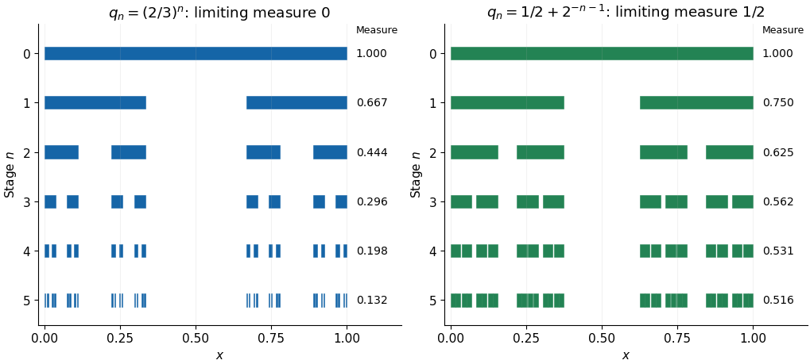

# Generalized Cantor set

↑ **Parent:** [Fractal geometry](fractal-geometry.md)

Choose a strictly decreasing positive [sequence](sequence.md) $q_0=1,q_1,q_2,\ldots$. Begin with $C_0=[0,1]$ and at step $n+1$ keep two closed end intervals of length $q_{n+1}/2^{n+1}$ from every component interval of $C_n$. This constructs a [compact set](compact-space.md) $C=\bigcap_n C_n$ with

$$
m(C_n)=q_n,\qquad m(C)=\lim_n q_n.
$$

The second equality is [continuity from above of a measure](continuity-from-above-of-a-measure.md). Every stage has positive gaps and maximum component length at most $2^{-n}$, so $C$ contains no nondegenerate [interval](interval-mathematics.md) and is a [nowhere dense set](nowhere-dense-set.md). It has no [isolated points](isolated-point.md): both endpoints of the stage-$n$ component containing a point remain in $C$, and at least one distinct endpoint is within $2^{-n}$. Thus its topological sparseness is compatible with positive [Lebesgue measure](lebesgue-measure.md).

Taking $q_n=(2/3)^n$ gives the usual [Cantor set](cantor-set.md) of measure zero. Taking $q_n=1/2+2^{-(n+1)}$ gives a generalized construction of measure $1/2$. This is one useful family of generalized constructions; the removed intervals need not have the same proportions at every stage.

**[Figure 19](#image-generalized-cantor-constructions-with-zero-and-positive-limiting-lebesgue-measure). Generalized Cantor constructions with zero and positive limiting Lebesgue measure**. Each row shows the retained [closed intervals](closed-real-interval.md) at one stage. The two constructions have the same binary splitting pattern but different limits of the total retained length.

## ↑ Ancestors (5)

1. [Fractal geometry](fractal-geometry.md)
2. [Geometry and topology](geometry-and-topology-split.md)
3. [Area of mathematics](area-of-mathematics.md)
4. [Mathematics](mathematics-split.md)
5. [Codex Wiki](split.md)

## ← Incoming links (1)

- [Solution](past-exam-of-the-integration-course-of-the-university-of-oxford/2021/3/a/solution.md)
