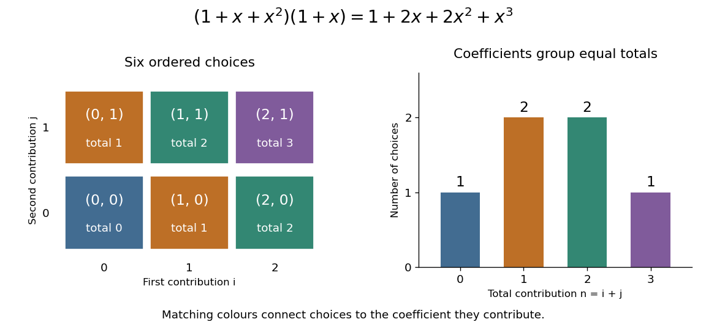
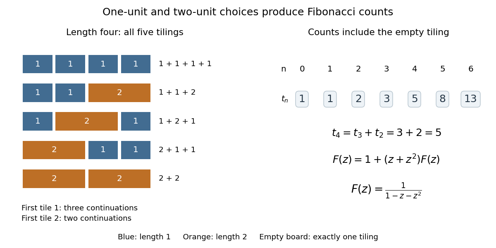

# Generating function

↑ **Parent:** [Power series](power-series.md)  
ⓦ [Wiki](https://en.wikipedia.org/wiki/Generating_function)

A [generating function](generating-function.md) packages a [sequence](sequence.md) into a [series](series-mathematics.md) so that operations on objects become operations on their encodings. An [ordinary generating function](ordinary-generating-function.md) uses the [power series](power-series.md) $A(z)=\sum_{n\geq0}a_nz^n$; in counting problems, the [coefficient](coefficient.md) $a_n$ records the number of objects of size $n$. The variable $z$ initially marks size: it need not be assigned a numerical value. [Coefficient extraction](coefficient-extraction.md) writes this recovery as $[z^n]A(z)=a_n$. One compact expression can therefore answer infinitely many counting questions, while explaining how their answers fit together.

Start with two contributions: choose $i$ from $\{0,1,2\}$ and $j$ from $\{0,1\}$, with exactly one option at each allowed value. Their individual [ordinary generating functions](ordinary-generating-function.md) are the [polynomials](polynomial-split.md) $P(x)=1+x+x^2$ and $Q(x)=1+x$. To count [ordered pairs](ordered-pair.md) by total $i+j$, multiply:

$$
P(x)Q(x)=(1+x+x^2)(1+x)=1+2x+2x^2+x^3.
$$

The [coefficients](coefficient.md) $1,2,2,1$ count the ways to obtain totals zero through three. For total two, the possibilities are $(1,1)$ and $(2,0)$; the two corresponding [monomials](monomial.md) both contribute $x^2$. There are six [ordered pairs](ordered-pair.md) altogether, agreeing with $P(1)Q(1)=3\cdot2=6$.

**[Figure 26](#image-polynomial-multiplication-groups-six-ordered-choices-by-their-total-contribution). Polynomial multiplication groups six ordered choices by their total contribution**.

If the first contribution has two distinguishable choices when $i=1$, replace $P(x)$ by $1+2x+x^2$. Its product with $Q(x)$ becomes $1+3x+3x^2+x^3$. The [coefficients](coefficient.md) now carry multiplicities as well as possible totals; the exponent still records cost. This lets the same construction handle several actions with identical costs without losing their separate identities.

In general, the [Cauchy product](cauchy-product.md) gives

$$
[z^n]\bigl(A(z)B(z)\bigr)=\sum_{k=0}^n a_kb_{n-k}.
$$

For each split of the total size, the [rule of product](rule-of-product.md) counts the choices of the two components; summing over those splits counts all possibilities. This requires each combined object to have a unique decomposition into the two components. The same idea works for costs, lengths, or other additive measures, not just the number of pieces. See [MIT 18.310, generating functions, sections 1–2](https://ocw.mit.edu/courses/18-310-principles-of-discrete-applied-mathematics-fall-2013/1d3495b2adb2dc35cb8dd1933398a647_MIT18_310F13_Ch7.pdf).

Now cover a board of length $n$ with tiles of lengths one and two, without gaps or overlaps. Let $t_n$ count these tilings. There is exactly one empty tiling, so $t_0=1$, and $t_1=1$. Removing the first tile leaves a board shorter by one or two, giving the [recurrence relation](recurrence-relation.md)

$$
t_n=t_{n-1}+t_{n-2}\quad(n\geq2),\qquad (t_0,t_1,t_2,t_3,t_4,t_5)=(1,1,2,3,5,8).
$$

These are the [Fibonacci numbers](fibonacci-number.md) shifted by one index: $t_n=F_{n+1}$ under the convention $F_0=0$, $F_1=1$. Keeping the empty tiling is essential to both the counting rule and the resulting [ordinary generating function](ordinary-generating-function.md).

**[Figure 27](#image-length-one-and-length-two-tiles-give-five-coverings-of-a-length-four-board-and-the-fibonacci-recurrence). Length-one and length-two tiles give five coverings of a length-four board and the Fibonacci recurrence**.

For $F(z)=\sum_{n\geq0}t_nz^n$, the empty board or a first tile followed by a remaining tiling gives

$$
F(z)=1+(z+z^2)F(z),\qquad F(z)=\frac{1}{1-z-z^2}=1+z+2z^2+3z^3+5z^4+8z^5+\cdots.
$$

Equivalently, $F(z)=\sum_{m\geq0}(z+z^2)^m$: each factor chooses one tile, and $m$ counts pieces while the exponent of $z$ records total length. The same [ordinary generating function](ordinary-generating-function.md) counts ordered histories of two repeatable actions costing one and two units. Histories $(1,2)$ and $(2,1)$ differ despite having the same total cost. MIT's notes use dots and dashes with these costs, including the empty message. [MIT 18.200, generating functions, section 4](https://ocw.mit.edu/courses/18-200-principles-of-discrete-applied-mathematics-spring-2024/mit18_200_s24_lec07-08.pdf)

These identities hold in [formal power series](formal-power-series.md) algebra: each requested [coefficient](coefficient.md) uses only finitely many contributions. The repeated-choice expansion is legitimate because $z+z^2$ has zero [constant term](constant-term.md); a zero-cost repeatable action would allow infinitely many histories of the same size. Numerical evaluation separately requires a [convergent series](convergent-series.md). Here the [radius of convergence](radius-of-convergence.md) is $(\sqrt5-1)/2$, the reciprocal of the [golden ratio](golden-ratio.md). At $z=1$, the [rational function](rational-function.md) equals $-1$, but the counting [series](series-mathematics.md) diverges: that value cannot represent its sum.

Other [generating functions](generating-function.md) change the encoding: an [exponential generating function](exponential-generating-function.md) divides by [factorials](factorial.md), while a [Dirichlet series](dirichlet-series.md) uses $n^{-s}$. A counting [generating function](generating-function.md) also differs from a [probability generating function](probability-generating-function.md), whose [coefficients](coefficient.md) must be nonnegative and sum to one.

**Table of contents**

- [Exponential generating function](exponential-generating-function.md)

## ↑ Ancestors (7)

1. [Power series](power-series.md)
2. [Sequence and series](sequence-and-series.md)
3. [Real analysis](real-analysis-split.md)
4. [Analysis](analysis-split.md)
5. [Area of mathematics](area-of-mathematics.md)
6. [Mathematics](mathematics-split.md)
7. [Codex Wiki](split.md)

## ← Incoming links (25)

- [Bernoulli number](bernoulli-number.md)
- [Board tiling](board-tiling.md)
- [Convolution theorem](convolution-theorem.md)
- [Discrete convolution](discrete-convolution.md)
- [Even-length walk generating function on a bipartite graph](even-length-walk-generating-function-on-a-bipartite-graph.md)
- [Galton-Watson process](galton-watson-process.md)
- [Gaussian binomial coefficient](gaussian-binomial-coefficient.md)
- [Generating function](generating-function.md)
- [Kravchuk polynomials](kravchuk-polynomials.md)
- [Large-level degeneracy of a closed bosonic string](large-level-degeneracy-of-a-closed-bosonic-string.md)
- [North-east-west self-avoiding walk count](north-east-west-self-avoiding-walk-count.md)
- [Ordinary generating function](ordinary-generating-function.md)
- [Partition of an integer](partition-of-an-integer.md)
- [Solution](past-exam-of-the-mathematics-course-of-the-university-of-cambridge/2003/iii/paper-50/4/solution.md)
- [Solution](past-exam-of-the-mathematics-course-of-the-university-of-cambridge/2003/iii/paper-50/5/a/solution.md)
- [Solution](past-exam-of-the-mathematics-course-of-the-university-of-cambridge/2004/iii/paper-2/5/b/solution.md)
- [Solution](past-exam-of-the-mathematics-course-of-the-university-of-cambridge/2005/iii/paper-54/4/b/solution.md)
- [Solution](past-exam-of-the-mathematics-course-of-the-university-of-cambridge/2007/iii/paper-54/4/solution.md)
- [Solution](past-exam-of-the-mathematics-course-of-the-university-of-cambridge/2012/iii/paper-30/1/c/solution.md)
- [Solution](past-exam-of-the-mathematics-course-of-the-university-of-cambridge/2013/iii/paper-26/1/iv/solution.md)
- [Power series](power-series.md)
- [Q-analogue](q-analogue.md)
- [Self-avoiding walk generating function](self-avoiding-walk-generating-function.md)
- [Termwise differentiation of a power series](termwise-differentiation-of-a-power-series.md)
- [Triangle replacement for self-avoiding walks](triangle-replacement-for-self-avoiding-walks.md)
