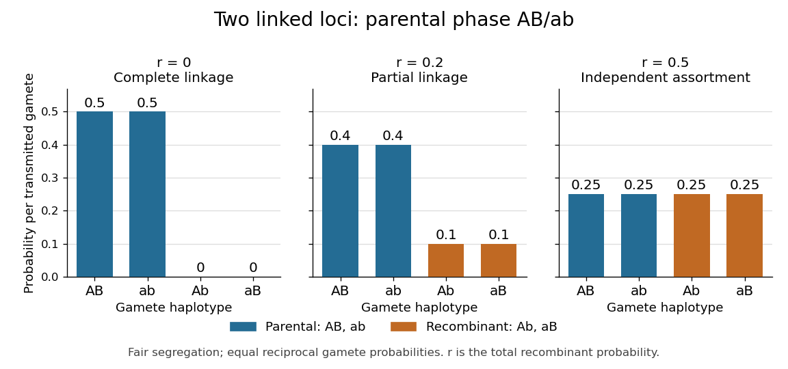

# Genetic linkage

↑ **Parent:** [Genetics](genetics-split.md)  
ⓦ [Wiki](https://en.wikipedia.org/wiki/Genetic_linkage)

Why can two individually fair [allele](allele.md) transmissions fail to be independent? [Genetic loci](genetic-locus.md) on the same [chromosome](chromosome.md) can travel together through [meiosis](meiosis.md). This tendency is [genetic linkage](genetic-linkage.md); in an ordinary two-locus model, detectable [genetic linkage](genetic-linkage.md) means a [recombination fraction](recombination-fraction.md) below $1/2$. A [genetic marker](genetic-marker.md) can therefore help track a neighboring [genetic locus](genetic-locus.md) through a [pedigree](pedigree.md). See [Clark, Douglas and Choi, Biology 2e: chromosomal theory and genetic linkage](https://openstax.org/books/biology-2e/pages/13-1-chromosomal-theory-and-genetic-linkage).

Take a [diploid](diploid.md) individual [heterozygous](heterozygosity.md) at two [genetic loci](genetic-locus.md), with [phase-known genotype](phase-known-genotype.md) $AB/ab$: one [homologous chromosome](homologous-chromosome.md) carries [alleles](allele.md) $A,B$, the other $a,b$. The parental [haplotypes](haplotype.md) are $AB,ab$; the recombinant [haplotypes](haplotype.md) are $Ab,aB$. Assume fair [Mendelian segregation](mendelian-segregation.md), equal [probabilities](probability.md) within each reciprocal pair of [gametes](gamete.md), and no [allele](allele.md)-dependent differences in [gamete](gamete.md) recovery. If the [recombination fraction](recombination-fraction.md) is $r=0.2$, the [gamete](gamete.md) [probabilities](probability.md) are $0.4,0.4,0.1,0.1$ in that order. Each [genetic locus](genetic-locus.md) still transmits its two [alleles](allele.md) equally, but $P(AB)=0.4$ exceeds $P(A)P(B)=0.25$: fairness at each [genetic locus](genetic-locus.md) does not imply [independence](independent-random-variables.md) between [genetic loci](genetic-locus.md).

**[Figure 8](#image-gamete-probabilities-from-the-phase-known-genotype-ab-ab-parental-versus-recombinant-haplotypes-at-three-recombination-fractions). Gamete probabilities from the phase-known genotype AB/ab: parental versus recombinant haplotypes at three recombination fractions**.

At $r=0$, only the parental [haplotypes](haplotype.md) occur, each with [probability](probability.md) $0.5$: this is [complete genetic linkage](complete-genetic-linkage.md). At $r=0.5$, all four [haplotypes](haplotype.md) have [probability](probability.md) $0.25$, giving [independent assortment](independent-assortment.md). A [recombination fraction](recombination-fraction.md) near $0.5$ alone cannot establish whether the [genetic loci](genetic-locus.md) lie on different [chromosomes](chromosome.md) or far apart on one [chromosome](chromosome.md).

[Genetic linkage](genetic-linkage.md) concerns joint transmission through [meiosis](meiosis.md). [Linkage disequilibrium](linkage-disequilibrium.md) concerns [haplotype](haplotype.md) frequencies in a population, while [genetic association](genetic-association.md) compares [allele](allele.md) or [genotype](genotype.md) frequencies with a [phenotype](phenotype.md). These questions require different observations; [pedigrees](pedigree.md) directly reveal co-transmission.

**Table of contents**

- [Genetic map](genetic-map.md)
  - [Haldane mapping function](haldane-mapping-function.md)
  - [Morgan (unit)](morgan-unit.md)
    - [Centimorgan](centimorgan.md)
- [Nonparametric linkage analysis](nonparametric-linkage-analysis.md)
  - [Mean allele-sharing test for affected siblings](mean-allele-sharing-test-for-affected-siblings.md)
  - [Affected-sib-pair analysis](affected-sib-pair-analysis.md)
    - [Recessive affected-sib-pair likelihood](recessive-affected-sib-pair-likelihood.md)
      - [Allele-sharing sufficiency for recessive linkage](allele-sharing-sufficiency-for-recessive-linkage.md)
- [Parametric linkage analysis](parametric-linkage-analysis.md)
- [Complete genetic linkage](complete-genetic-linkage.md)
- [Homozygosity mapping](homozygosity-mapping.md)
- [LOD score](lod-score.md)

## ↑ Ancestors (3)

1. [Genetics](genetics-split.md)
2. [Biology](biology-split.md)
3. [Codex Wiki](split.md)

## ← Incoming links (25)

- [Affected-sib-pair analysis](affected-sib-pair-analysis.md)
- [Genetic linkage](genetic-linkage.md)
- [Genetic marker](genetic-marker.md)
- [Independent assortment](independent-assortment.md)
- [Linkage disequilibrium](linkage-disequilibrium.md)
- [Mendelian segregation](mendelian-segregation.md)
- [Solution](past-exam-of-the-genetics-course-of-the-university-of-cambridge/2025/paper-2/2/solution.md)
- [Solution](past-exam-of-the-genetics-course-of-the-university-of-cambridge/2025/paper-4/3/solution.md)
- [Solution](past-exam-of-the-genetics-course-of-the-university-of-cambridge/2025/paper-4/5/solution.md)
- [Solution](past-exam-of-the-genetics-course-of-the-university-of-cambridge/2025/paper-4/7/solution.md)
- [Solution](past-exam-of-the-mathematics-course-of-the-university-of-cambridge/2001/iii/paper-29/6/i/solution.md)
- [Solution](past-exam-of-the-mathematics-course-of-the-university-of-cambridge/2001/iii/paper-29/6/vi/solution.md)
- [Solution](past-exam-of-the-mathematics-course-of-the-university-of-cambridge/2003/iii/paper-40/5/i/solution.md)
- [Solution](past-exam-of-the-mathematics-course-of-the-university-of-cambridge/2003/iii/paper-40/6/c/solution.md)
- [Solution](past-exam-of-the-mathematics-course-of-the-university-of-cambridge/2004/iii/paper-39/2/solution.md)
- [Solution](past-exam-of-the-mathematics-course-of-the-university-of-cambridge/2005/iii/paper-45/1/ii/solution.md)
- [Solution](past-exam-of-the-mathematics-course-of-the-university-of-cambridge/2005/iii/paper-45/1/iii/solution.md)
- [Solution](past-exam-of-the-mathematics-course-of-the-university-of-cambridge/2005/iii/paper-45/4/i/solution.md)
- [Solution](past-exam-of-the-mathematics-course-of-the-university-of-cambridge/2006/iii/paper-45/2/a/solution.md)
- [Solution](past-exam-of-the-zoology-course-of-the-university-of-cambridge/2024/paper-zl3/3/solution.md)
- [Solution](past-exam-of-the-zoology-course-of-the-university-of-cambridge/2024/paper-zm5/3/solution.md)
- [Solution](past-exam-of-the-zoology-course-of-the-university-of-cambridge/2025/paper-zm5/2/solution.md)
- [Solution](past-exam-of-the-zoology-course-of-the-university-of-cambridge/2025/paper-zm5/3/solution.md)
- [Phase-known genotype](phase-known-genotype.md)
- [Recombination fraction](recombination-fraction.md)
