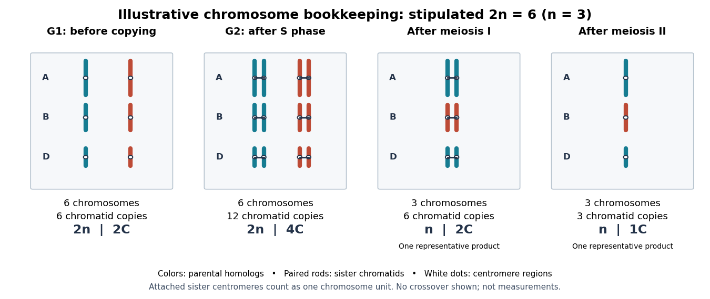
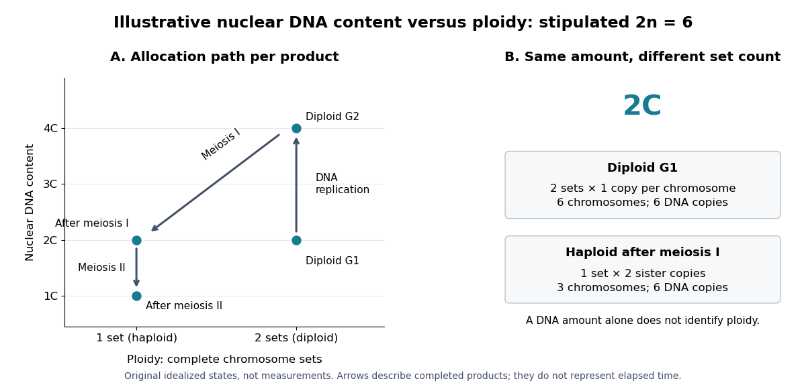
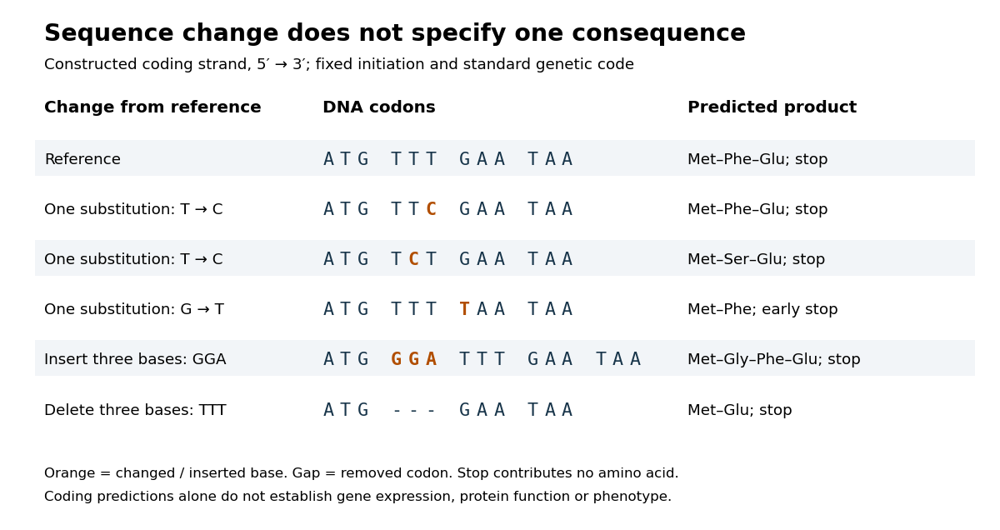
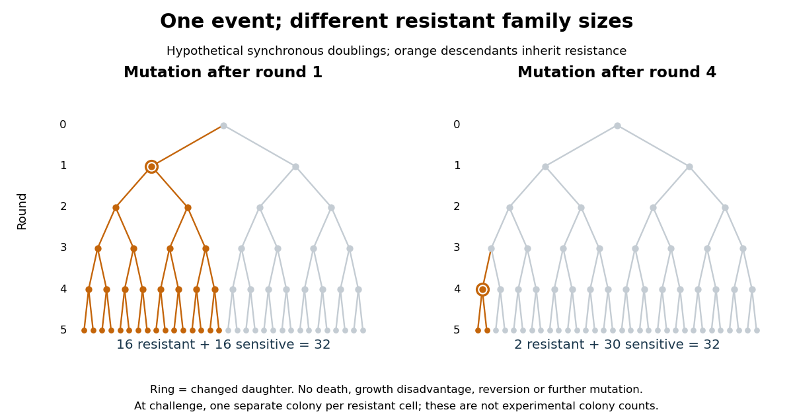
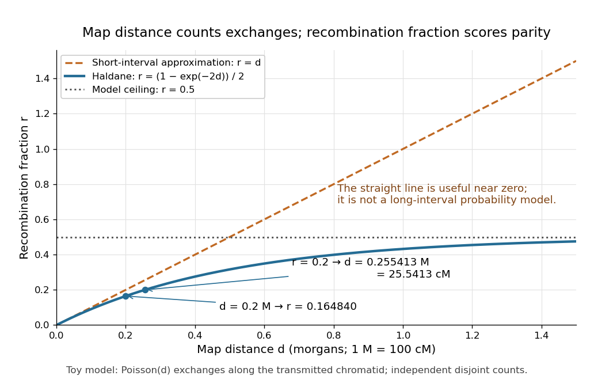
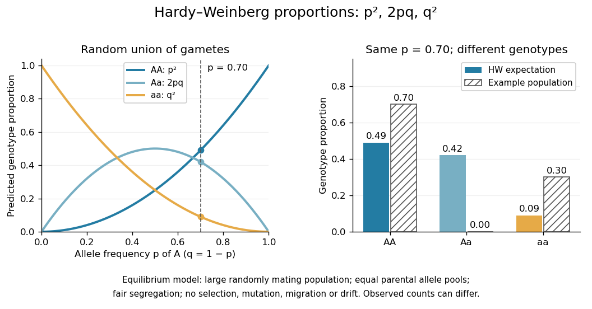

# Genetics

↑ **Parent:** [Biology](biology.md)  
ⓦ [Wiki](https://en.wikipedia.org/wiki/Genetics)

[Genetics](genetics.md) studies how [genes](#gene) are inherited, how their [alleles](#allele) vary, and how that variation contributes to [phenotypes](#phenotype). Its central distinction is between an inherited description, the [genotype](#genotype), and what an [organism](organism.md) actually expresses, the [phenotype](#phenotype). Following [alleles](#allele) through a [pedigree](#pedigree) answers a family-level question; following [allele frequencies](#allele-frequency) through generations leads to [population genetics](population-genetics.md) and [evolution](biology.md#evolution).

The beauty of [Mendelian segregation](#mendelian-segregation) is that discrete inherited copies can generate predictable statistical patterns without making every offspring identical. A single [genetic locus](#genetic-locus) already connects [meiosis](#meiosis), [probability](probability-theory.md#probability) and observable variation. The [Hardy-Weinberg principle](#hardy-weinberg-principle) then supplies a population baseline: it separates reshuffling inherited copies from processes such as [natural selection](biology.md#natural-selection) that change their frequencies. These simple models are useful precisely because their assumptions can be stated and checked.

**Table of contents**

- [Genome evolution](#genome-evolution)
  - [Genome structural variation](#genome-structural-variation)
    - [Presence-absence variation](#presence-absence-variation)
    - [Chromosomal inversion](#chromosomal-inversion)
- [Functional genomics](#functional-genomics)
  - [Tissue-specific gene perturbation](#tissue-specific-gene-perturbation)
  - [Temporal gene perturbation](#temporal-gene-perturbation)
- [Genetic rescue](#genetic-rescue)
- [Cytoplasmic inheritance](#cytoplasmic-inheritance)
- [Inherited disorder](#inherited-disorder)
  - [Lynch syndrome](#lynch-syndrome)
- [Genomic instability](#genomic-instability)
  - [Chromothripsis](#chromothripsis)
  - [Breakage-fusion-bridge cycle](#breakage-fusion-bridge-cycle)
  - [Microsatellite instability](#microsatellite-instability)
- [Human genetics](#human-genetics)
  - [Lactase persistence](#lactase-persistence)
- [Short tandem repeat](#short-tandem-repeat)
- [Forensic DNA profiling](#forensic-dna-profiling)
- [Sickle cell disease](#sickle-cell-disease)
- [Genomics](#genomics)
  - [Zoonomia Consortium](#zoonomia-consortium)
    - [Work by Zoonomia Consortium](#work-by-zoonomia-consortium)
  - [Environmental DNA](#environmental-dna)
  - [Metagenomics](#metagenomics)
  - [Comparative genomics](#comparative-genomics)
    - [Synteny](#synteny)
  - [Reference genome](#reference-genome)
    - [Reference bias](#reference-bias)
  - [Genome assembly](#genome-assembly)
  - [Genome annotation](#genome-annotation)
    - [Gene annotation](#gene-annotation)
      - [Gene prediction](#gene-prediction)
      - [Gene model](#gene-model)
- [Hybrid (biology)](#hybrid-biology)
  - [Hybridization (biology)](#hybridization-biology)
- [Genetic rescue experiment](#genetic-rescue-experiment)
- [Candidate gene](#candidate-gene)
- [Microsatellite](#microsatellite)
- [Genotype-phenotype linkage](#genotype-phenotype-linkage)
- [Transposable element](#transposable-element)
  - [Hybrid dysgenesis](#hybrid-dysgenesis)
  - [Retrotransposon](#retrotransposon)
  - [Endogenous retrovirus](#endogenous-retrovirus)
- [Epigenetic inheritance](#epigenetic-inheritance)
  - [Transgenerational epigenetic inheritance](#transgenerational-epigenetic-inheritance)
  - [Epigenetic state](#epigenetic-state)
- [Genetic variation](#genetic-variation)
- [Common garden experiment](#common-garden-experiment)
- [Diminishing-returns epistasis](#diminishing-returns-epistasis)
- [Polymorphism](#polymorphism)
- [Gene dosage](#gene-dosage)
- [Heterogametic sex](#heterogametic-sex)
- [Epistasis](#epistasis)
  - [Genetic bypass experiment](#genetic-bypass-experiment)
  - [Sign epistasis](#sign-epistasis)
- [Genetic mosaic](#genetic-mosaic)
- [Strain (biology)](#strain-biology)
- [Genetic background](#genetic-background)
- [Functional complementation](#functional-complementation)
  - [Complementation testing](#complementation-testing)
- [Molecular genetics](molecular-genetics.md)
  - [Foraging gene](molecular-genetics.md#foraging-gene)
  - [DNA synthesis](molecular-genetics.md#dna-synthesis)
    - [Trinucleotide phosphoramidite](molecular-genetics.md#trinucleotide-phosphoramidite)
  - [DNA library](molecular-genetics.md#dna-library)
    - [Library coverage](molecular-genetics.md#library-coverage)
  - [Mutagenesis](molecular-genetics.md#mutagenesis)
    - [Mutation load](molecular-genetics.md#mutation-load)
    - [Saturation mutagenesis](molecular-genetics.md#saturation-mutagenesis)
  - [Retrotransposon insertion](molecular-genetics.md#retrotransposon-insertion)
  - [Ultraconserved element](molecular-genetics.md#ultraconserved-element)
  - [Transcriptomics](molecular-genetics.md#transcriptomics)
    - [Spatial transcriptomics](molecular-genetics.md#spatial-transcriptomics)
      - [Slide-seq](molecular-genetics.md#slide-seq)
      - [Spatial barcoding](molecular-genetics.md#spatial-barcoding)
  - [Orthology](molecular-genetics.md#orthology)
  - [Tumour mutational burden](molecular-genetics.md#tumour-mutational-burden)
  - [dN/dS](molecular-genetics.md#dn-ds)
  - [CpG site](molecular-genetics.md#cpg-site)
  - [Genetic engineering](molecular-genetics.md#genetic-engineering)
    - [Genetic perturbation](molecular-genetics.md#genetic-perturbation)
    - [Protein engineering](molecular-genetics.md#protein-engineering)
      - [Computational enzyme design](molecular-genetics.md#computational-enzyme-design)
    - [Off-target effect](molecular-genetics.md#off-target-effect)
    - [Gene knockout](molecular-genetics.md#gene-knockout)
    - [CRISPR genome editing](molecular-genetics.md#crispr-genome-editing)
      - [CRISPR locus labelling](molecular-genetics.md#crispr-locus-labelling)
      - [CRISPR-Cas9](molecular-genetics.md#crispr-cas9)
      - [CRISPR activation](molecular-genetics.md#crispr-activation)
      - [CRISPR interference](molecular-genetics.md#crispr-interference)
      - [Cas9](molecular-genetics.md#cas9)
        - [dCas9](molecular-genetics.md#dcas9)
      - [Protospacer adjacent motif](molecular-genetics.md#protospacer-adjacent-motif)
      - [Guide RNA](molecular-genetics.md#guide-rna)
    - [Optogenetics](molecular-genetics.md#optogenetics)
  - [Site-directed mutagenesis](molecular-genetics.md#site-directed-mutagenesis)
  - [De novo gene birth](molecular-genetics.md#de-novo-gene-birth)
  - [Neofunctionalization](molecular-genetics.md#neofunctionalization)
  - [Subfunctionalization](molecular-genetics.md#subfunctionalization)
  - [Gene duplication](molecular-genetics.md#gene-duplication)
    - [Whole-genome duplication](molecular-genetics.md#whole-genome-duplication)
      - [Two-round vertebrate genome duplication hypothesis](molecular-genetics.md#two-round-vertebrate-genome-duplication-hypothesis)
    - [Tandem gene duplication](molecular-genetics.md#tandem-gene-duplication)
    - [Tandem duplication](molecular-genetics.md#tandem-duplication)
    - [Birth-and-death evolution](molecular-genetics.md#birth-and-death-evolution)
    - [Paralogy](molecular-genetics.md#paralogy)
      - [Paralogue](molecular-genetics.md#paralogue)
  - [DNA methylation](molecular-genetics.md#dna-methylation)
    - [CHH methylation](molecular-genetics.md#chh-methylation)
    - [CHG methylation](molecular-genetics.md#chg-methylation)
    - [CG methylation](molecular-genetics.md#cg-methylation)
    - [De novo DNA methylation](molecular-genetics.md#de-novo-dna-methylation)
    - [Maintenance DNA methylation](molecular-genetics.md#maintenance-dna-methylation)
    - [DNA demethylation](molecular-genetics.md#dna-demethylation)
      - [DEMETER](molecular-genetics.md#demeter)
      - [ROS1](molecular-genetics.md#ros1)
    - [DNA methyltransferase](molecular-genetics.md#dna-methyltransferase)
      - [DRM2](molecular-genetics.md#drm2)
      - [CMT2](molecular-genetics.md#cmt2)
      - [CMT3](molecular-genetics.md#cmt3)
      - [MET1](molecular-genetics.md#met1)
    - [Differentially methylated region](molecular-genetics.md#differentially-methylated-region)
    - [Posterior methylation profile](molecular-genetics.md#posterior-methylation-profile)
    - [Bisulfite sequencing](molecular-genetics.md#bisulfite-sequencing)
  - [Single-cell RNA sequencing](molecular-genetics.md#single-cell-rna-sequencing)
    - [Developmental pseudotime](molecular-genetics.md#developmental-pseudotime)
    - [Pseudotime](molecular-genetics.md#pseudotime)
  - [Chromatin](molecular-genetics.md#chromatin)
    - [Polycomb repression](molecular-genetics.md#polycomb-repression)
    - [Chromatin organization](molecular-genetics.md#chromatin-organization)
      - [DDM1](molecular-genetics.md#ddm1)
      - [Fluorescent operator-repressor chromosome labelling](molecular-genetics.md#fluorescent-operator-repressor-chromosome-labelling)
    - [Chromosome territory](molecular-genetics.md#chromosome-territory)
    - [Chromatin compartment](molecular-genetics.md#chromatin-compartment)
    - [Chromatin loop](molecular-genetics.md#chromatin-loop)
      - [Loop extrusion](molecular-genetics.md#loop-extrusion)
    - [Topologically associating domain](molecular-genetics.md#topologically-associating-domain)
    - [Chromosome conformation capture](molecular-genetics.md#chromosome-conformation-capture)
      - [Hi-C](molecular-genetics.md#hi-c)
    - [Nucleosome array](molecular-genetics.md#nucleosome-array)
    - [Chromatin accessibility](molecular-genetics.md#chromatin-accessibility)
      - [DNase-seq](molecular-genetics.md#dnase-seq)
      - [ATAC-seq](molecular-genetics.md#atac-seq)
    - [Dinoflagellate histone-like protein](molecular-genetics.md#dinoflagellate-histone-like-protein)
    - [Dinoflagellate viral nucleoprotein](molecular-genetics.md#dinoflagellate-viral-nucleoprotein)
    - [Liquid-crystalline chromosome organization](molecular-genetics.md#liquid-crystalline-chromosome-organization)
    - [Chromatin boundary](molecular-genetics.md#chromatin-boundary)
    - [Heterochromatin](molecular-genetics.md#heterochromatin)
      - [H3K9 methylation](molecular-genetics.md#h3k9-methylation)
        - [H3K9 dimethylation](molecular-genetics.md#h3k9-dimethylation)
      - [Heterochromatin spreading](molecular-genetics.md#heterochromatin-spreading)
    - [Chromatin remodelling](molecular-genetics.md#chromatin-remodelling)
      - [ATP-dependent chromatin remodelling complex](molecular-genetics.md#atp-dependent-chromatin-remodelling-complex)
    - [Histone acetylation](molecular-genetics.md#histone-acetylation)
      - [HDA6](molecular-genetics.md#hda6)
    - [Nucleosome](molecular-genetics.md#nucleosome)
      - [Nucleosome reconstitution](molecular-genetics.md#nucleosome-reconstitution)
      - [Histone transfer](molecular-genetics.md#histone-transfer)
      - [Nucleosome stability](molecular-genetics.md#nucleosome-stability)
      - [Nucleosome breathing](molecular-genetics.md#nucleosome-breathing)
      - [Linker DNA](molecular-genetics.md#linker-dna)
      - [Histone octamer](molecular-genetics.md#histone-octamer)
      - [Nucleosome mapping by MNase-seq](molecular-genetics.md#nucleosome-mapping-by-mnase-seq)
  - [Plasmid](molecular-genetics.md#plasmid)
    - [Expression vector](molecular-genetics.md#expression-vector)
    - [Plasmid feature map](molecular-genetics.md#plasmid-feature-map)
    - [Plasmid insert](molecular-genetics.md#plasmid-insert)
    - [Plasmid restriction mapping](molecular-genetics.md#plasmid-restriction-mapping)
    - [1973 plasmid construction experiment](molecular-genetics.md#1973-plasmid-construction-experiment)
  - [Genetic transformation](molecular-genetics.md#genetic-transformation)
    - [Plasmid selection and confirmation](molecular-genetics.md#plasmid-selection-and-confirmation)
  - [Replica plating](molecular-genetics.md#replica-plating)
    - [Replica plating spatial correspondence](molecular-genetics.md#replica-plating-spatial-correspondence)
    - [Lederberg replica plating experiment](molecular-genetics.md#lederberg-replica-plating-experiment)
    - [Replica plating controls](molecular-genetics.md#replica-plating-controls)
    - [Indirect selection of bacterial mutants](molecular-genetics.md#indirect-selection-of-bacterial-mutants)
  - [Genome](molecular-genetics.md#genome)
    - [Genome defence](molecular-genetics.md#genome-defence)
    - [Episome](molecular-genetics.md#episome)
      - [Episome partitioning](molecular-genetics.md#episome-partitioning)
    - [Polyploidy](molecular-genetics.md#polyploidy)
      - [Allopolyploidy](molecular-genetics.md#allopolyploidy)
    - [Genome reduction](molecular-genetics.md#genome-reduction)
      - [Adaptive gene loss](molecular-genetics.md#adaptive-gene-loss)
    - [Chloroplast genome](molecular-genetics.md#chloroplast-genome)
    - [Pangenome](molecular-genetics.md#pangenome)
    - [Mitochondrial genome](molecular-genetics.md#mitochondrial-genome)
    - [Genome mapping](molecular-genetics.md#genome-mapping)
  - [DNA sequencing](molecular-genetics.md#dna-sequencing)
    - [Variant allele fraction](molecular-genetics.md#variant-allele-fraction)
    - [Unique molecular identifier](molecular-genetics.md#unique-molecular-identifier)
    - [Whole-genome sequencing](molecular-genetics.md#whole-genome-sequencing)
    - [Long-read sequencing](molecular-genetics.md#long-read-sequencing)
    - [Sanger sequencing](molecular-genetics.md#sanger-sequencing)
      - [Sanger ladder reading](molecular-genetics.md#sanger-ladder-reading)
      - [Sanger sequencing controls](molecular-genetics.md#sanger-sequencing-controls)
      - [Sanger-Nicklen-Coulson sequencing experiment](molecular-genetics.md#sanger-nicklen-coulson-sequencing-experiment)
    - [Sequencing primer](molecular-genetics.md#sequencing-primer)
  - [Sequence alignment](molecular-genetics.md#sequence-alignment)
    - [Multiple sequence alignment](molecular-genetics.md#multiple-sequence-alignment)
      - [Alignment column information content](molecular-genetics.md#alignment-column-information-content)
      - [Gap fraction](molecular-genetics.md#gap-fraction)
    - [Sequence similarity](molecular-genetics.md#sequence-similarity)
    - [Sequence identity](molecular-genetics.md#sequence-identity)
    - [Fitting sequence alignment](molecular-genetics.md#fitting-sequence-alignment)
    - [Local sequence alignment](molecular-genetics.md#local-sequence-alignment)
      - [FASTA sequence search](molecular-genetics.md#fasta-sequence-search)
      - [BLAST](molecular-genetics.md#blast)
      - [Smith-Waterman algorithm](molecular-genetics.md#smith-waterman-algorithm)
    - [Global sequence alignment](molecular-genetics.md#global-sequence-alignment)
      - [Needleman-Wunsch algorithm](molecular-genetics.md#needleman-wunsch-algorithm)
    - [Gap penalty](molecular-genetics.md#gap-penalty)
      - [Affine gap penalty](molecular-genetics.md#affine-gap-penalty)
      - [Linear gap penalty](molecular-genetics.md#linear-gap-penalty)
    - [Substitution matrix](molecular-genetics.md#substitution-matrix)
      - [BLOSUM](molecular-genetics.md#blosum)
        - [BLOSUM62](molecular-genetics.md#blosum62)
    - [Splice-aware sequence alignment](molecular-genetics.md#splice-aware-sequence-alignment)
  - [Polymerase chain reaction](molecular-genetics.md#polymerase-chain-reaction)
    - [Error-prone PCR](molecular-genetics.md#error-prone-pcr)
    - [PCR primer](molecular-genetics.md#pcr-primer)
      - [Primer melting temperature](molecular-genetics.md#primer-melting-temperature)
    - [Amplicon](molecular-genetics.md#amplicon)
    - [PCR thermal cycle](molecular-genetics.md#pcr-thermal-cycle)
      - [PCR denaturation](molecular-genetics.md#pcr-denaturation)
      - [PCR annealing](molecular-genetics.md#pcr-annealing)
      - [PCR extension](molecular-genetics.md#pcr-extension)
    - [Thermal cycler](molecular-genetics.md#thermal-cycler)
    - [PCR efficiency](molecular-genetics.md#pcr-efficiency)
      - [PCR plateau](molecular-genetics.md#pcr-plateau)
    - [PCR specificity](molecular-genetics.md#pcr-specificity)
      - [Primer dimer](molecular-genetics.md#primer-dimer)
      - [PCR controls](molecular-genetics.md#pcr-controls)
    - [PV92 teaching experiment](molecular-genetics.md#pv92-teaching-experiment)
    - [Reverse transcription polymerase chain reaction](molecular-genetics.md#reverse-transcription-polymerase-chain-reaction)
    - [Real-time polymerase chain reaction](molecular-genetics.md#real-time-polymerase-chain-reaction)
      - [RT-qPCR](molecular-genetics.md#rt-qpcr)
    - [Polymerase chain reaction history](molecular-genetics.md#polymerase-chain-reaction-history)
  - [PV92 locus](molecular-genetics.md#pv92-locus)
  - [Alu element](molecular-genetics.md#alu-element)
  - [Chelex extraction](molecular-genetics.md#chelex-extraction)
  - [Reverse transcription](molecular-genetics.md#reverse-transcription)
    - [Reverse transcriptase](molecular-genetics.md#reverse-transcriptase)
    - [Complementary DNA](molecular-genetics.md#complementary-dna)
  - [Northern blot](molecular-genetics.md#northern-blot)
  - [DNA replication](molecular-genetics.md#dna-replication)
    - [Aphidicolin](molecular-genetics.md#aphidicolin)
    - [Underreplicated DNA](molecular-genetics.md#underreplicated-dna)
    - [Template switching](molecular-genetics.md#template-switching)
    - [Translesion synthesis](molecular-genetics.md#translesion-synthesis)
    - [Replication slippage](molecular-genetics.md#replication-slippage)
    - [DNA polymerase proofreading](molecular-genetics.md#dna-polymerase-proofreading)
    - [Replication stress](molecular-genetics.md#replication-stress)
    - [DNA polymerase slippage](molecular-genetics.md#dna-polymerase-slippage)
    - [Replication licensing](molecular-genetics.md#replication-licensing)
    - [Lagging strand](molecular-genetics.md#lagging-strand)
    - [Leading strand](molecular-genetics.md#leading-strand)
    - [Replication fork](molecular-genetics.md#replication-fork)
      - [Collapsed replication fork](molecular-genetics.md#collapsed-replication-fork)
    - [Tus-Ter system](molecular-genetics.md#tus-ter-system)
    - [DNA catenane](molecular-genetics.md#dna-catenane)
    - [End-replication problem](molecular-genetics.md#end-replication-problem)
    - [RNA primer](molecular-genetics.md#rna-primer)
    - [Okazaki fragment](molecular-genetics.md#okazaki-fragment)
    - [RFC](molecular-genetics.md#rfc)
    - [PCNA](molecular-genetics.md#pcna)
    - [DnaG](molecular-genetics.md#dnag)
    - [Beta sliding clamp](molecular-genetics.md#beta-sliding-clamp)
    - [DNA rereplication](molecular-genetics.md#dna-rereplication)
    - [GINS](molecular-genetics.md#gins)
    - [Cdc45](molecular-genetics.md#cdc45)
    - [CMG helicase](molecular-genetics.md#cmg-helicase)
    - [DnaB](molecular-genetics.md#dnab)
    - [DnaA](molecular-genetics.md#dnaa)
    - [MCM2-7](molecular-genetics.md#mcm2-7)
    - [Cdt1](molecular-genetics.md#cdt1)
    - [Cdc6](molecular-genetics.md#cdc6)
    - [Origin recognition complex](molecular-genetics.md#origin-recognition-complex)
    - [Replication origin licensing](molecular-genetics.md#replication-origin-licensing)
      - [Once-per-cell-cycle replication](molecular-genetics.md#once-per-cell-cycle-replication)
    - [Clamp loader](molecular-genetics.md#clamp-loader)
    - [Semiconservative replication](molecular-genetics.md#semiconservative-replication)
    - [DNA polymerase](molecular-genetics.md#dna-polymerase)
      - [DNA polymerase I](molecular-genetics.md#dna-polymerase-i)
      - [DNA polymerase delta](molecular-genetics.md#dna-polymerase-delta)
      - [DNA polymerase epsilon](molecular-genetics.md#dna-polymerase-epsilon)
      - [DNA polymerase alpha-primase](molecular-genetics.md#dna-polymerase-alpha-primase)
      - [DNA polymerase III](molecular-genetics.md#dna-polymerase-iii)
      - [Taq polymerase](molecular-genetics.md#taq-polymerase)
      - [Klenow fragment](molecular-genetics.md#klenow-fragment)
    - [Deoxynucleoside triphosphate](molecular-genetics.md#deoxynucleoside-triphosphate)
    - [DNA replication inhibitor](molecular-genetics.md#dna-replication-inhibitor)
      - [Hydroxyurea](molecular-genetics.md#hydroxyurea)
    - [Dideoxynucleoside triphosphate](molecular-genetics.md#dideoxynucleoside-triphosphate)
    - [Replicon](molecular-genetics.md#replicon)
    - [Origin of replication](molecular-genetics.md#origin-of-replication)
      - [oriC](molecular-genetics.md#oric)
  - [DNA repair](molecular-genetics.md#dna-repair)
    - [DNA repair synthesis](molecular-genetics.md#dna-repair-synthesis)
    - [Nucleotide excision repair](molecular-genetics.md#nucleotide-excision-repair)
    - [Base excision repair](molecular-genetics.md#base-excision-repair)
    - [RNase H1](molecular-genetics.md#rnase-h1)
    - [Ribonucleotide excision repair](molecular-genetics.md#ribonucleotide-excision-repair)
      - [RNase H2](molecular-genetics.md#rnase-h2)
    - [BRCA2](molecular-genetics.md#brca2)
    - [BRCA1](molecular-genetics.md#brca1)
    - [Homology-directed repair](molecular-genetics.md#homology-directed-repair)
    - [Non-homologous end joining](molecular-genetics.md#non-homologous-end-joining)
    - [SOS response](molecular-genetics.md#sos-response)
    - [D-loop](molecular-genetics.md#d-loop)
    - [DNA strand exchange](molecular-genetics.md#dna-strand-exchange)
    - [Presynaptic filament](molecular-genetics.md#presynaptic-filament)
    - [DNA mismatch repair](molecular-genetics.md#dna-mismatch-repair)
      - [Nascent-strand discrimination](molecular-genetics.md#nascent-strand-discrimination)
      - [MutH](molecular-genetics.md#muth)
      - [MutL complex](molecular-genetics.md#mutl-complex)
      - [MutSβ](molecular-genetics.md#muts-beta)
      - [MutSα](molecular-genetics.md#muts-alpha)
    - [DNA double-strand break](molecular-genetics.md#dna-double-strand-break)
  - [Gene expression](molecular-genetics.md#gene-expression)
    - [Differential gene expression](molecular-genetics.md#differential-gene-expression)
    - [Trans-regulation](molecular-genetics.md#trans-regulation)
    - [Regulation of gene expression](molecular-genetics.md#regulation-of-gene-expression)
      - [Post-transcriptional regulation](molecular-genetics.md#post-transcriptional-regulation)
        - [RNA export](molecular-genetics.md#rna-export)
        - [Messenger RNA localization](molecular-genetics.md#messenger-rna-localization)
          - [RNA partition coefficient](molecular-genetics.md#rna-partition-coefficient)
        - [RNA decay](molecular-genetics.md#rna-decay)
          - [AU-rich element](molecular-genetics.md#au-rich-element)
        - [RNA half-life](molecular-genetics.md#rna-half-life)
        - [RNA tethering assay](molecular-genetics.md#rna-tethering-assay)
        - [Translational regulation](molecular-genetics.md#translational-regulation)
          - [Translation efficiency](molecular-genetics.md#translation-efficiency)
          - [Nascent-chain imaging](molecular-genetics.md#nascent-chain-imaging)
      - [Inducer exclusion](molecular-genetics.md#inducer-exclusion)
      - [Lac operon](molecular-genetics.md#lac-operon)
        - [Lac operator](molecular-genetics.md#lac-operator)
    - [Transcription corepressor](molecular-genetics.md#transcription-corepressor)
    - [Transcription coactivator](molecular-genetics.md#transcription-coactivator)
    - [Attenuation in bacterial gene regulation](molecular-genetics.md#attenuation-in-bacterial-gene-regulation)
    - [RNA thermometer](molecular-genetics.md#rna-thermometer)
    - [Riboswitch](molecular-genetics.md#riboswitch)
    - [T7 expression system](molecular-genetics.md#t7-expression-system)
    - [RNA editing](molecular-genetics.md#rna-editing)
    - [Stringent response](molecular-genetics.md#stringent-response)
    - [Integrated stress response](molecular-genetics.md#integrated-stress-response)
    - [RNA interference](molecular-genetics.md#rna-interference)
      - [Dicer-independent small RNA biogenesis](molecular-genetics.md#dicer-independent-small-rna-biogenesis)
      - [RNA-induced silencing complex](molecular-genetics.md#rna-induced-silencing-complex)
      - [Small interfering RNA](molecular-genetics.md#small-interfering-rna)
        - [22G RNA](molecular-genetics.md#22g-rna)
      - [RITS complex](molecular-genetics.md#rits-complex)
    - [Preinitiation complex](molecular-genetics.md#preinitiation-complex)
      - [TFIIH](molecular-genetics.md#tfiih)
        - [XPB](molecular-genetics.md#xpb)
      - [TFIIB](molecular-genetics.md#tfiib)
      - [TFIID](molecular-genetics.md#tfiid)
    - [Transcription start site](molecular-genetics.md#transcription-start-site)
    - [Polyadenylation](molecular-genetics.md#polyadenylation)
    - [Reporter gene](molecular-genetics.md#reporter-gene)
    - [Cis-regulatory element](molecular-genetics.md#cis-regulatory-element)
      - [Hormone response element](molecular-genetics.md#hormone-response-element)
    - [Nonsense-mediated decay](molecular-genetics.md#nonsense-mediated-decay)
      - [UPF protein](molecular-genetics.md#upf-protein)
        - [UPF3](molecular-genetics.md#upf3)
        - [UPF2](molecular-genetics.md#upf2)
        - [UPF1](molecular-genetics.md#upf1)
    - [Transcript isoform](molecular-genetics.md#transcript-isoform)
    - [Gene overexpression](molecular-genetics.md#gene-overexpression)
    - [Allele-specific expression](molecular-genetics.md#allele-specific-expression)
    - [RNA sequencing](molecular-genetics.md#rna-sequencing)
      - [Sequencing depth](molecular-genetics.md#sequencing-depth)
      - [Read coverage](molecular-genetics.md#read-coverage)
      - [RNA-seq differential expression](molecular-genetics.md#rna-seq-differential-expression)
      - [Transcript assembly](molecular-genetics.md#transcript-assembly)
      - [Nanopore sequencing](molecular-genetics.md#nanopore-sequencing)
        - [xPore](molecular-genetics.md#xpore)
      - [GRO-cap](molecular-genetics.md#gro-cap)
      - [CAGE](molecular-genetics.md#cage)
      - [SLAM-seq](molecular-genetics.md#slam-seq)
      - [Single-nucleus RNA sequencing](molecular-genetics.md#single-nucleus-rna-sequencing)
      - [Long-read RNA sequencing](molecular-genetics.md#long-read-rna-sequencing)
    - [Enhancer](molecular-genetics.md#enhancer)
      - [Enhancer-promoter contact](molecular-genetics.md#enhancer-promoter-contact)
    - [Cis-regulatory evolution](molecular-genetics.md#cis-regulatory-evolution)
    - [Genomic imprinting](molecular-genetics.md#genomic-imprinting)
      - [Kinship theory of genomic imprinting](molecular-genetics.md#kinship-theory-of-genomic-imprinting)
    - [Zygotic genome activation](molecular-genetics.md#zygotic-genome-activation)
    - [Galactose induction](molecular-genetics.md#galactose-induction)
    - [Promoter (genetics)](molecular-genetics.md#promoter-genetics)
      - [psbD gene promoter](molecular-genetics.md#psbd-gene-promoter)
      - [Core promoter](molecular-genetics.md#core-promoter)
        - [Initiator element](molecular-genetics.md#initiator-element)
        - [TATA box](molecular-genetics.md#tata-box)
    - [Transcription factor](molecular-genetics.md#transcription-factor)
      - [Hunchback](molecular-genetics.md#hunchback)
      - [Bicoid](molecular-genetics.md#bicoid)
      - [FOXA2](molecular-genetics.md#foxa2)
      - [SMAD3](molecular-genetics.md#smad3)
      - [SMAD2](molecular-genetics.md#smad2)
      - [TEAD4](molecular-genetics.md#tead4)
      - [PAL-1](molecular-genetics.md#pal-1)
      - [SYS-1](molecular-genetics.md#sys-1)
      - [POP-1](molecular-genetics.md#pop-1)
      - [ELT-7](molecular-genetics.md#elt-7)
      - [ELT-2](molecular-genetics.md#elt-2)
      - [END-3](molecular-genetics.md#end-3)
      - [END-1](molecular-genetics.md#end-1)
      - [MED-2](molecular-genetics.md#med-2)
      - [MED-1](molecular-genetics.md#med-1)
      - [SKN-1](molecular-genetics.md#skn-1)
      - [GATA transcription factor](molecular-genetics.md#gata-transcription-factor)
      - [Phytochrome-interacting factor](molecular-genetics.md#phytochrome-interacting-factor)
        - [PIF4](molecular-genetics.md#pif4)
      - [DNA-binding motif](molecular-genetics.md#dna-binding-motif)
      - [CTCF](molecular-genetics.md#ctcf)
      - [ASCL1](molecular-genetics.md#ascl1)
      - [Pioneer transcription factor](molecular-genetics.md#pioneer-transcription-factor)
      - [E2F](molecular-genetics.md#e2f)
      - [LacI](molecular-genetics.md#laci)
      - [KRAB](molecular-genetics.md#krab)
      - [Myc](molecular-genetics.md#myc)
      - [TBX5](molecular-genetics.md#tbx5)
      - [NKX2-5](molecular-genetics.md#nkx2-5)
      - [Engrailed-1](molecular-genetics.md#engrailed-1)
      - [Lmx1b](molecular-genetics.md#lmx1b)
      - [CncC](molecular-genetics.md#cncc)
      - [NRF2](molecular-genetics.md#nrf2)
      - [ATOH1](molecular-genetics.md#atoh1)
      - [RccR](molecular-genetics.md#rccr)
      - [HNF1β](molecular-genetics.md#hnf1-beta)
      - [TCF transcription factor](molecular-genetics.md#tcf-transcription-factor)
      - [Transcription activator](molecular-genetics.md#transcription-activator)
      - [NEEDLY](molecular-genetics.md#needly)
      - [LEAFY](molecular-genetics.md#leafy)
      - [MADS-box transcription factor](molecular-genetics.md#mads-box-transcription-factor)
      - [SEPALLATA](molecular-genetics.md#sepallata)
      - [AGAMOUS](molecular-genetics.md#agamous)
      - [PISTILLATA](molecular-genetics.md#pistillata)
      - [APETALA3](molecular-genetics.md#apetala3)
      - [CYCLOIDEA](molecular-genetics.md#cycloidea)
      - [KNOX2](molecular-genetics.md#knox2)
      - [Catabolite activator protein](molecular-genetics.md#catabolite-activator-protein)
      - [Eukaryotic transcriptional activator](molecular-genetics.md#eukaryotic-transcriptional-activator)
      - [DNA shape readout](molecular-genetics.md#dna-shape-readout)
      - [Twist1](molecular-genetics.md#twist1)
      - [ZEB1](molecular-genetics.md#zeb1)
      - [GCN4](molecular-genetics.md#gcn4)
      - [ATF4](molecular-genetics.md#atf4)
      - [KRAB zinc-finger protein](molecular-genetics.md#krab-zinc-finger-protein)
      - [TATA-binding protein](molecular-genetics.md#tata-binding-protein)
      - [TFAP2C](molecular-genetics.md#tfap2c)
      - [PRDM14](molecular-genetics.md#prdm14)
      - [BLIMP1](molecular-genetics.md#blimp1)
      - [Dichaete](molecular-genetics.md#dichaete)
      - [Caudal](molecular-genetics.md#caudal)
      - [Odd-paired](molecular-genetics.md#odd-paired)
      - [Hes/Her transcription factor](molecular-genetics.md#hes-her-transcription-factor)
      - [KLF17](molecular-genetics.md#klf17)
      - [SOX17](molecular-genetics.md#sox17)
      - [GATA4](molecular-genetics.md#gata4)
      - [GATA6](molecular-genetics.md#gata6)
      - [NANOG](molecular-genetics.md#nanog)
      - [OCT4](molecular-genetics.md#oct4)
      - [CDX2](molecular-genetics.md#cdx2)
      - [TEAD](molecular-genetics.md#tead)
      - [YAP](molecular-genetics.md#yap)
      - [Dorsal protein](molecular-genetics.md#dorsal-protein)
      - [Snail](molecular-genetics.md#snail)
      - [Twist](molecular-genetics.md#twist)
      - [Tbx6](molecular-genetics.md#tbx6)
      - [Brachyury](molecular-genetics.md#brachyury)
      - [Sox2](molecular-genetics.md#sox2)
    - [Transcription (biology)](molecular-genetics.md#transcription-biology)
      - [Transcriptional quiescence](molecular-genetics.md#transcriptional-quiescence)
      - [RNA polymerase](molecular-genetics.md#rna-polymerase)
        - [RNA polymerase V](molecular-genetics.md#rna-polymerase-v)
        - [RNA polymerase IV](molecular-genetics.md#rna-polymerase-iv)
        - [Sigma factor](molecular-genetics.md#sigma-factor)
          - [SIG5](molecular-genetics.md#sig5)
        - [RNA-dependent RNA polymerase](molecular-genetics.md#rna-dependent-rna-polymerase)
          - [RDR2](molecular-genetics.md#rdr2)
        - [RNA polymerase II](molecular-genetics.md#rna-polymerase-ii)
          - [Mediator complex](molecular-genetics.md#mediator-complex)
      - [Coding strand](molecular-genetics.md#coding-strand)
    - [Translation (biology)](molecular-genetics.md#translation-biology)
      - [Translational repression](molecular-genetics.md#translational-repression)
      - [Translation initiation](molecular-genetics.md#translation-initiation)
        - [Lactimidomycin](molecular-genetics.md#lactimidomycin)
        - [Harringtonine](molecular-genetics.md#harringtonine)
        - [Translation reinitiation](molecular-genetics.md#translation-reinitiation)
        - [Leaky scanning](molecular-genetics.md#leaky-scanning)
      - [Puromycin](molecular-genetics.md#puromycin)
      - [Stop-codon readthrough](molecular-genetics.md#stop-codon-readthrough)
      - [Ribosomal translocation](molecular-genetics.md#ribosomal-translocation)
      - [RF3](molecular-genetics.md#rf3)
      - [eEF2](molecular-genetics.md#eef2)
      - [EF-G](molecular-genetics.md#ef-g)
      - [eEF1A](molecular-genetics.md#eef1a)
      - [Kinetic proofreading](molecular-genetics.md#kinetic-proofreading)
      - [EF-Tu](molecular-genetics.md#ef-tu)
      - [Translational coupling](molecular-genetics.md#translational-coupling)
      - [Shine-Dalgarno sequence](molecular-genetics.md#shine-dalgarno-sequence)
      - [Ribosome-binding site](molecular-genetics.md#ribosome-binding-site)
      - [eIF4F](molecular-genetics.md#eif4f)
      - [eIF4G](molecular-genetics.md#eif4g)
      - [eIF4E](molecular-genetics.md#eif4e)
      - [4E-BP protein](molecular-genetics.md#4e-bp-protein)
      - [Upstream open reading frame](molecular-genetics.md#upstream-open-reading-frame)
      - [eIF2B](molecular-genetics.md#eif2b)
      - [eIF2](molecular-genetics.md#eif2)
      - [Ribosome-associated quality control](molecular-genetics.md#ribosome-associated-quality-control)
      - [Amino acid starvation](molecular-genetics.md#amino-acid-starvation)
      - [Genetic code](molecular-genetics.md#genetic-code)
        - [Codon](molecular-genetics.md#codon)
          - [Start codon](molecular-genetics.md#start-codon)
          - [Degenerate codon](molecular-genetics.md#degenerate-codon)
            - [NNS codon](molecular-genetics.md#nns-codon)
            - [NNK codon](molecular-genetics.md#nnk-codon)
          - [Stop codon](molecular-genetics.md#stop-codon)
            - [Release factor](molecular-genetics.md#release-factor)
        - [Reading frame](molecular-genetics.md#reading-frame)
          - [Open reading frame](molecular-genetics.md#open-reading-frame)
            - [Small open reading frame](molecular-genetics.md#small-open-reading-frame)
          - [Ribosomal frameshifting](molecular-genetics.md#ribosomal-frameshifting)
          - [Programmed ribosomal frameshifting](molecular-genetics.md#programmed-ribosomal-frameshifting)
          - [Frameshift mutation](molecular-genetics.md#frameshift-mutation)
        - [Degeneracy of the genetic code](molecular-genetics.md#degeneracy-of-the-genetic-code)
        - [Nirenberg and Matthaei experiment](molecular-genetics.md#nirenberg-and-matthaei-experiment)
      - [Cell-free translation](molecular-genetics.md#cell-free-translation)
  - [Non-coding DNA](molecular-genetics.md#non-coding-dna)
  - [Auxotrophy](molecular-genetics.md#auxotrophy)
  - [DNA ligation](molecular-genetics.md#dna-ligation)
  - [Molecular cloning](molecular-genetics.md#molecular-cloning)
- [Ploidy](#ploidy)
  - [Haploid](#haploid)
  - [Diploid](#diploid)
  - [Nuclear DNA content](#nuclear-dna-content)
- [Panmixia](#panmixia)
- [Mutation](#mutation)
  - [Drug-resistant allele](#drug-resistant-allele)
  - [Deletion mutation](#deletion-mutation)
  - [Insertion mutation](#insertion-mutation)
  - [Base substitution](#base-substitution)
  - [Gene fusion](#gene-fusion)
  - [Gain-of-function mutation](#gain-of-function-mutation)
    - [Neomorphic mutation](#neomorphic-mutation)
  - [Loss-of-function mutation](#loss-of-function-mutation)
  - [Loss of heterozygosity](#loss-of-heterozygosity)
  - [Copy-number alteration](#copy-number-alteration)
  - [Gene amplification](#gene-amplification)
  - [Temperature-sensitive mutation](#temperature-sensitive-mutation)
    - [Temperature-shift experiment](#temperature-shift-experiment)
  - [Separation-of-function mutation](#separation-of-function-mutation)
  - [Insertional oncogenesis](#insertional-oncogenesis)
  - [Passenger mutation](#passenger-mutation)
  - [Driver mutation](#driver-mutation)
  - [Mutant](#mutant)
  - [Zygotic-effect mutation](#zygotic-effect-mutation)
  - [Maternal-effect mutation](#maternal-effect-mutation)
  - [Point mutation](#point-mutation)
    - [Nucleotide substitution](#nucleotide-substitution)
      - [Jukes-Cantor model](#jukes-cantor-model)
  - [Indel](#indel)
  - [Germline mutation](#germline-mutation)
  - [Somatic mutation](#somatic-mutation)
  - [Luria-Delbrück experiment](#luria-delbruck-experiment)
  - [Gene deletion](#gene-deletion)
  - [Mutation rate](#mutation-rate)
    - [Mutator allele](#mutator-allele)
  - [Clock mutation (mouse)](#clock-mutation-mouse)
- [Chromosome](#chromosome)
  - [Chromosomal fragile site](#chromosomal-fragile-site)
  - [Karyotyping](#karyotyping)
  - [Aneuploidy](#aneuploidy)
  - [Y chromosome](#y-chromosome)
  - [Chromosome dimer](#chromosome-dimer)
  - [Telomere](#telomere)
  - [Chromosome condensation](#chromosome-condensation)
  - [Sex chromosome](#sex-chromosome)
  - [Chromosomal rearrangement](#chromosomal-rearrangement)
  - [Karyotype](#karyotype)
  - [Chromosome segregation](#chromosome-segregation)
    - [Sister chromatid cohesion](#sister-chromatid-cohesion)
    - [Merotelic attachment](#merotelic-attachment)
    - [Biorientation](#biorientation)
  - [Centromere](#centromere)
    - [Epigenetic centromere inheritance](#epigenetic-centromere-inheritance)
    - [Neocentromere](#neocentromere)
    - [Kinetochore](#kinetochore)
  - [Homologous chromosome](#homologous-chromosome)
  - [Chromatid](#chromatid)
    - [Sister chromatids](#sister-chromatids)
- [Gene](#gene)
  - [hunchback gene](#hunchback-gene)
  - [Heterochronic gene](#heterochronic-gene)
  - [lin-14](#lin-14)
  - [Homeobox](#homeobox)
  - [Bric-à-brac](#bric-a-brac)
  - [Abdominal-B](#abdominal-b)
  - [Optix](#optix)
  - [Alpi](#alpi)
  - [glcB](#glcb)
  - [aceA](#acea)
  - [MYC proto-oncogene](#myc-proto-oncogene)
  - [Proto-oncogene](#proto-oncogene)
  - [c-src](#c-src)
  - [v-src](#v-src)
  - [Coding sequence](#coding-sequence)
  - [ERBB2](#erbb2)
  - [Tumour suppressor gene](#tumour-suppressor-gene)
    - [MicroRNA tumour suppressor](#microrna-tumour-suppressor)
  - [Oncogene](#oncogene)
  - [TP53](#tp53)
  - [PIK3CA](#pik3ca)
  - [BRAF](#braf)
  - [KRAS](#kras)
  - [Spo11](#spo11)
  - [Pitx1](#pitx1)
  - [eyeless](#eyeless)
  - [PRDM9](#prdm9)
  - [ALX1](#alx1)
  - [Segment-polarity gene](#segment-polarity-gene)
  - [Pair-rule gene](#pair-rule-gene)
  - [Gap gene](#gap-gene)
  - [Hoxb gene](#hoxb-gene)
  - [Hox gene](#hox-gene)
    - [Posterior prevalence](#posterior-prevalence)
    - [Hox paralogy group](#hox-paralogy-group)
    - [Hox cluster](#hox-cluster)
      - [HoxD regulatory landscape](#hoxd-regulatory-landscape)
      - [Hox quantitative collinearity](#hox-quantitative-collinearity)
      - [Hox temporal collinearity](#hox-temporal-collinearity)
      - [Hox spatial collinearity](#hox-spatial-collinearity)
  - [Hairy gene](#hairy-gene)
- [Genetic-study ascertainment](#genetic-study-ascertainment)
- [Meiosis](#meiosis)
  - [Meiotic driver](#meiotic-driver)
  - [Meiosis I](#meiosis-i)
  - [Meiosis II](#meiosis-ii)
  - [Meiotic DNA content](#meiotic-dna-content)
- [Mendelian segregation](#mendelian-segregation)
  - [Independent assortment](#independent-assortment)
  - [Test cross](#test-cross)
- [Genetic marker](#genetic-marker)
  - [Selectable marker](#selectable-marker)
- [Identity by descent](#identity-by-descent)
  - [Sibling IBD ascertainment under multiplicative penetrance](#sibling-ibd-ascertainment-under-multiplicative-penetrance)
  - [Jacquard identity coefficients](#jacquard-identity-coefficients)
    - [Identity-by-descent sharing of inbred full siblings](#identity-by-descent-sharing-of-inbred-full-siblings)
  - [First-cousin identity-by-descent probabilities](#first-cousin-identity-by-descent-probabilities)
  - [Identical-by-descent segment](#identical-by-descent-segment)
  - [Kinship coefficient](#kinship-coefficient)
    - [Finite-population chromosomal coancestry](#finite-population-chromosomal-coancestry)
    - [Sex-linked cousin kinship](#sex-linked-cousin-kinship)
  - [Mendelian IBD sharing of full siblings](#mendelian-ibd-sharing-of-full-siblings)
  - [Autozygosity](#autozygosity)
  - [Identity by state](#identity-by-state)
- [Genetic association](#genetic-association)
  - [Genome-wide association study](#genome-wide-association-study)
  - [Genotype relative risk](#genotype-relative-risk)
    - [Disease-ascertained transmission probability](#disease-ascertained-transmission-probability)
  - [Haplotype-relative-risk](#haplotype-relative-risk)
  - [Association mapping](#association-mapping)
    - [Linkage-disequilibrium marker tagging](#linkage-disequilibrium-marker-tagging)
  - [Transmission disequilibrium test](#transmission-disequilibrium-test)
    - [Incomplete-trio transmission-selection bias](#incomplete-trio-transmission-selection-bias)
    - [Family pseudo-control genotype](#family-pseudo-control-genotype)
      - [Transmitted and untransmitted alleles under multiplicative penetrance](#transmitted-and-untransmitted-alleles-under-multiplicative-penetrance)
- [Genetic linkage](#genetic-linkage)
  - [Genetic map](#genetic-map)
    - [Haldane mapping function](#haldane-mapping-function)
    - [Morgan (unit)](#morgan-unit)
      - [Centimorgan](#centimorgan)
  - [Nonparametric linkage analysis](#nonparametric-linkage-analysis)
    - [Mean allele-sharing test for affected siblings](#mean-allele-sharing-test-for-affected-siblings)
    - [Affected-sib-pair analysis](#affected-sib-pair-analysis)
      - [Recessive affected-sib-pair likelihood](#recessive-affected-sib-pair-likelihood)
        - [Allele-sharing sufficiency for recessive linkage](#allele-sharing-sufficiency-for-recessive-linkage)
  - [Parametric linkage analysis](#parametric-linkage-analysis)
  - [Complete genetic linkage](#complete-genetic-linkage)
  - [Homozygosity mapping](#homozygosity-mapping)
  - [LOD score](#lod-score)
- [Genetic recombination](#genetic-recombination)
  - [FIGL1](#figl1)
  - [FANCM](#fancm)
  - [RECQ4](#recq4)
  - [Gene conversion](#gene-conversion)
    - [GC-biased gene conversion](#gc-biased-gene-conversion)
  - [Recombination modifier](#recombination-modifier)
  - [Recombination load](#recombination-load)
  - [Fisher-Muller hypothesis](#fisher-muller-hypothesis)
  - [Homologous recombination](#homologous-recombination)
    - [Homoeologous recombination](#homoeologous-recombination)
  - [Recombination rate](#recombination-rate)
  - [Chromosomal crossover](#chromosomal-crossover)
    - [Class II crossover](#class-ii-crossover)
    - [Class I crossover](#class-i-crossover)
      - [HEI10](#hei10)
    - [Crossover assurance](#crossover-assurance)
    - [Crossover interference](#crossover-interference)
  - [Four-gamete test](#four-gamete-test)
  - [Recombination hotspot](#recombination-hotspot)
  - [Recombination fraction](#recombination-fraction)
- [Pedigree](#pedigree)
  - [Outbred pedigree](#outbred-pedigree)
  - [First cousin](#first-cousin)
  - [Full sibling](#full-sibling)
  - [Pedigree likelihood](#pedigree-likelihood)
    - [Phase averaging in a linkage likelihood](#phase-averaging-in-a-linkage-likelihood)
      - [Score equation for a phase-averaged linkage likelihood](#score-equation-for-a-phase-averaged-linkage-likelihood)
    - [Pedigree graphical model](#pedigree-graphical-model)
    - [Elston-Stewart algorithm](#elston-stewart-algorithm)
  - [Founder in a pedigree](#founder-in-a-pedigree)
- [Recessive inheritance](#recessive-inheritance)
  - [Sibling recurrence risk](#sibling-recurrence-risk)
  - [Genetic carrier](#genetic-carrier)
- [Phenotype](#phenotype)
  - [Phenotypic plasticity](#phenotypic-plasticity)
    - [Developmental plasticity](#developmental-plasticity)
    - [Costs of phenotypic plasticity](#costs-of-phenotypic-plasticity)
    - [Behavioural plasticity](#behavioural-plasticity)
      - [Cost of behavioural flexibility](#cost-of-behavioural-flexibility)
    - [Phenotypic buffering](#phenotypic-buffering)
  - [Phenotypic trait](#phenotypic-trait)
  - [Dominance (genetics)](#dominance-genetics)
    - [Complete dominance](#complete-dominance)
  - [Penetrance](#penetrance)
    - [Genetic variance of penetrance](#genetic-variance-of-penetrance)
    - [Multiplicative diallelic penetrance](#multiplicative-diallelic-penetrance)
- [Genotype](#genotype)
  - [Genotyping](#genotyping)
  - [Genotyping error](#genotyping-error)
  - [Heterozygosity](#heterozygosity)
  - [Homozygosity](#homozygosity)
  - [Heterozygote](#heterozygote)
  - [Homozygote](#homozygote)
  - [Haplotype](#haplotype)
    - [Haplotype frequency](#haplotype-frequency)
    - [Haplotype estimation](#haplotype-estimation)
    - [Haplotype block](#haplotype-block)
  - [Phase-known genotype](#phase-known-genotype)
- [Genetic locus](#genetic-locus)
- [Allele](#allele)
  - [Allele frequency](#allele-frequency)
    - [Allele fixation](#allele-fixation)
      - [Fixation probability](#fixation-probability)
- [Population genetics](population-genetics.md)
  - [Genetic hitchhiking](population-genetics.md#genetic-hitchhiking)
  - [Site frequency spectrum](population-genetics.md#site-frequency-spectrum)
    - [Unfolded site frequency spectrum](population-genetics.md#unfolded-site-frequency-spectrum)
  - [McDonald-Kreitman test](population-genetics.md#mcdonald-kreitman-test)
  - [Sex ratio](population-genetics.md#sex-ratio)
  - [Conservation genetics](population-genetics.md#conservation-genetics)
  - [Population structure](population-genetics.md#population-structure)
    - [Isolation by distance](population-genetics.md#isolation-by-distance)
  - [Folded site frequency spectrum](population-genetics.md#folded-site-frequency-spectrum)
  - [Genetic relatedness](population-genetics.md#genetic-relatedness)
  - [Neutral drift](population-genetics.md#neutral-drift)
  - [Simons Genome Diversity Project](population-genetics.md#simons-genome-diversity-project)
  - [Genetic admixture](population-genetics.md#genetic-admixture)
  - [Coalescent theory](population-genetics.md#coalescent-theory)
  - [Population geneticist](population-genetics.md#population-geneticist)
    - [List of population geneticists](population-genetics.md#list-of-population-geneticists)
      - [Iain Mathieson](population-genetics.md#iain-mathieson)
      - [Wolfgang Haak](population-genetics.md#wolfgang-haak)
      - [Iosif Lazaridis](population-genetics.md#iosif-lazaridis)
      - [Aaron P. Ragsdale](population-genetics.md#aaron-p-ragsdale)
      - [Richard E. Green](population-genetics.md#richard-e-green)
      - [Luca Pagani](population-genetics.md#luca-pagani)
      - [Swapan Mallick](population-genetics.md#swapan-mallick)
  - [Muller's ratchet](population-genetics.md#muller-s-ratchet)
  - [Hill-Robertson interference](population-genetics.md#hill-robertson-interference)
  - [Fixation index](population-genetics.md#fixation-index)
  - [Selective sweep](population-genetics.md#selective-sweep)
  - [Clonal interference](population-genetics.md#clonal-interference)
  - [Selection coefficient](population-genetics.md#selection-coefficient)
  - [Distribution of beneficial fitness effects](population-genetics.md#distribution-of-beneficial-fitness-effects)
  - [Standing genetic variation](population-genetics.md#standing-genetic-variation)
  - [Adaptive walk](population-genetics.md#adaptive-walk)
  - [Adaptive substitution](population-genetics.md#adaptive-substitution)
  - [Fisher's geometric model](population-genetics.md#fisher-s-geometric-model)
  - [Heterozygote advantage](population-genetics.md#heterozygote-advantage)
  - [Underdominance](population-genetics.md#underdominance)
    - [Underdominant allele-frequency dynamics](population-genetics.md#underdominant-allele-frequency-dynamics)
  - [Genotype fitness](population-genetics.md#genotype-fitness)
  - [Ancestral recombination graph](population-genetics.md#ancestral-recombination-graph)
  - [Population bottleneck](population-genetics.md#population-bottleneck)
  - [Genetic drift](population-genetics.md#genetic-drift)
    - [Founder effect](population-genetics.md#founder-effect)
  - [Effective population size](population-genetics.md#effective-population-size)
  - [Segregating site](population-genetics.md#segregating-site)
    - [Watterson estimator](population-genetics.md#watterson-estimator)
      - [Asymptotic normality of the Watterson estimator](population-genetics.md#asymptotic-normality-of-the-watterson-estimator)
      - [Variance of the Watterson estimator](population-genetics.md#variance-of-the-watterson-estimator)
  - [Infinite sites mutation model](population-genetics.md#infinite-sites-mutation-model)
    - [Segregating-site likelihood under the neutral coalescent](population-genetics.md#segregating-site-likelihood-under-the-neutral-coalescent)
  - [Inbreeding](population-genetics.md#inbreeding)
    - [Inbreeding depression](population-genetics.md#inbreeding-depression)
    - [Inbreeding coefficient](population-genetics.md#inbreeding-coefficient)
      - [Inbreeding genotype frequencies](population-genetics.md#inbreeding-genotype-frequencies)
      - [First-cousin inbreeding coefficient](population-genetics.md#first-cousin-inbreeding-coefficient)
  - [Linkage disequilibrium](population-genetics.md#linkage-disequilibrium)
    - [Recombination change in two-locus haplotype frequencies](population-genetics.md#recombination-change-in-two-locus-haplotype-frequencies)
    - [Linkage equilibrium](population-genetics.md#linkage-equilibrium)
    - [Standardized linkage disequilibrium](population-genetics.md#standardized-linkage-disequilibrium)
    - [Linkage-disequilibrium decay under recombination](population-genetics.md#linkage-disequilibrium-decay-under-recombination)
    - [Allelic correlation](population-genetics.md#allelic-correlation)
- [Population stratification](#population-stratification)
- [Hardy-Weinberg principle](#hardy-weinberg-principle)
  - [Multiplicative penetrance preserves Hardy-Weinberg equilibrium](#multiplicative-penetrance-preserves-hardy-weinberg-equilibrium)
  - [One-generation random-mating equilibrium](#one-generation-random-mating-equilibrium)
  - [Allele-frequency estimator under Hardy-Weinberg equilibrium](#allele-frequency-estimator-under-hardy-weinberg-equilibrium)
- [Genetic variant](#genetic-variant)
  - [Structural variant](#structural-variant)
  - [Single-nucleotide polymorphism](#single-nucleotide-polymorphism)
    - [Tag SNP](#tag-snp)
- [Quantitative genetics](#quantitative-genetics)
  - [Selection differential](#selection-differential)
  - [Breeder's equation](#breeder-s-equation)
  - [Animal model in quantitative genetics](#animal-model-in-quantitative-genetics)
  - [Paternal half-sib design](#paternal-half-sib-design)
  - [Maternal effect](#maternal-effect)
  - [Direct genetic effect](#direct-genetic-effect)
  - [Indirect genetic effect](#indirect-genetic-effect)
  - [Quantitative trait locus](#quantitative-trait-locus)
  - [Genetic architecture](#genetic-architecture)
  - [Reaction norm](#reaction-norm)
    - [Social reaction norm](#social-reaction-norm)
  - [Polygenic trait](#polygenic-trait)
  - [Genotype-environment interaction](#genotype-environment-interaction)
  - [Quantitative trait locus mapping](#quantitative-trait-locus-mapping)
  - [Antagonistic pleiotropy](#antagonistic-pleiotropy)
  - [Genetic covariance](#genetic-covariance)
  - [Genetic variance](#genetic-variance)
  - [Additive genetic covariance matrix](#additive-genetic-covariance-matrix)
  - [Multivariate breeder's equation](#multivariate-breeder-s-equation)
  - [Phenotypic selection gradient](#phenotypic-selection-gradient)
  - [Cost of complexity](#cost-of-complexity)
  - [Pleiotropy](#pleiotropy)
  - [Genetic risk score](#genetic-risk-score)
  - [Heritability](#heritability)
    - [Narrow-sense heritability](#narrow-sense-heritability)
    - [Twin study](#twin-study)
      - [Monozygotic twin](#monozygotic-twin)
      - [Dizygotic twin](#dizygotic-twin)
      - [ACE model](#ace-model)
        - [Falconer's formula](#falconer-s-formula)
  - [Assortative mating](#assortative-mating)

## Genome evolution

↑ **Parent:** [Genetics](genetics.md)

### Genome structural variation

↑ **Parent:** [Genome evolution](#genome-evolution)

Variation in the organization or copy number of genomic segments, including inversions, insertions, deletions and duplications.

#### Presence-absence variation

↑ **Parent:** [Genome structural variation](#genome-structural-variation)

Variation among genomes in whether a specified gene or genomic segment is present.

#### Chromosomal inversion

↑ **Parent:** [Genome structural variation](#genome-structural-variation)

## Functional genomics

↑ **Parent:** [Genetics](genetics.md)

Study of [gene](#gene) functions and interactions using perturbations and genome-scale measurements. Expression correlation and causal requirement are different forms of evidence.

### Tissue-specific gene perturbation

↑ **Parent:** [Functional genomics](#functional-genomics)

A perturbation restricted to a chosen tissue or lineage. Driver specificity and indirect effects through neighbouring tissues must be validated.

### Temporal gene perturbation

↑ **Parent:** [Functional genomics](#functional-genomics)

A perturbation initiated or terminated at a chosen time to separate earlier specification from later growth or maintenance. Recombination and protein-depletion delays require measurement.

## Genetic rescue

↑ **Parent:** [Genetics](genetics.md)

## Cytoplasmic inheritance

↑ **Parent:** [Genetics](genetics.md)

Inheritance of genetic material outside the nuclear [chromosomes](#chromosome), often through only one parent. Its transmission interests can differ from those of biparentally inherited elements.

## Inherited disorder

↑ **Parent:** [Genetics](genetics.md)

### Lynch syndrome

↑ **Parent:** [Inherited disorder](#inherited-disorder)

An inherited predisposition to several cancers associated with defective DNA mismatch repair, commonly through inherited variants in mismatch-repair genes.

## Genomic instability

↑ **Parent:** [Genetics](genetics.md)

An elevated propensity to acquire changes in nucleotide sequence, chromosome structure or chromosome number. A fixed alteration alone does not demonstrate a high ongoing alteration rate.

### Chromothripsis

↑ **Parent:** [Genomic instability](#genomic-instability)

A clustered chromosome-rearrangement pattern associated with fragmentation and reassembly. It is one route to complex structural alteration, not a name for every rearranged genome.

### Breakage-fusion-bridge cycle

↑ **Parent:** [Genomic instability](#genomic-instability)

A repeating sequence of chromosome-end fusion, bridge formation and breakage during division. Inadequate end protection can perpetuate structural changes and copy-number alterations.

### Microsatellite instability

↑ **Parent:** [Genomic instability](#genomic-instability)

Variation in short-repeat lengths resulting from inadequately corrected replication errors, commonly associated with defective [DNA mismatch repair](molecular-genetics.md#dna-mismatch-repair).

## Human genetics

↑ **Parent:** [Genetics](genetics.md)

### Lactase persistence

↑ **Parent:** [Human genetics](#human-genetics)

Continued lactase expression into adulthood. Its evolutionary history must distinguish dairying, arrival of relevant alleles and subsequent selection.

## Short tandem repeat

↑ **Parent:** [Genetics](genetics.md)

A genomic locus containing repeated short sequence units. Allele length variation allows identification by amplification and fragment analysis, subject to stutter and amplification bias.

## Forensic DNA profiling

↑ **Parent:** [Genetics](genetics.md)

Comparison of informative DNA markers for identification or relatedness. Multilocus matches require statistical interpretation and controls for contamination, mixtures and allelic dropout.

## Sickle cell disease

↑ **Parent:** [Genetics](genetics.md)

An inherited disorder caused by pathogenic variation in beta-globin, classically the haemoglobin-S substitution. Genotyping detects the allele; interpretation also depends on the other inherited globin allele.

## Genomics

↑ **Parent:** [Genetics](genetics.md)

### Zoonomia Consortium

↑ **Parent:** [Genomics](#genomics)

#### Work by Zoonomia Consortium

↑ **Parent:** [Zoonomia Consortium](#zoonomia-consortium)

### Environmental DNA

↑ **Parent:** [Genomics](#genomics)

### Metagenomics

↑ **Parent:** [Genomics](#genomics)

### Comparative genomics

↑ **Parent:** [Genomics](#genomics)

#### Synteny

↑ **Parent:** [Comparative genomics](#comparative-genomics)

### Reference genome

↑ **Parent:** [Genomics](#genomics)

An assembled [genome](molecular-genetics.md#genome) used as a coordinate system for mapping sequence measurements and comparing [genetic variants](#genetic-variant). A reference is a chosen representation rather than all variation within a species.

#### Reference bias

↑ **Parent:** [Reference genome](#reference-genome)

Bias toward sequence represented by a chosen [reference genome](#reference-genome), for example when divergent reads map less successfully or non-reference sequence has no alignment target.

### Genome assembly

↑ **Parent:** [Genomics](#genomics)

### Genome annotation

↑ **Parent:** [Genomics](#genomics)

#### Gene annotation

↑ **Parent:** [Genome annotation](#genome-annotation)

##### Gene prediction

↑ **Parent:** [Gene annotation](#gene-annotation)

##### Gene model

↑ **Parent:** [Gene annotation](#gene-annotation)

## Hybrid (biology)

↑ **Parent:** [Genetics](genetics.md)  
ⓦ [Wiki](https://en.wikipedia.org/wiki/Hybrid_(biology))

An offspring or descendant combining ancestry from distinguishable parental lineages. A [hybrid](#hybrid-biology) can be viable and fertile; its existence alone neither proves nor disproves strong [reproductive isolation](biology.md#reproductive-isolation) in natural [biological populations](ecology.md#population-biology).

### Hybridization (biology)

↑ **Parent:** [Hybrid (biology)](#hybrid-biology)

Crossing between genetically distinct lineages or populations. It can introduce combinations of [alleles](#allele) into descendants and contribute to [gene flow](biology.md#gene-flow) or [hybrid speciation](biology.md#hybrid-speciation). This process is distinct from [DNA hybridization](polymer.md#dna-hybridization), the pairing of complementary nucleic-acid strands.

## Genetic rescue experiment

↑ **Parent:** [Genetics](genetics.md)

Restoration of a perturbed phenotype by a specified genetic intervention. Controls must separate restored target function from nonspecific intervention effects.

## Candidate gene

↑ **Parent:** [Genetics](genetics.md)

A gene proposed to influence a trait on functional, positional or comparative grounds. Candidate status is not a demonstration of causation.

## Microsatellite

↑ **Parent:** [Genetics](genetics.md)

A short tandem repeat in [DNA](polymer.md#deoxyribonucleic-acid). Repeat-length changes can arise through [DNA polymerase slippage](molecular-genetics.md#dna-polymerase-slippage), making both biological instability and amplification artifacts relevant to measurement.

## Genotype-phenotype linkage

↑ **Parent:** [Genetics](genetics.md)

[Genotype-phenotype linkage](#genotype-phenotype-linkage) in experimental selection keeps the sequence encoding a candidate associated with the function used to select it. Clonal compartments or display particles carrying the encoding DNA prevent active products from indiscriminately rescuing unrelated inactive variants.

## Transposable element

↑ **Parent:** [Genetics](genetics.md)

A genetic element capable of moving or producing copies that insert at new positions in a [genome](molecular-genetics.md#genome). Repression of its expression can prevent mobilization before insertional damage occurs.

### Hybrid dysgenesis

↑ **Parent:** [Transposable element](#transposable-element)

A cross-dependent syndrome of [germline](biological-cell.md#germline) defects caused in classic [Drosophila](organism.md#drosophila) systems by failure to control inherited [transposable elements](#transposable-element). Reciprocal crosses can differ because of maternal [piRNA](polymer.md#piwi-interacting-rna) inheritance.

### Retrotransposon

↑ **Parent:** [Transposable element](#transposable-element)

A mobile element whose replication involves an RNA intermediate.

### Endogenous retrovirus

↑ **Parent:** [Transposable element](#transposable-element)

A retroviral sequence inherited as part of the host [genome](molecular-genetics.md#genome). Some families retain mobilization capacity, whereas others are inactive remnants.

## Epigenetic inheritance

↑ **Parent:** [Genetics](genetics.md)

Transmission of a regulatory state beyond the initiating event without requiring a change to the underlying [DNA](polymer.md#deoxyribonucleic-acid) sequence. Persistence over time must be distinguished from continued exposure to the original inducing signal.

### Transgenerational epigenetic inheritance

↑ **Parent:** [Epigenetic inheritance](#epigenetic-inheritance)

Transmission of an epigenetic effect beyond directly exposed generations, after excluding alternative explanations such as sequence change and parental provisioning.

### Epigenetic state

↑ **Parent:** [Epigenetic inheritance](#epigenetic-inheritance)

A regulatory state associated with [chromatin](molecular-genetics.md#chromatin), DNA modification or a self-maintaining regulatory process. Persistence through cell divisions and transmission through sexual reproduction are distinct properties.

## Genetic variation

↑ **Parent:** [Genetics](genetics.md)

Inherited differences among members of a [biological population](ecology.md#population-biology), including alternative [alleles](#allele) and combinations of [alleles](#allele). Their phenotypic consequences depend on [genetic background](#genetic-background) and environment.

## Common garden experiment

↑ **Parent:** [Genetics](genetics.md)

Comparison of lineages raised under standardized conditions. Replicated families and randomized rearing help distinguish inherited differences from immediate environmental effects; persistent maternal effects require additional controls.

## Diminishing-returns epistasis

↑ **Parent:** [Genetics](genetics.md)

[epistasis](#epistasis) in which the benefit of a [mutation](#mutation) tends to be smaller in fitter [genetic backgrounds](#genetic-background). Its measured magnitude depends on the chosen scale of [genotype fitness](population-genetics.md#genotype-fitness).

## Polymorphism

↑ **Parent:** [Genetics](genetics.md)

Coexistence of distinct inherited variants in a [biological population](ecology.md#population-biology). Opposing selective effects do not alone guarantee persistence: a protected [polymorphism](#polymorphism) requires the relevant alternatives to increase when rare under the specified model.

## Gene dosage

↑ **Parent:** [Genetics](genetics.md)

The number of copies of a [gene](#gene) available in the specified [biological cell](biological-cell.md) or [genotype](#genotype). A dosage change can alter an outcome even before duplicated copies diverge in function.

## Heterogametic sex

↑ **Parent:** [Genetics](genetics.md)

The sex producing distinct classes of [gametes](biology.md#gamete) with respect to the [sex chromosomes](#sex-chromosome), as with XY males or ZW females in familiar systems.

## Epistasis

↑ **Parent:** [Genetics](genetics.md)

Dependence of the effect of one genetic change on another. Double-mutant and bypass experiments can order functional requirements, but phenotype suppression alone does not prove a direct molecular interaction.

### Genetic bypass experiment

↑ **Parent:** [Epistasis](#epistasis)

Testing whether forced activity of a downstream candidate restores an output after another [gene](#gene) is impaired. Rescue supports functional sufficiency in the tested context, but parallel routes and overexpression can also bypass a defect.

### Sign epistasis

↑ **Parent:** [Epistasis](#epistasis)

An interaction in which the sign of a genetic change’s fitness effect depends on the genetic background. It constrains which steps increase fitness along an [adaptive walk](population-genetics.md#adaptive-walk).

## Genetic mosaic

↑ **Parent:** [Genetics](genetics.md)

An organism or tissue containing cells with different [genotypes](#genotype). Marked clones can separate the tissue requiring a gene product from tissues responding to it.

## Strain (biology)

↑ **Parent:** [Genetics](genetics.md)

A [biological strain](#strain-biology) is a maintained variant or lineage within a [species](biology.md#species). Naming the [species](biology.md#species) alone does not specify a laboratory [genotype](#genotype) or its [genetic background](#genetic-background).

## Genetic background

↑ **Parent:** [Genetics](genetics.md)

The [genetic background](#genetic-background) is the rest of the [genotype](#genotype) against which a focal [allele](#allele) or [gene deletion](#gene-deletion) is studied. Other [genes](#gene) can influence the resulting [phenotype](#phenotype), so comparisons should specify which background is held fixed.

## Functional complementation

↑ **Parent:** [Genetics](genetics.md)

[Functional complementation](#functional-complementation) is restoration of a specified function or [phenotype](#phenotype) by introducing a [gene](#gene) into a deficient recipient. In the [yeast cross-species complementation experiment](biology.md#yeast-cross-species-complementation-experiment), the restored property is growth without supplied [methionine](chemical-substance.md#methionine), under the assay conditions. Rescue need not restore every property of the original [genotype](#genotype).

## Molecular genetics

↑ **Parent:** [Genetics](genetics.md)

[This section is present in another page, follow this link to view it.](molecular-genetics.md)

### Complementation testing

↑ **Parent:** [Functional complementation](#functional-complementation)

A genetic test asking whether two mutant genomes together restore a function. Failure of recessive alleles to complement can support a shared affected [genetic locus](#genetic-locus), subject to exceptions such as interacting loci and deletions.

## Ploidy

↑ **Parent:** [Genetics](genetics.md)  
ⓦ [Wiki](https://en.wikipedia.org/wiki/Ploidy)

[Ploidy](#ploidy) counts complete sets of [chromosomes](#chromosome) in a [cell nucleus](biological-cell.md#cell-nucleus). Write $n$ for the number of [chromosomes](#chromosome) in one set: [haploid](#haploid) means one set, [diploid](#diploid) two. [DNA replication](molecular-genetics.md#dna-replication) produces [sister chromatids](#sister-chromatids) without changing [ploidy](#ploidy).[Biology 2e, §10.1, Genomic DNA; Eukaryotic Chromosomal Structure and Compaction, final paragraph](biology-bibliography.md#biology-2e-by-mary-ann-clark-and-others/cell-division)

Consider an illustrative [species](biology.md#species) with $2n=6$, hence $n=3$. One set contains three distinguishable [chromosome](#chromosome) types, $A,B,D$; the [diploid](#diploid) [cell nucleus](biological-cell.md#cell-nucleus) contains two [homologous chromosomes](#homologous-chromosome) of each type. Labels describe [chromosome](#chromosome) identity, not particular [alleles](#allele). Let $C$ be the [Nuclear DNA content](#nuclear-dna-content) of one unreplicated set. All entries below refer to one completed product of division, or the starting [cell nucleus](biological-cell.md#cell-nucleus), rather than the sum over products. Here “[chromatid](#chromatid) count” includes the single [DNA](polymer.md#deoxyribonucleic-acid) copy in each unreplicated [chromosome](#chromosome).

| State | [Ploidy](#ploidy) | [Chromosomes](#chromosome) | [Chromatid](#chromatid) copies | [Nuclear DNA content](#nuclear-dna-content) |
| --- | --- | --- | --- | --- |
| [G1 phase](cell-cycle.md#g1-phase), before [DNA replication](molecular-genetics.md#dna-replication) | [Diploid](#diploid), $2n$ | 6 | 6 | $2C$ |
| After [S phase](cell-cycle.md#s-phase), in [G2 phase](cell-cycle.md#g2-phase) | [Diploid](#diploid), $2n$ | 6 | 12 | $4C$ |
| Each product of [meiosis I](#meiosis-i) | [Haploid](#haploid), $n$ | 3 | 6 | $2C$ |
| Each product of [meiosis II](#meiosis-ii) | [Haploid](#haploid), $n$ | 3 | 3 | $1C$ |

**[Figure 1](#image-illustrative-chromosome-and-chromatid-bookkeeping-for-a-stipulated-2n-6-species). Illustrative chromosome and chromatid bookkeeping for a stipulated $2n=6$ species**. Original counting model, not a microscopy image or measured dataset. Colors distinguish parental [homologous chromosomes](#homologous-chromosome); lengths distinguish three [chromosome](#chromosome) types. Paired dots on [sister chromatids](#sister-chromatids) represent their two copied [centromere](#centromere) regions, counted together as one replicated [chromosome](#chromosome) until separation. One representative product is shown after each division; the model omits [chromosomal crossover](#chromosomal-crossover).

The arithmetic follows the allocation rules. [DNA replication](molecular-genetics.md#dna-replication) replaces each of six single copies with two associated [sister chromatids](#sister-chromatids): $6\times2=12$ copies still grouped as six [chromosomes](#chromosome). [Meiosis I](#meiosis-i) allocates one [homologous chromosome](#homologous-chromosome) of every type to each product: three replicated [chromosomes](#chromosome), with $3\times2=6$ copies. [Meiosis II](#meiosis-ii) allocates one copy from each pair of [sister chromatids](#sister-chromatids) to each final product: three single-copy [chromosomes](#chromosome). Compare [meiotic DNA content](#meiotic-dna-content) for the general symbolic bookkeeping. [Chromosomal crossover](#chromosomal-crossover) can change the [alleles](#allele) on a [chromatid](#chromatid) without changing these counts when exchanges preserve material.

Keeping [ploidy](#ploidy), [chromosome](#chromosome) count and [Nuclear DNA content](#nuclear-dna-content) separate makes the beauty of [meiosis](#meiosis) explicit: copying supplies material for two divisions, while sorting determines which complete sets each product inherits. It also prevents interpreting a doubled [DNA](polymer.md#deoxyribonucleic-acid) signal as evidence of an extra [homologous chromosome](#homologous-chromosome) set.

### Haploid

↑ **Parent:** [Ploidy](#ploidy)

A [haploid](#haploid) [cell nucleus](biological-cell.md#cell-nucleus) has one complete set of [chromosomes](#chromosome). For the stipulated $n=3$ example, both products after [meiosis I](#meiosis-i) and products after [meiosis II](#meiosis-ii) are [haploid](#haploid); their [Nuclear DNA contents](#nuclear-dna-content) differ because the former retain associated [sister chromatids](#sister-chromatids). [Haploid](#haploid) therefore does not mean “unreplicated”.[Biology 2e by Mary Ann Clark and others; §11.1, Telophase I and Cytokinesis, final two paragraphs; Meiosis II, opening paragraph](biology-bibliography.md#biology-2e-by-mary-ann-clark-and-others/the-process-of-meiosis)

### Diploid

↑ **Parent:** [Ploidy](#ploidy)

Diploid [biological cells](biological-cell.md) have two sets of [chromosomes](#chromosome). In the ordinary one-locus inheritance model, a [diploid](#diploid) [genotype](#genotype) therefore contains two [allele](#allele) copies at each [genetic locus](#genetic-locus).

Two [homologous chromosomes](#homologous-chromosome) of a given type are distinct inherited members of the two sets; the two [sister chromatids](#sister-chromatids) of one replicated [chromosome](#chromosome) are its copied members. In the stipulated $2n=6$ example, a [diploid](#diploid) [G2 phase](cell-cycle.md#g2-phase) [cell nucleus](biological-cell.md#cell-nucleus) has six replicated [chromosomes](#chromosome), not twelve sets or twelve independently counted [chromosomes](#chromosome).

### Nuclear DNA content

↑ **Parent:** [Ploidy](#ploidy)

[Nuclear DNA content](#nuclear-dna-content) is the amount of [DNA](polymer.md#deoxyribonucleic-acid) in a specified [cell nucleus](biological-cell.md#cell-nucleus). Define $1C$ relative to one unreplicated [haploid](#haploid) set of the chosen [species](biology.md#species). It includes coding and [non-coding DNA](molecular-genetics.md#non-coding-dna) and excludes [DNA](polymer.md#deoxyribonucleic-acid) outside the [cell nucleus](biological-cell.md#cell-nucleus), such as a [mitochondrion](biological-cell.md#mitochondria)'s [genome](molecular-genetics.md#genome). $C$ is an amount, whereas $n$ is a [chromosome](#chromosome) count; neither fixes the other across different [species](biology.md#species).

For an original numerical model, assign the three [chromosome](#chromosome) types unreplicated [DNA](polymer.md#deoxyribonucleic-acid) amounts of 3, 2 and 1 arbitrary units. Then $C=3+2+1=6$ units: [diploid](#diploid) [G1 phase](cell-cycle.md#g1-phase) contains 12 units, [G2 phase](cell-cycle.md#g2-phase) 24, each completed [meiosis I](#meiosis-i) product 12, and each completed [meiosis II](#meiosis-ii) product 6. The totals $2\times12=24$ and $4\times6=24$ check conservation after copying. Equal [chromosome](#chromosome) counts alone would not justify equal [DNA](polymer.md#deoxyribonucleic-acid) amounts if the sets had different sequence lengths.

**[Figure 2](#image-illustrative-nuclear-dna-content-versus-ploidy-the-same-2c-amount-can-belong-to-different-set-counts). Illustrative Nuclear DNA content versus ploidy: the same $2C$ amount can belong to different set counts**. Original stipulated states and allocation paths, not measured signals or a fitted [histogram](probability-and-statistics.md#histogram). [DNA replication](molecular-genetics.md#dna-replication) moves upward without changing [ploidy](#ploidy); [meiosis I](#meiosis-i) reduces both axes; [meiosis II](#meiosis-ii) halves [Nuclear DNA content](#nuclear-dna-content) while retaining [haploid](#haploid) [ploidy](#ploidy). The right panel isolates the ambiguous $2C$ amount.

How can an experiment measure the amount independently of [chromosome](#chromosome) counting? UCL's [Cell Cycle Analysis by Propidium Iodide Staining](https://www.ucl.ac.uk/child-health/sites/child_health/files/facilities-flowcyt-pi_cell_cycle.pdf_.pdf), pp. 1–2, specifies a [flow cytometric DNA-content assay](biology.md#flow-cytometric-dna-content-assay). Washed [biological cells](biological-cell.md) receive cold 70% [ethanol](biology.md#ethanol) dropwise while vortexing, then at least 30 minutes on ice. After centrifugation and two washes, [ribonuclease A](protein.md#ribonuclease-a) removes [RNA](polymer.md#ribonucleic-acid) that would also bind the dye. [Propidium iodide](chemical-substance.md#propidium-iodide) stains the preparation. A [flow cytometry](biology.md#flow-cytometry) instrument such as the listed BD LSR II records individual-event [fluorescence](fluorescence.md) on a linear scale. Signal area versus height or width excludes doublets and clumps; acquisition is below 400 events per second, retaining at least 10,000 single-cell events. These are protocol settings, not measured results.[pp. 1–2, Materials, Equipment, Procedure steps 1–9, and Flow analysis](biology-bibliography.md#cell-cycle-analysis-by-propidium-iodide-staining-by-ucl-institute-of-child-health-flow-cytometry-core-facility)

For a [ploidy](#ploidy) comparison, add a known [diploid](#diploid) [G1 phase](cell-cycle.md#g1-phase) reference processed with the same staining and detector settings, and an unstained background control. These are proposed comparison controls, beyond the protocol's clump-exclusion procedure. Proportional [fluorescence](fluorescence.md) then estimates relative [Nuclear DNA content](#nuclear-dna-content); it does not count [chromosomes](#chromosome). A $2C$ event could be a [diploid](#diploid) [G1 phase](cell-cycle.md#g1-phase) product or a replicated [haploid](#haploid) product; $4C$ could be replicated [diploid](#diploid) material or an unreplicated four-set [cell nucleus](biological-cell.md#cell-nucleus). Peaks alone therefore cannot establish [ploidy](#ploidy) or [cell cycle](cell-cycle.md) stage without a reference and biological context. Uneven staining, residual [RNA](polymer.md#ribonucleic-acid) and unresolved doublets limit this inference; two $2C$ particles can mimic one $4C$ event.

## Panmixia

↑ **Parent:** [Genetics](genetics.md)  
ⓦ [Wiki](https://en.wikipedia.org/wiki/Panmixia)

Panmixia is random mating within a breeding population, without systematic choice by genotype or phenotype. In a homogeneous genetic model it makes the two parental gamete draws independent, yielding the [Hardy-Weinberg equilibrium](#hardy-weinberg-principle) genotype probabilities $p_i^2$ and $2p_ip_j$. It is a modelling assumption; [assortative mating](#assortative-mating) and [population stratification](#population-stratification) are distinct ways a population can depart from it.

// Target: causal-inference.bigb

## Mutation

↑ **Parent:** [Genetics](genetics.md)  
ⓦ [Wiki](https://en.wikipedia.org/wiki/Mutation)

A mutation changes inherited genetic sequence. Under an [infinite sites mutation model](population-genetics.md#infinite-sites-mutation-model), every mutation occurs at a previously unmutated position, so mutations below the sample's common ancestor correspond to [segregating sites](population-genetics.md#segregating-site).

More precisely, a [mutation](#mutation) changes a genetic [nucleotide sequence](polymer.md#nucleic-acid-sequence); in cellular [organisms](organism.md) this is a [DNA](polymer.md#deoxyribonucleic-acid) sequence. An altered sequence can be copied by [DNA replication](molecular-genetics.md#dna-replication) into descendant [biological cells](biological-cell.md), changing their [genotype](#genotype) whether or not an observable [phenotype](#phenotype) changes. Inheritance along a [cell lineage](biological-cell.md#cell-lineage) does not require transmission to an offspring [organism](organism.md). In animals, [germline mutations](#germline-mutation) can enter offspring through [gametes](biology.md#gamete), whereas [somatic mutations](#somatic-mutation) remain in body-cell lineages.[Definition and Narration: DNA sequence change, germline transmission and descendants of somatic cells](biology-bibliography.md#mutation-by-national-human-genome-research-institute)

A [DNA lesion](polymer.md#dna-lesion) is damage to the physical [DNA](polymer.md#deoxyribonucleic-acid) molecule, such as a damaged [nucleobase](molecule.md#nucleotide-base) or a broken strand. It need not become a lasting [mutation](#mutation): [DNA repair](molecular-genetics.md#dna-repair) can restore the original sequence. Conversely, a copied [nucleotide substitution](#nucleotide-substitution) can leave an ordinary, correctly paired [DNA](polymer.md#deoxyribonucleic-acid) duplex whose sequence differs from the ancestor. The distinction is between a damaged template and a changed inherited message, not simply between harmful and harmless effects.[Chapter 5, DNA Repair, Without DNA Repair, Spontaneous DNA Damage Would Rapidly Change DNA Sequences; Figures 5-46–5-49](biology-bibliography.md#molecular-biology-of-the-cell-4th-edition-by-bruce-alberts-and-others)

Small [mutations](#mutation) include [nucleotide substitutions](#nucleotide-substitution) and [indels](#indel). Larger changes can remove a [gene](#gene), duplicate a [chromosome](#chromosome) region or rearrange its order. [Genetic recombination](#genetic-recombination) can bring existing [alleles](#allele) together without creating a new [nucleobase](molecule.md#nucleotide-base) at the exchanged positions; the mechanism and the resulting sequence change are different questions. A molecular description of a [mutation](#mutation), its effect on a [gene](#gene) product and its effect on a [phenotype](#phenotype) are likewise three separate statements.

For an original consequence ledger, choose the [coding strand](molecular-genetics.md#coding-strand) segment $5'\text{-}\mathrm{ATG\ TTT\ GAA\ TAA}\text{-}3'$ with initiation at the first displayed [codon](molecular-genetics.md#codon). Use the standard [genetic code](molecular-genetics.md#genetic-code), the same [reading frame](molecular-genetics.md#reading-frame) and suitable [gene expression](molecular-genetics.md#gene-expression) context throughout. Its [messenger RNA](polymer.md#messenger-rna) has U in place of T, and the predicted [amino acid](chemical-substance.md#amino-acid) chain is [methionine](chemical-substance.md#methionine)–[phenylalanine](protein.md#phenylalanine)–[glutamic acid residue](protein.md#glutamic-acid-residue), followed by a [stop codon](molecular-genetics.md#stop-codon). This is a constructed coding segment, not an experimentally measured [gene](#gene).

**[Figure 3](#image-original-mutation-ledger-sequence-changes-and-predicted-coding-consequences). Original mutation ledger: sequence changes and predicted coding consequences**. All [DNA](polymer.md#deoxyribonucleic-acid) segments are written $5'$ to $3'$ in the same chosen [reading frame](molecular-genetics.md#reading-frame). Colored letters mark changed or inserted [nucleotides](molecule.md#nucleotide); a gap marks a removed [codon](molecular-genetics.md#codon). Products follow the standard [genetic code](molecular-genetics.md#genetic-code) under the stated initiation assumption. The ledger predicts [amino acid](chemical-substance.md#amino-acid) order or termination, not a measured [phenotype](#phenotype).

In the second row, position 6 changes from T to C, replacing TTT by TTC. Both corresponding [RNA](polymer.md#ribonucleic-acid) [codons](molecular-genetics.md#codon) specify [phenylalanine](protein.md#phenylalanine), so the predicted chain is unchanged. Changing position 5 from T to C instead gives TCT, whose [RNA](polymer.md#ribonucleic-acid) [codon](molecular-genetics.md#codon) specifies [serine](chemical-substance.md#serine). Changing position 7 from G to T gives TAA and therefore a [stop codon](molecular-genetics.md#stop-codon) before the original [glutamic acid residue](protein.md#glutamic-acid-residue). Each is one [nucleotide substitution](#nucleotide-substitution), but their coding consequences differ. Even preservation of the [amino acid](chemical-substance.md#amino-acid) chain does not guarantee unchanged [gene expression](molecular-genetics.md#gene-expression) or [phenotype](#phenotype).

Insert GGA after ATG to add a [glycine](protein.md#glycine) [codon](molecular-genetics.md#codon), or remove the complete TTT [codon](molecular-genetics.md#codon) to remove [phenylalanine](protein.md#phenylalanine). Both [indels](#indel) preserve the downstream [reading frame](molecular-genetics.md#reading-frame) because their lengths are three [nucleotides](molecule.md#nucleotide). A one-[nucleotide](molecule.md#nucleotide) insertion at that location instead produces a [frameshift mutation](molecular-genetics.md#frameshift-mutation); the positional explanation and a worked regrouping appear under [frameshift mutation](molecular-genetics.md#frameshift-mutation). The ledger illustrates why interpreting a [genetic variant](#genetic-variant) requires its position and context, rather than just the label mutation.

[Mutation](#mutation) supplies new inherited variation on which [natural selection](biology.md#natural-selection) can act. The [Luria-Delbrück experiment](#luria-delbruck-experiment) makes the distinction unusually visible: [natural selection](biology.md#natural-selection) reveals resistant descendants, while the timing of a prior [mutation](#mutation) determines how many descendants are available to reveal. This connects an invisible change in one [biological cell](biological-cell.md) to a visible pattern across [cell cultures](biological-cell.md#cell-culture).

### Drug-resistant allele

↑ **Parent:** [Mutation](#mutation)

An allele that reduces a specified drug response. Resistance can arise through altered target binding, altered target function or other cellular mechanisms; biochemical and exposure controls distinguish them.

### Deletion mutation

↑ **Parent:** [Mutation](#mutation)

Loss of sequence from a genetic molecule. Its effects depend on location and length, including whether the [reading frame](molecular-genetics.md#reading-frame) is preserved.

### Insertion mutation

↑ **Parent:** [Mutation](#mutation)

Addition of sequence to a genetic molecule. In a coding region an insertion whose length is not divisible by three can change the downstream [reading frame](molecular-genetics.md#reading-frame).

### Base substitution

↑ **Parent:** [Mutation](#mutation)

Replacement of a base-pair state by another. A newly formed mismatch is an intermediate and need not become a heritable substitution if repaired.

### Gene fusion

↑ **Parent:** [Mutation](#mutation)

A genetic rearrangement joining parts of different [genes](#gene). It can create an altered [protein](protein.md) or expression context without inventing entirely new molecular components.

### Gain-of-function mutation

↑ **Parent:** [Mutation](#mutation)

A [mutation](#mutation) increasing an existing activity or producing a new functional effect. A changed substrate reaction is more specific than merely higher expression.

#### Neomorphic mutation

↑ **Parent:** [Gain-of-function mutation](#gain-of-function-mutation)

A [mutation](#mutation) giving a qualitatively altered activity, such as a new substrate reaction. Mutant [IDH1](enzyme.md#idh1) production of [2-hydroxyglutarate](biochemistry.md#2-hydroxyglutarate) provides an example.

### Loss-of-function mutation

↑ **Parent:** [Mutation](#mutation)

A sequence change reducing a relevant [gene](#gene) activity. Complete deletion, partial loss and context-dependent defects can have different phenotypes.

### Loss of heterozygosity

↑ **Parent:** [Mutation](#mutation)

Loss of one of the distinguishable allelic states at a locus in a lineage, through deletion or other genetic events. Copy-number change and allelic change should be measured separately.

### Copy-number alteration

↑ **Parent:** [Mutation](#mutation)

A change in the number of copies of a genomic region. [cancer](biology.md#cancer) analysis must account for purity, ploidy and the boundaries of the altered segment before assigning a specific [gene](#gene) as a driver.

### Gene amplification

↑ **Parent:** [Mutation](#mutation)

An increase in genomic copy number of a [gene](#gene) or region. It can raise expression or activity, but an amplified [gene](#gene) may instead accompany another selected alteration. It is distinct from laboratory [PCR amplification](molecular-genetics.md#polymerase-chain-reaction).

### Temperature-sensitive mutation

↑ **Parent:** [Mutation](#mutation)

A mutation whose phenotype changes with temperature. Conditional loss of an essential function permits study of its consequences after an organism has grown under permissive conditions.

#### Temperature-shift experiment

↑ **Parent:** [Temperature-sensitive mutation](#temperature-sensitive-mutation)

Changing between permissive and restrictive temperatures at defined stages tests when a conditional [gene](#gene) product is required. Reciprocal shifts and short pulses separate initiation from maintenance, subject to inactivation kinetics and [protein perdurance](protein.md#protein-perdurance).

### Separation-of-function mutation

↑ **Parent:** [Mutation](#mutation)

A [mutation](#mutation) that selectively disrupts one measured activity while preserving others relevant to the test. Preservation must be demonstrated, rather than inferred from unchanged abundance.

### Insertional oncogenesis

↑ **Parent:** [Mutation](#mutation)

[Insertional oncogenesis](#insertional-oncogenesis) is oncogenic change caused by insertion of genetic material at a site affecting cellular gene expression or function. Recurrent sites in independent tumours and functional validation help distinguish a causal driver from an incidental insertion.

### Passenger mutation

↑ **Parent:** [Mutation](#mutation)

A [mutation](#mutation) not responsible for the selective advantage that expands the observed clone. It can be carried along with a driver and can recur through high [mutation](#mutation) opportunity.

### Driver mutation

↑ **Parent:** [Mutation](#mutation)

A [mutation](#mutation) conferring a selective advantage on a somatic lineage in a specified environment. Its effect depends on cellular background and can concern initiation, progression or treatment resistance.

### Mutant

↑ **Parent:** [Mutation](#mutation)

An [organism](organism.md), [biological cell](biological-cell.md) or molecular variant carrying a specified [mutation](#mutation). A mechanistic rescue experiment must check whether a [mutant](#mutant) changes abundance, folding or location as well as the proposed activity.

### Zygotic-effect mutation

↑ **Parent:** [Mutation](#mutation)

In an embryonic genetic analysis, a mutation whose developmental effect is assigned to the embryo's own [genotype](#genotype), in contrast to a [maternal-effect mutation](#maternal-effect-mutation). This usage does not assert when the sequence change first arose.

### Maternal-effect mutation

↑ **Parent:** [Mutation](#mutation)

A [mutation](#mutation) whose offspring [phenotype](#phenotype) depends on the mother's [genotype](#genotype), for example through products deposited during [oogenesis](biology.md#oogenesis), rather than solely on the offspring's own genotype.

### Point mutation

↑ **Parent:** [Mutation](#mutation)

A [point mutation](#point-mutation) affects a single [base pair](polymer.md#base-pair). Terminology varies: the broad usage includes a one-[base pair](polymer.md#base-pair) insertion or deletion as well as a [nucleotide substitution](#nucleotide-substitution). Describing the actual sequence change avoids this ambiguity.[Definition: a single base pair added, deleted or changed](biology-bibliography.md#point-mutation-by-national-human-genome-research-institute)

#### Nucleotide substitution

↑ **Parent:** [Point mutation](#point-mutation)

A [nucleotide substitution](#nucleotide-substitution) replaces a [nucleotide](molecule.md#nucleotide) at a specified position without changing sequence length. In a fixed [reading frame](molecular-genetics.md#reading-frame), a single substitution can preserve an [amino acid](chemical-substance.md#amino-acid) assignment, change it or introduce a [stop codon](molecular-genetics.md#stop-codon); the [mutation](#mutation) ledger exhibits all three possibilities.

##### Jukes-Cantor model

↑ **Parent:** [Nucleotide substitution](#nucleotide-substitution)

The [Jukes-Cantor model](#jukes-cantor-model) is a symmetric four-state [continuous-time Markov chain](continuous-time-markov-chain.md) for [DNA](polymer.md#deoxyribonucleic-acid) evolution. Each change to a specified different base has rate $q$, so the total rate of actual changes is $3q$. Its same-base probability is $1/4+(3/4)e^{-4qt}$ and its probability for one specified different base is $(1/4)(1-e^{-4qt})$. The probability of any mismatch is three times the latter, tending to $3/4$ at long times. Distinguish the exponent parameter $4q$ from the actual per-site [mutation rate](#mutation-rate) $3q$ when fitting this model.

### Indel

↑ **Parent:** [Mutation](#mutation)

An [indel](#indel) is an insertion or deletion of [nucleotides](molecule.md#nucleotide) relative to a specified reference [nucleotide sequence](polymer.md#nucleic-acid-sequence). Its length and location matter: within a coding region, a length not divisible by three changes the downstream [reading frame](molecular-genetics.md#reading-frame), producing a [frameshift mutation](molecular-genetics.md#frameshift-mutation). A [gene deletion](#gene-deletion) is a larger removal defined by the [gene](#gene) it eliminates.

### Germline mutation

↑ **Parent:** [Mutation](#mutation)

A [germline mutation](#germline-mutation) occurs in the lineage that makes [gametes](biology.md#gamete) and can therefore be inherited by an offspring [organism](organism.md). Transmission depends on whether the affected lineage actually contributes a [gamete](biology.md#gamete) to that offspring. Compare [somatic mutation](#somatic-mutation).

### Somatic mutation

↑ **Parent:** [Mutation](#mutation)

A [somatic mutation](#somatic-mutation) occurs in a body-cell lineage outside the [germline mutation](#germline-mutation) route. Its descendant [biological cells](biological-cell.md) can inherit it through [DNA replication](molecular-genetics.md#dna-replication), even though it is not transmitted through [gametes](biology.md#gamete). Thus heritability within a [cell lineage](biological-cell.md#cell-lineage) differs from inheritance between sexually reproducing [organisms](organism.md).

<h3 id="luria-delbruck-experiment">Luria-Delbrück experiment</h3>

↑ **Parent:** [Mutation](#mutation)  
ⓦ [Wiki](https://en.wikipedia.org/wiki/Luria–Delbrück_experiment)

In 1943, [Salvador Luria](biology.md#salvador-luria) and [Max Delbrück](biology.md#max-delbruck) grew separate [Escherichia coli](organism.md#escherichia-coli) B [cell cultures](biological-cell.md#cell-culture) from small equal inocula, without the challenging [bacteriophage](biology.md#bacteriophage). They used nutrient broth or an asparagine–glucose [cell culture medium](biological-cell.md#cell-culture-medium). On nutrient agar plates, they first spread excess [bacteriophage](biology.md#bacteriophage) and then the bacterial sample centrally, leaving an outer margin. After incubation, resistant [biological colonies](organism.md#colony-biology) provided the readout; counts were usually made at 24 and 48 hours. Their control plated repeated samples from one shared culture. Independently grown cultures varied much more than this sampling comparison. That contrast supported resistant lineages arising before challenge: early [mutations](#mutation) could produce many resistant descendants before [natural selection](biology.md#natural-selection) revealed them.[pp. 501–504, Material and Methods; Experimental, plating reliability, Table 1 and independent cultures, Table 2](biology-bibliography.md#mutations-of-bacteria-from-virus-sensitivity-to-virus-resistance-by-salvador-luria-and-max-delbruck)

This was evidence about the timing of heritable resistance, not [DNA sequencing](molecular-genetics.md#dna-sequencing) of the responsible [genes](#gene). It does not establish uniform [mutation rates](#mutation-rate) or exclude environmentally induced [mutations](#mutation); the paper itself discusses physiological dependence and delayed expression.[pp. 505–507, discussion of excess variation, physiological state, delayed resistance and genetic relatedness](biology-bibliography.md#mutations-of-bacteria-from-virus-sensitivity-to-virus-resistance-by-salvador-luria-and-max-delbruck)

Now construct a deliberately small [mathematical model](mathematics.md#mathematical-model) of the timing effect. Start with one sensitive [biological cell](biological-cell.md) at generation $g=0$. Every [biological cell](biological-cell.md) divides into two in each of five synchronous rounds, with no death or growth difference. There are $N_g=2^g$ [biological cells](biological-cell.md) immediately after round $g$, ending with $N_5=32$. In each scenario, exactly one newly formed daughter changes to resistance immediately after round $g$; its descendants inherit resistance without reversion or further [mutations](#mutation). Resistance is expressed immediately, and the final challenge allows every resistant [biological cell](biological-cell.md), and no sensitive one, to form one separate [biological colony](organism.md#colony-biology).

**[Figure 4](#image-hypothetical-five-doubling-cell-lineages-one-early-mutation-makes-a-larger-resistant-family). Hypothetical five-doubling cell lineages: one early mutation makes a larger resistant family**. Two constructed scenarios with 32 final [biological cells](biological-cell.md) each. An event after round 1 leaves four doublings and produces 16 resistant descendants; an event after round 4 leaves one doubling and produces 2. Orange marks the affected [cell lineage](biological-cell.md#cell-lineage). These are stipulated lineage trees, not the 1943 experiment's [biological colony](organism.md#colony-biology) counts or a fitted [mutation rate](#mutation-rate).

The descendant count obeys

$$
R_g=2^{5-g},\qquad g\in\{1,2,3,4,5\}.
$$

At the moment of the event there is one resistant [biological cell](biological-cell.md); each remaining round doubles its descendants. This proves the formula by repeated multiplication, with terminal case $R_5=1$. An event after round 1 gives $R_1=16$ resistant and 16 sensitive [biological cells](biological-cell.md); an event after round 4 gives $R_4=2$ resistant and 30 sensitive [biological cells](biological-cell.md). Both scenarios contain one [mutation](#mutation) event. A culture with no event gives zero resistant [biological colonies](organism.md#colony-biology) under these assumptions. The difference is family size, rather than the number of events.

For comparison, suppose each of the 32 final sensitive [biological cells](biological-cell.md) independently acquires resistance only on challenge, with [probability](probability-theory.md#probability) $p=1/16$ and no subsequent multiplication before counting. Then the resistant count has a [binomial distribution](discrete-probability-distribution.md#binomial-distribution), with [expected value](expected-value.md) $32p=2$ and [variance](variance.md) $32p(1-p)=15/8$. This alternative [mathematical model](mathematics.md#mathematical-model) has no pre-challenge resistant family to amplify. Its independent trials are an assumption of the comparison, not a consequence of using physically distinct [biological cells](biological-cell.md). The clonal scenarios explain how a jackpot can occur; they do not assign [probabilities](probability-theory.md#probability) to the event times or estimate a real [mutation rate](#mutation-rate).

// Target: biology.bigb

### Gene deletion

↑ **Parent:** [Mutation](#mutation)

A [gene deletion](#gene-deletion) removes a chosen [gene](#gene) sequence from a [genome](molecular-genetics.md#genome). An experimental [gene deletion](#gene-deletion) tests the consequences of that removal in a specified [genetic background](#genetic-background) and environment; lack of an observed [phenotype](#phenotype) does not prove that the [gene](#gene) has no function under other conditions.

### Mutation rate

↑ **Parent:** [Mutation](#mutation)  
ⓦ [Wiki](https://en.wikipedia.org/wiki/Mutation_rate)

A mutation rate measures the frequency of [mutation](#mutation) events per specified unit, such as per chromosome segment per generation. Its units and the population-size convention must be specified. If time is measured in $N$ generations and $\theta=2Nu$, each ancestral lineage has mutation intensity $Nu=\theta/2$ per unit of coalescent time.

#### Mutator allele

↑ **Parent:** [Mutation rate](#mutation-rate)

An [allele](#allele) that increases the rate of [mutations](#mutation). In an asexual lineage it can hitchhike with a beneficial change, despite also increasing the production of harmful changes; [genetic recombination](#genetic-recombination) can weaken that association.

### Clock mutation (mouse)

↑ **Parent:** [Mutation](#mutation)

A [mutation](#mutation) affecting a [house mouse](organism.md#house-mouse) [circadian clock](physiology.md#circadian-clock).

## Chromosome

↑ **Parent:** [Genetics](genetics.md)  
ⓦ [Wiki](https://en.wikipedia.org/wiki/Chromosome)

A chromosome carries [genes](#gene) and other genetic material. A [haplotype](#haplotype) records the [alleles](#allele) carried on one chromosome at specified [genetic loci](#genetic-locus).

In a typical [eukaryotic](organism.md#eukaryote) [cell nucleus](biological-cell.md#cell-nucleus), an unreplicated [chromosome](#chromosome) comprises one long double-stranded [DNA](polymer.md#deoxyribonucleic-acid) [molecule](molecule.md) with associated [proteins](protein.md); a replicated [chromosome](#chromosome) comprises two associated [sister chromatids](#sister-chromatids). It need not be X-shaped: that familiar outline depicts a condensed, replicated state.[Biology 2e by Mary Ann Clark and others; §10.1, Genomic DNA; Eukaryotic Chromosomal Structure and Compaction, especially Figure 10.4 and final paragraph](biology-bibliography.md#biology-2e-by-mary-ann-clark-and-others/cell-division)

For these ordinary [centromere](#centromere)-bearing [chromosomes](#chromosome), count by [centromere](#centromere) units before separation: the paired sister [centromere](#centromere) regions count together as one replicated [chromosome](#chromosome). Once [sister chromatids](#sister-chromatids) separate in [anaphase](cell-cycle.md#anaphase) of [mitosis](cell-cycle.md#mitosis) or [meiosis II](#meiosis-ii), each becomes a daughter [chromosome](#chromosome). Thus the undivided [anaphase](cell-cycle.md#anaphase) [biological cell](biological-cell.md) in the $2n=6$ mitotic example transiently contains twelve daughter [chromosomes](#chromosome), but each pole receives six and each completed daughter [cell nucleus](biological-cell.md#cell-nucleus) remains [diploid](#diploid). State the counting compartment and stage; summing both poles is not the [ploidy](#ploidy) of one daughter.

### Chromosomal fragile site

↑ **Parent:** [Chromosome](#chromosome)

A locus prone to abnormal gaps, undercondensation or breakage under specified cellular conditions. A cytological gap is not by itself proof of a [DNA double-strand break](molecular-genetics.md#dna-double-strand-break).

### Karyotyping

↑ **Parent:** [Chromosome](#chromosome)

Examination of chromosome number and morphology. Resolution is insufficient for many small sequence changes, so a normal karyotype does not establish an unchanged genome.

### Aneuploidy

↑ **Parent:** [Chromosome](#chromosome)

A chromosome-number state differing by individual chromosomes from an exact whole-set complement. It is distinct from a uniform change in the number of complete chromosome sets.

### Y chromosome

↑ **Parent:** [Chromosome](#chromosome)

A sex chromosome whose non-recombining regions provide a predominantly paternal human genealogy. That genealogy does not trace all ancestors of an individual.

### Chromosome dimer

↑ **Parent:** [Chromosome](#chromosome)

A joined [chromosome](#chromosome) structure produced by some recombination events and requiring resolution before successful bacterial [chromosome](#chromosome) allocation.

### Telomere

↑ **Parent:** [Chromosome](#chromosome)

The specialised end region of a linear [chromosome](#chromosome), with [DNA](polymer.md#deoxyribonucleic-acid) and [proteins](protein.md) that support chromosome-end protection and maintenance.

### Chromosome condensation

↑ **Parent:** [Chromosome](#chromosome)

The compaction and organisation of chromosomal material during division. Condensation helps [chromosome](#chromosome) handling but is distinct from the removal of sister-chromatid cohesion.

### Sex chromosome

↑ **Parent:** [Chromosome](#chromosome)

A [chromosome](#chromosome) involved in genetic sex determination. Its inheritance and copy number can expose incompatibilities differently in the two sexes of [hybrids](#hybrid-biology).

### Chromosomal rearrangement

↑ **Parent:** [Chromosome](#chromosome)

A change in the organization of [chromosome](#chromosome) segments. A balanced parental arrangement can preserve sequence dosage while causing abnormal segregation in a [heterozygous](#heterozygosity) [hybrid](#hybrid-biology).

### Karyotype

↑ **Parent:** [Chromosome](#chromosome)

The number and structural organization of a [biological cell](biological-cell.md)'s [chromosomes](#chromosome). A difference between parental [karyotypes](#karyotype) can affect pairing and segregation in [hybrids](#hybrid-biology), but its consequences require direct tests rather than inference from the chromosome count alone.

### Chromosome segregation

↑ **Parent:** [Chromosome](#chromosome)  
ⓦ [Wiki](https://en.wikipedia.org/wiki/Chromosome_segregation)

[Chromosome segregation](#chromosome-segregation) allocates [chromosomes](#chromosome) to the products of division. [Mitosis](cell-cycle.md#mitosis) separates [sister chromatids](#sister-chromatids), preserving [ploidy](#ploidy) in completed daughter [cell nuclei](biological-cell.md#cell-nucleus). [Meiosis I](#meiosis-i) separates [homologous chromosomes](#homologous-chromosome) with their [sister chromatids](#sister-chromatids) still associated, reducing [diploid](#diploid) to [haploid](#haploid) [ploidy](#ploidy); [meiosis II](#meiosis-ii) separates the [sister chromatids](#sister-chromatids). Only the first of the two divisions reduces the number of complete sets.[Biology 2e by Mary Ann Clark and others; §11.1, introduction comparing mitosis and meiosis; Telophase I and Cytokinesis; Meiosis II](biology-bibliography.md#biology-2e-by-mary-ann-clark-and-others/the-process-of-meiosis)

For example, correct [chromosome segregation](#chromosome-segregation) of the stipulated three [homologous chromosome](#homologous-chromosome) pairs gives each [meiosis I](#meiosis-i) product one $A$, one $B$ and one $D$, each replicated. Giving one product both $A$ members and the other none would preserve the total [DNA](polymer.md#deoxyribonucleic-acid) across products while failing to give each a complete set. Conservation of material alone does not prove correct [chromosome segregation](#chromosome-segregation).

#### Sister chromatid cohesion

↑ **Parent:** [Chromosome segregation](#chromosome-segregation)

Physical association of replicated sister chromatids before their regulated separation. It supports orderly biorientation and segregation.

#### Merotelic attachment

↑ **Parent:** [Chromosome segregation](#chromosome-segregation)

Attachment of one [kinetochore](#kinetochore) to [microtubules](mathematical-biology.md#microtubule) connected to both spindle poles. It can evade an unattached-kinetochore checkpoint signal and produce lagging [chromosomes](#chromosome).

#### Biorientation

↑ **Parent:** [Chromosome segregation](#chromosome-segregation)

Attachment of sister [kinetochores](#kinetochore) toward opposite spindle poles, supporting accurate allocation of [sister chromatids](#sister-chromatids).

### Centromere

↑ **Parent:** [Chromosome](#chromosome)  
ⓦ [Wiki](https://en.wikipedia.org/wiki/Centromere)

A [centromere](#centromere) is the [chromosome](#chromosome) region where a [kinetochore](#kinetochore) assembles.[Biology 2e by Mary Ann Clark and others; §11.1, Prometaphase I, kinetochore proteins at centromeres](biology-bibliography.md#biology-2e-by-mary-ann-clark-and-others/the-process-of-meiosis) Following [DNA replication](molecular-genetics.md#dna-replication), both [sister chromatids](#sister-chromatids) have their own copied [centromere](#centromere) regions; the counting convention groups the attached sisters as one replicated [chromosome](#chromosome). [Cohesin](protein.md#cohesin) maintains sister association: a [centromere](#centromere) is not an extra [DNA](polymer.md#deoxyribonucleic-acid) bridge joining two separate [DNA](polymer.md#deoxyribonucleic-acid) [molecules](molecule.md).[Biology 2e by Mary Ann Clark and others; §10.1, Eukaryotic Chromosomal Structure and Compaction, final paragraph, centromeric region and cohesin](biology-bibliography.md#biology-2e-by-mary-ann-clark-and-others/cell-division)

#### Epigenetic centromere inheritance

↑ **Parent:** [Centromere](#centromere)

Propagation or re-establishment of a functional centromeric chromatin state across divisions without specification by a unique DNA sequence alone. Inheritance of chromosome function and invariance of the precise occupied base pairs are different claims.

#### Neocentromere

↑ **Parent:** [Centromere](#centromere)

A functional centromere established at a location different from the ancestral centromere. Its formation can demonstrate that particular repeat arrays are not obligatory for centromeric function.

#### Kinetochore

↑ **Parent:** [Centromere](#centromere)  
ⓦ [Wiki](https://en.wikipedia.org/wiki/Kinetochore)

A [kinetochore](#kinetochore) is a [protein](protein.md) assembly at a [centromere](#centromere) that attaches a [chromosome](#chromosome) to [microtubules](mathematical-biology.md#microtubule) of the [spindle apparatus](cell-cycle.md#spindle-apparatus). Each replicated [chromosome](#chromosome) has sister [kinetochores](#kinetochore); their attachment and subsequent separation help distribute the copied material. A [kinetochore](#kinetochore) is therefore the attachment machinery, while the [centromere](#centromere) is its [chromosome](#chromosome) site.[Biology 2e by Mary Ann Clark and others; §11.1, Prometaphase I and Prometaphase II](biology-bibliography.md#biology-2e-by-mary-ann-clark-and-others/the-process-of-meiosis)

The [kinetochore ablation experiment](cell-cycle.md#kinetochore-ablation-experiment) tests this mechanical role directly. Counting [kinetochores](#kinetochore) as independent [chromosomes](#chromosome) before sister separation would confuse duplicated attachment machinery with [ploidy](#ploidy).

### Homologous chromosome

↑ **Parent:** [Chromosome](#chromosome)  
ⓦ [Wiki](https://en.wikipedia.org/wiki/Homologous_chromosome)

Homologous chromosomes carry corresponding [genetic loci](#genetic-locus), although their [alleles](#allele) may differ. In the [diploid](#diploid) $AB/ab$ example, the two homologous chromosomes carry the parental [haplotypes](#haplotype) $AB$ and $ab$.

### Chromatid

↑ **Parent:** [Chromosome](#chromosome)  
ⓦ [Wiki](https://en.wikipedia.org/wiki/Chromatid)

A chromatid is one of the two copies of a replicated [chromosome](#chromosome). Each [homologous chromosome](#homologous-chromosome) contributes two sister chromatids before separation in [meiosis](#meiosis); [chromosomal crossovers](#chromosomal-crossover) can exchange segments between nonsister chromatids.

// Target: biology.bigb

#### Sister chromatids

↑ **Parent:** [Chromatid](#chromatid)

[Sister chromatids](#sister-chromatids) are the paired [chromatids](#chromatid) originating from [DNA replication](molecular-genetics.md#dna-replication) of the same [chromosome](#chromosome).

## Gene

↑ **Parent:** [Genetics](genetics.md)  
ⓦ [Wiki](https://en.wikipedia.org/wiki/Gene)

A [gene](#gene) is an inherited functional unit of genetic material. In cellular [organisms](organism.md), a [gene](#gene) is a region of [DNA](polymer.md#deoxyribonucleic-acid) whose information produces a functional [RNA](polymer.md#ribonucleic-acid) or contributes to a [protein](protein.md). This connects inheritance to cellular chemistry: a change in a [gene](#gene) can alter the amount or activity of a [protein](protein.md), and thereby a [phenotype](#phenotype). See [NHGRI: gene](https://www.genome.gov/genetics-glossary/Gene).

Alternative inherited versions at a [genetic locus](#genetic-locus) are [alleles](#allele). The distinction matters: two parents can carry the same [gene](#gene) but different [alleles](#allele), and a [genetic locus](#genetic-locus) can have variation outside a [gene](#gene). Neither the word [gene](#gene) nor a change in [DNA](polymer.md#deoxyribonucleic-acid) alone specifies the resulting [phenotype](#phenotype).

// Target: biology.bigb

### hunchback gene

↑ **Parent:** [Gene](#gene)

The [Drosophila](organism.md#drosophila) [gene](#gene) encoding [Hunchback](molecular-genetics.md#hunchback). Maternal transcript regulation and [Bicoid](molecular-genetics.md#bicoid)-dependent zygotic [transcription](molecular-genetics.md#transcription-biology) are distinct developmental inputs.

### Heterochronic gene

↑ **Parent:** [Gene](#gene)

A [gene](#gene) whose perturbation changes the timing of developmental programmes, for example reiterating an earlier [cell](biological-cell.md)-fate pattern at a later stage.

### lin-14

↑ **Parent:** [Gene](#gene)

A [Caenorhabditis elegans](organism.md#caenorhabditis-elegans) heterochronic regulator whose post-transcriptional control by lin-4 contributes to [developmental timing](biology.md#developmental-timing).

### Homeobox

↑ **Parent:** [Gene](#gene)

A conserved [DNA](polymer.md#deoxyribonucleic-acid) sequence encoding a [homeodomain](protein.md#homeodomain), shared by many [transcription factor](molecular-genetics.md#transcription-factor) families. Not every [homeobox](#homeobox)-containing [gene](#gene) is a [Hox gene](#hox-gene).

<h3 id="bric-a-brac">Bric-à-brac</h3>

↑ **Parent:** [Gene](#gene)

A fly transcriptional-regulatory gene family involved in developmental and pigmentation patterns. Its interaction with developmental and chromatin regulators can affect temperature-dependent pigmentation.

### Abdominal-B

↑ **Parent:** [Gene](#gene)

A homeotic transcription-factor gene involved in posterior developmental identity in flies, with context-dependent effects on pigmentation regulation.

### Optix

↑ **Parent:** [Gene](#gene)

A gene whose regulatory variation contributes to wing-pattern differences in Heliconius; association with nearby preference loci does not prove that the same causal change controls both traits.

### Alpi

↑ **Parent:** [Gene](#gene)

The intestinal alkaline-phosphatase gene used to mark enterocyte-lineage progenitors in experimental fate-mapping systems. A driver's initially labelled population must be verified before interpreting long-lived descendants.

### glcB

↑ **Parent:** [Gene](#gene)

In the [Pseudomonas aeruginosa](organism.md#pseudomonas-aeruginosa) pathway, [glcB](#glcb) encodes [malate synthase](enzyme.md#malate-synthase). Its expression contributes to glyoxylate-shunt capacity.

### aceA

↑ **Parent:** [Gene](#gene)

In the [Pseudomonas aeruginosa](organism.md#pseudomonas-aeruginosa) pathway, [aceA](#acea) encodes [isocitrate lyase](enzyme.md#isocitrate-lyase). Its transcriptional regulation changes potential [enzyme](enzyme.md) capacity, not uniquely the instantaneous [metabolic flux](biochemistry.md#metabolic-flux).

### MYC proto-oncogene

↑ **Parent:** [Gene](#gene)

The [MYC proto-oncogene](#myc-proto-oncogene) regulates growth-associated gene-expression programmes. Retroviral promoter insertion near it provided an experimental example of transformation through deregulated expression of a cellular gene rather than carriage of a viral oncogene.

### Proto-oncogene

↑ **Parent:** [Gene](#gene)

A [proto-oncogene](#proto-oncogene) is a normal cellular gene that can contribute to oncogenic transformation when its expression or activity is altered. Its normal presence is not evidence that a cell is malignant.

### c-src

↑ **Parent:** [Gene](#gene)

[c-src](#c-src) is the normal cellular counterpart of viral src, encoding a regulated protein tyrosine kinase. Conservation in normal cells distinguishes a proto-oncogene from an exclusively virus-specific genetic invention.

### v-src

↑ **Parent:** [Gene](#gene)

[v-src](#v-src) is the transforming src determinant carried by Rous sarcoma virus. Its product is a deregulated protein tyrosine kinase related to the normal cellular c-src product.

### Coding sequence

↑ **Parent:** [Gene](#gene)

A [coding sequence](#coding-sequence) is the part of a nucleotide sequence that specifies a [polypeptide](protein.md#polypeptide) through the [genetic code](molecular-genetics.md#genetic-code). In a processed eukaryotic transcript it excludes untranslated regions; a genomic region may require removal of [introns](biology.md#intron) before bacterial expression.

### ERBB2

↑ **Parent:** [Gene](#gene)

A receptor tyrosine kinase [gene](#gene) also called HER2, expressed at different levels in some [tumours](biology.md#tumour) and normal tissues. Target abundance alone does not establish a safe therapeutic window.

### Tumour suppressor gene

↑ **Parent:** [Gene](#gene)

A [gene](#gene) whose normal activity restrains [tumour](biology.md#tumour) development. Loss-of-function alterations can be diverse, and allelic requirements vary among [genes](#gene) and contexts.

#### MicroRNA tumour suppressor

↑ **Parent:** [Tumour suppressor gene](#tumour-suppressor-gene)

A [microRNA](polymer.md#microrna) whose endogenous activity restrains [tumour](biology.md#tumour) development or progression in a specified context. Specific loss, controlled restoration and target tests provide stronger evidence than an expression correlation.

### Oncogene

↑ **Parent:** [Gene](#gene)

A [gene](#gene) whose altered activity can promote [tumour](biology.md#tumour) development, commonly through activating or expression-increasing changes that retain a useful [protein](protein.md) function.

### TP53

↑ **Parent:** [Gene](#gene)

The [gene](#gene) encoding the p53 regulatory [protein](protein.md), frequently altered in [tumours](biology.md#tumour). Different alleles can cause loss of function, dominant-negative effects or additional context-dependent effects.

### PIK3CA

↑ **Parent:** [Gene](#gene)

The [gene](#gene) encoding the p110-alpha catalytic subunit of PI3K, with recurrent activating variants in cancers.

### BRAF

↑ **Parent:** [Gene](#gene)

A RAF-family kinase [gene](#gene) with activating oncogenic variants such as V600E; the consequences of inhibition depend on the surrounding signalling circuitry.

### KRAS

↑ **Parent:** [Gene](#gene)

A RAS-family [gene](#gene) whose activating [mutations](#mutation) can promote constitutive growth signalling in multiple [tumour](biology.md#tumour) lineages.

### Spo11

↑ **Parent:** [Gene](#gene)

A conserved component implicated in the catalytic formation of programmed meiotic [DNA double-strand breaks](molecular-genetics.md#dna-double-strand-break).[Cell 88, pp. 375–384; biochemical identification](biology-bibliography.md#meiosis-specific-dna-double-strand-breaks-are-catalyzed-by-spo11-a-member-of-a-widely-conserved-protein-family-by-scott-keeney-and-others)

### Pitx1

↑ **Parent:** [Gene](#gene)

A developmental [transcription factor](molecular-genetics.md#transcription-factor) whose pelvic regulatory region provides an experimental example of localized [cis-regulatory evolution](molecular-genetics.md#cis-regulatory-evolution) in sticklebacks.[Pelvic enhancer deletion and restoration experiments](biology-bibliography.md#adaptive-evolution-of-pelvic-reduction-in-sticklebacks-by-recurrent-deletion-of-a-pitx1-enhancer-by-yingguang-frank-chan-and-others)

### eyeless

↑ **Parent:** [Gene](#gene)

A fruit-fly developmental regulator whose targeted [gene expression](molecular-genetics.md#gene-expression) can induce eye structures in competent tissues at abnormal locations.[Science 267, pp. 1788–1792](biology-bibliography.md#induction-of-ectopic-eyes-by-targeted-expression-of-the-eyeless-gene-in-drosophila-by-georg-halder-and-others)

### PRDM9

↑ **Parent:** [Gene](#gene)

A regulator of the positions of meiotic [recombination hotspots](#recombination-hotspot) in relevant mammals. An engineered DNA-binding region rescued fertility in a particular mouse [hybrid](#hybrid-biology) cross.[Figure 1 and hybrid-fertility rescue](biology-bibliography.md#re-engineering-the-zinc-fingers-of-prdm9-reverses-hybrid-sterility-in-mice-by-benjamin-davies-and-others)

### ALX1

↑ **Parent:** [Gene](#gene)

A developmental regulator associated with variation in beak shape in Darwin's finches.[ALX1-region association with beak morphology](biology-bibliography.md#evolution-of-darwin-s-finches-and-their-beaks-revealed-by-genome-sequencing-by-sangeet-lamichhaney-and-others)

### Segment-polarity gene

↑ **Parent:** [Gene](#gene)

A regulator involved in establishing and maintaining local identities within repeated insect segments, downstream of earlier segmentation patterns.

### Pair-rule gene

↑ **Parent:** [Gene](#gene)

A segmentation regulator associated with an initial double-segment periodicity in the early [Drosophila melanogaster](organism.md#drosophila-melanogaster) trunk.

### Gap gene

↑ **Parent:** [Gene](#gene)

A segmentation regulator whose altered activity can affect a broad contiguous region of the insect embryonic body pattern.

### Hoxb gene

↑ **Parent:** [Gene](#gene)

A member of the vertebrate HoxB cluster; sequential activation in progenitors can be coupled to their timing of entry into axial tissues.

### Hox gene

↑ **Parent:** [Gene](#gene)

A member of the developmental gene family assigning regional identities along the body axis. Temporal and spatial expression order can be related, but need not follow one universal rule in all animals.

#### Posterior prevalence

↑ **Parent:** [Hox gene](#hox-gene)

A context-dependent tendency for posterior Hox functions to dominate more anterior Hox functions where their domains overlap. It is not a universal rule for all tissues.

#### Hox paralogy group

↑ **Parent:** [Hox gene](#hox-gene)

A grouping of related [Hox genes](#hox-gene) corresponding to an ancestral member retained in duplicated clusters. Sequence relationships, [synteny](#synteny) and [gene](#gene) history jointly support the assignment.

#### Hox cluster

↑ **Parent:** [Hox gene](#hox-gene)

A genomic grouping of related [Hox genes](#hox-gene) whose organization can support shared and sequential developmental regulation. Clustering is widespread but is not a universal requirement for positional Hox expression.

##### HoxD regulatory landscape

↑ **Parent:** [Hox cluster](#hox-cluster)

The cis-regulatory domains flanking the mouse HoxD cluster. Developmental changes in [enhancer](molecular-genetics.md#enhancer) contacts support distinct proximal and distal [limb](biology.md#vertebrate-limb) expression programmes.

##### Hox quantitative collinearity

↑ **Parent:** [Hox cluster](#hox-cluster)

An association between genomic position and expression level or prevalence in a developmental domain. It is a separate property from spatial and temporal order.

##### Hox temporal collinearity

↑ **Parent:** [Hox cluster](#hox-cluster)

Sequential onset of Hox expression following genomic order in relevant developmental contexts. Rearrangements can alter onset timing without equivalently changing every later spatial boundary.

##### Hox spatial collinearity

↑ **Parent:** [Hox cluster](#hox-cluster)

Correspondence between [gene](#gene) order and the anterior boundaries of Hox expression domains along a body axis. It must be distinguished from temporal collinearity.

### Hairy gene

↑ **Parent:** [Gene](#gene)

An insect developmental regulatory gene; an avian hairy-related gene supplied early molecular evidence for a vertebrate [segmentation clock](mathematical-biology.md#segmentation-clock).

## Genetic-study ascertainment

↑ **Parent:** [Genetics](genetics.md)

[Ascertainment in a genetic study](#genetic-study-ascertainment) specifies how individuals or families enter a genetic study. If $A$ is the event of inclusion, then $P(X\mid A)=P(X)P(A\mid X)/P(A)$. Selection on disease [phenotype](#phenotype) can change an unconditional [pedigree likelihood](#pedigree-likelihood). When comparing [genetic marker](#genetic-marker) [probabilities](probability-theory.md#probability) conditional on a specified disease pattern, selection depending only on that pattern cancels from the linkage [likelihood ratio](statistical-hypothesis-test.md#likelihood-ratio).

## Meiosis

↑ **Parent:** [Genetics](genetics.md)  
ⓦ [Wiki](https://en.wikipedia.org/wiki/Meiosis)

[Meiosis](#meiosis) reduces two sets of [chromosomes](#chromosome) to one. In the ordinary [diploid](#diploid) life cycle, this makes it possible for [fertilization](biology.md#fertilization) of two [haploid](#haploid) [gametes](biology.md#gamete) to restore the [diploid](#diploid) state rather than double the number of sets in every generation. Its two divisions perform different tasks: [meiosis I](#meiosis-i) separates [homologous chromosomes](#homologous-chromosome), whereas [meiosis II](#meiosis-ii) separates [sister chromatids](#sister-chromatids). One round of [DNA replication](molecular-genetics.md#dna-replication) precedes both divisions; there is no second round between them. See [Meiosis, “Duplicated Homologous Chromosomes Pair During Meiosis” and “Gametes Are Produced by Two Meiotic Cell Divisions”, Figures 20-6–20-7](biology-bibliography.md#molecular-biology-of-the-cell-4th-edition-by-bruce-alberts-and-others).

Two [homologous chromosomes](#homologous-chromosome) carry corresponding [genetic loci](#genetic-locus), potentially with different [alleles](#allele); two [sister chromatids](#sister-chromatids) originate by [DNA replication](molecular-genetics.md#dna-replication) of one [chromosome](#chromosome). After [chromosomal crossover](#chromosomal-crossover) between nonsister [chromatids](#chromatid), the [sister chromatids](#sister-chromatids) need not carry identical [alleles](#allele) everywhere. Separating the two relationships explains why a [haploid](#haploid) product of [meiosis I](#meiosis-i) still contains replicated [chromosomes](#chromosome).

**[Figure 5](#image-one-dna-replication-followed-by-homologous-chromosome-separation-and-separation-of-sister-chromatids). One DNA replication followed by homologous chromosome separation and separation of sister chromatids**. Original simplified model with two [homologous chromosome](#homologous-chromosome) pairs, no [chromosomal crossover](#chromosomal-crossover), and symmetric divisions. The four final compartments represent [haploid](#haploid) products, not four functional [ova](biology.md#ovum). Human [oogenesis](biology.md#oogenesis) uses unequal divisions, retaining most [cytoplasm](biological-cell.md#cytoplasm) in one developing [ovum](biology.md#ovum) and producing [polar bodies](biology.md#polar-body).

The two divisions explain [Mendelian segregation](#mendelian-segregation); variable orientation of different [homologous chromosome](#homologous-chromosome) pairs connects it to [independent assortment](#independent-assortment). [Genetic recombination](#genetic-recombination) adds another source of [allele](#allele) combinations. These mechanisms reshuffle inherited material without requiring a new [mutation](#mutation).

The symmetric diagram is useful for counting, but human [oogenesis](biology.md#oogenesis) produces one functional [ovum](biology.md#ovum) rather than four. The [polar bodies](biology.md#polar-body) receive discarded [chromosomes](#chromosome) and little [cytoplasm](biological-cell.md#cytoplasm). See [Human Reproductive Anatomy and Gametogenesis](biology-bibliography.md#biology-2e-by-mary-ann-clark-and-others/human-reproductive-anatomy-and-gametogenesis) (§43.3, Oogenesis and Figure 43.13: unequal divisions and polar bodies).

### Meiotic driver

↑ **Parent:** [Meiosis](#meiosis)

A genetic element with a transmission advantage over the Mendelian expectation, including systems that impair competing gametes. Unlinked suppressors can be favoured when they counter the driver’s wider fitness costs.

### Meiosis I

↑ **Parent:** [Meiosis](#meiosis)

The first division of [meiosis](#meiosis) separates replicated [homologous chromosomes](#homologous-chromosome); their [sister chromatids](#sister-chromatids) remain associated.

### Meiosis II

↑ **Parent:** [Meiosis](#meiosis)

The second division of [meiosis](#meiosis) separates [sister chromatids](#sister-chromatids), without an intervening round of [DNA replication](molecular-genetics.md#dna-replication).

### Meiotic DNA content

↑ **Parent:** [Meiosis](#meiosis)

[Ploidy](#ploidy) counts sets of [chromosomes](#chromosome); [DNA](polymer.md#deoxyribonucleic-acid) amount counts material. Let $n$ be the number of [chromosomes](#chromosome) in one complete set and $C$ the [DNA](polymer.md#deoxyribonucleic-acid) amount of one unreplicated set. For the ordinary [diploid](#diploid) model, read each row per completed [cell nucleus](biological-cell.md#cell-nucleus), not as a total across all products:

| Stage | [Ploidy](#ploidy) | [DNA](polymer.md#deoxyribonucleic-acid) amount | [Chromosome](#chromosome) organization |
| --- | --- | --- | --- |
| Before [DNA replication](molecular-genetics.md#dna-replication) | $2n$ | $2C$ | Two unreplicated sets |
| After [DNA replication](molecular-genetics.md#dna-replication) | $2n$ | $4C$ | Two sets; each [chromosome](#chromosome) has two [sister chromatids](#sister-chromatids) |
| After [meiosis I](#meiosis-i) | $n$ | $2C$ | One replicated set |
| After [meiosis II](#meiosis-ii) | $n$ | $C$ | One unreplicated set |

In the illustrated $n=2$ example, the starting [biological cell](biological-cell.md) has four [chromosomes](#chromosome). [DNA replication](molecular-genetics.md#dna-replication) gives eight [chromatids](#chromatid), organized into four replicated [chromosomes](#chromosome). Each product of [meiosis I](#meiosis-i) has two replicated [chromosomes](#chromosome), hence four [chromatids](#chromatid); each final product has two unreplicated [chromosomes](#chromosome). Across completed products, $2(2C)=4C$ after [meiosis I](#meiosis-i) and $4(C)=4C$ after [meiosis II](#meiosis-ii): division redistributes the replicated [DNA](polymer.md#deoxyribonucleic-acid). A [haploid](#haploid) [cell nucleus](biological-cell.md#cell-nucleus) can therefore have $2C$ without becoming [diploid](#diploid).

## Mendelian segregation

↑ **Parent:** [Genetics](genetics.md)

In ordinary [diploid](#diploid) [meiosis](#meiosis), the two copies at a [genetic locus](#genetic-locus) separate: each [gamete](biology.md#gamete) receives one copy. With fair transmission, a [heterozygote](#heterozygote) $Aa$ produces [gametes](biology.md#gamete) carrying $A$ or $a$ with [probability](probability-theory.md#probability) $1/2$ each. This is a transmission mechanism conditional on a parental [genotype](#genotype), rather than a statement about how common either [allele](#allele) is in a population.

For the one-locus cross $Aa\times Aa$, assume independent parental transmissions, no new [mutation](#mutation), and no differences in [fertilization](biology.md#fertilization) or survival between the resulting [genotypes](#genotype). Multiplying the two [gamete](biology.md#gamete) [probabilities](probability-theory.md#probability) gives four equally likely ordered outcomes: $AA,Aa,aA,aa$, each with [probability](probability-theory.md#probability) $1/4$. Combining the two orders of the [heterozygote](#heterozygote) gives

$$
P(AA)=0.25,\qquad P(Aa)=0.50,\qquad P(aa)=0.25.
$$

Only under the additional ideal model of [complete dominance](#complete-dominance) of $A$, complete [penetrance](#penetrance), and no environmental changes to the scored characteristic do $AA$ and $Aa$ share the dominant [phenotype](#phenotype). Its [probability](probability-theory.md#probability) is then $0.25+0.50=0.75$. The inheritance calculation alone does not determine a [phenotype](#phenotype) or predict a generic [disease](biology.md#disease) risk.

**[Figure 6](#image-fair-mendelian-transmission-in-an-aa-×-aa-cross-with-phenotype-grouping-under-complete-dominance-and-penetrance). Fair Mendelian transmission in an Aa × Aa cross, with phenotype grouping under complete dominance and penetrance**.

These are [probabilities](probability-theory.md#probability), not a requirement that every four offspring contain one $AA$, two $Aa$ and one $aa$. For 100 independent offspring under the ideal model, the [expected values](expected-value.md) of the three counts are $25,50,25$; the $aa$ count has a [binomial distribution](discrete-probability-distribution.md#binomial-distribution) with [standard deviation](variance.md#standard-deviation) $\sqrt{100(0.25)(0.75)}\approx4.33$. Each new transmission keeps the same [conditional probabilities](probability-theory.md#conditional-probability) given the parental [genotypes](#genotype).

In his paper published in 1866, Mendel reported 5,474 round and 1,850 wrinkled pea seeds: $5474/7324\approx0.7474$ round, close to the ideal $0.75$. Following descendants also distinguished two inherited classes within the round [phenotype](#phenotype), illustrating why [genotype](#genotype) cannot always be read from appearance.[sections 5–6](biology-bibliography.md#experiments-in-plant-hybridization-by-gregor-mendel) At several [genetic loci](#genetic-locus), transmission patterns additionally depend on [genetic linkage](#genetic-linkage) and [genetic recombination](#genetic-recombination).

### Independent assortment

↑ **Parent:** [Mendelian segregation](#mendelian-segregation)

[Independent assortment](#independent-assortment) means that transmission at different [genetic loci](#genetic-locus) has [conditional independence](random-variable.md#conditional-independence) given the parental [genotype](#genotype). With fair [Mendelian segregation](#mendelian-segregation), a parent [heterozygous](#heterozygosity) at two [genetic loci](#genetic-locus), $AaBb$, produces $AB,Ab,aB,ab$ [gametes](biology.md#gamete) with [probability](probability-theory.md#probability) $1/4$ each. For example,

$$
P(A,B\mid AaBb)=P(A\mid AaBb)P(B\mid AaBb)=\frac12\frac12=\frac14.
$$

Here $AB$ labels an [allele](#allele) combination; it does not assert that the two [genetic loci](#genetic-locus) lie on the same [chromosome](#chromosome).

The physical model is stochastic orientation of different [homologous chromosome](#homologous-chromosome) pairs toward the two poles of the [spindle apparatus](cell-cycle.md#spindle-apparatus) in [meiosis I](#meiosis-i). One pair's orientation does not determine another's. For two pairs, one division can send $A,B$ together and $a,b$ together; another can send $A,b$ together and $a,B$ together. See [The Process of Meiosis](biology-bibliography.md#biology-2e-by-mary-ann-clark-and-others/the-process-of-meiosis) (§11.1, Metaphase I and Figure 11.5: random orientation of chromosome pairs).

**[Figure 7](#image-two-relative-homologous-chromosome-orientations-generate-four-allele-combinations-across-meioses). Two relative homologous chromosome orientations generate four allele combinations across meioses**. Original $AaBb$ schematic for two separate [chromosome](#chromosome) pairs, fair independent orientations, no [chromosomal crossover](#chromosomal-crossover), and symmetric divisions. Fixing $A$ at the left pole removes the duplicate obtained by reversing both poles. Each displayed orientation has [probability](probability-theory.md#probability) $1/2$. A single division gives two copies each of two complementary combinations; all four equally likely combinations appear across divisions.

With $k$ distinguishable [homologous chromosome](#homologous-chromosome) pairs, there are $2^k$ choices of parental [homologous chromosome](#homologous-chromosome) origin for a product at a specified pole, each with [probability](probability-theory.md#probability) $2^{-k}$ under this model. For $k=3$, enumerate $MMM,MMP,MPM,MPP,PMM,PMP,PPM,PPP$, where M and P mark parental origins. Whole-pole reversal pairs complementary choices, leaving $2^{k-1}$ unordered partitions for $k\geq1$. For $k=2$ there are four choices for a specified pole but only the two relative orientations drawn. This counts possible products across [meioses](#meiosis), not eight different products of one division when $k=3$. Identical [alleles](#allele) at scored [genetic loci](#genetic-locus) can also make different parental-origin choices observationally indistinguishable.

[Independent assortment](#independent-assortment) of different [chromosome](#chromosome) pairs does not imply independence of every pair of [genes](#gene). Nearby [genetic loci](#genetic-locus) on the same [chromosome](#chromosome) can show [genetic linkage](#genetic-linkage). [Chromosomal crossover](#chromosomal-crossover) can create new [haplotypes](#haplotype), but does not automatically erase [genetic linkage](#genetic-linkage). See [Laws of Inheritance](biology-bibliography.md#biology-2e-by-mary-ann-clark-and-others/laws-of-inheritance) (§12.3, Law of Independent Assortment and Linked Genes Violate the Law of Independent Assortment). In the ordinary fair two-locus model with parental [haplotypes](#haplotype) $AB/ab$ and [recombination fraction](#recombination-fraction) $r$,

$$
P(AB)=P(ab)=\frac{1-r}{2},\qquad P(Ab)=P(aB)=\frac r2.
$$

Thus $r=0$ gives only the two parental [haplotypes](#haplotype), while $r=1/2$ gives four equal [probabilities](probability-theory.md#probability). A [recombination fraction](#recombination-fraction) of $1/2$ alone does not establish that the [genetic loci](#genetic-locus) lie on different [chromosomes](#chromosome).

A motivating experiment appears in [Experiments in Plant Hybridization by Gregor Mendel](biology-bibliography.md#experiments-in-plant-hybridization-by-gregor-mendel) (§9, “The Reproductive Cells of the Hybrids”). In [peas](organism.md#pea), hybrids for round versus wrinkled [seeds](organism.md#seed) and yellow versus green [seeds](organism.md#seed) were crossed reciprocally with constant wrinkled-green [plants](organism.md#plant). The readout was visible [seed](organism.md#seed) shape and color: hybrid seed parents gave 31 round-yellow, 26 round-green, 27 wrinkled-yellow and 26 wrinkled-green; the reciprocal cross gave 24, 25, 22 and 27.

The apparatus was controlled [pollination](biology.md#pollination): opening immature [flowers](organism.md#flower), removing [stamens](organism.md#stamen) with forceps, and applying selected [pollen](biology.md#pollen) to the [stigma](organism.md#stigma-botany). Two-year trials established constant parental characters; greenhouse pots checked interference from insects in outdoor beds. Reciprocal crosses tested both transmission directions. These procedures are described in [Experiments in Plant Hybridization by Gregor Mendel](biology-bibliography.md#experiments-in-plant-hybridization-by-gregor-mendel) (§§2–3).

With [complete dominance](#complete-dominance) at both [genetic loci](#genetic-locus), this [test cross](#test-cross) makes each [phenotype](#phenotype) report one hybrid [gamete](biology.md#gamete) combination. The ideal [expected values](expected-value.md) are $110/4=27.5$ and $98/4=24.5$ per class. The observations support four transmitted combinations, approximately equally frequent. They do not directly image [chromosome](#chromosome) orientation or prove independence for all [genes](#gene); failed development and [seed](organism.md#seed) germination also limit the inference, as §9 notes.

### Test cross

↑ **Parent:** [Mendelian segregation](#mendelian-segregation)

A [test cross](#test-cross) crosses an individual with a [homozygote](#homozygote) for recessive [alleles](#allele), allowing suitable offspring [phenotypes](#phenotype) to reveal transmitted [gamete](biology.md#gamete) combinations.

## Genetic marker

↑ **Parent:** [Genetics](genetics.md)  
ⓦ [Wiki](https://en.wikipedia.org/wiki/Genetic_marker)

A [genetic marker](#genetic-marker) is an observed inherited genomic state used to track chromosomes, test [genetic association](#genetic-association), or perform [genetic linkage](#genetic-linkage) analysis. [Genetic marker](#genetic-marker) [alleles](#allele) need not themselves cause the [phenotype](#phenotype). Several [genetic markers](#genetic-marker) on one nonrecombining region form a single observed [haplotype](#haplotype).

### Selectable marker

↑ **Parent:** [Genetic marker](#genetic-marker)

A [selectable marker](#selectable-marker) is a [gene](#gene) or other inherited feature that permits recovery of carriers under specified growth conditions. Selection for a marker does not identify every other [nucleotide sequence](polymer.md#nucleic-acid-sequence) in its carrier.

## Identity by descent

↑ **Parent:** [Genetics](genetics.md)  
ⓦ [Wiki](https://en.wikipedia.org/wiki/Identity_by_descent)

Allele copies are identical by descent if they derive from the same specified ancestral copy. Identical observed states need not imply this ancestry. Two diploid individuals are 2-IBD when both of their allele copies can be paired as identical by descent; autozygous individuals carrying two copies of the same ancestral copy are mutually 2-IBD when that ancestor is shared.

### Sibling IBD ascertainment under multiplicative penetrance

↑ **Parent:** [Identity by descent](#identity-by-descent)

For [full siblings](#full-sibling) in an [outbred pedigree](#outbred-pedigree), condition on both being affected under [multiplicative diallelic penetrance](#multiplicative-diallelic-penetrance) and on residual disease outcomes being independent given their [genotypes](#genotype). The usual [Mendelian IBD sharing of full siblings](#mendelian-ibd-sharing-of-full-siblings) probabilities $(1/4,1/2,1/4)$ are weighted by $p^2\alpha^4,p^2\alpha^2\beta,p^2\beta^2$, respectively, giving the displayed conditional sharing probabilities. Since $\beta-\alpha^2=\phi(1-\phi)(\theta-1)^2\geq0$, $z_1\leq1/2$, strictly for a polymorphic locus with a nontrivial effect.

### Jacquard identity coefficients

↑ **Parent:** [Identity by descent](#identity-by-descent)

For two individuals carrying labelled copies $(a,b)$ and $(c,d)$, condensed identity coefficients give the [probabilities](probability-theory.md#probability) of nine [identity by descent](#identity-by-descent) patterns, identifying states that differ only by exchanging the two homologues within either individual. They retain within-individual [autozygosity](#autozygosity), which three ordinary outbred sharing coefficients omit. One convention is

$$
\begin{array}{c|l}
1&abcd\\2&ab\mid cd\\3&abc\mid d\text{ or }abd\mid c\\4&ab\mid c\mid d\\5&acd\mid b\text{ or }bcd\mid a\\6&cd\mid a\mid b\\7&ac\mid bd\text{ or }ad\mid bc\\8&\text{one cross-individual pair, two singletons}\\9&a\mid b\mid c\mid d
\end{array}
$$

Each block consists of copies identical by descent, and different blocks have distinct ancestral origins. For siblings whose parents are otherwise outbred [first cousins](#first-cousin), these coefficients are $(1,0,2,1,2,1,15,30,12)/64$. This follows by conditioning on whether the parents share one ancestral copy and enumerating the four independent [Mendelian segregation](#mendelian-segregation) choices to their two children. The [kinship coefficient](#kinship-coefficient) is $\Delta_1+(\Delta_3+\Delta_5+\Delta_7)/2+\Delta_8/4$, here $9/32$. [Weir's discussion of identity states](https://pmc.ncbi.nlm.nih.gov/articles/PMC2585748/) uses this convention.

#### Identity-by-descent sharing of inbred full siblings

↑ **Parent:** [Jacquard identity coefficients](#jacquard-identity-coefficients)

Let $J$ be the largest number of chromosome copies that can be paired across the two [full siblings](#full-sibling) as [identical by descent](#identity-by-descent), counting repeated copies when a child is [autozygous](#autozygosity). For offspring of otherwise outbred [first cousins](#first-cousin), with probability $3/4$ the parental copies have no common ancestral origin, giving ordinary sibling sharing $(1/4,1/2,1/4)$. With probability $1/4$, write the parental copies as $(A,B)$ and $(A,C)$ with three distinct origins. Each child independently has one of $AA,AB,AC,BC$, equally likely. Among sixteen ordered child pairs, two share no copy, ten share one, and four share two. The mixture gives the displayed probabilities. These three numbers do not determine all [Jacquard identity coefficients](#jacquard-identity-coefficients); the formula $\phi=\mathbb E[J]/4$ is restricted to noninbred individuals and fails here.

### First-cousin identity-by-descent probabilities

↑ **Parent:** [Identity by descent](#identity-by-descent)

For [first cousins](#first-cousin) in an otherwise [outbred pedigree](#outbred-pedigree), compare the copies transmitted from their related parents, who are [full siblings](#full-sibling). These transmissions trace to the same shared grandparent with [probability](probability-theory.md#probability) $1/2$ and then to the same homologous copy of that grandparent with probability $1/2$, giving $k_1=1/4$. The unrelated parental contributions cannot match, so two shared copies have probability zero. Selecting one random copy from each cousin chooses those two potentially shared copies with probability $1/4$, giving [kinship coefficient](#kinship-coefficient) $k_1/4=1/16$.

### Identical-by-descent segment

↑ **Parent:** [Identity by descent](#identity-by-descent)

An identical-by-descent segment is a chromosomal tract inherited from the same ancestral chromosome without an intervening breakpoint in the tracked ancestry. With a specified total number $m$ of independent [meioses](#meiosis) and a uniform recombination map, the probability that a fixed tract of genetic length $d$ survives without [genetic recombination](#genetic-recombination) is approximately $e^{-md}$. Recent common ancestry therefore tends to give longer shared tracts. Lengths of tracts selected by covering a random point are length-biased relative to tracts sampled by their boundaries.

### Kinship coefficient

↑ **Parent:** [Identity by descent](#identity-by-descent)

The kinship coefficient $\phi_{XY}$ is the [probability](probability-theory.md#probability) that one randomly selected [allele](#allele) copy from each of $X,Y$ is [identical by descent](#identity-by-descent). For a noninbred individual, $\phi_{XX}=1/2$, and more generally $\phi_{XX}=(1+F_X)/2$. For distinct individuals with parents $M_X,P_X$, [Mendelian segregation](#mendelian-segregation) gives $\phi_{XY}=[\phi_{M_XY}+\phi_{P_XY}]/2$. The offspring's [inbreeding coefficient](population-genetics.md#inbreeding-coefficient) equals the parents' kinship coefficient.

// Target: biology.bigb

#### Finite-population chromosomal coancestry

↑ **Parent:** [Kinship coefficient](#kinship-coefficient)

For $N$ individuals in monogamous families of exactly two offspring, let $\Phi_G$ be [mean](expected-value.md) pairwise [kinship coefficient](#kinship-coefficient), $F_G$ [mean](expected-value.md) inbreeding and $\Phi_{m,G}$ [mean](expected-value.md) kinship of mates. A random distinct offspring pair are siblings with [probability](probability-theory.md#probability) $1/(N-1)$. Accounting separately for within-family and cross-family pairs gives the displayed recurrence, while $F_{G+1}=\Phi_{m,G}$. Random mating makes $\Phi_{m,G}=\Phi_G$. Sibling avoidance changes the mating-pair [mean](expected-value.md); it does not create unrelated founders or stop eventual drift to ancestral identity in a closed finite population.

#### Sex-linked cousin kinship

↑ **Parent:** [Kinship coefficient](#kinship-coefficient)

For otherwise outbred opposite-sex [first cousins](#first-cousin), the [probability](probability-theory.md#probability) that the mother's randomly transmitted X copy matches the father's X by descent depends on which of their parents are siblings. It is zero when the male cousin is related through his father, $1/8$ when the female cousin is related through her father and the male through his mother, and $3/16$ when their mothers are sisters. Daughters can be X-autozygous; sons have one X and a Y and are not homozygous for a paired X chromosome. Recombination and pseudoautosomal regions require a locus-based formulation instead of whole-chromosome blocks.

### Mendelian IBD sharing of full siblings

↑ **Parent:** [Identity by descent](#identity-by-descent)

In an [outbred pedigree](#outbred-pedigree), the two [full siblings](#full-sibling) receive the same paternal copy with probability $1/2$, and independently the same maternal copy with probability $1/2$. Thus the number $J$ of shared copies has a [binomial distribution](discrete-probability-distribution.md#binomial-distribution) with probabilities $(1/4,1/2,1/4)$, and $E[J/2]=1/2$.

// Target: biology.bigb

### Autozygosity

↑ **Parent:** [Identity by descent](#identity-by-descent)

[Autozygosity](#autozygosity) is [homozygosity](#homozygosity) by descent: the maternal and paternal copies in one individual derive from the same ancestral copy. Unlike ordinary [homozygosity](#homozygosity), it concerns the ancestry of chromosome copies rather than only their observed states. In a [pedigree](#pedigree) with one ancestral disease-allele copy and fully penetrant [recessive inheritance](#recessive-inheritance), every affected individual is [autozygous](#autozygosity) for that copy.

### Identity by state

↑ **Parent:** [Identity by descent](#identity-by-descent)

Two allele copies are identical by state when their observed states agree, regardless of whether they derive from one recent ancestral copy. Equal marker [haplotypes](#haplotype) can therefore reflect either [identity by descent](#identity-by-descent) or matching founder haplotypes.

## Genetic association

↑ **Parent:** [Genetics](genetics.md)  
ⓦ [Wiki](https://en.wikipedia.org/wiki/Genetic_association)

A genetic association is a statistical dependence between a [genetic variant](#genetic-variant) and a [phenotype](#phenotype). An associated marker need not be causal: [linkage disequilibrium](population-genetics.md#linkage-disequilibrium) can correlate it with a causal locus, and [population stratification](#population-stratification) can produce an association without such a link.

### Genome-wide association study

↑ **Parent:** [Genetic association](#genetic-association)

A study testing associations between genomic variants and a measured outcome across many genomic positions. Relatedness, [population stratification](#population-stratification), multiple testing and independent replication matter; an association can tag a neighboring causal change through [linkage disequilibrium](population-genetics.md#linkage-disequilibrium).

### Genotype relative risk

↑ **Parent:** [Genetic association](#genetic-association)

The genotype relative risk compares the [penetrance](#penetrance) for [genotype](#genotype) $g$ with that of a chosen baseline $g_0$. The common baseline factor cancels when computing [conditional probabilities](probability-theory.md#conditional-probability) of transmitted genotypes given an affected offspring. It is a ratio of disease probabilities, unlike an [odds ratio](statistical-modelling.md#odds-ratio).

#### Disease-ascertained transmission probability

↑ **Parent:** [Genotype relative risk](#genotype-relative-risk)

Let $q_g=P(g\mid g_f,g_m)$ be the [Mendelian segregation](#mendelian-segregation) probability, and assume the child's disease status depends on the parental [genotypes](#genotype) only through its own genotype, with [penetrance](#penetrance) proportional to $R_g$. [Bayes' theorem](probability-theory.md#bayes-theorem) gives the displayed conditional law. For a diallelic parent pair there are four equally likely labelled transmission outcomes. If an unordered genotype occurs in $m_g$ of them, $q_g=m_g/4$, so its probability is $m_gR_g/\sum_hm_hR_h$. Dropping multiplicities would, for example, misweight a heterozygous child of two heterozygotes.

### Haplotype-relative-risk

↑ **Parent:** [Genetic association](#genetic-association)  
ⓦ [Wiki](https://en.wikipedia.org/wiki/Haplotype-relative-risk)

The haplotype-relative-risk design compares transmitted [alleles](#allele) to the corresponding untransmitted parental copies, used as internal controls for an affected offspring. If allele-1/allele-2 transmitted counts are $w,x$ and untransmitted counts are $y,z$, the allele-1 [odds ratio](statistical-modelling.md#odds-ratio) estimate is $wz/(xy)$. An unmatched [Pearson chi-squared test of independence](statistical-hypothesis-test.md#pearson-chi-squared-test-of-independence) treats this as a two-by-two table. The [transmission disequilibrium test](#transmission-disequilibrium-test) instead keeps parent-specific pairing and uses only discordant transmissions. The sampling assumptions of the unmatched calculation and any missing-parent reconstruction must be justified separately.

### Association mapping

↑ **Parent:** [Genetic association](#genetic-association)  
ⓦ [Wiki](https://en.wikipedia.org/wiki/Association_mapping)

Association mapping localizes genetic influences on a [phenotype](#phenotype) by testing population [genetic association](#genetic-association) with markers. [Linkage disequilibrium](population-genetics.md#linkage-disequilibrium) allows a typed marker to tag a nearby causal variant; historical [genetic recombination](#genetic-recombination) can narrow the associated interval. [Population stratification](#population-stratification) can produce association without a local causal relation.

// Target: biology.bigb

#### Linkage-disequilibrium marker tagging

↑ **Parent:** [Association mapping](#association-mapping)

An observed [genetic marker](#genetic-marker) tags an unobserved causal [genetic variant](#genetic-variant) when [linkage disequilibrium](population-genetics.md#linkage-disequilibrium) correlates their allele indicators. Their squared [allelic correlation](population-genetics.md#allelic-correlation) $r^2$ measures prediction strength. Under standard local-alternative score-test approximations, using the marker rather than the causal allele reduces the noncentrality parameter by roughly $r^2$, suggesting a sample-size multiplier about $1/r^2$. This is an approximation requiring the same disease model and sampling design, not a universal power identity.

### Transmission disequilibrium test

↑ **Parent:** [Genetic association](#genetic-association)  
ⓦ [Wiki](https://en.wikipedia.org/wiki/Transmission_disequilibrium_test)

For affected offspring and heterozygous parents at a diallelic locus, let $b$ count transmissions of allele 1 with allele 2 untransmitted and $c$ count the reverse. Under the fair-transmission null, conditional on $b+c$, $b$ is binomial with probability $1/2$. The asymptotic statistic is $(b-c)^2/(b+c)$, with a one-degree-of-freedom chi-squared null distribution. Homozygous-parent transmissions give no contrast. Conditioning within families protects this test from ordinary [population stratification](#population-stratification).

#### Incomplete-trio transmission-selection bias

↑ **Parent:** [Transmission disequilibrium test](#transmission-disequilibrium-test)

If one parent is [heterozygous](#heterozygosity) and the other parent's [genotype](#genotype) is missing, a homozygous child reveals the observed parent's transmitted [allele](#allele), whereas a heterozygous child need not. Selecting only revealed transmissions can therefore bias the [transmission disequilibrium test](#transmission-disequilibrium-test). For allele-1 frequency $p$ under random mating and fair transmission, the probabilities of an allele-1 or allele-2 homozygous child from an observed heterozygous parent are $p/2$ and $(1-p)/2$. Among selected homozygous children, the observed allele-1 transmission probability is $p$, not generally $1/2$. A complete-trio analysis avoids this reconstruction rule; methods retaining missing-parent families need an explicit [likelihood function](maximum-likelihood-estimation.md#likelihood-function) or a valid conditional adjustment. [Family-based association tests using genotype data with uncertainty](https://pmc.ncbi.nlm.nih.gov/articles/PMC3297829/) discusses this bias.

#### Family pseudo-control genotype

↑ **Parent:** [Transmission disequilibrium test](#transmission-disequilibrium-test)

Combine the untransmitted maternal and paternal alleles into a hypothetical control [genotype](#genotype), paired with the child's transmitted genotype. Even when two heterozygous parents have a heterozygous child and parent-specific phase is ambiguous, the combined untransmitted genotype is unambiguously heterozygous. Such pseudo-controls are matched family controls, not independent random individuals; [Hardy-Weinberg principle](#hardy-weinberg-principle) is therefore not guaranteed merely by this construction.

##### Transmitted and untransmitted alleles under multiplicative penetrance

↑ **Parent:** [Family pseudo-control genotype](#family-pseudo-control-genotype)

Under random mating and [Hardy-Weinberg equilibrium](#hardy-weinberg-principle), label each parental allele by whether it is transmitted. Let $(A,B)$ and $(C,D)$ be the transmitted/untransmitted pairs of two parents. Before ascertainment all four draws are independent with population frequencies $\pi$. If offspring disease weights the transmitted pair by $\psi_A\psi_C$, then

$$
\mathbb P(A=a,B=b,C=c,D=d\mid\text{offspring disease})=\pi_a^*\pi_c^*\pi_b\pi_d.
$$

The transmitted pair is an affected-case genotype and the untransmitted pair a population [family pseudo-control genotype](#family-pseudo-control-genotype) under this homogeneous model. For unordered genotypes, compatible labelled transmissions must be summed. Conditioning on parental genotypes instead removes nuisance population frequencies and gives the usual [transmission disequilibrium test](#transmission-disequilibrium-test).

// Target: statistical-modelling.bigb

## Genetic linkage

↑ **Parent:** [Genetics](genetics.md)  
ⓦ [Wiki](https://en.wikipedia.org/wiki/Genetic_linkage)

Why can two individually fair [allele](#allele) transmissions fail to be independent? [Genetic loci](#genetic-locus) on the same [chromosome](#chromosome) can travel together through [meiosis](#meiosis). This tendency is [genetic linkage](#genetic-linkage); in an ordinary two-locus model, detectable [genetic linkage](#genetic-linkage) means a [recombination fraction](#recombination-fraction) below $1/2$. A [genetic marker](#genetic-marker) can therefore help track a neighboring [genetic locus](#genetic-locus) through a [pedigree](#pedigree). See [Clark, Douglas and Choi, Biology 2e: chromosomal theory and genetic linkage](https://openstax.org/books/biology-2e/pages/13-1-chromosomal-theory-and-genetic-linkage).

Take a [diploid](#diploid) individual [heterozygous](#heterozygosity) at two [genetic loci](#genetic-locus), with [phase-known genotype](#phase-known-genotype) $AB/ab$: one [homologous chromosome](#homologous-chromosome) carries [alleles](#allele) $A,B$, the other $a,b$. The parental [haplotypes](#haplotype) are $AB,ab$; the recombinant [haplotypes](#haplotype) are $Ab,aB$. Assume fair [Mendelian segregation](#mendelian-segregation), equal [probabilities](probability-theory.md#probability) within each reciprocal pair of [gametes](biology.md#gamete), and no [allele](#allele)-dependent differences in [gamete](biology.md#gamete) recovery. If the [recombination fraction](#recombination-fraction) is $r=0.2$, the [gamete](biology.md#gamete) [probabilities](probability-theory.md#probability) are $0.4,0.4,0.1,0.1$ in that order. Each [genetic locus](#genetic-locus) still transmits its two [alleles](#allele) equally, but $P(AB)=0.4$ exceeds $P(A)P(B)=0.25$: fairness at each [genetic locus](#genetic-locus) does not imply [independence](random-variable.md#independent-random-variables) between [genetic loci](#genetic-locus).

**[Figure 8](#image-gamete-probabilities-from-the-phase-known-genotype-ab-ab-parental-versus-recombinant-haplotypes-at-three-recombination-fractions). Gamete probabilities from the phase-known genotype AB/ab: parental versus recombinant haplotypes at three recombination fractions**.

At $r=0$, only the parental [haplotypes](#haplotype) occur, each with [probability](probability-theory.md#probability) $0.5$: this is [complete genetic linkage](#complete-genetic-linkage). At $r=0.5$, all four [haplotypes](#haplotype) have [probability](probability-theory.md#probability) $0.25$, giving [independent assortment](#independent-assortment). A [recombination fraction](#recombination-fraction) near $0.5$ alone cannot establish whether the [genetic loci](#genetic-locus) lie on different [chromosomes](#chromosome) or far apart on one [chromosome](#chromosome).

[Genetic linkage](#genetic-linkage) concerns joint transmission through [meiosis](#meiosis). [Linkage disequilibrium](population-genetics.md#linkage-disequilibrium) concerns [haplotype](#haplotype) frequencies in a population, while [genetic association](#genetic-association) compares [allele](#allele) or [genotype](#genotype) frequencies with a [phenotype](#phenotype). These questions require different observations; [pedigrees](#pedigree) directly reveal co-transmission.

### Genetic map

↑ **Parent:** [Genetic linkage](#genetic-linkage)

A genetic map turns observations of inherited [haplotypes](#haplotype) into an ordered account of [genetic loci](#genetic-locus) along a [chromosome](#chromosome). Its distances describe [genetic recombination](#genetic-recombination), which makes the map useful for locating a [genetic locus](#genetic-locus) relative to known [genetic markers](#genetic-marker). A [genetic map](#genetic-map) measures inheritance separation; separation measured in [base pairs](polymer.md#base-pair) describes positions along [DNA](polymer.md#deoxyribonucleic-acid). [Recombination hotspots](#recombination-hotspot) help explain why equal numbers of [base pairs](polymer.md#base-pair) need not give equal [genetic map](#genetic-map) distances. See [T. A. Brown, Genomes, 2nd edition (2002), chapter 5: Mapping Genomes](https://www.ncbi.nlm.nih.gov/books/NBK21116/).

Write $d$ for the [expected value](expected-value.md) of the number of [chromosomal crossovers](#chromosomal-crossover) encountered along one transmitted [chromatid](#chromatid) between the chosen [genetic loci](#genetic-locus), measured in [morgans](#morgan-unit); $100d$ is the distance in [centimorgans](#centimorgan). This counts exchanges along that transmitted [chromatid](#chromatid), rather than all exchanges in the four-[chromatid](#chromatid) meiotic bundle. For a short interval with very few multiple exchanges, the [recombination fraction](#recombination-fraction) satisfies $r\approx d$: about $1\%$ recombinant [gametes](biology.md#gamete) then corresponds to about one [centimorgan](#centimorgan).

For a longer interval, hidden even numbers of [chromosomal crossovers](#chromosomal-crossover) make that approximation inaccurate. Under the [Haldane mapping function](#haldane-mapping-function), $d=0.2$ [morgans](#morgan-unit) gives $r\approx0.164840$; conversely $r=0.2$ gives $d\approx0.255413$ [morgans](#morgan-unit), or $25.5413$ [centimorgans](#centimorgan). Applying the inverse formula to an already specified [genetic map](#genetic-map) distance would confuse a count with a [probability](probability-theory.md#probability).

[Genetic map](#genetic-map) distances add along ordered adjacent intervals because the total exchange count is the sum of its interval counts. For [independent random variables](random-variable.md#independent-random-variables) describing counts in disjoint intervals of the [Haldane mapping function](#haldane-mapping-function) model, the endpoint [recombination fraction](#recombination-fraction) instead obeys

$$
r_{12}=r_1(1-r_2)+(1-r_1)r_2=r_1+r_2-2r_1r_2.
$$

Exactly one interval must change parental origin. Thus $r_1=r_2=0.2$ gives $r_{12}=0.32$, although the two [genetic map](#genetic-map) distances add to approximately $0.510826$ [morgans](#morgan-unit). The simple composition formula requires the stated [independence](random-variable.md#independent-random-variables); [crossover interference](#crossover-interference) can invalidate it.

#### Haldane mapping function

↑ **Parent:** [Genetic map](#genetic-map)

The Haldane mapping function connects additive [genetic map](#genetic-map) distance to endpoint [recombination fraction](#recombination-fraction) in a toy model with no [crossover interference](#crossover-interference). Specify the model directly along a transmitted [chromatid](#chromatid): the exchange count $N$ in the interval has a [Poisson distribution](discrete-probability-distribution.md#poisson-distribution) with [expected value](expected-value.md) $d$, where $d$ is the distance in [morgans](#morgan-unit). Counts in disjoint intervals are [independent random variables](random-variable.md#independent-random-variables). This is the transmitted-[chromatid](#chromatid) convention; $d$ is not the mean number of exchanges across all four [chromatids](#chromatid) in [meiosis](#meiosis).

An odd exchange count changes parental phase. Summing the odd terms of the [Poisson distribution](discrete-probability-distribution.md#poisson-distribution) gives

$$
r=P(N\text{ is odd})=e^{-d}\sum_{k=0}^{\infty}\frac{d^{2k+1}}{(2k+1)!}=\frac{1-e^{-2d}}{2}.
$$

For $0\le r<1/2$, the inverse and short-interval approximation are

$$
d=-\frac12\log(1-2r),\qquad r=d-d^2+O(d^3).
$$

Here $\log$ is the [natural logarithm](calculus.md#natural-logarithm). At $d=0.2$, the [recombination fraction](#recombination-fraction) is $0.16483997698$; at $r=0.2$, the distance is $0.2554128119$ [morgans](#morgan-unit), or about $25.5413$ [centimorgans](#centimorgan). The linear approximation $r\approx d$ is useful only near zero. The [recombination fraction](#recombination-fraction) approaches $1/2$ as $d$ grows; $r=1/2$ has no finite inverse in this model.

**[Figure 9](#image-haldane-mapping-function-versus-the-short-interval-approximation-genetic-map-distance-keeps-growing-while-the-recombination-fraction-approaches-one-half). Haldane mapping function versus the short-interval approximation: genetic map distance keeps growing while the recombination fraction approaches one half**.

The model is a useful baseline, not a universal rule for every interval during [meiosis](#meiosis). [Crossover interference](#crossover-interference) can change the relationship between distance and [recombination fraction](#recombination-fraction). For the count convention and assumptions, see [Weeks, Tang and Kwon (2009): genetic map functions and exchange-count conventions](https://pmc.ncbi.nlm.nih.gov/articles/PMC2704907/). Haldane's original paper is bibliographically recorded as _The combination of linkage values, and the calculation of distances between the loci of linked factors_, _Journal of Genetics_ 8 (1919), 299–309, in [Selected Genetics Papers of J. B. S. Haldane, edited by K. Dronamraju (1990), contents](https://jbshaldane.org/books/1990-Selected-Genetics-Papers/index.html).

#### Morgan (unit)

↑ **Parent:** [Genetic map](#genetic-map)

A morgan is a unit of [genetic map](#genetic-map) distance: an [expected value](expected-value.md) of one exchange along the transmitted [chromatid](#chromatid) in the interval. One morgan equals 100 [centimorgans](#centimorgan); it does not mean a [recombination fraction](#recombination-fraction) of one.

##### Centimorgan

↑ **Parent:** [Morgan (unit)](#morgan-unit)  
ⓦ [Wiki](https://en.wikipedia.org/wiki/Centimorgan)

A centimorgan is one hundredth of a [morgan](#morgan-unit). For a sufficiently short [genetic map](#genetic-map) interval, one centimorgan corresponds approximately to a $1\%$ [recombination fraction](#recombination-fraction), rather than an exact identity for all intervals.

### Nonparametric linkage analysis

↑ **Parent:** [Genetic linkage](#genetic-linkage)

Nonparametric linkage analysis tests excess [identity by descent](#identity-by-descent) among relatives with a shared [phenotype](#phenotype), without specifying its complete [penetrance](#penetrance) model or disease-allele frequency. Its null still uses [Mendelian segregation](#mendelian-segregation) and the specified [pedigree](#pedigree).

// Target: biology.bigb

#### Mean allele-sharing test for affected siblings

↑ **Parent:** [Nonparametric linkage analysis](#nonparametric-linkage-analysis)

For independent pairs of affected [full siblings](#full-sibling) with unrelated, noninbred parents and a fully informative [genetic marker](#genetic-marker), the no-linkage null gives shared [identity by descent](#identity-by-descent) count $J\sim\operatorname{Bin}(2,1/2)$. Therefore $EJ=1$ and $\operatorname{Var}J=1/2$. An excess-sharing test uses the displayed approximately [standard normal](probability-distribution.md#standard-normal-distribution) statistic and an upper-tail critical value. Pairs sharing family members are dependent, so their variance needs separate treatment. This targeted test differs from an omnibus test of all three sharing probabilities.

#### Affected-sib-pair analysis

↑ **Parent:** [Nonparametric linkage analysis](#nonparametric-linkage-analysis)

An affected-sib-pair analysis examines marker [identity by descent](#identity-by-descent) between affected [full siblings](#full-sibling). Without [genetic linkage](#genetic-linkage) to the disease locus, the probabilities of sharing zero, one and two copies are $1/4,1/2,1/4$. Excess sharing supplies evidence for linkage under disease models that preferentially transmit a common risk allele to both siblings.

// Target: biology.bigb

##### Recessive affected-sib-pair likelihood

↑ **Parent:** [Affected-sib-pair analysis](#affected-sib-pair-analysis)

For unaffected [genetic carriers](#genetic-carrier) of a disease with complete [penetrance](#penetrance) and [recessive inheritance](#recessive-inheritance), suppose parental marker-disease [haplotype](#haplotype) phases are equally likely and the marker is fully informative. Write $u=\theta(1-\theta)$ and $v=1/2-u$, where $\theta$ is the [recombination fraction](#recombination-fraction). Conditional on sharing a parental marker copy, the probability that both siblings inherit that parent's disease allele is $[(1-\theta)^2+\theta^2]/2=v$; conditional on inheriting different marker copies it is $\theta(1-\theta)=u$. Independent paternal and maternal transmissions therefore give $L_0=u^2,L_1=uv,L_2=v^2$. Conditional instead on both siblings being affected, the IBD probabilities are $s^2,2s(1-s),(1-s)^2$, where $s=2u\in[0,1/2]$.

// Target: biology.bigb

###### Allele-sharing sufficiency for recessive linkage

↑ **Parent:** [Recessive affected-sib-pair likelihood](#recessive-affected-sib-pair-likelihood)

For independent affected sib pairs with IBD counts $n_0,n_1,n_2$, the [likelihood function](maximum-likelihood-estimation.md#likelihood-function) of the [recombination fraction](#recombination-fraction) is proportional to $s^{2n_0+n_1}(1-s)^{2n_2+n_1}$, with $s=2\theta(1-\theta)$. At fixed sample size, the total shared-copy count $2n_2+n_1$ is a [sufficient statistic](probability-and-statistics.md#sufficient-statistic) by the [Fisher-Neyman factorization theorem](probability-and-statistics.md#fisher-neyman-factorization-theorem). Thus a one-sided [likelihood-ratio test](statistical-hypothesis-test.md#likelihood-ratio-test) has the same ordering as a test for excess mean IBD sharing. This equivalence depends on the stated fully penetrant recessive model and does not extend to arbitrary disease models.

// Target: biology.bigb

### Parametric linkage analysis

↑ **Parent:** [Genetic linkage](#genetic-linkage)

Parametric linkage analysis forms a [pedigree likelihood](#pedigree-likelihood) from a specified disease model, including [penetrance](#penetrance), [allele](#allele) frequencies and [recessive inheritance](#recessive-inheritance) or another transmission model. It estimates or tests the [recombination fraction](#recombination-fraction) between a disease locus and a [genetic marker](#genetic-marker).

// Target: biology.bigb

### Complete genetic linkage

↑ **Parent:** [Genetic linkage](#genetic-linkage)

[Complete linkage](#complete-genetic-linkage) in a two-locus model means [recombination fraction](#recombination-fraction) zero: only parental [haplotype](#haplotype) combinations are transmitted. Multiple [genetic markers](#genetic-marker) in a nonrecombining block represent one [haplotype](#haplotype) segregation observation.

### Homozygosity mapping

↑ **Parent:** [Genetic linkage](#genetic-linkage)

Homozygosity mapping searches for shared homozygous marker regions in individuals with a rare recessive condition, often in an [inbred](population-genetics.md#inbreeding) pedigree. Under a single ancestral disease copy, affected individuals inherit two copies identical by descent. Marker homozygosity alone gives [identity by state](#identity-by-state), so founder haplotype frequencies matter. If a particular haplotype has founder frequency $p$ and $K$ distinct founder chromosome copies underlie all selected descendant copies, their marker-pattern probability is $E[p^K]$. For complete linkage and a single disease copy, the affected-only numerator is $p$, yielding a [LOD score](#lod-score) $\log_{10}(p/E[p^K])$ under linkage-equilibrium founder assumptions.

### LOD score

↑ **Parent:** [Genetic linkage](#genetic-linkage)

The LOD score compares the likelihood at recombination fraction $\theta$ with independent assortment:

$$
Z(\theta)=\log_{10}\frac{L(\theta)}{L(1/2)}.
$$

When phenotype likelihood is independent of $\theta$, it can be computed from marker probabilities conditional on phenotype and ascertainment. Positive values support linkage; the observed marker pattern must be specified precisely because affected-only and affected-plus-unaffected observations give different likelihoods.

## Genetic recombination

↑ **Parent:** [Genetics](genetics.md)  
ⓦ [Wiki](https://en.wikipedia.org/wiki/Genetic_recombination)

Genetic recombination rearranges inherited genetic material into new combinations. In the [meiosis](#meiosis) example considered here, [chromosomal crossover](#chromosomal-crossover) exchanges segments between nonsister [chromatids](#chromatid) of [homologous chromosomes](#homologous-chromosome). A transmitted [chromatid](#chromatid) can consequently contain [DNA](polymer.md#deoxyribonucleic-acid) from both parental homologues. This produces new [haplotypes](#haplotype) without requiring a new [mutation](#mutation) at either scored [genetic locus](#genetic-locus). See [Meiosis](biology-bibliography.md#molecular-biology-of-the-cell-4th-edition-by-bruce-alberts-and-others/meiosis).

For [phase-known genotype](#phase-known-genotype) $AB/ab$, a single [chromosomal crossover](#chromosomal-crossover) between the selected [genetic loci](#genetic-locus) can yield $Ab$ and $aB$ on the participating [chromatids](#chromatid); the other two [chromatids](#chromatid) can remain $AB$ and $ab$. Thus an exchange in the four-[chromatid](#chromatid) bundle does not mean every resulting [gamete](biology.md#gamete) is recombinant. Only a [chromosomal crossover](#chromosomal-crossover) encountered along the transmitted [chromatid](#chromatid) within the selected interval affects its two-locus score.

Follow parental origin along the transmitted [chromatid](#chromatid) from the first [genetic locus](#genetic-locus) to the second. Each exchange switches that origin. An odd number of such [chromosomal crossovers](#chromosomal-crossover) changes the endpoint combination; an even number restores parental phase. Two exchanges can therefore leave the scored [haplotype](#haplotype) as $AB$ even though an internal segment came from the other parental [homologous chromosome](#homologous-chromosome). Recombinant status is relative to the chosen [genetic loci](#genetic-locus), not a complete record of exchanges along the [chromosome](#chromosome).

This [integer parity](integer.md#parity-mathematics) distinction connects the physical process of [genetic recombination](#genetic-recombination) to the observed [recombination fraction](#recombination-fraction). It also explains why a long [genetic map](#genetic-map) interval can accumulate many exchanges while its endpoint [recombination fraction](#recombination-fraction) approaches $1/2$ in the [Haldane mapping function](#haldane-mapping-function) model.

### FIGL1

↑ **Parent:** [Genetic recombination](#genetic-recombination)

A recombination regulator with anti-crossover effects in characterized [plant](organism.md#plant) contexts; effects on fertility and crossover number differ among genes, species and hybrid backgrounds.

### FANCM

↑ **Parent:** [Genetic recombination](#genetic-recombination)

A recombination regulator with anti-crossover effects in characterized [plant](organism.md#plant) contexts; effects on fertility and crossover number differ among genes, species and hybrid backgrounds.

### RECQ4

↑ **Parent:** [Genetic recombination](#genetic-recombination)

A recombination regulator with anti-crossover effects in characterized [plant](organism.md#plant) contexts; effects on fertility and crossover number differ among genes, species and hybrid backgrounds.

### Gene conversion

↑ **Parent:** [Genetic recombination](#genetic-recombination)

Nonreciprocal transfer of sequence information during repair or recombination. Transmission need not be symmetric between alleles.

#### GC-biased gene conversion

↑ **Parent:** [Gene conversion](#gene-conversion)

A bias in transmission or repair favouring G/C over A/T at suitable heterozygous sites. It can produce substitution patterns resembling selection without a corresponding organism-level fitness advantage.

### Recombination modifier

↑ **Parent:** [Genetic recombination](#genetic-recombination)

An inherited variant that changes the rate or pattern of [genetic recombination](#genetic-recombination). Its spread requires a reproductive advantage to its own lineage, directly or through associations with other variants, rather than a benefit only to a distant future species.

### Recombination load

↑ **Parent:** [Genetic recombination](#genetic-recombination)

A reduction in reproductive performance caused by breaking favorable inherited associations through [genetic recombination](#genetic-recombination). Its possibility prevents treating exchange as universally advantageous.

### Fisher-Muller hypothesis

↑ **Parent:** [Genetic recombination](#genetic-recombination)

The proposal that [genetic recombination](#genetic-recombination) can accelerate adaptation by combining beneficial [alleles](#allele) that arise in different lineages. Recombination also produces other combinations, so the benefit depends on the inherited associations and ensuing [natural selection](biology.md#natural-selection).

### Homologous recombination

↑ **Parent:** [Genetic recombination](#genetic-recombination)

Exchange or repair using corresponding [DNA](polymer.md#deoxyribonucleic-acid) sequences as templates. It can restore a broken molecule and can yield crossover or noncrossover products; sequence repair and reshuffling of inherited [alleles](#allele) are compatible outcomes.

#### Homoeologous recombination

↑ **Parent:** [Homologous recombination](#homologous-recombination)

Recombination between related chromosomes derived from different ancestral genomes, distinguished from recombination between true homologues.

### Recombination rate

↑ **Parent:** [Genetic recombination](#genetic-recombination)

The rate of recombination events under the stated scale, for example per genomic interval per generation. It should not be silently equated with a two-marker [recombination fraction](#recombination-fraction), which can hide multiple exchanges.

### Chromosomal crossover

↑ **Parent:** [Genetic recombination](#genetic-recombination)  
ⓦ [Wiki](https://en.wikipedia.org/wiki/Chromosomal_crossover)

A chromosomal crossover is a reciprocal exchange of segments between nonsister [chromatids](#chromatid) of [homologous chromosomes](#homologous-chromosome) during [meiosis](#meiosis). It can change the [haplotypes](#haplotype) inherited at selected [genetic loci](#genetic-locus); whether it does so depends on the transmitted [chromatid](#chromatid) and interval.

#### Class II crossover

↑ **Parent:** [Chromosomal crossover](#chromosomal-crossover)

A meiotic crossover from an alternative pathway that is substantially less subject to interference.

#### Class I crossover

↑ **Parent:** [Chromosomal crossover](#chromosomal-crossover)

A meiotic crossover from the interference-sensitive pathway associated with ZMM proteins and [HEI10](#hei10).

##### HEI10

↑ **Parent:** [Class I crossover](#class-i-crossover)

A pro-crossover E3 ubiquitin ligase whose dosage can influence crossover number.

#### Crossover assurance

↑ **Parent:** [Chromosomal crossover](#chromosomal-crossover)

Mechanisms promoting at least one crossover per homolog pair to support balanced segregation.

#### Crossover interference

↑ **Parent:** [Chromosomal crossover](#chromosomal-crossover)

Crossover interference means that an exchange affects the occurrence of other nearby [chromosomal crossovers](#chromosomal-crossover). The [Haldane mapping function](#haldane-mapping-function) assumes this dependence is absent. See [Meiosis](biology-bibliography.md#molecular-biology-of-the-cell-4th-edition-by-bruce-alberts-and-others/meiosis).

### Four-gamete test

↑ **Parent:** [Genetic recombination](#genetic-recombination)  
ⓦ [Wiki](https://en.wikipedia.org/wiki/Four-gamete_test)

Under an [infinite sites mutation model](population-genetics.md#infinite-sites-mutation-model), two variable sites on one unrecombined rooted tree have nested or disjoint derived-allele clades. At most three of the four biallelic [haplotypes](#haplotype) can then occur. Observation of all four haplotypes proves that the single-tree, single-mutation-per-site model cannot hold: some ancestral [genetic recombination](#genetic-recombination) is necessary if recurrent mutation is excluded. The test gives no proof of absence of recombination when only three haplotypes occur.

// Target: biology.bigb

### Recombination hotspot

↑ **Parent:** [Genetic recombination](#genetic-recombination)  
ⓦ [Wiki](https://en.wikipedia.org/wiki/Recombination_hotspot)

A recombination hotspot is a short region with an elevated local rate of [genetic recombination](#genetic-recombination). Repeated ancestral breakpoints there can separate neighboring [haplotype blocks](#haplotype-block) of strong [linkage disequilibrium](population-genetics.md#linkage-disequilibrium).

// Target: biology.bigb

### Recombination fraction

↑ **Parent:** [Genetic recombination](#genetic-recombination)

The recombination fraction is the [probability](probability-theory.md#probability) that a transmitted [gamete](biology.md#gamete) carries a recombinant [haplotype](#haplotype) between two specified [genetic loci](#genetic-locus), relative to the parent's known [haplotype](#haplotype) phase. Write it as $r$ here; the symbol $\theta$ is also common in [genetic linkage](#genetic-linkage) analysis. In the ordinary symmetric two-locus model, $0\le r\le1/2$, with $r=0$ for [complete genetic linkage](#complete-genetic-linkage) and $r=1/2$ for [independent assortment](#independent-assortment).

For [phase-known genotype](#phase-known-genotype) $AB/ab$, fair [Mendelian segregation](#mendelian-segregation) and equal reciprocal [gamete](biology.md#gamete) [probabilities](probability-theory.md#probability) give

$$
P(AB)=P(ab)=\frac{1-r}{2},\qquad P(Ab)=P(aB)=\frac r2.
$$

For example, 1,000 independent informative transmissions with observed counts $400,400,100,100$ in this order have empirical [recombination fraction](#recombination-fraction) $(100+100)/1000=0.2$. Those illustrative counts match the [expected values](expected-value.md) in the toy model, but actual counts fluctuate. The [genetic linkage](#genetic-linkage) diagram shows both the parental and recombinant classes, so their separate [probabilities](probability-theory.md#probability) are not confused with the total $r$.

The [recombination fraction](#recombination-fraction) measures the [probability](probability-theory.md#probability) of an odd number of origin switches along the transmitted [chromatid](#chromatid). It is neither the [expected value](expected-value.md) of the exchange count nor the [probability](probability-theory.md#probability) of at least one exchange: even positive counts can be invisible at the two endpoints. Converting an observed [recombination fraction](#recombination-fraction) to a [genetic map](#genetic-map) distance therefore needs an explicit model such as the [Haldane mapping function](#haldane-mapping-function). The distinction between transmitted-[chromatid](#chromatid) counts and four-[chromatid](#chromatid) exchange counts is discussed in [Weeks, Tang and Kwon (2009), Casares' map function: No need for a 'corrected' Haldane's map function, Genetica 135, 305–307](https://pmc.ncbi.nlm.nih.gov/articles/PMC2704907/).

## Pedigree

↑ **Parent:** [Genetics](genetics.md)

A pedigree records parent–offspring relationships. A [founder in a pedigree](#founder-in-a-pedigree) has no recorded parents; all other individuals have a genotype conditional on their parental genotypes. Inbreeding can produce loops in the undirected diagram while the directed ancestry remains acyclic.

### Outbred pedigree

↑ **Parent:** [Pedigree](#pedigree)

For calculations of [identity by descent](#identity-by-descent), an outbred pedigree has unrelated, noninbred [founders in a pedigree](#founder-in-a-pedigree), and no additional ancestral relationships beyond those explicitly specified. Founder gene copies are treated as distinct ancestral copies even if they have [identity by state](#identity-by-state).

// Target: biology.bigb

### First cousin

↑ **Parent:** [Pedigree](#pedigree)

First cousins are children of [full siblings](#full-sibling). An otherwise outbred first-cousin pair shares two noninbred grandparents and has [kinship coefficient](#kinship-coefficient) $1/16$.

// Target: biology.bigb

### Full sibling

↑ **Parent:** [Pedigree](#pedigree)

Full siblings share both parents. With unrelated, noninbred [founders in a pedigree](#founder-in-a-pedigree), the two parental contributions give independent opportunities for [identity by descent](#identity-by-descent).

// Target: biology.bigb

### Pedigree likelihood

↑ **Parent:** [Pedigree](#pedigree)

For latent [genotypes](#genotype) $G_i$ and observed [phenotypes](#phenotype) $X_i$, assume conditional phenotype independence, independent founder genotypes, and conditionally independent Mendelian transmissions. The [likelihood function](maximum-likelihood-estimation.md#likelihood-function) is

$$
\sum_{(G_i)}\prod_i P(X_i\mid G_i)\prod_{i\in F}P(G_i)\prod_{i\notin F}P(G_i\mid G_{m(i)},G_{f(i)}).
$$

This follows by the chain rule applied to the acyclic ancestry graph, then the law of total probability over all latent genotypes. [Penetrance](#penetrance) supplies the phenotype factors and [genetic recombination](#genetic-recombination) supplies multilocus transmission factors.

#### Phase averaging in a linkage likelihood

↑ **Parent:** [Pedigree likelihood](#pedigree-likelihood)

An unphased multilocus [genotype](#genotype) can have several pairs of [haplotypes](#haplotype). Its [pedigree likelihood](#pedigree-likelihood) must average over these possible phases with prior weights $\pi_s$, rather than maximize over phases after observing the offspring. Under [linkage disequilibrium](population-genetics.md#linkage-disequilibrium), the weights need not be equal. They can be obtained by conditioning population haplotype frequencies on the observed parental [genotype](#genotype); different choices of what is conditioned on change only parameter-independent factors when those frequencies are held fixed.

##### Score equation for a phase-averaged linkage likelihood

↑ **Parent:** [Phase averaging in a linkage likelihood](#phase-averaging-in-a-linkage-likelihood)

For a known-phase contribution $L_1(\theta)\propto\theta^{r_1}(1-\theta)^{m_1-r_1}$ and an independent phase-averaged contribution $L_2(\theta)$, an interior maximum satisfies

$$
[r_1-m_1\theta]L_2(\theta)+\theta(1-\theta)L_2'(\theta)=0.
$$

This follows by differentiating $\log L_1+\log L_2$ and multiplying by $\theta(1-\theta)L_2$. The constrained [maximum-likelihood estimate](maximum-likelihood-estimation.md#maximum-likelihood-estimator) on $[0,1/2]$ must also be compared with the endpoints. An interior root cannot be asserted without the observed pedigree counts; complete nonrecombinant data, for example, have their maximum at zero.

// Target: biology.bigb

#### Pedigree graphical model

↑ **Parent:** [Pedigree likelihood](#pedigree-likelihood)

Assign one [genotype](#genotype) [random variable](random-variable.md) to each person in a [pedigree](#pedigree). Independent [founders in a pedigree](#founder-in-a-pedigree) carry population genotype laws, and each other genotype has its [conditional distribution](probability-theory.md#conditional-distribution) given its two parents from [Mendelian segregation](#mendelian-segregation). The ancestry [Directed acyclic graph](combinatorics.md#directed-acyclic-graph) is a [Bayesian network](statistical-model.md#bayesian-network) for the joint genotype law. Its [moral graph](combinatorics.md#moral-graph) contains each parent-child edge and each coparent edge. Each founder factor and each child-with-parents factor belongs to a [clique](graph-theory.md#clique-graph-theory), giving an undirected graphical representation. The graph is an independence representation; equality with the minimal [conditional independence graph](random-variable.md#conditional-independence-graph) needs additional faithfulness assumptions, particularly because inheritance can produce zero probabilities.

#### Elston-Stewart algorithm

↑ **Parent:** [Pedigree likelihood](#pedigree-likelihood)

Pedigree peeling eliminates latent [genotypes](#genotype) by moving sums inside products whenever the other factors do not depend on the eliminated genotype. For one parent genotype $g$ and one child genotype $h$, the likelihood becomes

$$
\sum_g P(g)P(X_p\mid g)\left[\sum_hP(h\mid g)P(X_c\mid h)\right].
$$

The inner bracket is the child's message to its parent. With two states each, it needs four multiplications and two additions; multiplying the two parent weights and messages needs four more multiplications and the final sum one addition. The unrearranged four terms instead use twelve multiplications. Larger pedigrees use the same variable-elimination identity, with additional handling of pedigree loops.

### Founder in a pedigree

↑ **Parent:** [Pedigree](#pedigree)

A founder is an individual whose parents are outside the recorded [pedigree](#pedigree). The standard [pedigree likelihood](#pedigree-likelihood) assigns unrelated founders independent genotype distributions based on population allele or haplotype frequencies. If founders are related, their joint prior must instead account for that relationship.

## Recessive inheritance

↑ **Parent:** [Genetics](genetics.md)

In a fully penetrant autosomal recessive model with normal allele $A$ and disease allele $a$, $aa$ is affected and $AA,Aa$ are unaffected. A carrier cross $Aa\times Aa$ has offspring probabilities $1/4,1/2,1/4$ for $AA,Aa,aa$, respectively, from the two independent parental meioses.

### Sibling recurrence risk

↑ **Parent:** [Recessive inheritance](#recessive-inheritance)

Sibling recurrence risk is the [conditional probability](probability-theory.md#conditional-probability) that another child has the disease, given an affected sibling. For unaffected parents, complete [penetrance](#penetrance) and a single recessive disease allele, the affected child identifies both parents as [genetic carriers](#genetic-carrier). Independent [Mendelian segregation](#mendelian-segregation) then gives recurrence probability $1/4$, whether or not the parents are related. Incomplete penetrance, phenocopies, different causal loci or affected parents change this calculation.

// Target: biology.bigb

### Genetic carrier

↑ **Parent:** [Recessive inheritance](#recessive-inheritance)

A genetic [genetic carrier](#genetic-carrier) has one disease-associated recessive [allele](#allele) and one normal [allele](#allele) at a [genetic locus](#genetic-locus), and is unaffected under a fully penetrant recessive model. Two [genetic carriers](#genetic-carrier) have affected-offspring [probability](probability-theory.md#probability) $1/4$ under [Mendelian segregation](#mendelian-segregation); a [genetic carrier](#genetic-carrier) and an individual with no disease [allele](#allele) have affected-offspring [probability](probability-theory.md#probability) zero under that same mutation-free model.

## Phenotype

↑ **Parent:** [Genetics](genetics.md)  
ⓦ [Wiki](https://en.wikipedia.org/wiki/Phenotype)

A [phenotype](#phenotype) is an observable characteristic of an [organism](organism.md), arising from its [genotype](#genotype), environment and other influences. Seed shape is a [phenotype](#phenotype); $Aa$ is a [genotype](#genotype). The distinction prevents appearance from being mistaken for a complete inherited description. See [NHGRI: phenotype](https://www.genome.gov/genetics-glossary/Phenotype).

For a specified binary [phenotype](#phenotype) $T$, let its [penetrance](#penetrance) in [genotype](#genotype) $g$ be $r_g=P(T\mid g)$. The [law of total probability](probability-space.md#law-of-total-probability) gives $P(T)=\sum_g r_gP(g)$. Thus the ideal $Aa\times Aa$ example has $P(T)=r_{AA}/4+r_{Aa}/2+r_{aa}/4$: the familiar $3/4$ follows only when these [penetrances](#penetrance) are $1,1,0$. A [pedigree likelihood](#pedigree-likelihood) keeps inheritance and the conditional [phenotype](#phenotype) model as separate factors.

### Phenotypic plasticity

↑ **Parent:** [Phenotype](#phenotype)

Dependence of the [phenotype](#phenotype) expressed by a [genotype](#genotype) on the environment. An immediate response can be beneficial or harmful; evolutionary change additionally requires a change in inherited properties across generations.

#### Developmental plasticity

↑ **Parent:** [Phenotypic plasticity](#phenotypic-plasticity)

Environment-dependent variation in developmental trajectories within a genotype. Plasticity need not be adaptive, and an environmentally induced developmental change need not be reversible.

#### Costs of phenotypic plasticity

↑ **Parent:** [Phenotypic plasticity](#phenotypic-plasticity)

Fitness costs associated with maintaining or using a responsive system, distinct from poor performance of a particular expressed [phenotype](#phenotype). Comparisons should match the expressed outcome while varying the capacity for response.

#### Behavioural plasticity

↑ **Parent:** [Phenotypic plasticity](#phenotypic-plasticity)

Environment- or experience-dependent change in [animal behaviour](biology.md#animal-behaviour) expressed by an individual. A change within a lifetime must be distinguished from an evolutionary change in its [reaction norm](#reaction-norm).

##### Cost of behavioural flexibility

↑ **Parent:** [Behavioural plasticity](#behavioural-plasticity)

Costs of acquiring information, maintaining responsiveness or switching action. They must be distinguished from a maladaptive action caused by an unreliable cue.

#### Phenotypic buffering

↑ **Parent:** [Phenotypic plasticity](#phenotypic-plasticity)

Reduction of phenotypic or fitness effects of environmental variation through plastic responses. It can reduce immediate selection on other inherited traits.

### Phenotypic trait

↑ **Parent:** [Phenotype](#phenotype)

A distinguishable measurable characteristic of an [organism](organism.md). Trait definitions matter: several correlated measurements need not represent independent dimensions of a [phenotype](#phenotype).

### Dominance (genetics)

↑ **Parent:** [Phenotype](#phenotype)

#### Complete dominance

↑ **Parent:** [Dominance (genetics)](#dominance-genetics)

For a specified characteristic, complete dominance means that the [heterozygote](#heterozygote) has the same [phenotype](#phenotype) as one of the two [homozygotes](#homozygote). It does not mean that the dominant [allele](#allele) is more common, more advantageous, or transmitted more often. [Penetrance](#penetrance) specifies the [conditional probability](probability-theory.md#conditional-probability) of an expressed [phenotype](#phenotype) given a [genotype](#genotype) and is a separate modeling assumption.

### Penetrance

↑ **Parent:** [Phenotype](#phenotype)  
ⓦ [Wiki](https://en.wikipedia.org/wiki/Penetrance)

Penetrance is the probability of an expressed [phenotype](#phenotype) conditional on a specified [genotype](#genotype). It can depend on age, sex and environment. A fully penetrant recessive model assigns disease probability one to the recessive homozygote and zero to other genotypes; incomplete penetrance or phenocopies replace these indicators by intermediate probabilities.

#### Genetic variance of penetrance

↑ **Parent:** [Penetrance](#penetrance)

For a binary disease trait $Y$ with [genotype](#genotype) $G$, the genetic variance of [penetrance](#penetrance) is the between-genotype term in the [law of total variance](probability-theory.md#law-of-total-variance). The averaged within-genotype term is $\mathbb E[q_G(1-q_G)]$. Under [multiplicative diallelic penetrance](#multiplicative-diallelic-penetrance), the genetic term is $p^2(\beta^2-\alpha^4)$. This decomposition attributes variance to the modeled locus, not automatically to all hereditary causes.

#### Multiplicative diallelic penetrance

↑ **Parent:** [Penetrance](#penetrance)

With [Hardy-Weinberg equilibrium](#hardy-weinberg-principle), let $G$ count copies of the risk [allele](#allele). The [penetrance](#penetrance) $p\theta^G$ must lie in $[0,1]$ for every possible [genotype](#genotype). Writing $\alpha=1-\phi+\phi\theta$ and $\beta=1-\phi+\phi\theta^2$ gives $\mathbb E(q_G)=p\alpha^2$ and $\mathbb E(q_G^2)=p^2\beta^2$.

## Genotype

↑ **Parent:** [Genetics](genetics.md)  
ⓦ [Wiki](https://en.wikipedia.org/wiki/Genotype)

A [genotype](#genotype) records the inherited [alleles](#allele) carried by an individual at one or more [genetic loci](#genetic-locus). At a two-copy [diploid](#diploid) [genetic locus](#genetic-locus) with [alleles](#allele) $A,a$, the possible unordered [genotypes](#genotype) are $AA,Aa,aa$. The first and last are [homozygotes](#homozygote); the middle is a [heterozygote](#heterozygote). The notation records inherited states, without yet asserting their [phenotypes](#phenotype). See [NHGRI: genotype](https://www.genome.gov/genetics-glossary/genotype).

An unordered $Aa$ combines the two parental orders $Aa$ and $aA$. This small bookkeeping point explains the factor two in [Hardy-Weinberg proportions](#hardy-weinberg-principle) and in an $Aa\times Aa$ cross. If parental origin or arrangement across several [genetic loci](#genetic-locus) matters, a [phase-known genotype](#phase-known-genotype) retains extra information about the two [haplotypes](#haplotype).

### Genotyping

↑ **Parent:** [Genotype](#genotype)

[Genotyping](#genotyping) determines the [alleles](#allele) carried at chosen [genetic loci](#genetic-locus). A [diploid](#diploid) [genotype](#genotype) call need not identify its two [haplotypes](#haplotype); that additionally requires a [phase-known genotype](#phase-known-genotype) or [haplotype estimation](#haplotype-estimation).

### Genotyping error

↑ **Parent:** [Genotype](#genotype)

A [genotyping error](#genotyping-error) is an incorrect observed [allele](#allele) or [genotype](#genotype) call. A probabilistic observation model replaces the deterministic [genetic marker](#genetic-marker) factor by $P(X=x\mid G=g)$, allowing nonzero [probability](probability-theory.md#probability) of an observed call inconsistent with the latent [genotype](#genotype). Such error can bias family transmission tests and linkage [likelihoods](maximum-likelihood-estimation.md#likelihood-function).

### Heterozygosity

↑ **Parent:** [Genotype](#genotype)

[Heterozygosity](#heterozygosity) means that the two [allele](#allele) states at a diploid [genetic locus](#genetic-locus) differ; an individual with that property is a [heterozygote](#heterozygote). [Heterozygous](#heterozygosity) parental [genotypes](#genotype) provide alternative [alleles](#allele) for a [transmission disequilibrium test](#transmission-disequilibrium-test).

### Homozygosity

↑ **Parent:** [Genotype](#genotype)

[Homozygosity](#homozygosity) means that the two [allele](#allele) states at a diploid [genetic locus](#genetic-locus) are the same; an individual with that property is a [homozygote](#homozygote). Observed [homozygosity](#homozygosity) does not by itself establish [identity by descent](#identity-by-descent).

### Heterozygote

↑ **Parent:** [Genotype](#genotype)

A heterozygote carries different [alleles](#allele) at a diploid locus. Under ordinary Mendelian segregation each is transmitted to an offspring with probability $1/2$. Only heterozygous parents provide a comparison between alternative transmissions in the [transmission disequilibrium test](#transmission-disequilibrium-test).

### Homozygote

↑ **Parent:** [Genotype](#genotype)

A homozygote carries two identical [alleles](#allele) at a locus; a [heterozygote](#heterozygote) carries different alleles. Homozygosity of an observed [haplotype](#haplotype) is identity by state, and need not be [identity by descent](#identity-by-descent).

### Haplotype

↑ **Parent:** [Genotype](#genotype)  
ⓦ [Wiki](https://en.wikipedia.org/wiki/Haplotype)

A haplotype is the set of [alleles](#allele) on one chromosome across specified [genetic loci](#genetic-locus). Closely linked markers without intervening [genetic recombination](#genetic-recombination) are transmitted as one haplotype; they are not independent observations of inheritance.

#### Haplotype frequency

↑ **Parent:** [Haplotype](#haplotype)

A [haplotype frequency](#haplotype-frequency) is the proportion of chromosome copies carrying specified [alleles](#allele) together across chosen [genetic loci](#genetic-locus). Its [marginal distributions](probability-distribution.md#marginal-distribution) give [allele frequencies](#allele-frequency); its departures from products of those frequencies are [linkage disequilibrium](population-genetics.md#linkage-disequilibrium).

#### Haplotype estimation

↑ **Parent:** [Haplotype](#haplotype)  
ⓦ [Wiki](https://en.wikipedia.org/wiki/Haplotype_estimation)

[Haplotype estimation](#haplotype-estimation) reconstructs which [alleles](#allele) share a [chromosome](#chromosome) from observed [genotypes](#genotype) and other information, such as [pedigrees](#pedigree). A doubly [heterozygous](#heterozygosity) [genotype](#genotype) can be $AB/ab$ or $Ab/aB$; a [phase-known genotype](#phase-known-genotype) distinguishes them. Uncertainty in that reconstruction must propagate to estimated [haplotype frequencies](#haplotype-frequency) and [linkage disequilibrium](population-genetics.md#linkage-disequilibrium).

#### Haplotype block

↑ **Parent:** [Haplotype](#haplotype)  
ⓦ [Wiki](https://en.wikipedia.org/wiki/Haplotype_block)

A haplotype block is a chromosomal region with limited historical [genetic recombination](#genetic-recombination), strong local [linkage disequilibrium](population-genetics.md#linkage-disequilibrium) and comparatively few common [haplotypes](#haplotype). Its definition is operational and population-dependent; it does not mean that recombination never occurs within it.

// Target: biology.bigb

### Phase-known genotype

↑ **Parent:** [Genotype](#genotype)

At several [genetic loci](#genetic-locus), a phase-known genotype specifies which [alleles](#allele) occur together on each chromosome, hence its two [haplotypes](#haplotype). An unphased multilocus [genotype](#genotype) may be compatible with several haplotype pairs. For two heterozygous loci, $AB/ab$ and $Ab/aB$ have identical unphased genotypes but different transmission probabilities when [genetic linkage](#genetic-linkage) is present.

## Genetic locus

↑ **Parent:** [Genetics](genetics.md)

A locus is a position or region of a genome. An [allele](#allele) specifies an inherited state there; a [haplotype](#haplotype) specifies states at several loci on one chromosome.

## Allele

↑ **Parent:** [Genetics](genetics.md)  
ⓦ [Wiki](https://en.wikipedia.org/wiki/Allele)

An [allele](#allele) is one of the alternative inherited states at a [genetic locus](#genetic-locus), often distinguished by a difference in [DNA](polymer.md#deoxyribonucleic-acid) sequence. A population can contain many [alleles](#allele), although a two-copy [diploid](#diploid) individual carries at most two at that [genetic locus](#genetic-locus), one inherited from each parent. See [NHGRI: allele](https://www.genome.gov/genetics-glossary/Allele).

Count copies, not just individuals, when computing [allele frequency](#allele-frequency): in 100 individuals with [genotype](#genotype) counts $49\ AA$, $42\ Aa$, $9\ aa$, there are $2(49)+42=140$ copies of $A$ among 200, so $p_A=0.70$. The [heterozygotes](#heterozygote) contribute to both [allele](#allele) counts. This converts observed [genotypes](#genotype) into the population quantity needed by the [Hardy-Weinberg principle](#hardy-weinberg-principle).

### Allele frequency

↑ **Parent:** [Allele](#allele)

The allele frequency is the proportion of gene copies at a specified [genetic locus](#genetic-locus) carrying an [allele](#allele). Two unrelated copies can have the same observed allele without being [identical by descent](#identity-by-descent); under independent sampling their matching probability is the sum of squared allele frequencies. Pedigree [autozygosity](#autozygosity) instead traces copies to the same ancestral copy.

#### Allele fixation

↑ **Parent:** [Allele frequency](#allele-frequency)

An [allele](#allele) fixes when all copies at the relevant locus in the population are that [allele](#allele). Fixation can occur through selection or [genetic drift](population-genetics.md#genetic-drift). Spatial polymorphism means that fixation within an individual habitat need not imply fixation across a [metapopulation](mathematical-biology.md#metapopulation).

## Population genetics

↑ **Parent:** [Genetics](genetics.md)

[This section is present in another page, follow this link to view it.](population-genetics.md)

##### Fixation probability

↑ **Parent:** [Allele fixation](#allele-fixation)

The probability that an [allele](#allele) eventually occupies every copy at the specified [genetic locus](#genetic-locus) under a population model. For a rare favorable variant in a suitable large-population, small-effect branching approximation, $P_{\mathrm{fix}}\approx2s$; inheritance, reproduction and competition assumptions matter.

## Population stratification

↑ **Parent:** [Genetics](genetics.md)  
ⓦ [Wiki](https://en.wikipedia.org/wiki/Population_stratification)

Population stratification is systematic variation in allele frequencies between subpopulations. If those subpopulations also differ in outcome causes, [genetic variant](#genetic-variant) associations can exhibit [confounding](causal-inference.md#confounding), violating [instrumental-variable independence](causal-inference.md#instrumental-variable-independence) in [Mendelian randomization](causal-inference.md#mendelian-randomization).

## Hardy-Weinberg principle

↑ **Parent:** [Genetics](genetics.md)  
ⓦ [Wiki](https://en.wikipedia.org/wiki/Hardy–Weinberg_principle)

The [Hardy-Weinberg principle](#hardy-weinberg-principle) describes the [genotype](#genotype) proportions produced by independently combining two parental [gametes](biology.md#gamete) from the same [allele](#allele) pool. For [alleles](#allele) $A,a$ with [allele frequencies](#allele-frequency) $p,q$, where $p+q=1$, the [Hardy-Weinberg proportions](#hardy-weinberg-principle) are

$$
P(AA)=p^2,\qquad P(Aa)=2pq,\qquad P(aa)=q^2.
$$

The two ordered [heterozygote](#heterozygote) outcomes contribute $pq+qp$. These proportions sum to $(p+q)^2=1$, and their implied $A$ [allele frequency](#allele-frequency) is $p^2+(2pq)/2=p$. Reshuffling copies therefore preserves their frequencies.

For stable [Hardy-Weinberg equilibrium](#hardy-weinberg-principle) across generations, use a large population with [random mating](#panmixia), equal [allele frequencies](#allele-frequency) in the parental pools, ordinary [Mendelian segregation](#mendelian-segregation), and no [natural selection](biology.md#natural-selection), [mutation](#mutation), [gene flow](biology.md#gene-flow) or [genetic drift](population-genetics.md#genetic-drift). Negligible [genetic drift](population-genetics.md#genetic-drift) is an idealization of large population size. The [one-generation random-mating equilibrium](#one-generation-random-mating-equilibrium) needs independent union of [gametes](biology.md#gamete); persistence additionally requires processes that change [allele frequencies](#allele-frequency) to be absent.

At $p=0.70,q=0.30$, the predicted [genotype](#genotype) proportions are $0.49,0.42,0.09$. For 100 sampled individuals the [expected values](expected-value.md) of the counts are $49,42,9$, rather than the $25,50,25$ of a specified $Aa\times Aa$ cross. The latter fixes both parental [genotypes](#genotype); [Hardy-Weinberg proportions](#hardy-weinberg-principle) average over population mating.

**[Figure 10](#image-hardy-weinberg-genotype-proportions-as-allele-frequency-varies-highlighting-p-0-70). Hardy-Weinberg genotype proportions as allele frequency varies, highlighting p = 0.70**.

An observed population need not have these proportions. For example, $70\ AA$, no $Aa$, and $30\ aa$ among 100 individuals still gives $p=0.70$, but has no [heterozygotes](#heterozygote). [Random mating](#panmixia) predicts $0.42$ [heterozygosity](#heterozygosity) in the next generation under the stated model. A finite sample can also depart by chance, so a discrepancy is a starting point for investigating [inbreeding](population-genetics.md#inbreeding), [population stratification](#population-stratification) or [genotyping error](#genotyping-error), rather than proof of one cause.

Hardy's 1908 note made the conceptual payoff explicit: a dominant [phenotype](#phenotype) does not by itself make its [allele](#allele) spread. [Complete dominance](#complete-dominance) describes expression; changes in frequency require a separate mechanism such as [natural selection](biology.md#natural-selection). See [Hardy, Mendelian Proportions in a Mixed Population, Science 28 (1908), 49–50](https://www-leland.stanford.edu/~huatang/gene244/readings/HardyWeinberg.pdf).

### Multiplicative penetrance preserves Hardy-Weinberg equilibrium

↑ **Parent:** [Hardy-Weinberg principle](#hardy-weinberg-principle)

For ordered alleles $I,J$ independently drawn with probabilities $\pi_i$, suppose disease [penetrance](#penetrance) is $c\psi_i\psi_j$. Conditional on disease, the allele draws remain independent with probabilities $\pi_i^*=\pi_i\psi_i/\sum_u\pi_u\psi_u$. This follows by normalizing the product $c\pi_i\pi_j\psi_i\psi_j$. Unordered homozygote probabilities are $(\pi_i^*)^2$ and heterozygote probabilities are $2\pi_i^*\pi_j^*$. Unaffected controls do not generally share this factorization: their genotype weights contain $1-c\psi_i\psi_j$.

// Target: biology.bigb

### One-generation random-mating equilibrium

↑ **Parent:** [Hardy-Weinberg principle](#hardy-weinberg-principle)

If parental [genotype](#genotype) frequencies are $(u,v,w)$ and the two parental gametes are independently sampled from the same [allele](#allele) pool, [Mendelian segregation](#mendelian-segregation) gives allele frequency $p=u+v/2$. Their independent union has the displayed [Hardy-Weinberg proportions](#hardy-weinberg-principle), irrespective of parental genotype proportions. Equal allele frequencies in the two sexes and no transmission or viability distortion are part of this conclusion.

### Allele-frequency estimator under Hardy-Weinberg equilibrium

↑ **Parent:** [Hardy-Weinberg principle](#hardy-weinberg-principle)

From genotype counts in $n$ independent diploid individuals, the unbiased and maximum-likelihood estimator of the frequency of allele $B$ is

$$
\widehat\theta=\frac{2n_{BB}+n_{AB}}{2n}.
$$

It is the sample proportion among the $2n$ sampled alleles, so it is consistent and

$$
\sqrt n(\widehat\theta-\theta)
\xrightarrow{d}N\left(0,\frac{\theta(1-\theta)}2\right).
$$

## Genetic variant

↑ **Parent:** [Genetics](genetics.md)  
ⓦ [Wiki](https://en.wikipedia.org/wiki/Genetic_variant)

A genetic variant is a heritable difference in a DNA sequence relative to a chosen reference. Genetic variants can be used as [instrumental variables](causal-inference.md#instrumental-variable) in [Mendelian randomization](causal-inference.md#mendelian-randomization) when the required causal assumptions are credible.

### Structural variant

↑ **Parent:** [Genetic variant](#genetic-variant)

An inherited change in the organization or amount of a genomic segment, rather than a single changed base. Comparable assemblies and sequence coverage are important because reference mapping can miss lineage-specific material.

### Single-nucleotide polymorphism

↑ **Parent:** [Genetic variant](#genetic-variant)  
ⓦ [Wiki](https://en.wikipedia.org/wiki/Single-nucleotide_polymorphism)

A single-nucleotide polymorphism is variation at one nucleotide position in sampled genomes. Under an [infinite sites mutation model](population-genetics.md#infinite-sites-mutation-model), the number of such variable positions in a sample equals the number of mutations on the genealogy below its most recent common ancestor.

#### Tag SNP

↑ **Parent:** [Single-nucleotide polymorphism](#single-nucleotide-polymorphism)  
ⓦ [Wiki](https://en.wikipedia.org/wiki/Tag_SNP)

A tag SNP represents other nearby [single-nucleotide polymorphisms](#single-nucleotide-polymorphism) whose [alleles](#allele) are strongly correlated through [linkage disequilibrium](population-genetics.md#linkage-disequilibrium). Tagging reduces the number of markers needed for [association mapping](#association-mapping); it does not establish that the tag itself causes the phenotype.

// Target: biology.bigb

## Quantitative genetics

↑ **Parent:** [Genetics](genetics.md)  
ⓦ [Wiki](https://en.wikipedia.org/wiki/Quantitative_genetics)

Quantitative genetics studies how genetic and environmental variation contribute to continuously varying traits.

### Selection differential

↑ **Parent:** [Quantitative genetics](#quantitative-genetics)

The difference between the mean phenotype of selected parents and the population mean under a specified selection scheme. It differs from the partial regression coefficients in a multivariate selection gradient.

<h3 id="breeder-s-equation">Breeder's equation</h3>

↑ **Parent:** [Quantitative genetics](#quantitative-genetics)

A one-trait short-term response model $R=h^2S$, where $R$ is the inherited change in mean, $S$ the phenotypic selection differential and $h^2$ narrow-sense [heritability](#heritability). It assumes an appropriate additive inheritance model and does not turn environmental phenotype change into inherited response.

### Animal model in quantitative genetics

↑ **Parent:** [Quantitative genetics](#quantitative-genetics)

A mixed model using pedigree or genomic relationships to estimate genetic contributions to phenotypic variation. A donor identity effect alone is not proof of an indirect genetic effect.

### Paternal half-sib design

↑ **Parent:** [Quantitative genetics](#quantitative-genetics)

A breeding design in which offspring share a sire but have different dams. Relatedness patterns help distinguish inherited covariance from shared full-family environment.

### Maternal effect

↑ **Parent:** [Quantitative genetics](#quantitative-genetics)

An influence of the mother on offspring phenotype beyond simply transmitting offspring alleles. It can include genetic and non-genetic components.

### Direct genetic effect

↑ **Parent:** [Quantitative genetics](#quantitative-genetics)

An effect of an individual's own genotype on its phenotype, defined relative to the model and its other genetic and environmental contributions.

### Indirect genetic effect

↑ **Parent:** [Quantitative genetics](#quantitative-genetics)

An effect of one individual's genotype on another individual's phenotype, mediated through the environment or social interaction. Maternal effects are genetic only insofar as maternal genetic variation contributes to them.

### Quantitative trait locus

↑ **Parent:** [Quantitative genetics](#quantitative-genetics)

A genomic region statistically associated with variation in a quantitative trait. A mapped interval can contain multiple causal variants or genes.

### Genetic architecture

↑ **Parent:** [Quantitative genetics](#quantitative-genetics)

The genetic variants, their effects, interactions and arrangement that contribute to a specified phenotype in a stated population and environment.

### Reaction norm

↑ **Parent:** [Quantitative genetics](#quantitative-genetics)

The relationship between environment and the [phenotype](#phenotype) expressed by a specified [genotype](#genotype). In the illustrative form $z=a+bC$, $a$ describes baseline expression and $b$ describes responsiveness to cue $C$.

#### Social reaction norm

↑ **Parent:** [Reaction norm](#reaction-norm)

A relation between an individual’s behaviour and social conditions. Baseline differences and differences in responsiveness are separate components.

### Polygenic trait

↑ **Parent:** [Quantitative genetics](#quantitative-genetics)

A [phenotypic trait](#phenotypic-trait) influenced by variation at multiple [genetic loci](#genetic-locus). Absence of a single shared large-effect region does not exclude repeated evolution through many small inherited effects.

### Genotype-environment interaction

↑ **Parent:** [Quantitative genetics](#quantitative-genetics)

Dependence of a difference between [genotypes](#genotype) on the environment. Crossing [reaction norms](#reaction-norm) provides a clear example: one [genotype](#genotype) can outperform another in one environment but reverse rank elsewhere.

### Quantitative trait locus mapping

↑ **Parent:** [Quantitative genetics](#quantitative-genetics)

Mapping inherited differences in a quantitative [phenotypic trait](#phenotypic-trait) to genomic intervals through segregation and [genetic recombination](#genetic-recombination). A detected interval need not contain only one causal [gene](#gene) or [genetic variant](#genetic-variant).

### Antagonistic pleiotropy

↑ **Parent:** [Quantitative genetics](#quantitative-genetics)

[pleiotropy](#pleiotropy) in which a change has benefits and costs in different traits, environments, sexes or life stages. Whether an [allele](#allele) spreads depends on its net contribution to [genotype fitness](population-genetics.md#genotype-fitness), rather than the sign of any one effect.

### Genetic covariance

↑ **Parent:** [Quantitative genetics](#quantitative-genetics)

Shared variation in inherited contributions to different [phenotypic traits](#phenotypic-trait). It can arise from [pleiotropy](#pleiotropy) or associations between separate causal [genetic loci](#genetic-locus); measuring it does not distinguish these mechanisms by itself.

### Genetic variance

↑ **Parent:** [Quantitative genetics](#quantitative-genetics)

The component of variation in a specified trait attributable to differences among [genotypes](#genotype) in the stated environment and population. Additive [genetic variance](#genetic-variance) is distinguished from contributions due to [dominance](#dominance-genetics) and [epistasis](#epistasis).

### Additive genetic covariance matrix

↑ **Parent:** [Quantitative genetics](#quantitative-genetics)

The [covariance matrix](variance.md#covariance-matrix) of additive inherited contributions to a collection of [phenotypic traits](#phenotypic-trait). Its diagonal entries are additive [genetic variances](#genetic-variance); off-diagonal entries describe additive [genetic covariance](#genetic-covariance). It summarizes available local directions of response but can change as [allele frequencies](#allele-frequency) and associations change.

<h3 id="multivariate-breeder-s-equation">Multivariate breeder's equation</h3>

↑ **Parent:** [Quantitative genetics](#quantitative-genetics)

The local response approximation $\Delta\overline{\mathbf z}=\mathbf G\boldsymbol\beta$, where $\mathbf G$ is the [additive genetic covariance matrix](#additive-genetic-covariance-matrix) and $\boldsymbol\beta$ is a [phenotypic selection gradient](#phenotypic-selection-gradient). Correlated inheritance can facilitate one direction of response and inhibit another.[Evolution 33, pp. 402–416](biology-bibliography.md#quantitative-genetic-analysis-of-multivariate-evolution-applied-to-brain-body-size-allometry-by-russell-lande)

### Phenotypic selection gradient

↑ **Parent:** [Quantitative genetics](#quantitative-genetics)

A [vector](vector-space.md#vector) describing direct selection on measured [phenotypic traits](#phenotypic-trait), conditional on the other measured traits. In a local deterministic fitness model it can be written $\boldsymbol\beta=\nabla_{\mathbf z}\log w$; population regression estimates require their own sampling and fitness assumptions. This differs in context from a rare-mutant invasion [selection gradient](game-theory.md#selection-gradient).

### Cost of complexity

↑ **Parent:** [Quantitative genetics](#quantitative-genetics)

A proposed reduction in the rate of adaptation when [mutations](#mutation) affect more independently selected dimensions. In [Fisher's geometric model](population-genetics.md#fisher-s-geometric-model), a large random step can improve one component while damaging others. The prediction depends on the scaling of mutational effects and need not follow from a simple count of organismal traits.

### Pleiotropy

↑ **Parent:** [Quantitative genetics](#quantitative-genetics)

An effect of one [gene](#gene) or [genetic variant](#genetic-variant) on multiple distinguishable [phenotypic traits](#phenotypic-trait). It can constrain evolution when effects oppose simultaneous improvement, or facilitate coordinated improvement when their directions align with [natural selection](biology.md#natural-selection). Distinguish a single causal change from several linked changes.

### Genetic risk score

↑ **Parent:** [Quantitative genetics](#quantitative-genetics)

A genetic risk score combines allele counts from several [genetic variants](#genetic-variant), usually using specified weights. In [Mendelian randomization](causal-inference.md#mendelian-randomization) it can act as a combined [instrumental variable](causal-inference.md#instrumental-variable) for an [exposure](causal-inference.md#exposure); interpretation still requires [instrument relevance](causal-inference.md#instrument-relevance), [instrumental-variable independence](causal-inference.md#instrumental-variable-independence), and the [exclusion restriction](causal-inference.md#exclusion-restriction).

### Heritability

↑ **Parent:** [Quantitative genetics](#quantitative-genetics)  
ⓦ [Wiki](https://en.wikipedia.org/wiki/Heritability)

Heritability is the fraction of phenotypic variance in a specified population and environment attributed to genetic variation. It is a population parameter, not the genetic fraction of one individual's trait.

#### Narrow-sense heritability

↑ **Parent:** [Heritability](#heritability)

The ratio of additive genetic variance to total phenotypic variance in a specified population and environment. It is not the fraction of one individual attributable to genes.

#### Twin study

↑ **Parent:** [Heritability](#heritability)  
ⓦ [Wiki](https://en.wikipedia.org/wiki/Twin_study)

A twin study compares trait resemblance between twins with different degrees of genetic relatedness to separate genetic and environmental variance components.

##### Monozygotic twin

↑ **Parent:** [Twin study](#twin-study)

This is the single-zygote subtype of a [twin](biology.md#twin).

Monozygotic twins develop from one zygote and are modeled as sharing essentially all additive genetic variation.

##### Dizygotic twin

↑ **Parent:** [Twin study](#twin-study)

This is the two-zygote subtype of a [twin](biology.md#twin).

Dizygotic twins develop from two zygotes and, absent assortative mating and other complications, share one half of additive genetic variation on average.

##### ACE model

↑ **Parent:** [Twin study](#twin-study)  
ⓦ [Wiki](https://en.wikipedia.org/wiki/ACE_model)

The ACE model decomposes trait variation into additive genetic effects $A$, common environmental effects $C$, and unique environmental effects $E$.

<h6 id="falconer-s-formula">Falconer's formula</h6>

↑ **Parent:** [ACE model](#ace-model)  
ⓦ [Wiki](https://en.wikipedia.org/wiki/Falconer's_formula)

Falconer's formula estimates narrow-sense heritability from monozygotic and dizygotic twin correlations:

$$
h^2=2(r_{\rm MZ}-r_{\rm DZ}).
$$

It relies on equal relevant environments and a dizygotic additive-genetic correlation of one half.

### Assortative mating

↑ **Parent:** [Quantitative genetics](#quantitative-genetics)  
ⓦ [Wiki](https://en.wikipedia.org/wiki/Assortative_mating)

Assortative mating is nonrandom mating in which partners are more or less similar than random pairs for a trait or correlated characteristic. Positive assortment can increase genetic similarity among siblings.

## ↑ Ancestors (2)

1. [Biology](biology.md)
2. [Codex Wiki](README.md)

## ← Incoming links (7)

- [Arabidopsis thaliana](biology.md#arabidopsis-thaliana)
- [Cross-pollination](biology.md#cross-pollination)
- [Genetics](genetics.md)
- [J. David McDonald](biology.md#j-david-mcdonald)
- [Saccharomyces cerevisiae](organism.md#saccharomyces-cerevisiae)
- [Uncoupling time and space in the collinear regulation of Hox genes by Patrick Tschopp and others](biology-bibliography.md#uncoupling-time-and-space-in-the-collinear-regulation-of-hox-genes-by-patrick-tschopp-and-others)
- [William F. Dove](biology.md#william-f-dove)
