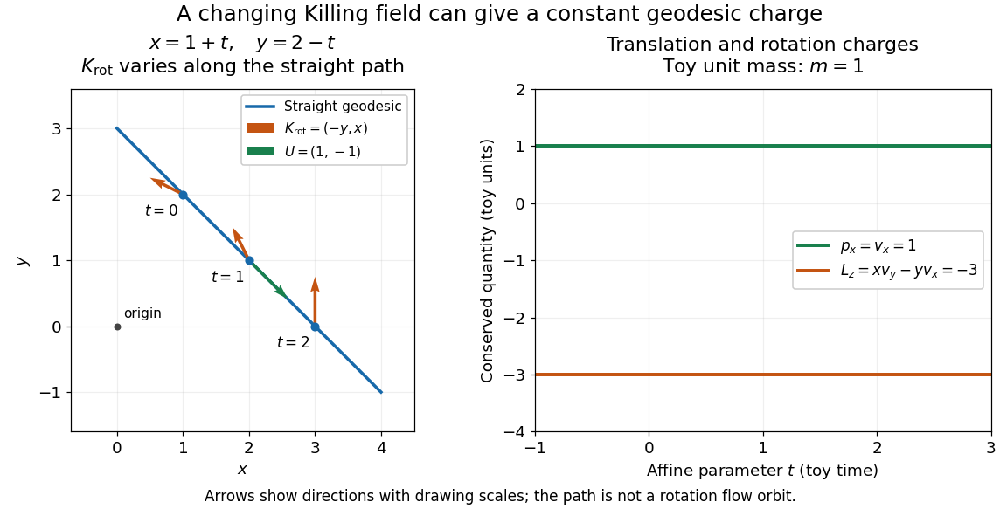

# Geodesic conserved quantity from a Killing vector

↑ **Parent:** [Killing vector field](killing-vector-field.md)

Each [Killing vector field](killing-vector-field.md) supplies a [conserved quantity](conserved-quantity.md) for freely moving [test particles](test-particle.md): it turns a geometric [symmetry](symmetry-physics.md) into a first integral of the [geodesic equation](geodesic-equation.md). Let $\gamma(\lambda)$ be a [geodesic](geodesic.md) with [affine parameter](affine-parameter.md) $\lambda$, [tangent vector](tangent-vector.md) $U^\mu=dx^\mu/d\lambda$, and $\nabla_UU=0$. Wherever a [Killing vector field](killing-vector-field.md) $K$ is defined along the [geodesic](geodesic.md),

$$
C_K=g(K,U)=K_\mu U^\mu,\qquad \frac{dC_K}{d\lambda}=0.
$$

The statement applies to [Riemannian manifolds](riemannian-manifold.md) and to [timelike geodesics](timelike-geodesic.md), [null geodesics](null-geodesic.md) and [spacelike geodesics](spacelike-geodesic.md) in a [Lorentzian manifold](lorentzian-manifold.md). It requires an [affine parameter](affine-parameter.md); for a massive [test particle](test-particle.md), [proper time](proper-time.md) is one choice. See [Tong, section 4.3.2, equation (4.32)](https://davidtong.org/pdfs/teaching/general-relativity/gr.pdf#page=171).

For a worked example in the [Euclidean plane](euclidean-plane.md), take $\gamma(t)=(1+t,2-t)$ with [affine parameter](affine-parameter.md) $t$ and [velocity](velocity.md) $U=(1,-1)$. The [Euclidean Killing vector fields](euclidean-killing-vector-field.md) for [translation](translation-geometry.md) and [rotation](rotation-mathematics.md) give

$$
C_{\mathrm{tr}}=v_x=1,\qquad
C_{\mathrm{rot}}=xv_y-yv_x=-(1+t)-(2-t)=-3.
$$

The rotational field along the [geodesic](geodesic.md) is $K_{\mathrm{rot}}(\gamma(t))=(t-2,1+t)$: it changes from $(-2,1)$ at $t=0$ to $(-1,2)$ at $t=1$, yet its pairing with $U$ stays $-3$. With toy [mass](mass.md) $m=1$ and $t$ interpreted as time, the first constant is the $x$ component of [linear momentum](momentum.md), and the second is the signed $z$ component of [angular momentum](angular-momentum.md) about the origin. Their numerical values use toy units. The [geodesic](geodesic.md) is straight; the [rotation](rotation-mathematics.md) flow orbits are [circles](circle.md).

**[Figure 3](#image-one-straight-euclidean-geodesic-the-rotational-killing-field-varies-while-translation-momentum-and-angular-momentum-stay-constant-for-toy-unit-mass). One straight Euclidean geodesic: the rotational Killing field varies while translation momentum and angular momentum stay constant for toy unit mass**.

This [conservation law](conservation-law.md) follows from [metric compatibility](metric-compatibility.md) and the [Killing equation](killing-equation.md):

$$
\frac{d}{d\lambda}(K_\mu U^\mu)
=U^\mu U^\nu\nabla_\mu K_\nu+K_\nu(\nabla_UU)^\nu
=U^\mu U^\nu\nabla_{(\mu}K_{\nu)}=0.
$$

The [geodesic equation](geodesic-equation.md) kills the acceleration term, and the symmetric product $U^\mu U^\nu$ selects the vanishing symmetric derivative. This [tensor contraction](tensor-contraction.md) is the whole proof outline; see [Carroll, equation (5.43)](https://arxiv.org/pdf/gr-qc/9712019#page=147).

In a [stationary spacetime](stationary-spacetime.md), a chosen time-translation [Killing vector field](killing-vector-field.md) $K$ gives [Killing energy](killing-energy.md). With [metric signature](metric-signature.md) $(-+++)$, $c=1$, and a massive [test particle](test-particle.md)'s [four-momentum](four-momentum.md) $p^\mu=mU^\mu$, the physical normalization is

$$
E=-p_\mu K^\mu,\qquad L_z=p_\mu\Phi^\mu.
$$

Here $\Phi$ generates the axial [rotational symmetry](rotational-symmetry.md) when one exists. In coordinates with $K=\partial_t$ and $\Phi=\partial_\phi$, these are $E=-p_t$ and $L_z=p_\phi$. Both are [conserved quantities](conserved-quantity.md) along the [geodesic](geodesic.md), even if the metric has a time-angle cross term. A future timelike $K$ makes $E$ positive for a future massive particle; the scale of $E$ depends on the normalization of $K$. Not every [spacetime](spacetime.md) has a global timelike [Killing vector field](killing-vector-field.md), and a stationary field can become spacelike in an [ergoregion of a stationary spacetime](ergoregion-of-a-stationary-spacetime.md). Conservation on the field's domain does not imply a universal global positive [energy](energy.md); see [Tong, sections 4.3.1-4.3.2 on the timelike-domain qualification and conserved charges](https://davidtong.org/pdfs/teaching/general-relativity/gr.pdf#page=170).

**Table of contents**

- [Killing energy](killing-energy.md)
- [Charged-particle conserved quantity from a Killing symmetry](charged-particle-conserved-quantity-from-a-killing-symmetry.md)

## ↑ Ancestors (5)

1. [Killing vector field](killing-vector-field.md)
2. [General relativity](general-relativity-split.md)
3. [Branches of physics](branches-of-physics.md)
4. [Physics](physics-split.md)
5. [Codex Wiki](split.md)

## ← Incoming links (11)

- [Euclidean Killing vector field](euclidean-killing-vector-field.md)
- [Killing vector field](killing-vector-field.md)
- [Solution](past-exam-of-the-mathematics-course-of-the-university-of-cambridge/2005/iii/paper-60/3/solution.md)
- [Solution](past-exam-of-the-mathematics-course-of-the-university-of-cambridge/2008/iii/paper-63/4/solution.md)
- [Solution](past-exam-of-the-mathematics-course-of-the-university-of-cambridge/2010/ii/paper-2/36b/solution.md)
- [Solution](past-exam-of-the-mathematics-course-of-the-university-of-cambridge/2012/iii/paper-56/4/a/ii/solution.md)
- [Solution](past-exam-of-the-mathematics-course-of-the-university-of-cambridge/2018/iii/paper-309/2/ii/solution.md)
- [Solution](past-exam-of-the-mathematics-course-of-the-university-of-cambridge/2024/iii/paper-309/1/b/ii/solution.md)
- [Solution](past-exam-of-the-mathematics-course-of-the-university-of-cambridge/2025/iii/paper-309/1/c/solution.md)
- [Solution](past-exam-of-the-mathematics-course-of-the-university-of-cambridge/2025/iii/paper-311/1/a/solution.md)
- [Solution](past-exam-of-the-mathematics-course-of-the-university-of-cambridge/2026/iii/paper-309/1/a/solution.md)
