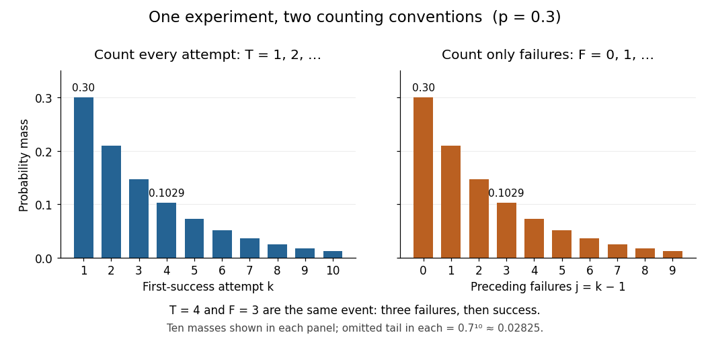

# Geometric distribution

↑ **Parent:** [Discrete probability distribution](discrete-probability-distribution-split.md)  
ⓦ [Wiki](https://en.wikipedia.org/wiki/Geometric_distribution)

Consider successive [independent](independent-random-variables.md) [Bernoulli trials](bernoulli-trial.md) with the same success [probability](probability.md) $0<p\leq1$. A [geometric distribution](geometric-distribution.md) models waiting for their first success. Two conventions coexist, so always say what is counted. Let $T$ count all trials up to and including the successful trial, and let $F=T-1$ count preceding failures. Their [probability mass functions](probability-mass-function.md) are

$$
\mathbb P(T=k)=(1-p)^{k-1}p,\quad k=1,2,\ldots,
\qquad
\mathbb P(F=j)=(1-p)^jp,\quad j=0,1,\ldots.
$$

The factors describe failures followed by one success; [independence](independent-random-variables.md) permits multiplication. Summing the [geometric series](geometric-series.md) verifies that each law has total mass one. Their [expected values](expected-value-split.md) differ by one, while shifting by a constant leaves the [variance](variance-split.md) unchanged:

$$
\mathbb E T=\frac1p,\qquad \mathbb E F=\frac{1-p}{p},\qquad
\operatorname{Var}(T)=\operatorname{Var}(F)=\frac{1-p}{p^2}.
$$

The positive convention and these moments are also given by Penn State STAT 414.[STAT 414: Introduction to Probability Theory at Pennsylvania State University; §11.1, Definition 11.1; §11.2, mean and variance theorems](stat-414-introduction-to-probability-theory-at-pennsylvania-state-university/11-geometric-and-negative-binomial-distributions.md)

For a constructed retry mechanism with [independent](independent-random-variables.md) attempts and $p=0.3$, success on attempt four has [probability](probability.md) $\mathbb P(T=4)=0.7^3(0.3)=0.1029$. More than four attempts are needed precisely when the first four fail: $\mathbb P(T>4)=0.7^4=0.2401$. The [expected values](expected-value-split.md) are $\mathbb E T=10/3$ and $\mathbb E F=7/3$, and the common [variance](variance-split.md) is $70/9\approx7.7778$. The large spread explains why the average waiting count is not a deadline.

**[Figure 5](#image-first-success-trial-versus-preceding-failures-the-same-probability-masses-shifted-by-one). First-success trial versus preceding failures: the same probability masses shifted by one**.

The two [probability mass functions](probability-mass-function.md) have identical heights with different labels: $T=4$ and $F=3$ describe the same [event](event.md). For $0<p<1$, consecutive masses have ratio $1-p$, explaining the name [geometric distribution](geometric-distribution.md). The [support of a probability distribution](support-of-a-probability-distribution.md) is the positive [integers](integer-split.md) for $T$ and the nonnegative [integers](integer-split.md) for $F$. At $p=1$, it collapses to $T=1$ and $F=0$, both with [variance](variance-split.md) zero; interpret an empty product, including $(1-p)^0$, as one. These counts concern attempts; converting them into elapsed time requires specifying the time spent per attempt.

The [survival function](survival-function.md) makes the counting convention especially visible. Put $q=1-p$. For nonnegative [integers](integer-split.md) $n$, and for $k\geq1$,

$$
\mathbb P(T>n)=q^n,\qquad \mathbb P(T\leq n)=1-q^n,\qquad
\mathbb P(T\geq k)=q^{k-1},\qquad
\mathbb P(F\geq n)=q^n,\qquad \mathbb P(F>n)=q^{n+1}.
$$

The [event](event.md) $T>n$ requires $n$ failures, whereas $T\geq n$ requires only $n-1$ when $n\geq1$. For the constructed $p=0.3$ mechanism, $\mathbb P(T\geq4)=0.343$ differs from $\mathbb P(T>4)=0.2401$. The [geometric success deadline](geometric-success-deadline.md) uses the latter tail to control the chance of still waiting.

The striking [memorylessness of the geometric distribution](memorylessness-of-the-geometric-distribution.md) says that, for nonnegative integers $m,r$ with $\mathbb P(T>m)>0$,

$$
\mathbb P(T>m+r\mid T>m)=\frac{(1-p)^{m+r}}{(1-p)^m}
=(1-p)^r=\mathbb P(T>r).
$$

After five failures, the [conditional probability](conditional-probability.md) of requiring more than two additional attempts is still $0.7^2=0.49$. The analogous zero-based identity uses $\mathbb P(F\geq m+r\mid F\geq m)=\mathbb P(F\geq r)$; keeping the inequalities straight avoids an off-by-one error. This property follows from fresh [independent](independent-random-variables.md) trials with unchanged $p$; learning or changing conditions can destroy it. At $p=0$, success never occurs, so there is no proper finite waiting-count law.

**Table of contents**

- [Geometric continuation after an initial tie](geometric-continuation-after-an-initial-tie.md)
- [Memorylessness of the geometric distribution](memorylessness-of-the-geometric-distribution.md)
- [Geometric success deadline](geometric-success-deadline.md)
- [Geometric return count before absorption](geometric-return-count-before-absorption.md)
- [Geometric count under Bernoulli thinning](geometric-count-under-bernoulli-thinning.md)
- [Capped geometric waiting time](capped-geometric-waiting-time.md)
- [Coupon collector problem](coupon-collector-problem.md)
  - [Poissonized coupon completion time and count](poissonized-coupon-completion-time-and-count.md)
  - [Waiting time to observe both Bernoulli outcomes](waiting-time-to-observe-both-bernoulli-outcomes.md)
  - [Coupon collector waiting-time variance](coupon-collector-waiting-time-variance.md)

## ↑ Ancestors (7)

1. [Discrete probability distribution](discrete-probability-distribution-split.md)
2. [Probability distribution](probability-distribution-split.md)
3. [Probability theory](probability-theory-split.md)
4. [Probability and statistics](probability-and-statistics-split.md)
5. [Area of mathematics](area-of-mathematics.md)
6. [Mathematics](mathematics-split.md)
7. [Codex Wiki](split.md)

## ← Incoming links (104)

- [Bernoulli process](bernoulli-process.md)
- [Capped geometric waiting time](capped-geometric-waiting-time.md)
- [Claim count](claim-count.md)
- [Compound geometric distribution](compound-geometric-distribution.md)
- [Continuity of probability](continuity-of-probability.md)
- [Cost of trials until the first success](cost-of-trials-until-the-first-success.md)
- [Coupon collector waiting-time variance](coupon-collector-waiting-time-variance.md)
- [Discrete probability distribution](discrete-probability-distribution-split.md)
- [Discrete-time Markov chain](discrete-time-markov-chain.md)
- [Geometric continuation after an initial tie](geometric-continuation-after-an-initial-tie.md)
- [Geometric count under Bernoulli thinning](geometric-count-under-bernoulli-thinning.md)
- [Geometric distribution](geometric-distribution.md)
- [Geometric maximum of an upward skip-free random walk](geometric-maximum-of-an-upward-skip-free-random-walk.md)
- [Geometric mutation count in a coalescent epoch](geometric-mutation-count-in-a-coalescent-epoch.md)
- [Geometric series](geometric-series.md)
- [Geometric success deadline](geometric-success-deadline.md)
- [Geometric-sum moment-generating function](geometric-sum-moment-generating-function.md)
- [Geometric sum of shape-two gamma variables](geometric-sum-of-shape-two-gamma-variables.md)
- [Grand-canonical single-level occupation variance](grand-canonical-single-level-occupation-variance.md)
- [Insertion state](insertion-state.md)
- [Integer and fractional parts of an exponential variable](integer-and-fractional-parts-of-an-exponential-variable.md)
- [Local-count independence in a linear flow network](local-count-independence-in-a-linear-flow-network.md)
- [M/M/1 utilization and delay](m-m-1-utilization-and-delay.md)
- [Maximum entropy distribution on the nonnegative integers](maximum-entropy-distribution-on-the-nonnegative-integers.md)
- [Maximum of a downward-biased random walk](maximum-of-a-downward-biased-random-walk.md)
- [Memorylessness of the geometric distribution](memorylessness-of-the-geometric-distribution.md)
- [Negative binomial distribution](negative-binomial-distribution.md)
- [Negative binomial stopping argument](negative-binomial-stopping-argument.md)
- [Solution](past-exam-of-the-chemistry-a-course-of-the-university-of-cambridge/2023/paper-2/a6/c/solution.md)
- [Solution](past-exam-of-the-chemistry-a-course-of-the-university-of-cambridge/2023/paper-2/a6/d/i/solution.md)
- [Solution](past-exam-of-the-chemistry-course-of-the-year-4-of-the-natural-sciences-course-of-the-university-of-cambridge/2022/paper-1/5/d/i/solution.md)
- [Solution](past-exam-of-the-chemistry-course-of-the-year-4-of-the-natural-sciences-course-of-the-university-of-cambridge/2022/paper-1/5/e/i/solution.md)
- [Solution](past-exam-of-the-chemistry-course-of-the-year-4-of-the-natural-sciences-course-of-the-university-of-cambridge/2022/paper-1/5/f/i/solution.md)
- [Solution](past-exam-of-the-mathematical-and-computational-biology-course-of-the-university-of-cambridge/2025/paper-1/6/b/solution.md)
- [Solution](past-exam-of-the-mathematical-and-computational-biology-course-of-the-university-of-cambridge/2025/paper-1/6/d/solution.md)
- [Solution](past-exam-of-the-mathematics-course-of-the-university-of-cambridge/2002/iii/paper-27/6/b/solution.md)
- [Solution](past-exam-of-the-mathematics-course-of-the-university-of-cambridge/2002/iii/paper-35/4/a/solution.md)
- [Solution](past-exam-of-the-mathematics-course-of-the-university-of-cambridge/2002/iii/paper-77/2/a/solution.md)
- [Solution](past-exam-of-the-mathematics-course-of-the-university-of-cambridge/2004/ib/paper-1/21h/solution.md)
- [Solution](past-exam-of-the-mathematics-course-of-the-university-of-cambridge/2004/iii/paper-39/1/iv/solution.md)
- [Solution](past-exam-of-the-mathematics-course-of-the-university-of-cambridge/2004/iii/paper-39/1/v/solution.md)
- [Solution](past-exam-of-the-mathematics-course-of-the-university-of-cambridge/2004/iii/paper-53/2/5/solution.md)
- [Solution](past-exam-of-the-mathematics-course-of-the-university-of-cambridge/2004/iii/paper-53/4/1/solution.md)
- [Solution](past-exam-of-the-mathematics-course-of-the-university-of-cambridge/2005/iii/paper-43/1/solution.md)
- [Solution](past-exam-of-the-mathematics-course-of-the-university-of-cambridge/2005/iii/paper-45/3/v/solution.md)
- [Solution](past-exam-of-the-mathematics-course-of-the-university-of-cambridge/2006/iii/paper-32/2/c/solution.md)
- [Solution](past-exam-of-the-mathematics-course-of-the-university-of-cambridge/2006/iii/paper-34/1/solution.md)
- [Solution](past-exam-of-the-mathematics-course-of-the-university-of-cambridge/2006/iii/paper-59/2/solution.md)
- [Solution](past-exam-of-the-mathematics-course-of-the-university-of-cambridge/2008/ia/paper-2/12f/solution.md)
- [Solution](past-exam-of-the-mathematics-course-of-the-university-of-cambridge/2008/iii/paper-43/1/c/solution.md)
- [Solution](past-exam-of-the-mathematics-course-of-the-university-of-cambridge/2008/iii/paper-44/2/c/solution.md)
- [Solution](past-exam-of-the-mathematics-course-of-the-university-of-cambridge/2008/iii/paper-44/2/h/solution.md)
- [Solution](past-exam-of-the-mathematics-course-of-the-university-of-cambridge/2009/iii/paper-101/4/c/solution.md)
- [Solution](past-exam-of-the-mathematics-course-of-the-university-of-cambridge/2009/iii/paper-30/5/solution.md)
- [Solution](past-exam-of-the-mathematics-course-of-the-university-of-cambridge/2009/iii/paper-37/1/b/solution.md)
- [Solution](past-exam-of-the-mathematics-course-of-the-university-of-cambridge/2009/iii/paper-37/2/solution.md)
- [Solution](past-exam-of-the-mathematics-course-of-the-university-of-cambridge/2010/ia/paper-2/10f/b/solution.md)
- [Solution](past-exam-of-the-mathematics-course-of-the-university-of-cambridge/2010/ia/paper-2/9f/a/solution.md)
- [Solution](past-exam-of-the-mathematics-course-of-the-university-of-cambridge/2010/ia/paper-2/9f/b/solution.md)
- [Solution](past-exam-of-the-mathematics-course-of-the-university-of-cambridge/2010/iii/paper-28/1/c/iii/solution.md)
- [Solution](past-exam-of-the-mathematics-course-of-the-university-of-cambridge/2010/iii/paper-30/1/b/solution.md)
- [Solution](past-exam-of-the-mathematics-course-of-the-university-of-cambridge/2010/iii/paper-33/3/solution.md)
- [Solution](past-exam-of-the-mathematics-course-of-the-university-of-cambridge/2010/iii/paper-38/1/b/solution.md)
- [Solution](past-exam-of-the-mathematics-course-of-the-university-of-cambridge/2011/ia/paper-2/10f/b/solution.md)
- [Solution](past-exam-of-the-mathematics-course-of-the-university-of-cambridge/2012/ia/paper-2/11f/iii/solution.md)
- [Solution](past-exam-of-the-mathematics-course-of-the-university-of-cambridge/2012/ia/paper-2/4f/solution.md)
- [Solution](past-exam-of-the-mathematics-course-of-the-university-of-cambridge/2012/iii/paper-40/1/a/solution.md)
- [Solution](past-exam-of-the-mathematics-course-of-the-university-of-cambridge/2013/ia/paper-2/11f/solution.md)
- [Solution](past-exam-of-the-mathematics-course-of-the-university-of-cambridge/2013/ia/paper-2/9f/solution.md)
- [Solution](past-exam-of-the-mathematics-course-of-the-university-of-cambridge/2013/iii/paper-28/1/b/ii/solution.md)
- [Solution](past-exam-of-the-mathematics-course-of-the-university-of-cambridge/2013/iii/paper-37/5/solution.md)
- [Solution](past-exam-of-the-mathematics-course-of-the-university-of-cambridge/2014/iii/paper-31/1/b/solution.md)
- [Solution](past-exam-of-the-mathematics-course-of-the-university-of-cambridge/2014/iii/paper-33/4/g/solution.md)
- [Solution](past-exam-of-the-mathematics-course-of-the-university-of-cambridge/2015/ii/paper-1/9g/a/solution.md)
- [Solution](past-exam-of-the-mathematics-course-of-the-university-of-cambridge/2015/iii/paper-39/5/solution.md)
- [Solution](past-exam-of-the-mathematics-course-of-the-university-of-cambridge/2016/iii/paper-213/1/i/solution.md)
- [Solution](past-exam-of-the-mathematics-course-of-the-university-of-cambridge/2016/iii/paper-213/5/solution.md)
- [Solution](past-exam-of-the-mathematics-course-of-the-university-of-cambridge/2017/ii/paper-1/27k/b/solution.md)
- [Solution](past-exam-of-the-mathematics-course-of-the-university-of-cambridge/2019/ib/paper-4/9h/a/solution.md)
- [Solution](past-exam-of-the-mathematics-course-of-the-university-of-cambridge/2020/ii/paper-4/27k/ii/solution.md)
- [Solution](past-exam-of-the-mathematics-course-of-the-university-of-cambridge/2020/ii/paper-4/6b/iii/solution.md)
- [Solution](past-exam-of-the-mathematics-course-of-the-university-of-cambridge/2021/iii/paper-220/2/c/i/solution.md)
- [Solution](past-exam-of-the-mathematics-course-of-the-university-of-cambridge/2022/ia/paper-2/10f/c/solution.md)
- [Solution](past-exam-of-the-mathematics-course-of-the-university-of-cambridge/2022/ia/paper-2/10f/d/solution.md)
- [Solution](past-exam-of-the-mathematics-course-of-the-university-of-cambridge/2022/ii/paper-4/28k/d/solution.md)
- [Solution](past-exam-of-the-mathematics-course-of-the-university-of-cambridge/2022/iii/paper-224/4/c/solution.md)
- [Solution](past-exam-of-the-mathematics-course-of-the-university-of-cambridge/2023/ii/paper-1/28j/a/solution.md)
- [Solution](past-exam-of-the-mathematics-course-of-the-university-of-cambridge/2023/iii/paper-224/1/b/solution.md)
- [Solution](past-exam-of-the-mathematics-course-of-the-university-of-cambridge/2024/ia/paper-2/10f/iii/solution.md)
- [Solution](past-exam-of-the-mathematics-course-of-the-university-of-cambridge/2024/iii/paper-124/4/ii/solution.md)
- [Solution](past-exam-of-the-mathematics-course-of-the-university-of-cambridge/2024/iii/paper-201/3/b/solution.md)
- [Solution](past-exam-of-the-mathematics-course-of-the-university-of-cambridge/2026/iii/paper-224/4/a/solution.md)
- [Solution](past-exam-of-the-mathematics-course-of-the-year-1-of-the-natural-sciences-course-of-the-university-of-cambridge/2001/paper-2/11/a/solution.md)
- [Solution](past-exam-of-the-mathematics-course-of-the-year-1-of-the-natural-sciences-course-of-the-university-of-cambridge/2021/paper-2/14/a/iv/solution.md)
- [Solution](past-exam-of-the-physics-a-course-of-the-university-of-cambridge/2014/paper-1/section-c/c10/solution.md)
- [Posterior coin count after exactly one head](posterior-coin-count-after-exactly-one-head.md)
- [Prefix code for a rare geometric success](prefix-code-for-a-rare-geometric-success.md)
- [Return period](return-period.md)
- [Shifted-exponential Poisson mixture](shifted-exponential-poisson-mixture.md)
- [Thermal light](thermal-light.md)
- [Three-level discount equilibrium with geometric annual counts](three-level-discount-equilibrium-with-geometric-annual-counts.md)
- [Waiting time for a new record after a fixed sample](waiting-time-for-a-new-record-after-a-fixed-sample.md)
- [Waiting time to observe both Bernoulli outcomes](waiting-time-to-observe-both-bernoulli-outcomes.md)
- [Zero-based geometric sum of exponential variables](zero-based-geometric-sum-of-exponential-variables.md)
