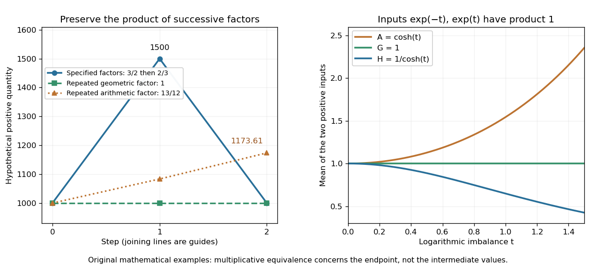

# Geometric mean

↑ **Parent:** [Arithmetic](arithmetic-split.md)  
ⓦ [Wiki](https://en.wikipedia.org/wiki/Geometric_mean)

The geometric mean replaces a list of nonnegative [real numbers](real-number.md) by one repeated value that preserves their [product of numbers](product-of-numbers.md). For $n\geq1$ inputs,

$$
G=(x_1\cdots x_n)^{1/n},\qquad G^n=x_1\cdots x_n.
$$

For two positive inputs, $G=\sqrt{x_1x_2}$ is their positive [square root](square-root.md). The [geometric mean](geometric-mean.md) of $1$ and $9$ is three: replacing $1\cdot9$ by $3\cdot3$ retains the same product. In contrast, their [arithmetic mean](arithmetic-mean.md) five retains the [sum](sum.md) $1+9=5+5$. The geometric mean is zero if any input is zero; the [logarithm](logarithm.md) formula below requires every input to be positive. [NIST Digital Library of Mathematical Functions, §1.2(iv), equation 1.2.18: geometric mean](https://dlmf.nist.gov/1.2.iv).

Its usefulness becomes immediate for successive [growth factors](growth-factor.md). Suppose a hypothetical positive quantity starts at $Q_0=1000$, is multiplied by $3/2$, then by $2/3$. It goes $1000\to1500\to1000$, so the [geometric mean](geometric-mean.md) factor is $\sqrt{(3/2)(2/3)}=1$: a constant factor of one for both steps gives the same endpoint. The [arithmetic mean](arithmetic-mean.md) factor is $13/12$; repeating it would give $1000(13/12)^2\approx1173.61$, a different endpoint. A mean of factors summarizes multiplicative change; subtracting one afterwards gives the equivalent change per step. Equal-duration steps are necessary to interpret this as change per common time interval.

For positive inputs, [logarithms](logarithm.md) turn [multiplication](multiplication.md) into [addition](addition.md), so

$$
\log G=\frac1n\sum_i\log x_i,\qquad G=\exp\left(\frac1n\sum_i\log x_i\right).
$$

Thus the [geometric mean](geometric-mean.md) is an [arithmetic mean](arithmetic-mean.md) in logarithmic coordinates, followed by the [exponential function](exponential-function.md). For positive measurements with a common unit, one can use dimensionless ratios to a fixed reference $x_0$: $G=x_0\exp(n^{-1}\sum_i\log(x_i/x_0))$. Changing the common unit rescales $G$ by the same factor as the inputs. As a check, doubling one input and halving another retains $G$ while usually changing the [arithmetic mean](arithmetic-mean.md).

**[Figure 3](#image-the-geometric-mean-preserves-multiplicative-endpoints-and-sits-between-the-harmonic-mean-and-arithmetic-mean). The geometric mean preserves multiplicative endpoints and sits between the harmonic mean and arithmetic mean**. Left: the original toy factors $3/2$ and $2/3$ return a quantity to its starting value; repeating their [arithmetic mean](arithmetic-mean.md) would produce a larger endpoint. Right: the dimensionless inputs $e^{-t}$ and $e^t$ keep product one while $H=1/\cosh t$, $G=1$, and $A=\cosh t$ separate as the inputs become less equal. Lines joining time steps are guides, not a continuous growth model.

The [arithmetic-geometric mean inequality](arithmetic-geometric-mean-inequality.md) gives $G\leq A$. Apply that same [inequality](inequality-mathematics.md) to the [multiplicative inverses](multiplicative-inverse.md) $1/x_i$ to obtain $H\leq G$, where $H$ is the [harmonic mean](harmonic-mean.md). Consequently

$$
\boxed{H\leq G\leq A}
$$

for positive inputs, with equality throughout exactly when all inputs agree. For $30$ and $60$, the three values are $H=40$, $G=30\sqrt2\approx42.4264$, and $A=45$. They preserve, respectively, the sum of inverses, the product, and the sum. No one of these summaries preserves all three for unequal inputs.

**Table of contents**

- [Growth factor](growth-factor.md)
  - [Neuregulin 1](neuregulin-1.md)
  - [FGF8](fgf8.md)
  - [PDGF](pdgf.md)
- [Weighted geometric mean](weighted-geometric-mean.md)
- [Arithmetic-geometric mean iteration](arithmetic-geometric-mean-iteration.md)

## ↑ Ancestors (4)

1. [Arithmetic](arithmetic-split.md)
2. [Area of mathematics](area-of-mathematics.md)
3. [Mathematics](mathematics-split.md)
4. [Codex Wiki](split.md)

## ← Incoming links (15)

- [Arithmetic-geometric mean iteration](arithmetic-geometric-mean-iteration.md)
- [Bose condensation in a three-dimensional harmonic trap](bose-condensation-in-a-three-dimensional-harmonic-trap.md)
- [Chernoff information for complementary Bernoulli distributions](chernoff-information-for-complementary-bernoulli-distributions.md)
- [Circle geometric mean of a holomorphic function](circle-geometric-mean-of-a-holomorphic-function.md)
- [Discrete geometric average under the stock-numeraire measure](discrete-geometric-average-under-the-stock-numeraire-measure.md)
- [Geometric Asian option](geometric-asian-option.md)
- [Geometric mean](geometric-mean.md)
- [Growth factor](growth-factor.md)
- [Harmonic mean](harmonic-mean.md)
- [Jensen's inequality](jensen-s-inequality.md)
- [Logarithmic midpoint](logarithmic-midpoint.md)
- [Solution](past-exam-of-the-mathematics-course-of-the-university-of-cambridge/2004/iii/paper-37/4/solution.md)
- [Pauling bond-energy excess](pauling-bond-energy-excess.md)
- [Weighted arithmetic-geometric mean inequality](weighted-arithmetic-geometric-mean-inequality.md)
- [Weighted geometric mean](weighted-geometric-mean.md)
