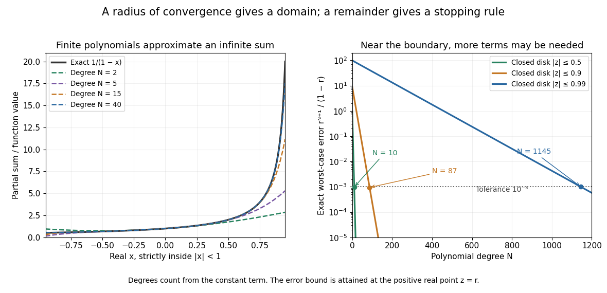

# Geometric power-series remainder

↑ **Parent:** [Power series](power-series.md)

For the degree-$N$ [partial sum](partial-sum.md) $P_N(z)=1+z+\cdots+z^N$ of the [geometric series](geometric-series.md), the finite identity $(1-z)P_N(z)=1-z^{N+1}$ gives

$$
\frac1{1-z}-P_N(z)=\frac{z^{N+1}}{1-z},\qquad z\ne1.
$$

For any fixed $0<r<1$, the [triangle inequality](triangle-inequality.md) then gives the uniform error bound

$$
\sup_{|z|\le r}\left|\frac1{1-z}-P_N(z)\right|
\le\frac{r^{N+1}}{1-r}.
$$

Equality is attained at the positive real point $z=r$, so this is the exact worst-case error on that closed [disk](disk-mathematics.md). It also proves [uniform convergence](uniform-convergence.md) on each such disk, not just [pointwise convergence](pointwise-convergence.md).

**[Figure 12](#image-polynomial-approximations-improve-within-the-radius-of-convergence-but-approaching-its-boundary-can-require-many-terms). Polynomial approximations improve within the radius of convergence, but approaching its boundary can require many terms**. Left: degree-$N$ [partial sums](partial-sum.md) approximate $1/(1-x)$ for $-0.95\le x\le0.95$. Right: the exact worst-case error on $|z|\le r$ for three choices of $r$. A tolerance $10^{-3}$ needs minimum degrees $10$, $87$, and $1145$ for $r=0.5$, $0.9$, and $0.99$, respectively.

Given a positive tolerance $\varepsilon$, choosing $N$ with $r^{N+1}/(1-r)\le\varepsilon$ turns a convergence statement into a finite stopping rule. For $\varepsilon=10^{-3}$, degree ten suffices throughout $|z|\le1/2$. Nearer the boundary, $r=0.9$ requires degree $87$ and $r=0.99$ requires degree $1145$. The required degree depends on both the tolerance and the region, not just on the name of the [function](function-split.md).

## ↑ Ancestors (7)

1. [Power series](power-series.md)
2. [Sequence and series](sequence-and-series-split.md)
3. [Real analysis](real-analysis-split.md)
4. [Analysis](analysis-split.md)
5. [Area of mathematics](area-of-mathematics.md)
6. [Mathematics](mathematics-split.md)
7. [Codex Wiki](split.md)

## ← Incoming links (1)

- [Power series](power-series.md)
