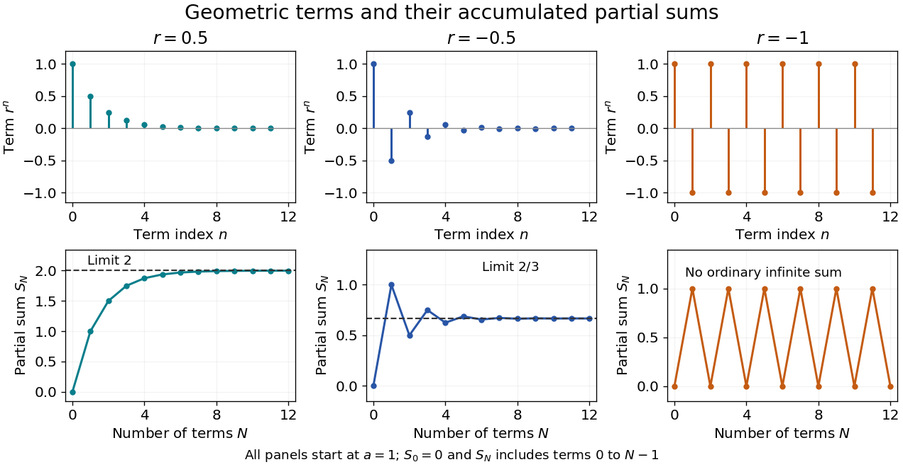

# Geometric series

↑ **Parent:** [Sequence and series](sequence-and-series-split.md)  
ⓦ [Wiki](https://en.wikipedia.org/wiki/Geometric_series)

A geometric series adds the terms of a [geometric progression](geometric-progression.md):

$$
a+ar+ar^2+\cdots=\sum_{n=0}^{\infty}ar^n.
$$

Its ordinary infinite sum is the [limit of a sequence](limit-of-a-sequence.md) of [partial sums](partial-sum.md) $S_N=\sum_{j=0}^{N-1}ar^j$, rather than a new operation that adds infinitely many terms at once. For $a,r$ that are [real numbers](real-number.md) or [complex numbers](complex-number.md), if $|r|<1$, the series is [absolutely convergent](absolute-convergence.md) and

$$
\boxed{\sum_{n=0}^{\infty}ar^n=\frac{a}{1-r}.}
$$

When $a\ne0$, this condition on the [modulus](modulus.md) of $r$ is also necessary: for $|r|\ge1$ the terms fail to tend to zero. The all-zero series $a=0$ converges for every $r$. The [finite geometric series](finite-geometric-series.md) identity and $r^N\to0$ give the result with almost no extra algebra. [Lebl, Basic Analysis I, §2.5, Proposition 2.5.5 and Example 2.5.10](https://www.jirka.org/ra/html/sec_series.html)

**[Figure 17](#image-decaying-terms-accumulating-sums-and-the-failure-of-an-undamped-alternating-series). Decaying terms, accumulating sums, and the failure of an undamped alternating series**.

With $a=1$ and $r=1/2$, the [partial sums](partial-sum.md) approach $2$ from below. Changing the [common ratio](common-ratio.md) to $-1/2$ makes the [partial sums](partial-sum.md) approach $2/3$ from alternating sides: their increments still shrink. At $r=-1$, those increments never shrink, and the [partial sums](partial-sum.md) remain $0,1,0,1,\ldots$. Substituting $r=-1$ into $1/(1-r)$ does not supply the ordinary sum of that divergent series.

The formula is useful because many apparently different problems share a fixed multiplier. A [repeating decimal](repeating-decimal.md) such as $0.\overline{27}$ is

$$
\frac{27}{100}+\frac{27}{100^2}+\cdots
=\frac{27/100}{1-1/100}=\frac3{11}.
$$

A [geometric distribution](geometric-distribution.md) counting failures before the first success normalizes by the same identity: for $0<q<1$, the [probabilities](probability.md) $(1-q)q^n$ on $n=0,1,\ldots$ add to one. The [comparison test for series](comparison-test-for-series.md) uses a bound by a decaying [geometric progression](geometric-progression.md) to establish [absolute convergence](absolute-convergence.md) without an exact formula for the series being studied. The [iterated contraction gives a summable orbit](iterated-contraction-gives-a-summable-orbit.md) result uses precisely this idea for repeated applications of a map.

The [remainder of a geometric series](remainder-of-a-geometric-series.md) gives more than an eventual [limit](limit-of-a-function.md): it states exactly how much an approximation omits. A [common ratio](common-ratio.md) close to one still gives a [convergent series](convergent-series.md), but can require many terms for a useful approximation.

**Table of contents**

- [Geometric decay of bounce distances](geometric-decay-of-bounce-distances.md)
- [Weighted geometric series](weighted-geometric-series.md)
- [Remainder of a geometric series](remainder-of-a-geometric-series.md)
- [Iterated contraction gives a summable orbit](iterated-contraction-gives-a-summable-orbit.md)
- [Finite geometric series](finite-geometric-series.md)
  - [Finite weighted geometric sum](finite-weighted-geometric-sum.md)
  - [Finite trigonometric sum](finite-trigonometric-sum.md)
  - [Exponential geometric sum bound](exponential-geometric-sum-bound.md)

## ↑ Ancestors (6)

1. [Sequence and series](sequence-and-series-split.md)
2. [Real analysis](real-analysis-split.md)
3. [Analysis](analysis-split.md)
4. [Area of mathematics](area-of-mathematics.md)
5. [Mathematics](mathematics-split.md)
6. [Codex Wiki](split.md)

## ← Incoming links (441)

- [A divergent factorial series can approximate a convergent integral](a-divergent-factorial-series-can-approximate-a-convergent-integral.md)
- [Absolutely summable sequence space](absolutely-summable-sequence-space.md)
- [Absorption time](absorption-time.md)
- [Aggregate analysis](aggregate-analysis.md)
- [Analytic continuation](analytic-continuation.md)
- [Array (data structure)](array-data-structure.md)
- [Asymptotic expansion](asymptotic-expansion-split.md)
- [Autocovariance of an AR(1) process](autocovariance-of-an-ar-1-process.md)
- [Binary search tree](binary-search-tree.md)
- [Black-body radiation](black-body-radiation.md)
- [Bose integral](bose-integral.md)
- [Boundary convergence of a power series](boundary-convergence-of-a-power-series.md)
- [Bounded power-series terms force interior absolute convergence](bounded-power-series-terms-force-interior-absolute-convergence.md)
- [Cauchy identity for symmetric functions](cauchy-identity-for-symmetric-functions.md)
- [Character of a Weyl-vector multiple](character-of-a-weyl-vector-multiple.md)
- [Characteristic-function derivative under an absolute first moment](characteristic-function-derivative-under-an-absolute-first-moment.md)
- [Characteristic ratio of a freely rotating chain](characteristic-ratio-of-a-freely-rotating-chain.md)
- [Chebyshev series](chebyshev-series.md)
- [Classical grand potential in a harmonic trap](classical-grand-potential-in-a-harmonic-trap.md)
- [Coherent harmonic pulse-train model](coherent-harmonic-pulse-train-model.md)
- [Complete negative filtration](complete-negative-filtration.md)
- [Complex analysis](complex-analysis-split.md)
- [Composite Simpson's rule](composite-simpson-s-rule.md)
- [Conjugate Poisson kernel on the circle](conjugate-poisson-kernel-on-the-circle.md)
- [Connectivity of a fixed-density binomial random graph](connectivity-of-a-fixed-density-binomial-random-graph.md)
- [Contraction mapping theorem](contraction-mapping-theorem.md)
- [Convergence of an adjacent-term averaging recurrence](convergence-of-an-adjacent-term-averaging-recurrence.md)
- [Convergence of the Stirling sequence](convergence-of-the-stirling-sequence.md)
- [Cotangent Fourier expansion](cotangent-fourier-expansion.md)
- [Counting finite group actions by transitive orbit types](counting-finite-group-actions-by-transitive-orbit-types.md)
- [Counting measure](counting-measure.md)
- [Decimal representation](decimal-representation.md)
- [Diffraction grating](diffraction-grating.md)
- [Dirichlet eigenfunction supremum estimate](dirichlet-eigenfunction-supremum-estimate.md)
- [Discrete Fourier transform](discrete-fourier-transform-split.md)
- [Discrete-time Markov chain](discrete-time-markov-chain.md)
- [Divide-and-conquer product ledger](divide-and-conquer-product-ledger.md)
- [Dual norm supremum need not be attained](dual-norm-supremum-need-not-be-attained.md)
- [Dyadic spherical shells with inverse-radius density scaling](dyadic-spherical-shells-with-inverse-radius-density-scaling.md)
- [Dynamic array doubling](dynamic-array-doubling.md)
- [Einstein solid](einstein-solid.md)
- [Equidistribution of a quadratic polynomial with irrational leading coefficient](equidistribution-of-a-quadratic-polynomial-with-irrational-leading-coefficient.md)
- [Eventually periodic positional expansion of a rational number](eventually-periodic-positional-expansion-of-a-rational-number.md)
- [Expectation of an absolutely summable random series](expectation-of-an-absolutely-summable-random-series.md)
- [Exponential generating function](exponential-generating-function.md)
- [Exponential-logarithmic distribution](exponential-logarithmic-distribution.md)
- [Fabry–Pérot transmission from multiple reflections](fabry-perot-transmission-from-multiple-reflections.md)
- [Factorial-gap power series](factorial-gap-power-series.md)
- [Factorial of a Poisson random variable](factorial-of-a-poisson-random-variable.md)
- [Failure-probability budget](failure-probability-budget.md)
- [Finesse](finesse.md)
- [Finite geometric series](finite-geometric-series.md)
- [Finite-horizon bargaining parity effect](finite-horizon-bargaining-parity-effect.md)
- [Finite-layer model of Lippmann reflection](finite-layer-model-of-lippmann-reflection.md)
- [Finite-row electron diffraction model](finite-row-electron-diffraction-model.md)
- [First-order Cesàro summation of a geometric series](first-order-cesaro-summation-of-a-geometric-series.md)
- [Fourier harmonic](fourier-harmonic.md)
- [Gaussian sum truncation bound](gaussian-sum-truncation-bound.md)
- [Generalized Bell basis](generalized-bell-basis.md)
- [Generating series of the Kostant partition function](generating-series-of-the-kostant-partition-function.md)
- [Geometric-binomial posterior is shifted negative binomial](geometric-binomial-posterior-is-shifted-negative-binomial.md)
- [Geometric distribution](geometric-distribution.md)
- [Geometric partition bounds for a power-law improper integral](geometric-partition-bounds-for-a-power-law-improper-integral.md)
- [Geometric power-series remainder](geometric-power-series-remainder.md)
- [Geometric progression](geometric-progression.md)
- [Geometric-sum moment-generating function](geometric-sum-moment-generating-function.md)
- [Hash table](hash-table.md)
- [Hash table resizing](hash-table-resizing.md)
- [Height of a binary tree](height-of-a-binary-tree.md)
- [High-speed passage expansion of a localized trap](high-speed-passage-expansion-of-a-localized-trap.md)
- [Holomorphic logarithm](holomorphic-logarithm.md)
- [Image charges between concentric grounded spheres](image-charges-between-concentric-grounded-spheres.md)
- [Incompleteness of finitely supported sequences](incompleteness-of-finitely-supported-sequences.md)
- [Integer coefficients with a prescribed radius of convergence](integer-coefficients-with-a-prescribed-radius-of-convergence.md)
- [Integer partition](integer-partition.md)
- [Integration of a series with summable L1 norms](integration-of-a-series-with-summable-l1-norms.md)
- [Interferogram of an equally spaced spectral multiplet](interferogram-of-an-equally-spaced-spectral-multiplet.md)
- [Iterated contraction gives a summable orbit](iterated-contraction-gives-a-summable-orbit.md)
- [Iterated prisoner's dilemma](iterated-prisoner-s-dilemma.md)
- [Karatsuba digit-operation cost](karatsuba-digit-operation-cost.md)
- [Kuhn length of a freely rotating chain](kuhn-length-of-a-freely-rotating-chain.md)
- [Lambert series](lambert-series.md)
- [Landweber full inverse filter](landweber-full-inverse-filter.md)
- [Lipschitz one-step error bound](lipschitz-one-step-error-bound.md)
- [Logarithmic distribution](logarithmic-distribution.md)
- [Mean absorption time of a lazy symmetric random walk](mean-absorption-time-of-a-lazy-symmetric-random-walk.md)
- [Mercator series](mercator-series.md)
- [Missing-value search by deficient value intervals](missing-value-search-by-deficient-value-intervals.md)
- [Modular inversion converges to a p-adic inverse](modular-inversion-converges-to-a-p-adic-inverse.md)
- [Negative binomial stopping argument](negative-binomial-stopping-argument.md)
- [One minus a nilpotent element is a unit](one-minus-a-nilpotent-element-is-a-unit.md)
- [P-adic number](p-adic-number.md)
- [Solution](past-exam-of-the-algebra-analysis-and-differential-equations-2-course-of-the-university-of-oxford/2007/5/solution.md)
- [Solution](past-exam-of-the-algebra-analysis-and-differential-equations-2-course-of-the-university-of-oxford/2009/algebra/1/solution.md)
- [Solution](past-exam-of-the-algebra-analysis-and-differential-equations-2-course-of-the-university-of-oxford/2010/analysis/5/c/solution.md)
- [Solution](past-exam-of-the-algebra-analysis-and-differential-equations-2-course-of-the-university-of-oxford/2012/5/c/solution.md)
- [Solution](past-exam-of-the-analysis-course-of-the-university-of-oxford/2010/a/3/a/solution.md)
- [Solution](past-exam-of-the-analytic-number-theory-and-elliptic-curves-course-of-the-university-of-oxford/2008/b/5/ii/solution.md)
- [Solution](past-exam-of-the-approximation-theory-and-finite-element-methods-course-of-the-university-of-oxford/2007/a/1/d/solution.md)
- [Solution](past-exam-of-the-biological-physics-course-of-the-university-of-oxford/2018/5/b/solution.md)
- [Solution](past-exam-of-the-chemistry-a-course-of-the-university-of-cambridge/2025/paper-2/a6/b/i/solution.md)
- [Solution](past-exam-of-the-chemistry-course-of-the-year-4-of-the-natural-sciences-course-of-the-university-of-cambridge/2022/paper-1/5/d/ii/solution.md)
- [Solution](past-exam-of-the-chemistry-course-of-the-year-4-of-the-natural-sciences-course-of-the-university-of-cambridge/2022/paper-1/5/e/ii/solution.md)
- [Solution](past-exam-of-the-chemistry-course-of-the-year-4-of-the-natural-sciences-course-of-the-university-of-cambridge/2022/paper-1/5/f/ii/solution.md)
- [Solution](past-exam-of-the-computer-science-course-of-the-university-of-oxford/2015/advanced-data-structures-and-algorithms/1/b/solution.md)
- [Solution](past-exam-of-the-computer-science-course-of-the-university-of-oxford/2015/probability-and-computing/3/c/solution.md)
- [Solution](past-exam-of-the-computer-science-course-of-the-university-of-oxford/2018/computational-game-theory/2/f/solution.md)
- [Solution](past-exam-of-the-differential-equations-1-course-of-the-university-of-oxford/2023/1/b/iii/solution.md)
- [Solution](past-exam-of-the-electromagnetism-and-optics-course-of-the-university-of-oxford/2016/9/solution.md)
- [Solution](past-exam-of-the-electromagnetism-course-of-the-university-of-oxford/2023/1/b/i/solution.md)
- [Solution](past-exam-of-the-electromagnetism-course-of-the-university-of-oxford/2023/1/b/ii/solution.md)
- [Solution](past-exam-of-the-fixed-point-methods-for-nonlinear-partial-differential-equations-course-of-the-university-of-oxford/2023/1/a/i/solution.md)
- [Solution](past-exam-of-the-fourier-analysis-course-of-the-university-of-oxford/2023/3/b/ii/solution.md)
- [Solution](past-exam-of-the-general-relativity-and-cosmology-and-condensed-matter-physics-paper-of-part-b-of-the-physics-course-of-the-university-of-oxford/2011/section-vi/5/unlettered-3/solution.md)
- [Solution](past-exam-of-the-graph-theory-and-probabilistic-combinatorics-course-of-the-university-of-oxford/2008/b/8/b/i/solution.md)
- [Solution](past-exam-of-the-history-of-mathematics-course-of-the-university-of-oxford/2023/7/solution.md)
- [Solution](past-exam-of-the-information-theory-course-of-the-university-of-oxford/2021/1/c/solution.md)
- [Solution](past-exam-of-the-laser-science-and-quantum-information-processing-course-of-the-university-of-oxford/2022/6/b/solution.md)
- [Solution](past-exam-of-the-mathematical-methods-i-course-of-the-university-of-oxford/2013/10/c/solution.md)
- [Solution](past-exam-of-the-mathematical-methods-i-course-of-the-university-of-oxford/2014/6/solution.md)
- [Solution](past-exam-of-the-mathematical-methods-i-course-of-the-university-of-oxford/2017/1/b/solution.md)
- [Solution](past-exam-of-the-mathematical-methods-ii-course-of-the-university-of-oxford/2014-resit/2/b/solution.md)
- [Solution](past-exam-of-the-mathematical-methods-ii-course-of-the-university-of-oxford/2014/2/c/solution.md)
- [Solution](past-exam-of-the-mathematical-methods-ii-course-of-the-university-of-oxford/2019-resit/9/b/solution.md)
- [Solution](past-exam-of-the-mathematics-course-of-the-university-of-cambridge/2001/ia/paper-1/9d/i/solution.md)
- [Solution](past-exam-of-the-mathematics-course-of-the-university-of-cambridge/2001/ia/paper-1/9d/ii/solution.md)
- [Solution](past-exam-of-the-mathematics-course-of-the-university-of-cambridge/2001/ia/paper-1/9d/iii/solution.md)
- [Solution](past-exam-of-the-mathematics-course-of-the-university-of-cambridge/2001/ib/paper-1/7e/solution.md)
- [Solution](past-exam-of-the-mathematics-course-of-the-university-of-cambridge/2001/ib/paper-2/16e/solution.md)
- [Solution](past-exam-of-the-mathematics-course-of-the-university-of-cambridge/2001/iii/paper-21/3/solution.md)
- [Solution](past-exam-of-the-mathematics-course-of-the-university-of-cambridge/2001/iii/paper-25/4/solution.md)
- [Solution](past-exam-of-the-mathematics-course-of-the-university-of-cambridge/2001/iii/paper-33/3/solution.md)
- [Solution](past-exam-of-the-mathematics-course-of-the-university-of-cambridge/2001/iii/paper-40/1/ii/solution.md)
- [Solution](past-exam-of-the-mathematics-course-of-the-university-of-cambridge/2001/iii/paper-6/1/solution.md)
- [Solution](past-exam-of-the-mathematics-course-of-the-university-of-cambridge/2001/iii/paper-61/1/solution.md)
- [Solution](past-exam-of-the-mathematics-course-of-the-university-of-cambridge/2001/iii/paper-77/4/solution.md)
- [Solution](past-exam-of-the-mathematics-course-of-the-university-of-cambridge/2002/ia/paper-2/12f/c/solution.md)
- [Solution](past-exam-of-the-mathematics-course-of-the-university-of-cambridge/2002/iii/paper-6/1/solution.md)
- [Solution](past-exam-of-the-mathematics-course-of-the-university-of-cambridge/2003/ib/paper-4/8b/a/solution.md)
- [Solution](past-exam-of-the-mathematics-course-of-the-university-of-cambridge/2003/ib/paper-4/8b/b/solution.md)
- [Solution](past-exam-of-the-mathematics-course-of-the-university-of-cambridge/2003/ib/paper-4/8b/c/solution.md)
- [Solution](past-exam-of-the-mathematics-course-of-the-university-of-cambridge/2003/iii/paper-25/3/solution.md)
- [Solution](past-exam-of-the-mathematics-course-of-the-university-of-cambridge/2004/ib/paper-1/4g/iii/solution.md)
- [Solution](past-exam-of-the-mathematics-course-of-the-university-of-cambridge/2004/iii/paper-2/5/a/solution.md)
- [Solution](past-exam-of-the-mathematics-course-of-the-university-of-cambridge/2004/iii/paper-2/5/b/solution.md)
- [Solution](past-exam-of-the-mathematics-course-of-the-university-of-cambridge/2004/iii/paper-28/4/solution.md)
- [Solution](past-exam-of-the-mathematics-course-of-the-university-of-cambridge/2004/iii/paper-71/1/b/solution.md)
- [Solution](past-exam-of-the-mathematics-course-of-the-university-of-cambridge/2004/iii/paper-76/2/ii/solution.md)
- [Solution](past-exam-of-the-mathematics-course-of-the-university-of-cambridge/2004/iii/paper-79/1/solution.md)
- [Solution](past-exam-of-the-mathematics-course-of-the-university-of-cambridge/2005/ia/paper-1/4d/solution.md)
- [Solution](past-exam-of-the-mathematics-course-of-the-university-of-cambridge/2005/ia/paper-1/9f/iv/solution.md)
- [Solution](past-exam-of-the-mathematics-course-of-the-university-of-cambridge/2005/ia/paper-4/12c/solution.md)
- [Solution](past-exam-of-the-mathematics-course-of-the-university-of-cambridge/2005/iii/paper-16/4/b/solution.md)
- [Solution](past-exam-of-the-mathematics-course-of-the-university-of-cambridge/2005/iii/paper-43/1/solution.md)
- [Solution](past-exam-of-the-mathematics-course-of-the-university-of-cambridge/2005/iii/paper-47/1/solution.md)
- [Solution](past-exam-of-the-mathematics-course-of-the-university-of-cambridge/2005/iii/paper-85/1/solution.md)
- [Solution](past-exam-of-the-mathematics-course-of-the-university-of-cambridge/2006/iii/paper-10/4/solution.md)
- [Solution](past-exam-of-the-mathematics-course-of-the-university-of-cambridge/2006/iii/paper-10/5/solution.md)
- [Solution](past-exam-of-the-mathematics-course-of-the-university-of-cambridge/2006/iii/paper-19/6/1/solution.md)
- [Solution](past-exam-of-the-mathematics-course-of-the-university-of-cambridge/2006/iii/paper-2/4/solution.md)
- [Solution](past-exam-of-the-mathematics-course-of-the-university-of-cambridge/2006/iii/paper-36/2/a/solution.md)
- [Solution](past-exam-of-the-mathematics-course-of-the-university-of-cambridge/2006/iii/paper-58/1/a/solution.md)
- [Solution](past-exam-of-the-mathematics-course-of-the-university-of-cambridge/2006/iii/paper-7/1/i/solution.md)
- [Solution](past-exam-of-the-mathematics-course-of-the-university-of-cambridge/2006/iii/paper-7/4/ii/solution.md)
- [Solution](past-exam-of-the-mathematics-course-of-the-university-of-cambridge/2006/iii/paper-82/4/b/ii/solution.md)
- [Solution](past-exam-of-the-mathematics-course-of-the-university-of-cambridge/2007/ia/paper-1/4d/solution.md)
- [Solution](past-exam-of-the-mathematics-course-of-the-university-of-cambridge/2007/ib/paper-1/3f/solution.md)
- [Solution](past-exam-of-the-mathematics-course-of-the-university-of-cambridge/2007/ib/paper-2/20c/solution.md)
- [Solution](past-exam-of-the-mathematics-course-of-the-university-of-cambridge/2007/iii/paper-30/6/solution.md)
- [Solution](past-exam-of-the-mathematics-course-of-the-university-of-cambridge/2007/iii/paper-35/4/solution.md)
- [Solution](past-exam-of-the-mathematics-course-of-the-university-of-cambridge/2008/ia/paper-1/12e/solution.md)
- [Solution](past-exam-of-the-mathematics-course-of-the-university-of-cambridge/2008/ia/paper-2/12f/solution.md)
- [Solution](past-exam-of-the-mathematics-course-of-the-university-of-cambridge/2008/ib/paper-2/19h/solution.md)
- [Solution](past-exam-of-the-mathematics-course-of-the-university-of-cambridge/2008/ii/paper-3/25i/b/solution.md)
- [Solution](past-exam-of-the-mathematics-course-of-the-university-of-cambridge/2008/iii/paper-32/3/solution.md)
- [Solution](past-exam-of-the-mathematics-course-of-the-university-of-cambridge/2008/iii/paper-33/3/solution.md)
- [Solution](past-exam-of-the-mathematics-course-of-the-university-of-cambridge/2008/iii/paper-34/1/solution.md)
- [Solution](past-exam-of-the-mathematics-course-of-the-university-of-cambridge/2008/iii/paper-35/5/solution.md)
- [Solution](past-exam-of-the-mathematics-course-of-the-university-of-cambridge/2008/iii/paper-42/3/solution.md)
- [Solution](past-exam-of-the-mathematics-course-of-the-university-of-cambridge/2009/ia/paper-1/4e/solution.md)
- [Solution](past-exam-of-the-mathematics-course-of-the-university-of-cambridge/2009/ia/paper-1/9f/a/solution.md)
- [Solution](past-exam-of-the-mathematics-course-of-the-university-of-cambridge/2009/ia/paper-1/9f/b/solution.md)
- [Solution](past-exam-of-the-mathematics-course-of-the-university-of-cambridge/2009/ia/paper-1/9f/c/solution.md)
- [Solution](past-exam-of-the-mathematics-course-of-the-university-of-cambridge/2009/ib/paper-2/3e/solution.md)
- [Solution](past-exam-of-the-mathematics-course-of-the-university-of-cambridge/2009/iii/paper-11/1/solution.md)
- [Solution](past-exam-of-the-mathematics-course-of-the-university-of-cambridge/2009/iii/paper-13/1/solution.md)
- [Solution](past-exam-of-the-mathematics-course-of-the-university-of-cambridge/2009/iii/paper-13/2/solution.md)
- [Solution](past-exam-of-the-mathematics-course-of-the-university-of-cambridge/2009/iii/paper-15/2/ii/solution.md)
- [Solution](past-exam-of-the-mathematics-course-of-the-university-of-cambridge/2009/iii/paper-30/1/i/solution.md)
- [Solution](past-exam-of-the-mathematics-course-of-the-university-of-cambridge/2009/iii/paper-30/5/solution.md)
- [Solution](past-exam-of-the-mathematics-course-of-the-university-of-cambridge/2009/iii/paper-7/1/ii/solution.md)
- [Solution](past-exam-of-the-mathematics-course-of-the-university-of-cambridge/2010/ia/paper-1/3d/solution.md)
- [Solution](past-exam-of-the-mathematics-course-of-the-university-of-cambridge/2010/ia/paper-1/9e/a/solution.md)
- [Solution](past-exam-of-the-mathematics-course-of-the-university-of-cambridge/2010/ia/paper-3/12c/solution.md)
- [Solution](past-exam-of-the-mathematics-course-of-the-university-of-cambridge/2010/ia/paper-4/2e/b/solution.md)
- [Solution](past-exam-of-the-mathematics-course-of-the-university-of-cambridge/2010/ii/paper-3/8e/solution.md)
- [Solution](past-exam-of-the-mathematics-course-of-the-university-of-cambridge/2010/ii/paper-4/33b/solution.md)
- [Solution](past-exam-of-the-mathematics-course-of-the-university-of-cambridge/2010/ii/paper-4/8e/solution.md)
- [Solution](past-exam-of-the-mathematics-course-of-the-university-of-cambridge/2010/iii/paper-30/1/c/solution.md)
- [Solution](past-exam-of-the-mathematics-course-of-the-university-of-cambridge/2010/iii/paper-30/3/a/solution.md)
- [Solution](past-exam-of-the-mathematics-course-of-the-university-of-cambridge/2010/iii/paper-39/1/b/solution.md)
- [Solution](past-exam-of-the-mathematics-course-of-the-university-of-cambridge/2010/iii/paper-49/4/b/solution.md)
- [Solution](past-exam-of-the-mathematics-course-of-the-university-of-cambridge/2010/iii/paper-7/2/a/solution.md)
- [Solution](past-exam-of-the-mathematics-course-of-the-university-of-cambridge/2011/ii/paper-3/11i/i/solution.md)
- [Solution](past-exam-of-the-mathematics-course-of-the-university-of-cambridge/2011/ii/paper-3/24i/solution.md)
- [Solution](past-exam-of-the-mathematics-course-of-the-university-of-cambridge/2011/ii/paper-3/28k/solution.md)
- [Solution](past-exam-of-the-mathematics-course-of-the-university-of-cambridge/2011/ii/paper-3/2f/i/solution.md)
- [Solution](past-exam-of-the-mathematics-course-of-the-university-of-cambridge/2012/ia/paper-1/12f/a/i/solution.md)
- [Solution](past-exam-of-the-mathematics-course-of-the-university-of-cambridge/2012/ia/paper-2/11f/ii/solution.md)
- [Solution](past-exam-of-the-mathematics-course-of-the-university-of-cambridge/2012/ia/paper-2/3f/solution.md)
- [Solution](past-exam-of-the-mathematics-course-of-the-university-of-cambridge/2012/iii/paper-38/1/v/solution.md)
- [Solution](past-exam-of-the-mathematics-course-of-the-university-of-cambridge/2012/iii/paper-66/2/c/solution.md)
- [Solution](past-exam-of-the-mathematics-course-of-the-university-of-cambridge/2012/iii/paper-70/2/b/solution.md)
- [Solution](past-exam-of-the-mathematics-course-of-the-university-of-cambridge/2012/iii/paper-70/3/c/solution.md)
- [Solution](past-exam-of-the-mathematics-course-of-the-university-of-cambridge/2012/iii/paper-82/2/solution.md)
- [Solution](past-exam-of-the-mathematics-course-of-the-university-of-cambridge/2012/iii/paper-9/1/i/solution.md)
- [Solution](past-exam-of-the-mathematics-course-of-the-university-of-cambridge/2013/iii/paper-23/1/d/solution.md)
- [Solution](past-exam-of-the-mathematics-course-of-the-university-of-cambridge/2013/iii/paper-37/5/solution.md)
- [Solution](past-exam-of-the-mathematics-course-of-the-university-of-cambridge/2013/iii/paper-58/1/a/solution.md)
- [Solution](past-exam-of-the-mathematics-course-of-the-university-of-cambridge/2014/ia/paper-1/9d/b/solution.md)
- [Solution](past-exam-of-the-mathematics-course-of-the-university-of-cambridge/2014/ia/paper-4/5e/solution.md)
- [Solution](past-exam-of-the-mathematics-course-of-the-university-of-cambridge/2014/iii/paper-25/4/b/solution.md)
- [Solution](past-exam-of-the-mathematics-course-of-the-university-of-cambridge/2014/iii/paper-5/1/a/solution.md)
- [Solution](past-exam-of-the-mathematics-course-of-the-university-of-cambridge/2015/ii/paper-3/2i/solution.md)
- [Solution](past-exam-of-the-mathematics-course-of-the-university-of-cambridge/2015/ii/paper-4/31a/solution.md)
- [Solution](past-exam-of-the-mathematics-course-of-the-university-of-cambridge/2015/iii/paper-12/2/ii/solution.md)
- [Solution](past-exam-of-the-mathematics-course-of-the-university-of-cambridge/2015/iii/paper-13/3/iii/solution.md)
- [Solution](past-exam-of-the-mathematics-course-of-the-university-of-cambridge/2015/iii/paper-39/5/solution.md)
- [Solution](past-exam-of-the-mathematics-course-of-the-university-of-cambridge/2015/iii/paper-76/3/c/solution.md)
- [Solution](past-exam-of-the-mathematics-course-of-the-university-of-cambridge/2015/iii/paper-9/1/iii/solution.md)
- [Solution](past-exam-of-the-mathematics-course-of-the-university-of-cambridge/2016/ib/paper-1/12e/solution.md)
- [Solution](past-exam-of-the-mathematics-course-of-the-university-of-cambridge/2016/ib/paper-3/9h/solution.md)
- [Solution](past-exam-of-the-mathematics-course-of-the-university-of-cambridge/2016/ib/paper-4/14a/c/ii/solution.md)
- [Solution](past-exam-of-the-mathematics-course-of-the-university-of-cambridge/2016/iii/paper-107/6/iii/solution.md)
- [Solution](past-exam-of-the-mathematics-course-of-the-university-of-cambridge/2016/iii/paper-108/3/solution.md)
- [Solution](past-exam-of-the-mathematics-course-of-the-university-of-cambridge/2016/iii/paper-124/1/b/solution.md)
- [Solution](past-exam-of-the-mathematics-course-of-the-university-of-cambridge/2016/iii/paper-208/1/1/7/solution.md)
- [Solution](past-exam-of-the-mathematics-course-of-the-university-of-cambridge/2016/iii/paper-321/3/c/solution.md)
- [Solution](past-exam-of-the-mathematics-course-of-the-university-of-cambridge/2017/ia/paper-1/11f/b/solution.md)
- [Solution](past-exam-of-the-mathematics-course-of-the-university-of-cambridge/2017/ia/paper-1/4e/solution.md)
- [Solution](past-exam-of-the-mathematics-course-of-the-university-of-cambridge/2017/ia/paper-4/8d/b/solution.md)
- [Solution](past-exam-of-the-mathematics-course-of-the-university-of-cambridge/2017/ii/paper-4/1g/solution.md)
- [Solution](past-exam-of-the-mathematics-course-of-the-university-of-cambridge/2017/iii/paper-102/4/ii/solution.md)
- [Solution](past-exam-of-the-mathematics-course-of-the-university-of-cambridge/2017/iii/paper-304/1/i/solution.md)
- [Solution](past-exam-of-the-mathematics-course-of-the-university-of-cambridge/2018/ia/paper-1/4d/solution.md)
- [Solution](past-exam-of-the-mathematics-course-of-the-university-of-cambridge/2018/ib/paper-4/12f/b/ii/solution.md)
- [Solution](past-exam-of-the-mathematics-course-of-the-university-of-cambridge/2018/ii/paper-3/36a/a/solution.md)
- [Solution](past-exam-of-the-mathematics-course-of-the-university-of-cambridge/2018/iii/paper-108/2/solution.md)
- [Solution](past-exam-of-the-mathematics-course-of-the-university-of-cambridge/2018/iii/paper-142/3/2/solution.md)
- [Solution](past-exam-of-the-mathematics-course-of-the-university-of-cambridge/2018/iii/paper-335/3/iii/solution.md)
- [Solution](past-exam-of-the-mathematics-course-of-the-university-of-cambridge/2019/ia/paper-1/4f/i/solution.md)
- [Solution](past-exam-of-the-mathematics-course-of-the-university-of-cambridge/2019/ib/paper-1/2f/solution.md)
- [Solution](past-exam-of-the-mathematics-course-of-the-university-of-cambridge/2019/ii/paper-3/21h/a/solution.md)
- [Solution](past-exam-of-the-mathematics-course-of-the-university-of-cambridge/2019/ii/paper-4/12h/a/solution.md)
- [Solution](past-exam-of-the-mathematics-course-of-the-university-of-cambridge/2019/ii/paper-4/1i/solution.md)
- [Solution](past-exam-of-the-mathematics-course-of-the-university-of-cambridge/2019/iii/paper-335/3/iv/solution.md)
- [Solution](past-exam-of-the-mathematics-course-of-the-university-of-cambridge/2020/ib/paper-2/12b/i/solution.md)
- [Solution](past-exam-of-the-mathematics-course-of-the-university-of-cambridge/2020/ii/paper-3/2h/solution.md)
- [Solution](past-exam-of-the-mathematics-course-of-the-university-of-cambridge/2020/ii/paper-4/6b/ii/solution.md)
- [Solution](past-exam-of-the-mathematics-course-of-the-university-of-cambridge/2021/ib/paper-2/8e/b/iii/solution.md)
- [Solution](past-exam-of-the-mathematics-course-of-the-university-of-cambridge/2021/ib/paper-3/13g/solution.md)
- [Solution](past-exam-of-the-mathematics-course-of-the-university-of-cambridge/2021/ii/paper-2/9b/a/i/solution.md)
- [Solution](past-exam-of-the-mathematics-course-of-the-university-of-cambridge/2021/iii/paper-326/1/1/3/a/solution.md)
- [Solution](past-exam-of-the-mathematics-course-of-the-university-of-cambridge/2022/ia/paper-2/10f/c/solution.md)
- [Solution](past-exam-of-the-mathematics-course-of-the-university-of-cambridge/2022/ia/paper-4/6d/b/solution.md)
- [Solution](past-exam-of-the-mathematics-course-of-the-university-of-cambridge/2022/iii/paper-160/4/a/i/solution.md)
- [Solution](past-exam-of-the-mathematics-course-of-the-university-of-cambridge/2023/iii/paper-324/3/iv/solution.md)
- [Solution](past-exam-of-the-mathematics-course-of-the-university-of-cambridge/2025/ib/paper-4/12a/b/solution.md)
- [Solution](past-exam-of-the-mathematics-course-of-the-university-of-cambridge/2025/iii/paper-335/3/iii/solution.md)
- [Solution](past-exam-of-the-mathematics-course-of-the-university-of-oxford/2015/prelims/mathematics-ii/3/a/iii/solution.md)
- [Solution](past-exam-of-the-mathematics-course-of-the-university-of-oxford/2015/prelims/mathematics-ii/3/b/ii/solution.md)
- [Solution](past-exam-of-the-mathematics-course-of-the-university-of-oxford/2015/prelims/mathematics-ii/3/b/iii/solution.md)
- [Solution](past-exam-of-the-mathematics-course-of-the-university-of-oxford/2015/prelims/mathematics-ii/3/c/i/solution.md)
- [Solution](past-exam-of-the-mathematics-course-of-the-university-of-oxford/2015/prelims/mathematics-ii/3/c/ii/solution.md)
- [Solution](past-exam-of-the-mathematics-course-of-the-university-of-oxford/2015/prelims/mathematics-ii/5/b/ii/solution.md)
- [Solution](past-exam-of-the-mathematics-course-of-the-university-of-oxford/2015/prelims/mathematics-iii/4/b/i/solution.md)
- [Solution](past-exam-of-the-mathematics-course-of-the-university-of-oxford/2017/prelims/mathematics-ii/3/b/solution.md)
- [Solution](past-exam-of-the-mathematics-course-of-the-university-of-oxford/2017/prelims/mathematics-ii/3/c/ii/solution.md)
- [Solution](past-exam-of-the-mathematics-course-of-the-university-of-oxford/2017/prelims/mathematics-ii/5/c/ii/solution.md)
- [Solution](past-exam-of-the-mathematics-course-of-the-university-of-oxford/2017/prelims/mathematics-iii/4/a/ii/solution.md)
- [Solution](past-exam-of-the-mathematics-course-of-the-university-of-oxford/2021/prelims/mathematics-ii/5/b/ii/solution.md)
- [Solution](past-exam-of-the-mathematics-course-of-the-university-of-oxford/2023/prelims/mathematics-ii/2/c/i/solution.md)
- [Solution](past-exam-of-the-mathematics-course-of-the-university-of-oxford/2023/prelims/mathematics-ii/3/a/solution.md)
- [Solution](past-exam-of-the-mathematics-course-of-the-university-of-oxford/2023/prelims/mathematics-ii/6/b/iii/solution.md)
- [Solution](past-exam-of-the-mathematics-course-of-the-university-of-oxford/2023/prelims/mathematics-iii/5/a/ii/solution.md)
- [Solution](past-exam-of-the-mathematics-course-of-the-university-of-oxford/undated/prelims/mathematics-iii-resit/4/c/ii/solution.md)
- [Solution](past-exam-of-the-mathematics-course-of-the-year-1-of-the-natural-sciences-course-of-the-university-of-cambridge/2001/paper-1/9/a/solution.md)
- [Solution](past-exam-of-the-mathematics-course-of-the-year-1-of-the-natural-sciences-course-of-the-university-of-cambridge/2001/paper-2/11/a/solution.md)
- [Solution](past-exam-of-the-mathematics-course-of-the-year-1-of-the-natural-sciences-course-of-the-university-of-cambridge/2001/paper-2/12/c/solution.md)
- [Solution](past-exam-of-the-mathematics-course-of-the-year-1-of-the-natural-sciences-course-of-the-university-of-cambridge/2002/paper-2/10/ii/solution.md)
- [Solution](past-exam-of-the-mathematics-course-of-the-year-1-of-the-natural-sciences-course-of-the-university-of-cambridge/2004/paper-2/8/a/ii/solution.md)
- [Solution](past-exam-of-the-mathematics-course-of-the-year-1-of-the-natural-sciences-course-of-the-university-of-cambridge/2006/paper-1/7/b/iii/solution.md)
- [Solution](past-exam-of-the-mathematics-course-of-the-year-1-of-the-natural-sciences-course-of-the-university-of-cambridge/2007/paper-1/section-a/5/b/solution.md)
- [Solution](past-exam-of-the-mathematics-course-of-the-year-1-of-the-natural-sciences-course-of-the-university-of-cambridge/2007/paper-2/section-b/3/a/solution.md)
- [Solution](past-exam-of-the-mathematics-course-of-the-year-1-of-the-natural-sciences-course-of-the-university-of-cambridge/2008/paper-1/13/a/solution.md)
- [Solution](past-exam-of-the-mathematics-course-of-the-year-1-of-the-natural-sciences-course-of-the-university-of-cambridge/2009/paper-1/7/b/solution.md)
- [Solution](past-exam-of-the-mathematics-course-of-the-year-1-of-the-natural-sciences-course-of-the-university-of-cambridge/2010/paper-1/7/a/solution.md)
- [Solution](past-exam-of-the-mathematics-course-of-the-year-1-of-the-natural-sciences-course-of-the-university-of-cambridge/2011/paper-1/10/b/solution.md)
- [Solution](past-exam-of-the-mathematics-course-of-the-year-1-of-the-natural-sciences-course-of-the-university-of-cambridge/2012/paper-1/8/a/solution.md)
- [Solution](past-exam-of-the-mathematics-course-of-the-year-1-of-the-natural-sciences-course-of-the-university-of-cambridge/2013/paper-1/19/c/solution.md)
- [Solution](past-exam-of-the-mathematics-course-of-the-year-1-of-the-natural-sciences-course-of-the-university-of-cambridge/2013/paper-1/19/d/solution.md)
- [Solution](past-exam-of-the-mathematics-course-of-the-year-1-of-the-natural-sciences-course-of-the-university-of-cambridge/2016/paper-1/15/a/ii/solution.md)
- [Solution](past-exam-of-the-mathematics-course-of-the-year-1-of-the-natural-sciences-course-of-the-university-of-cambridge/2016/paper-1/18/a/ii/solution.md)
- [Solution](past-exam-of-the-mathematics-course-of-the-year-1-of-the-natural-sciences-course-of-the-university-of-cambridge/2016/paper-2/4/b/solution.md)
- [Solution](past-exam-of-the-mathematics-course-of-the-year-1-of-the-natural-sciences-course-of-the-university-of-cambridge/2017/paper-1/15/c/ii/solution.md)
- [Solution](past-exam-of-the-mathematics-course-of-the-year-1-of-the-natural-sciences-course-of-the-university-of-cambridge/2018/paper-1/16/g/solution.md)
- [Solution](past-exam-of-the-mathematics-course-of-the-year-1-of-the-natural-sciences-course-of-the-university-of-cambridge/2018/paper-1/7/b/solution.md)
- [Solution](past-exam-of-the-mathematics-course-of-the-year-1-of-the-natural-sciences-course-of-the-university-of-cambridge/2018/paper-2/19/b/solution.md)
- [Solution](past-exam-of-the-mathematics-course-of-the-year-1-of-the-natural-sciences-course-of-the-university-of-cambridge/2018/paper-2/4/solution.md)
- [Solution](past-exam-of-the-mathematics-course-of-the-year-1-of-the-natural-sciences-course-of-the-university-of-cambridge/2019/paper-1/15/b/ii/solution.md)
- [Solution](past-exam-of-the-mathematics-course-of-the-year-1-of-the-natural-sciences-course-of-the-university-of-cambridge/2019/paper-1/19/a/ii/solution.md)
- [Solution](past-exam-of-the-mathematics-course-of-the-year-1-of-the-natural-sciences-course-of-the-university-of-cambridge/2019/paper-1/19/b/ii/solution.md)
- [Solution](past-exam-of-the-mathematics-course-of-the-year-1-of-the-natural-sciences-course-of-the-university-of-cambridge/2020/paper-1/15/c/i/solution.md)
- [Solution](past-exam-of-the-mathematics-course-of-the-year-1-of-the-natural-sciences-course-of-the-university-of-cambridge/2020/paper-1/15/c/ii/solution.md)
- [Solution](past-exam-of-the-mathematics-course-of-the-year-1-of-the-natural-sciences-course-of-the-university-of-cambridge/2021/paper-1/15/c/solution.md)
- [Solution](past-exam-of-the-mathematics-course-of-the-year-1-of-the-natural-sciences-course-of-the-university-of-cambridge/2021/paper-1/19/b/solution.md)
- [Solution](past-exam-of-the-mathematics-course-of-the-year-1-of-the-natural-sciences-course-of-the-university-of-cambridge/2021/paper-1/20/a/solution.md)
- [Solution](past-exam-of-the-mathematics-course-of-the-year-1-of-the-natural-sciences-course-of-the-university-of-cambridge/2021/paper-1/4/solution.md)
- [Solution](past-exam-of-the-mathematics-course-of-the-year-1-of-the-natural-sciences-course-of-the-university-of-cambridge/2021/paper-2/14/a/iii/solution.md)
- [Solution](past-exam-of-the-mathematics-course-of-the-year-1-of-the-natural-sciences-course-of-the-university-of-cambridge/2021/paper-2/7/solution.md)
- [Solution](past-exam-of-the-mathematics-course-of-the-year-1-of-the-natural-sciences-course-of-the-university-of-cambridge/2021/paper-2/8/solution.md)
- [Solution](past-exam-of-the-mathematics-course-of-the-year-1-of-the-natural-sciences-course-of-the-university-of-cambridge/2022/paper-1/19/a/ii/solution.md)
- [Solution](past-exam-of-the-mathematics-course-of-the-year-1-of-the-natural-sciences-course-of-the-university-of-cambridge/2022/paper-1/19/b/solution.md)
- [Solution](past-exam-of-the-mathematics-course-of-the-year-1-of-the-natural-sciences-course-of-the-university-of-cambridge/2022/paper-1/5/b/solution.md)
- [Solution](past-exam-of-the-mathematics-course-of-the-year-1-of-the-natural-sciences-course-of-the-university-of-cambridge/2024/paper-1/19/c/i/solution.md)
- [Solution](past-exam-of-the-mathematics-course-of-the-year-1-of-the-natural-sciences-course-of-the-university-of-cambridge/2024/paper-1/4/b/solution.md)
- [Solution](past-exam-of-the-mathematics-course-of-the-year-1-of-the-natural-sciences-course-of-the-university-of-cambridge/2025/paper-1/19/e/solution.md)
- [Solution](past-exam-of-the-mathematics-course-of-the-year-1-of-the-natural-sciences-course-of-the-university-of-cambridge/2025/paper-1/6/b/solution.md)
- [Solution](past-exam-of-the-mathematics-course-of-the-year-2-of-the-natural-sciences-course-of-the-university-of-cambridge/2009/paper-1/7/b/solution.md)
- [Solution](past-exam-of-the-mathematics-course-of-the-year-2-of-the-natural-sciences-course-of-the-university-of-cambridge/2012/paper-2/4/ii/solution.md)
- [Solution](past-exam-of-the-mathematics-course-of-the-year-2-of-the-natural-sciences-course-of-the-university-of-cambridge/2013/paper-1/8/ii/solution.md)
- [Solution](past-exam-of-the-mathematics-course-of-the-year-2-of-the-natural-sciences-course-of-the-university-of-cambridge/2015/paper-1/7/d/solution.md)
- [Solution](past-exam-of-the-mathematics-course-of-the-year-2-of-the-natural-sciences-course-of-the-university-of-cambridge/2018/paper-1/7/b/solution.md)
- [Solution](past-exam-of-the-mathematics-course-of-the-year-2-of-the-natural-sciences-course-of-the-university-of-cambridge/2019/paper-1/7/e/solution.md)
- [Solution](past-exam-of-the-mathematics-course-of-the-year-2-of-the-natural-sciences-course-of-the-university-of-cambridge/2020/paper-1/7/d/solution.md)
- [Solution](past-exam-of-the-mathematics-course-of-the-year-2-of-the-natural-sciences-course-of-the-university-of-cambridge/2021/paper-1/7/d/i/solution.md)
- [Solution](past-exam-of-the-mathematics-course-of-the-year-2-of-the-natural-sciences-course-of-the-university-of-cambridge/2021/paper-1/7/d/ii/solution.md)
- [Solution](past-exam-of-the-mathematics-course-of-the-year-2-of-the-natural-sciences-course-of-the-university-of-cambridge/2022/paper-1/7/d/solution.md)
- [Solution](past-exam-of-the-mathematics-course-of-the-year-2-of-the-natural-sciences-course-of-the-university-of-cambridge/2025/paper-1/7/d/solution.md)
- [Solution](past-exam-of-the-methods-of-applied-functional-analysis-course-of-the-university-of-oxford/2009/b/4/a/solution.md)
- [Solution](past-exam-of-the-metric-spaces-and-complex-analysis-course-of-the-university-of-oxford/2021/1/c/ii/solution.md)
- [Solution](past-exam-of-the-metric-spaces-and-complex-analysis-course-of-the-university-of-oxford/2021/5/a/i/solution.md)
- [Solution](past-exam-of-the-metric-spaces-and-complex-analysis-course-of-the-university-of-oxford/2023/1/b/ii/solution.md)
- [Solution](past-exam-of-the-non-commutative-rings-course-of-the-university-of-oxford/2023/2/c/solution.md)
- [Solution](past-exam-of-the-numerical-analysis-course-of-the-university-of-oxford/2021/1/c/ii/solution.md)
- [Solution](past-exam-of-the-numerical-analysis-course-of-the-university-of-oxford/2021/3/a/ii/solution.md)
- [Solution](past-exam-of-the-numerical-analysis-course-of-the-university-of-oxford/2023/3/c/solution.md)
- [Solution](past-exam-of-the-numerical-solution-of-differential-equations-course-of-the-university-of-oxford/2011/a/1/b/solution.md)
- [Equally spaced spectral components](past-exam-of-the-optics-and-electrodynamics-course-of-the-university-of-cambridge/2018/section-b/b2/equally-spaced-spectral-components.md)
- [Solution](past-exam-of-the-options-ii-course-of-the-university-of-oxford/2004/m/m3/c/solution.md)
- [Solution](past-exam-of-the-options-ii-course-of-the-university-of-oxford/2005/d/3/iii/solution.md)
- [Solution](past-exam-of-the-options-ii-course-of-the-university-of-oxford/2007/m/m5/b/solution.md)
- [Solution](past-exam-of-the-options-ii-course-of-the-university-of-oxford/2007/o/o5/solution.md)
- [Solution](past-exam-of-the-options-ii-course-of-the-university-of-oxford/2009/d/d3/iii/solution.md)
- [Solution](past-exam-of-the-options-ii-course-of-the-university-of-oxford/2009/m/m4/d/i/solution.md)
- [Solution](past-exam-of-the-options-ii-course-of-the-university-of-oxford/2013/d3/b/solution.md)
- [Solution](past-exam-of-the-options-ii-for-mathematics-and-philosophy-course-of-the-university-of-oxford/2013/d3/b/solution.md)
- [Solution](past-exam-of-the-physics-a-course-of-the-university-of-cambridge/2011/paper-1/section-b/b9/solution.md)
- [Solution](past-exam-of-the-physics-a-course-of-the-university-of-cambridge/2012/paper-2/section-b/b7/solution.md)
- [Solution](past-exam-of-the-physics-a-course-of-the-university-of-cambridge/2013/paper-2/section-d/d13/b/solution.md)
- [Solution](past-exam-of-the-physics-a-course-of-the-university-of-cambridge/2018/paper-1/section-c/c11/b/solution.md)
- [Solution](past-exam-of-the-physics-a-course-of-the-university-of-cambridge/2021/paper-1/section-d/d9/solution.md)
- [Solution](past-exam-of-the-physics-a-course-of-the-university-of-cambridge/2022/paper-2/section-b/b7/d/solution.md)
- [Solution](past-exam-of-the-physics-b-course-of-the-university-of-cambridge/2010/paper-1/section-c/c12/solution.md)
- [Solution](past-exam-of-the-physics-b-course-of-the-university-of-cambridge/2013/paper-1/section-b/b7/solution.md)
- [Solution](past-exam-of-the-physics-course-of-the-year-1-of-the-natural-sciences-course-of-the-university-of-cambridge/2018/section-a/4/solution.md)
- [Solution](past-exam-of-the-physics-course-of-the-year-1-of-the-natural-sciences-course-of-the-university-of-cambridge/2024/paper-1/section-b/6/g/solution.md)
- [Solution](past-exam-of-the-probability-course-of-the-university-of-oxford/2017/3/b/i/solution.md)
- [Solution](past-exam-of-the-probability-statistics-and-options-ii-course-of-the-university-of-oxford/2007/m/5/b/solution.md)
- [Solution](past-exam-of-the-probability-statistics-and-options-ii-course-of-the-university-of-oxford/2008/m/4/solution.md)
- [Solution](past-exam-of-the-probability-statistics-and-options-ii-course-of-the-university-of-oxford/2009/s/s2/b/solution.md)
- [Solution](past-exam-of-the-probability-statistics-and-options-ii-course-of-the-university-of-oxford/2011/m/m4/c/solution.md)
- [Solution](past-exam-of-the-real-and-harmonic-analysis-course-of-the-university-of-oxford/2007/3/c/solution.md)
- [Solution](past-exam-of-the-real-and-harmonic-analysis-course-of-the-university-of-oxford/2007/4/b/solution.md)
- [Solution](past-exam-of-the-short-options-paper-of-the-physics-prelims-of-the-university-of-oxford/2021/s01/1/b/solution.md)
- [Solution](past-exam-of-the-simulation-and-statistical-programming-course-of-the-university-of-oxford/2021/2/a/ii/solution.md)
- [Solution](past-exam-of-the-simulation-and-statistical-programming-course-of-the-university-of-oxford/2021/3/b/i/solution.md)
- [Solution](past-exam-of-the-simulation-and-statistical-programming-course-of-the-university-of-oxford/2021/3/b/ii/solution.md)
- [Solution](past-exam-of-the-simulation-and-statistical-programming-course-of-the-university-of-oxford/2023/2/b/iii/solution.md)
- [Solution](past-exam-of-the-theoretical-physics-ii-course-of-the-university-of-cambridge/2014/paper-1/4/c/solution.md)
- [Solution](past-exam-of-the-theoretical-physics-ii-course-of-the-university-of-cambridge/2015/paper-1/4/c/solution.md)
- [Solution](past-exam-of-the-theoretical-physics-major-option-course-of-the-university-of-oxford/2017/3/e/solution.md)
- [Solution](past-exam-of-the-thermal-and-statistical-physics-course-of-the-university-of-cambridge/2018/section-b/b3/solution.md)
- [Solution](past-exam-of-the-year-1-of-the-computer-science-course-of-the-university-of-oxford/2014/discrete-mathematics-continuous-mathematics-and-probability/8/a/i/solution.md)
- [Solution](past-exam-of-the-year-1-of-the-computer-science-course-of-the-university-of-oxford/2014/imperative-programming/1/c/solution.md)
- [Solution](past-exam-of-the-year-1-of-the-computer-science-course-of-the-university-of-oxford/2015/discrete-mathematics-continuous-mathematics-and-probability-resit/2/b/i/solution.md)
- [Solution](past-exam-of-the-year-1-of-the-computer-science-course-of-the-university-of-oxford/2015/discrete-mathematics-continuous-mathematics-and-probability-resit/7/b/ii/solution.md)
- [Solution](past-exam-of-the-year-1-of-the-computer-science-course-of-the-university-of-oxford/2015/imperative-programming-resit/4/d/solution.md)
- [Solution](past-exam-of-the-year-1-of-the-computer-science-course-of-the-university-of-oxford/2016/discrete-mathematics-continuous-mathematics-and-probability-resit/7/b/i/solution.md)
- [Solution](past-exam-of-the-year-1-of-the-computer-science-course-of-the-university-of-oxford/2016/discrete-mathematics-continuous-mathematics-and-probability/8/b/ii/solution.md)
- [Solution](past-exam-of-the-year-1-of-the-computer-science-course-of-the-university-of-oxford/2016/functional-programming-design-and-analysis-of-algorithms/5/c/solution.md)
- [Solution](past-exam-of-the-year-1-of-the-computer-science-course-of-the-university-of-oxford/2017/discrete-mathematics-continuous-mathematics-and-probability/7/a/ii/solution.md)
- [Solution](past-exam-of-the-year-1-of-the-computer-science-course-of-the-university-of-oxford/2017/functional-programming-design-and-analysis-of-algorithms/5/c/solution.md)
- [Solution](past-exam-of-the-year-1-of-the-computer-science-course-of-the-university-of-oxford/2017/imperative-programming/2/d/solution.md)
- [Solution](past-exam-of-the-year-1-of-the-computer-science-course-of-the-university-of-oxford/2019/discrete-mathematics-continuous-mathematics-and-probability-resit/9/a/v/solution.md)
- [Solution](past-exam-of-the-year-1-of-the-computer-science-course-of-the-university-of-oxford/2019/discrete-mathematics-continuous-mathematics-and-probability/4/c/ii/solution.md)
- [Solution](past-exam-of-the-year-1-of-the-computer-science-course-of-the-university-of-oxford/2019/discrete-mathematics-continuous-mathematics-and-probability/8/b/iii/solution.md)
- [Solution](past-exam-of-the-year-1-of-the-computer-science-course-of-the-university-of-oxford/2019/imperative-programming-resit/2/c/solution.md)
- [Solution](past-exam-of-the-year-1-of-the-computer-science-course-of-the-university-of-oxford/2022/digital-systems-linear-algebra-introduction-to-formal-proof/2/b/solution.md)
- [Solution](past-exam-of-the-year-1-of-the-computer-science-course-of-the-university-of-oxford/2022/discrete-mathematics-continuous-mathematics-and-probability-resit/8/b/i/solution.md)
- [Solution](past-exam-of-the-year-1-of-the-computer-science-course-of-the-university-of-oxford/2022/discrete-mathematics-continuous-mathematics-and-probability/probability/8/a/ii/solution.md)
- [Solution](past-exam-of-the-year-1-of-the-computer-science-course-of-the-university-of-oxford/2022/functional-programming-design-and-analysis-of-algorithms-resit/5/a/solution.md)
- [Solution](past-exam-of-the-year-1-of-the-computer-science-course-of-the-university-of-oxford/2023/discrete-mathematics-probability-and-continuous-mathematics/8/a/ii/solution.md)
- [Perfect binary tree](perfect-binary-tree.md)
- [Periodic dilation annihilates low Fourier modes](periodic-dilation-annihilates-low-fourier-modes.md)
- [Planck's law](planck-s-law.md)
- [Poisson kernel for the unit disk](poisson-kernel-for-the-unit-disk.md)
- [Poisson kernel on the circle](poisson-kernel-on-the-circle.md)
- [Polylogarithm series remainder bound](polylogarithm-series-remainder-bound.md)
- [Polynomial approximation of an exterior pole on a convex compact set](polynomial-approximation-of-an-exterior-pole-on-a-convex-compact-set.md)
- [Polynomial versus exponential growth](polynomial-versus-exponential-growth.md)
- [Power series](power-series.md)
- [Proportional scaling limit of the Erlang loss formula](proportional-scaling-limit-of-the-erlang-loss-formula.md)
- [Quickselect](quickselect.md)
- [Radix sort key encoding](radix-sort-key-encoding.md)
- [Reciprocal chart at infinity](reciprocal-chart-at-infinity.md)
- [Reciprocal-factorial series remainder bound](reciprocal-factorial-series-remainder-bound.md)
- [Reflected-step solution of the wave equation](reflected-step-solution-of-the-wave-equation.md)
- [Regular polygon edge rotation criterion](regular-polygon-edge-rotation-criterion.md)
- [Repeated weak-rotation bomb-test efficiency](repeated-weak-rotation-bomb-test-efficiency.md)
- [Repunit](repunit.md)
- [Reset-or-increment Markov chain](reset-or-increment-markov-chain.md)
- [Return period](return-period.md)
- [Richardson extrapolation](richardson-extrapolation.md)
- [Root-of-unity filter](root-of-unity-filter.md)
- [Rounded Bernstein polynomial](rounded-bernstein-polynomial.md)
- [Set without natural density](set-without-natural-density.md)
- [Single-return approximation for periodic line reflections](single-return-approximation-for-periodic-line-reflections.md)
- [Stability conditions for a two-resource linear flow network](stability-conditions-for-a-two-resource-linear-flow-network.md)
- [Summable increments imply a Cauchy sequence](summable-increments-imply-a-cauchy-sequence.md)
- [Superincreasing sequence](superincreasing-sequence.md)
- [Taylor series](taylor-series.md)
- [Terms of a power series are unbounded outside its convergence disc](terms-of-a-power-series-are-unbounded-outside-its-convergence-disc.md)
- [Termwise differentiation of a power series](termwise-differentiation-of-a-power-series.md)
- [Thermal partition function of a quantum harmonic oscillator](thermal-partition-function-of-a-quantum-harmonic-oscillator.md)
- [Two-turn renewal game](two-turn-renewal-game.md)
- [Unbounded multipliers can preserve uniform convergence](unbounded-multipliers-can-preserve-uniform-convergence.md)
- [Uniform equidistribution of an irrational skew shift](uniform-equidistribution-of-an-irrational-skew-shift.md)
- [Uniform noise bound for relaxed Landweber iteration](uniform-noise-bound-for-relaxed-landweber-iteration.md)
- [Unit criterion for noncommutative formal power series](unit-criterion-for-noncommutative-formal-power-series.md)
- [Variance of cyclic Bernoulli run counts](variance-of-cyclic-bernoulli-run-counts.md)
