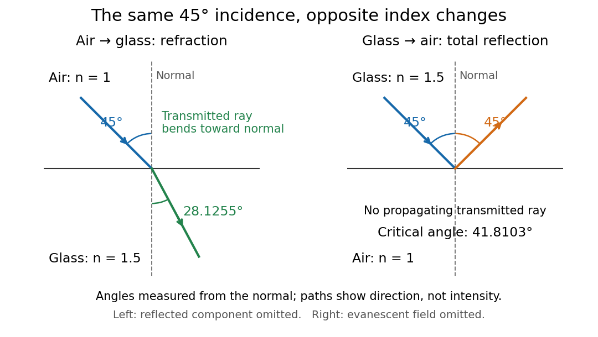

# Geometrical optics

↑ **Parent:** [Optics](optics-split.md)  
ⓦ [Wiki](https://en.wikipedia.org/wiki/Geometrical_optics)

Geometrical optics describes propagation by rays and [Snell's law](snell-s-law.md), neglecting [diffraction](diffraction.md) on scales much larger than the [wavelength](wavelength.md).

A [light ray](light-ray.md) is a path in an approximation, not a physical thread of zero width. In a transparent, homogeneous, isotropic medium it is straight and perpendicular to a [wavefront](wavefront.md); boundaries redirect it by the [law of reflection](law-of-reflection.md) or [Snell's law](snell-s-law.md). The approximation is useful when the [wavelength](wavelength.md) is small compared with relevant apertures, surface curvature scales, and distances over which the [refractive index](refractive-index.md) changes. For an illustrative [wavelength](wavelength.md) of $500\,\mathrm{nm}$ and a $10\,\mathrm{mm}$ aperture, their ratio is $5\times10^{-5}$. That small ratio supports [ray tracing](ray-tracing.md) for image location, but does not eliminate [diffraction](diffraction.md) when calculating the fine structure of a focused spot. At a [wave caustic](wave-caustic.md), [geometrical optics](geometrical-optics-split.md) can fail despite large optical elements. [Lecture Notes on Geometrical Optics](mit-2-71-and-2-710-optics-spring-2014-by-nicholas-x-fang/lecture-notes-on-geometrical-optics.md).

The mechanism of [refraction](refraction.md) is a change in [phase velocity](phase-velocity.md). For transparent isotropic media at the chosen [frequency](frequency.md), the [refractive index](refractive-index.md) is

$$
n=\frac{c}{v_{\mathrm{phase}}},\qquad n_1\sin\theta_1=n_2\sin\theta_2,
$$

where $c$ is the vacuum [speed of light](speed-of-light.md) and the [angles](angle.md) are measured from the interface [normal vector](normal-vector.md). At a stationary planar interface the [frequency](frequency.md) and tangential [wavevector](wavevector.md) match across the boundary. Since the [wavenumber](wavenumber.md) is $k=n\omega/c$, that matching gives [Snell's law](snell-s-law.md). The transmitted [wavelength](wavelength.md) changes while the [frequency](frequency.md) stays fixed. Here $n$ uses [phase velocity](phase-velocity.md), which need not equal [group velocity](group-velocity.md). [OpenStax: Refraction](https://openstax.org/books/university-physics-volume-3/pages/1-3-refraction). [MIT: Classical electromagnetism and optics, phase and group velocities](https://ocw.mit.edu/courses/6-974-fundamentals-of-photonics-quantum-electronics-spring-2006/ce6075363fa304e0a61078f7048e96f9_maxwell_eq_iso.pdf).

Choose model air with $n_1=1$ and model glass with $n_2=1.5$, without claiming these are exact values for every sample or [wavelength](wavelength.md). At $\theta_1=45^\circ$, [Snell's law](snell-s-law.md) gives

$$
\theta_2=\arcsin\!\left(\frac{\sin45^\circ}{1.5}\right)\approx28.1255^\circ.
$$

The transmitted [light ray](light-ray.md) bends toward the [normal vector](normal-vector.md); its [phase velocity](phase-velocity.md) is $c/1.5$, and its [wavelength](wavelength.md) is two thirds of the air value. By [reversibility of an optical ray](reversibility-of-an-optical-ray.md), incidence from glass at $28.1255^\circ$ returns the outgoing air [angle](angle.md) $45^\circ$.

Incidence from glass at $45^\circ$ is a different experiment. It would require $\sin\theta_2=1.5\sin45^\circ\approx1.06066$, so there is no real transmitted [angle](angle.md). The [critical angle for total internal reflection](critical-angle-for-total-internal-reflection.md) is

$$
\theta_c=\arcsin(1/1.5)\approx41.8103^\circ.
$$

Above this [angle](angle.md), an ideal lossless glass-air boundary produces [total internal reflection](total-internal-reflection.md). The [physical optics](physical-optics-split.md) description still permits an [evanescent wave](evanescent-wave.md) in the air, although no propagating transmitted [light ray](light-ray.md) crosses the boundary. [OpenStax: Total internal reflection](https://openstax.org/books/university-physics-volume-3/pages/1-4-total-internal-reflection). [MIT optics: Total internal reflection and evanescent waves, slide 40](https://web.mit.edu/2.710/Fall06/2.710-wk7-b-ho.pdf).

**[Figure 1](#image-refraction-into-glass-and-total-internal-reflection-on-incidence-from-glass-all-angles-are-measured-from-the-normal). Refraction into glass and total internal reflection on incidence from glass; all angles are measured from the normal**.

The usefulness of [geometrical optics](geometrical-optics-split.md) is that complicated instruments can be assembled from these local rules. Applying [Snell's law](snell-s-law.md) at successive curved surfaces changes a spreading bundle into a converging one. The [Fermat principle](fermat-principle.md) unifies the construction through stationary [optical path length](optical-path-length.md); stationarity does not require a global minimum. [Feynman Lectures: The principle of least time, section 26-5](https://www.feynmanlectures.caltech.edu/I_26.html). Fang's MIT notes explicitly connect this principle to [specular reflection](specular-reflection.md), [refraction](refraction.md), and [thin lens](thin-lens.md) imaging, providing a route from individual paths to complete instruments. [Lecture Notes on Geometrical Optics](mit-2-71-and-2-710-optics-spring-2014-by-nicholas-x-fang/lecture-notes-on-geometrical-optics.md).

**Table of contents**

- [Optical rays in a reciprocal-height refractive index](optical-rays-in-a-reciprocal-height-refractive-index.md)
- [Optical momentum of a ray](optical-momentum-of-a-ray.md)
- [Helical rays in a radially graded refractive index](helical-rays-in-a-radially-graded-refractive-index.md)
- [Mirage](mirage.md)
  - [Catenary light ray in a linear refractive index](catenary-light-ray-in-a-linear-refractive-index.md)
    - [Two stationary catenary rays in an inverse-height speed profile](two-stationary-catenary-rays-in-an-inverse-height-speed-profile.md)
- [Optical lever](optical-lever.md)
- [Wave caustic](wave-caustic.md)
- [Light ray](light-ray.md)
  - [Circular light ray in a linear speed profile](circular-light-ray-in-a-linear-speed-profile.md)
  - [Meridional ray](meridional-ray.md)
- [Eikonal equation for a variable-speed wave](eikonal-equation-for-a-variable-speed-wave.md)
  - [Wave-action transport for a variable-speed wave](wave-action-transport-for-a-variable-speed-wave.md)
    - [Stationary wave amplitude in a stratified wavespeed](stationary-wave-amplitude-in-a-stratified-wavespeed.md)
  - [Phase compatibility in geometrical optics](phase-compatibility-in-geometrical-optics.md)
- [Lagrange optical invariant](lagrange-optical-invariant.md)
- [Etendue](etendue.md)
  - [Conservation of etendue](conservation-of-etendue.md)
    - [Basic radiance](basic-radiance.md)
  - [Etendue of a circular aperture and cone](etendue-of-a-circular-aperture-and-cone.md)
  - [Area-angle tradeoff](area-angle-tradeoff.md)
  - [Aperture truncation of etendue](aperture-truncation-of-etendue.md)
  - [Optical concentrator](optical-concentrator.md)
    - [Etendue concentration limit](etendue-concentration-limit.md)
  - [Etendue bench measurement](etendue-bench-measurement.md)
- [Optical axis](optical-axis.md)
- [Law of reflection](law-of-reflection.md)
- [Reversibility of an optical ray](reversibility-of-an-optical-ray.md)
- [Lens (optics)](lens-optics.md)
  - [Focus (optics)](focus-optics.md)
  - [Focal length](focal-length.md)
    - [Optical power](optical-power.md)
      - [Dioptre](dioptre.md)
  - [Thick lens](thick-lens.md)
    - [Principal plane](principal-plane.md)
  - [Thin lens](thin-lens.md)
    - [Two equal lenses with a virtual intermediate object](two-equal-lenses-with-a-virtual-intermediate-object.md)
    - [Virtual object](virtual-object.md)
    - [Newton's lens formula](newton-s-lens-formula.md)
    - [Bessel lens displacement method](bessel-lens-displacement-method.md)
      - [Bessel two focus positions](bessel-two-focus-positions.md)
      - [Bessel lens displacement experiment](bessel-lens-displacement-experiment.md)
      - [Bessel focal length uncertainty](bessel-focal-length-uncertainty.md)
    - [Lensmaker's equation](lensmaker-s-equation.md)
- [Optical aberration](optical-aberration.md)
  - [Seidel aberration](seidel-aberration.md)
    - [Spherical aberration](spherical-aberration.md)
    - [Coma (optics)](coma-optics.md)
      - [Seidel coma pupil mapping](seidel-coma-pupil-mapping.md)
      - [Off-axis pinhole test for coma](off-axis-pinhole-test-for-coma.md)
    - [Astigmatism (optical systems)](astigmatism-optical-systems.md)
    - [Petzval field curvature](petzval-field-curvature.md)
    - [Distortion (optics)](distortion-optics.md)
  - [Chromatic aberration](chromatic-aberration.md)
    - [Axial chromatic aberration](axial-chromatic-aberration.md)
    - [Lateral chromatic aberration](lateral-chromatic-aberration.md)
    - [Achromatic lens](achromatic-lens.md)
      - [Achromatic doublet](achromatic-doublet.md)
      - [Achromatic doublet power balance](achromatic-doublet-power-balance.md)
      - [Secondary spectrum](secondary-spectrum.md)
- [Dispersion (optics)](dispersion-optics.md)
  - [Normal dispersion](normal-dispersion.md)
  - [Anomalous dispersion](anomalous-dispersion.md)
  - [Abbe number](abbe-number.md)
    - [Abbe diagram](abbe-diagram.md)
- [Prism (optics)](prism-optics.md)
  - [Minimum deviation](minimum-deviation.md)
- [Schlieren photography](schlieren-photography.md)

## ↑ Ancestors (4)

1. [Optics](optics-split.md)
2. [Branches of physics](branches-of-physics.md)
3. [Physics](physics-split.md)
4. [Codex Wiki](split.md)

## ← Incoming links (42)

- [Aperture](aperture.md)
- [Conjugate pinholes in confocal microscopy](conjugate-pinholes-in-confocal-microscopy.md)
- [Etendue](etendue.md)
- [Etendue concentration limit](etendue-concentration-limit.md)
- [Geometrical optics](geometrical-optics-split.md)
- [Grazing-incidence X-ray optics](grazing-incidence-x-ray-optics.md)
- [Helical rays in a radially graded refractive index](helical-rays-in-a-radially-graded-refractive-index.md)
- [Image formation](image-formation.md)
- [Light ray](light-ray.md)
- [Mie scattering](mie-scattering.md)
- [Near-field diffraction laboratory experiment](near-field-diffraction-laboratory-experiment.md)
- [Optical fiber acceptance angle](optical-fiber-acceptance-angle.md)
- [Optical path length](optical-path-length.md)
- [Optical trap position readout](optical-trap-position-readout.md)
- [Optical tweezers](optical-tweezers.md)
- [Optics](optics-split.md)
- [Solution](past-exam-of-the-mathematics-course-of-the-university-of-cambridge/2003/iii/paper-74/1/solution.md)
- [Solution](past-exam-of-the-mathematics-course-of-the-university-of-cambridge/2006/iii/paper-82/2/a/solution.md)
- [Solution](past-exam-of-the-mathematics-course-of-the-university-of-cambridge/2006/iii/paper-82/2/b/i/solution.md)
- [Solution](past-exam-of-the-mathematics-course-of-the-university-of-cambridge/2006/iii/paper-82/2/b/ii/solution.md)
- [Solution](past-exam-of-the-mathematics-course-of-the-university-of-cambridge/2007/iii/paper-61/2/solution.md)
- [Solution](past-exam-of-the-mathematics-course-of-the-university-of-cambridge/2007/iii/paper-63/4/solution.md)
- [Solution](past-exam-of-the-mathematics-course-of-the-university-of-cambridge/2008/iii/paper-88/2/a/solution.md)
- [Solution](past-exam-of-the-mathematics-course-of-the-university-of-cambridge/2015/ii/paper-3/37b/solution.md)
- [Solution](past-exam-of-the-mathematics-course-of-the-university-of-cambridge/2016/iii/paper-316/1/solution.md)
- [Solution](past-exam-of-the-mathematics-course-of-the-university-of-cambridge/2016/iii/paper-336/3/solution.md)
- [Solution](past-exam-of-the-mphil-in-micro-and-nanotechnology-enterprise-course-of-the-university-of-cambridge/2023/paper-2/section-a-iii/19/i/solution.md)
- [Phase-conjugate ray retracing](phase-conjugate-ray-retracing.md)
- [Photon capture cross-section of a Reissner-Nordstrom black hole](photon-capture-cross-section-of-a-reissner-nordstrom-black-hole.md)
- [Point-mass gravitational lens](point-mass-gravitational-lens.md)
- [Point-mass lens deflection and focusing](point-mass-lens-deflection-and-focusing.md)
- [Radiant flux through an oriented surface](radiant-flux-through-an-oriented-surface.md)
- [Rayleigh optical gradient force](rayleigh-optical-gradient-force.md)
- [Real image](real-image.md)
- [Refraction](refraction.md)
- [Single-slit diffraction](single-slit-diffraction.md)
- [Sommerfeld half-plane diffraction](sommerfeld-half-plane-diffraction.md)
- [Step-index optical fiber](step-index-optical-fiber.md)
- [Thin lens](thin-lens.md)
- [Wave-action transport for a variable-speed wave](wave-action-transport-for-a-variable-speed-wave.md)
- [Wavefront](wavefront.md)
- [Wiener-Hopf solution of rigid half-plane diffraction](wiener-hopf-solution-of-rigid-half-plane-diffraction.md)
