# Geometry and topology

↑ **Parent:** [Area of mathematics](mathematics.md#area-of-mathematics)  
ⓦ [Wiki](https://en.wikipedia.org/wiki/Geometry_and_topology)

How much information about a shape do we need to keep? [Euclidean geometry](euclidean-geometry.md) retains [lengths](physics.md#length) and [angles](#angle), allowing questions about the diagonal of a [rectangle](euclidean-geometry.md#rectangle) or the shortest route between two points. [Topology](topology.md) retains the structure preserved by a [homeomorphism](topology.md#homeomorphism), allowing questions about [connectedness](#connected-space) and whether a loop can shrink to a point, as recorded by the [fundamental group](algebraic-topology.md#fundamental-group). These are different levels of description of the same object.

For example, stretching a [circle](topology.md#circle) horizontally produces an [ellipse](euclidean-geometry.md#ellipse). The stretching map and its inverse are [continuous maps](topology.md#continuous-map), so it gives a [homeomorphism](topology.md#homeomorphism): the two curves have the same [topology](topology.md). It changes some [Euclidean distances](topological-analysis.md#euclidean-distance), however, so it is not an [isometry](riemannian-geometry.md#isometry). This distinction helps separate essential structure from a particular drawing, while explaining why measuring a shape requires more information than recognizing its [topology](topology.md).

The choice of geometry matters too. A [Euclidean geometry](euclidean-geometry.md) [triangle](euclidean-geometry.md#triangle) has interior [angles](#angle) summing to $\pi$, but a [spherical triangle](#spherical-triangle) can have three [right angles](euclidean-geometry.md#right-angle). [Spherical geometry](#spherical-geometry) turns this apparent surprise into a measurement: the excess of the [angle](#angle) sum over $\pi$ determines the [area](differential-geometry.md#surface-area). Begin with the [Pythagorean theorem](euclidean-geometry.md#pythagorean-theorem) for flat measurements, then compare the [spherical triangle](#spherical-triangle) below to see [curvature](differential-geometry.md#curvature) change the rules.

**Table of contents**

- [Coordinate system](#coordinate-system)
  - [Coordinate function](#coordinate-function)
  - [Integral coordinate](#integral-coordinate)
- [Cylinder (geometry)](#cylinder-geometry)
  - [Geodesics on a generalized cylinder](#geodesics-on-a-generalized-cylinder)
  - [Optimal aspect ratios of closed cylinders](#optimal-aspect-ratios-of-closed-cylinders)
- [Parametric equation](#parametric-equation)
  - [Parameter domain](#parameter-domain)
- [Embedding](#embedding)
- [Pencil (geometry)](#pencil-geometry)
- [Spherical geometry](#spherical-geometry)
  - [Convex regular spherical polygon](#convex-regular-spherical-polygon)
  - [Spherical circle](#spherical-circle)
  - [Spherical lune](#spherical-lune)
  - [Great-circle distance](#great-circle-distance)
  - [Spherical trigonometry](#spherical-trigonometry)
  - [Spherical triangle](#spherical-triangle)
- [Convex geometry](#convex-geometry)
  - [Minkowski addition](#minkowski-addition)
  - [Convex body](#convex-body)
- [Affine geometry](#affine-geometry)
  - [Affine space](#affine-space)
- [Moduli space](#moduli-space)
  - [SU2 character variety of the punctured torus](#su2-character-variety-of-the-punctured-torus)
  - [Moduli space of Riemann surfaces](#moduli-space-of-riemann-surfaces)
- [Foliation](#foliation)
  - [Godbillon-Vey invariant](#godbillon-vey-invariant)
  - [Leaf of a regular foliation](#leaf-of-a-regular-foliation)
  - [Taut foliation](#taut-foliation)
- [Orbifold](#orbifold)
  - [Orbifold fundamental group](#orbifold-fundamental-group)
  - [Orbifold Euler characteristic](#orbifold-euler-characteristic)
- [Algebraic geometry](algebraic-geometry.md)
  - [GAGA theorem](algebraic-geometry.md#gaga-theorem)
  - [Very general point of an algebraic parameter space](algebraic-geometry.md#very-general-point-of-an-algebraic-parameter-space)
  - [Hilbert scheme](algebraic-geometry.md#hilbert-scheme)
  - [Étale cohomology](algebraic-geometry.md#etale-cohomology)
  - [Algebraic set](algebraic-geometry.md#algebraic-set)
  - [Complex multiplication](algebraic-geometry.md#complex-multiplication)
  - [Birational geometry](algebraic-geometry.md#birational-geometry)
  - [Zariski topology](algebraic-geometry.md#zariski-topology)
  - [Presheaf of sets on a topological space](algebraic-geometry.md#presheaf-of-sets-on-a-topological-space)
  - [Ringed space](ringed-space.md)
  - [Weil divisor](algebraic-geometry.md#weil-divisor)
  - [Algebraic variety](algebraic-variety.md)
  - [Cartier divisor](cartier-divisor.md)
  - [Irreducible topological space](algebraic-geometry.md#irreducible-topological-space)
  - [Zariski-closed set](algebraic-geometry.md#zariski-closed-set)
  - [Zariski-open set](algebraic-geometry.md#zariski-open-set)
  - [Noether normalization](algebraic-geometry.md#noether-normalization)
  - [Hilbert Nullstellensatz](algebraic-geometry.md#hilbert-nullstellensatz)
  - [Zariski density of the complex exponential graph](algebraic-geometry.md#zariski-density-of-the-complex-exponential-graph)
  - [Degree of an algebraic variety](algebraic-geometry.md#degree-of-an-algebraic-variety)
  - [Twisted cubic](algebraic-geometry.md#twisted-cubic)
  - [Genus distinguishes equal-degree projective curves](algebraic-geometry.md#genus-distinguishes-equal-degree-projective-curves)
  - [Zariski tangent space](algebraic-geometry.md#zariski-tangent-space)
  - [Krull dimension of an affine variety](algebraic-geometry.md#krull-dimension-of-an-affine-variety)
  - [Affine hypersurface](algebraic-geometry.md#affine-hypersurface)
  - [Projective hypersurface](algebraic-geometry.md#projective-hypersurface)
  - [Determinantal variety](algebraic-geometry.md#determinantal-variety)
  - [Birational variety](algebraic-geometry.md#birational-variety)
  - [Normalization of an algebraic curve](normalization-of-an-algebraic-curve.md)
  - [Divisor on an algebraic curve](algebraic-geometry.md#divisor-on-an-algebraic-curve)
  - [Gonality](algebraic-geometry.md#gonality)
  - [Hyperelliptic curve](algebraic-geometry.md#hyperelliptic-curve)
  - [Rational map of projective varieties](algebraic-geometry.md#rational-map-of-projective-varieties)
  - [Nonsingular plane cubic](algebraic-geometry.md#nonsingular-plane-cubic)
  - [Ramification (mathematics)](algebraic-geometry.md#ramification-mathematics)
  - [Product surface without low-genus curves](algebraic-geometry.md#product-surface-without-low-genus-curves)
  - [Algebraic surface](algebraic-geometry.md#algebraic-surface)
  - [Projection of a plane curve from an exterior point](algebraic-geometry.md#projection-of-a-plane-curve-from-an-exterior-point)
  - [Projection from a point on a plane curve](algebraic-geometry.md#projection-from-a-point-on-a-plane-curve)
  - [Toric geometry](toric-geometry.md)
  - [Intersection theory](algebraic-geometry.md#intersection-theory)
  - [Elimination theory](algebraic-geometry.md#elimination-theory)
- [Algebraic topology](algebraic-topology.md)
  - [Delta-complex](algebraic-topology.md#delta-complex)
  - [Intersection homology](algebraic-topology.md#intersection-homology)
  - [Homotopy colimit of spaces](algebraic-topology.md#homotopy-colimit-of-spaces)
  - [Stable homotopy theory](algebraic-topology.md#stable-homotopy-theory)
  - [Based space](algebraic-topology.md#based-space)
  - [Lusternik–Schnirelmann category](algebraic-topology.md#lusternik-schnirelmann-category)
  - [Theta graph](algebraic-topology.md#theta-graph)
  - [Dumbbell graph](algebraic-topology.md#dumbbell-graph)
  - [Borsuk-Ulam theorem](algebraic-topology.md#borsuk-ulam-theorem)
  - [CW complex](algebraic-topology.md#cw-complex)
  - [Mapping cylinder](algebraic-topology.md#mapping-cylinder)
  - [Smash product](algebraic-topology.md#smash-product)
  - [Real projective space](algebraic-topology.md#real-projective-space)
  - [Mapping torus](algebraic-topology.md#mapping-torus)
  - [Homology (mathematics)](homology.md)
  - [Homotopy](homotopy.md)
  - [Loop (topology)](algebraic-topology.md#loop-topology)
  - [Fundamental group](algebraic-topology.md#fundamental-group)
  - [Covering space](algebraic-topology.md#covering-space)
  - [Topological group](topological-group.md)
  - [Lefschetz number](algebraic-topology.md#lefschetz-number)
  - [Lefschetz fixed-point theorem](algebraic-topology.md#lefschetz-fixed-point-theorem)
  - [Mayer–Vietoris sequence](algebraic-topology.md#mayer-vietoris-sequence)
  - [Simplicial complex](algebraic-topology.md#simplicial-complex)
  - [Cone (topology)](algebraic-topology.md#cone-topology)
  - [Simplicial cone](algebraic-topology.md#simplicial-cone)
  - [Suspension (topology)](algebraic-topology.md#suspension-topology)
  - [Cohomology](cohomology.md)
  - [Fiber bundle](fiber-bundle.md)
  - [Complex projective space](algebraic-topology.md#complex-projective-space)
  - [Topological K-theory](algebraic-topology.md#topological-k-theory)
  - [Reidemeister torsion](algebraic-topology.md#reidemeister-torsion)
- [Complex geometry](complex-geometry.md)
  - [Complex structure](complex-geometry.md#complex-structure)
- [Differential geometry](differential-geometry.md)
  - [Analytic torsion](differential-geometry.md#analytic-torsion)
  - [Differential geometry of surfaces](differential-geometry.md#differential-geometry-of-surfaces)
  - [Pullback (differential geometry)](differential-geometry.md#pullback-differential-geometry)
  - [Laplace operators in differential geometry](differential-geometry.md#laplace-operators-in-differential-geometry)
  - [Critical point of a smooth map](differential-geometry.md#critical-point-of-a-smooth-map)
  - [Calibrated geometry](differential-geometry.md#calibrated-geometry)
  - [Carnot-Carathéodory distance](differential-geometry.md#carnot-caratheodory-distance)
  - [Hodge theory](differential-geometry.md#hodge-theory)
  - [Jet bundle of maps](differential-geometry.md#jet-bundle-of-maps)
  - [Harmonic map](differential-geometry.md#harmonic-map)
  - [Submanifold](differential-geometry.md#submanifold)
  - [Morse theory](differential-geometry.md#morse-theory)
  - [Pseudo-Riemannian manifold](differential-geometry.md#pseudo-riemannian-manifold)
  - [Curvature](differential-geometry.md#curvature)
  - [Morse function](differential-geometry.md#morse-function)
  - [Distribution (differential geometry)](differential-geometry.md#distribution-differential-geometry)
  - [Submersion](differential-geometry.md#submersion)
  - [Immersion](differential-geometry.md#immersion)
  - [Lie bracket of vector fields](differential-geometry.md#lie-bracket-of-vector-fields)
  - [Laplace-Beltrami operator](differential-geometry.md#laplace-beltrami-operator)
  - [Smooth surface](differential-geometry.md#smooth-surface)
  - [Riemannian metric](riemannian-metric.md)
  - [Smooth manifold](smooth-manifold.md)
  - [Tangent vector](tangent-vector.md)
  - [Dimension jump in a smooth family of manifolds](differential-geometry.md#dimension-jump-in-a-smooth-family-of-manifolds)
  - [Normal vector](differential-geometry.md#normal-vector)
  - [Orientation of a surface](differential-geometry.md#orientation-of-a-surface)
  - [First fundamental form](differential-geometry.md#first-fundamental-form)
  - [Gauss map](differential-geometry.md#gauss-map)
  - [Second fundamental form](second-fundamental-form.md)
  - [Smooth curve](differential-geometry.md#smooth-curve)
  - [Curvature and torsion](differential-geometry.md#curvature-and-torsion)
  - [Steiner symmetrization](differential-geometry.md#steiner-symmetrization)
  - [Frenet-Serret formulas](differential-geometry.md#frenet-serret-formulas)
  - [Geodesic curvature](differential-geometry.md#geodesic-curvature)
  - [Gauss-Bonnet theorem](differential-geometry.md#gauss-bonnet-theorem)
  - [Preimage theorem](differential-geometry.md#preimage-theorem)
  - [Theorema Egregium](differential-geometry.md#theorema-egregium)
  - [Riemannian geometry](riemannian-geometry.md)
  - [Embedded surface parametrization](differential-geometry.md#embedded-surface-parametrization)
  - [Surface of revolution](differential-geometry.md#surface-of-revolution)
  - [Helicoid](differential-geometry.md#helicoid)
  - [Ruled surface](differential-geometry.md#ruled-surface)
  - [Flat cone](differential-geometry.md#flat-cone)
  - [Manifold chart](differential-geometry.md#manifold-chart)
  - [Regular value](differential-geometry.md#regular-value)
  - [Degree modulo two](differential-geometry.md#degree-modulo-two)
  - [Symplectic geometry](symplectic-geometry.md)
  - [Grassmannian](differential-geometry.md#grassmannian)
  - [Dirichlet energy](differential-geometry.md#dirichlet-energy)
  - [Fundamental theorem of curves](differential-geometry.md#fundamental-theorem-of-curves)
- [Classification theorem for surfaces](#classification-theorem-for-surfaces)
  - [Crosscap number](#crosscap-number)
  - [Orientable genus](#orientable-genus)
  - [Closed surfaces obtained from a square](#closed-surfaces-obtained-from-a-square)
- [Inversive distance](#inversive-distance)
- [Conformal map](#conformal-map)
  - [Vanishing harmonic moments of a polynomial conformal disc map](#vanishing-harmonic-moments-of-a-polynomial-conformal-disc-map)
  - [Strip automorphism with a prescribed image of its midpoint](#strip-automorphism-with-a-prescribed-image-of-its-midpoint)
  - [Hyperbolic-cosine map of a half-strip](#hyperbolic-cosine-map-of-a-half-strip)
  - [Squaring map from a quadrant to the upper half-plane](#squaring-map-from-a-quadrant-to-the-upper-half-plane)
  - [Lens-to-strip logarithmic conformal map](#lens-to-strip-logarithmic-conformal-map)
  - [Angle multiplication at a holomorphic critical point](#angle-multiplication-at-a-holomorphic-critical-point)
  - [Anticonformal map](#anticonformal-map)
  - [Conformal map from the exterior half-disc to a slit half-plane](#conformal-map-from-the-exterior-half-disc-to-a-slit-half-plane)
  - [Schwarz-Christoffel mapping](#schwarz-christoffel-mapping)
  - [Quarter-sector mapping of a circular lens](#quarter-sector-mapping-of-a-circular-lens)
  - [Conformal group](#conformal-group)
  - [Null affine parameter under a conformal rescaling](#null-affine-parameter-under-a-conformal-rescaling)
  - [Conformality](#conformality)
  - [Conformal map of a circular lens](#conformal-map-of-a-circular-lens)
  - [Explicit disk map of a slit half disk](#explicit-disk-map-of-a-slit-half-disk)
  - [Conformal map of a segment complement to a punctured disk](#conformal-map-of-a-segment-complement-to-a-punctured-disk)
  - [Tangent-circle crescent conformal map](#tangent-circle-crescent-conformal-map)
  - [Conformal map of a vertical half-strip by sine](#conformal-map-of-a-vertical-half-strip-by-sine)
  - [Conformal geometry](#conformal-geometry)
  - [Half-strip conformal map by hyperbolic cosine](#half-strip-conformal-map-by-hyperbolic-cosine)
  - [Conformal inversion of a quadrant](#conformal-inversion-of-a-quadrant)
  - [Conformal map from a parabolic domain to the unit disc](#conformal-map-from-a-parabolic-domain-to-the-unit-disc)
  - [Prime end](#prime-end)
  - [Conformal radius](#conformal-radius)
  - [Conformal equivalence](#conformal-equivalence)
  - [Holomorphic inverse function theorem](#holomorphic-inverse-function-theorem)
  - [Hyperbolic-cosine half-strip map](#hyperbolic-cosine-half-strip-map)
- [Connected space](#connected-space)
  - [Disconnected space](#disconnected-space)
  - [Connected set](#connected-set)
  - [Connectedness of an intersection from connected finite intersections](#connectedness-of-an-intersection-from-connected-finite-intersections)
  - [Connected complement of a product of proper subsets](#connected-complement-of-a-product-of-proper-subsets)
  - [Connectedness of an interval](#connectedness-of-an-interval)
  - [Topologist's sine curve](#topologist-s-sine-curve)
  - [Connected chain of overlapping subsets](#connected-chain-of-overlapping-subsets)
  - [Spiral accumulating on a circle](#spiral-accumulating-on-a-circle)
  - [Connectedness from global regular functions](#connectedness-from-global-regular-functions)
  - [Connected subset](#connected-subset)
  - [Separation of a topological space](#separation-of-a-topological-space)
  - [Connected component](#connected-component)
  - [Continuous image of a connected space](#continuous-image-of-a-connected-space)
  - [Connected subset of the real line](#connected-subset-of-the-real-line)
  - [Integer-valued function criterion for connectedness](#integer-valued-function-criterion-for-connectedness)
  - [Pairwise-intersecting connected cover](#pairwise-intersecting-connected-cover)
  - [Product of connected spaces](#product-of-connected-spaces)
  - [Closure of a connected set](#closure-of-a-connected-set)
- [Distance from a point to a plane](#distance-from-a-point-to-a-plane)
  - [Closest point on a plane](#closest-point-on-a-plane)
  - [Signed distance from a point to a plane](#signed-distance-from-a-point-to-a-plane)
- [Elliptic coordinates](#elliptic-coordinates)
  - [Mixed Dirichlet-Neumann problem in an elliptic annulus](#mixed-dirichlet-neumann-problem-in-an-elliptic-annulus)
- [Joukowski map](#joukowski-map)
  - [Joukowski map from the upper half-disc to the upper half-plane](#joukowski-map-from-the-upper-half-disc-to-the-upper-half-plane)
  - [Joukowski circle-to-ellipse mapping](#joukowski-circle-to-ellipse-mapping)
  - [Joukowski map of the upper exterior of a unit disk](#joukowski-map-of-the-upper-exterior-of-a-unit-disk)
- [Path-connected space](#path-connected-space)
  - [Rational comb with a deleted attachment point](#rational-comb-with-a-deleted-attachment-point)
  - [Path-connectedness implies connectedness](#path-connectedness-implies-connectedness)
  - [Continuous image of a path-connected space](#continuous-image-of-a-path-connected-space)
  - [Multiply connected region](#multiply-connected-region)
  - [Reciprocal spiral with its endpoint](#reciprocal-spiral-with-its-endpoint)
  - [Rational comb with a connecting spine](#rational-comb-with-a-connecting-spine)
  - [Polygonal connectivity of a finite-line complement](#polygonal-connectivity-of-a-finite-line-complement)
  - [Plane minus a countable set is path connected](#plane-minus-a-countable-set-is-path-connected)
  - [Continuous path](#continuous-path)
  - [Path component](#path-component)
  - [Locally path-connected space](#locally-path-connected-space)
  - [Cut point](#cut-point)
- [Plane](#plane)
  - [Intersection of two planes](#intersection-of-two-planes)
  - [Plane through a point and a line given by a cross product](#plane-through-a-point-and-a-line-given-by-a-cross-product)
  - [Angle between two planes](#angle-between-two-planes)
  - [Cartesian equation of a plane](#cartesian-equation-of-a-plane)
  - [Distance between parallel planes](#distance-between-parallel-planes)
  - [Line-plane intersection criterion](#line-plane-intersection-criterion)
  - [Equation of a plane through three points](#equation-of-a-plane-through-three-points)
  - [Euclidean plane](#euclidean-plane)
- [Product topology](#product-topology)
  - [Local compactness of a product with finitely many noncompact factors](#local-compactness-of-a-product-with-finitely-many-noncompact-factors)
  - [Product projection](#product-projection)
  - [Rectangularity of every product-open set](#rectangularity-of-every-product-open-set)
  - [Hausdorff property of a nonempty product](#hausdorff-property-of-a-nonempty-product)
  - [Finite-coordinate basis for the product topology](#finite-coordinate-basis-for-the-product-topology)
  - [Convergence in a product space](#convergence-in-a-product-space)
  - [Box topology](#box-topology)
  - [Continuity into a product space](#continuity-into-a-product-space)
  - [Cylinder function on a product space](#cylinder-function-on-a-product-space)
  - [Diagonal map](#diagonal-map)
  - [Cantor space](#cantor-space)
  - [Cylinder set](#cylinder-set)
  - [Product space](#product-space)
  - [Tychonoff's theorem](#tychonoff-s-theorem)
  - [Hewitt–Marczewski–Pondiczery theorem](#hewitt-marczewski-pondiczery-theorem)
- [Sequentially compact space](#sequentially-compact-space)
  - [Distance-increasing self-map theorem for sequentially compact metric spaces](#distance-increasing-self-map-theorem-for-sequentially-compact-metric-spaces)
  - [Compactness from uniformly vanishing sequence tails](#compactness-from-uniformly-vanishing-sequence-tails)
- [Sphere-plane intersection](#sphere-plane-intersection)
  - [Center and radius of a sphere-plane intersection](#center-and-radius-of-a-sphere-plane-intersection)
- [Spherically symmetric solution of Poisson equation](#spherically-symmetric-solution-of-poisson-equation)
  - [Origin-regular spherical Poisson flux law](#origin-regular-spherical-poisson-flux-law)
- [Topological degree](#topological-degree)
- [Trigonometric function](#trigonometric-function)
  - [Trigonometric inequality](#trigonometric-inequality)
  - [Double-angle formula](#double-angle-formula)
  - [Trigonometric identity](#trigonometric-identity)
  - [Tangent function](#tangent-function)
  - [Sinusoid](#sinusoid)
  - [Product-to-sum formula](#product-to-sum-formula)
  - [Cosecant](#cosecant)
  - [Cotangent](#cotangent)
  - [Sine](#sine)
  - [Cosine](#cosine)
  - [Sine addition formula](#sine-addition-formula)
  - [Cosine addition formula](#cosine-addition-formula)
  - [Pythagorean trigonometric identity](#pythagorean-trigonometric-identity)
  - [Tangent](#tangent)
  - [Secant (trigonometry)](#secant-trigonometry)
  - [Half-angle identities](#half-angle-identities)
  - [Tangent addition formula](#tangent-addition-formula)
  - [Inverse trigonometric functions](#inverse-trigonometric-functions)
  - [Small-angle approximation](#small-angle-approximation)
  - [Tangent half-angle substitution](#tangent-half-angle-substitution)
- [Fractal geometry](#fractal-geometry)
  - [Generalized Cantor set](#generalized-cantor-set)
  - [Mass fractal dimension](#mass-fractal-dimension)
  - [Box-counting dimension](#box-counting-dimension)
  - [Self-similarity](#self-similarity)
  - [Fractal](#fractal)
- [Point (geometry)](#point-geometry)
- [Euclidean geometry](euclidean-geometry.md)
  - [Straightedge and compass construction](straightedge-and-compass-construction.md)
  - [Ray-plane intersection](euclidean-geometry.md#ray-plane-intersection)
  - [Coplanarity](euclidean-geometry.md#coplanarity)
  - [Solid geometry](euclidean-geometry.md#solid-geometry)
  - [Cross-sectional area](euclidean-geometry.md#cross-sectional-area)
  - [Axis of symmetry](euclidean-geometry.md#axis-of-symmetry)
  - [Dihedral angle](euclidean-geometry.md#dihedral-angle)
  - [Sylvester-Gallai theorem](euclidean-geometry.md#sylvester-gallai-theorem)
  - [Geometric scale factor](euclidean-geometry.md#geometric-scale-factor)
  - [Perpendicular lines](euclidean-geometry.md#perpendicular-lines)
  - [Cone (geometry)](euclidean-geometry.md#cone-geometry)
  - [Collinearity](euclidean-geometry.md#collinearity)
  - [Quadric surface](euclidean-geometry.md#quadric-surface)
  - [Center (geometry)](euclidean-geometry.md#center-geometry)
  - [Distance between parallel lines](euclidean-geometry.md#distance-between-parallel-lines)
  - [Square grid](euclidean-geometry.md#square-grid)
  - [Parallel postulate](euclidean-geometry.md#parallel-postulate)
  - [Euclid's Elements](euclidean-geometry.md#euclid-s-elements)
  - [Congruence (geometry)](euclidean-geometry.md#congruence-geometry)
  - [Right circular conical surface](euclidean-geometry.md#right-circular-conical-surface)
  - [Euclidean group](euclidean-geometry.md#euclidean-group)
  - [Geometric locus](euclidean-geometry.md#geometric-locus)
  - [Hypercube](euclidean-geometry.md#hypercube)
  - [Centroid](euclidean-geometry.md#centroid)
  - [Polygon](euclidean-geometry.md#polygon)
  - [Point group](euclidean-geometry.md#point-group)
  - [Wallpaper group](euclidean-geometry.md#wallpaper-group)
  - [Elliptic paraboloid](euclidean-geometry.md#elliptic-paraboloid)
  - [Double circular cone](euclidean-geometry.md#double-circular-cone)
  - [Geometric packing](euclidean-geometry.md#geometric-packing)
  - [Euclidean ray](euclidean-geometry.md#euclidean-ray)
  - [Hyperbolic paraboloid](euclidean-geometry.md#hyperbolic-paraboloid)
  - [Right circular cone](euclidean-geometry.md#right-circular-cone)
  - [Straight line](euclidean-geometry.md#straight-line)
  - [Polyhedron](euclidean-geometry.md#polyhedron)
  - [Pythagorean theorem](euclidean-geometry.md#pythagorean-theorem)
  - [Voronoi diagram](euclidean-geometry.md#voronoi-diagram)
  - [Sphere](euclidean-geometry.md#sphere)
  - [Triangle](euclidean-geometry.md#triangle)
  - [Trapezoid](euclidean-geometry.md#trapezoid)
  - [Triangular prism](euclidean-geometry.md#triangular-prism)
  - [Borsuk conjecture](euclidean-geometry.md#borsuk-conjecture)
  - [Unit disk](euclidean-geometry.md#unit-disk)
  - [Cyclic quadrilateral](euclidean-geometry.md#cyclic-quadrilateral)
  - [Locus (mathematics)](euclidean-geometry.md#locus-mathematics)
  - [Conic section](euclidean-geometry.md#conic-section)
  - [Ellipsoid](euclidean-geometry.md#ellipsoid)
  - [Perpendicular bisector](euclidean-geometry.md#perpendicular-bisector)
  - [Skew lines](euclidean-geometry.md#skew-lines)
  - [Circles of Apollonius](euclidean-geometry.md#circles-of-apollonius)
  - [Right angle](euclidean-geometry.md#right-angle)
  - [Rigid transformation](euclidean-geometry.md#rigid-transformation)
  - [Thales's theorem](euclidean-geometry.md#thales-s-theorem)
  - [Regular polygon](euclidean-geometry.md#regular-polygon)
  - [Spherical cap](euclidean-geometry.md#spherical-cap)
  - [Lattice polygon](euclidean-geometry.md#lattice-polygon)
  - [Isoperimetric inequality](euclidean-geometry.md#isoperimetric-inequality)
- [Spherical symmetry](#spherical-symmetry)
  - [Isotropic tensor integral](#isotropic-tensor-integral)
- [Diffeomorphism](#diffeomorphism)
  - [Pullback of a mixed tensor by a diffeomorphism](#pullback-of-a-mixed-tensor-by-a-diffeomorphism)
  - [C1 openness of diffeomorphisms](#c1-openness-of-diffeomorphisms)
  - [Large diffeomorphism](#large-diffeomorphism)
- [Differential form](differential-form.md)
  - [Inexact differential](differential-form.md#inexact-differential)
  - [Holomorphic volume form](differential-form.md#holomorphic-volume-form)
  - [Integration on an oriented manifold](differential-form.md#integration-on-an-oriented-manifold)
  - [Comass](differential-form.md#comass)
  - [Integral pairing of complex top forms](differential-form.md#integral-pairing-of-complex-top-forms)
  - [Differential three-form](differential-form.md#differential-three-form)
  - [Vector-bundle-valued differential form](differential-form.md#vector-bundle-valued-differential-form)
  - [Sheaf of smooth differential forms](differential-form.md#sheaf-of-smooth-differential-forms)
  - [Volume form](differential-form.md#volume-form)
  - [2-form](differential-form.md#2-form)
  - [Wedge product of differential forms](differential-form.md#wedge-product-of-differential-forms)
  - [Pullback of a differential form](differential-form.md#pullback-of-a-differential-form)
  - [Interior product](differential-form.md#interior-product)
  - [One-form](differential-form.md#one-form)
  - [Exterior derivative](differential-form.md#exterior-derivative)
  - [Hodge star operator](differential-form.md#hodge-star-operator)
  - [Exact differential](differential-form.md#exact-differential)
  - [Lie derivative of a differential form](differential-form.md#lie-derivative-of-a-differential-form)
- [Hyperbolic geometry](hyperbolic-geometry.md)
  - [Hyperbolic Pythagorean theorem](hyperbolic-geometry.md#hyperbolic-pythagorean-theorem)
  - [Tessellation](hyperbolic-geometry.md#tessellation)
  - [Hyperbolic circle in the Poincare disc](hyperbolic-geometry.md#hyperbolic-circle-in-the-poincare-disc)
  - [Hyperbolic space](hyperbolic-geometry.md#hyperbolic-space)
  - [Hyperbolic hexagon](hyperbolic-geometry.md#hyperbolic-hexagon)
  - [Beltrami-Klein model](hyperbolic-geometry.md#beltrami-klein-model)
  - [Hyperbolic surface](hyperbolic-geometry.md#hyperbolic-surface)
  - [Hyperbolic metric](hyperbolic-geometry.md#hyperbolic-metric)
  - [Hyperbolic plane](hyperbolic-geometry.md#hyperbolic-plane)
  - [Poincaré disk model](hyperbolic-geometry.md#poincare-disk-model)
  - [Poincaré half-plane model](hyperbolic-geometry.md#poincare-half-plane-model)
  - [Cayley transform (hyperbolic geometry)](hyperbolic-geometry.md#cayley-transform-hyperbolic-geometry)
  - [Hyperboloid model](hyperbolic-geometry.md#hyperboloid-model)
  - [Lambert quadrilateral](hyperbolic-geometry.md#lambert-quadrilateral)
  - [Hyperbolic triangle](hyperbolic-geometry.md#hyperbolic-triangle)
  - [Hyperbolic law of sines](hyperbolic-geometry.md#hyperbolic-law-of-sines)
- [Topology](topology.md)
  - [Initial topology](topology.md#initial-topology)
  - [Topology with countable closed sets away from one point](topology.md#topology-with-countable-closed-sets-away-from-one-point)
  - [Zero-dimensional space](topology.md#zero-dimensional-space)
  - [Hausdorff compactification](topology.md#hausdorff-compactification)
  - [Finer topology](topology.md#finer-topology)
  - [Topological disjoint union](topology.md#topological-disjoint-union)
  - [Topological invariant](topology.md#topological-invariant)
  - [End (topology)](topology.md#end-topology)
  - [Orientability](topology.md#orientability)
  - [Non-Hausdorff manifold](topology.md#non-hausdorff-manifold)
  - [Stone space](topology.md#stone-space)
  - [Tail topology on the natural numbers](topology.md#tail-topology-on-the-natural-numbers)
  - [Fell topology](topology.md#fell-topology)
  - [Upper-ray topology on the real line](topology.md#upper-ray-topology-on-the-real-line)
  - [Hyperconnected space](topology.md#hyperconnected-space)
  - [Closed cover](topology.md#closed-cover)
  - [Partition topology](topology.md#partition-topology)
  - [Finite subsets do not define a topology on an infinite set](topology.md#finite-subsets-do-not-define-a-topology-on-an-infinite-set)
  - [Lower limit topology](topology.md#lower-limit-topology)
  - [Symmetric product](topology.md#symmetric-product)
  - [Extremally disconnected space](topology.md#extremally-disconnected-space)
  - [Countable complement topology](topology.md#countable-complement-topology)
  - [Locally finite family of subsets](topology.md#locally-finite-family-of-subsets)
  - [Indiscrete topology](topology.md#indiscrete-topology)
  - [Triangulation of a surface](topology.md#triangulation-of-a-surface)
  - [Pasting lemma for closed subspaces](topology.md#pasting-lemma-for-closed-subspaces)
  - [Cofinite topology](topology.md#cofinite-topology)
  - [Hahn-Mazurkiewicz theorem](topology.md#hahn-mazurkiewicz-theorem)
  - [Topological manifold](topological-manifold.md)
  - [Closed set](topology.md#closed-set)
  - [Closure (topology)](topology.md#closure-topology)
  - [Interior (topology)](topology.md#interior-topology)
  - [Topological space](topology.md#topological-space)
  - [Quotient topology](topology.md#quotient-topology)
  - [Open set](topology.md#open-set)
  - [Disk (mathematics)](topology.md#disk-mathematics)
  - [Topological disc](topology.md#topological-disc)
  - [Level set](topology.md#level-set)
  - [Dense set](topology.md#dense-set)
  - [Discrete space](topology.md#discrete-space)
  - [Connected-space zero-product dichotomy](topology.md#connected-space-zero-product-dichotomy)
  - [Normal space](topology.md#normal-space)
  - [Compact space](topology.md#compact-space)
  - [Hausdorff space](topology.md#hausdorff-space)
  - [Homeomorphism](topology.md#homeomorphism)
  - [Unit sphere](topology.md#unit-sphere)
  - [Closed graph theorem for compact spaces](topology.md#closed-graph-theorem-for-compact-spaces)
  - [Curve](topology.md#curve)
  - [Topological surface](topological-surface.md)
  - [Knaster-Kuratowski-Mazurkiewicz lemma](topology.md#knaster-kuratowski-mazurkiewicz-lemma)
- [Cobordism](#cobordism)
  - [Witt bordism](#witt-bordism)
  - [Trivial cobordism](#trivial-cobordism)
  - [H-cobordism](#h-cobordism)
  - [Framed cobordism](#framed-cobordism)
  - [Complex cobordism](#complex-cobordism)
  - [Knot cobordism](#knot-cobordism)
  - [One-handle cobordism from a disjoint union to a connected sum](#one-handle-cobordism-from-a-disjoint-union-to-a-connected-sum)
- [Geometric group theory](geometric-group-theory.md)
  - [Combing of a group](geometric-group-theory.md#combing-of-a-group)
  - [Automatic group](geometric-group-theory.md#automatic-group)
  - [Small cancellation theory](geometric-group-theory.md#small-cancellation-theory)
  - [Cobounded group action](geometric-group-theory.md#cobounded-group-action)
  - [CAT(0) space](geometric-group-theory.md#cat-0-space)
  - [Cubical complex](geometric-group-theory.md#cubical-complex)
  - [Right-angled Artin group](geometric-group-theory.md#right-angled-artin-group)
  - [Free group](geometric-group-theory.md#free-group)
  - [Group presentation](geometric-group-theory.md#group-presentation)
  - [Cayley graph](geometric-group-theory.md#cayley-graph)
  - [Milnor–Švarc lemma](geometric-group-theory.md#milnor-svarc-lemma)
  - [Covering graph](geometric-group-theory.md#covering-graph)
  - [Bass-Serre theory](geometric-group-theory.md#bass-serre-theory)
  - [Group action on a tree](geometric-group-theory.md#group-action-on-a-tree)
  - [Fuchsian group](geometric-group-theory.md#fuchsian-group)
  - [Quasi-isometry](geometric-group-theory.md#quasi-isometry)
  - [Quasiconvex subset](geometric-group-theory.md#quasiconvex-subset)
  - [Displacement function](geometric-group-theory.md#displacement-function)
  - [Proper metric space](geometric-group-theory.md#proper-metric-space)
  - [Cocompact group action](geometric-group-theory.md#cocompact-group-action)
  - [Properly discontinuous group action](geometric-group-theory.md#properly-discontinuous-group-action)
  - [Nielsen–Schreier theorem](geometric-group-theory.md#nielsen-schreier-theorem)
  - [Finiteness of subgroups of a fixed finite index](geometric-group-theory.md#finiteness-of-subgroups-of-a-fixed-finite-index)
  - [Growth function of a discrete metric space](geometric-group-theory.md#growth-function-of-a-discrete-metric-space)
  - [Amenable group](geometric-group-theory.md#amenable-group)
  - [Length function](geometric-group-theory.md#length-function)
- [Knot theory](knot-theory.md)
  - [Knot invariant](knot-theory.md#knot-invariant)
  - [Knot](knot-theory.md#knot)
  - [Knot concordance](knot-theory.md#knot-concordance)
  - [Two-fold branched cover of a knot](knot-theory.md#two-fold-branched-cover-of-a-knot)
  - [Amphichiral knot](knot-theory.md#amphichiral-knot)
  - [Arf invariant of a knot](knot-theory.md#arf-invariant-of-a-knot)
  - [Twist-spun knot](knot-theory.md#twist-spun-knot)
  - [Surface knot](knot-theory.md#surface-knot)
  - [Stevedore knot](knot-theory.md#stevedore-knot)
  - [Seifert longitude](knot-theory.md#seifert-longitude)
  - [Link](knot-theory.md#link)
  - [Colored link](knot-theory.md#colored-link)
  - [Dehn surgery](knot-theory.md#dehn-surgery)
  - [Fibered knot](knot-theory.md#fibered-knot)
  - [Seifert fibered space](knot-theory.md#seifert-fibered-space)
  - [Splice of knots](knot-theory.md#splice-of-knots)
  - [Turaev torsion](knot-theory.md#turaev-torsion)
  - [Satellite knot as a splice](knot-theory.md#satellite-knot-as-a-splice)
- [Chern-Weil homomorphism](#chern-weil-homomorphism)
  - [Pontryagin class](#pontryagin-class)
  - [A-hat form](#a-hat-form)
  - [Chern-Weil connection transgression](#chern-weil-connection-transgression)
  - [Second Chern form](#second-chern-form)
  - [Chern-Simons form](#chern-simons-form)
- [Volume](#volume)
  - [Minim (unit)](#minim-unit)
  - [Gas volume](#gas-volume)
  - [Partial molar volume](#partial-molar-volume)
- [Angle](#angle)
  - [Angular position](#angular-position)
  - [Angular diameter](#angular-diameter)
  - [Angle bisector](#angle-bisector)
  - [Protractor](#protractor)
  - [Radian](#radian)
  - [Minute and second of arc](#minute-and-second-of-arc)
- [Envelope (mathematics)](#envelope-mathematics)
- [Geometry](#geometry)
  - [Distance](#distance)
  - [Surface-to-volume ratio](#surface-to-volume-ratio)
  - [Tangency](#tangency)
  - [Bounding box](#bounding-box)
  - [Geometric vertex](#geometric-vertex)

## Coordinate system

↑ **Parent:** [Geometry and topology](geometry-and-topology.md)  
ⓦ [Wiki](https://en.wikipedia.org/wiki/Coordinate_system)

### Coordinate function

↑ **Parent:** [Coordinate system](#coordinate-system)

A component [function](function.md) of a local coordinate chart on a [smooth manifold](smooth-manifold.md). Its [differential](smooth-manifold.md#differential-of-a-smooth-map) $dx^i$ belongs to the coordinate [cotangent space](tangent-vector.md#cotangent-space) basis.

### Integral coordinate

↑ **Parent:** [Coordinate system](#coordinate-system)

## Cylinder (geometry)

↑ **Parent:** [Geometry and topology](geometry-and-topology.md)  
ⓦ [Wiki](https://en.wikipedia.org/wiki/Cylinder)

A [cylinder](#cylinder-geometry) is generated by translating a [plane curve](topology.md#plane-curve) along parallel lines transverse to its plane. A [circular cylinder](differential-geometry.md#circular-cylinder) uses a [circle](topology.md#circle) as its generating [plane curve](topology.md#plane-curve); it is right when the generators are perpendicular to that plane. The term can denote the lateral surface or, for a bounded portion with end caps, the enclosed solid. The [circular cylinder](differential-geometry.md#circular-cylinder) curvature formulas describe the smooth lateral surface.

### Geodesics on a generalized cylinder

↑ **Parent:** [Cylinder (geometry)](#cylinder-geometry)

For a smooth surface obtained by translating the plane graph $z=F(y)$ along the $x$ direction, the [induced metric](riemannian-geometry.md#induced-metric) is $ds^2=dx^2+[1+F'(y)^2]dy^2$. The transverse [arc length](riemannian-geometry.md#arc-length) coordinate $u(y)=\int^y\sqrt{1+F'(s)^2}ds$ makes it $ds^2=dx^2+du^2$. This is a local [isometry](riemannian-geometry.md#isometry) to the Euclidean plane, extending the [intrinsic flatness of a circular cylinder](differential-geometry.md#intrinsic-flatness-of-a-circular-cylinder) to arbitrary smooth generating graphs.

Its [geodesics](riemannian-geometry.md#geodesic) therefore lift to straight lines in $(x,u)$ coordinates. Those that are graphs over $x$ satisfy $u=ax+b$, while the additional family $x=\text{constant}$ cannot be written as $y(x)$. The same graph formula follows from the [Beltrami identity](analysis.md#beltrami-identity) for the arc-length integrand $\sqrt{1+[1+F'(y)^2]y'^2}$. These straight lines are locally minimizing; on cylinders with a closed generating curve, global identifications can create several different winding paths between two points.

### Optimal aspect ratios of closed cylinders

↑ **Parent:** [Cylinder (geometry)](#cylinder-geometry)

A closed [circular cylinder](differential-geometry.md#circular-cylinder) of radius $a>0$ and length $\ell>0$ has [volume](#volume) $\pi a^2\ell$ and total [surface area](differential-geometry.md#surface-area) $2\pi a(a+\ell)$, including both end disks. At fixed area $A$, [Lagrange multipliers](mathematical-optimization.md#lagrange-multiplier) for maximizing the volume give $\ell=2a$, hence

$$
a=\sqrt{\frac A{6\pi}},\qquad V_{\max}=\frac13\sqrt{\frac{A^3}{6\pi}}.
$$

Equivalently, eliminate $\ell=A/(2\pi a)-a$ and maximize $(A/2)a-\pi a^3$ on $0<a<\sqrt{A/(2\pi)}$. The derivative changes from positive to negative at the displayed radius, and the volume tends to zero at both ends.

For a cylinder inscribed in a [sphere](euclidean-geometry.md#sphere) of radius $R$, the constraint is $a^2+\ell^2/4=R^2$. Maximizing $a^2+a\ell$ by [Lagrange multipliers](mathematical-optimization.md#lagrange-multiplier) gives $\ell^2+2a\ell=4a^2$, so the positive aspect ratio is $\ell/a=\sqrt5-1$. It is independent of $R$. With $q=\ell/a$, the area is $2\pi R^2(1+q)/(1+q^2/4)$; differentiating this expression confirms the unique maximum on $q>0$.

## Parametric equation

↑ **Parent:** [Geometry and topology](geometry-and-topology.md)  
ⓦ [Wiki](https://en.wikipedia.org/wiki/Parametric_equation)

A [parametric equation](#parametric-equation) expresses coordinates as [functions](function.md) of one or more independent parameters. For example, $x=\cos t$, $y=\sin t$ describes a [circle](topology.md#circle); multiple parameters describe surfaces. A [smooth curve](differential-geometry.md#smooth-curve) is a differentiable single-parameter realization. A [reparametrization](differential-geometry.md#reparametrization) changes the parameter without changing the geometric image.

### Parameter domain

↑ **Parent:** [Parametric equation](#parametric-equation)

The [domain of a function](function.md#domain-of-a-function) $U$ used by a [parametrization](#parametric-equation) $\mathbf r$ is its parameter domain. A [parametrized surface](multivariable-calculus.md#parametrized-surface) may require several such domains, and duplicated images must be accounted for in a [surface integral](multivariable-calculus.md#surface-integral).

## Embedding

↑ **Parent:** [Geometry and topology](geometry-and-topology.md)  
ⓦ [Wiki](https://en.wikipedia.org/wiki/Embedding)

An [embedding](#embedding) identifies one mathematical structure with a structure-preserving copy inside another. In [topology](topology.md) it is a [homeomorphism](topology.md#homeomorphism) onto its image with the [subspace topology](topology.md#subspace-topology); an algebraic [embedding](#embedding) is an injective [homomorphism](algebra.md#homomorphism). A [smooth embedding](differential-geometry.md#smooth-embedding) additionally has injective [differential](smooth-manifold.md#differential-of-a-smooth-map) everywhere, so its image is an [embedded submanifold](smooth-manifold.md#embedded-submanifold).

## Pencil (geometry)

↑ **Parent:** [Geometry and topology](geometry-and-topology.md)  
ⓦ [Wiki](https://en.wikipedia.org/wiki/Pencil_(geometry))

A [pencil](#pencil-geometry) is a one-parameter linear family of geometric objects. For linearly independent homogeneous [polynomials](polynomial.md) $F,G$ of equal degree, $sF+tG=0$, indexed by $[s:t]\in\mathbb P^1$, is a [pencil](#pencil-geometry) of [plane curves](topology.md#plane-curve) or [hypersurfaces](smooth-manifold.md#hypersurface). Lines through a fixed point give a simple example; a [pencil of plane curves](algebraic-geometry.md#pencil-of-plane-curves) specializes the general construction.

## Spherical geometry

↑ **Parent:** [Geometry and topology](geometry-and-topology.md)  
ⓦ [Wiki](https://en.wikipedia.org/wiki/Spherical_geometry)

[Spherical geometry](#spherical-geometry) studies [lengths](physics.md#length) and [angles](#angle) measured along the surface of a [sphere](euclidean-geometry.md#sphere), rather than through its interior. It is a useful model whenever travel is constrained to a round surface. Its straightest paths are [great circle](euclidean-geometry.md#great-circle) arcs: they are [geodesics](riemannian-geometry.md#geodesic), even though they appear curved in the surrounding [Euclidean space](normed-vector-space.md#euclidean-norm). Two distinct [great circles](euclidean-geometry.md#great-circle) meet at an [antipodal pair](euclidean-geometry.md#antipodal-pair), so the parallel-line picture of [Euclidean geometry](euclidean-geometry.md) does not apply.

For a [sphere](euclidean-geometry.md#sphere) of radius $R>0$, write two positions as $Ru,Rv$, with $u,v$ [unit vectors](vector-space.md#unit-vector). Their shorter surface route has [great-circle distance](#great-circle-distance)

$$
d=R\arccos(u\cdot v),
$$

where the [dot product](inner-product.md#dot-product) gives the central [angle](#angle) in [radians](#radian). The straight chord through the surrounding [Euclidean space](normed-vector-space.md#euclidean-norm) instead has [length](physics.md#length) $2R\sin(d/(2R))$. For a quarter-circle separation these are $\pi R/2\approx1.571R$ and $\sqrt2R\approx1.414R$: specifying which distance we mean has a measurable effect. On the [unit sphere](topology.md#unit-sphere), $R=1$ and [great-circle distance](#great-circle-distance) equals the central [angle](#angle).

Consider the [spherical triangle](#spherical-triangle) with vertices $(R,0,0)$, $(0,R,0)$ and $(0,0,R)$, joined by the shorter [great circle](euclidean-geometry.md#great-circle) arcs. Each side has [length](physics.md#length) $\pi R/2$. At each vertex the two outgoing [tangent vectors](tangent-vector.md) point along the other coordinate axes and are [orthogonal](inner-product.md#orthogonal-vectors), so all three interior [angles](#angle) are $\pi/2$. This is the positive coordinate octant of the [sphere](euclidean-geometry.md#sphere), not a flat [triangle](euclidean-geometry.md#triangle) drawn inside it.

For a convex minor [spherical triangle](#spherical-triangle) with interior [angles](#angle) $\alpha,\beta,\gamma$ in [radians](#radian), the [spherical excess formula](differential-geometry.md#spherical-excess-formula) states

$$
\mathcal A=R^2(\alpha+\beta+\gamma-\pi).
$$

Our octant therefore has [area](differential-geometry.md#surface-area) $R^2(3\pi/2-\pi)=\pi R^2/2$. Independently, eight congruent octants partition the [sphere](euclidean-geometry.md#sphere), giving $4\pi R^2/8$ again. Thus [angles](#angle) alone determine [area](differential-geometry.md#surface-area) when $R$ is fixed, unlike [Euclidean geometry](euclidean-geometry.md), where [similar triangles](euclidean-geometry.md#similar-triangle) can have arbitrarily different [areas](differential-geometry.md#surface-area). The [Gauss-Bonnet theorem](differential-geometry.md#gauss-bonnet-theorem) explains the connection: the [sphere](euclidean-geometry.md#sphere)'s constant [Gaussian curvature](second-fundamental-form.md#gaussian-curvature) $1/R^2$ times the [area](differential-geometry.md#surface-area) equals this excess. For [spherical triangles](#spherical-triangle) whose [area](differential-geometry.md#surface-area) is small compared with $R^2$, the excess is small, recovering the familiar flat picture.

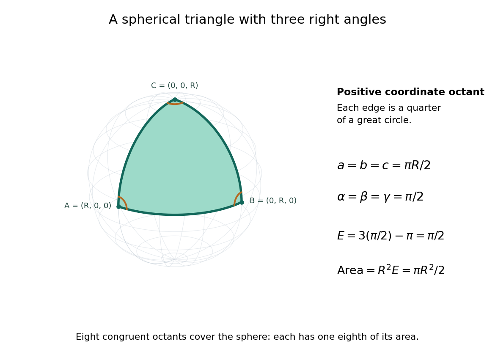

**[Figure 1](#image-three-quarter-great-circle-sides-enclose-a-spherical-octant-with-three-right-angles-and-area-pi-r-2-2). Three quarter-great-circle sides enclose a spherical octant with three right angles and area $\pi R^2/2$**.

### Convex regular spherical polygon

↑ **Parent:** [Spherical geometry](#spherical-geometry)

A nondegenerate convex regular spherical $n$-gon contained in an [open hemisphere](euclidean-geometry.md#open-hemisphere) has equal interior angles $\alpha$ in the displayed interval. The [spherical excess formula](differential-geometry.md#spherical-excess-formula) gives area $n\alpha-(n-2)\pi>0$. Conversely, put equally spaced vertices at colatitude $t\in(0,\pi/2)$ around a pole. Dividing each central triangle in half gives $\cot(\alpha/2)=\cos t\tan(\pi/n)$ by the [spherical law of cosines](#spherical-law-of-cosines). As $t$ increases, the angle ranges continuously from the Euclidean limiting angle to $\pi$.

### Spherical circle

↑ **Parent:** [Spherical geometry](#spherical-geometry)

On a sphere of radius $R$, a spherical circle of radius $r\in(0,\pi R)$ is the locus at [spherical distance](#great-circle-distance) $r$ from its center. Its polar angle about that center is $r/R$, so parametrization by longitude has speed $R\sin(r/R)$. Its circumference is therefore $2\pi R\sin(r/R)$. For small $r$, this is $2\pi r-\pi r^3/(3R^2)+O(r^5)$, with the deficit determined by the sphere's positive [Gaussian curvature](second-fundamental-form.md#gaussian-curvature).

### Spherical lune

↑ **Parent:** [Spherical geometry](#spherical-geometry)

A spherical lune is the region between two great semicircles joining antipodal points. On a unit sphere a lune of opening angle $\alpha$ has area $2\alpha$, obtained by integrating area over longitude width $\alpha$. Lune area counting yields the [spherical excess formula](differential-geometry.md#spherical-excess-formula).

### Great-circle distance

↑ **Parent:** [Spherical geometry](#spherical-geometry)

For points on a [sphere](euclidean-geometry.md#sphere) of radius $R$, write their position [vectors](vector-space.md#vector) relative to the centre as $Ru,Rv$ with $u,v$ [unit vectors](vector-space.md#unit-vector). The [great-circle distance](#great-circle-distance) is the shorter [great circle](euclidean-geometry.md#great-circle) arc length, $R$ times its central angle. Hence it equals $R\arccos(u\cdot v)$, including zero for identical points and $\pi R$ for antipodal points. At antipodal points the shortest arc is not unique, but its length is.

### Spherical trigonometry

↑ **Parent:** [Spherical geometry](#spherical-geometry)  
ⓦ [Wiki](https://en.wikipedia.org/wiki/Spherical_trigonometry)

[Spherical trigonometry](#spherical-trigonometry) calculates the sides and interior [angles](#angle) of [spherical triangles](#spherical-triangle) using [trigonometric functions](#trigonometric-function). Its sides must be shorter [great circle](euclidean-geometry.md#great-circle) arcs, which are [geodesics](riemannian-geometry.md#geodesic) on a round [sphere](euclidean-geometry.md#sphere). A curve at constant nonzero [latitude](astrophysics.md#geographical-latitude) does not qualify. The [spherical law of sines](#spherical-law-of-sines) and [spherical law of cosines](#spherical-law-of-cosines) play the roles of the familiar flat-triangle rules, but account for the [sphere](euclidean-geometry.md#sphere)'s [curvature](differential-geometry.md#curvature).

Use uppercase $A,B,C$ both for the vertices and for their interior [angles](#angle), and lowercase $a,b,c$ for the opposite angular sides. For example, $a$ is the central [angle](#angle) subtended by the arc from $B$ to $C$. On a [sphere](euclidean-geometry.md#sphere) of [radius](topology.md#radius) $R$, its physical [arc length](riemannian-geometry.md#arc-length) is $\ell_a=Ra$ when $a$ is in [radians](#radian); similarly $\ell_b=Rb$ and $\ell_c=Rc$. Only on the [unit sphere](topology.md#unit-sphere) do the angular and physical side [lengths](physics.md#length) have the same numerical values. See [J. B. Tatum, Celestial Mechanics, chapter 3, section 3.5: great-circle sides and angular units](https://www.astro.uvic.ca/~tatum/celmechs/celm3.pdf).

One useful application of [spherical trigonometry](#spherical-trigonometry) is finding [great-circle distance](#great-circle-distance) from [spherical coordinates](multivariable-calculus.md#spherical-coordinate-system). Write a [unit vector](vector-space.md#unit-vector) as $u(\phi,\lambda)=(\cos\phi\cos\lambda,\cos\phi\sin\lambda,\sin\phi)$, where $\phi$ is [latitude](astrophysics.md#geographical-latitude) and $\lambda$ is the equatorial [azimuth](astrophysics.md#azimuth), or longitude, measured from a chosen reference direction. The [dot product](inner-product.md#dot-product) of two such [unit vectors](vector-space.md#unit-vector) gives

$$
\cos\delta=\sin\phi_1\sin\phi_2+\cos\phi_1\cos\phi_2\cos(\lambda_2-\lambda_1),\qquad d=R\delta.
$$

Here $\delta\in[0,\pi]$ is the central [angle](#angle) and $d$ is the [great-circle distance](#great-circle-distance). The same identity follows from the [spherical law of cosines](#spherical-law-of-cosines) by adding the north pole as the third vertex, with angular sides $\pi/2-\phi_1$ and $\pi/2-\phi_2$. This connects [spherical geometry](#spherical-geometry) to position calculations in [astronomy](astronomy.md) and to navigation on a spherical model of [Earth](planetary-science.md#earth). Choosing the surface model matters: [Paula Neeley and Anthony Narkawicz, Map Projection Induced Variations in Locations of Polygon Geofence Edges, NASA/TM-2017-219675 (2017), sections 2-3](https://ntrs.nasa.gov/api/citations/20170011116/downloads/20170011116.pdf) distinguishes spherical and ellipsoidal [geodesics](riemannian-geometry.md#geodesic) and gives this coordinate identity.

For a toy example, put two points at [latitude](astrophysics.md#geographical-latitude) $30^\circ$, with equatorial [azimuths](astrophysics.md#azimuth) $-60^\circ$ and $60^\circ$. The [great-circle distance](#great-circle-distance) and the [arc length](riemannian-geometry.md#arc-length) along constant [latitude](astrophysics.md#geographical-latitude) are

$$
d=R\arccos\!\left(\frac14+\frac34\cos120^\circ\right)=R\arccos(-1/8)\approx1.696124R,\qquad \ell_{\mathrm{parallel}}=R\cos30^\circ\frac{2\pi}{3}\approx1.813799R.
$$

The [great circle](euclidean-geometry.md#great-circle) takes a shorter route by bending towards the pole in these [spherical coordinates](multivariable-calculus.md#spherical-coordinate-system). To locate its highest [latitude](astrophysics.md#geographical-latitude), the endpoint [unit vectors](vector-space.md#unit-vector) are $p=(\sqrt3/4,-3/4,1/2)$ and $q=(\sqrt3/4,3/4,1/2)$. Their [great circle](euclidean-geometry.md#great-circle) lies in the [plane](#plane) through the origin with $z=2x/\sqrt3$. On its shorter arc, the maximum [latitude](astrophysics.md#geographical-latitude) occurs at $y=0$ and is $\arctan(2/\sqrt3)\approx49.106605^\circ$. Thus a [geodesic](riemannian-geometry.md#geodesic) can change [latitude](astrophysics.md#geographical-latitude) substantially even when its endpoints have equal [latitude](astrophysics.md#geographical-latitude). These are lengths on an ideal [sphere](euclidean-geometry.md#sphere); the example illustrates the geometry rather than specifying an actual flight route.

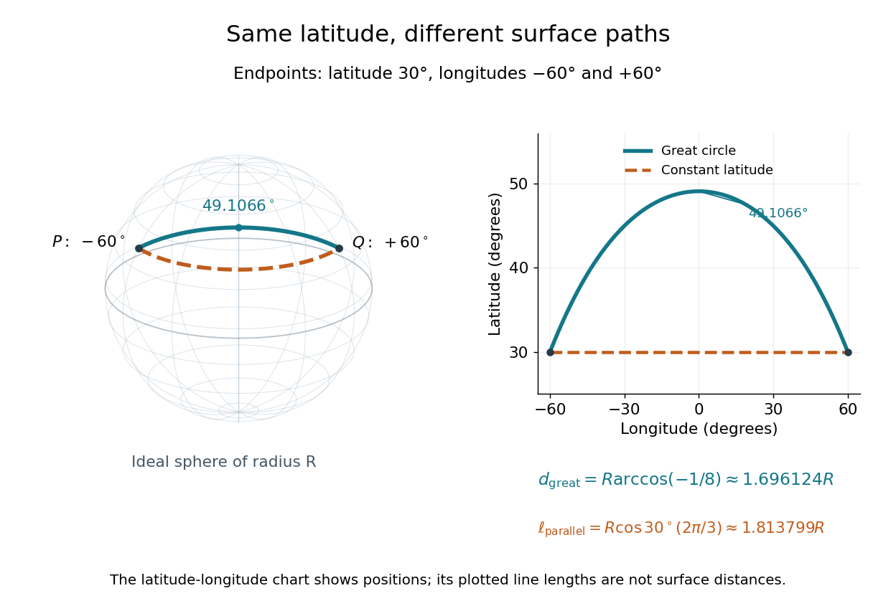

**[Figure 2](#image-on-an-ideal-sphere-two-points-at-latitude-30-circ-and-longitudes-pm60-circ-are-joined-by-a-shorter-great-circle-arc-reaching-latitude-49-106605-circ). On an ideal sphere, two points at latitude $30^\circ$ and longitudes $\pm60^\circ$ are joined by a shorter great-circle arc reaching latitude $49.106605^\circ$**.

Historically, [spherical trigonometry](#spherical-trigonometry) was prominent in teaching as well as in [astronomy](astronomy.md). John Conway and Alex Ryba note its presence in early twentieth-century school textbooks in [Remembering spherical trigonometry, The Mathematical Gazette 100(547), March 2016, pages 1-8, DOI 10.1017/mag.2016.3](https://www.cambridge.org/core/journals/mathematical-gazette/article/abs/remembering-spherical-trigonometry/5282E6A1C67D0BF0DBEC096EF8C1CBF5). Their introductory observation documents that teaching history; it does not identify a single inventor of the [spherical law of sines](#spherical-law-of-sines) or [spherical law of cosines](#spherical-law-of-cosines).

#### Spherical law of sines

↑ **Parent:** [Spherical trigonometry](#spherical-trigonometry)

For a nondegenerate convex minor [spherical triangle](#spherical-triangle), with angular sides $a,b,c$ opposite interior [angles](#angle) $A,B,C$, the [spherical law of sines](#spherical-law-of-sines) states

$$
\frac{\sin A}{\sin a}=\frac{\sin B}{\sin b}=\frac{\sin C}{\sin c}.
$$

The [sines](#sine) of sides refer to central [angles](#angle), so a physical side [length](physics.md#length) $\ell_a$ on a [sphere](euclidean-geometry.md#sphere) of [radius](topology.md#radius) $R$ must enter as $\sin(\ell_a/R)$. All six [angles](#angle) lie in $(0,\pi)$, and the denominators are positive. The reciprocal form, $\sin a/\sin A=\sin b/\sin B=\sin c/\sin C$, is equivalent. This is Tatum's sine formula, equation 3.5.1, in [Celestial Mechanics, section 3.5: spherical sine and cosine formulas](https://www.astro.uvic.ca/~tatum/celmechs/celm3.pdf).

A short proof explains the [symmetry](physics.md#symmetry-physics) of the [spherical law of sines](#spherical-law-of-sines). Let $u,v,w$ be the vertex [unit vectors](vector-space.md#unit-vector) at $A,B,C$. At $u$, the outgoing unit [tangent vectors](tangent-vector.md) towards $v,w$ are $t_B=(v-\cos c\,u)/\sin c$ and $t_C=(w-\cos b\,u)/\sin b$. Their [angle](#angle) is $A$, so the magnitude of their [cross product](vector-space.md#cross-product) is $\sin A$. Since both [tangent vectors](tangent-vector.md) are [orthogonal](inner-product.md#orthogonal-vectors) to $u$, the [scalar triple product](multilinear-algebra.md#scalar-triple-product) obeys

$$
|u\cdot(v\times w)|=\sin b\sin c\sin A=\sin c\sin a\sin B=\sin a\sin b\sin C.
$$

Dividing by $\sin a\sin b\sin c$ proves the [spherical law of sines](#spherical-law-of-sines). Its beauty is that the same three-dimensional [scalar triple product](multilinear-algebra.md#scalar-triple-product) can be calculated at any vertex, producing all three ratios at once.

For the [spherical triangle](#spherical-triangle) worked out under the [spherical law of cosines](#spherical-law-of-cosines), $A=90^\circ$, $b=c=60^\circ$ and $\cos a=1/4$. Hence $\sin a=\sqrt{15}/4$, and the [spherical law of sines](#spherical-law-of-sines) gives

$$
\sin B=\frac{\sin b\sin A}{\sin a}=\frac{\sqrt3/2}{\sqrt{15}/4}=\frac2{\sqrt5}.
$$

The [inverse sine](#inverse-sine) gives $B\approx63.434949^\circ$, but the supplementary [angle](#angle) $116.565051^\circ$ has the same [sine](#sine). The [spherical law of sines](#spherical-law-of-sines) alone therefore leaves two candidates for this [angle](#angle). The [spherical law of cosines](#spherical-law-of-cosines), using the known three sides, gives $\cos B=1/\sqrt5>0$ and selects $63.434949^\circ$; likewise $C=B$. When only two sides and an opposite [angle](#angle) are given, two distinct valid [spherical triangles](#spherical-triangle) can remain. A [cosine](#cosine) relation resolves an [inverse sine](#inverse-sine) branch only when enough additional data are known; it does not make every ambiguous data set unique.

#### Spherical law of cosines

↑ **Parent:** [Spherical trigonometry](#spherical-trigonometry)  
ⓦ [Wiki](https://en.wikipedia.org/wiki/Spherical_law_of_cosines)

For a nondegenerate convex minor [spherical triangle](#spherical-triangle), the [spherical law of cosines](#spherical-law-of-cosines) relates two angular sides $b,c$, their included interior [angle](#angle) $A$, and the opposite angular side $a$:

$$
\cos a=\cos b\cos c+\sin b\sin c\cos A.
$$

Relabelling the vertices gives the corresponding formulas for $b,B$ and $c,C$. As with the [spherical law of sines](#spherical-law-of-sines), physical side [lengths](physics.md#length) must first be divided by the [sphere](euclidean-geometry.md#sphere)'s [radius](topology.md#radius). The [spherical law of cosines](#spherical-law-of-cosines) determines $a\in(0,\pi)$ uniquely from $b,c,A$ when the data describe such a [spherical triangle](#spherical-triangle). It also recovers each interior [angle](#angle) from three sides, for example

$$
\cos A=\frac{\cos a-\cos b\cos c}{\sin b\sin c}.
$$

Using the [cosine](#cosine) and the range $0<A<\pi$ selects a unique [angle](#angle), avoiding the supplementary-angle ambiguity of an [inverse sine](#inverse-sine) calculation.

To derive the [spherical law of cosines](#spherical-law-of-cosines), let $u,v,w$ be the vertex [unit vectors](vector-space.md#unit-vector) at $A,B,C$, so $u\cdot v=\cos c$, $u\cdot w=\cos b$ and $v\cdot w=\cos a$. The outgoing unit [tangent vectors](tangent-vector.md) at $u$ are $t_B=(v-\cos c\,u)/\sin c$ and $t_C=(w-\cos b\,u)/\sin b$. Their [dot product](inner-product.md#dot-product) is both $\cos A$ and $(\cos a-\cos b\cos c)/(\sin b\sin c)$, proving the identity. This gives a geometric explanation: [spherical trigonometry](#spherical-trigonometry) compares [angles](#angle) in the [tangent plane](tangent-vector.md#tangent-plane) using [vectors](vector-space.md#vector) in the surrounding [Euclidean space](normed-vector-space.md#euclidean-norm).

For a worked example on the [unit sphere](topology.md#unit-sphere), take the vertices

$$
A=(0,0,1),\qquad B=(\sqrt3/2,0,1/2),\qquad C=(0,\sqrt3/2,1/2).
$$

At $A$, the outgoing unit [tangent vectors](tangent-vector.md) are $(1,0,0)$ and $(0,1,0)$, so the interior [angle](#angle) is a [right angle](euclidean-geometry.md#right-angle). The vertex [dot products](inner-product.md#dot-product) give $b=c=\pi/3=60^\circ$. The [spherical law of cosines](#spherical-law-of-cosines) then reduces to the right-angle identity $\cos a=\cos b\cos c$, giving

$$
\cos a=\frac14,\qquad a=\arccos(1/4)\approx1.318116\text{ radians}=75.522488^\circ.
$$

To find $B$, use the relabelled [spherical law of cosines](#spherical-law-of-cosines):

$$
\cos B=\frac{\cos b-\cos a\cos c}{\sin a\sin c}=\frac{1/2-1/8}{(\sqrt{15}/4)(\sqrt3/2)}=\frac1{\sqrt5},\qquad B=C\approx63.434949^\circ.
$$

The physical side [lengths](physics.md#length) on a [sphere](euclidean-geometry.md#sphere) of [radius](topology.md#radius) $R$ are $\ell_a\approx1.318116R$ and $\ell_b=\ell_c=\pi R/3\approx1.047198R$. For example, on a toy [sphere](euclidean-geometry.md#sphere) with $R=10$ metres they are approximately $13.18116$, $10.47198$ and $10.47198$ metres; the interior [angles](#angle) stay the same. Applying the planar [Pythagorean theorem](euclidean-geometry.md#pythagorean-theorem) directly to the angular sides would instead give $\sqrt{60^2+60^2}\approx84.852814^\circ$. That flat [right triangle](euclidean-geometry.md#right-triangle) calculation does not give the [great-circle distance](#great-circle-distance) between $B$ and $C$.

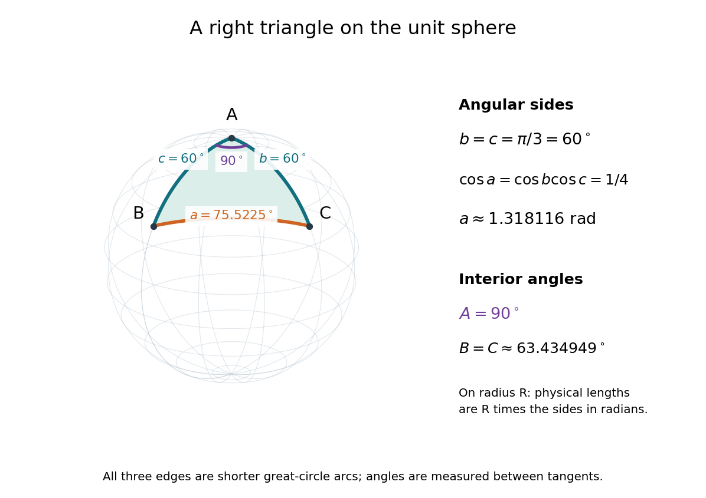

**[Figure 3](#image-a-non-octant-spherical-triangle-with-a-right-angle-at-a-angular-sides-b-c-60-circ-and-a-75-522488-circ-and-interior-angles-b-c-63-434949-circ). A non-octant spherical triangle with a right angle at $A$, angular sides $b=c=60^\circ$ and $a=75.522488^\circ$, and interior angles $B=C=63.434949^\circ$**.

The familiar [law of cosines](euclidean-geometry.md#law-of-cosines) reappears as a local approximation. With $a,b,c$ all small in [radians](#radian), substitute the [small-angle approximations](#small-angle-approximation) $\sin x\approx x$ and $\cos x\approx1-x^2/2$ into the [spherical law of cosines](#spherical-law-of-cosines) and keep terms through second order:

$$
1-\frac{a^2}{2}\approx1-\frac{b^2+c^2}{2}+bc\cos A,\qquad a^2\approx b^2+c^2-2bc\cos A.
$$

Multiplication by $R^2$ gives the planar [law of cosines](euclidean-geometry.md#law-of-cosines) for the physical side [lengths](physics.md#length). For a fixed small surface [triangle](euclidean-geometry.md#triangle) on a progressively larger [sphere](euclidean-geometry.md#sphere), the angular sides shrink and this approximation improves. Thus the curved and flat formulas fit together: the [Pythagorean theorem](euclidean-geometry.md#pythagorean-theorem) is recovered locally when $A$ is a [right angle](euclidean-geometry.md#right-angle).

### Spherical triangle

↑ **Parent:** [Spherical geometry](#spherical-geometry)

A [spherical triangle](#spherical-triangle) is bounded by three [great circle](euclidean-geometry.md#great-circle) arcs. For the usual convex minor [spherical triangle](#spherical-triangle), the vertices are neither antipodal nor on one [great circle](euclidean-geometry.md#great-circle), and its angular sides and interior [angles](#angle) lie in $(0,\pi)$. An interior [angle](#angle) is measured between outgoing [tangent vectors](tangent-vector.md) to the two sides at a vertex, rather than between straight chords inside the [sphere](euclidean-geometry.md#sphere). The [spherical law of sines](#spherical-law-of-sines) and [spherical law of cosines](#spherical-law-of-cosines) determine its side-angle relations; the [spherical excess formula](differential-geometry.md#spherical-excess-formula) determines its [area](differential-geometry.md#surface-area).

#### Spherical triangle reflection group

↑ **Parent:** [Spherical triangle](#spherical-triangle)

Reflections in the sides of a spherical triangle of angles $\pi/p,\pi/q,\pi/r$ generate a finite [group](group.md) when its images tessellate the sphere. The triangle area is $\pi(1/p+1/q+1/r-1)$ by the [spherical excess formula](differential-geometry.md#spherical-excess-formula). Label its three vertex types and continue those labels across each reflected side; they are consistent around every vertex and, because the sphere is [simply connected](algebraic-topology.md#simply-connected-space), globally. The generated group preserves these labels, so a chamber stabilizer fixes all three vertices and is trivial. Dividing sphere area by chamber area gives its order. Up to permutation the possibilities are $(2,2,n)$ for $n\geq2$, and $(2,3,3),(2,3,4),(2,3,5)$, of orders $4n,24,48,120$.

## Convex geometry

↑ **Parent:** [Geometry and topology](geometry-and-topology.md)  
ⓦ [Wiki](https://en.wikipedia.org/wiki/Convex_geometry)

The study of [convex sets](convex-set.md), their [convex hulls](convex-set.md#convex-hull), supporting [closed half-spaces](convex-set.md#closed-half-space), and inequalities for their sizes.

### Minkowski addition

↑ **Parent:** [Convex geometry](#convex-geometry)  
ⓦ [Wiki](https://en.wikipedia.org/wiki/Minkowski_addition)

The [Minkowski sum](#minkowski-addition) of [subsets](set.md#subset) $A,B$ of a [vector space](vector-space.md) collects the result of [vector addition](vector-space.md#vector-addition) for every possible pair:

$$
A+B=\{a+b:a\in A,\ b\in B\}=\bigcup_{b\in B}(A+b).
$$

Think of fixing a point $b$ of $B$, making a [translation](#translation-geometry) of the whole of $A$ by $b$, and then taking the [union](set.md#set-union) of these copies over every $b\in B$. The points of $B$ specify displacement [vectors](vector-space.md#vector); they need not be the centre of a shape. [Minkowski addition](#minkowski-addition) applies to nonconvex [sets](set.md) too. It is different from [set union](set.md#set-union): for $A=B=\{0,1\}$ on the real line, $A\cup B=\{0,1\}$ but $A+B=\{0,1,2\}$.

For axis-aligned [rectangles](euclidean-geometry.md#rectangle) in the [Euclidean plane](#euclidean-plane), the coordinate [intervals](real-analysis.md#interval-mathematics) add separately:

$$
([0,a]\times[0,b])+([0,c]\times[0,d])=[0,a+c]\times[0,b+d],\qquad a,b,c,d>0.
$$

Every coordinate between $0$ and $a+c$ can be split into one coordinate in $[0,a]$ and another in $[0,c]$, and likewise for the vertical coordinate. Thus a $2\times1$ [rectangle](euclidean-geometry.md#rectangle) plus a $1\times2$ [rectangle](euclidean-geometry.md#rectangle) gives a $3\times3$ [square](euclidean-geometry.md#square) of [area](differential-geometry.md#surface-area) $9$, although the two input [areas](differential-geometry.md#surface-area) total only $4$. The [Minkowski sum](#minkowski-addition) adds possible displacements, so its [area](differential-geometry.md#surface-area) need not be the sum of input [areas](differential-geometry.md#surface-area).

For closed [Euclidean disks](topology.md#disk-mathematics) $D_r=\{x\in\mathbb R^2:\|x\|\leq r\}$ centred at the origin, the [triangle inequality](topological-analysis.md#triangle-inequality) gives $D_r+D_s\subseteq D_{r+s}$. Conversely, if $r+s>0$, split any $x\in D_{r+s}$ as $x=rx/(r+s)+sx/(r+s)$. Therefore $D_r+D_s=D_{r+s}$, including the case $r=s=0$. Disks of [radii](topology.md#radius) $1$ and $2$ give a [disk](topology.md#disk-mathematics) of [radius](topology.md#radius) $3$, with [areas](differential-geometry.md#surface-area) $\pi,4\pi,9\pi$. For [disks](topology.md#disk-mathematics) with centres $u,v$, the resulting centre is $u+v$. These two examples lead to the root-of-[area](differential-geometry.md#surface-area) comparison in the [Brunn-Minkowski theorem](#brunn-minkowski-theorem).

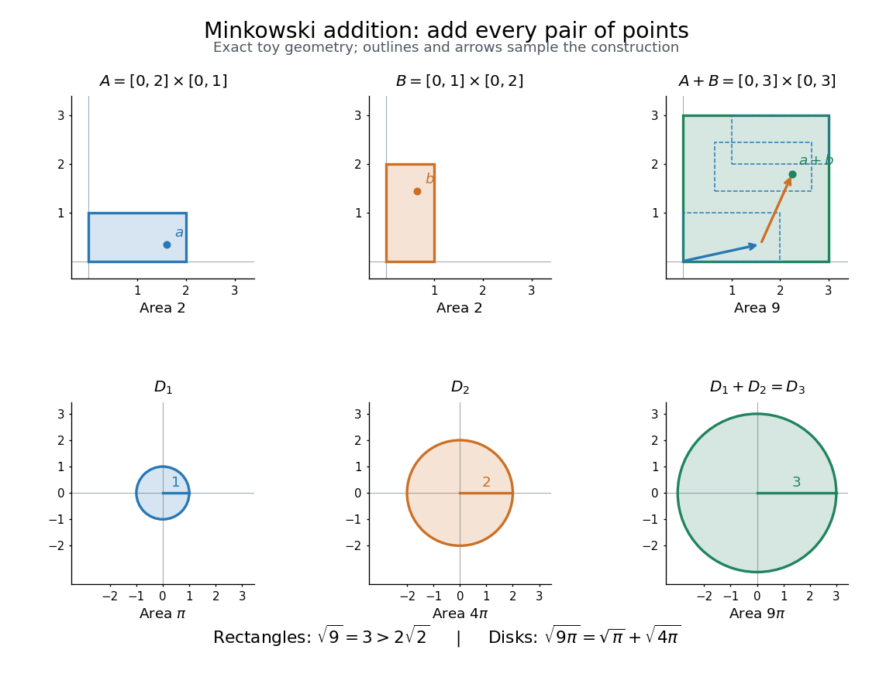

**[Figure 4](#image-minkowski-addition-of-two-rectangles-and-of-two-closed-disks-exact-toy-shapes-sample-displacement-arrows-and-the-square-root-of-area-comparison). Minkowski addition of two rectangles and of two closed disks: exact toy shapes, sample displacement arrows, and the square-root-of-area comparison**.

[Minkowski addition](#minkowski-addition) is commutative and associative because [vector addition](vector-space.md#vector-addition) is. Its identity is the [singleton](set.md#singleton-mathematics) $\{0\}$, and $A+\varnothing=\varnothing$. For displacement [vectors](vector-space.md#vector) $u,v$ and $t>0$, [translations](#translation-geometry) and [uniform dilations](vector-space.md#uniform-dilation) satisfy

$$
(A+u)+(B+v)=(A+B)+(u+v),\qquad t(A+B)=tA+tB,
$$

where $tA=\{ta:a\in A\}$ uses [scalar multiplication](vector-space.md#scalar-multiplication). A [Minkowski sum](#minkowski-addition) of [convex sets](convex-set.md) is [convex](real-analysis.md#convex-function): a [line segment](convex-set.md#line-segment) between $a_1+b_1$ and $a_2+b_2$ is obtained by adding the corresponding points of the [line segments](convex-set.md#line-segment) in $A$ and $B$. Closure requires care; see [sum of two closed sets need not be closed](#sum-of-two-closed-sets-need-not-be-closed) and [sum of a compact set and a closed set](#sum-of-a-compact-set-and-a-closed-set).

#### Minkowski addition for collision detection

↑ **Parent:** [Minkowski addition](#minkowski-addition)

Suppose a robot occupies a closed [set](set.md) $R\subseteq\mathbb R^n$ relative to its chosen reference point, and a closed obstacle occupies $O$. Keep the robot's orientation fixed and allow only [translations](#translation-geometry). At reference [position](classical-mechanics.md#position) $q$, its occupied [set](set.md) is $q+R$. If touching counts as collision, the forbidden [positions](classical-mechanics.md#position) in this [configuration space](classical-mechanics.md#mechanical-configuration-space) are exactly

$$
\begin{aligned}
q\in C_{\mathrm{obs}}&\iff(q+R)\cap O\ne\varnothing\\
&\iff q+r=o\text{ for some }r\in R,\ o\in O\\
&\iff q\in O+(-R),\qquad -R=\{-r:r\in R\}.
\end{aligned}
$$

The minus sign reflects the robot through its reference origin: solving $q+r=o$ gives $q=o-r$. Thus collision checking for a moving shape becomes checking whether one point lies in a fixed [Minkowski sum](#minkowski-addition). Steven M. LaValle derives this translational [configuration space](classical-mechanics.md#mechanical-configuration-space) construction in [Planning Algorithms, section 4.3.2, equation 4.37 and Example 4.13](https://msl.cs.uiuc.edu/planning/node161.html).

For a concrete toy example, take the robot [rectangle](euclidean-geometry.md#rectangle) $R=[0,2]\times[0,1]$ with its reference point at the lower-left corner, and obstacle [rectangle](euclidean-geometry.md#rectangle) $O=[4,6]\times[2,4]$. Their collision region is the [rectangle](euclidean-geometry.md#rectangle)

$$
O+(-R)=[2,6]\times[1,4],\qquad \lambda_2(C_{\mathrm{obs}})=4\cdot3=12.
$$

For example, $q=(3,3/2)$ is forbidden: $q+R=[3,5]\times[3/2,5/2]$ meets $O$ in $[4,5]\times[2,5/2]$, of [area](differential-geometry.md#surface-area) $1/2$. At $q=(2,1)$ there is just corner contact, which our convention also forbids. Using $O+R=[4,8]\times[2,5]$ instead would wrongly miss both reference [positions](classical-mechanics.md#position). Only when $R=-R$, as for an origin-centred [disk](topology.md#disk-mathematics), does the reflection leave the robot [set](set.md) unchanged.

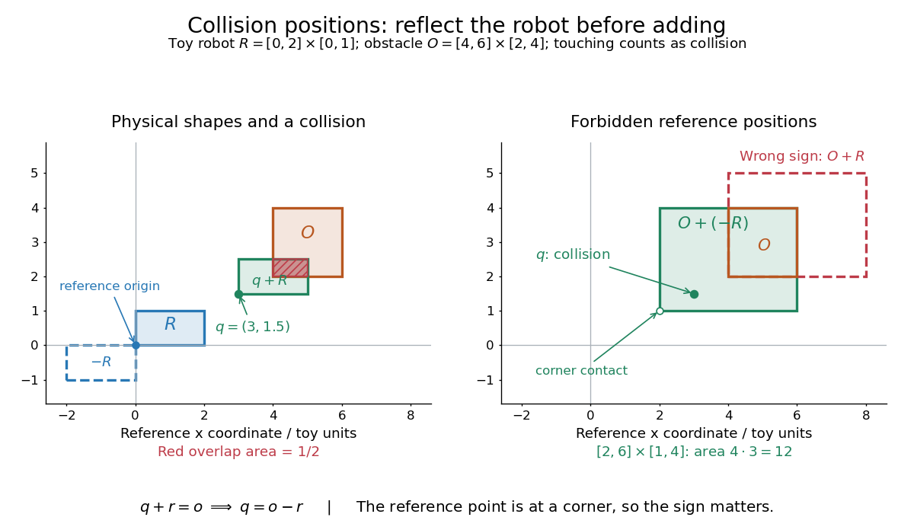

**[Figure 5](#image-toy-translational-collision-geometry-a-corner-referenced-robot-requires-o-plus-r-of-area-12-and-its-positive-minkowski-sum-o-plus-r-puts-forbidden-positions-on-the-wrong-side). Toy translational collision geometry: a corner-referenced robot requires $O+(-R)$, of area $12$, and its positive Minkowski sum $O+R$ puts forbidden positions on the wrong side**.

The same calculation handles bounded additive uncertainty. If the actual reference [position](classical-mechanics.md#position) is $q+e$ for any $e\in E$, the [union](set.md#set-union) of possible occupied [sets](set.md) is $q+(E+R)$. There exists an allowed error causing contact exactly when

$$
q\in O+(-(E+R))=O+(-R)+(-E).
$$

Consequently avoiding this [set](set.md) guarantees avoidance for every $e\in E$ in this model. For $E=[-\varepsilon,\varepsilon]^2$, the example's forbidden region becomes $[2-\varepsilon,6+\varepsilon]\times[1-\varepsilon,4+\varepsilon]$, with [area](differential-geometry.md#surface-area) $(4+2\varepsilon)(3+2\varepsilon)$. Here $-E=E$ because the error bounds are symmetric; a one-sided error [set](set.md) must still be negated. This is a worst-case geometric bound, not a probability of collision. Rotating the robot requires an orientation-dependent [Minkowski sum](#minkowski-addition) for each orientation.

#### Sum of two closed sets need not be closed

↑ **Parent:** [Minkowski addition](#minkowski-addition)

In $\mathbb R$, the sets $X=\{n:n\ge1\}$ and $Y=\{-n+1/n:n\ge1\}$ are closed because their points have no finite accumulation point. Their [Minkowski sum](#minkowski-addition) contains $1/n\to0$ but does not contain zero, since $m-n+1/n=0$ has no positive-integer solution. Compactness of one summand is a useful sufficient condition missing from this counterexample.

#### Sum of a compact set and a closed set

↑ **Parent:** [Minkowski addition](#minkowski-addition)

In Euclidean space, a [Minkowski sum](#minkowski-addition) of a compact set $X$ and a closed set $Y$ is closed. From any convergent sequence $x_j+y_j$, extract a convergent subsequence of $x_j$ using compactness. The corresponding $y_j$ then converges to the difference of the two limits, which lies in $Y$. If $Y$ is also bounded, the sum is bounded and therefore compact.

#### Brunn-Minkowski theorem

↑ **Parent:** [Minkowski addition](#minkowski-addition)  
ⓦ [Wiki](https://en.wikipedia.org/wiki/Brunn–Minkowski_theorem)

Let $n\geq1$ and let $A,B\subseteq\mathbb R^n$ be nonempty [Lebesgue measurable sets](measure-theory.md#lebesgue-measurable-set) with finite [Lebesgue measures](measure-theory.md#lebesgue-measure). Assume that $A+B$ is also a [Lebesgue measurable set](measure-theory.md#lebesgue-measurable-set); its [measure](measure.md) may be infinite. Then

$$
\lambda_n(A+B)^{1/n}\geq\lambda_n(A)^{1/n}+\lambda_n(B)^{1/n}.
$$

Here $\lambda_n$ denotes $n$-dimensional [Lebesgue measure](measure-theory.md#lebesgue-measure) in [Euclidean space](normed-vector-space.md#euclidean-norm). Nonempty [compact sets](topology.md#compact-space) and nonempty [open sets](topology.md#open-set) of finite [measure](measure.md) satisfy the measurability assumptions. Measurability of arbitrary summands alone does not guarantee measurability of their [Minkowski sum](#minkowski-addition). The theorem does not require [convexity](real-analysis.md#convex-function). See [R. J. Gardner, The Brunn-Minkowski Inequality (2002), Theorem 4.1 and the following remarks](https://sites.stat.washington.edu/jaw/COURSES/520s/523/HO.523.20/Gardner.BullAMS.02.pdf).

The $n$th root converts a volume into a quantity that scales like a [length](physics.md#length): [uniform dilation](vector-space.md#uniform-dilation) gives $\lambda_n(tA)^{1/n}=t\lambda_n(A)^{1/n}$ for $t>0$. In the [Euclidean plane](#euclidean-plane) the theorem compares square roots of [areas](differential-geometry.md#surface-area), not the [areas](differential-geometry.md#surface-area) themselves. For the two [rectangles](euclidean-geometry.md#rectangle) above it reads $3\geq\sqrt2+\sqrt2=2\sqrt2$. Equivalently their sum has [area](differential-geometry.md#surface-area) $9\geq8$. For the two [disks](topology.md#disk-mathematics), it reads $3\sqrt\pi=\sqrt\pi+2\sqrt\pi$, an equality. These are exact geometric examples, not measured data.

Applying the theorem to the scaled [sets](set.md) gives, whenever that sum is a [Lebesgue measurable set](measure-theory.md#lebesgue-measurable-set),

$$
\lambda_n((1-t)A+tB)^{1/n}\geq(1-t)\lambda_n(A)^{1/n}+t\lambda_n(B)^{1/n},\qquad 0<t<1.
$$

For [convex bodies](#convex-body), this means the root-volume of the interpolated shape lies above the straight line between the input root-volumes. In fact $t\mapsto\lambda_n((1-t)A+tB)^{1/n}$ is a [concave function](real-analysis.md#concave-function) on $[0,1]$: [convexity](real-analysis.md#convex-function) gives $sA+tA=(s+t)A$ for $s,t\geq0$, so interpolating two intermediate shapes gives another intermediate shape and the same inequality applies. The beauty is that no particular boundary shape appears in the bound: possible pointwise displacements force a minimum amount of space.

For [convex bodies](#convex-body) $A,B$, equality holds exactly when they are [homothetic convex bodies](#homothetic-convex-bodies), meaning $B=v+sA$ for some [vector](vector-space.md#vector) $v$ and $s>0$. This equality qualification is part of the [Brunn-Minkowski theorem](#brunn-minkowski-theorem) for [convex bodies](#convex-body). [Gardner (2002), introduction, equation 2 and its equality condition](https://sites.stat.washington.edu/jaw/COURSES/520s/523/HO.523.20/Gardner.BullAMS.02.pdf) For positive-sided axis-aligned [rectangles](euclidean-geometry.md#rectangle), the comparison can be checked directly:

$$
(a+c)(b+d)-(\sqrt{ab}+\sqrt{cd})^2=(\sqrt{ad}-\sqrt{bc})^2\geq0.
$$

Equality requires $ad=bc$: the [rectangles](euclidean-geometry.md#rectangle) must have the same aspect ratio. Our $2\times1$ and $1\times2$ [rectangles](euclidean-geometry.md#rectangle) do not. All positive-radius [disks](topology.md#disk-mathematics) are [homothetic convex bodies](#homothetic-convex-bodies), explaining their equality.

Do not apply that equality criterion without its hypotheses. If $A=\{a\}$, its [Lebesgue measure](measure-theory.md#lebesgue-measure) is zero and $A+B$ is a [translation](#translation-geometry) of $B$, so equality holds even for nonconvex $B$. Also, changing a summand on a [null set](measure-theory.md#null-set) can change the [measure](measure.md) of its [Minkowski sum](#minkowski-addition): in one dimension, $A=[0,1]\cup\{3\}$ and $B=[0,1]$ both have [measure](measure.md) $1$, but $A+B=[0,2]\cup[3,4]$ has [measure](measure.md) $3$. Removing the single extra point restores equality with sum [measure](measure.md) $2$. Thus merely being equal almost everywhere to [homothetic convex bodies](#homothetic-convex-bodies) is not a sufficient equality test for arbitrary [sets](set.md).

The [Brunn-Minkowski theorem](#brunn-minkowski-theorem) also bounds the collision-region [volume](#volume): for positive-volume [compact sets](topology.md#compact-space) $O,R$, reflection preserves [Lebesgue measure](measure-theory.md#lebesgue-measure), so $\lambda_n(O+(-R))^{1/n}\geq\lambda_n(O)^{1/n}+\lambda_n(R)^{1/n}$. In the toy collision example this gives [area](differential-geometry.md#surface-area) at least $(2+\sqrt2)^2=6+4\sqrt2\approx11.657$, compared with the exact [area](differential-geometry.md#surface-area) $12$. A lower bound alone does not identify safe reference [positions](classical-mechanics.md#position); the actual [Minkowski sum](#minkowski-addition) supplies those.

### Convex body

↑ **Parent:** [Convex geometry](#convex-geometry)

A [convex body](#convex-body) in $\mathbb R^n$ is a [compact](topology.md#compact-space) [convex set](convex-set.md) with nonempty [interior](topology.md#interior-topology) in the ambient [Euclidean space](normed-vector-space.md#euclidean-norm). It consequently has positive finite [Lebesgue measure](measure-theory.md#lebesgue-measure). A filled [rectangle](euclidean-geometry.md#rectangle) with positive side [lengths](physics.md#length) and a closed positive-radius [Euclidean disk](topology.md#disk-mathematics) are planar [convex bodies](#convex-body). A [line segment](convex-set.md#line-segment) in $\mathbb R^2$ has empty ambient [interior](topology.md#interior-topology) and is not a [convex body](#convex-body) under this convention. This is the convention used in the [Brunn-Minkowski theorem](#brunn-minkowski-theorem). [Gardner (2002), introduction](https://sites.stat.washington.edu/jaw/COURSES/520s/523/HO.523.20/Gardner.BullAMS.02.pdf)

#### Outer parallel body

↑ **Parent:** [Convex body](#convex-body)

#### Homothetic convex bodies

↑ **Parent:** [Convex body](#convex-body)

Two [convex bodies](#convex-body) are [homothetic convex bodies](#homothetic-convex-bodies) if one is a [translation](#translation-geometry) of a positive [uniform dilation](vector-space.md#uniform-dilation) of the other. Their [lengths](physics.md#length) scale by $s$ and their [volumes](#volume) by $s^n$. Closed [disks](topology.md#disk-mathematics) of positive [radii](topology.md#radius) are [homothetic convex bodies](#homothetic-convex-bodies); axis-aligned positive-sided [rectangles](euclidean-geometry.md#rectangle) are [homothetic convex bodies](#homothetic-convex-bodies) exactly when their aspect ratios agree. The [Brunn-Minkowski theorem](#brunn-minkowski-theorem) characterizes this relation by equality of root-volumes in [Minkowski addition](#minkowski-addition).

## Affine geometry

↑ **Parent:** [Geometry and topology](geometry-and-topology.md)  
ⓦ [Wiki](https://en.wikipedia.org/wiki/Affine_geometry)

The geometry of [affine spaces](#affine-space), studying incidence and parallelism without choosing an origin or a metric.

### Affine space

↑ **Parent:** [Affine geometry](#affine-geometry)  
ⓦ [Wiki](https://en.wikipedia.org/wiki/Affine_space)

A nonempty set $A$ equipped with a [group action](group-action.md) of the additive group of a [vector space](vector-space.md) $V$, such that for every $x,y\in A$ there is a unique $v\in V$ with $x+v=y$. There is no distinguished origin. Choosing one identifies $A$ with $V$; changing it gives a [translation](#translation-geometry).

#### Translated vector-space structure

↑ **Parent:** [Affine space](#affine-space)

Choosing a new origin $a$ in a [vector space](vector-space.md) transports its operations along $T(x)=x-a$. Since $T(x\oplus y)=T(x)+T(y)$ and $T(k\odot x)=kT(x)$, every [vector space](vector-space.md) axiom transfers through this [bijection](function.md#bijection). The new additive identity is $a$ and the additive inverse of $x$ is $2a-x$. This illustrates why an [affine space](#affine-space) has no preferred origin even though choosing one produces a [vector space](vector-space.md).

#### Affine independence

↑ **Parent:** [Affine space](#affine-space)

Points $p_0,\ldots,p_k$ in an [affine space](#affine-space) are [affinely independent](#affine-independence) if the only affine dependence displayed above has all coefficients zero, using any choice of origin to read the [vector](vector-space.md#vector) equation. Since the coefficients sum to zero, replacing the origin leaves that equation unchanged. Substituting $\lambda_0=-\sum_{i=1}^k\lambda_i$ shows that this condition is equivalent to [linear independence](vector-space.md#linear-independence) of $p_1-p_0,\ldots,p_k-p_0$. It also says that an affine combination of the points has unique coefficients. In $\mathbb R^n$, at most $n+1$ points can be [affinely independent](#affine-independence); $n+1$ such points span a full-dimensional [simplex](algebraic-topology.md#simplex).

##### Affine dependence

↑ **Parent:** [Affine independence](#affine-independence)

An [affine dependence](#affine-dependence) of points is a nonzero coefficient family satisfying the displayed identities. Equivalently, the augmented [vectors](vector-space.md#vector) $(x_i,1)$ are [linearly dependent](vector-space.md#linear-dependence). Both identities are independent of the chosen origin. The absence of an [affine dependence](#affine-dependence) is [affine independence](#affine-independence).

#### Integer lattice

↑ **Parent:** [Affine space](#affine-space)

The points with [integer](integer.md) coordinates in a real d-dimensional [affine space](#affine-space) with a chosen origin and coordinate basis. [Translations](#translation-geometry) by [integer](integer.md) [vectors](vector-space.md#vector) and dilations by [positive integers](integer.md#positive-integer) preserve this set. The [Gallai theorem for an integer lattice](ramsey-theory.md#gallai-theorem-for-an-integer-lattice) concerns [finite colourings](ramsey-theory.md#finite-coloring) of these points and [homothetic copies](#homothetic-copy-of-a-finite-configuration) of finite configurations of them.

#### Homothetic copy of a finite configuration

↑ **Parent:** [Affine space](#affine-space)

A [translation](#translation-geometry) and positive uniform scaling of a finite configuration $F$ in a [real vector space](vector-space.md#real-vector-space). It preserves the ratios and directions of differences between its points. In an [integer lattice](#integer-lattice), the [Gallai theorem for an integer lattice](ramsey-theory.md#gallai-theorem-for-an-integer-lattice) guarantees a [monochromatic](ramsey-theory.md#monochromatic-set) [homothetic copy](#homothetic-copy-of-a-finite-configuration) of every finite pattern in any [finite colouring](ramsey-theory.md#finite-coloring), with [positive integer](integer.md#positive-integer) scaling factor.

#### Affine combination

↑ **Parent:** [Affine space](#affine-space)  
ⓦ [Wiki](https://en.wikipedia.org/wiki/Affine_combination)

An [affine combination](#affine-combination) is a weighted point $P=\sum_{i=0}^k\lambda_iP_i$ with $\sum_{i=0}^k\lambda_i=1$. The coefficients can be negative. The sum is meaningful in an [affine space](#affine-space) without selecting a preferred origin: relative to any point $O$, it means $P=O+\sum_i\lambda_i(P_i-O)$. [Affine maps](#affine-map) preserve these weighted points. [§2.4, Lemma 2.4.1, pp. 23–24; §2.7, Definition 2.7.1, p. 37](mathematics-bibliography.md#curves-and-surfaces-in-geometric-modeling-theory-and-algorithms-by-jean-gallier)

For an original example in the [Euclidean plane](#euclidean-plane), take $A=(0,0)$, $B=(2,0)$ and $C=(0,2)$. Then $P=\tfrac14 A+\tfrac12 B+\tfrac14 C=(1,\tfrac12)$ lies inside their [triangle](euclidean-geometry.md#triangle). Its coefficients are nonnegative, making it a [convex combination](convex-set.md#convex-combination). In contrast, $R=-\tfrac12 A+\tfrac32 B=(3,0)$ is beyond $B$: it is an [affine combination](#affine-combination) but not a [convex combination](convex-set.md#convex-combination) of these three points. Negative weights allow [extrapolation](interpolation.md#extrapolation), rather than only [interpolation](interpolation.md) inside the [convex hull](convex-set.md#convex-hull).

For the [affine map](#affine-map) $T(x,y)=(2x+y+1,y-2)$, the same weights produce $T(P)=(\tfrac72,-\tfrac32)$ from $T(A),T(B),T(C)$, and produce $T(R)=(7,-2)$ from $T(A),T(B)$. Thus one can compute a weighted point before transforming the vertices or afterwards, obtaining exactly the same point.

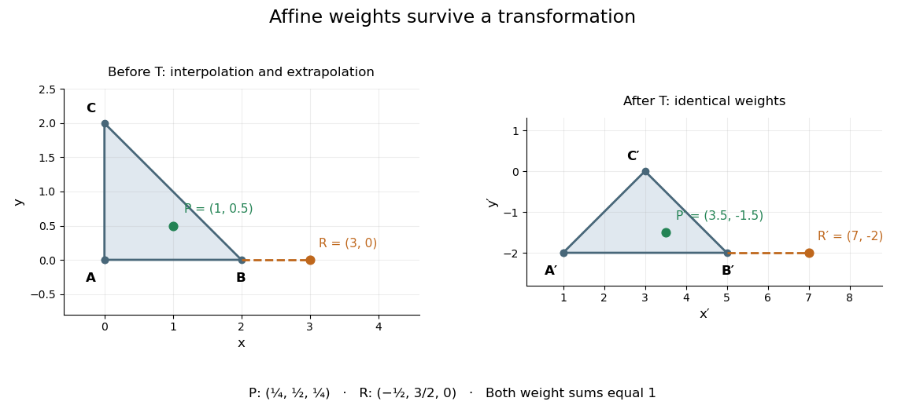

**[Figure 6](#image-positive-and-signed-affine-weights-before-and-after-a-transformation). Positive and signed affine weights before and after a transformation**. The green point has weights $(1/4,1/2,1/4)$ and stays inside the transformed [triangle](euclidean-geometry.md#triangle). The orange point has weights $(-1/2,3/2,0)$ and lies beyond the corresponding edge endpoint. These are original coordinate examples; the same weights are used in both panels.

This is useful whenever an object is built from weighted control points: its construction commutes with an [affine map](#affine-map), so transforming the control points transforms the constructed object as well. The [sum](arithmetic.md#sum) of the weights is the essential condition; no assumption about [lengths](physics.md#length) or [angles](#angle) is needed.

##### Affine combinations are independent of the chosen origin

↑ **Parent:** [Affine combination](#affine-combination)

Keep the [basis](vector-space.md#basis) fixed and replace the origin by a point with old coordinates $o$. Each point's coordinates change from $p_i$ to $p_i-o$. For coefficients with [sum](arithmetic.md#sum) one, the weighted coordinates become

$$
\sum_i\lambda_i(p_i-o)=\sum_i\lambda_ip_i-o.
$$

Adding the new origin $o$ gives the original point. This proves origin independence rather than asserting that the coordinate tuples themselves stay unchanged.

The requirement cannot be omitted. In the example $A=(0,0)$, $B=(2,0)$, blindly treating $A+B$ as a point gives $(2,0)$ in the old coordinates. If the new origin is $o=(1,1)$, the two coordinates become $(-1,-1)$ and $(1,-1)$; adding them and restoring $o$ instead gives $(1,-1)$. The coefficients sum to two, so this procedure has no origin-independent interpretation as a weighted point.

#### Affine map

↑ **Parent:** [Affine space](#affine-space)

An [affine map](#affine-map) combines a [linear map](vector-space.md#linear-map) with a [translation](#translation-geometry). After choosing coordinate origins, it has the form $T:\mathbb R^p\to\mathbb R^q$, $T(x)=Mx+b$, where the $q\times p$ [matrix](vector-space.md#matrix) $M$ is its [linear part of an affine map](#linear-part-of-an-affine-map) and $b$ is a fixed [vector](vector-space.md#vector). Equivalently, it preserves every [affine combination](#affine-combination). [§2.7, Definition 2.7.1 and linear-map construction, pp. 37–38](mathematics-bibliography.md#curves-and-surfaces-in-geometric-modeling-theory-and-algorithms-by-jean-gallier)

An original planar example is

$$
T(x,y)=(2x+y+1,y-2),\qquad M=\begin{pmatrix}2&1\\0&1\end{pmatrix},\qquad b=\begin{pmatrix}1\\-2\end{pmatrix}.
$$

It stretches horizontally, applies a [shear mapping](vector-space.md#shear-mapping), and then translates. The vertices $A=(0,0)$, $B=(2,0)$ and $C=(0,2)$ become $A'=(1,-2)$, $B'=(5,-2)$ and $C'=(3,0)$. A [square grid](euclidean-geometry.md#square-grid) becomes a grid of [parallelograms](euclidean-geometry.md#parallelogram); straight edges and their weighted points still fit together.

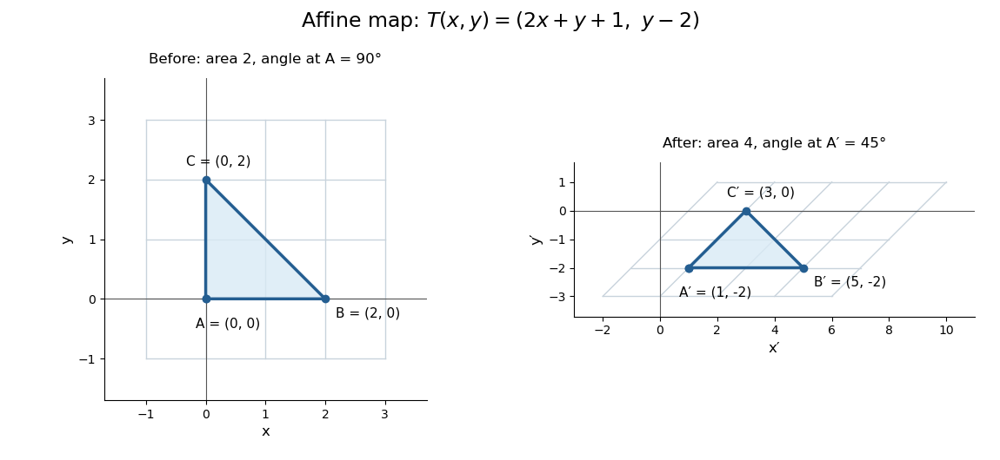

**[Figure 7](#image-an-affine-map-preserves-straightness-while-changing-lengths-and-angles). An affine map preserves straightness while changing lengths and angles**. An original [triangle](euclidean-geometry.md#triangle) and finite window of a [square grid](euclidean-geometry.md#square-grid), followed by their images under $T(x,y)=(2x+y+1,y-2)$. The right-hand grid is the transformed left-hand grid. Equal axis scales make the altered [lengths](physics.md#length) and [angles](#angle) visible.

This map is not a [linear map](vector-space.md#linear-map) with respect to the displayed origins, because $T(0,0)=(1,-2)$ rather than zero. It also is not a [Euclidean similarity](#euclidean-similarity): $AB$ has [length](physics.md#length) $2$ and $A'B'$ has [length](physics.md#length) $4$, while the right [angle](#angle) at $A$ becomes $45^\circ$. Its [determinant](multilinear-algebra.md#determinant) is $2$, so it doubles planar [area](differential-geometry.md#surface-area). These metric changes explain why [affine geometry](#affine-geometry) studies straightness, incidence and weighted points rather than treating every transformation as an [isometry](riemannian-geometry.md#isometry).

The linear part is an [invertible matrix](linear-algebra.md#invertible-matrix), giving the concise inverse **$T^{-1}(u,v)=((u-v-3)/2,v+2)$**. More generally an [affine map](#affine-map) is [bijective](function.md#bijection) exactly when its [linear part of an affine map](#linear-part-of-an-affine-map) is [bijective](function.md#bijection). Between equal finite-dimensional spaces, this means an [invertible matrix](linear-algebra.md#invertible-matrix); the [translation](#translation-geometry) cannot repair a loss of [rank of a linear map](vector-space.md#rank-of-a-linear-map).

##### Composition of affine transformations

↑ **Parent:** [Affine map](#affine-map)

If $f(x)=Ax+b$ and $g(x)=Cx+d$, their [function composition](function.md#function-composition) is $g(f(x))=CAx+Cb+d$, again an [affine map](#affine-map). With column-vector [homogeneous coordinates](projective-space.md#homogeneous-coordinate), its matrix is the product of the matrix for $g$ with that for $f$, so the rightmost factor acts first.

##### Affine maps preserve affine combinations

↑ **Parent:** [Affine map](#affine-map)

For coefficients with [sum](arithmetic.md#sum) one, the defining identity follows from [linearity](vector-space.md#linearity):

$$
T\left(\sum_i\lambda_iP_i\right)=M\sum_i\lambda_iP_i+b=\sum_i\lambda_i(MP_i+b)=\sum_i\lambda_iT(P_i).
$$

The [translation](#translation-geometry) appears once on both sides precisely because $\sum_i\lambda_i=1$. In particular, [midpoints](convex-set.md#midpoint) map to [midpoints](convex-set.md#midpoint), and a parameterized [line segment](convex-set.md#line-segment) $(1-t)P+tQ$, $0\leq t\leq1$, maps to $(1-t)T(P)+tT(Q)$. A whole [line](euclidean-geometry.md#straight-line) has the same formula with $t\in\mathbb R$; its image is a [line](euclidean-geometry.md#straight-line) if $M(Q-P)\ne0$, and a single point otherwise.

##### Affine maps can collapse lines

↑ **Parent:** [Affine map](#affine-map)

An [affine map](#affine-map) need not be [injective](algebra.md#injective-function). For $G(x,y)=(x+y,0)$, the direction $(1,-1)$ belongs to the [kernel](kernel-of-a-linear-map.md) of its [linear part of an affine map](#linear-part-of-an-affine-map). Consequently the whole [line](euclidean-geometry.md#straight-line) $y=-x$ maps to $(0,0)$, and every parallel [line](euclidean-geometry.md#straight-line) $y=-x+c$ maps to $(c,0)$. These are collapsed lines, not images with a surviving direction. Assertions that an [affine map](#affine-map) preserves distinct parallel lines require the appropriate noncollapse or [injectivity](algebra.md#injective-function) hypothesis.

##### Euclidean similarity

↑ **Parent:** [Affine map](#affine-map)

A [Euclidean similarity](#euclidean-similarity) is a map $S:\mathbb R^n\to\mathbb R^n$ satisfying $|S(x)-S(y)|=c|x-y|$ for a fixed $c>0$. It has the form $S(x)=cRx+b$ with $R$ orthogonal: after subtracting $S(0)$ and dividing by $c$, the map fixes zero and preserves distances, hence inner products by polarization, so it is a linear orthogonal map. It is a contraction if $c<1$. Contracting [Euclidean similarities](#euclidean-similarity) define self-similar [compact sets](topology.md#compact-space); the [open set condition](#open-set-condition) is a useful separation hypothesis for computing their [Hausdorff dimension](measure-theory.md#hausdorff-dimension).

##### Linear part of an affine map

↑ **Parent:** [Affine map](#affine-map)

The map $A$ associated with an [affine map](#affine-map) $x\mapsto Ax+b$; it is independent of the translation $b$. An affine [Euclidean isometry](riemannian-geometry.md#euclidean-isometry) has an orthogonal linear part, and an [isometry](riemannian-geometry.md#isometry) between [flat tori](second-fundamental-form.md#flat-torus) has a lift whose linear part carries one [Euclidean lattice](fourier-analysis.md#euclidean-lattice) onto the other.

#### Half-space

↑ **Parent:** [Affine space](#affine-space)

A closed half-space consists of a [hyperplane](vector-space.md#hyperplane) and one of its two sides in a real [affine space](#affine-space). Replacing the weak inequality by a strict inequality gives an open half-space. Half-spaces are [convex sets](convex-set.md), and finite [intersections](set.md#set-intersection) of closed [half-spaces](#half-space) are [linear polyhedra](linear-programming.md#linear-polyhedron).

##### Half-plane

↑ **Parent:** [Half-space](#half-space)

A half-plane is a [half-space](#half-space) in a two-dimensional [Euclidean space](normed-vector-space.md#euclidean-norm), consisting of points on one side of a [line](euclidean-geometry.md#straight-line). For distinct [centroids](euclidean-geometry.md#centroid), each of the two [Voronoi cells](euclidean-geometry.md#voronoi-cell) defined by their [Euclidean distances](topological-analysis.md#euclidean-distance) is a closed half-plane bounded by their [perpendicular bisector](euclidean-geometry.md#perpendicular-bisector), with an explicit convention needed to assign boundary ties.

#### Translation (geometry)

↑ **Parent:** [Affine space](#affine-space)

On an [affine space](#affine-space) modeled on a [vector space](vector-space.md), the map $T_v(x)=x+v$ for a fixed vector $v$. Its [derivative](calculus.md#derivative) is the identity, and $T_vT_w=T_{v+w}$. Changes between [flat coordinates](complex-geometry.md#natural-coordinate-of-a-holomorphic-differential) on a [translation surface](riemann-surfaces.md#translation-surface) have this form.

## Moduli space

↑ **Parent:** [Geometry and topology](geometry-and-topology.md)

A space parametrizing isomorphism classes of geometric objects. Its topology and possible stabilizers are part of the definition; a [moduli space of Riemann surfaces](#moduli-space-of-riemann-surfaces) forgets the marking retained by [Teichmüller space](riemann-surfaces.md#teichmuller-space).

### SU2 character variety of the punctured torus

↑ **Parent:** [Moduli space](#moduli-space)

The punctured torus retracts onto two circles, so its flat $SU(2)$ gauge-orbit space is $SU(2)^2/SU(2)$ under simultaneous conjugation. Write unit quaternions as $A=a+u$ and $B=b+v$. Complete orbit invariants are $(a,b,u\cdot v)$ with $(u\cdot v)^2\leq(1-a^2)(1-b^2)$. Adding $ab$ to the third coordinate identifies this space with the compact convex set of positive-semidefinite $3\times3$ real correlation matrices, a closed three-ball. The dense open subset $A\ne\pm1$ is a closed disk times an open interval; its complement is two disjoint intervals.

// Destination: geometry-and-topology.bigb

### Moduli space of Riemann surfaces

↑ **Parent:** [Moduli space](#moduli-space)

The [moduli space](#moduli-space) of unmarked [compact](topology.md#compact-space) [genus](topological-surface.md#genus-of-a-surface)-$g$ [Riemann surfaces](riemann-surfaces.md). For $g\geq2$ it is the quotient $\mathcal T_g/\operatorname{Mod}(S_g)$ of [Teichmüller space](riemann-surfaces.md#teichmuller-space) by the [mapping class group](topological-surface.md#mapping-class-group), with its quotient topology. The thick subsets are [compact](topology.md#compact-space) by [Mumford's compactness theorem](#mumford-s-compactness-theorem).

#### Punctured Riemann surface moduli dimension

↑ **Parent:** [Moduli space of Riemann surfaces](#moduli-space-of-riemann-surfaces)

For stable compact [Riemann surfaces](riemann-surfaces.md) with $n$ distinct labelled marked points, where $2g-2+n>0$, the displayed complex dimension counts independent conformal shapes and positions after conformal automorphisms are removed. On the sphere it is $n-3$, since three points fix a [Möbius transformation](group-theory.md#mobius-transformation). On a torus it is $1+n-1=n$: one shape modulus and $n$ positions, less one translation. For [genus](topological-surface.md#genus-of-a-surface) $g\ge2$, the unmarked shape dimension is $3g-3$ and continuous conformal automorphisms vanish. The shape dimension also follows from the [Riemann-Roch theorem](algebraic-geometry.md#riemann-roch-theorem) applied to [holomorphic quadratic differentials](complex-geometry.md#holomorphic-quadratic-differential).

<h4 id="mumford-s-compactness-theorem">Mumford's compactness theorem</h4>

↑ **Parent:** [Moduli space of Riemann surfaces](#moduli-space-of-riemann-surfaces)  
ⓦ [Wiki](https://en.wikipedia.org/wiki/Mumford's_compactness_theorem)

The subset of the unmarked [moduli space of Riemann surfaces](#moduli-space-of-riemann-surfaces) with [hyperbolic systole](hyperbolic-geometry.md#hyperbolic-systole) at least $\varepsilon>0$ is [compact](topology.md#compact-space) for fixed [genus](topological-surface.md#genus-of-a-surface) $g\geq2$. Use a [Bers pants decomposition theorem](hyperbolic-geometry.md#bers-pants-decomposition-theorem) bound, finitely many topological decomposition types and [Dehn twists](topological-surface.md#dehn-twist) to place representatives in finitely many [compact](topology.md#compact-space) boxes in [Fenchel–Nielsen coordinates](hyperbolic-geometry.md#fenchel-nielsen-coordinates).

## Foliation

↑ **Parent:** [Geometry and topology](geometry-and-topology.md)  
ⓦ [Wiki](https://en.wikipedia.org/wiki/Foliation)

A foliation decomposes a [topological manifold](topological-manifold.md) into connected leaves which locally look like parallel slices in product coordinate charts.

### Godbillon-Vey invariant

↑ **Parent:** [Foliation](#foliation)

For a cooriented integrable codimension-one distribution, choose a nonvanishing defining form $\zeta$ and an auxiliary form with $d\zeta=\eta\wedge\zeta$. Changing the auxiliary form to $\eta+a\zeta$ changes $\eta\wedge d\eta$ by $-d(a\,d\zeta)$. Replacing $\zeta$ by $h\zeta$ changes the auxiliary form by $d\log|h|$, changing the three-form by the exact differential $d(-d\log|h|\wedge\eta)$. Stokes' theorem proves invariance on a closed oriented three-manifold. For the weak stable foliation of a curvature-minus-one surface geodesic flow, take $\zeta=\theta+\omega$, $\eta=\alpha$ to obtain $\mathrm{gv}=4\pi^2\chi(M)$ in the positive base/fibre orientation.

### Leaf of a regular foliation

↑ **Parent:** [Foliation](#foliation)

A leaf is a maximal connected [integral manifold](differential-geometry.md#integral-manifold) of the smooth constant-rank [integrable distribution](differential-geometry.md#integrable-distribution) defining a regular [foliation](#foliation). It carries its intrinsic manifold topology and is immersed in the ambient manifold. It need not be embedded or closed. Local [Frobenius theorem](differential-geometry.md#frobenius-theorem) coordinates make each leaf segment a plaque with constant transverse coordinates; [global confinement to an immersed leaf](differential-geometry.md#global-confinement-to-an-immersed-leaf) follows by joining such plaques along tangent curves.

### Taut foliation

↑ **Parent:** [Foliation](#foliation)  
ⓦ [Wiki](https://en.wikipedia.org/wiki/Taut_foliation)

A codimension-one [foliation](#foliation) of a closed [three-manifold](topological-manifold.md#3-manifold) is taut if every leaf meets a closed transverse curve. In particular, the fibers of a bundle over $S^1$ form a taut [foliation](#foliation).

#### Closed transversal to a foliation

↑ **Parent:** [Taut foliation](#taut-foliation)

A closed transversal is a closed curve everywhere transverse to the leaves of a [foliation](#foliation). A single such curve meeting every leaf proves that the [foliation](#foliation) is a [taut foliation](#taut-foliation).

## Orbifold

↑ **Parent:** [Geometry and topology](geometry-and-topology.md)  
ⓦ [Wiki](https://en.wikipedia.org/wiki/Orbifold)

### Orbifold fundamental group

↑ **Parent:** [Orbifold](#orbifold)

The [orbifold fundamental group](#orbifold-fundamental-group) records loops together with their local isotropy relations, so a loop around a cone point of order $m$ has its $m$th power trivial rather than being trivial itself. For an oriented closed surface of [genus](topological-surface.md#genus-of-a-surface) $g$ with cone orders $m_1,\ldots,m_r$, its presentation is $\langle a_1,b_1,\ldots,a_g,b_g,c_1,\ldots,c_r\mid c_i^{m_i}=1,\ \prod_j[a_j,b_j]c_1\cdots c_r=1\rangle$. A torsion-free [finite-index subgroup](group.md#finite-index-subgroup) of a [hyperbolic surface](hyperbolic-geometry.md#hyperbolic-surface) [orbifold](#orbifold) gives a smooth locally isometric surface cover. The absence of torsion means that the [subgroup](group.md#subgroup) meets no nonidentity local cone stabilizer.

#### Paired-polygon construction of finite surface covers

↑ **Parent:** [Orbifold fundamental group](#orbifold-fundamental-group)

Pair the $2s$ edges of an oriented [hyperbolic polygon](hyperbolic-geometry.md#hyperbolic-polygon) by length-preserving identifications reversing their [boundary](topology.md#boundary-of-a-set) directions. Label the pairs by generating elements $A_1,\ldots,A_s$ of a finite [group](group.md) $T$. Glue the corresponding edge of a copy labelled $g$ to its mate in the copy labelled $gA_k$. Left multiplication of labels defines the $T$ action. A [vertex cycle of a paired polygon](#vertex-cycle-of-a-paired-polygon) has angle sum $\theta_j$ and accumulated gluing word $C_j\in T$ of order $q_j$; above it lie $|T|/q_j$ vertices, each of [cone angle](differential-geometry.md#cone-angle) $q_j\theta_j$. The action is free away from vertices, and the vertex stabilizers are conjugates of $\langle C_j\rangle$. If the base cone has integer order $m_j=2\pi/\theta_j$ and $q_j\mid m_j$, this is an [orbifold](#orbifold) covering, with lifted cone order $m_j/q_j$. The lift is smooth exactly when $q_j=m_j$.

##### Freeness criterion for a subgroup of a polygon-cover deck group

↑ **Parent:** [Paired-polygon construction of finite surface covers](#paired-polygon-construction-of-finite-surface-covers)

In the [paired-polygon construction of finite surface covers](#paired-polygon-construction-of-finite-surface-covers), a [subgroup](group.md#subgroup) $U$ acts freely precisely when the displayed intersection is trivial for every vertex word $C_j$ and every $g\in T$. The quotient map $M\to U\backslash M$ is then a [normal covering map](algebraic-topology.md#normal-covering-map) with deck [group](group.md) $U$ and $\chi(U\backslash M)=\chi(M)/|U|$. Normality of $U$ in $T$ is instead the criterion for the intermediate [orbifold](#orbifold) cover $U\backslash M\to T\backslash M$ to be normal. These are different [covering maps](algebraic-topology.md#covering-space).

##### Euler characteristic of a paired-polygon surface cover

↑ **Parent:** [Paired-polygon construction of finite surface covers](#paired-polygon-construction-of-finite-surface-covers)

For a paired $2s$-gon with $r$ base [vertex cycles of a paired polygon](#vertex-cycle-of-a-paired-polygon), there are one face, $s$ edges and $r$ vertices on the base, so $\chi(M_0)=1-s+r$. The full finite-group construction has $|T|$ faces, $s|T|$ edges and $\sum_j|T|/q_j$ vertices, giving the displayed ordinary [Euler characteristic](homology.md#euler-characteristic). If all lifted angles are $2\pi$, the [orbifold Euler characteristic](#orbifold-euler-characteristic) formula gives equivalently $\chi(M)=|T|\chi_{\rm orb}(M_0)$.

##### Vertex cycle of a paired polygon

↑ **Parent:** [Paired-polygon construction of finite surface covers](#paired-polygon-construction-of-finite-surface-covers)

A [vertex cycle of a paired polygon](#vertex-cycle-of-a-paired-polygon) is an equivalence class of vertices under the edge identifications. Its angle sum is the total angle at the resulting point of the quotient surface. Recording the edge labels encountered around that point gives a [group](group.md) word, whose order determines the number of turns required to close a lifted cycle. This explains the angle multiplier and lifted vertex count in the [paired-polygon construction of finite surface covers](#paired-polygon-construction-of-finite-surface-covers).

#### Smoothness criterion from cone-monodromy cycles

↑ **Parent:** [Orbifold fundamental group](#orbifold-fundamental-group)

Over a cone point of order $m$, a cycle of length $\ell$ in the [monodromy](complex-analysis.md#monodromy) on sheets has ramification degree $\ell$ and residual cone angle $2\pi\ell/m$. The lifted inherited [hyperbolic metric](hyperbolic-geometry.md#hyperbolic-metric) is smooth precisely when every such cycle has length $m$. Equivalently the subgroup defining the cover meets no conjugate of a nonidentity power of a cone generator.

### Orbifold Euler characteristic

↑ **Parent:** [Orbifold](#orbifold)

For a compact [topological surface](topological-surface.md) with cone-point orders $\alpha_1,\ldots,\alpha_k$, the orbifold Euler characteristic is $\chi_{\mathrm{orb}}=\chi(\text{underlying surface})-\sum_i(1-1/\alpha_i)$. An orbifold covering multiplies this quantity by its degree.

#### Euler characteristic from coset cycle counts

↑ **Parent:** [Orbifold Euler characteristic](#orbifold-euler-characteristic)

An $n$-sheeted surface cover of an orbifold of underlying [genus](topological-surface.md#genus-of-a-surface) $g_0$ with $r$ cone points has the displayed ordinary [Euler characteristic](homology.md#euler-characteristic), where $c_i$ is the number of cycles of the $i$th cone [monodromy permutation](algebraic-topology.md#monodromy-permutation). The ramification deficit over that point is $n-c_i$, so the formula follows by counting lifted vertices, edges and faces, or by the [Riemann-Hurwitz formula](riemann-surfaces.md#riemann-hurwitz-formula). If every cone cycle has its full prescribed length, this equals $n\chi_{\mathrm{orb}}$.

## Algebraic geometry

↑ **Parent:** [Geometry and topology](geometry-and-topology.md)

[This section is present in another page, follow this link to view it.](algebraic-geometry.md)

## Algebraic topology

↑ **Parent:** [Geometry and topology](geometry-and-topology.md)

[This section is present in another page, follow this link to view it.](algebraic-topology.md)

## Complex geometry

↑ **Parent:** [Geometry and topology](geometry-and-topology.md)

[This section is present in another page, follow this link to view it.](complex-geometry.md)

## Differential geometry

↑ **Parent:** [Geometry and topology](geometry-and-topology.md)

[This section is present in another page, follow this link to view it.](differential-geometry.md)

## Classification theorem for surfaces

↑ **Parent:** [Geometry and topology](geometry-and-topology.md)  
ⓦ [Wiki](https://en.wikipedia.org/wiki/Classification_theorem_for_surfaces)

### Crosscap number

↑ **Parent:** [Classification theorem for surfaces](#classification-theorem-for-surfaces)

For a closed connected [nonorientable surface](topological-surface.md#non-orientable-surface), the crosscap number is the number of [real projective plane](differential-geometry.md#real-projective-plane) summands in its [connected sum](smooth-manifold.md#connected-sum-of-oriented-manifolds) classification. It is at least one, and its [Euler characteristic](homology.md#euler-characteristic) is $2-h$. The projective plane has one crosscap and the [Klein bottle](topological-surface.md#klein-bottle) has two.

### Orientable genus

↑ **Parent:** [Classification theorem for surfaces](#classification-theorem-for-surfaces)

For a closed connected [orientable surface](differential-geometry.md#orientable-surface), its orientable genus is the number of [torus](topological-surface.md#torus) summands in its [connected sum](smooth-manifold.md#connected-sum-of-oriented-manifolds) classification, with the [two-sphere](euclidean-geometry.md#two-sphere) assigned genus zero. The [Euler characteristic](homology.md#euler-characteristic) is $2-2g$, so it determines this number within the orientable family.

### Closed surfaces obtained from a square

↑ **Parent:** [Classification theorem for surfaces](#classification-theorem-for-surfaces)

There are exactly four types: the [two-sphere](euclidean-geometry.md#two-sphere), [real projective plane](differential-geometry.md#real-projective-plane), [torus](topological-surface.md#torus), and [Klein bottle](topological-surface.md#klein-bottle). Four sides admit three pairings and four direction choices for each pairing. Up to cyclic relabelling, labels are adjacent, $aa^sbb^t$, or alternating, $aba^sb^t$. For adjacent labels, the vertex counts for $(s,t)=(-1,-1)$, a mixed-sign pair, and $(1,1)$ are $3,2,1$. For alternating labels they are $1,1,2$. There are two edge classes and one face, so [Euler characteristic](homology.md#euler-characteristic) is $V-1$. Orientability occurs exactly when $s=t=-1$. The [classification theorem for surfaces](#classification-theorem-for-surfaces) identifies every case, leaving no additional closed surfaces from a square. Examples are $aa^{-1}bb^{-1}$ for the sphere, $aabb^{-1}$ for the projective plane, $aba^{-1}b^{-1}$ for the torus and $aba^{-1}b$ for the Klein bottle.

## Inversive distance

↑ **Parent:** [Geometry and topology](geometry-and-topology.md)  
ⓦ [Wiki](https://en.wikipedia.org/wiki/Inversive_distance)

For two disjoint Euclidean spheres of radii $R_1,R_2$ whose centers are distance $d$ apart, the inversive distance

$$
\chi=\frac{d^2-R_1^2-R_2^2}{2R_1R_2}
$$

is invariant under conformal transformations. It satisfies $\chi>1$ for externally disjoint spheres.

## Conformal map

↑ **Parent:** [Geometry and topology](geometry-and-topology.md)  
ⓦ [Wiki](https://en.wikipedia.org/wiki/Conformal_map)

### Vanishing harmonic moments of a polynomial conformal disc map

↑ **Parent:** [Conformal map](#conformal-map)

If a degree-$N$ [polynomial](polynomial.md) $f(\zeta)=\sum_{j=1}^Na_j\zeta^j$ maps the [unit disc](topology.md#unit-disc) conformally onto $D$, [Green's theorem](multivariable-calculus.md#green-theorem) expresses $M_n=\iint_D z^n\,dx\,dy$ as the residue of $f^n f'\sum_j\bar a_j\zeta^{-j}$ times $\pi$. Its lowest possible power is $n-N$, so no residue occurs when $n\geq N$. For a quadratic map, $M_0=\pi(|a_1|^2+2|a_2|^2)$ and $M_1=\pi a_1^2\bar a_2$. The first moment can be complex; the zeroth is area.

### Strip automorphism with a prescribed image of its midpoint

↑ **Parent:** [Conformal map](#conformal-map)

On $S_h=\{z:0<\operatorname{Im}z<h\}$, let $\beta\in S_h$ and write $e^{\pi\beta/h}=A+iB$ with $B>0$. The [exponential function](calculus.md#exponential-function) $E(z)=e^{\pi z/h}$ is a [conformal map](#conformal-map) from the strip bijectively onto the [upper half-plane](complex-analysis.md#upper-half-plane-complex-analysis), sending $ih/2$ to $i$. The affine map $w\mapsto A+Bw$ is an automorphism of the half-plane sending $i$ to $E(\beta)$. Conjugate it by $E$, using the [principal complex logarithm](analysis.md#principal-complex-logarithm) as the inverse. The displayed formula is a conformal automorphism of the strip and satisfies $g_\beta(ih/2)=\beta$. The branch range $0<\operatorname{Im}\operatorname{Log}w<\pi$ is what prevents an unwanted vertical period in this inverse.

### Hyperbolic-cosine map of a half-strip

↑ **Parent:** [Conformal map](#conformal-map)

For $a>0$, this [conformal map](#conformal-map) takes $\operatorname{Re}z>0$, $0<\operatorname{Im}z<a$ bijectively onto the [upper half-plane](complex-analysis.md#upper-half-plane-complex-analysis). Its imaginary part is $\sinh(\pi x/a)\sin(\pi y/a)>0$, and its derivative is nonzero in the interior. The end wall maps to $[-1,1]$ and the two long walls to the complementary real rays. To prove the map is onto and injective, first put $s=e^{\pi z/a}$, which maps onto $|s|>1$, $\operatorname{Im}s>0$. The equation $s+s^{-1}=2\zeta$ has exactly one root outside the [unit circle](complex-analysis.md#complex-unit-circle) when $\operatorname{Im}\zeta>0$: the roots have product one and neither has unit modulus. The identity $\operatorname{Im}\zeta=(1-|s|^{-2})\operatorname{Im}s/2$ puts that root in the correct half-plane. This permits planar [potential flow](fluid-mechanics.md#potential-flow) problems in a closed-end channel to be solved by the [method of images](mathematics.md#method-of-images).

### Squaring map from a quadrant to the upper half-plane

↑ **Parent:** [Conformal map](#conformal-map)

The map $z\mapsto z^2$ is a bijective [conformal map](#conformal-map) from the open first quadrant to the [complex upper half-plane](complex-analysis.md#upper-half-plane-complex-analysis). In polar coordinates it doubles arguments from $(0,\pi/2)$ to $(0,\pi)$, and its derivative $2z$ never vanishes inside the quadrant. Its inverse is the branch of the [square root](algebra.md#square-root) with argument in $(0,\pi/2)$. By [conformal invariance of harmonicity](riemann-surfaces.md#conformal-invariance-of-harmonicity), a [harmonic function](partial-differential-equation.md#harmonic-function) $f$ on the half-plane pulls back to $g(x,y)=f(x^2-y^2,2xy)$. The two boundary rays map to the positive and negative real axes, respectively.

### Lens-to-strip logarithmic conformal map

↑ **Parent:** [Conformal map](#conformal-map)

Compose the [lens-to-quadrant Möbius map](group-theory.md#lens-to-quadrant-mobius-map) with the logarithm having argument in $(0,\pi/2)$ on the first quadrant. Polar coordinates show that the latter maps bijectively to the horizontal strip $0<\operatorname{Im}\zeta<\pi/2$. Its inverse is the [exponential function](calculus.md#exponential-function), so the combined inverse is $(e^\zeta-(1+i))/(e^\zeta+(1+i))$. Both derivatives are nonzero, proving [conformality](#conformality). The logarithm's branch fixes the strip's vertical position; adding $2\pi i$ shifts that position without changing the exponential inverse.

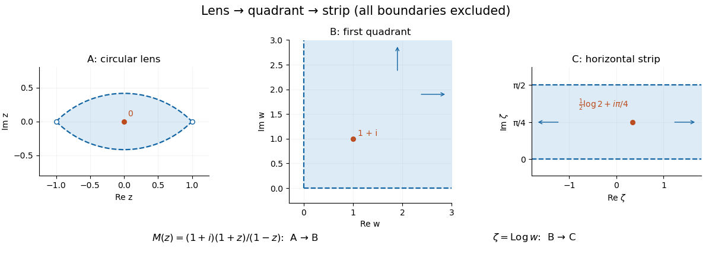

**[Figure 8](#image-the-lens-to-quadrant-mobius-map-followed-by-a-logarithm-branch). The lens-to-quadrant Möbius map followed by a logarithm branch**. The marked point shows the same interior point at each stage. The logarithm converts radial size into horizontal position and the quadrant's angle into the strip's height.

### Angle multiplication at a holomorphic critical point

↑ **Parent:** [Conformal map](#conformal-map)

If a nonconstant [holomorphic function](holomorphic-function.md) has its first nonzero local Taylor coefficient at order $m$, small rays from $z_0$ have image arguments $\arg a+m\arg(z-z_0)$ to leading order. Their oriented angles are therefore multiplied by $m$ modulo $2\pi$. The case $m=1$ is locally [conformal](#conformal-map); $m>1$ gives a [critical point](analysis.md#critical-point), and the local inverse has $m$ branches. For the [Joukowski map](#joukowski-map) at $z_0=1$, $f(1+\zeta)=2+\zeta^2+O(\zeta^3)$, so $m=2$.

### Anticonformal map

↑ **Parent:** [Conformal map](#conformal-map)

An orientation-reversing local [conformal map](#conformal-map) of planar domains. Equivalently, its [complex conjugation](complex-analysis.md#complex-conjugation) is a [holomorphic function](holomorphic-function.md) with nonzero [derivative](calculus.md#derivative). [Complex conjugation](complex-analysis.md#complex-conjugation) $z\mapsto\bar z$ is the basic example. The metric pullback uses the modulus of its local scale factor, just as for an orientation-preserving [conformal map](#conformal-map).

### Conformal map from the exterior half-disc to a slit half-plane

↑ **Parent:** [Conformal map](#conformal-map)

The [rational function](isolated-singularity.md#rational-function) $g(z)=2z/(1-z^2)$ is a [conformal](#conformal-map) bijection from $\{z:\operatorname{Im}z>0,\ |z|>1\}$ onto $\{w:\operatorname{Im}w>0\}\setminus\{iy:y\geq1\}$. For a proof, the [Cayley transform between the half-plane and disk](complex-analysis.md#cayley-transform-between-the-half-plane-and-disk) $f(z)=(z-i)/(z+i)$ maps the source onto the right half of the [unit disc](topology.md#unit-disc). Squaring maps this half-disc bijectively onto $\mathbb D\setminus(-1,0]$. Finally $T(s)=i(1-s)/(1+s)$ maps the disc to the [upper half-plane](complex-analysis.md#upper-half-plane-complex-analysis) and $(-1,0]$ to the excluded ray. The composition $T(f(z)^2)$ simplifies to $g(z)$. Each factor is [holomorphic](holomorphic-function.md) with nonzero derivative and bijective on its indicated domain.

### Schwarz-Christoffel mapping

↑ **Parent:** [Conformal map](#conformal-map)

A [conformal map](#conformal-map) from the [complex upper half-plane](complex-analysis.md#upper-half-plane-complex-analysis) to a polygonal domain with finite prevertices $a_j\in\mathbb R$ and interior angles $\pi\alpha_j$ has the displayed derivative, with upper-half-plane branches of the powers. Integrating supplies the map, up to translation and nonzero scaling. For a slit boundary, repeated geometric vertices are treated as distinct boundary approaches: the two sides at the slit base have their respective angles, and a slit tip has angle $2\pi$, hence exponent one.

#### Conformal map to a right half-plane with a horizontal slit

↑ **Parent:** [Schwarz-Christoffel mapping](#schwarz-christoffel-mapping)

The [principal square root](analysis.md#principal-square-root-of-a-complex-number) maps the upper $Z$ [half-plane](#half-plane) bijectively onto $\Re z>0$ with the ray $[1,\infty)$ removed. The [prevertex](#prevertex-of-a-schwarz-christoffel-map) zero is the slit tip, and $\pm1$ represent the two ends at infinity. The inverse is the unique root $Z^2=1-z^{-2}$ with positive [imaginary part](complex-analysis.md#imaginary-part). Pulling back $\pi^{-1}\arg((Z-1)/(Z+1))$ gives the bounded [harmonic function](partial-differential-equation.md#harmonic-function) with value one on the slit banks and zero on the imaginary axis. The [harmonic function](partial-differential-equation.md#harmonic-function) $\Im[Z/(1-Z^2)]$ has zero finite [boundary values](differential-equation.md#boundary-value) but grows at infinity, explaining the role of boundedness.

#### Schwarz-Christoffel map of a half-plane joined to a strip

↑ **Parent:** [Schwarz-Christoffel mapping](#schwarz-christoffel-mapping)

The [upper half-plane](complex-analysis.md#upper-half-plane-complex-analysis) joined to the downward strip $-1<x<1$ has reentrant corners at $\pm1$. The [Schwarz-Christoffel formula](#schwarz-christoffel-mapping) gives $z'(Z)=2R/(\pi Z)$, with $R\sim Z$ at upper infinity. Since $(R+\tan^{-1}(1/R))'=R/Z$, integration gives the displayed map. The [inverse trigonometric function](#inverse-trigonometric-functions) is continued analytically in the [upper half-plane](complex-analysis.md#upper-half-plane-complex-analysis) so its corner values are $\pm\pi/2$. The origin is the lower channel end and infinity the upper open end. The complex potentials $2Z/\pi$ and $2\log Z/\pi$ respectively normalize unit horizontal [velocity](classical-mechanics.md#velocity) in the upper region and unit upward [velocity](classical-mechanics.md#velocity) in the channel.

#### Right-half-plane slit map

↑ **Parent:** [Schwarz-Christoffel mapping](#schwarz-christoffel-mapping)

With the square root positive for $Z$ on the positive imaginary axis, the displayed [conformal map](#conformal-map) takes the upper half-plane bijectively to $\{\operatorname{Re}z>0\}\setminus[1,\infty)$. Squaring, subtracting from one, taking the positive-real-part square root, and reciprocating identifies each intermediate slit domain. The boundary prevertices $-1,0,1$ correspond to the lower infinite end, the slit tip at one, and the upper infinite end. The inverse is $\sqrt{1-z^{-2}}$ with positive imaginary part.

#### Prevertex of a Schwarz-Christoffel map

↑ **Parent:** [Schwarz-Christoffel mapping](#schwarz-christoffel-mapping)

A boundary point of the source half-plane that maps to a [polygon](euclidean-geometry.md#polygon) vertex. If that corner has angle $\pi\alpha$, the [Schwarz-Christoffel mapping](#schwarz-christoffel-mapping) has local behavior $F(z)-F(a)\sim C(z-a)^\alpha$ at its [prevertex](#prevertex-of-a-schwarz-christoffel-map), so the [derivative](calculus.md#derivative) has exponent $\alpha-1$. Infinity may also be a [prevertex](#prevertex-of-a-schwarz-christoffel-map), expressed in the local coordinate $1/z$.

#### Power-product map to a slit half-plane

↑ **Parent:** [Schwarz-Christoffel mapping](#schwarz-christoffel-mapping)

For $0<k<1$, principal upper-half-plane branches give a [conformal map](#conformal-map) onto the upper half-plane cut along $[0,\tau]$, where $\tau=2k^k(1-k)^{1-k}e^{i\pi k}$. Its [derivative](calculus.md#derivative) is $(z-1+2k)(z-1)^{k-1}(z+1)^{-k}$. The two prevertices $-1,1$ map to the slit base, and $1-2k$ maps to its tip. Boundary traversal goes out along the slit and back, while $g(z)=z+1-2k+O(1/z)$ at infinity. The [argument principle](complex-analysis.md#argument-principle) gives one preimage of every point off the slit.

### Quarter-sector mapping of a circular lens

↑ **Parent:** [Conformal map](#conformal-map)

For the lens $\operatorname{Im}z>0$ and $|z+i|<\sqrt2$, the [Möbius transformation](group-theory.md#mobius-transformation) $w=(1+z)/(1-z)$ maps its real boundary segment to the positive real axis and its circular boundary arc to the ray with argument $\pi/4$. Its interior maps bijectively to $0<\arg w<\pi/4$. The fourth power therefore maps this lens conformally onto the upper half-plane. Composing with $(F-i)/(F+i)$ maps it onto the unit disc. The endpoints $\pm1$ are boundary points, so the pole and zero introduce no interior singularity or branching.

### Conformal group

↑ **Parent:** [Conformal map](#conformal-map)

The [conformal group](#conformal-group) of a metric manifold consists of [diffeomorphisms](#diffeomorphism) $f$ with $f^*g=\Omega^2g$ for a positive function $\Omega$. Its infinitesimal generators are [Conformal Killing vector fields](general-relativity.md#conformal-killing-vector-field). The choice of manifold matters: in flat Euclidean dimension greater than two, [special conformal transformations](general-relativity.md#special-conformal-transformation) can be regular on the [conformal compactification of Euclidean space](#conformal-compactification-of-euclidean-space) while having finite poles in the uncompactified space.

### Null affine parameter under a conformal rescaling

↑ **Parent:** [Conformal map](#conformal-map)

If $g$ is rescaled to $\widetilde g=\Omega^2g$, a null geodesic retains its unparametrized path. For its original affine tangent $k$, the changed connection gives $\widetilde\nabla_k k=2k(\log\Omega)k$. Rescaling the tangent by $\Omega^{-2}$ cancels this term and proves the displayed affine-parameter relation, up to a constant multiplier. A conformal boundary may therefore be reached at finite unphysical affine parameter while physical affine parameter is infinite.

### Conformality

↑ **Parent:** [Conformal map](#conformal-map)

The local angle-preservation property of a [conformal map](#conformal-map). At a regular point its [derivative](calculus.md#derivative) is a positive scaling times an orthogonal linear map. Consequently composition multiplies [gradient](multivariable-calculus.md#gradient) lengths by that scaling, as follows directly from the [chain rule](calculus.md#chain-rule).

### Conformal map of a circular lens

↑ **Parent:** [Conformal map](#conformal-map)

Two intersecting [circles](topology.md#circle) bound a lens. A [Möbius transformation](group-theory.md#mobius-transformation) sending their intersection points to zero and infinity sends the two boundary arcs to rays, and the lens to a sector. A suitable power straightens the sector to a half-plane. The chosen sector and its branch must be identified by an interior test point; merely squaring an arbitrary boundary-straightening map need not be injective on the intended domain. A [Cayley transform](group-theory.md#cayley-transform-complex-analysis) then gives a conformal bijection to a disc.

#### Conformal map of a symmetric circular lens

↑ **Parent:** [Conformal map of a circular lens](#conformal-map-of-a-circular-lens)

The intersection of the unit disks centered at $1/2\pm i\sqrt3/2$ has endpoints zero and one. The [Möbius transformation](group-theory.md#mobius-transformation) $w=z/(1-z)$ maps it onto the sector $|\arg w|<\pi/6$: the two disk conditions become $\operatorname{Re}(e^{\pm i\pi/3}w)>0$. Cubing gives the right half-plane, and the [Cayley transform between the half-plane and disk](complex-analysis.md#cayley-transform-between-the-half-plane-and-disk) gives the displayed holomorphic bijection to the unit disk. The sector width ensures that cubing is injective.

### Explicit disk map of a slit half disk

↑ **Parent:** [Conformal map](#conformal-map)

For the upper half disk $|z|<2$ slit along $z=iy$, $0<y\le1$, squaring maps onto $|w|<4$ minus $[-1,4)$. After scaling the radius-four disc, the [disk automorphism](topology.md#automorphism-of-the-unit-disk) $v=4(w+1)/(w+16)$ sends this slit to $[0,1)$. Its [square root](algebra.md#square-root) with argument in $(0,\pi)$ maps onto the upper half [unit disc](topology.md#unit-disc). There $u+u^{-1}$ maps bijectively onto the [lower half-plane](complex-analysis.md#lower-half-plane): its [imaginary part](complex-analysis.md#imaginary-part) is $\operatorname{Im}u(1-|u|^{-2})<0$, and the two roots of its inverse equation are reciprocal, with exactly one inside the unit [circle](topology.md#circle). The final [Möbius map](group-theory.md#mobius-transformation) gives the displayed conformal disk [bijection](function.md#bijection).

#### Two-sided cluster set at an interior slit point

↑ **Parent:** [Explicit disk map of a slit half disk](#explicit-disk-map-of-a-slit-half-disk)

In the explicit slit map, right-side approach to $i/2$ gives the positive root, and left-side approach gives the negative root. The corresponding lower-half-plane [boundary](topology.md#boundary-of-a-set) values are $\pm25/(2\sqrt{21})$, so the two unit-circle image values are distinct. Every other [conformal bijection](riemann-surfaces.md#biholomorphism) onto the disk differs by a [disk automorphism](topology.md#automorphism-of-the-unit-disk), which extends bijectively to the unit [circle](topology.md#circle). Thus a sequence approaching that slit point has exactly one or both of two [boundary](topology.md#boundary-of-a-set) cluster values, according to which sides occur infinitely often.

### Conformal map of a segment complement to a punctured disk

↑ **Parent:** [Conformal map](#conformal-map)

On $\mathbb C\setminus[-1,1]$, take the [principal square root](analysis.md#principal-square-root-of-a-complex-number) with positive real part. The [Möbius transformation](group-theory.md#mobius-transformation) $(z-1)/(z+1)$ has image $\bigl(\mathbb C\setminus(-\infty,0]\bigr)\setminus\{1\}$. The [principal square root](analysis.md#principal-square-root-of-a-complex-number) therefore maps to the right half-plane with $1$ omitted, and the final [Möbius transformation](group-theory.md#mobius-transformation) gives exactly $0<|w|<1$. The inverse is $z=-(w+w^{-1})/2$. Adding $\infty$ to the source on the [Riemann sphere](riemann-surfaces.md#riemann-sphere) fills the missing value $w=0$ and gives a [conformal map](#conformal-map) onto the full disk. Without $\infty$, a loop surrounding the segment has nonzero [winding number](complex-analysis.md#winding-number), so the source is not a [simply connected space](algebraic-topology.md#simply-connected-space) and cannot be [conformally equivalent](#conformal-equivalence) to a disk.

### Tangent-circle crescent conformal map

↑ **Parent:** [Conformal map](#conformal-map)

For the crescent inside $|z-2i|<2$ and outside $|z-i|\leq1$, inversion $w=1/z$ gives the horizontal strip $-1/2<\operatorname{Im}w<-1/4$. The affine map $\zeta=4w+2i$ sends it to $0<\operatorname{Im}\zeta<1$, and $e^{\pi\zeta}$ maps it bijectively onto the upper half-plane. A Cayley transform then maps it onto the unit disc. Tangency, rather than a separate enclosed hole, is why this domain is simply connected.

### Conformal map of a vertical half-strip by sine

↑ **Parent:** [Conformal map](#conformal-map)

The [sine](#sine) maps $\{-\pi/2<\operatorname{Re}z<\pi/2,\ \operatorname{Im}z>0\}$ bijectively onto the upper half-plane: its imaginary part is $\cos(\operatorname{Re}z)\sinh(\operatorname{Im}z)>0$, and the equality of two sine values forces either equal arguments modulo $2\pi$ or arguments summing to an odd multiple of $\pi$. Only equality is possible in this domain. For surjectivity, solve $t^2-2iwt-1=0$ for $t=e^{iz}$. When $\operatorname{Im}w>0$, exactly one root has modulus below one and it has positive real part. The inverse $z=-i\log t$ therefore belongs to the half-strip. Composing with $(w-i)/(w+i)$ gives a [conformal map](#conformal-map) onto the [unit disc](topology.md#unit-disc).

### Conformal geometry

↑ **Parent:** [Conformal map](#conformal-map)  
ⓦ [Wiki](https://en.wikipedia.org/wiki/Conformal_geometry)

[Conformal geometry](#conformal-geometry) studies a [metric tensor](general-relativity.md#metric-tensor) only up to multiplication by a nowhere-zero positive scalar function on a real slice. A conformal class determines angles in Riemannian signature and null directions in Lorentzian signature. The complexified flat four-dimensional conformal geometry is encoded by the [Klein quadric](differential-geometry.md#klein-quadric), whose incidence relation describes null separation.

#### Conformal structure

↑ **Parent:** [Conformal geometry](#conformal-geometry)

An equivalence class of [Riemannian metrics](riemannian-metric.md) under multiplication by positive smooth functions. Such rescalings preserve angles. On an oriented smooth surface, a conformal structure is equivalent to a [complex structure](complex-geometry.md#complex-structure), with local holomorphic coordinates in which its metrics are positive multiples of $dx^2+dy^2$.

#### Conformal compactification

↑ **Parent:** [Conformal geometry](#conformal-geometry)  
ⓦ [Wiki](https://en.wikipedia.org/wiki/Conformal_compactification)

A conformal compactification realizes a noncompact metric space as a dense open subset of a compact space whose metric on that subset is conformally related to the original one. Its smoothness and boundary interpretation depend on the example. [Conformal compactification of Euclidean space](#conformal-compactification-of-euclidean-space) adds one point to four-space; [Projective Minkowski compactification](general-relativity.md#projective-minkowski-compactification) adds a null cone. A regular null-boundary [conformal completion](general-relativity.md#conformal-completion) and a projective compactification need not have the same global topology or causal covering convention.

##### Conformal boundary

↑ **Parent:** [Conformal compactification](#conformal-compactification)

A boundary obtained by extending the rescaled metric $\widetilde g=\Omega^2g$ smoothly and nondegenerately to a hypersurface on which $\Omega$ vanishes with nonzero derivative. Its causal character is measured using the extended [Lorentzian metric](general-relativity.md#lorentzian-metric), not the divergent physical metric. In signature $(+---)$, a timelike normal makes the boundary spacelike, a spacelike normal makes it timelike, and a null normal makes it null. These cases lead to different causal and initial-value properties. The [conformal cylinder of two-dimensional de Sitter spacetime](general-relativity.md#conformal-cylinder-of-two-dimensional-de-sitter-spacetime) has spacelike past/future boundaries; the [conformal strip of two-dimensional anti-de Sitter spacetime](general-relativity.md#conformal-strip-of-two-dimensional-anti-de-sitter-spacetime) has two timelike boundaries.

##### Conformal compactification of Euclidean space

↑ **Parent:** [Conformal compactification](#conformal-compactification)

Inverse stereographic projection identifies Euclidean four-space with a sphere minus one point. Multiplying its flat metric by $4/(1+|x|^2)^2$ gives the round metric, which extends smoothly over the added point. In the [Klein quadric](differential-geometry.md#klein-quadric) description, the compact space is the projectivized real null cone of signature $(1,5)$. It differs topologically from [Minkowski conformal compactification](general-relativity.md#minkowski-conformal-compactification).

##### Global obstruction to Wick rotation of conformal compactifications

↑ **Parent:** [Conformal compactification](#conformal-compactification)

The [Projective Minkowski compactification](general-relativity.md#projective-minkowski-compactification) has infinite cyclic fundamental group, while the [conformal compactification of Euclidean space](#conformal-compactification-of-euclidean-space) is $S^4$ and simply connected. Thus the affine substitution $t\mapsto it$ cannot extend to an invertible smooth identification of these real compactifications. Both are real slices of the same complex [Klein quadric](differential-geometry.md#klein-quadric), which permits local analytic continuation without equating their global real topologies.

In affine cone coordinates $[U,V,t,\boldsymbol x]$ with $2UV+t^2-|\boldsymbol x|^2=0$ and $U=1$, the substitution is represented on the complex quadric by the rational map $[U,V,t,\boldsymbol x]\mapsto[U^2,UV+t^2,iUt,U\boldsymbol x]$. It preserves the quadric equation but is indeterminate at some infinity points, including $[0,1,0,\boldsymbol0]$. This is a direct algebraic manifestation of the obstruction to a global regular Wick map.

### Half-strip conformal map by hyperbolic cosine

↑ **Parent:** [Conformal map](#conformal-map)

For $b>0$, the [conformal map](#conformal-map) $\cosh(\pi z/b)$ takes $\{\operatorname{Re}z>0,\ 0<\operatorname{Im}z<b\}$ bijectively onto the upper half-plane. The exponential maps this half-strip onto the upper half-plane exterior to the unit circle; then $\cosh(\pi z/b)=(w+w^{-1})/2$ is a scaled [Joukowski map](#joukowski-map). All critical points of the entire map are $z=inb$, mapping alternately to $1$ and $-1$.

### Conformal inversion of a quadrant

↑ **Parent:** [Conformal map](#conformal-map)

The map $w=-1/z$ sends the open second quadrant inside the unit circle bijectively to the open first quadrant outside it. Radius becomes $r^{-1}$ and argument becomes $\pi-\theta$. Its derivative $1/z^2$ is nonzero on the source, so it is a [conformal map](#conformal-map). Rotation combined with reciprocal inversion similarly maps other quarter-disc regions.

### Conformal map from a parabolic domain to the unit disc

↑ **Parent:** [Conformal map](#conformal-map)

The map $C(z)=\tan^2(\pi\sqrt z/4)$ is a [conformal map](#conformal-map) from $\{x+iy:y^2<4(1-x)\}$ onto the [unit disc](topology.md#unit-disc). A [principal square root](analysis.md#principal-square-root-of-a-complex-number) first maps the slit parabolic region to a vertical strip, and a scaled [tangent](#tangent) followed by squaring maps the strip to a slit disc. Evenness in the square-root variable gives a [holomorphic](holomorphic-function.md) extension across the removed axis, filling the target slit.

### Prime end

↑ **Parent:** [Conformal map](#conformal-map)

A prime end describes an approach to the boundary of a [simply connected domain](complex-analysis.md#simply-connected-domain) through a nested sequence of [crosscuts](complex-analysis.md#crosscut). A [conformal map](#conformal-map) induces a correspondence between prime ends, even when the Euclidean boundary does not have a continuous one-to-one parametrization. This is the natural boundary interpretation of the endpoints and growing tip of a [Loewner chain](schramm-loewner-evolution.md#loewner-chain).

#### Intrinsic boundary of a simply connected domain

↑ **Parent:** [Prime end](#prime-end)

Choose a [conformal map](#conformal-map) from a proper [simply connected domain](complex-analysis.md#simply-connected-domain) to the unit disc and pull back the topology of the closed disc. The resulting compactification is independent of the chosen map, since disc automorphisms extend to its boundary. Its intrinsic boundary distinguishes different approaches to a slit. Every [conformal map](#conformal-map) between such domains extends to their intrinsic compactifications. This boundary agrees with the prime-end description in the simply connected setting.

### Conformal radius

↑ **Parent:** [Conformal map](#conformal-map)

For a [simply connected domain](complex-analysis.md#simply-connected-domain) $D\ne\mathbb C$ and $z\in D$, the conformal radius is $|\phi'(0)|$, where $\phi$ maps the unit disc conformally onto $D$ with $\phi(0)=z$. Disc automorphisms fixing zero are rotations, so the value is independent of the chosen map.

#### Conformal radius under a chordal Loewner flow

↑ **Parent:** [Conformal radius](#conformal-radius)

Before the [Loewner swallowing time](schramm-loewner-evolution.md#interior-point-swallowing-time-for-a-loewner-chain) of $z$, set $Z_t=g_t(z)-U_t=X_t+iY_t$ and $\Upsilon_t=Y_t/|g_t'(z)|$. Since the [conformal radius](#conformal-radius) of the [complex upper half-plane](complex-analysis.md#upper-half-plane-complex-analysis) at $Z_t$ is $2Y_t$, the transformation rule gives $2\Upsilon_t=\operatorname{crad}_{D_t}(z)$. The [Koebe quarter theorem](riemann-surfaces.md#koebe-quarter-theorem) and the interior-disc comparison give $\operatorname{dist}(z,\partial D_t)/2\leq\Upsilon_t\leq2\operatorname{dist}(z,\partial D_t)$. Differentiating the [Chordal Loewner equation](schramm-loewner-evolution.md#chordal-loewner-equation) gives $\boxed{\partial_t\log\Upsilon_t=-4Y_t^2/|Z_t|^4}$. Thus this quantity decreases as the remaining [domain](topology.md#domain-mathematical-analysis) shrinks.

### Conformal equivalence

↑ **Parent:** [Conformal map](#conformal-map)  
ⓦ [Wiki](https://en.wikipedia.org/wiki/Conformal_equivalence)

Two plane domains are conformally equivalent when there is a bijective holomorphic map between them whose inverse is holomorphic.

#### Punctured plane is not conformally equivalent to the punctured unit disc

↑ **Parent:** [Conformal equivalence](#conformal-equivalence)

A conformal map from $\mathbb C^*$ into the punctured unit disc would be bounded near its isolated singularity at zero, hence extend to a bounded entire function. The [Liouville theorem](complex-analysis.md#liouville-theorem) would make it constant.

#### Complex plane is not conformally equivalent to the upper half-plane

↑ **Parent:** [Conformal equivalence](#conformal-equivalence)

Composing a hypothetical conformal equivalence $\mathbb C\to\mathbb H$ with a [Cayley transform](hyperbolic-geometry.md#cayley-transform-hyperbolic-geometry) $\mathbb H\to\mathbb D$ would give a nonconstant bounded [entire function](holomorphic-function.md#entire-function), contradicting the [Liouville theorem](complex-analysis.md#liouville-theorem).

#### Complex plane and unit disc are homeomorphic but not conformally equivalent

↑ **Parent:** [Conformal equivalence](#conformal-equivalence)

The radial map $z\mapsto z/(1+|z|)$ is a [homeomorphism](topology.md#homeomorphism) from $\mathbb C$ to the unit disc, with inverse $w\mapsto w/(1-|w|)$. A conformal equivalence in that direction would be a nonconstant bounded entire function, contradicting the [Liouville theorem](complex-analysis.md#liouville-theorem).

#### Conformal equivalence between the upper half-disc and upper half-plane

↑ **Parent:** [Conformal equivalence](#conformal-equivalence)

The map

$$
z\longmapsto\left(\frac{1+z}{1-z}\right)^2
$$

maps $\{z:|z|<1,\ \operatorname{Im}z>0\}$ conformally onto the upper half-plane. The [Möbius transformation](group-theory.md#mobius-transformation) maps the half-disc onto the first quadrant, and squaring maps that quadrant onto the upper half-plane.

### Holomorphic inverse function theorem

↑ **Parent:** [Conformal map](#conformal-map)

If a holomorphic function $f$ satisfies $f'(z_0)\ne0$, then it has a holomorphic local inverse near $z_0$ and is conformal there. Its possible failures of local conformality are therefore its critical points.

### Hyperbolic-cosine half-strip map

↑ **Parent:** [Conformal map](#conformal-map)

The map $z\mapsto\cosh(\pi z)$ is a conformal bijection from

$$
\{z:\Re z>0,\ 0<\Im z<1\}
$$

onto the upper half-plane. Its three boundary intervals map respectively to $(1,\infty)$, $(-1,1)$ and $(-\infty,-1)$.

## Connected space

↑ **Parent:** [Geometry and topology](geometry-and-topology.md)  
ⓦ [Wiki](https://en.wikipedia.org/wiki/Connected_space)

A [topological space](topology.md#topological-space) $X$ is [connected](#connected-space) when it has no [separation of a topological space](#separation-of-a-topological-space): no [partition of a set](set.md#partition-of-a-set) into two nonempty [open subsets](topology.md#open-set) $U,V$ satisfying

$$
X=U\cup V,\qquad U\cap V=\varnothing.
$$

Here the [union](set.md#set-union) covers all of $X$, and the [intersection](set.md#set-intersection) is the [empty set](set.md#empty-set), so no point belongs to both pieces. For a [subset](set.md#subset) $X$ of a larger [topological space](topology.md#topological-space), "[open](topology.md#open-set)" means [open](topology.md#open-set) in the [subspace topology](topology.md#subspace-topology): each piece is the [intersection](set.md#set-intersection) of $X$ with an ambient [open set](topology.md#open-set). Both pieces must be [open](topology.md#open-set); merely dividing a drawing into two colours does not establish a [separation of a topological space](#separation-of-a-topological-space). [Munkres, Topology: A First Course, section 3-1, definition on p. 147](https://math.mit.edu/~hrm/palestine/munkres-topology.pdf)

For example, the [closed interval](real-analysis.md#closed-real-interval) $I=[0,1]$ with its usual [subspace topology](topology.md#subspace-topology) from the [real line](real-analysis.md#real-line) is [connected](#connected-space). The proposed split $[0,1/2)\cup[1/2,1]$ fails: the second [subset](set.md#subset) is not [open](topology.md#open-set) in $I$, since every [neighbourhood](topology.md#neighbourhood-mathematics) of $1/2$ in $I$ contains points less than $1/2$. More generally, a [connected subset of the real line](#connected-subset-of-the-real-line) is precisely a [real interval](real-analysis.md#interval-mathematics). In contrast, for the [union](set.md#set-union)

$$
D=[-2,-1]\cup[1,2],\qquad U=D\cap(-3,0)=[-2,-1],\qquad V=D\cap(0,3)=[1,2],
$$

the [open intervals](topology.md#open-interval) $(-3,0)$ and $(0,3)$ exhibit $U,V$ as nonempty [open subsets](topology.md#open-set) in the [subspace topology](topology.md#subspace-topology) of $D$. Their [intersection](set.md#set-intersection) is empty and their [union](set.md#set-union) is $D$, so $D$ is not [connected](#connected-space). Although $U,V$ are [closed intervals](real-analysis.md#closed-real-interval) in the [real line](real-analysis.md#real-line), they are also [open](topology.md#open-set) within $D$.

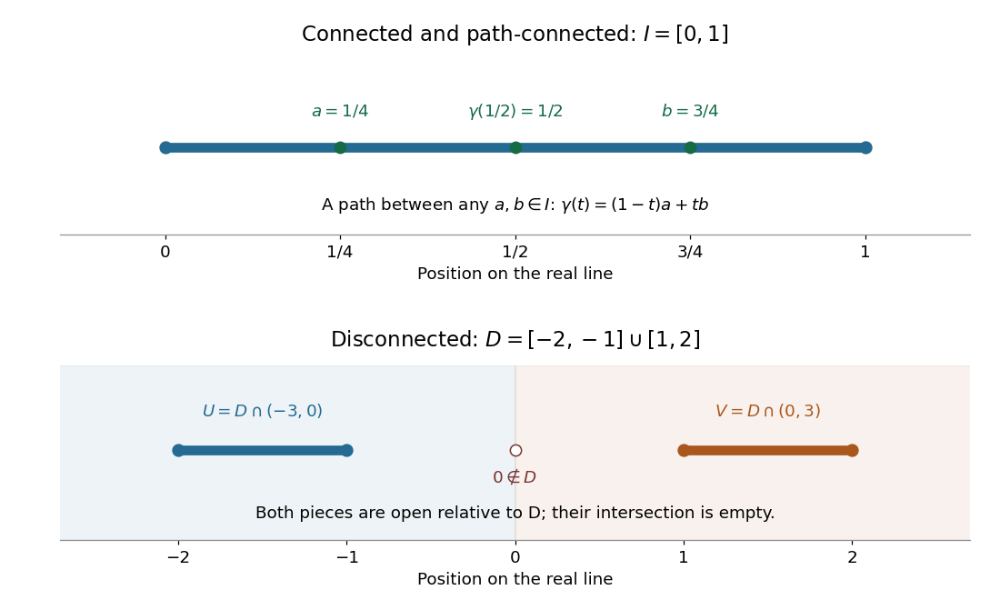

**[Figure 9](#image-a-connected-closed-interval-and-a-union-of-two-closed-intervals-admitting-a-separation-of-a-topological-space-in-the-subspace-topology). A connected closed interval and a union of two closed intervals admitting a separation of a topological space in the subspace topology**.

Why is [connectedness](#connected-space) useful? A [continuous image of a connected space](#continuous-image-of-a-connected-space) is [connected](#connected-space): a proposed [separation of a topological space](#separation-of-a-topological-space) in the [image](set-theory.md#image-of-a-function) would pull back through the [continuous map](topology.md#continuous-map) to a forbidden [separation of a topological space](#separation-of-a-topological-space) in its source. Thus a [continuous map](topology.md#continuous-map) from a [real interval](real-analysis.md#interval-mathematics) to the [real line](real-analysis.md#real-line) cannot skip values between two attained values. This is the [intermediate value theorem](calculus.md#intermediate-value-theorem). For a computed example, the [continuous function](calculus.md#continuous-function) $f(x)=x^2$ on $[0,1]$ has [image](set-theory.md#image-of-a-function) $[0,1]$; the value $1/2$ occurs at $x=1/\sqrt2\approx0.707107$. [Connectedness](#connected-space) guarantees an input attaining that value even when we have no formula for it.

[Path connectedness](#path-connected-space) is a stronger condition: it supplies a [continuous path](#continuous-path) between every pair of points. The [topologist's sine curve](#topologist-s-sine-curve) below shows that a [connected space](#connected-space) need not be a [path-connected space](#path-connected-space).

### Disconnected space

↑ **Parent:** [Connected space](#connected-space)

A [topological space](topology.md#topological-space) is [disconnected space](#disconnected-space) if it can be written as the union of two disjoint nonempty [open subsets](topology.md#open-set). Such a pair is a [separation of a topological space](#separation-of-a-topological-space). Each of the subsets is also closed, and conversely a nontrivial subset that is both open and closed gives a [separation of a topological space](#separation-of-a-topological-space) with its complement.

### Connected set

↑ **Parent:** [Connected space](#connected-space)

A [subset](set.md#subset) of a [topological space](topology.md#topological-space) is a connected set when its [subspace topology](topology.md#subspace-topology) is [connected](#connected-space). Thus connectedness is tested using relatively [open sets](topology.md#open-set), not only subsets open in the ambient space.

#### Connectedness at a one-sided contact point

↑ **Parent:** [Connected set](#connected-set)

Two disjoint [connected sets](#connected-set) can have a connected union when one contains a contact point of the other's [closure](topology.md#closure-topology). To prove the displayed criterion, suppose the union had a separation into disjoint nonempty relatively [open sets](topology.md#open-set) $P,Q$. Each connected set lies wholly on one side; if both lie on the same side, the other side is empty. Otherwise assume $A\subset P$ and $B\subset Q$. Choose $b\in B\cap\overline A$. Since $Q$ is relatively open in the union and contains $b$, some ambient [open set](topology.md#open-set) containing $b$ meets the union only in $Q$. It must nevertheless meet $A$ by the definition of [closure](topology.md#closure-topology), a contradiction.

For example, the open unit disc centred at zero and the closed unit disc centred at two are disjoint, but their union contains the common contact point one through the second disc and is [connected](#connected-space). In this example it is even [path-connected](#path-connected-space): the real segment from zero to one lies in the first disc except for its endpoint, and that endpoint belongs to the second disc. Omitting the contact point from both discs instead gives a disconnected union.

### Connectedness of an intersection from connected finite intersections

↑ **Parent:** [Connected space](#connected-space)

Let $X$ be a [compact Hausdorff space](topology.md#compact-hausdorff-space) and let $K_i$ be [compact subsets](topology.md#compact-space) such that all finite [intersections](set.md#set-intersection) are nonempty and [connected](#connected-space). Their total [intersection](set.md#set-intersection) $K$ is nonempty by the [finite intersection characterization of compactness](topology.md#finite-intersection-characterization-of-compactness), and [compact](topology.md#compact-space) because it is [closed](topology.md#closed-set) in $X$.

If $K$ were not [connected](#connected-space), its [separation of a topological space](#separation-of-a-topological-space) would divide it into two nonempty [compact subsets](topology.md#compact-space). [Separation of disjoint compact subsets](topology.md#separation-of-disjoint-compact-subsets) gives [disjoint](set.md#disjoint-sets) ambient [open sets](topology.md#open-set) $U,V$ containing the two pieces. The family consisting of $X\setminus(U\cup V)$ and all $K_i$ has empty total [intersection](set.md#set-intersection), so some finite subfamily has empty [intersection](set.md#set-intersection). Hence a finite [intersection](set.md#set-intersection) $K_J$ of the $K_i$ lies in $U\cup V$. Since $K\subseteq K_J$ meets both [open sets](topology.md#open-set), they disconnect $K_J$, a contradiction. The hypothesis on all finite [intersections](set.md#set-intersection) is stronger than requiring each individual $K_i$ to be [connected](#connected-space).

#### Decreasing closed connected sets with disconnected compact intersection

↑ **Parent:** [Connectedness of an intersection from connected finite intersections](#connectedness-of-an-intersection-from-connected-finite-intersections)

Use the arcs and points of the [noncompact counterexample to the Šura-Bura lemma](#noncompact-counterexample-to-the-sura-bura-lemma), and add the central ray $\{(1/2,t):t\geq1\}$ to form $X$. Define $C_n=\{p,q\}\cup\bigcup_{m\geq n}A_m\cup\{(1/2,t):t\geq n\}$. Each graph tail is [connected](#connected-space) because its arcs meet the ray. Its relative [closure](topology.md#closure-topology) in $X$ adds just $p,q$, so each $C_n$ is closed and [connected](#connected-space). These sets decrease and have [intersection](set.md#set-intersection) $\{p,q\}$, which is [compact](topology.md#compact-space) and disconnected. The ambient $X=C_1$ is [connected](#connected-space) and [Hausdorff](topology.md#hausdorff-space) but noncompact.

### Connected complement of a product of proper subsets

↑ **Parent:** [Connected space](#connected-space)

Suppose $X,Y$ are nonempty [connected spaces](#connected-space), and $A\subsetneq X$, $B\subsetneq Y$ are proper [subsets](set.md#subset). Then $C=(X\times Y)\setminus(A\times B)$, with its [subspace topology](topology.md#subspace-topology) from the [product topology](#product-topology), is a [connected space](#connected-space). No [closed set](topology.md#closed-set) or [open set](topology.md#open-set) hypothesis on $A,B$ is needed.

Choose $x_0\in X\setminus A$, $y_0\in Y\setminus B$. The two [topological subspaces](topology.md#topological-subspace) $\{x_0\}\times Y$ and $X\times\{y_0\}$ are [homeomorphic](topology.md#homeomorphism) to the factors, intersect at $(x_0,y_0)$, and lie in $C$. Their [union](set.md#set-union) is a [connected subset](#connected-subset) $H$. Every $(x,y)\in C$ has $x\notin A$ or $y\notin B$. In the first case its entire vertical copy $\{x\}\times Y$ lies in $C$ and meets $H$; in the second case the horizontal copy $X\times\{y\}$ does so. Thus $C$ is a [connected union with a connected hub](#connected-union-with-a-connected-hub).

Both properness assumptions are needed for this general result. Taking $X=Y=\mathbb R$, $A=X$ and $B=\{0\}$ gives the two disjoint [open](topology.md#open-set) half-planes $y<0$ and $y>0$, a [separation of a topological space](#separation-of-a-topological-space) of the complement.

### Connectedness of an interval

↑ **Parent:** [Connected space](#connected-space)

Every real interval is [connected](#connected-space). Otherwise a separation into two nonempty relatively open sets defines a continuous real function equal to zero on one side and one on the other. Choose one point of each set. The [intermediate value theorem](calculus.md#intermediate-value-theorem) on the closed segment between them requires the value $1/2$, a contradiction. The converse also holds: a connected subset of the real line contains every point between two of its points, since omitting an intermediate point separates it into its intersections with the two open half-lines.

<h3 id="topologist-s-sine-curve">Topologist's sine curve</h3>

↑ **Parent:** [Connected space](#connected-space)  
ⓦ [Wiki](https://en.wikipedia.org/wiki/Topologist's_sine_curve)

Consider the [graph of a function](function.md#graph-of-a-function) $x\mapsto\sin(1/x)$, using the [sine](#sine) of the [multiplicative inverse](arithmetic.md#multiplicative-inverse) of $x$, together with a vertical [closed interval](real-analysis.md#closed-real-interval):

$$
G=\{(x,\sin(1/x)):0<x\le1\},\qquad L=\{0\}\times[-1,1],\qquad T=G\cup L.
$$

Give $T$ the [subspace topology](topology.md#subspace-topology) from the [Euclidean plane](#euclidean-plane). The symbol $\times$ denotes a [Cartesian product](set-theory.md#cartesian-product). The right endpoint $(1,\sin1)\approx(1,0.841471)$ belongs to $G$. The [continuous map](topology.md#continuous-map) $x\mapsto(x,\sin(1/x))$ sends the [connected](#connected-space) [real interval](real-analysis.md#interval-mathematics) $(0,1]$ onto $G$. Hence $G$ is [connected](#connected-space), and its [closure](topology.md#closure-topology) $\overline G=T$ is [connected](#connected-space) by [closure of a connected set](#closure-of-a-connected-set). Every height in $[-1,1]$ is approached as $x$ tends to zero; for example,

$$
p_n=\frac1{\pi/2+2\pi n},\qquad q_n=\frac1{3\pi/2+2\pi n},\qquad \sin(1/p_n)=1,\qquad\sin(1/q_n)=-1\quad(n=0,1,\ldots).
$$

For $n=1$, these inputs are $p_1=2/(5\pi)\approx0.127324$ and $q_1=2/(7\pi)\approx0.090946$. For any other height $y\in[-1,1]$, choose $\theta\ge1$ with $\sin\theta=y$; then the [sequence](sequence-and-series.md#sequence) $(1/(\theta+2\pi n),y)$ lies in $G$ and has [limit of a sequence](sequence-and-series.md#limit-of-a-sequence) $(0,y)$.

Nevertheless, $T$ has exactly two [path components](#path-component), $G$ and $L$. Within $G$, join inputs $a,b\in(0,1]$ by the [continuous path](#continuous-path) $t\mapsto((1-t)a+tb,\sin(1/((1-t)a+tb)))$. Within $L$, use $t\mapsto(0,(1-t)c+td)$ for heights $c,d\in[-1,1]$.

The obstruction to a [continuous path](#continuous-path) between $L$ and $G$ is persistent oscillation, not a visible gap. Proof outline: suppose such a [path](#continuous-path) exists, directed from $L$ to $G$, and take its last time in $L$. Immediately afterwards its first coordinate $x(t)>0$ approaches zero and its second coordinate is $\sin(1/x(t))$. The [intermediate value theorem](calculus.md#intermediate-value-theorem) forces the first coordinate to pass through inputs of both displayed types arbitrarily close to that departure time. The second coordinate therefore takes both values $1$ and $-1$ arbitrarily close to that time, contradicting [continuity](calculus.md#continuous-function). [Munkres, Topology: A First Course, section 3-2, example 7 on p. 158](https://math.mit.edu/~hrm/palestine/munkres-topology.pdf)

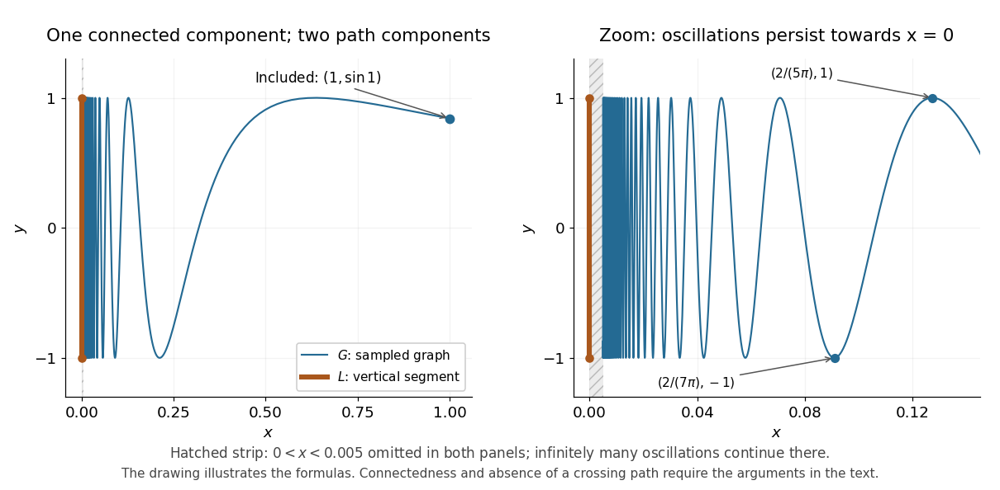

**[Figure 10](#image-the-topologist-s-sine-curve-has-one-connected-component-and-two-path-components-the-graph-of-a-function-is-drawn-only-for-x-ge0-005-with-further-oscillations-omitted-near-the-vertical-closed-interval). The topologist's sine curve has one connected component and two path components; the graph of a function is drawn only for $x\ge0.005$, with further oscillations omitted near the vertical closed interval**.

The sampled [graph of a function](function.md#graph-of-a-function) illustrates the formulas; it does not prove [connectedness](#connected-space) or the failure of [path connectedness](#path-connected-space). Taking a [closure](topology.md#closure-topology) preserves [connectedness](#connected-space), but this example shows that it can destroy [path connectedness](#path-connected-space).

### Connected chain of overlapping subsets

↑ **Parent:** [Connected space](#connected-space)

A sequence of [connected subsets](#connected-subset) with each consecutive pair intersecting has connected union. If the union admitted a separation, each [connected subset](#connected-subset) would lie entirely on one side. Consecutive intersections force consecutive subsets onto the same side, hence all subsets onto one side, contradicting that both sides of the separation are nonempty.

### Spiral accumulating on a circle

↑ **Parent:** [Connected space](#connected-space)

The closure of the displayed [connected](#connected-space) spiral adds the unit circle. Its union with the closed unit disk is therefore connected but not path-connected. A path from the spiral to the disk would have a first contact time. Before contact its reciprocal radial offset defines a continuous parameter tending to infinity. The [intermediate value theorem](calculus.md#intermediate-value-theorem) then forces sequences of path points with parameters integer and half-integer, approaching opposite circle points. This contradicts continuity at the first contact. Thus the spiral and disk form separate [path-connected components](#path-component).

### Connectedness from global regular functions

↑ **Parent:** [Connected space](#connected-space)

If a nonempty [scheme](locally-ringed-space.md#scheme) $X$ has no nontrivial [idempotent](commutative-algebra.md#idempotent) in $\Gamma(X,\mathcal O_X)$, then its underlying [topological space](topology.md#topological-space) is [connected](#connected-space). Indeed, a decomposition into two nonempty clopen subsets would produce the global regular function equal to zero on one component and one on the other. In particular, $\Gamma(X,\mathcal O_X)$ being a [field](algebra.md#field) implies connectedness.

### Connected subset

↑ **Parent:** [Connected space](#connected-space)

A [subset](set.md#subset) $A$ of a [topological space](topology.md#topological-space) $X$ is a [connected subset](#connected-subset) when $A$, with the [subspace topology](topology.md#subspace-topology) inherited from $X$, is a [connected space](#connected-space). Thus [connectedness](#connected-space) is tested inside $A$: a forbidden [separation of a topological space](#separation-of-a-topological-space) consists of nonempty [subsets](set.md#subset)

$$
U=A\cap O_1,\qquad V=A\cap O_2,\qquad A=U\cup V,\qquad U\cap V=\varnothing,
$$

where $O_1,O_2$ are [open sets](topology.md#open-set) in $X$. The ambient [open sets](topology.md#open-set) need not be disjoint outside $A$.

For example, in the [real line](real-analysis.md#real-line) with its usual [topology](topology.md), $[0,2]$ is a [connected subset](#connected-subset), whereas $\{0,2\}$ is not: its two [singleton sets](set.md#singleton-mathematics) are [open](topology.md#open-set) in its [subspace topology](topology.md#subspace-topology). A [subset](set.md#subset) of a [connected space](#connected-space) need not be [connected](#connected-space). Conversely, $[-2,-1]$ is a [connected subset](#connected-subset) of the disconnected [topological space](topology.md#topological-space) $[-2,-1]\cup[1,2]$. The ambient [topological space](topology.md#topological-space) need not itself be [connected](#connected-space).

A [finite set](set.md#finite-set) of distinct points in the [real line](real-analysis.md#real-line) inherits the [discrete topology](topology.md#discrete-space): a sufficiently small [open interval](topology.md#open-interval) around each point isolates that point. Its only nonempty [connected subsets](#connected-subset) are [singleton sets](set.md#singleton-mathematics). This depends on the [topology](topology.md): a nonempty [finite set](set.md#finite-set) with the [indiscrete topology](topology.md#indiscrete-topology) is a [connected space](#connected-space), since its only [open sets](topology.md#open-set) are itself and the [empty set](set.md#empty-set). Here, as in the definition of [connected space](#connected-space), the [empty set](set.md#empty-set) is also [connected](#connected-space) because it admits no [separation of a topological space](#separation-of-a-topological-space).[Definition 3.1.1 and Example 3.1.3: connectedness and discrete spaces](mathematics-bibliography.md#point-set-topology-by-romyar-sharifi/chapter-3-connected-and-compact-spaces)

The distinction matters when finding [connected components](#connected-component): we search among [connected subsets](#connected-subset) of the specified [topological space](topology.md#topological-space), rather than judging whether the surrounding drawing looks like one piece.

#### Connected union with a connected hub

↑ **Parent:** [Connected subset](#connected-subset)

Suppose [connected subsets](#connected-subset) $U_j$ all meet one [connected](#connected-space) member $U_1$. A separation of their union would place $U_1$ entirely on one side. Each $U_j$ is also entirely on one side and intersects $U_1$, so every $U_j$ lies on the same side, contradicting nonempty separation. Thus the union is [connected](#connected-space). If the subsets are [path-connected](#path-connected-space), join two points by a [path](#continuous-path) to $U_1$, a [path](#continuous-path) inside $U_1$, and a [path](#continuous-path) back out. This needs pairwise contact with the hub, not one point shared by every subset.

#### Irrational-cut separation of rational slopes

↑ **Parent:** [Connected subset](#connected-subset)

In a plane set with $x,y>0$ and rational ratio $x/y$, any irrational number $a$ lying between two attained ratios separates the set into the nonempty relatively open sets $x/y<a$ and $x/y>a$. This exhibits a failure of [connectedness](#connected-space) using the continuous slope map, even though each individual ray is [path-connected](#path-connected-space).

### Separation of a topological space

↑ **Parent:** [Connected space](#connected-space)

A separation of a topological space $X$ is a pair of disjoint nonempty open subsets whose union is $X$. A space is [connected](#connected-space) exactly when it has no separation.

### Connected component

↑ **Parent:** [Connected space](#connected-space)  
ⓦ [Wiki](https://en.wikipedia.org/wiki/Connected_component)

A [connected component](#connected-component) of a [topological space](topology.md#topological-space) $X$ is a nonempty [connected subset](#connected-subset) that is maximal under [subset](set.md#subset) inclusion. If $C$ is a [connected component](#connected-component) and $C\subseteq D\subseteq X$ with $D$ a [connected subset](#connected-subset), then $D=C$. Maximality means that no larger [connected subset](#connected-subset) contains $C$; it does not mean largest [cardinality](cardinal-number.md#cardinality) among all [connected subsets](#connected-subset).

For example, the [connected components](#connected-component) of $[-2,2]\setminus\{0\}$ in the usual [subspace topology](topology.md#subspace-topology) of the [real line](real-analysis.md#real-line) are $[-2,0)$ and $(0,2]$. Each is a [real interval](real-analysis.md#interval-mathematics), and no [connected subset of the real line](#connected-subset-of-the-real-line) can meet both without containing the missing point $0$. For the [finite set](set.md#finite-set) $\{-2,0,2\}$ in the same [subspace topology](topology.md#subspace-topology), the three [connected components](#connected-component) are its [singleton sets](set.md#singleton-mathematics).

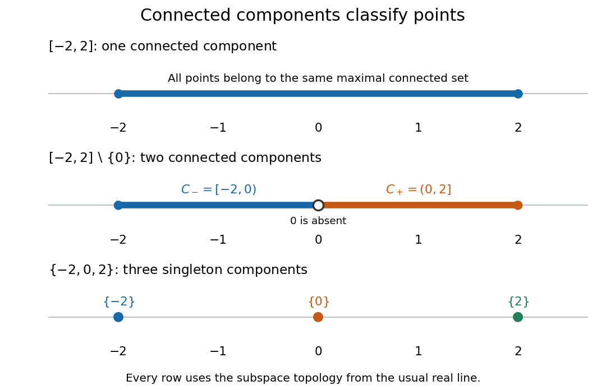

**[Figure 11](#connected-component-classification). An intact real interval, an interval with an interior point removed, and a finite set have one, two, and three connected components in the usual subspace topology of the real line**.

Every point $x\in X$ lies in exactly one [connected component](#connected-component), constructed by taking the [union](set.md#set-union)

$$
C_x=\bigcup\{A\subseteq X:x\in A\text{ and }A\text{ is connected}\}.
$$

All members contain $x$, so their [union](set.md#set-union) is [connected](#connected-space) by [connected union with a connected hub](#connected-union-with-a-connected-hub). The [union](set.md#set-union) includes every [connected subset](#connected-subset) through $x$, so it is maximal. Equivalently, define

$$
x\sim y\quad\Longleftrightarrow\quad
\text{some connected subset of }X\text{ contains both }x\text{ and }y.
$$

This is an [equivalence relation](set-theory.md#equivalence-relation): [singleton sets](set.md#singleton-mathematics) give reflexivity, symmetry is immediate, and two [connected subsets](#connected-subset) sharing the middle point have a [connected](#connected-space) [union](set.md#set-union), giving transitivity. The [equivalence classes](set-theory.md#equivalence-class) are precisely the [connected components](#connected-component). They form a [partition of a set](set.md#partition-of-a-set): they cover $X$ and any two are either equal or disjoint.[Proposition 3.1.11, Definition 3.1.12 and Remark 3.1.16: maximal connected subsets and equivalence classes](mathematics-bibliography.md#point-set-topology-by-romyar-sharifi/chapter-3-connected-and-compact-spaces)

Every nonempty [connected subset](#connected-subset) lies within one [connected component](#connected-component). Moreover, every [connected component](#connected-component) is [closed](topology.md#closed-set) in $X$: [closure of a connected set](#closure-of-a-connected-set) makes its [closure](topology.md#closure-topology) [connected](#connected-space), and maximality forces that [closure](topology.md#closure-topology) to equal the original [connected component](#connected-component). A [connected component](#connected-component) need not be [open](topology.md#open-set). For example, in $S=\{0\}\cup\{1/n:n=1,2,\ldots\}$ with its usual [subspace topology](topology.md#subspace-topology) from the [real line](real-analysis.md#real-line), all [connected components](#connected-component) are [singleton sets](set.md#singleton-mathematics), but $\{0\}$ is not [open](topology.md#open-set): every [neighbourhood](topology.md#neighbourhood-mathematics) of $0$ in $S$ contains some $1/n$.[Lemma 3.1.13 and Example 3.1.14: closed components and a component which is not open](mathematics-bibliography.md#point-set-topology-by-romyar-sharifi/chapter-3-connected-and-compact-spaces)

#### Boundary-bumping theorem for compact subsets

↑ **Parent:** [Connected component](#connected-component)

Every [connected component](#connected-component) $C$ of a nonempty [compact](topology.md#compact-space) proper subset $D$ of a [connected](#connected-space) [Hausdorff space](topology.md#hausdorff-space) meets its [boundary](topology.md#boundary-of-a-set). If not, the [Šura-Bura lemma](#sura-bura-lemma) identifies $C$ as a [quasi-component](#quasi-component) in the [compact](topology.md#compact-space) [Hausdorff](topology.md#hausdorff-space) subspace $D$. Finitely many [clopen](topology.md#clopen-set) [neighborhoods](topology.md#neighbourhood-mathematics) separate it from the [compact](topology.md#compact-space) [boundary](topology.md#boundary-of-a-set), giving a nonempty relatively [clopen](topology.md#clopen-set) $H\subseteq\operatorname{int}D$. Such $H$ is open in the ambient space, and is also closed there because $D$ is closed. It is proper because $D$ is proper. This contradicts [connectedness](#connected-space).

#### Quasi-component

↑ **Parent:** [Connected component](#connected-component)

The [quasi-component](#quasi-component) of a point is the [intersection](set.md#set-intersection) of its [clopen](topology.md#clopen-set) neighborhoods. Its [connected component](#connected-component) is always contained in it: a [connected set](#connected-set) meeting a [clopen](topology.md#clopen-set) set cannot also meet its complement. Equality need not hold in noncompact [Hausdorff](topology.md#hausdorff-space) spaces. The [Šura-Bura lemma](#sura-bura-lemma) proves equality in [compact Hausdorff spaces](topology.md#compact-hausdorff-space).

<h5 id="sura-bura-lemma">Šura-Bura lemma</h5>

↑ **Parent:** [Quasi-component](#quasi-component)

In a [compact Hausdorff space](topology.md#compact-hausdorff-space), each [connected component](#connected-component) is its [quasi-component](#quasi-component) and has a neighborhood basis of [clopen](topology.md#clopen-set) sets. Let $Q$ be the [intersection](set.md#set-intersection) of [clopen](topology.md#clopen-set) neighborhoods of $x$. It is [compact](topology.md#compact-space). If it splits into two nonempty [compact](topology.md#compact-space) sets, normality separates them by disjoint [open neighborhoods](topology.md#open-neighbourhood). The [finite intersection characterization of compactness](topology.md#finite-intersection-characterization-of-compactness) gives a finite [intersection](set.md#set-intersection) of [clopen](topology.md#clopen-set) neighborhoods lying in their [union](set.md#set-union). Its [intersection](set.md#set-intersection) with the neighborhood containing $x$ is then [clopen](topology.md#clopen-set) and excludes part of $Q$, a contradiction. Thus $Q$ is [connected](#connected-space) and equals the component. Applying the same finite-intersection argument to any neighborhood of $Q$ proves the neighborhood-basis assertion. [Formalized Šura-Bura results, including the compact Euclidean case](https://www.cl.cam.ac.uk/research/hvg/Isabelle/dist/Isabelle/browser_info/HOL/HOL-Analysis/Homotopy.html).

<h6 id="noncompact-counterexample-to-the-sura-bura-lemma">Noncompact counterexample to the Šura-Bura lemma</h6>

↑ **Parent:** [Šura-Bura lemma](#sura-bura-lemma)

Set $p=(0,0)$, $q=(1,0)$, $\varepsilon_m=1/(m+2)$, and let $A_m$ be the polygonal arc joining $(\varepsilon_m,0)$, $(\varepsilon_m,m)$, $(1-\varepsilon_m,m)$, and $(1-\varepsilon_m,0)$. In the planar subspace $Z=\{p,q\}\cup\bigcup_m A_m$, each arc is [clopen](topology.md#clopen-set). The component of $p$ is therefore just $\{p\}$. Any [clopen](topology.md#clopen-set) neighborhood of $p$ contains the left endpoints of all sufficiently high arcs, hence those entire [connected](#connected-space) arcs, and by closedness also the limit $q$ of their right endpoints. Thus its [quasi-component](#quasi-component) is $\{p,q\}$. Higher arcs escape to infinity while their endpoints approach the two distinguished points.

#### Quasicomponent

↑ **Parent:** [Connected component](#connected-component)

The quasicomponent of a point is the intersection of all its clopen neighborhoods. Every connected set containing the point lies in its quasicomponent, since a [clopen set](topology.md#clopen-set) cannot split a connected set. In a compact Hausdorff space, quasicomponents equal [connected components](#connected-component) by the [Šura-Bura component lemma](#sura-bura-component-lemma).

<h5 id="sura-bura-component-lemma">Šura-Bura component lemma</h5>

↑ **Parent:** [Quasicomponent](#quasicomponent)

In a compact Hausdorff space, the [quasicomponent](#quasicomponent) $Q_x$ is connected and equals the [connected component](#connected-component) of $x$. If $Q_x=A\cup B$ were a nontrivial separation, disjoint open neighborhoods $U,V$ of its compact pieces leave a compact complement missing $Q_x$. Finitely many clopen neighborhoods of $x$ intersect to a clopen $N$ containing $Q_x$ inside $U\cup V$. The piece $N\cap U$ is then clopen in the whole space, contains $x$, and misses the nonempty other piece, contradicting the definition of $Q_x$. This also proves that any neighborhood of a component contains a clopen neighborhood of that component, by compactness of its complement.

#### Identity component

↑ **Parent:** [Connected component](#connected-component)  
ⓦ [Wiki](https://en.wikipedia.org/wiki/Identity_component)

The identity component is the [connected component](#connected-component) containing the [identity element](algebraic-operation.md#identity-element). It is a closed [normal subgroup](group-theory.md#normal-subgroup): products and inverses of connected sets through the identity remain in that component, and conjugation preserves it. It need not be open; in the additive group $\mathbb Q$ with its usual topology it is the nonopen singleton $\{0\}$.

#### Connected components of a product space

↑ **Parent:** [Connected component](#connected-component)

The [product of connected spaces](#product-of-connected-spaces) is connected, so the product of the two [connected components](#connected-component) lies in the component of $(x,y)$. Conversely, continuous projections carry that component to connected sets in the factors, which must lie in $C_x$ and $C_y$. These two inclusions prove equality in arbitrary [topological spaces](topology.md#topological-space).

#### Jordan-Brouwer separation theorem

↑ **Parent:** [Connected component](#connected-component)  
ⓦ [Wiki](https://en.wikipedia.org/wiki/Jordan-Brouwer_separation_theorem)

An embedded copy of $S^{n-1}$ in $\mathbb R^n$ separates space into an inside and an outside. In particular, a connected closed surface embedded in $\mathbb R^3$ is two-sided and orientable.

### Continuous image of a connected space

↑ **Parent:** [Connected space](#connected-space)  
ⓦ [Wiki](https://en.wikipedia.org/wiki/Continuous_image_of_a_connected_space)

If $f:X\to Y$ is a [continuous map](topology.md#continuous-map) and $X$ is a [connected space](#connected-space), then its [image](set-theory.md#image-of-a-function) $f(X)$, with the [subspace topology](topology.md#subspace-topology) from $Y$, is a [connected subset](#connected-subset) of $Y$. The whole [codomain](function.md#codomain) $Y$ need not be [connected](#connected-space); the assertion concerns the values actually attained. No [injectivity](algebra.md#injective-function) is required.[p. 70: a continuous image is connected](mathematics-bibliography.md#general-topology-by-tom-leinster)

For example, the [continuous function](calculus.md#continuous-function) $f(x)=x^2$ maps the [connected](#connected-space) [closed interval](real-analysis.md#closed-real-interval) $[-2,2]$ onto the [connected](#connected-space) [closed interval](real-analysis.md#closed-real-interval) $[0,4]$, even though opposite inputs have the same output. The same [continuous function](calculus.md#continuous-function) maps the disconnected [union](set.md#set-union) $[-2,-1]\cup[1,2]$ onto $[1,4]$. Thus a [connected](#connected-space) [image](set-theory.md#image-of-a-function) does not imply a [connected](#connected-space) source: a [continuous map](topology.md#continuous-map) can merge different [connected components](#connected-component).

For a [continuous function](calculus.md#continuous-function) $r:[0,1]\to\mathbb R$ representing a continuous reading, $r(0)=0$ and $r(1)=1$ force some input with $r(t)=1/2$. Its [image](set-theory.md#image-of-a-function) is a [connected subset of the real line](#connected-subset-of-the-real-line), hence a [real interval](real-analysis.md#interval-mathematics) containing both endpoint readings. For the synthetic model $r(t)=t^2$, the missing-value test is explicit: $r(1/\sqrt2)=1/2$. A step reading equal to $0$ for $t<1/2$ and $1$ for $t\ge1/2$ skips $1/2$, but fails [continuity](calculus.md#continuous-function) at $t=1/2$.

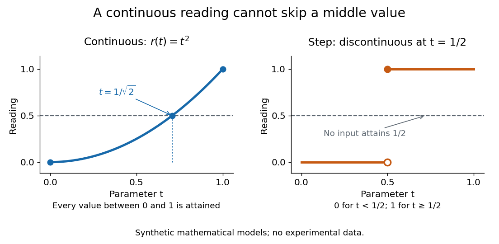

**[Figure 12](#continuous-readings-intermediate-values). A continuous function attains intermediate readings; a step that skips them violates continuity**. Synthetic mathematical models, not measured data. The [continuous function](calculus.md#continuous-function) $r(t)=t^2$ attains $1/2$ at $t=1/\sqrt2$; the step attains only $0$ and $1$.

Proof outline: a [separation of a topological space](#separation-of-a-topological-space) of $f(X)$ into nonempty [open subsets](topology.md#open-set) pulls back under $f$ to nonempty [open subsets](topology.md#open-set) of $X$. Their [intersection](set.md#set-intersection) is empty and their [union](set.md#set-union) is $X$, contradicting [connectedness](#connected-space). This also shows why a [continuous map](topology.md#continuous-map) sends each [connected component](#connected-component) of its source into a single [connected component](#connected-component) of its target.

### Connected subset of the real line

↑ **Parent:** [Connected space](#connected-space)

In the usual [subspace topology](topology.md#subspace-topology) from the [real line](real-analysis.md#real-line), a [subset](set.md#subset) $A\subseteq\mathbb R$ is [connected](#connected-space) exactly when it has the defining property of a [real interval](real-analysis.md#interval-mathematics):

$$
a,b\in A,\qquad a<c<b\quad\Longrightarrow\quad c\in A.
$$

Every [real number](arithmetic.md#real-number) between two members must be present. Thus [open intervals](topology.md#open-interval), [closed intervals](real-analysis.md#closed-real-interval), intervals with only one endpoint included, and unbounded [real intervals](real-analysis.md#interval-mathematics) are [connected](#connected-space). [Singleton sets](set.md#singleton-mathematics) are [connected](#connected-space) too. With the no-[separation of a topological space](#separation-of-a-topological-space) convention used here, the [empty set](set.md#empty-set) satisfies the same property; some texts reserve the word [connected](#connected-space) for nonempty [topological spaces](topology.md#topological-space).[p. 68, and Proposition C2.6, p. 73: the nonempty convention and the interval characterization](mathematics-bibliography.md#general-topology-by-tom-leinster)

Removing an interior point changes the answer:

$$
[-2,2]\setminus\{0\}=[-2,0)\cup(0,2].
$$

These two [real intervals](real-analysis.md#interval-mathematics) are exactly its [connected components](#connected-component) and its [path components](#path-component). Removing an endpoint instead leaves a [real interval](real-analysis.md#interval-mathematics), for example $[-2,2]\setminus\{2\}=[-2,2)$, which stays [connected](#connected-space). This is why an interior point of a [closed interval](real-analysis.md#closed-real-interval) is a [cut point](#cut-point), whereas an endpoint is not. A nonempty [finite set](set.md#finite-set) of points in the [real line](real-analysis.md#real-line) is [connected](#connected-space) exactly when it is a [singleton set](set.md#singleton-mathematics).

Proof outline: if $a,b\in A$ but $c\in(a,b)$ is missing, the [subsets](set.md#subset)

$$
A\cap(-\infty,c),\qquad A\cap(c,\infty)
$$

give a [separation of a topological space](#separation-of-a-topological-space), since the two [open intervals](topology.md#open-interval) make both pieces [open](topology.md#open-set) in $A$. Conversely, a nonempty [real interval](real-analysis.md#interval-mathematics) contains the [continuous path](#continuous-path) $t\mapsto(1-t)a+tb$ between any two of its points, so it is [path-connected](#path-connected-space) and hence [connected](#connected-space). Together with [continuous image of a connected space](#continuous-image-of-a-connected-space), this characterization gives the [intermediate value theorem](calculus.md#intermediate-value-theorem): a [continuous function](calculus.md#continuous-function) on a [real interval](real-analysis.md#interval-mathematics) cannot jump over a value lying between two attained values.

### Integer-valued function criterion for connectedness

↑ **Parent:** [Connected space](#connected-space)

A topological space is connected exactly when every continuous map from it to the discrete space $\mathbb Z$ is constant. A disconnection produces a nonconstant indicator map, while the continuous image of a connected space in $\mathbb Z$ must be a singleton.

### Pairwise-intersecting connected cover

↑ **Parent:** [Connected space](#connected-space)

If connected subsets cover a space and every two of them intersect, then their union is connected. Equivalently, any continuous integer-valued function is constant on each member, and the intersections force all those constants to agree.

### Product of connected spaces

↑ **Parent:** [Connected space](#connected-space)

The product of any family of connected spaces is connected. For two factors, fix $y_0$ and use the connected sets

$$
(X\times\{y_0\})\cup(\{x\}\times Y),
\qquad x\in X.
$$

They cover $X\times Y$ and all contain the connected horizontal slice $X\times\{y_0\}$.

### Closure of a connected set

↑ **Parent:** [Connected space](#connected-space)  
ⓦ [Wiki](https://en.wikipedia.org/wiki/Closure_of_a_connected_set)

Every set lying between a connected set and its closure is connected.

## Distance from a point to a plane

↑ **Parent:** [Geometry and topology](geometry-and-topology.md)  
ⓦ [Wiki](https://en.wikipedia.org/wiki/Distance_from_a_point_to_a_plane)

The [distance from a point to a plane](#distance-from-a-point-to-a-plane) is the shortest [Euclidean distance](topological-analysis.md#euclidean-distance) from the given [point](#point-geometry) to any point on the [plane](#plane). For $P=\{\mathbf x:\mathbf n\cdot\mathbf x=d\}$ with nonzero [normal vector](differential-geometry.md#normal-vector) $\mathbf n$, a point $\mathbf p$ has

$$
\boxed{D=\frac{|\mathbf n\cdot\mathbf p-d|}{\|\mathbf n\|}.}
$$

The numerator is the residual of the [plane equation](#cartesian-equation-of-a-plane), not yet a [length](physics.md#length): its size depends on the chosen [normal vector](differential-geometry.md#normal-vector). Dividing by that vector's [Euclidean norm](normed-vector-space.md#euclidean-norm) removes this arbitrary scale.

For the original example $P:2x-y+2z=3$ and $\mathbf p=(4,1,2)$, the [normal vector](differential-geometry.md#normal-vector) is $\mathbf n=(2,-1,2)$ and $\|\mathbf n\|=3$. The residual is $8-1+4-3=8$, so **the distance is $8/3$**. Using the equivalent [plane equation](#cartesian-equation-of-a-plane) $-6x+3y-6z=-9$ instead gives numerator $24$ and [Euclidean norm](normed-vector-space.md#euclidean-norm) $9$, hence the same $8/3$. A point already on the [plane](#plane) has zero residual and zero distance.

Why is the perpendicular route shortest? Let $\mathbf q$ be the [closest point on a plane](#closest-point-on-a-plane) and $\mathbf r$ any other point on it. The displacement $\mathbf p-\mathbf q$ is [orthogonal](inner-product.md#orthogonal-vectors) to $\mathbf q-\mathbf r$, so the [Pythagorean theorem](euclidean-geometry.md#pythagorean-theorem) gives

$$
\|\mathbf p-\mathbf r\|^2=\|\mathbf p-\mathbf q\|^2+\|\mathbf q-\mathbf r\|^2\geq\|\mathbf p-\mathbf q\|^2.
$$

Equality holds only for $\mathbf r=\mathbf q$. This is the closest-point principle of [orthogonal decomposition](hilbert-space.md#orthogonal-decomposition-by-a-closed-subspace), applied after a [translation](#translation-geometry) of an affine [plane](#plane) to its direction [linear subspace](vector-space.md#vector-subspace).[Interactive Linear Algebra, §6.3.1: Orthogonal decomposition theorem, Closest vector and distance](mathematics-bibliography.md#interactive-linear-algebra-by-dan-margalit-and-others/orthogonal-projection)

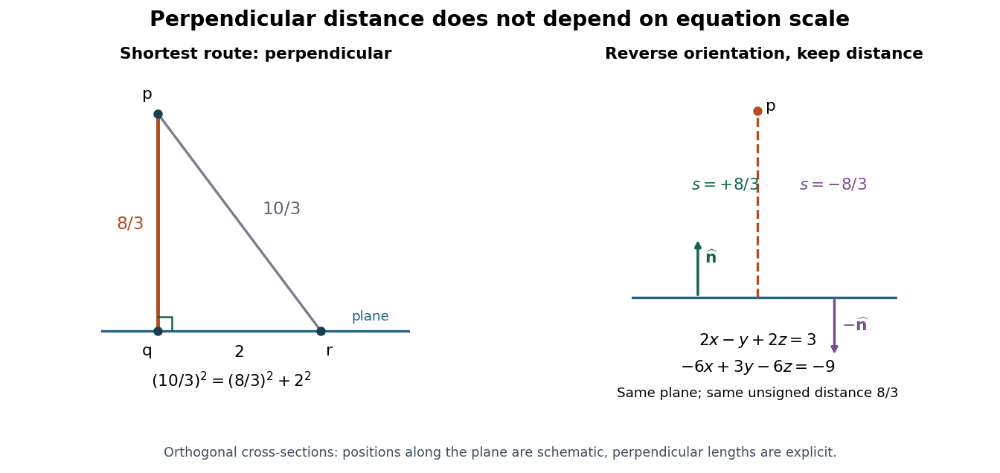

**[Figure 13](#image-the-perpendicular-route-to-a-plane-is-shortest-and-rescaling-its-plane-equation-preserves-the-distance). The perpendicular route to a plane is shortest, and rescaling its plane equation preserves the distance**. Original cross-section using the worked distance $8/3$. The comparison point lies two length units along the [plane](#plane) from the [closest point on a plane](#closest-point-on-a-plane), giving a longer route of $10/3$. The second panel reverses the [unit normal](differential-geometry.md#unit-normal) without moving the [plane](#plane).

The formula is useful whenever the deviation from a flat reference should be measured geometrically. A raw [linear equation](linear-algebra.md#linear-equation) residual cannot be compared across arbitrary equation scalings; a perpendicular distance can. The same reasoning works for a [hyperplane](vector-space.md#hyperplane) in any finite-dimensional [Euclidean space](normed-vector-space.md#euclidean-norm), with the appropriate number of coordinates.

### Closest point on a plane

↑ **Parent:** [Distance from a point to a plane](#distance-from-a-point-to-a-plane)

For a nonzero [normal vector](differential-geometry.md#normal-vector) $\mathbf n$ and the [plane equation](#cartesian-equation-of-a-plane) $\mathbf n\cdot\mathbf x=d$, the [closest point on a plane](#closest-point-on-a-plane) to $\mathbf p$ is

$$
\boxed{\mathbf q=\mathbf p-\frac{\mathbf n\cdot\mathbf p-d}{\mathbf n\cdot\mathbf n}\mathbf n.}
$$

It subtracts only the normal displacement. Substituting gives $\mathbf n\cdot\mathbf q=d$, so $\mathbf q$ lies on the [plane](#plane); the difference $\mathbf p-\mathbf q$ is a [scalar multiple](vector-space.md#scalar-multiple) of its [normal vector](differential-geometry.md#normal-vector). These two checks identify the [orthogonal projection onto a plane](#closest-point-on-a-plane) without solving a three-variable minimization problem.

For $\mathbf n=(2,-1,2)$, $d=3$, and $\mathbf p=(4,1,2)$, the residual $8$ gives

$$
\boxed{\mathbf q=(4,1,2)-\frac89(2,-1,2)
=\left(\frac{20}9,\frac{17}9,\frac29\right).}
$$

Indeed, $(40-17+4)/9=3$, and $\|\mathbf p-\mathbf q\|=(8/9)\cdot3=8/3$. Choosing the [plane](#plane) point $(1,1,1)$ instead gives distance $\sqrt{10}>8/3$: being on the [plane](#plane) does not make a point the nearest one.

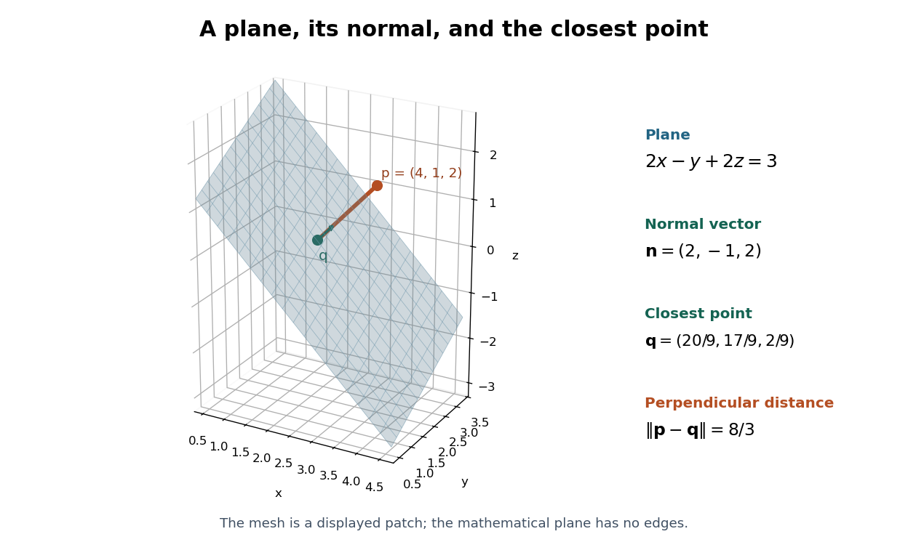

**[Figure 14](#image-the-closest-point-on-a-plane-is-reached-along-its-normal-vector). The closest point on a plane is reached along its normal vector**. Original three-dimensional example $2x-y+2z=3$, with $\mathbf p=(4,1,2)$ and $\mathbf q=(20/9,17/9,2/9)$. The finite mesh is only a displayed patch of the infinite [plane](#plane); it is not a physical measurement.

As a [function](function.md) of $\mathbf p$, this projection is

$$
\mathbf p\longmapsto\left(I-\frac{\mathbf n\mathbf n^{\mathsf T}}{\mathbf n^{\mathsf T}\mathbf n}\right)\mathbf p
+\frac{d}{\mathbf n^{\mathsf T}\mathbf n}\mathbf n.
$$

It is an [affine map](#affine-map), becoming a [linear map](vector-space.md#linear-map) when $d=0$. Projecting a second time changes nothing. It preserves displacements along the [plane](#plane) and removes the normal displacement, so it is a concrete example of an [idempotent map](function.md#idempotent-function).

#### Orthogonal projection onto an intercept plane

↑ **Parent:** [Closest point on a plane](#closest-point-on-a-plane)

For positive coordinate intercepts $A=(a,0,0)$, $B=(0,b,0)$ and $C=(0,0,c)$, their [plane equation](#cartesian-equation-of-a-plane) is $\mathbf n\cdot\mathbf r=1$. The [closest point on a plane](#closest-point-on-a-plane) to the origin is $\mathbf d=\mathbf n/\|\mathbf n\|^2$, with distance $1/\|\mathbf n\|$. Its [barycentric coordinate system](algebraic-topology.md#barycentric-coordinate-system) coefficients are proportional to $a^{-2},b^{-2},c^{-2}$ and sum to one.

The projection is also the [orthocenter](euclidean-geometry.md#orthocenter) of triangle $ABC$. Indeed $\mathbf a\cdot(\mathbf b-\mathbf c)=0$, and $\mathbf d\cdot\mathbf b=\mathbf d\cdot\mathbf c$ because each equals $1/\|\mathbf n\|^2$. Hence $(\mathbf a-\mathbf d)\cdot(\mathbf b-\mathbf c)=0$. Cycling the vertices gives all three altitude directions. This connects an ambient-space [orthogonal projection](hilbert-space.md#orthogonal-projection) with intrinsic triangle geometry.

### Signed distance from a point to a plane

↑ **Parent:** [Distance from a point to a plane](#distance-from-a-point-to-a-plane)

Orient the [plane](#plane) $\mathbf n\cdot\mathbf r=d$ with a [unit normal](differential-geometry.md#unit-normal) $\mathbf n$. A [point](#point-geometry) $\mathbf p$ then has [signed distance from a point to a plane](#signed-distance-from-a-point-to-a-plane)

$$
s=\mathbf n\cdot\mathbf p-d.
$$

Its [absolute value](real-analysis.md#absolute-value) is the ordinary [distance from a point to a plane](#distance-from-a-point-to-a-plane). The [closest point on a plane](#closest-point-on-a-plane) is $\mathbf p-s\mathbf n$, so the [displacement](classical-mechanics.md#displacement) from the [point](#point-geometry) to its [orthogonal projection onto a plane](#closest-point-on-a-plane) is $-s\mathbf n$. Reversing the [unit normal](differential-geometry.md#unit-normal) and $d$ reverses $s$ without changing the [plane](#plane) or the [distance from a point to a plane](#distance-from-a-point-to-a-plane). A [sphere](euclidean-geometry.md#sphere) of [radius](topology.md#radius) $q$ centred at $\mathbf p$ has [sphere-plane intersection](#sphere-plane-intersection) radius $\sqrt{q^2-s^2}$ when $|s|<q$.

For a general, not necessarily unit, [normal vector](differential-geometry.md#normal-vector) $\mathbf n_0$ in $\mathbf n_0\cdot\mathbf x=d_0$, the oriented distance is $(\mathbf n_0\cdot\mathbf p-d_0)/\|\mathbf n_0\|$. In the worked example of [distance from a point to a plane](#distance-from-a-point-to-a-plane), orientation toward $(2,-1,2)$ assigns $+8/3$ to $(4,1,2)$; reversing that [unit normal](differential-geometry.md#unit-normal) assigns $-8/3$. The [closest point on a plane](#closest-point-on-a-plane) and the unsigned distance are unaffected.

## Elliptic coordinates

↑ **Parent:** [Geometry and topology](geometry-and-topology.md)  
ⓦ [Wiki](https://en.wikipedia.org/wiki/Elliptic_coordinates)

### Mixed Dirichlet-Neumann problem in an elliptic annulus

↑ **Parent:** [Elliptic coordinates](#elliptic-coordinates)

In [elliptic coordinates](#elliptic-coordinates) $x=\cosh\mu\cos\nu$, $y=\sinh\mu\sin\nu$, a [harmonic function](partial-differential-equation.md#harmonic-function) in $a<\mu<b$, with $0<a<b$ and [period](mathematics.md#period-of-a-function) $2\pi$ in $\nu$, satisfies $u_{\mu\mu}+u_{\nu\nu}=0$. Prescribe $u(b,\nu)=f(\nu)$ and $u_\mu(a,\nu)=g(\nu)$. Expand both boundary functions in [Fourier series](fourier-series.md), writing their constant terms as $f_0,g_0$. For either the [sine](#sine) or [cosine](#cosine) coefficient of order $n\geq1$, [separation of variables](partial-differential-equation.md#separation-of-variables) gives

$$
u_n(\mu)=f_n\frac{\cosh[n(\mu-a)]}{\cosh[n(b-a)]}-g_n\frac{\sinh[n(b-\mu)]}{n\cosh[n(b-a)]}.
$$

The constant angular mode is $u_0(\mu)=f_0+g_0(\mu-b)$. These expressions follow by solving $u_n''-n^2u_n=0$ and checking $u_n(b)=f_n$, $u_n'(a)=g_n$. Their [Fourier series](fourier-series.md) gives the solution for sufficiently regular boundary data.

The phrase _normal derivative_ needs care: the [scale factor](cosmology.md#scale-factor-cosmology) is $h=\sqrt{\sinh^2\mu+\sin^2\nu}$, so the outward [unit normal](differential-geometry.md#unit-normal) derivative on the inner ellipse is $\partial_nu=-h^{-1}u_\mu$. Prescribing a physical [Neumann boundary condition](differential-equation.md#neumann-boundary-condition) therefore differs from prescribing $u_\mu$.

For [uniqueness](mathematical-logic.md#uniqueness), subtract two solutions to obtain $v$. Multiply $v_{\mu\mu}+v_{\nu\nu}=0$ by $v$ and use [integration by parts](calculus.md#integration-by-parts) over the periodic coordinate rectangle. The outer [Dirichlet boundary condition](differential-equation.md#dirichlet-boundary-condition), inner homogeneous derivative condition and periodic side cancellation give $\int_a^b\int_0^{2\pi}(v_\mu^2+v_\nu^2)\,d\nu\,d\mu=0$. Thus $v$ is constant, and the outer condition makes it zero.

## Joukowski map

↑ **Parent:** [Geometry and topology](geometry-and-topology.md)  
ⓦ [Wiki](https://en.wikipedia.org/wiki/Joukowski_map)

### Joukowski map from the upper half-disc to the upper half-plane

↑ **Parent:** [Joukowski map](#joukowski-map)

The [holomorphic function](holomorphic-function.md) $J(w)=-(w+w^{-1})$ maps $D_+=\{w:|w|<1,\ \operatorname{Im}w>0\}$ conformally and bijectively onto the [upper half-plane](complex-analysis.md#upper-half-plane-complex-analysis). Its imaginary part is $\operatorname{Im}w\,(|w|^{-2}-1)>0$, and its [derivative](calculus.md#derivative) $w^{-2}-1$ never vanishes there.

Equality of two values implies $(w_1-w_2)(1-1/(w_1w_2))=0$; since $|w_1w_2|<1$, this proves [injectivity](algebra.md#injective-function). For any target $\zeta$ in the [upper half-plane](complex-analysis.md#upper-half-plane-complex-analysis), the quadratic equation $w^2+\zeta w+1=0$ has two [roots](semisimple-lie-algebra.md#root-of-a-root-system) with product one and neither on the [unit circle](complex-analysis.md#complex-unit-circle). Exactly one therefore has modulus below one; the imaginary-part formula forces that [root](semisimple-lie-algebra.md#root-of-a-root-system) to lie in $D_+$, proving [surjectivity](algebra.md#surjective-function).

In particular, $z\mapsto e^{iz}$ maps $\{0<\operatorname{Re}z<\pi,\ \operatorname{Im}z>0\}$ bijectively to $D_+$, and composition gives the [conformal map](#conformal-map) $z\mapsto-2\cos z$ onto the [upper half-plane](complex-analysis.md#upper-half-plane-complex-analysis). The two sides of the half-strip map to the outer real rays, while its bottom edge maps to the segment $[-2,2]$.

### Joukowski circle-to-ellipse mapping

↑ **Parent:** [Joukowski map](#joukowski-map)

For $\rho>0$, substitution in the [Joukowski map](#joukowski-map) gives the title parametrization. If $\rho\ne1$, its image is an [ellipse](euclidean-geometry.md#ellipse) with semiaxes $\rho+\rho^{-1}$ and $|\rho-\rho^{-1}|$ and [foci](dynamical-systems.md#focus-dynamical-systems) $\pm2$. Reciprocal radii give the same [ellipse](euclidean-geometry.md#ellipse) in opposite orientations. At $\rho=1$ the image degenerates to $[-2,2]$, each interior point covered once by each unit [semicircle](topology.md#semicircle).

### Joukowski map of the upper exterior of a unit disk

↑ **Parent:** [Joukowski map](#joukowski-map)

The [Joukowski map](#joukowski-map) restricts to a [conformal map](#conformal-map) from $\{\operatorname{Im}z>0,\ |z|>1\}$ onto the [upper half-plane](complex-analysis.md#upper-half-plane-complex-analysis). Indeed, $\operatorname{Im}g(z)=\operatorname{Im}z(1-|z|^{-2})>0$ there. For any $\operatorname{Im}\zeta>0$, the roots of $z^2-\zeta z+1=0$ have product one and cannot lie on the unit [circle](topology.md#circle); exactly one has modulus greater than one, and that root has positive [imaginary part](complex-analysis.md#imaginary-part). This proves that the map is a [bijection](function.md#bijection).

Its [inverse function](function.md#inverse-function) is

$$
g^{-1}(\zeta)=\frac{\zeta+\sqrt{\zeta-2}\sqrt{\zeta+2}}2,
$$

with each factor taken as the [principal square root](analysis.md#principal-square-root-of-a-complex-number). This product is the [holomorphic square root](complex-analysis.md#holomorphic-square-root) of $\zeta^2-4$ that behaves as $\zeta$ at infinity in the [upper half-plane](complex-analysis.md#upper-half-plane-complex-analysis). The upper unit [semicircle](topology.md#semicircle) maps to $[-2,2]$; the exterior real rays map to the remaining real rays. The [derivative](calculus.md#derivative) $g'=1-z^{-2}$ vanishes only at the boundary endpoints $z=\pm1$.

## Path-connected space

↑ **Parent:** [Geometry and topology](geometry-and-topology.md)  
ⓦ [Wiki](https://en.wikipedia.org/wiki/Path-connected_space)

A [topological space](topology.md#topological-space) $X$ is [path-connected](#path-connected-space) if, for every $a,b\in X$, there is a [continuous map](topology.md#continuous-map)

$$
\gamma:[0,1]\longrightarrow X,\qquad\gamma(0)=a,\qquad\gamma(1)=b.
$$

This [continuous path](#continuous-path) must stay within $X$ for its entire duration. Its parameter need not represent physical time, and [continuity](calculus.md#continuous-function) does not require a [derivative](calculus.md#derivative) or finite [arc length](riemannian-geometry.md#arc-length). [Munkres, Topology: A First Course, section 3-2, definition on p. 155](https://math.mit.edu/~hrm/palestine/munkres-topology.pdf)

In the [closed interval](real-analysis.md#closed-real-interval) $[0,1]$, any $a,b$ are joined by $\gamma(t)=(1-t)a+tb$. For $a=1/4$ and $b=3/4$, this becomes $\gamma(t)=1/4+t/2$, so $\gamma(0)=1/4$, $\gamma(1/2)=1/2$, and $\gamma(1)=3/4$. All its values stay in $[0,1]$. In the [union](set.md#set-union) $D=[-2,-1]\cup[1,2]$, however, a [continuous path](#continuous-path) from $-1$ to $1$ would attain $0$ by the [intermediate value theorem](calculus.md#intermediate-value-theorem), although $0\notin D$. Thus $D$ is not [path-connected](#path-connected-space).

Every [path-connected space](#path-connected-space) is a [connected space](#connected-space). Proof outline: if $X=U\cup V$ admitted a [separation of a topological space](#separation-of-a-topological-space), choose $a\in U$ and $b\in V$. A [continuous path](#continuous-path) between them would have nonempty [open](topology.md#open-set) [inverse images](set-theory.md#preimage) $\gamma^{-1}(U),\gamma^{-1}(V)$ with empty [intersection](set.md#set-intersection) and [union](set.md#set-union) $[0,1]$. This contradicts the [connectedness](#connected-space) of that [closed interval](real-analysis.md#closed-real-interval).

The converse fails: the [topologist's sine curve](#topologist-s-sine-curve) is [connected](#connected-space) but has two [path components](#path-component). [Path connectedness](#path-connected-space) is useful when we need an actual [continuous path](#continuous-path) of allowed positions, rather than only the absence of a [separation of a topological space](#separation-of-a-topological-space). For instance, when modelling allowed positions as a [topological space](topology.md#topological-space), membership in the same [path component](#path-component) answers whether one can move continuously between two positions while remaining in that [topological space](topology.md#topological-space).

### Rational comb with a deleted attachment point

↑ **Parent:** [Path-connected space](#path-connected-space)

The displayed subspace of the [Euclidean plane](#euclidean-plane) is [path-connected](#path-connected-space): each vertical rational tooth joins the horizontal line at height one. Delete $(r,1)$ for rational $r$. The residual tooth $V=\{r\}\times[0,1)$ cannot be joined by a [path](#continuous-path) to the top line. Before a path first reaches height one, its first coordinate is a continuous rational-valued function on an [interval](real-analysis.md#interval-mathematics) and must therefore be constant; it would reach the deleted point.

The punctured space remains [connected](#connected-space). Its portions $L,R$ on either side of $x=r$ are [path-connected](#path-connected-space), and $V\subseteq\overline L\cap\overline R$ by the [density of the rational numbers](number-theory.md#density-of-the-rational-numbers). Adjoining [limit points](topology.md#limit-point) to a [connected set](#connected-set) preserves connectedness: a separation would place the connected subset on one side and prevent the other side from containing its limit points. Hence $L\cup V$ and $R\cup V$ are connected and intersect in $V$. Their union is connected. This example distinguishes [connectedness](#connected-space) from [path-connected](#path-connected-space) using the loss of a single attachment point.

### Path-connectedness implies connectedness

↑ **Parent:** [Path-connected space](#path-connected-space)

If $X$ had a separation into two disjoint nonempty open subsets, a [continuous path](#continuous-path) joining points in the two subsets would pull it back to a separation of $[0,1]$. This contradicts [connectedness of an interval](#connectedness-of-an-interval). Thus every [path-connected space](#path-connected-space) is [connected](#connected-space). The converse fails, for example for the [topologist's sine curve](#topologist-s-sine-curve) with its limiting vertical segment.

### Continuous image of a path-connected space

↑ **Parent:** [Path-connected space](#path-connected-space)

If $f:X\to Y$ is continuous and $X$ is [path-connected](#path-connected-space), then $f(X)$ is path-connected. Choose preimages of any two image points and a [continuous path](#continuous-path) between them in $X$. Its composition with $f$ supplies the required path inside $f(X)$. The conclusion uses the [subspace topology](topology.md#subspace-topology) on the image, not an assumption that $f$ maps onto the whole codomain.

### Multiply connected region

↑ **Parent:** [Path-connected space](#path-connected-space)

A [path-connected](#path-connected-space) region is multiply connected when some closed [path](#continuous-path) cannot contract to a point within the region. An [annulus](topology.md#annulus-mathematics) and the complement of a solid [torus](topological-surface.md#torus) are examples. The accessible region in the ideal magnetic [Aharonov-Bohm effect](topological-quantum-matter.md#aharonov-bohm-effect) has this obstruction. Such a region is not a [simply connected space](algebraic-topology.md#simply-connected-space).

### Reciprocal spiral with its endpoint

↑ **Parent:** [Path-connected space](#path-connected-space)

The map $F(s)=se^{2\pi i/s}$ for $s>0$, $F(0)=0$, is [continuous](calculus.md#continuous-function) on $[0,1]$, since $|F(s)|=s$. Its image is the displayed spiral together with its endpoint. The image is [compact](topology.md#compact-space) and [path-connected](#path-connected-space): between images of $s_0,s_1$ the explicit path is $F((1-u)s_0+us_1)$.

### Rational comb with a connecting spine

↑ **Parent:** [Path-connected space](#path-connected-space)

The union of $\{0\}\times[0,1]$ with horizontal segments $[0,1]\times\{q\}$ for rational $q\in[0,1]$ is [path-connected](#path-connected-space). Each point lies either on the vertical spine or on a segment meeting it. A path travels horizontally to the spine, vertically along it, and horizontally to its destination. This contrasts with disconnected rational-slope rays whose common origin has been excluded.

### Polygonal connectivity of a finite-line complement

↑ **Parent:** [Path-connected space](#path-connected-space)

The complement of finitely many lines in $\mathbb R^3$ is [path-connected](#path-connected-space), and any two points can be joined by two line segments. For endpoints $a,b$ outside the lines, exclude the finitely many affine planes through each endpoint and each removed line. Choose a bend point $c$ outside all those planes. If either segment met a removed line, the bend point would lie in its associated excluded plane, a contradiction.

### Plane minus a countable set is path connected

↑ **Parent:** [Path-connected space](#path-connected-space)

For a [countable set](cardinal-number.md#countable-set) $T\subset\mathbb R^2$, join two points outside $T$ through an auxiliary point avoiding the countably many lines through either endpoint and a point of $T$. Such an auxiliary point exists: choose a line with direction outside the countable list of forbidden directions, then avoid its countably many intersections with those lines. The two segments avoid $T$, giving a [continuous path](#continuous-path).

### Continuous path

↑ **Parent:** [Path-connected space](#path-connected-space)

A continuous path in $X$ is a continuous map $\gamma:[0,1]\to X$.

#### Arc (topology)

↑ **Parent:** [Continuous path](#continuous-path)

##### Open arc

↑ **Parent:** [Arc (topology)](#arc-topology)

An open arc is a [topological space](topology.md#topological-space) [homeomorphic](topology.md#homeomorphism) to an [open interval](topology.md#open-interval). Unlike an [arc](#arc-topology), which is [homeomorphic](topology.md#homeomorphism) to a [closed interval](real-analysis.md#closed-real-interval), an open arc does not include its two endpoints.

#### Path space

↑ **Parent:** [Continuous path](#continuous-path)

The fixed-endpoint path space $\Omega(p,q)$ consists of paths in a [manifold](topological-manifold.md) with specified initial and terminal points. Smooth, piecewise smooth and Sobolev $H^1$ versions have the same homotopy type in the usual manifold setting. Joining a path to a fixed path back from $q$ to $p$ gives a [homotopy equivalence](homotopy.md#homotopy-equivalence) with the based [loop space](homotopy.md#loop-space).

#### Locally rectifiable path

↑ **Parent:** [Continuous path](#continuous-path)

A [continuous path](#continuous-path) with finite [arc length](riemannian-geometry.md#arc-length) on every [compact](topology.md#compact-space) parameter interval. Families of such paths are used in the measurable-density definition of [extremal length](riemann-surfaces.md#extremal-length).

#### Simple closed curve

↑ **Parent:** [Continuous path](#continuous-path)

A [topological embedding](topology.md#topological-embedding) $\gamma:S^1\to X$ of a [circle](topology.md#circle) into a [topological space](topology.md#topological-space). On an oriented surface, an essential such curve is noncontractible; on a punctured surface, nonperipheral means that it does not surround only one puncture.

##### Nonseparating curve

↑ **Parent:** [Simple closed curve](#simple-closed-curve)

A simple closed curve in a connected oriented [surface](topological-surface.md) is nonseparating when cutting along it leaves a connected [surface](topological-surface.md). A separating curve bounds a subsurface and represents zero in first [homology](homology.md). For a nonseparating curve, an arc between the two new boundary components closes to a curve meeting it once. Its [algebraic intersection number of curves on an oriented surface](topological-surface.md#algebraic-intersection-number-of-curves-on-an-oriented-surface) is $\pm1$, proving that the original curve represents a [primitive homology class](homology.md#primitive-homology-class).

#### Path family

↑ **Parent:** [Continuous path](#continuous-path)

A collection of [locally rectifiable paths](#locally-rectifiable-path), specified by their endpoints, winding or [homotopy class](homotopy.md#homotopy-class) when useful. Its [extremal length](riemann-surfaces.md#extremal-length) compares its shortest metric length with total metric area.

### Path component

↑ **Parent:** [Path-connected space](#path-connected-space)

A [path component](#path-component) of a [topological space](topology.md#topological-space) $X$ is a nonempty [subset](set.md#subset) maximal among its [path-connected](#path-connected-space) [subsets](set.md#subset). The [path component](#path-component) through $x$ can be described as

$$
P_x=\{y\in X:\text{there is a continuous path in }X\text{ from }x\text{ to }y\}.
$$

Every point along such a [continuous path](#continuous-path) also belongs to $P_x$: the initial part of the [path](#continuous-path) reaches that point. Thus the [paths](#continuous-path) witnessing membership stay inside $P_x$. This makes [path components](#path-component) useful for deciding which allowed positions can be reached from one another by continuous motion.

Every [path component](#path-component) lies inside one [connected component](#connected-component), because every [path-connected space](#path-connected-space) is [connected](#connected-space). Thus each [connected component](#connected-component) is a [union](set.md#set-union) of [path components](#path-component). In a [locally path-connected space](#locally-path-connected-space) the two classifications agree, by [connected locally path-connected spaces are path-connected](#connected-locally-path-connected-spaces-are-path-connected). For a [subset](set.md#subset) of the [real line](real-analysis.md#real-line) with its usual [subspace topology](topology.md#subspace-topology), the classifications also agree: every [connected component](#connected-component) is a [real interval](real-analysis.md#interval-mathematics), and interpolation supplies a [continuous path](#continuous-path) within it.

The [topologist's sine curve](#topologist-s-sine-curve) shows why the distinction matters in general. Use specifically the closed version

$$
G=\{(x,\sin(1/x)):0<x\le1\},\qquad
L=\{0\}\times[-1,1],\qquad T=G\cup L,
$$

with the [subspace topology](topology.md#subspace-topology) from the usual [Euclidean plane](#euclidean-plane). It has one [connected component](#connected-component), $T$, but two [path components](#path-component), $G$ and $L$. The [graph of a function](function.md#graph-of-a-function) $G$ is a [continuous image of a connected space](#continuous-image-of-a-connected-space), and its [closure](topology.md#closure-topology) is $T$, so [closure of a connected set](#closure-of-a-connected-set) gives [connectedness](#connected-space). Each of $G,L$ is [path-connected](#path-connected-space), but a [continuous path](#continuous-path) crossing from $L$ into $G$ would force its second coordinate to oscillate between $1$ and $-1$ arbitrarily near its departure time, contradicting [continuity](calculus.md#continuous-function); the [topologist's sine curve](#topologist-s-sine-curve) article gives the short argument. Also $G$ is not [closed](topology.md#closed-set) in $T$, so [path components](#path-component) need not be [closed](topology.md#closed-set), unlike [connected components](#connected-component).[p. 78, and the discussion after Lemma C4.12, p. 84: the sine-curve obstruction and nonclosed path components; here the positive graph is restricted to $0<x\le1$](mathematics-bibliography.md#general-topology-by-tom-leinster)

Being joined by a [continuous path](#continuous-path) is an [equivalence relation](set-theory.md#equivalence-relation). Proof outline: the constant [path](#continuous-path) joins a point to itself; $t\mapsto\gamma(1-t)$ reverses a [path](#continuous-path); and a [path](#continuous-path) from $x$ to $y$ followed by one from $y$ to $z$ gives a [path](#continuous-path) from $x$ to $z$. For the last construction, run each [path](#continuous-path) on half of $[0,1]$; their values agree at $1/2$, so the [pasting lemma for closed subspaces](topology.md#pasting-lemma-for-closed-subspaces) gives [continuity](calculus.md#continuous-function). The [equivalence classes](set-theory.md#equivalence-class) are [path-connected](#path-connected-space), are maximal, and form a [partition of a set](set.md#partition-of-a-set) of $X$ into [path components](#path-component).[p. 84: path equivalence and maximal path-connected subsets](mathematics-bibliography.md#general-topology-by-tom-leinster)

### Locally path-connected space

↑ **Parent:** [Path-connected space](#path-connected-space)

Every [locally path-connected space](#locally-path-connected-space) is a [locally connected space](topology.md#locally-connected-space), but the converse can fail.

A space is locally path-connected when every point has a neighbourhood basis of path-connected open sets. Its path components are open.

#### Connected locally path-connected spaces are path-connected

↑ **Parent:** [Locally path-connected space](#locally-path-connected-space)

In a [locally path-connected space](#locally-path-connected-space), every [path component](#path-component) is [open](topology.md#open-set): a [path-connected](#path-connected-space) open neighbourhood of a point lies within that point's [path component](#path-component). The complement of a [path component](#path-component) is a union of the other [open](topology.md#open-set) [path components](#path-component), hence is also [open](topology.md#open-set). In a nonempty [connected space](#connected-space), a nonempty subset that is both [open](topology.md#open-set) and [closed](topology.md#closed-set) must be the whole space. Thus a [connected space](#connected-space) that is [locally path-connected](#locally-path-connected-space) is [path-connected](#path-connected-space).

### Cut point

↑ **Parent:** [Path-connected space](#path-connected-space)  
ⓦ [Wiki](https://en.wikipedia.org/wiki/Cut_point)

A cut point of a connected space is a point whose removal disconnects the space. Every interior point of a closed interval is a cut point, whereas a two-dimensional closed disc has no cut point.

## Plane

↑ **Parent:** [Geometry and topology](geometry-and-topology.md)

A plane is a two-dimensional [affine subspace](vector-space.md#affine-subspace): a point $\mathbf a$ together with every [linear combination](vector-space.md#linear-combination) of two [linearly independent](vector-space.md#linear-independence) direction [vectors](vector-space.md#vector) $\mathbf u,\mathbf v$,

$$
P=\{\mathbf a+s\mathbf u+t\mathbf v:s,t\in\mathbb R\}.
$$

In three-dimensional [Euclidean space](normed-vector-space.md#euclidean-norm), a [Cartesian equation of a plane](#cartesian-equation-of-a-plane) fixes one [linear equation](linear-algebra.md#linear-equation) $\mathbf n\cdot\mathbf x=d$, with a nonzero [normal vector](differential-geometry.md#normal-vector) $\mathbf n$. The two free directions are [orthogonal](inner-product.md#orthogonal-vectors) to $\mathbf n$. A [plane](#plane) extends indefinitely; a rectangular patch in a drawing marks only part of it, and does not define an edge of the [plane](#plane).

For example, the [plane](#plane) $2x-y+2z=3$ contains $\mathbf a=(1,1,1)$. The [vectors](vector-space.md#vector) $\mathbf u=(1,2,0)$ and $\mathbf v=(0,2,1)$ are [linearly independent](vector-space.md#linear-independence) and satisfy $(2,-1,2)\cdot\mathbf u=(2,-1,2)\cdot\mathbf v=0$. Hence its points are exactly $(1+s,1+2s+2t,1+t)$: substitution gives $2x-y+2z=3$ for every real $s,t$, and every solution has $s=x-1$, $t=z-1$.

The description separates position from direction. A [translation](#translation-geometry) of the [plane](#plane) changes $\mathbf a$ and possibly $d$, while retaining its parallel directions. A [plane](#plane) through the [origin](linear-algebra.md#origin-mathematics) is a [linear subspace](vector-space.md#vector-subspace); the displayed example is not, since the [zero vector](vector-space.md#zero-vector) fails its [linear equation](linear-algebra.md#linear-equation). This distinction matters when applying [orthogonal projection](hilbert-space.md#orthogonal-projection): subtract an anchor point before projecting onto the direction [linear subspace](vector-space.md#vector-subspace).

Historically, [Euclid](mathematics.md#euclid)'s [Euclid's Elements by Euclid](mathematics-bibliography.md#euclid-s-elements-by-euclid), Book I Definition 7, describes a plane surface through the [straight lines](euclidean-geometry.md#straight-line) lying on it. [David E. Joyce](mathematics.md#david-e-joyce)'s accompanying guide notes that this older use can include a bounded square or circular figure. That usage differs from the whole unbounded [affine subspace](vector-space.md#affine-subspace) used here.[Euclid's Elements, Book I Definition 7 and David Joyce's Guide: plane surfaces and bounded figures](mathematics-bibliography.md#euclid-s-elements-by-euclid/book-i-definition-7)

### Intersection of two planes

↑ **Parent:** [Plane](#plane)

Two [planes](#plane) $n_1\cdot r=d_1$, $n_2\cdot r=d_2$ with independent [normal vectors](differential-geometry.md#normal-vector) meet in a [straight line](euclidean-geometry.md#straight-line) with direction $n_1\times n_2$. Any difference of two points on both [planes](#plane) is perpendicular to both [normal vectors](differential-geometry.md#normal-vector), which proves the direction statement. A particular point follows by solving the two [linear equations](linear-algebra.md#linear-equation); adding a real multiple of the direction gives the [parametric equation of a straight line](euclidean-geometry.md#parametric-equation-of-a-straight-line). For parallel [normal vectors](differential-geometry.md#normal-vector), the [planes](#plane) are either coincident or disjoint instead.

### Plane through a point and a line given by a cross product

↑ **Parent:** [Plane](#plane)

Suppose $\mathbf a\ne\mathbf0$ and $\mathbf a\cdot\mathbf b=0$. The [line](euclidean-geometry.md#straight-line) $\mathbf r\times\mathbf a=\mathbf b$ has [parametrization](#parametric-equation) $\mathbf r=\mathbf r_0+t\mathbf a$, where $\mathbf r_0=(\mathbf a\times\mathbf b)/|\mathbf a|^2$. For a [point](#point-geometry) $\mathbf y$ outside the [line](euclidean-geometry.md#straight-line), a [normal vector](differential-geometry.md#normal-vector) of the unique [plane](#plane) containing both is $\mathbf N=\mathbf a\times(\mathbf y-\mathbf r_0)=\mathbf b+\mathbf a\times\mathbf y$. Thus its equation is the one in the title. The [vector triple product](multivariable-calculus.md#vector-triple-product) verifies $\mathbf r_0\times\mathbf a=\mathbf b$, and cyclic invariance of the [scalar triple product](multilinear-algebra.md#scalar-triple-product) verifies that every [point](#point-geometry) of the [line](euclidean-geometry.md#straight-line) satisfies the equation. The excluded case $\mathbf N=\mathbf0$ is exactly $\mathbf y$ lying on the [line](euclidean-geometry.md#straight-line), when the [plane](#plane) is not unique.

### Angle between two planes

↑ **Parent:** [Plane](#plane)

The acute angle between two unoriented planes is the acute angle between their nonzero [normal vectors](differential-geometry.md#normal-vector), giving the displayed formula. For an oriented convex polyhedron, the [interior dihedral angle of a convex polyhedron](euclidean-geometry.md#interior-dihedral-angle-of-a-convex-polyhedron) is instead $\pi$ minus the angle between outward face normals. The distinction matters when a face normal is reversed: its unoriented plane is unchanged, but its vector angle is replaced by its supplement.

#### Angle between intersecting regular surfaces

↑ **Parent:** [Angle between two planes](#angle-between-two-planes)

For smooth level surfaces $f=0$, $g=0$ meeting at a point where both [gradients](multivariable-calculus.md#gradient) are nonzero, their acute angle is the [angle between two planes](#angle-between-two-planes) tangent to the surfaces there. Each gradient is a [normal vector](differential-geometry.md#normal-vector) to its tangent plane, proving the displayed formula. Vanishing gradients require further analysis because the level-set equation then need not specify a unique tangent plane.

### Cartesian equation of a plane

↑ **Parent:** [Plane](#plane)

In three-dimensional [Euclidean space](normed-vector-space.md#euclidean-norm), a nonzero [normal vector](differential-geometry.md#normal-vector) $\mathbf n=(a,b,c)$ determines the [plane equation](#cartesian-equation-of-a-plane)

$$
ax+by+cz=d.
$$

For a point $\mathbf a_0$ on the [plane](#plane), $d=\mathbf n\cdot\mathbf a_0$, so the equivalent point-normal form is $\mathbf n\cdot(\mathbf x-\mathbf a_0)=0$. The difference of any two points on the [plane](#plane) is [orthogonal](inner-product.md#orthogonal-vectors) to $\mathbf n$, directly explaining its role as a [normal vector](differential-geometry.md#normal-vector).

Multiplying $a,b,c,d$ by the same nonzero [scalar](vector-space.md#scalar) preserves the [set](set.md) of solutions. Thus $2x-y+2z=3$ and $-6x+3y-6z=-9$ describe the same [plane](#plane). Their [normal vectors](differential-geometry.md#normal-vector) point in opposite directions, so a [signed distance from a point to a plane](#signed-distance-from-a-point-to-a-plane) changes sign, while the [distance from a point to a plane](#distance-from-a-point-to-a-plane) is unchanged. If $a=b=c=0$, the [linear equation](linear-algebra.md#linear-equation) describes either all of space when $d=0$, or the [empty set](set.md#empty-set) when $d\ne0$; it does not select a [plane](#plane).

#### Parametrization of a plane with an auxiliary vector

↑ **Parent:** [Cartesian equation of a plane](#cartesian-equation-of-a-plane)

Let $\mathbf p\ne0$ and choose an auxiliary [vector](vector-space.md#vector) $\mathbf q$ with $\mathbf p\times\mathbf q\ne0$. Its component perpendicular to $\mathbf p$ is $\mathbf q_\perp=\mathbf q-(\mathbf p\cdot\mathbf q)\mathbf p/|\mathbf p|^2$. Then all solutions of the [Cartesian equation of a plane](#cartesian-equation-of-a-plane) $\mathbf x\cdot\mathbf p=k$ are

$$
\mathbf x=\frac{k}{|\mathbf p|^2}\mathbf p+s\mathbf q_\perp+t(\mathbf p\times\mathbf q),\qquad s,t\in\mathbb R.
$$

The two free directions are nonzero, perpendicular to each other and perpendicular to $\mathbf p$, so they span its two-dimensional [orthogonal complement](hilbert-space.md#orthogonal-complement). This proves completeness as well as direct substitution. If $\mathbf p\cdot\mathbf q=0$, then $\mathbf q_\perp=\mathbf q$. If the [dot product](inner-product.md#dot-product) is nonzero, another complete form is $\mathbf x=\alpha\mathbf p+[k-\alpha|\mathbf p|^2]\mathbf q/(\mathbf p\cdot\mathbf q)+\beta(\mathbf p\times\mathbf q)$.

### Distance between parallel planes

↑ **Parent:** [Plane](#plane)

Planes with common unit normal $n$ have distance $|(a_1-a_2)\cdot n|$. Every joining displacement has this normal component, giving a lower bound by its absolute value; a displacement parallel to the normal attains the bound.

For a common nonzero [normal vector](differential-geometry.md#normal-vector) $\mathbf n$, not necessarily of unit [Euclidean norm](normed-vector-space.md#euclidean-norm), the [planes](#plane) $\mathbf n\cdot\mathbf x=d_1$ and $\mathbf n\cdot\mathbf x=d_2$ have distance $|d_2-d_1|/\|\mathbf n\|$. Thus $2x-y+2z=3$ and $2x-y+2z=9$ are distance $6/3=2$ apart. First put both [plane equations](#cartesian-equation-of-a-plane) into the same normal-vector scale: subtracting offsets from independently rescaled equations need not give a geometric distance.

### Line-plane intersection criterion

↑ **Parent:** [Plane](#plane)

A line $r=b+s m$ intersects a plane $(r-a)\cdot n=0$ exactly when the scalar equation $s(m\cdot n)=(a-b)\cdot n$ can be solved. If $m\cdot n\ne0$, there is one point. If that product vanishes, the line is either contained in the plane or disjoint from it. Direction and normal vectors must be nonzero.

### Equation of a plane through three points

↑ **Parent:** [Plane](#plane)

For three non-collinear points with position [vectors](vector-space.md#vector) $\mathbf a,\mathbf b,\mathbf c$, a nonzero [normal vector](differential-geometry.md#normal-vector) is

$$
\mathbf N=(\mathbf b-\mathbf a)\times(\mathbf c-\mathbf a).
$$

The [plane](#plane) is the set of $\mathbf r$ satisfying $(\mathbf r-\mathbf a)\cdot\mathbf N=0$. Expanding the [cross product](vector-space.md#cross-product) and using the [scalar triple product](multilinear-algebra.md#scalar-triple-product) gives

$$
\mathbf r\cdot(\mathbf a\times\mathbf b+\mathbf b\times\mathbf c+\mathbf c\times\mathbf a)
=\mathbf a\cdot(\mathbf b\times\mathbf c).
$$

Non-collinearity is essential: otherwise $\mathbf N=0$ and the equation fails to select a unique plane.

### Euclidean plane

↑ **Parent:** [Plane](#plane)  
ⓦ [Wiki](https://en.wikipedia.org/wiki/Euclidean_plane)

The Euclidean plane is $\mathbb R^2$ with its standard [Euclidean norm](normed-vector-space.md#euclidean-norm) and the resulting distance, angles, and [Riemannian metric](riemannian-metric.md).

#### Planar domain

↑ **Parent:** [Euclidean plane](#euclidean-plane)

A connected open subset of the [Euclidean plane](#euclidean-plane). For a bounded polygonal example, the [Dirichlet Laplacian](partial-differential-equation.md#dirichlet-laplacian) is the self-adjoint operator associated with the [Dirichlet energy](differential-geometry.md#dirichlet-energy) on $H_0^1(\Omega)$; its [eigenfunctions](linear-operator-theory.md#eigenfunction) are smooth in the interior but need not be smooth at reentrant boundary corners.

## Product topology

↑ **Parent:** [Geometry and topology](geometry-and-topology.md)  
ⓦ [Wiki](https://en.wikipedia.org/wiki/Product_topology)

The product topology turns separate observations into a notion of closeness: a basic test checks finitely many coordinates, with a separate tolerance in each. For an [index set](computability-theory.md#index-set) $I$ and [topological spaces](topology.md#topological-space) $X_i$, the underlying [Cartesian product](set-theory.md#cartesian-product) and its coordinate [projection maps](function.md#projection-map) are

$$
X=\prod_{i\in I}X_i=\{(x_i)_{i\in I}:x_i\in X_i\},\qquad
\pi_i:X\to X_i,\quad\pi_i(x)=x_i.
$$

The product topology is the coarsest [topology](topology.md) making every $\pi_i$ a [continuous map](topology.md#continuous-map).[Definition 2.2.4 and Proposition 2.2.5: coordinate projections and the coarsest topology making them continuous](mathematics-bibliography.md#point-set-topology-by-romyar-sharifi/point-set-topology-chapter-2-continuous-functions)

The [Cartesian product](set-theory.md#cartesian-product) specifies which points exist; the [product topology](#product-topology) specifies their [neighborhoods](topology.md#neighbourhood-mathematics). Finite observations motivate its [finite-coordinate basis for the product topology](#finite-coordinate-basis-for-the-product-topology), while [convergence in a product space](#convergence-in-a-product-space) and [continuity into a product space](#continuity-into-a-product-space) explain why it is useful. The [compactness](topology.md#compact-space) result for this construction is [Tychonoff's theorem](#tychonoff-s-theorem).

### Local compactness of a product with finitely many noncompact factors

↑ **Parent:** [Product topology](#product-topology)

A [product topology](#product-topology) on locally [compact](topology.md#compact-space) factors is locally [compact](topology.md#compact-space) if all but finitely many factors are [compact](topology.md#compact-space). At a [point](#point-geometry), choose a [compact](topology.md#compact-space) [neighborhood](topology.md#neighbourhood-mathematics) in each of the finitely many exceptional factors and take the full [compact space](topology.md#compact-space) in every other coordinate. [Tychonoff's theorem](#tychonoff-s-theorem) makes their product [compact](topology.md#compact-space), and the product contains an open basic [neighborhood](topology.md#neighbourhood-mathematics) because only finitely many coordinates were restricted. In contrast $\mathbb R^{\mathbb N}$ is not locally [compact](topology.md#compact-space): a basic [neighborhood](topology.md#neighbourhood-mathematics) has a free coordinate projecting onto all of the noncompact real line, so no [compact set](topology.md#compact-space) can contain it.

### Product projection

↑ **Parent:** [Product topology](#product-topology)

A product projection takes a tuple to its coordinate with the chosen index. In the [product topology](#product-topology) every such map is continuous, and [inverse images](set-theory.md#preimage) of open subsets under all these maps form a [subbasis of a topology](topology.md#subbasis-of-a-topology). A map into the product is continuous exactly when its compositions with all product projections are continuous.

### Rectangularity of every product-open set

↑ **Parent:** [Product topology](#product-topology)

Every open subset of a product of two [topological spaces](topology.md#topological-space) is a rectangle exactly when at least one factor has the [indiscrete topology](topology.md#indiscrete-topology). For necessity, if both factors have nonempty proper [open sets](topology.md#open-set) $U\subsetneq X$, $V\subsetneq Y$, then $(U\times Y)\cup(X\times V)$ is open, projects onto both full factors, and omits every point of $(X\setminus U)\times(Y\setminus V)$. A rectangle with both full projections would be the whole product, a contradiction. For sufficiency, if $X$ is indiscrete, every basic open rectangle is $X\times V$ or empty; an arbitrary union is $X\times\bigcup V$. The same argument works when $Y$ is indiscrete. Empty factors cause no exception because their topology is indiscrete.

### Hausdorff property of a nonempty product

↑ **Parent:** [Product topology](#product-topology)

For nonempty [topological spaces](topology.md#topological-space) $X,Y$, their [product topology](#product-topology) is [Hausdorff](topology.md#hausdorff-space) exactly when both factors are [Hausdorff spaces](topology.md#hausdorff-space). Distinct pairs differ in some coordinate, and disjoint [open](topology.md#open-set) [neighbourhoods](topology.md#neighbourhood-mathematics) in that factor give disjoint [open](topology.md#open-set) rectangles in the [Cartesian product](set-theory.md#cartesian-product). Conversely, fixing $y_0\in Y$ gives a [homeomorphism](topology.md#homeomorphism) from $X$ onto the [topological subspace](topology.md#topological-subspace) $X\times\{y_0\}$; similarly for $Y$. The [Hausdorff condition](topology.md#hausdorff-space) passes to [topological subspaces](topology.md#topological-subspace). Nonemptiness matters: an [empty set](set.md#empty-set) product is [Hausdorff](topology.md#hausdorff-space) regardless of the other factor.

### Finite-coordinate basis for the product topology

↑ **Parent:** [Product topology](#product-topology)

For a [finite set](set.md#finite-set) $F\subseteq I$ and [open sets](topology.md#open-set) $U_i\subseteq X_i$ for $i\in F$, the sets

$$
B(F,U)=\bigcap_{i\in F}\pi_i^{-1}(U_i)
=\prod_{i\in I}V_i,\qquad
V_i=\begin{cases}U_i&i\in F,\\X_i&i\notin F\end{cases}
$$

form a [basis of a topology](topology.md#basis-of-a-topology) for the [product topology](#product-topology). The empty [set intersection](set.md#set-intersection) is $X$. Each basic [open set](topology.md#open-set) is a [cylinder set](#cylinder-set); all coordinates outside $F$ are free. Arbitrary [open sets](topology.md#open-set) are unions of these basic tests and need not themselves depend on one fixed finite collection of coordinates.[Proposition 2.2.1, Definition 2.2.2 and Remark 2.2.8: finite-coordinate basis and general open subsets](mathematics-bibliography.md#point-set-topology-by-romyar-sharifi/point-set-topology-chapter-2-continuous-functions)

Why finitely many? Any [topology](topology.md) making the [projection maps](function.md#projection-map) [continuous](calculus.md#continuous-function) must contain their [preimages](set-theory.md#preimage) of [open sets](topology.md#open-set), and hence finite [set intersections](set.md#set-intersection) of those [preimages](set-theory.md#preimage). Taking arbitrary unions supplies exactly the [product topology](#product-topology). Intersecting two basic [cylinder sets](#cylinder-set) still restricts only the finite union of their coordinate sets.

#### Open rectangles in a finite product

↑ **Parent:** [Finite-coordinate basis for the product topology](#finite-coordinate-basis-for-the-product-topology)

On two copies of the [real line](real-analysis.md#real-line) with their usual [topologies](topology.md), let $U=(1,2)$ and $V=(2,4)$. The coordinate [projection maps](function.md#projection-map) give

$$
\pi_1^{-1}(U)=U\times\mathbb R,\qquad
\pi_2^{-1}(V)=\mathbb R\times V,\qquad
\pi_1^{-1}(U)\cap\pi_2^{-1}(V)=U\times V.
$$

The first two [open sets](topology.md#open-set) are unbounded strips; their [set intersection](set.md#set-intersection) is an open [rectangle](euclidean-geometry.md#rectangle). The point $(1.4,3)$ passes both coordinate tests, whereas $(2,3)$ fails the first because the endpoint $2$ is excluded.

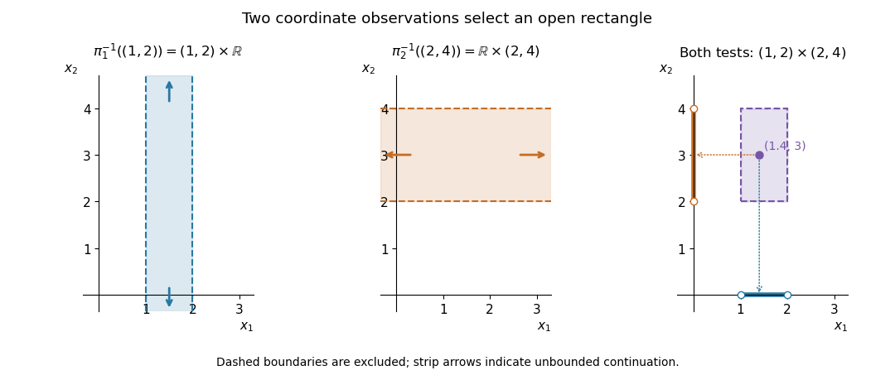

**[Figure 15](#image-an-open-rectangle-is-the-intersection-of-two-coordinate-projection-strips). An open rectangle is the intersection of two coordinate-projection strips**. Dashed boundaries and hollow endpoints are excluded. Arrows at the ends of the strips indicate that the strips continue indefinitely. The final panel projects the interior point onto the two tested intervals.

Every point of an [open set](topology.md#open-set) in the [Euclidean plane](#euclidean-plane) has such an open [rectangle](euclidean-geometry.md#rectangle) around it inside that [open set](topology.md#open-set). Conversely, every open [rectangle](euclidean-geometry.md#rectangle) contains a small [Euclidean ball](normed-vector-space.md#euclidean-ball) around each of its points. Thus the [product topology](#product-topology) here is the usual [metric topology](topological-analysis.md#metric-topology) of the [Euclidean plane](#euclidean-plane). With finitely many factors all coordinates may be restricted; on an infinite [Cartesian product](set-theory.md#cartesian-product) a basic [cylinder set](#cylinder-set) must leave all but finitely many factors free.

### Convergence in a product space

↑ **Parent:** [Product topology](#product-topology)

For arbitrary [topological spaces](topology.md#topological-space) $X_i$, an [index set](computability-theory.md#index-set) $I$, a [sequence](sequence-and-series.md#sequence) $x^{(n)}\in\prod_iX_i$, and a point $x$ in that [Cartesian product](set-theory.md#cartesian-product), [convergence in a product space](#convergence-in-a-product-space) to $x$ in the [product topology](#product-topology) is equivalent to [coordinatewise convergence](#convergence-in-a-product-space) in every factor. No countability or [Hausdorff](topology.md#hausdorff-space) assumption on the factors is needed. For a [product space](#product-space) of copies of the [real line](real-analysis.md#real-line), regarding each point as a [function](function.md) $I\to\mathbb R$ identifies this with [pointwise convergence](sequence-and-series.md#pointwise-convergence).

Proof outline: the forward implication follows because each [projection map](function.md#projection-map) is [continuous](calculus.md#continuous-function). Conversely, given a basic [neighborhood](topology.md#neighbourhood-mathematics) $B(F,U)$ of $x$, each of its finitely many coordinate tests holds for all $n\geq N_i$. Taking $N=\max_{i\in F}N_i$ makes all tests hold simultaneously; if $F$ is empty, any threshold works. This proves eventual membership in every [neighborhood](topology.md#neighbourhood-mathematics), rather than only in a sampled collection of cylinders. The same equivalence holds for [nets](topology.md#net-mathematics): a [directed set](set.md#directed-set) supplies a common upper bound for finitely many thresholds. [Sequences](sequence-and-series.md#sequence) alone need not characterize the whole [topology](topology.md) of an arbitrary [product space](#product-space).

#### Standard unit sequences in the real countable product

↑ **Parent:** [Convergence in a product space](#convergence-in-a-product-space)

Let $\mathbb N=\{1,2,\ldots\}$ and give each factor of $\mathbb R^{\mathbb N}$ the usual [topology](topology.md) of the [real line](real-analysis.md#real-line). The familiar [standard basis](vector-space.md#standard-basis) vectors extend to unit [sequences](sequence-and-series.md#sequence) $e_n$ with $(e_n)_j=1$ when $j=n$ and zero otherwise. Their finite [linear combinations](vector-space.md#linear-combination) are exactly the [finitely supported sequences](banach-space.md#finitely-supported-sequence), rather than all of $\mathbb R^{\mathbb N}$.

For every fixed coordinate $j$, $(e_n)_j=0$ for all $n>j$. Therefore $e_n\to0$ in the [product topology](#product-topology). More directly, any basic [cylinder set](#cylinder-set) $B(F,U)$ containing zero contains every $e_n$ with $n>\max(F\cup\{0\})$: all of its tested coordinates are then zero. The moving unit entry escapes every fixed finite collection of observations.

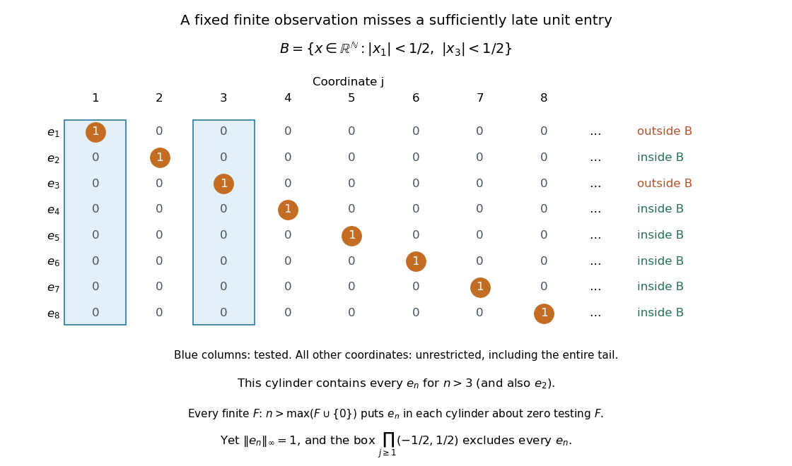

**[Figure 16](#image-a-moving-unit-entry-escapes-each-fixed-finite-coordinate-cylinder). A moving unit entry escapes each fixed finite-coordinate cylinder**. Only coordinates 1 and 3 are tested in the displayed cylinder, with values required to lie between minus one-half and one-half. All later coordinates remain unrestricted. The finite display illustrates the pattern; the threshold argument in the text applies to every finite coordinate set.

In the [l-infinity sequence space](banach-space.md#l-infinity-sequence-space) of bounded real [sequences](sequence-and-series.md#sequence), however,

$$
\|e_n-0\|_\infty=\sup_{j\geq1}|(e_n)_j|=1.
$$

Thus the same [sequence](sequence-and-series.md#sequence) does not converge to zero in the [supremum norm](normed-vector-space.md#supremum-norm). Here the comparison is between the [subspace topology](topology.md#subspace-topology) inherited from the [product topology](#product-topology) and the [norm topology](normed-vector-space.md#norm-topology) on $\ell^\infty$. The [supremum norm](normed-vector-space.md#supremum-norm) is not a finite-valued [norm](normed-vector-space.md#norm) on all of $\mathbb R^{\mathbb N}$, which also contains unbounded [sequences](sequence-and-series.md#sequence). In the [box topology](#box-topology) on $\mathbb R^{\mathbb N}$, the [neighborhood](topology.md#neighbourhood-mathematics) $\prod_{j\geq1}(-1/2,1/2)$ of zero excludes every $e_n$, so $e_n$ is not a [convergent sequence](sequence-and-series.md#convergent-sequence) with limit zero there either.

### Box topology

↑ **Parent:** [Product topology](#product-topology)  
ⓦ [Wiki](https://en.wikipedia.org/wiki/Box_topology)

The box topology on $\prod_{i\in I}X_i$ has a [basis of a topology](topology.md#basis-of-a-topology) consisting of all [Cartesian products](set-theory.md#cartesian-product) $\prod_iU_i$ with every $U_i$ an [open set](topology.md#open-set) in $X_i$; infinitely many coordinates may be restricted. It contains the [product topology](#product-topology) and agrees with it for finite $I$.[Lecture 12, Exercise 12.1.2(1)-(2), printed page 43: box basis, comparison with the product topology, and finite-factor equality](mathematics-bibliography.md#18-901-fall-2024-lecture-notes)

For copies of the usual [real line](real-analysis.md#real-line), the [box topology](#box-topology) is strictly finer when $I=\mathbb N$. The box $W=\prod_{j\geq1}(-1/2,1/2)$ is not an [open set](topology.md#open-set) in the [product topology](#product-topology): a basic [cylinder set](#cylinder-set) containing zero leaves some coordinate $j$ unrestricted, so it contains $e_j\notin W$. This is a construction for every finite coordinate set, not evidence from testing a finite prefix.

### Continuity into a product space

↑ **Parent:** [Product topology](#product-topology)

For a [topological space](topology.md#topological-space) $Y$ and [topological spaces](topology.md#topological-space) $X_i$, a [function](function.md) $f:Y\to\prod_iX_i$ is [continuous](calculus.md#continuous-function) into the [product topology](#product-topology) exactly when every coordinate [function](function.md) $f_i=\pi_i\circ f$ is [continuous](calculus.md#continuous-function).[Lecture 5, Proposition 5.3.2, printed page 21: continuity into a product is equivalent to continuity of all component functions](mathematics-bibliography.md#18-901-fall-2024-lecture-notes)

Proof outline: one direction uses [function composition](function.md#function-composition) with the [continuous](calculus.md#continuous-function) [projection maps](function.md#projection-map). For the other, the [preimage](set-theory.md#preimage) of a basic [cylinder set](#cylinder-set) is

$$
f^{-1}(B(F,U))=\bigcap_{i\in F}f_i^{-1}(U_i),
$$

a finite [set intersection](set.md#set-intersection) of [open sets](topology.md#open-set) in $Y$. This gives [continuity](calculus.md#continuous-function) on every basic test. It explains, for example, why $t\mapsto(t,t^2,t^3,\ldots)$ from the [real line](real-analysis.md#real-line) to $\mathbb R^{\mathbb N}$ is [continuous](calculus.md#continuous-function) in the [product topology](#product-topology): each coordinate is a [polynomial](polynomial.md) [function](function.md). The general coordinate criterion fails for the [box topology](#box-topology), where infinitely many [preimages](set-theory.md#preimage) can be required at once. For example, $g(t)=(t,t,\ldots)$ has [continuous](calculus.md#continuous-function) coordinate [functions](function.md), but the [preimage](set-theory.md#preimage) of the box $\prod_{j\geq1}(-1/j,1/j)$ is $\{0\}$, which is not an [open set](topology.md#open-set) in the [real line](real-analysis.md#real-line).

### Cylinder function on a product space

↑ **Parent:** [Product topology](#product-topology)

A function on a [Cartesian product](set-theory.md#cartesian-product) is a cylinder function if it depends on only finitely many coordinates. With finite discrete coordinate spaces it is a [continuous function](calculus.md#continuous-function) in the [product topology](#product-topology). These functions determine finite-dimensional laws and provide a natural domain for local generators of [interacting particle systems](stochastic-process.md#interacting-particle-system).

### Diagonal map

↑ **Parent:** [Product topology](#product-topology)

The diagonal map sends $x$ to $(x,x)$. It is an embedding of a [topological space](topology.md#topological-space) onto its diagonal subset, because either coordinate projection is its inverse on the image. For a closed oriented [manifold](topological-manifold.md), that subset has a [fundamental class](cohomology.md#fundamental-class), whose [Poincare dual](cohomology.md#poincare-dual) is the [cohomology class of the diagonal](algebraic-topology.md#cohomology-class-of-the-diagonal).

#### Diagonal subset

↑ **Parent:** [Diagonal map](#diagonal-map)

The image of the [diagonal map](#diagonal-map) in $X\times X$. For a [manifold](topological-manifold.md), the diagonal subset is an embedded submanifold diffeomorphic to $X$.

### Cantor space

↑ **Parent:** [Product topology](#product-topology)  
ⓦ [Wiki](https://en.wikipedia.org/wiki/Cantor_space)

Cantor space is the binary sequence space with the [product topology](#product-topology) of discrete two-point factors. Here the Bernoulli-space synonym refers to this [topology](topology.md), without selecting a particular [probability measure](probability-space.md#probability-measure). The [metric](topological-analysis.md#metric) $d(x,y)=\sum_{j\ge1}2^{-j}|x_j-y_j|$ induces the [topology](topology.md). A diagonal subsequence argument gives [compactness](topology.md#compact-space). Fixing a finite prefix gives a [clopen](topology.md#clopen-set) [cylinder set](#cylinder-set). The map $x\mapsto\sum_j2x_j3^{-j}$ is a homeomorphism to the usual [Cantor set](#cantor-set).

#### Weighted binary-sequence metric

↑ **Parent:** [Cantor space](#cantor-space)

On $\{0,1\}^{\mathbb N}$ this sum is a [metric](topological-analysis.md#metric), since each summand obeys the [triangle inequality](topological-analysis.md#triangle-inequality) and a zero sum forces coordinatewise equality. A prefix [cylinder set](#cylinder-set) fixing the first $n$ coordinates contains the [open ball](topology.md#open-ball) of radius $2^{-n}$ about each of its points and has [diameter](topological-analysis.md#diameter) at most $2^{-n}$. These bounds show that the [metric topology](topological-analysis.md#metric-topology) equals the prefix [cylinder set](#cylinder-set) topology, the usual [Cantor space](#cantor-space) topology.

#### Binary tree of finite strings

↑ **Parent:** [Cantor space](#cantor-space)

A binary tree of finite strings is a set of finite [binary strings](theoretical-computer-science.md#binary-string) closed under taking prefixes. The empty tree is allowed; a nonempty such tree contains the empty string. Finite nodes may have no infinite extensions. Such presentations describe closed subsets of [Cantor space](#cantor-space) through their infinite paths.

##### Computable binary tree

↑ **Parent:** [Binary tree of finite strings](#binary-tree-of-finite-strings)

A [binary tree of finite strings](#binary-tree-of-finite-strings) is computable when membership of a finite [binary string](theoretical-computer-science.md#binary-string) is decidable. An infinite computable tree need not have any computable infinite path. Removing all nodes without infinite extensions need not preserve decidability.

###### Decidable tree for binary diagonal avoidance

↑ **Parent:** [Computable binary tree](#computable-binary-tree)

For an effective enumeration $(\varphi_e)$ of unary [partial computable functions](computability-theory.md#computable-function), admit a length-$n$ string $\sigma$ if it disagrees with every binary value of $\varphi_e(e)$ observed within $n$ steps for $e<n$. The [bounded halting predicate](computability-theory.md#bounded-halting-predicate) makes membership decidable, and the tests are prefix compatible. Its paths are exactly the [binary diagonally noncomputable functions](computability-theory.md#binary-diagonally-noncomputable-function). The path space is nonempty and perfect because infinitely many indices of divergent programs leave arbitrarily late bits free; no path is computable. Dead ends in this decidable presentation are essential.

###### Computable pruned binary trees have computable paths

↑ **Parent:** [Computable binary tree](#computable-binary-tree)

For a nonempty decidable [binary tree of finite strings](#binary-tree-of-finite-strings) with no terminal nodes, begin at the empty string and repeatedly choose the first immediate successor that belongs to the tree. Each finite decision terminates and some successor always exists. This produces a [total computable function](computability-theory.md#total-computable-function) giving an infinite path. In particular, a nonempty decidable tree in which every node has two incompatible extensions cannot have only noncomputable paths.

##### Infinite path through a binary tree

↑ **Parent:** [Binary tree of finite strings](#binary-tree-of-finite-strings)

An infinite path is a binary [function](function.md) all of whose finite prefixes belong to the tree. Its path space $[T]$ is closed in [Cantor space](#cantor-space), since failure is witnessed by one finite prefix outside $T$.

###### Perfect path space

↑ **Parent:** [Infinite path through a binary tree](#infinite-path-through-a-binary-tree)

A nonempty path space $[T]$ is perfect if it has no isolated points: for every path and every finite prefix of it there is a different path sharing that prefix. This property of the closed subset of [Cantor space](#cantor-space) does not imply that its particular finite-string presentation has no dead ends. Requiring every finite node to extend to incompatible nodes is the stronger pruned-tree convention for a perfect tree.

#### Disjoint cylinder decomposition of open subsets of Cantor space

↑ **Parent:** [Cantor space](#cantor-space)

Every [open set](topology.md#open-set) in [Cantor space](#cantor-space) is a countable disjoint union of prefix [cylinder sets](#cylinder-set). Select all finite words whose cylinder lies in the open set but whose immediate predecessor's cylinder does not. These words are prefix-free, so their cylinders are disjoint. Every point of the open set has a shortest qualifying prefix. The whole space is represented by the empty prefix.

#### Cylinder-function density in Cantor space

↑ **Parent:** [Cantor space](#cantor-space)

A [continuous function](calculus.md#continuous-function) on [Cantor space](#cantor-space) is uniformly continuous. Replacing it by one constant on each length-$n$ prefix [cylinder set](#cylinder-set) changes it by at most its oscillation on sets of diameter $2^{-n}$. This tends uniformly to zero. Each approximant is a finite linear combination of continuous [indicator functions](measure-theory.md#indicator-function), proving density in the [supremum norm](normed-vector-space.md#supremum-norm).

### Cylinder set

↑ **Parent:** [Product topology](#product-topology)

A cylinder set in a product of spaces restricts a finite collection of coordinates $F$ and leaves all other coordinates free. It has the form $\pi_F^{-1}(A)$, where $\pi_F$ is the coordinate projection onto the finite subproduct. Taking $A$ to be a product of [open sets](topology.md#open-set) gives the basic open cylinders for the [product topology](#product-topology). In a finite-alphabet [full shift](dynamical-systems.md#full-shift), specifying exact letters at finitely many coordinates gives a [clopen set](topology.md#clopen-set).

### Product space

↑ **Parent:** [Product topology](#product-topology)

A product space $\prod_iX_i$ is the Cartesian product equipped with the [product topology](#product-topology), the coarsest topology making every coordinate [projection map](function.md#projection-map) continuous.

<h3 id="tychonoff-s-theorem">Tychonoff's theorem</h3>

↑ **Parent:** [Product topology](#product-topology)  
ⓦ [Wiki](https://en.wikipedia.org/wiki/Tychonoff's_theorem)

An arbitrary product of [compact spaces](topology.md#compact-space) is compact in the [product topology](#product-topology). The theorem is equivalent to the axiom of choice.

#### Product of two compact spaces

↑ **Parent:** [Tychonoff's theorem](#tychonoff-s-theorem)

The [product topology](#product-topology) of two [compact spaces](topology.md#compact-space) is [compact](topology.md#compact-space), without a [Hausdorff condition](topology.md#hausdorff-space). Refine an [open cover](topology.md#open-cover) locally by basis rectangles. For fixed $a\in A$, [compactness](topology.md#compact-space) of $B$ selects finitely many rectangles whose second factors cover $B$. Their first factors have an [open](topology.md#open-set) finite [intersection](set.md#set-intersection) $U_a$ containing $a$, and the finitely many original covering members cover $U_a\times B$. Use [compactness](topology.md#compact-space) of $A$ to choose finitely many $U_a$ covering $A$. The associated finitely many original members form a [finite subcover](topology.md#finite-subcover) of $A\times B$. Repeating the argument proves the finite-factor case of [Tychonoff's theorem](#tychonoff-s-theorem).

<h3 id="hewitt-marczewski-pondiczery-theorem">Hewitt–Marczewski–Pondiczery theorem</h3>

↑ **Parent:** [Product topology](#product-topology)  
ⓦ [Wiki](https://en.wikipedia.org/wiki/Hewitt–Marczewski–Pondiczery_theorem)

A product of at most continuum many separable spaces is separable. More generally, if each factor has a dense subset of cardinality at most an infinite cardinal $\kappa$ and there are at most $2^\kappa$ factors, then the product has a dense subset of cardinality at most $\kappa$.

## Sequentially compact space

↑ **Parent:** [Geometry and topology](geometry-and-topology.md)  
ⓦ [Wiki](https://en.wikipedia.org/wiki/Sequentially_compact_space)

A space is sequentially compact when every sequence has a convergent subsequence. A metric space is compact exactly when it is sequentially compact.

### Distance-increasing self-map theorem for sequentially compact metric spaces

↑ **Parent:** [Sequentially compact space](#sequentially-compact-space)

Every [continuous](calculus.md#continuous-function) map $T:X\to X$ on a [sequentially compact space](#sequentially-compact-space) with a [metric](topological-analysis.md#metric) satisfying $d(Tx,Ty)\geq d(x,y)$ is a surjective [isometry](riemannian-geometry.md#isometry).

A [convergent subsequence](real-analysis.md#convergent-subsequence) of the paired orbit $(T^kx,T^ky)$ has two late terms arbitrarily close. Removing their common number of iterates by the distance inequality shows that $(x,y)$ returns arbitrarily close to itself after a common positive time $n$. Thus $d(Tx,Ty)\leq d(T^nx,T^ny)\leq d(x,y)+2\epsilon$, and letting $\epsilon\downarrow0$ proves the [isometry](riemannian-geometry.md#isometry) claim. For each $x$, choose return times $n_k\geq1$ with $T^{n_k}x\to x$. A [convergent subsequence](real-analysis.md#convergent-subsequence) of $T^{n_k-1}x$ has limit $z$, and [continuity](calculus.md#continuous-function) gives $Tz=x$. This proves surjectivity.

### Compactness from uniformly vanishing sequence tails

↑ **Parent:** [Sequentially compact space](#sequentially-compact-space)

Let $a_m\geq0$ and $a_m\to0$. The set $K=\{x=(x_m):x_m\in\mathbb R,\ |x_m|\leq a_m\}$ is a [compact metric space](topological-analysis.md#compact-metric-space) for the [supremum norm](normed-vector-space.md#supremum-norm) metric. Every member is a sequence tending to zero.

For any sequence in $K$, successively extract a [convergent subsequence](real-analysis.md#convergent-subsequence) in each [compact interval](real-analysis.md#compact-interval) $[-a_m,a_m]$, then take diagonal indices. The coordinate limits define $x\in K$. For any $M$, coordinatewise differences in the tail are bounded by $2\sup_{m>M}a_m$, independently of the sequence index. This tends to zero as $M\to\infty$, while finitely many initial coordinates converge together. Hence the diagonal subsequence converges in the [supremum norm](normed-vector-space.md#supremum-norm). This proves [sequential compactness](#sequentially-compact-space), equivalent to [compactness](topology.md#compact-space) for [metric spaces](topological-analysis.md#metric-space).

## Sphere-plane intersection

↑ **Parent:** [Geometry and topology](geometry-and-topology.md)  
ⓦ [Wiki](https://en.wikipedia.org/wiki/Sphere-plane_intersection)

### Center and radius of a sphere-plane intersection

↑ **Parent:** [Sphere-plane intersection](#sphere-plane-intersection)

For a [sphere](euclidean-geometry.md#sphere) with centre $c$ and radius $a$, and a [plane](#plane) $n\cdot r=p$ with unit normal $n$, the orthogonal projection of $c$ onto the [plane](#plane) is $b=c+(p-n\cdot c)n$. The orthogonal decomposition $r-c=(r-b)+(b-c)$ gives the intersection [circle](topology.md#circle) radius by the [Pythagorean theorem](euclidean-geometry.md#pythagorean-theorem). A genuine [circle](topology.md#circle) requires $|p-n\cdot c|<a$; equality gives tangency and larger distance gives no intersection. The signed displacement is not determined by the two radii alone: it is $\pm\sqrt{a^2-\rho^2}$ with sign fixed by the oriented [plane](#plane).

## Spherically symmetric solution of Poisson equation

↑ **Parent:** [Geometry and topology](geometry-and-topology.md)  
ⓦ [Wiki](https://en.wikipedia.org/wiki/Spherically_symmetric_solution_of_Poisson_equation)

### Origin-regular spherical Poisson flux law

↑ **Parent:** [Spherically symmetric solution of Poisson equation](#spherically-symmetric-solution-of-poisson-equation)

For a spherically symmetric [gradient](multivariable-calculus.md#gradient) field regular at the origin and satisfying [Poisson equation](partial-differential-equation.md#poisson-s-equation), the [divergence theorem](multivariable-calculus.md#divergence-theorem) on a ball determines its radial magnitude from the enclosed source integral. It depends only on the source at smaller radii. Regularity excludes the source-free but origin-singular addition $Cx/|x|^3$; without that condition, solving the local equation on a punctured domain leaves this extra term undetermined.

#### Potential of a uniform spherical source

↑ **Parent:** [Origin-regular spherical Poisson flux law](#origin-regular-spherical-poisson-flux-law)

For a uniform spherical source of radius $a$, the origin-regular radial [Poisson equation](partial-differential-equation.md#poisson-s-equation) gives $\nabla f=\rho_0x/3$ inside and $\nabla f=\rho_0a^3x/(3|x|^3)$ outside. Integrating radially, imposing $f\to0$ at infinity and continuity at $|x|=a$, gives

$$
f(x)=\begin{cases}\rho_0(|x|^2-3a^2)/6,&|x|\le a,\\-\rho_0a^3/(3|x|),&|x|\ge a.\end{cases}
$$

The potential and its normal derivative are continuous at the interface, so its distributional [Laplacian](multivariable-calculus.md#laplacian) has no surface delta contribution. The classical equation holds off the interface and the source equation holds almost everywhere and distributionally.

## Topological degree

↑ **Parent:** [Geometry and topology](geometry-and-topology.md)  
ⓦ [Wiki](https://en.wikipedia.org/wiki/Topological_degree)

Topological degree is an integer-valued signed count of preimages that is stable under suitable perturbations.

## Trigonometric function

↑ **Parent:** [Geometry and topology](geometry-and-topology.md)  
ⓦ [Wiki](https://en.wikipedia.org/wiki/Trigonometric_function)

Trigonometric functions turn an [angle](#angle) into a coordinate or a [ratio](arithmetic.md#ratio) of lengths. Start at $(1,0)$ on the [unit circle](complex-analysis.md#complex-unit-circle) and rotate counterclockwise through $\theta$ [radians](#radian): the resulting point is

$$
(\cos\theta,\sin\theta).
$$

The [cosine](#cosine) records horizontal position and the [sine](#sine) records vertical position. This definition continues around the whole [circle](topology.md#circle), including negative [angles](#angle), so the signs encode direction rather than requiring a separate rule for each [right triangle](euclidean-geometry.md#right-triangle).

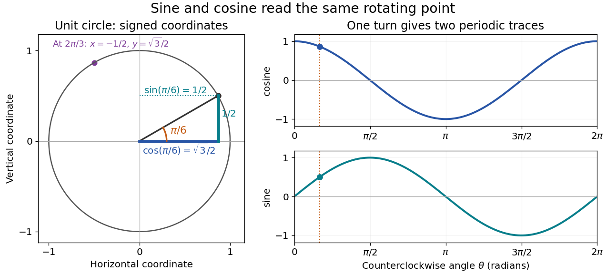

**[Figure 17](#image-sine-and-cosine-as-signed-circle-coordinates-and-periodic-traces). Sine and cosine as signed circle coordinates and periodic traces**.

The [unit circle](complex-analysis.md#complex-unit-circle) picture explains why these [functions](function.md) are useful beyond measuring [triangles](euclidean-geometry.md#triangle). The two [coordinates](vector-space.md#coordinate-linear-algebra) of a point rotating at constant angular speed are [periodic functions](function.md#periodic-function). Scaling the radius to $A$ and using $\theta=\omega t+\phi$ gives $x=A\cos(\omega t+\phi)$ and $y=A\sin(\omega t+\phi)$. A circular motion becomes two simple repeating traces, connecting [Euclidean geometry](euclidean-geometry.md), [simple harmonic motion](classical-mechanics.md#simple-harmonic-motion), and [Fourier series](fourier-series.md).

For an acute [angle](#angle) in a [right triangle](euclidean-geometry.md#right-triangle), rescaling its [hypotenuse](euclidean-geometry.md#hypotenuse) to one recovers the familiar ratios: [sine](#sine) is opposite side divided by [hypotenuse](euclidean-geometry.md#hypotenuse), and [cosine](#cosine) is adjacent side divided by [hypotenuse](euclidean-geometry.md#hypotenuse). The [tangent function](#tangent-function) is their ratio, $\tan\theta=\sin\theta/\cos\theta$, wherever the denominator is nonzero; the [secant function](#secant-trigonometry), [cosecant](#cosecant), and [cotangent](#cotangent) give the other reciprocal ratios.

The same names extend to [complex numbers](complex-analysis.md#complex-number) through the [complex exponential](calculus.md#complex-exponential-function):

$$
\cos z=\frac{e^{iz}+e^{-iz}}2,\qquad
\sin z=\frac{e^{iz}-e^{-iz}}{2i}.
$$

These definitions agree with the circle interpretation for real [angles](#angle). For complex arguments, the values need not lie between $-1$ and $1$; the literal circle-coordinate picture is restricted to real arguments. [NIST Digital Library of Mathematical Functions, §4.14: exponential definitions and periodicity](https://dlmf.nist.gov/4.14)

### Trigonometric inequality

↑ **Parent:** [Trigonometric function](#trigonometric-function)

An [inequality](arithmetic.md#inequality-mathematics) involving [trigonometric functions](#trigonometric-function). For $z\geq0$, the fundamental estimate $|\sin z|\leq z$ follows from $\sin z=\int_0^z\cos t\,dt$ and $|\cos t|\leq1$. Thus $1-\cos z=2\sin^2(z/2)\leq z^2/2$, and integrating gives $0\leq z-\sin z\leq z^3/6$. For $0\leq z\leq\pi$, this implies $0\leq z^2-\sin^2z\leq z^4/3$. These bounds give explicit errors for [central finite differences](finite-difference.md#central-finite-difference) applied to [sine](#sine) modes.

### Double-angle formula

↑ **Parent:** [Trigonometric function](#trigonometric-function)

The angle-addition identities give $\sin2x=2\sin x\cos x$, $\cos2x=\cos^2x-\sin^2x=1-2\sin^2x=2\cos^2x-1$, and $\tan2x=2\tan x/(1-\tan^2x)$ wherever the [tangent](#tangent) expressions are defined. The [sine](#sine) formula converts $\sin^2x\cos^2x$ into $\sin^2(2x)/4$, which is useful for trigonometric inequalities and [integration](integral.md).

### Trigonometric identity

↑ **Parent:** [Trigonometric function](#trigonometric-function)

A [trigonometric identity](#trigonometric-identity) is an equality involving [trigonometric functions](#trigonometric-function) that holds for every input in its stated domain.

### Tangent function

↑ **Parent:** [Trigonometric function](#trigonometric-function)

A [trigonometric function](#trigonometric-function) defined where $\cos x\ne0$. It has real [simple poles](isolated-singularity.md#simple-pole) at $(n+1/2)\pi$, and $\tan((n+1/2)\pi+\delta)=-\cot\delta$. This local pole identity generates the [large roots near tangent poles](asymptotic-expansion.md#large-roots-near-tangent-poles).

### Sinusoid

↑ **Parent:** [Trigonometric function](#trigonometric-function)

A sinusoid is a function $A\cos(\omega t+\phi)$, where $A$ is its amplitude, $\omega$ its angular frequency and $\phi$ its phase. For $\omega\ne0$ its period is $2\pi/|\omega|$. A uniformly randomized phase can produce a [strictly stationary process](time-series.md#strictly-stationary-process) even though individual paths look periodic.

### Product-to-sum formula

↑ **Parent:** [Trigonometric function](#trigonometric-function)

Product-to-sum formulas turn products of [trigonometric functions](#trigonometric-function) into sums at combined arguments. The identity $2\sin A\sin B=\cos(A-B)-\cos(A+B)$ is especially useful for verifying [orthogonality](inner-product.md#orthogonal-vectors) of sine [Fourier series](fourier-series.md) modes on an interval.

### Cosecant

↑ **Parent:** [Trigonometric function](#trigonometric-function)

The cosecant is $\csc z=1/\sin z$, wherever the [sine](#sine) denominator is nonzero. The square of the [cosecant](#cosecant) occurs in the derivative $d(\cot z)/dz=-\csc^2z$ of the [cotangent](#cotangent).

#### Cosecant expansion near zero

↑ **Parent:** [Cosecant](#cosecant)

Factor the [sine](#sine) expansion as $\sin z=z[1-z^2/6+z^4/120+O(z^6)]$. To invert the bracket, put $1+Az^2+Bz^4+O(z^6)$ and equate coefficients after multiplication. The $z^2$ coefficient gives $A=1/6$, while the $z^4$ coefficient gives $B=A/6-1/120=7/360$. Dividing by $z$ proves the displayed [Laurent series](analysis.md#laurent-series) truncation for $z\to0$, $z\ne0$. This reciprocal-series calculation is useful when a small [sine](#sine) argument is itself an inverse power of a large variable; multiply the remainder by any outside prefactor when assigning its final order.

### Cotangent

↑ **Parent:** [Trigonometric function](#trigonometric-function)

The cotangent is the quotient $\cot z=\cos z/\sin z$, wherever the [sine](#sine) denominator is nonzero. Its meromorphic continuation has simple [poles](isolated-singularity.md#pole) at integer multiples of $\pi$.

#### Cotangent partial-fraction expansion

↑ **Parent:** [Cotangent](#cotangent)

Away from integer [poles](isolated-singularity.md#pole),

$$
\pi\cot\pi z=\frac1z+\sum_{n=1}^{\infty}\frac{2z}{z^2-n^2}.
$$

The series is locally uniformly convergent. Integrate $\pi\cot(\pi\zeta)/(\zeta^2-z^2)$ around the square with sides $\operatorname{Re}\zeta,\operatorname{Im}\zeta=\pm(N+1/2)$. The [cotangent](#cotangent) is uniformly bounded there, so the integral tends to zero. The [residue theorem](analysis.md#residue-theorem) then gives $\pi\cot(\pi z)/z+\sum_{n\in\mathbb Z}(n^2-z^2)^{-1}=0$, which is the expansion. Differentiation generates higher integer-lattice [pole](isolated-singularity.md#pole) sums. Setting $w=e^{2\pi iz}$ gives $\pi\cot\pi z=\pi i(w+1)/(w-1)$. On $0<|z|<1$, expansion of each paired summand gives $\pi\cot\pi z=z^{-1}-2\sum_{m\ge0}\zeta(2m+2)z^{2m+1}$, relating this [trigonometric function](#trigonometric-function) to the [Riemann zeta function](analytic-number-theory.md#riemann-zeta-function).

##### Cotangent Fourier expansion

↑ **Parent:** [Cotangent partial-fraction expansion](#cotangent-partial-fraction-expansion)

For $\operatorname{Im}z>0$, writing [cotangent](#cotangent) as $i(e^{2\pi iz}+1)/(e^{2\pi iz}-1)$ and expanding a [geometric series](sequence-and-series.md#geometric-series) gives this [Fourier series](fourier-series.md). Differentiating the [cotangent partial-fraction expansion](#cotangent-partial-fraction-expansion) and this [Fourier series](fourier-series.md) $k-1$ times yields

$$
\sum_{n\in\mathbb Z}(z+n)^{-k}=\frac{(-2\pi i)^k}{(k-1)!}\sum_{r\geq1}r^{k-1}e^{2\pi irz},\qquad k\geq2.
$$

### Sine

↑ **Parent:** [Trigonometric function](#trigonometric-function)  
ⓦ [Wiki](https://en.wikipedia.org/wiki/Sine)

For a real [angle](#angle) $\theta$, $\sin\theta$ is the vertical coordinate on the [unit circle](complex-analysis.md#complex-unit-circle) reached by a counterclockwise [rotation](riemannian-geometry.md#rotation-mathematics) through $\theta$ [radians](#radian). For an acute [angle](#angle) in a [right triangle](euclidean-geometry.md#right-triangle), it is the opposite side divided by the [hypotenuse](euclidean-geometry.md#hypotenuse). In particular,

$$
\sin0=0,\qquad \sin(\pi/6)=\frac12,\qquad
\sin(\pi/2)=1,\qquad \sin\pi=0.
$$

The first-quarter rise and second-quarter fall are visible in the circle projection; the lower semicircle gives negative values.

Reflecting the [unit circle](complex-analysis.md#complex-unit-circle) across the horizontal axis gives $\sin(-\theta)=-\sin\theta$, so [sine](#sine) is an [odd function](calculus.md#odd-function). A full turn gives $\sin(\theta+2\pi)=\sin\theta$, making it a [periodic function](function.md#periodic-function). For real arguments, its range is $[-1,1]$ and its [zeros of a function](polynomial.md#zero-of-a-function) occur at $\theta=k\pi$ for [integers](integer.md) $k$. The [cosine](#cosine) describes the perpendicular coordinate of the same point, and the [Pythagorean trigonometric identity](#pythagorean-trigonometric-identity) keeps their two values tied together.

#### Complex sine

↑ **Parent:** [Sine](#sine)

The [sine](#sine) function extends to an [entire function](holomorphic-function.md#entire-function) on the [complex plane](complex-analysis.md#complex-plane) by the displayed exponential formula. Substituting $z=x+iy$ and grouping the real and imaginary terms gives $\sin(x+iy)=\sin x\cosh y+i\cos x\sinh y$, for real $x,y$. Thus its values grow exponentially in imaginary directions, even though the real sine is bounded.

#### Sine infinite product

↑ **Parent:** [Sine](#sine)

The paired zero factors converge locally uniformly because $\sum n^{-2}$ converges. [Hadamard factorization](holomorphic-function.md#hadamard-factorization-theorem) for the order-one entire sine function gives a possible exponential multiplier; oddness removes its linear exponent and the derivative at zero fixes its constant. This product turns a [Dirichlet oscillator determinant ratio](quantum-field-theory.md#dirichlet-oscillator-determinant-ratio) into an elementary sine ratio.

### Cosine

↑ **Parent:** [Trigonometric function](#trigonometric-function)  
ⓦ [Wiki](https://en.wikipedia.org/wiki/Cosine)

For a real [angle](#angle) $\theta$, $\cos\theta$ is the horizontal coordinate on the [unit circle](complex-analysis.md#complex-unit-circle) reached by a counterclockwise [rotation](riemannian-geometry.md#rotation-mathematics) through $\theta$ [radians](#radian). For an acute [angle](#angle) in a [right triangle](euclidean-geometry.md#right-triangle), it is the adjacent side divided by the [hypotenuse](euclidean-geometry.md#hypotenuse). Basic values include

$$
\cos0=1,\qquad \cos(\pi/3)=\frac12,\qquad
\cos(\pi/2)=0,\qquad \cos\pi=-1.
$$

At $\theta=2\pi/3$, the horizontal coordinate is $-1/2$ even though the vertical [sine](#sine) coordinate remains positive. A positive [angle](#angle) need not produce a positive [cosine](#cosine).

Reflection across the horizontal axis leaves this coordinate unchanged, giving $\cos(-\theta)=\cos\theta$: [cosine](#cosine) is an [even function](calculus.md#even-function). A full turn gives $\cos(\theta+2\pi)=\cos\theta$. For real arguments, its range is $[-1,1]$ and its [zeros of a function](polynomial.md#zero-of-a-function) occur at $\theta=\pi/2+k\pi$. A quarter-turn shifts between the two coordinate traces, with $\cos\theta=\sin(\theta+\pi/2)$.

#### Complex cosine

↑ **Parent:** [Cosine](#cosine)

The extension of the [cosine](#cosine) to the [complex plane](complex-analysis.md#complex-plane) is $\cos z=(e^{iz}+e^{-iz})/2$. Splitting the [complex exponential function](calculus.md#complex-exponential-function) into its [real part](complex-analysis.md#real-part) and [imaginary part](complex-analysis.md#imaginary-part) gives the displayed formula in terms of [hyperbolic cosine](calculus.md#hyperbolic-cosine) and [hyperbolic sine](calculus.md#hyperbolic-sine).

### Sine addition formula

↑ **Parent:** [Trigonometric function](#trigonometric-function)

The sine addition formula evaluates the vertical coordinate after two successive [rotations](riemannian-geometry.md#rotation-mathematics):

$$
\boxed{\sin(x+y)=\sin x\cos y+\cos x\sin y.}
$$

Here $x,y$ are real [angles](#angle) measured in [radians](#radian); the identity also extends to complex arguments. It is useful when a new [angle](#angle) can be assembled from familiar ones. For example,

$$
\sin(5\pi/12)=\sin(\pi/6+\pi/4)
=\frac12\frac{\sqrt2}{2}+\frac{\sqrt3}{2}\frac{\sqrt2}{2}
=\frac{\sqrt6+\sqrt2}{4}.
$$

The [cosine addition formula](#cosine-addition-formula) gives the horizontal coordinate of the same rotated point. Both formulas follow by multiplying a [rotation matrix](linear-algebra.md#rotation-matrix) by the [unit vector](vector-space.md#unit-vector) $(\cos x,\sin x)$, rather than by adding the individual coordinate values. [NIST DLMF, §4.21(i): trigonometric addition formulas](https://dlmf.nist.gov/4.21.i)

### Cosine addition formula

↑ **Parent:** [Trigonometric function](#trigonometric-function)

The cosine addition formula gives the horizontal coordinate after two successive [rotations](riemannian-geometry.md#rotation-mathematics):

$$
\boxed{\cos(x+y)=\cos x\cos y-\sin x\sin y.}
$$

The minus sign comes from the way a counterclockwise [rotation](riemannian-geometry.md#rotation-mathematics) mixes horizontal and vertical coordinates:

$$
\begin{pmatrix}\cos y&-\sin y\\ \sin y&\cos y\end{pmatrix}
\begin{pmatrix}\cos x\\ \sin x\end{pmatrix}
=\begin{pmatrix}\cos(x+y)\\ \sin(x+y)\end{pmatrix}.
$$

The two rows recover the [cosine addition formula](#cosine-addition-formula) and [sine addition formula](#sine-addition-formula) together.

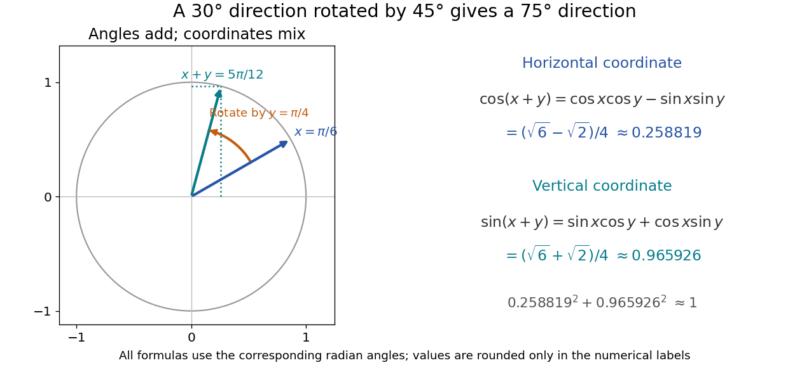

**[Figure 18](#image-adding-angles-rotates-a-coordinate-pair-and-mixes-its-sine-and-cosine-components). Adding angles rotates a coordinate pair and mixes its sine and cosine components**.

With $x=\pi/6$ and $y=\pi/4$, the resulting [angle](#angle) is $5\pi/12$, and

$$
\cos(5\pi/12)=\frac{\sqrt6-\sqrt2}{4},\qquad
\sin(5\pi/12)=\frac{\sqrt6+\sqrt2}{4}.
$$

Although the horizontal coordinate becomes small, the vertical one approaches one; their squared sum still obeys the [Pythagorean trigonometric identity](#pythagorean-trigonometric-identity). Taking $y=-x$ in the [cosine addition formula](#cosine-addition-formula), together with the [even function](calculus.md#even-function) property of [cosine](#cosine) and [odd function](calculus.md#odd-function) property of [sine](#sine), also recovers that identity.

### Pythagorean trigonometric identity

↑ **Parent:** [Trigonometric function](#trigonometric-function)  
ⓦ [Wiki](https://en.wikipedia.org/wiki/Pythagorean_trigonometric_identity)

For every real [angle](#angle) $\theta$,

$$
\boxed{\sin^2\theta+\cos^2\theta=1.}
$$

It is the equation of the [unit circle](complex-analysis.md#complex-unit-circle) written in terms of its [sine](#sine) and [cosine](#cosine) coordinates. For an acute [angle](#angle), dividing the [Pythagorean theorem](euclidean-geometry.md#pythagorean-theorem) by the square of the [hypotenuse](euclidean-geometry.md#hypotenuse) gives the same relation in a [right triangle](euclidean-geometry.md#right-triangle). The circle interpretation explains why it remains true outside that first-quadrant triangle.

For example, if $\sin\theta=3/5$, the identity gives $\cos^2\theta=16/25$, so $\cos\theta$ is either $4/5$ or $-4/5$. The sign needs the [angle](#angle)'s location: it is positive in the first quadrant and negative in the second. Thus the identity determines the magnitude of the missing coordinate without determining the direction.

The relation is useful for eliminating one squared [trigonometric function](#trigonometric-function), checking that a coordinate pair has unit length, and checking that the columns of a [rotation matrix](linear-algebra.md#rotation-matrix) are [unit vectors](vector-space.md#unit-vector). It also holds for complex arguments under the [complex exponential](calculus.md#complex-exponential-function) definitions, although then the squares are algebraic squares rather than squared [moduli](complex-analysis.md#modulus).

### Tangent

↑ **Parent:** [Trigonometric function](#trigonometric-function)

The [tangent](#tangent) is the [trigonometric function](#trigonometric-function) $\tan x=\sin x/\cos x$ where $\cos x\ne0$.

#### Subtangent

↑ **Parent:** [Tangent](#tangent)

For a point $B$ of a [curve](topology.md#curve), let its ordinate meet the chosen coordinate axis at $C$, and its [tangent](#tangent) meet that axis at $E$. The segment $CE$ is the [subtangent](#subtangent). It depends on the chosen axis. For the standard [parabola](euclidean-geometry.md#parabola), $CE=2CD$, where $D$ is its [vertex of a parabola](euclidean-geometry.md#vertex-of-a-parabola).

### Secant (trigonometry)

↑ **Parent:** [Trigonometric function](#trigonometric-function)

The secant function is the reciprocal of the [cosine](#cosine), $\sec x=1/\cos x$, where the denominator is nonzero. Its [derivative](calculus.md#derivative) is $\sec x\tan x$, and $\sec^2x=1+\tan^2x$ follows from the [Pythagorean trigonometric identity](#pythagorean-trigonometric-identity).

### Half-angle identities

↑ **Parent:** [Trigonometric function](#trigonometric-function)

These identities supply the formulas used in the [tangent half-angle substitution](#tangent-half-angle-substitution). The half-angle identities include

$$
\tan\frac\theta2=\frac{1-\cos\theta}{\sin\theta}
=\frac{\sin\theta}{1+\cos\theta}.
$$

### Tangent addition formula

↑ **Parent:** [Trigonometric function](#trigonometric-function)

The tangent addition formula is

$$
\tan(A+B)=\frac{\tan A+\tan B}{1-\tan A\tan B}
$$

where both sides are defined.

### Inverse trigonometric functions

↑ **Parent:** [Trigonometric function](#trigonometric-function)  
ⓦ [Wiki](https://en.wikipedia.org/wiki/Inverse_trigonometric_functions)

#### Arccosine

↑ **Parent:** [Inverse trigonometric functions](#inverse-trigonometric-functions)

For real $-1\leq x\leq1$, the principal arccosine is the unique angle $\theta\in[0,\pi]$ satisfying $\cos\theta=x$. Restricting to this interval makes the cosine one-to-one. Differentiating the identity on $-1<x<1$ gives $d(\arccos x)/dx=-1/\sqrt{1-x^2}$. Other solutions of $\cos\theta=x$ are $\theta=\pm\arccos x+2\pi n$, with integer $n$; an initial condition can select one of these branches.

##### Complex inverse cosine via the logarithm

↑ **Parent:** [Arccosine](#arccosine)

Set $u=e^{iw}$ in $\cos w=z$. The resulting [quadratic equation](polynomial.md#quadratic-equation) is $u^2-2zu+1=0$, with roots $z\pm i\sqrt{1-z^2}$. Their product is one, so taking a [complex logarithm](analysis.md#complex-logarithm) never encounters zero. Solving the exponential equation gives the displayed full inverse relation, with integer $n$. The [principal complex logarithm](analysis.md#principal-complex-logarithm) and [principal square root](analysis.md#principal-square-root-of-a-complex-number) do not make both signs identical to the principal [inverse cosine](#arccosine): at $z=0$ they yield $\pm\pi/2$, while principal $\arccos0=\pi/2$. A single analytic branch requires compatible choices of sign and branches.

#### Inverse tangent

↑ **Parent:** [Inverse trigonometric functions](#inverse-trigonometric-functions)

The inverse of the [tangent](#tangent) restricted to $(-\pi/2,\pi/2)$, taking real values in that interval. Its [derivative](calculus.md#derivative) is $(1+x^2)^{-1}$. A formula involving an inverse tangent of a ratio may need a continuous [branch of a multivalued function](complex-analysis.md#branch-of-a-multivalued-function) to describe a smooth field through a pole of that ratio.

##### Arctangent addition formula

↑ **Parent:** [Inverse tangent](#inverse-tangent)

For real $A,B$ with $AB<1$, the principal [inverse tangent](#inverse-tangent) satisfies

$$
\boxed{\arctan A+\arctan B=\arctan\frac{A+B}{1-AB}.}
$$

To prove it, multiply the [complex numbers](complex-analysis.md#complex-number) $1+iA$ and $1+iB$. Their product is $(1-AB)+i(A+B)$, whose positive [real part](complex-analysis.md#real-part) places its [complex argument](complex-analysis.md#argument-complex-analysis) in $(-\pi/2,\pi/2)$. The individual [complex arguments](complex-analysis.md#argument-complex-analysis) are $\arctan A$ and $\arctan B$, and their sum is in $(-\pi,\pi)$. Multiplication adds these [complex arguments](complex-analysis.md#argument-complex-analysis), so the positive [real part](complex-analysis.md#real-part) forces the sum into the same principal range and gives the displayed formula.

If $AB>1$, both $A,B$ have the same sign. Add $\pi$ to the right-hand side when $A,B>0$, and subtract $\pi$ when $A,B<0$. If $AB=1$, the sum is $\pi/2$ or $-\pi/2$ according to the sign of $A+B$. These cases record the branch information that can be lost by applying the [tangent addition formula](#tangent-addition-formula) alone.

#### Inverse sine

↑ **Parent:** [Inverse trigonometric functions](#inverse-trigonometric-functions)

The [inverse sine](#inverse-sine) is one member of the [inverse trigonometric functions](#inverse-trigonometric-functions).

### Small-angle approximation

↑ **Parent:** [Trigonometric function](#trigonometric-function)  
ⓦ [Wiki](https://en.wikipedia.org/wiki/Small-angle_approximation)

As $x\to0$, the [limit](calculus.md#limit-of-a-function) $\sin x/x\to1$ gives $\sin x\sim x$, while the [Taylor series](calculus.md#taylor-series) gives $\arcsin x\sim x$ and $\cos x\sim1-x^2/2$.

### Tangent half-angle substitution

↑ **Parent:** [Trigonometric function](#trigonometric-function)  
ⓦ [Wiki](https://en.wikipedia.org/wiki/Tangent_half-angle_substitution)

The [tangent half-angle substitution](#tangent-half-angle-substitution) $t=\tan(x/2)$ converts rational trigonometric expressions into rational functions: $\sin x=2t/(1+t^2)$, $\cos x=(1-t^2)/(1+t^2)$ and $dx=2\,dt/(1+t^2)$.

## Fractal geometry

↑ **Parent:** [Geometry and topology](geometry-and-topology.md)

[Fractal geometry](#fractal-geometry) studies [fractals](#fractal). Fractal geometry studies recursively structured sets and spaces, often with noninteger scaling dimension.

### Generalized Cantor set

↑ **Parent:** [Fractal geometry](#fractal-geometry)

Choose a strictly decreasing positive [sequence](sequence-and-series.md#sequence) $q_0=1,q_1,q_2,\ldots$. Begin with $C_0=[0,1]$ and at step $n+1$ keep two closed end intervals of length $q_{n+1}/2^{n+1}$ from every component interval of $C_n$. This constructs a [compact set](topology.md#compact-space) $C=\bigcap_n C_n$ with

$$
m(C_n)=q_n,\qquad m(C)=\lim_n q_n.
$$

The second equality is [continuity from above of a measure](measure.md#continuity-from-above-of-a-measure). Every stage has positive gaps and maximum component length at most $2^{-n}$, so $C$ contains no nondegenerate [interval](real-analysis.md#interval-mathematics) and is a [nowhere dense set](topological-analysis.md#nowhere-dense-set). It has no [isolated points](topological-analysis.md#isolated-point): both endpoints of the stage-$n$ component containing a point remain in $C$, and at least one distinct endpoint is within $2^{-n}$. Thus its topological sparseness is compatible with positive [Lebesgue measure](measure-theory.md#lebesgue-measure).

Taking $q_n=(2/3)^n$ gives the usual [Cantor set](#cantor-set) of measure zero. Taking $q_n=1/2+2^{-(n+1)}$ gives a generalized construction of measure $1/2$. This is one useful family of generalized constructions; the removed intervals need not have the same proportions at every stage.

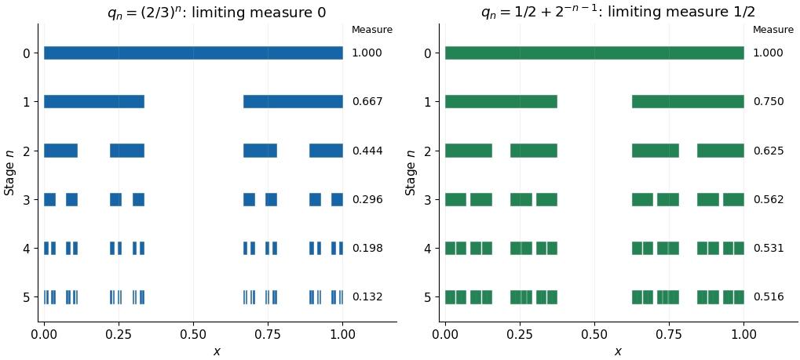

**[Figure 19](#image-generalized-cantor-constructions-with-zero-and-positive-limiting-lebesgue-measure). Generalized Cantor constructions with zero and positive limiting Lebesgue measure**. Each row shows the retained [closed intervals](real-analysis.md#closed-real-interval) at one stage. The two constructions have the same binary splitting pattern but different limits of the total retained length.

### Mass fractal dimension

↑ **Parent:** [Fractal geometry](#fractal-geometry)

The mass fractal dimension $d_f$ relates the particle count or mass in a self-similar aggregate to its spatial size. For primary particle radius $a$ and aggregate [radius of gyration](polymer.md#radius-of-gyration) $R_g$, a common convention is $N\sim k_f(R_g/a)^{d_f}$, with a nonuniversal prefactor $k_f$. In three dimensions the mean occupied fraction scales as $N a^3/R_g^3\propto(R_g/a)^{d_f-3}$. A smaller $d_f$ therefore describes a more tenuous large cluster; a compact constant-density object has $d_f=3$. The scaling applies between the primary-particle and aggregate scales, not at all distances.

### Box-counting dimension

↑ **Parent:** [Fractal geometry](#fractal-geometry)  
ⓦ [Wiki](https://en.wikipedia.org/wiki/Box-counting_dimension)

For a nonempty bounded subset $E$ of [Euclidean space](normed-vector-space.md#euclidean-norm), let $N_\delta(E)$ be the least number of radius-$\delta$ balls covering $E$. Its lower and upper box-counting dimensions are the lower and upper limits of $\log N_\delta(E)/\log(1/\delta)$ as $\delta\downarrow0$. If these limits agree, their common value is its [Minkowski dimension](#box-counting-dimension). A cover by $N_\delta(E)$ balls implies $|E_\delta|\lesssim_n\delta^nN_\delta(E)$ for the open $\delta$-neighborhood. Conversely, a maximal separated subset gives the reverse comparison up to fixed changes of scale. This connects small-scale covering counts with neighborhood [Lebesgue measure](measure-theory.md#lebesgue-measure).

#### Box-counting dimension of separated digit sets

↑ **Parent:** [Box-counting dimension](#box-counting-dimension)

Consider base-$b$ expansions using $m$ allowed digits with positive gaps between the corresponding first-level intervals. At depth $k$ there are $m^k$ cylinders of diameter comparable to $b^{-k}$, and separated cylinders cannot all be covered by fewer than a constant multiple of $m^k$ balls of that scale. Thus $N_{b^{-k}}(E)\asymp m^k$. Monotonicity between successive scales gives equal upper and lower [Minkowski dimensions](#box-counting-dimension), both $\log m/\log b$.

### Self-similarity

↑ **Parent:** [Fractal geometry](#fractal-geometry)  
ⓦ [Wiki](https://en.wikipedia.org/wiki/Self-similarity)

A self-similar object is assembled from smaller copies of itself, possibly after scaling or other transformations.

#### Finite similarity iterated function system

↑ **Parent:** [Self-similarity](#self-similarity)

For finitely many [contracting Euclidean similarities](#contracting-euclidean-similarity), the map $\mathcal T$ on nonempty compact subsets of $\mathbb R^n$ is a contraction in the [Hausdorff metric](topological-analysis.md#hausdorff-distance), with contraction constant $\max_i c_i<1$. The [contraction mapping theorem](analysis.md#contraction-mapping-theorem) gives a unique nonempty compact invariant set. If the [open set condition](#open-set-condition) holds, its [Hausdorff dimension](measure-theory.md#hausdorff-dimension) is the unique $s$ satisfying $\sum_i c_i^s=1$.

##### Minkowski sausage

↑ **Parent:** [Finite similarity iterated function system](#finite-similarity-iterated-function-system)  
ⓦ [Wiki](https://en.wikipedia.org/wiki/Minkowski_sausage)

The [Minkowski sausage](#minkowski-sausage) replaces a segment by eight directed unit segments whose endpoint displacement is four units. A middle straight run of length two represents two collinear unit segments. After normalizing the displacement to one, the eight [contracting Euclidean similarities](#contracting-euclidean-similarity) all have ratio $1/4$. The open diamond $\{|x-1/2|+|y|<1/2\}$ is an [open set condition](#open-set-condition) witness: its eight image diamonds have disjoint interiors and lie within it. Hence $8(1/4)^s=1$, giving [Hausdorff dimension](measure-theory.md#hausdorff-dimension) $3/2$. Treating the middle run as a single similarity of ratio $1/2$ instead defines a different iterated scheme.

#### Contracting Euclidean similarity

↑ **Parent:** [Self-similarity](#self-similarity)

A [contracting Euclidean similarity](#contracting-euclidean-similarity) multiplies every [Euclidean distance](topological-analysis.md#euclidean-distance) by a constant $c<1$; equivalently it has the form $cRx+b$ for an [orthogonal matrix](linear-algebra.md#orthogonal-matrix) $R$ and translation vector $b$. Finite families of such maps generate compact sets with [self-similarity](#self-similarity).

#### Open set condition

↑ **Parent:** [Self-similarity](#self-similarity)

A finite family of contracting similarities $S_1,\ldots,S_k$ satisfies the open set condition if there is a nonempty bounded [open set](topology.md#open-set) $O$ with $S_i(O)\subseteq O$ and $S_i(O)\cap S_j(O)=\varnothing$ for $i\ne j$. This permits the closures to meet. For the invariant compact set, this separation makes its [Hausdorff dimension](measure-theory.md#hausdorff-dimension) equal to the similarity exponent $s$ defined by $\sum_i c_i^s=1$, where $c_i$ are the contraction ratios. The level-$n$ cylinder sets supply the upper dimension bound; the separated cylinder masses with weights $c_i^s$ supply the matching mass-distribution lower bound. For the 24 maps of ratio $1/5$ retaining all but the central square, $O=(0,1)^2$ works and $s=\log24/\log5$.

#### Cantor set

↑ **Parent:** [Self-similarity](#self-similarity)  
ⓦ [Wiki](https://en.wikipedia.org/wiki/Cantor_set)

The Cantor set is obtained from $[0,1]$ by repeatedly deleting the open middle third of every remaining interval. Its first stages retain $[0,1/3]\cup[2/3,1]$, then four intervals of length $1/9$, then eight of length $1/27$. After level $n$, there are $2^n$ retained intervals of length $3^{-n}$. The Cantor set is the [intersection](set.md#set-intersection) of all these stages, rather than the set of endpoints visible in any finite drawing.

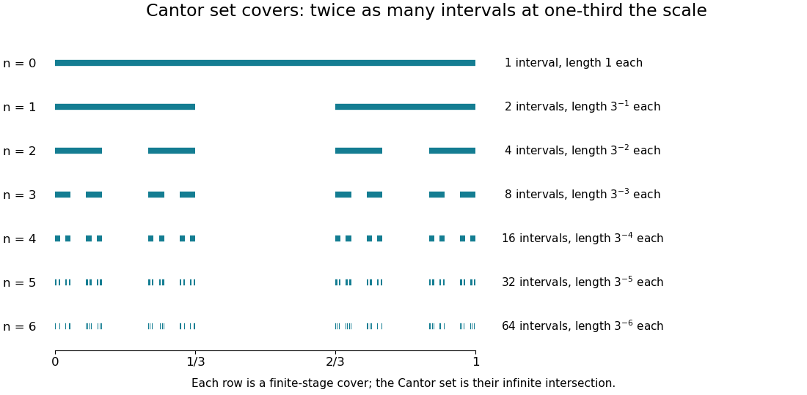

**[Figure 20](#image-finite-stages-of-the-cantor-construction-supply-covers-at-successively-smaller-scales). Finite stages of the Cantor construction supply covers at successively smaller scales**.

Equivalently,

$$
C=\left\{\sum_{j=1}^{\infty}\frac{a_j}{3^j}:a_j\in\{0,2\}\right\}.
$$

Thus its points admit a base-three expansion using only zero and two. The word “admit” handles numbers with two expansions: $1/3=0.1_3=0.02222\ldots_3$ is retained as an endpoint. Every infinite binary choice determines a point of $C$, and differing choices give differing points, so $C$ is [uncountable](cardinal-number.md#uncountable-set).

Its total retained interval [length](physics.md#length) is $(2/3)^n\to0$, so $C$ has zero [Lebesgue measure](measure-theory.md#lebesgue-measure). It is nevertheless nonempty, [compact](topology.md#compact-space), and [uncountable](cardinal-number.md#uncountable-set), and has [Hausdorff dimension](measure-theory.md#hausdorff-dimension) $\log2/\log3$: the covers and mass bounds are worked out in [Hausdorff dimension of the Cantor set](measure-theory.md#hausdorff-dimension-of-the-cantor-set). This separates counting, ordinary [length](physics.md#length), and fine-scale geometric size in one concrete example.

The [self-similarity](#self-similarity) is exact:

$$
C=\tfrac13C\ \cup\ \left(\tfrac23+\tfrac13C\right).
$$

The [Cantor distribution](continuous-probability-distribution.md#cantor-distribution) puts half the probability into each copy at every split. It has a continuous [cumulative distribution function](probability-distribution.md#cumulative-distribution-function), the [Cantor function](mathematics.md#cantor-function), while all its mass lies on a [Lebesgue null set](measure-theory.md#lebesgue-null-set). This makes the construction useful in [measure theory](measure-theory.md) as well as [fractal geometry](#fractal-geometry): it provides a concrete model in which several plausible meanings of “small” disagree.

##### Modified Cantor set with telescoping remaining lengths

↑ **Parent:** [Cantor set](#cantor-set)

Starting from $[0,1]$, remove the central fraction $1/(2^n+2)$ of every stage-$n$ interval. The total length obeys $L_{n+1}/L_n=(2^n+1)/(2^n+2)$, which telescopes to the displayed value. The limiting intersection has [Lebesgue outer measure](measure-theory.md#lebesgue-outer-measure) at most $1/3$ by covering it with the stage intervals and slightly enlarging them to open intervals. This argument uses no integration.

##### Cartesian powers of the Cantor set

↑ **Parent:** [Cantor set](#cantor-set)

For the middle-third [Cantor set](#cantor-set) $C$ and positive integer $d$, $C^d$ is compact and [totally disconnected](non-archimedean-analysis.md#totally-disconnected-space). A connected subset projects to a point in each coordinate and is therefore itself a point. At level $n$, the product has $2^{dn}$ cubes of side $3^{-n}$. These covers give dimension at most $d\log2/\log3$. The product digit probability assigns each cube mass $2^{-dn}$; a ball of radius comparable to $3^{-n}$ meets only a bounded number of cubes, so its mass is at most a constant times $r^{d\log2/\log3}$. The cover-cost argument for [Hausdorff dimension](measure-theory.md#hausdorff-dimension) proves the matching lower bound. Thus compact totally disconnected Euclidean subsets can have arbitrarily large Hausdorff dimension when the ambient dimension is allowed to increase.

##### Cantor cylinder

↑ **Parent:** [Cantor set](#cantor-set)

A Cantor cylinder fixes finitely many of the zero-or-two ternary digits in the standard [Cantor set](#cantor-set). These sets form finite [clopen](topology.md#clopen-set) partitions of diameter at most $3^{-n}$ at level $n$, and a base for the relative topology. They permit uniform approximation of continuous functions by locally constant functions.

<h4 id="sierpinski-triangle">Sierpiński triangle</h4>

↑ **Parent:** [Self-similarity](#self-similarity)  
ⓦ [Wiki](https://en.wikipedia.org/wiki/Sierpiński_triangle)

The Sierpinski triangle is formed recursively by retaining the three corner subtriangles after subdividing an equilateral triangle into four congruent pieces.

### Fractal

↑ **Parent:** [Fractal geometry](#fractal-geometry)  
ⓦ [Wiki](https://en.wikipedia.org/wiki/Fractal)

A [fractal](#fractal) is a set or pattern with structure at successively finer scales, often exhibiting [self-similarity](#self-similarity) and a noninteger [Hausdorff dimension](measure-theory.md#hausdorff-dimension). [Fractal geometry](#fractal-geometry) studies such objects.

#### Pythagoras tree

↑ **Parent:** [Fractal](#fractal)

#### Heighway dragon

↑ **Parent:** [Fractal](#fractal)

A plane curve generated by recursively folding or by a suitable [L-system](theoretical-computer-science.md#l-system). One drawing convention uses the productions $a\mapsto aRbFR$ and $b\mapsto LFaLb$, where $F$ moves forward, $L,R$ turn by $90^\circ$, and $a,b$ expand but do not draw. Summaries of whole expanded blocks permit a position after a large number of forward steps to be found by descending only into the block containing that step.

## Point (geometry)

↑ **Parent:** [Geometry and topology](geometry-and-topology.md)  
ⓦ [Wiki](https://en.wikipedia.org/wiki/Point_(geometry))

## Euclidean geometry

↑ **Parent:** [Geometry and topology](geometry-and-topology.md)

[This section is present in another page, follow this link to view it.](euclidean-geometry.md)

## Spherical symmetry

↑ **Parent:** [Geometry and topology](geometry-and-topology.md)  
ⓦ [Wiki](https://en.wikipedia.org/wiki/Spherical_symmetry)

Spherical symmetry means invariance under every orthogonal transformation fixing the centre.

### Isotropic tensor integral

↑ **Parent:** [Spherical symmetry](#spherical-symmetry)  
ⓦ [Wiki](https://en.wikipedia.org/wiki/Isotropic_tensor_integral)

A rotationally invariant rank-two tensor is a scalar multiple of $\delta_{ij}$; taking its trace determines the scalar.

#### Radial tensor moments in three dimensions

↑ **Parent:** [Isotropic tensor integral](#isotropic-tensor-integral)

For a radial weight $F$ with the required absolutely integrable moments, [rotational symmetry](linear-algebra.md#rotational-symmetry) makes the second and fourth moments [isotropic tensors](multilinear-algebra.md#isotropic-tensor). The second moment is $A\delta_{ij}$; its [trace](linear-algebra.md#matrix-trace) gives $3A=4\pi\int_0^\infty r^4F(r)\,dr$. Complete symmetry of the fourth moment forces equal coefficients of the three [Kronecker delta](multilinear-algebra.md#kronecker-delta) pairings. Its double [tensor contraction](multilinear-algebra.md#tensor-contraction) gives $15B=4\pi\int_0^\infty r^6F(r)\,dr$, proving the displayed expression. Odd moments vanish under $x\mapsto-x$. Choosing $F$ to be the [indicator function](measure-theory.md#indicator-function) of a [spherical shell](euclidean-geometry.md#spherical-shell) gives all the corresponding shell moments without separate angular integrations.

#### Quadratically weighted inverse-radius Hessian integral

↑ **Parent:** [Isotropic tensor integral](#isotropic-tensor-integral)

Away from the origin the [Hessian matrix](multivariable-calculus.md#hessian-matrix) of $r^{-1}$ is $(3x_kx_l-r^2\delta_{kl})/r^5$. Multiplication by $x_ix_j$ makes the singularity locally integrable. Rotational invariance and the symmetries in each index pair reduce the integral to $A\delta_{ij}\delta_{kl}+B(\delta_{ik}\delta_{jl}+\delta_{il}\delta_{jk})$. The Laplacian trace gives $3A+2B=0$, while contracting the two pairs as $k=i,l=j$ gives $3A+12B=\int_{r<a}2/r\,dV=4\pi a^2$. Solving these two equations yields the displayed expression.

#### Null-vector cancellation of radial moments

↑ **Parent:** [Isotropic tensor integral](#isotropic-tensor-integral)

Assume the radial moment integral exists. Rotation through $\phi$ about the third axis multiplies $x_1+ix_2$ by $e^{i\phi}$ and preserves the region, volume element and radial weight. The integral equals $e^{in\phi}$ times itself for every angle, so it vanishes. For degree two and four this also follows by contracting the isotropic sphere moments with the complex null vector $(1,i,0)$, whose bilinear square is zero. Odd moments vanish under inversion.

#### Cartesian moments of a three-dimensional ball

↑ **Parent:** [Isotropic tensor integral](#isotropic-tensor-integral)

[Spherical symmetry](#spherical-symmetry) makes moments over a ball [isotropic tensors](multilinear-algebra.md#isotropic-tensor). Odd moments vanish under $x\mapsto-x$, while the second and fourth moments are

$$
\int_{|x|\leq a}x_ix_j\,dV=\frac{4\pi a^5}{15}\delta_{ij},\qquad
\int_{|x|\leq a}x_ix_jx_kx_l\,dV=\frac{4\pi a^7}{105}(\delta_{ij}\delta_{kl}+\delta_{ik}\delta_{jl}+\delta_{il}\delta_{jk}).
$$

For the second moment, a [tensor contraction](multilinear-algebra.md#tensor-contraction) gives $3\alpha=\int r^2\,dV=4\pi a^5/5$. For the fourth, complete index symmetry makes the three coefficients equal and a double [tensor contraction](multilinear-algebra.md#tensor-contraction) gives $15\beta=\int r^4\,dV=4\pi a^7/7$. These identities turn polynomial [volume integrals](multivariable-calculus.md#volume-integral) into scalar radial integrals and are useful for inertia and rotational averages.

## Diffeomorphism

↑ **Parent:** [Geometry and topology](geometry-and-topology.md)  
ⓦ [Wiki](https://en.wikipedia.org/wiki/Diffeomorphism)

A diffeomorphism is a smooth bijection between smooth manifolds whose inverse is also smooth.

### Pullback of a mixed tensor by a diffeomorphism

↑ **Parent:** [Diffeomorphism](#diffeomorphism)

For a [diffeomorphism](#diffeomorphism), pull a type $(r,s)$ [tensor field](vector-bundle.md#tensor-field) back by the inverse differential on vector slots and the dual differential on covector slots. Invertibility distinguishes this construction from pullback of purely covariant tensors along an arbitrary smooth map. This operation preserves [tensor products](multilinear-algebra.md#tensor-product) and [tensor contractions](multilinear-algebra.md#tensor-contraction), supplying the [flow definition of the Lie derivative of a tensor field](vector-bundle.md#flow-definition-of-the-lie-derivative-of-a-tensor-field).

### C1 openness of diffeomorphisms

↑ **Parent:** [Diffeomorphism](#diffeomorphism)

On a compact [smooth manifold](smooth-manifold.md) without boundary, every smooth self-map sufficiently $C^1$-close to a [diffeomorphism](#diffeomorphism) is a [diffeomorphism](#diffeomorphism). Reducing to a map near the identity, invertibility of its differential follows uniformly by compactness. It is then a proper local [diffeomorphism](#diffeomorphism), hence a finite [covering map](algebraic-topology.md#covering-space). Sufficient $C^0$ closeness gives a [homotopy](homotopy.md) to the identity on each component; its induced map on the [fundamental group](algebraic-topology.md#fundamental-group) is surjective. The covering therefore has one sheet on each component, proving the assertion. This lets a nearby [Lagrangian submanifold](symplectic-geometry.md#lagrangian-submanifold) transverse to cotangent fibers be represented by a single global [differential one-form](differential-form.md#one-form) graph.

### Large diffeomorphism

↑ **Parent:** [Diffeomorphism](#diffeomorphism)

A large diffeomorphism does not approach the identity at the relevant boundary or cannot be continuously deformed to the identity within the allowed gauge transformations. It may therefore act nontrivially on physical states or boundary data.

#### Large spatial diffeomorphism

↑ **Parent:** [Large diffeomorphism](#large-diffeomorphism)

A large spatial diffeomorphism changes spatial coordinates by a transformation that remains nonzero at large distance. In cosmology, suitable large spatial diffeomorphisms generate zero-momentum adiabatic modes.

## Differential form

↑ **Parent:** [Geometry and topology](geometry-and-topology.md)

[This section is present in another page, follow this link to view it.](differential-form.md)

## Hyperbolic geometry

↑ **Parent:** [Geometry and topology](geometry-and-topology.md)

[This section is present in another page, follow this link to view it.](hyperbolic-geometry.md)

## Topology

↑ **Parent:** [Geometry and topology](geometry-and-topology.md)

[This section is present in another page, follow this link to view it.](topology.md)

## Cobordism

↑ **Parent:** [Geometry and topology](geometry-and-topology.md)  
ⓦ [Wiki](https://en.wikipedia.org/wiki/Cobordism)

A cobordism from a closed oriented $n$-manifold $X_0$ to $X_1$ is a compact oriented $(n+1)$-manifold $W$ whose oriented boundary is $-X_0\sqcup X_1$.

### Witt bordism

↑ **Parent:** [Cobordism](#cobordism)

Two closed oriented rational [Witt spaces](topology.md#witt-space) are Witt bordant if their signed disjoint union is the collared boundary of a compact oriented [Witt space with collared boundary](topology.md#witt-space-with-collared-boundary). Disjoint union gives the bordism group $\Omega_n^{\mathrm{Witt}}$.

#### Witt null-bordism in dimensions one two and three

↑ **Parent:** [Witt bordism](#witt-bordism)

Every odd-dimensional closed oriented [Witt space](topology.md#witt-space) bounds its closed cone: the new vertex has odd-dimensional link, so introduces no Witt obstruction. For a closed oriented two-dimensional pseudomanifold, normalize to a [surface](topological-surface.md), fill each [surface](topological-surface.md) component by a [handlebody](topological-manifold.md#handlebody), and attach a collar of the original space using the finite normalization map. Along the singular collar arcs the links are unions of circles; at their interior starting points the links are wedges of two-spheres. These links have zero middle [intersection homology](algebraic-topology.md#intersection-homology), so the construction is a three-dimensional Witt null-bordism.

#### Witt bordism classification

↑ **Parent:** [Witt bordism](#witt-bordism)

For $k\ge1$, the rational middle intersection pairing induces an isomorphism $\Omega_{4k}^{\mathrm{Witt}}\cong W(\mathbb Q)$. The restriction $k>0$ matters: the degree-zero group is $\mathbb Z$. In positive dimension congruent to zero modulo four, a space is Witt null-bordant precisely when its middle [intersection form](homology.md#intersection-form) is metabolic.

##### Metabolic intersection form of a four-dimensional product

↑ **Parent:** [Witt bordism classification](#witt-bordism-classification)

A nontrivial product of positive-dimensional closed oriented [Witt spaces](topology.md#witt-space) of total dimension four has metabolic rational middle [intersection form](homology.md#intersection-form). For dimensions $1+3$, the two Künneth summands in degree two pair only with one another, so either is a half-dimensional isotropic subspace. For dimensions $2+2$, the outside degree-two summands pair with one another, and the $IH^1\otimes IH^1$ summand has the tensor pairing of two symplectic forms. A Lagrangian in the first symplectic factor tensored with the entire second factor is a half-dimensional isotropic subspace of that summand. Adding one outside summand gives a Lagrangian in the complete middle form. The [Witt bordism classification](#witt-bordism-classification) then makes the product null-bordant.

### Trivial cobordism

↑ **Parent:** [Cobordism](#cobordism)

A [cobordism](#cobordism) is trivial when it is [diffeomorphic](#diffeomorphism) to a cylinder with the prescribed incoming boundary identification. Both boundary inclusions are [homotopy equivalences](homotopy.md#homotopy-equivalence) and its [relative homology](homology.md#relative-homology) with respect to either end vanishes. It can have [critical points](analysis.md#critical-point) for a chosen [cobordism Morse function](differential-geometry.md#cobordism-morse-function); those must form an acyclic relative [Morse chain complex](differential-geometry.md#morse-chain-complex).

### H-cobordism

↑ **Parent:** [Cobordism](#cobordism)  
ⓦ [Wiki](https://en.wikipedia.org/wiki/H-cobordism)

A compact smooth [cobordism](#cobordism) is an [h-cobordism](#h-cobordism) when both boundary inclusions $M_i\hookrightarrow W$ are [homotopy equivalences](homotopy.md#homotopy-equivalence). The name does not itself impose simple connectivity. A [trivial cobordism](#trivial-cobordism) is an [h-cobordism](#h-cobordism) because a product cylinder retracts onto either end.

#### H-cobordism theorem

↑ **Parent:** [H-cobordism](#h-cobordism)

A compact smooth [h-cobordism](#h-cobordism) of dimension at least six between connected simply connected closed [manifolds](topological-manifold.md) is [diffeomorphic](#diffeomorphism) to a product, relative to its incoming boundary. The boundary [manifolds](topological-manifold.md) consequently are [diffeomorphic](#diffeomorphism). The dimension and simple-connectivity hypotheses are sufficient conditions, not necessary properties of a product cylinder. The two boundary inclusions being [homotopy equivalences](homotopy.md#homotopy-equivalence) are necessary for a [trivial cobordism](#trivial-cobordism).

### Framed cobordism

↑ **Parent:** [Cobordism](#cobordism)

Framed cobordism is the [generalized cohomology theory](cohomology.md#generalized-cohomology-theory) of stable cohomotopy. Its geometric maps have a [stable framing of a vector bundle](vector-bundle.md#stable-framing-of-a-vector-bundle) on their normal data. A finite covering has canonically framed zero-dimensional relative tangent data; its Gysin class of $1$ is the stable transfer of the cover. A trivial $d$-sheeted cover gives $d\cdot1$ in degree zero.

#### Exotic subset-cover class of a framed bundle

↑ **Parent:** [Framed cobordism](#framed-cobordism)

The degree-zero [framed cobordism](#framed-cobordism) class is defined by the transfer of the [subset cover of a framed vector bundle](vector-bundle.md#subset-cover-of-a-framed-vector-bundle). With the canonical relative framing it equals $\binom nk\cdot1$ for a globally ordered framing of rank $n$. Put $l_0=1$ and $l_k=0$ outside the rank range. Disjoint-union additivity and fiber-product multiplicativity of transfer give $l_k(\eta\oplus\zeta)=\sum_{i+j=k}l_i(\eta)l_j(\zeta)$.

### Complex cobordism

↑ **Parent:** [Cobordism](#cobordism)

Complex cobordism is the [generalized cohomology theory](cohomology.md#generalized-cohomology-theory) represented by the stable Thom spaces of universal complex vector bundles. Its geometric cycles use maps with chosen stable complex normal data. Its complex [Thom classes](vector-bundle.md#thom-class) give [Chern classes in complex cobordism](algebraic-geometry.md#chern-class-in-complex-cobordism), and proper oriented maps have a [Gysin map in complex cobordism](#gysin-map-in-complex-cobordism).

#### Product of linear projective subspaces in complex cobordism

↑ **Parent:** [Complex cobordism](#complex-cobordism)

The displayed product applies when $k+m\geq n$. Move one projective subspace by a unitary [isotopy](smooth-manifold.md#isotopy) into transverse position. The intersection is a linear projective subspace of dimension $k+m-n$, with normal complex bundle the sum of the restricted input [normal bundles](algebraic-geometry.md#normal-bundle). If $k+m<n$, representatives can be made disjoint and the product is zero.

#### Complex cobordism product represented by transverse intersections

↑ **Parent:** [Complex cobordism](#complex-cobordism)

Pulling the external product of two normally complex [submanifolds](differential-geometry.md#submanifold) back along the diagonal gives their [transverse intersection](smooth-manifold.md#transverse-intersection). Its normal [complex structure](complex-geometry.md#complex-structure) is the direct sum of the restricted normal [complex structures](complex-geometry.md#complex-structure). Multiplication of [Thom classes](vector-bundle.md#thom-class) for a direct sum identifies this geometric representative with the [cup product](cohomology.md#cup-product) in [complex cobordism](#complex-cobordism). Empty intersection represents zero.

// Target: geometry-and-topology.bigb

#### Thom isomorphism in complex cobordism

↑ **Parent:** [Complex cobordism](#complex-cobordism)

For a rank-$r$ real bundle with chosen stable complex normal orientation, the complex-cobordism [Thom class](vector-bundle.md#thom-class) gives the displayed isomorphism by $a\mapsto\pi^*a\,u_\xi$. Stabilizing by a trivial complex bundle suspends the Thom space and its class compatibly. The class of an actual complex rank-$n$ bundle has degree $2n$.

#### Complex orientation of a smooth map

↑ **Parent:** [Complex cobordism](#complex-cobordism)

Represent a map $f:X\to Y$ by a smooth map, embed its graph into $Y\times\mathbb R^N$, and specify a stable complex structure on the normal bundle of that embedding, with the standard framing on the auxiliary real coordinates. Stabilization and homotopy identify equivalent choices. The auxiliary dimension is chosen to make the normal rank even; odd relative dimensions use an extra real suspension coordinate. The resulting oriented stable normal data defines the [Gysin map in complex cobordism](#gysin-map-in-complex-cobordism).

##### Gysin map in complex cobordism

↑ **Parent:** [Complex orientation of a smooth map](#complex-orientation-of-a-smooth-map)

For a proper map with fixed complex normal orientation, apply the [Thom isomorphism in complex cobordism](#thom-isomorphism-in-complex-cobordism), pull back by the collapse of a tubular neighborhood of a graph embedding, and desuspend the auxiliary Euclidean coordinates. The degree increase is the relative real codimension. Changing the orientation can change this map.

###### Self-intersection formula in complex cobordism

↑ **Parent:** [Gysin map in complex cobordism](#gysin-map-in-complex-cobordism)

Restricting the tubular-neighborhood collapse of an embedding back to its source is the normal bundle's zero section. The [Thom isomorphism in complex cobordism](#thom-isomorphism-in-complex-cobordism) therefore makes pullback after the Gysin map multiplication by the [Euler class in a generalized cohomology theory](vector-bundle.md#euler-class-in-a-generalized-cohomology-theory). For an actual complex normal bundle this is its top [Chern class in complex cobordism](algebraic-geometry.md#chern-class-in-complex-cobordism).

#### Coefficient ring of complex cobordism

↑ **Parent:** [Complex cobordism](#complex-cobordism)

The Milnor-Novikov coefficient theorem identifies the coefficient ring of [complex cobordism](#complex-cobordism) as the displayed graded polynomial ring. In cohomological grading it has no positive-degree or odd-degree coefficients. Homological grading reverses the signs: $MU_*$ has polynomial generators in degrees $2i$.

### Knot cobordism

↑ **Parent:** [Cobordism](#cobordism)

An oriented knot cobordism is a compact oriented smooth surface properly embedded in $S^3\times[0,1]$ with prescribed [knots](knot-theory.md#knot) at its incoming and outgoing boundary. A connected genus-zero [knot cobordism](#knot-cobordism) between knots is a [knot concordance](knot-theory.md#knot-concordance). Composing [knot cobordisms](#knot-cobordism) adds their [genera](topological-surface.md#genus-of-a-surface).

### One-handle cobordism from a disjoint union to a connected sum

↑ **Parent:** [Cobordism](#cobordism)

Start with $(X_0\sqcup X_1)\times[0,1]$ and attach an $(n+1)$-dimensional one-handle $D^1\times D^n$ to one $n$-ball in each component of its outgoing boundary. The new outgoing boundary is $X_0\mathbin\#X_1$, so this is a cobordism from $X_0\sqcup X_1$ to their connected sum.

## Geometric group theory

↑ **Parent:** [Geometry and topology](geometry-and-topology.md)

[This section is present in another page, follow this link to view it.](geometric-group-theory.md)

## Knot theory

↑ **Parent:** [Geometry and topology](geometry-and-topology.md)

[This section is present in another page, follow this link to view it.](knot-theory.md)

## Chern-Weil homomorphism

↑ **Parent:** [Geometry and topology](geometry-and-topology.md)  
ⓦ [Wiki](https://en.wikipedia.org/wiki/Chern–Weil_homomorphism)

Chern-Weil theory constructs closed characteristic forms by applying invariant polynomials to the curvature of a connection.

### Pontryagin class

↑ **Parent:** [Chern-Weil homomorphism](#chern-weil-homomorphism)

For a real [vector bundle](vector-bundle.md) $E$, its Pontryagin classes are the even-index [Chern classes](algebraic-geometry.md#chern-class) of its complexification with the displayed alternating signs. They lie in integral [cohomology](cohomology.md) of degrees $4k$ and obey a total-class product formula under [direct sums](vector-space.md#direct-sum). If a metric [connection on a vector bundle](vector-bundle.md#connection-vector-bundle) has curvature matrix $R$, its first real representative is $p_1(E)=-\operatorname{tr}(R\wedge R)/(8\pi^2)$. The [Bianchi identity](fiber-bundle.md#bianchi-identity) makes this representative closed, and [Chern-Weil connection transgression](#chern-weil-connection-transgression) makes its [de Rham cohomology](differential-form.md#de-rham-cohomology) class independent of the connection. This normalization gives degree-four [A-hat form](#a-hat-form) $-p_1/24$.

### A-hat form

↑ **Parent:** [Chern-Weil homomorphism](#chern-weil-homomorphism)

For the [vector-bundle curvature](fiber-bundle.md#curvature-form) matrix $R$ of a metric [connection on a vector bundle](vector-bundle.md#connection-vector-bundle) on a real oriented [vector bundle](vector-bundle.md), the A-hat form is the even [differential form](differential-form.md) defined by the displayed finite-degree [power series](sequence-and-series.md#power-series), with square root having constant term one. The expression is independent of the choice of orthonormal frame. Equivalently, for formal paired curvature [Chern roots](algebraic-topology.md#chern-root) $\pm x_j$, it is $\prod_j(x_j/2)/\sinh(x_j/2)$. The [Bianchi identity](fiber-bundle.md#bianchi-identity) makes it closed, and changing the connection changes it by an [exact differential form](differential-form.md#exact-differential-form) via [Chern-Weil connection transgression](#chern-weil-connection-transgression). Its degree-four part is $-p_1/24$, where $p_1=-\operatorname{tr}(R\wedge R)/(8\pi^2)$ is the first [Pontryagin class](#pontryagin-class) form.

### Chern-Weil connection transgression

↑ **Parent:** [Chern-Weil homomorphism](#chern-weil-homomorphism)

A variation of the [connection one-form](vector-bundle.md#connection-one-form) has $\dot F=D_A\dot A$. The [Bianchi identity](fiber-bundle.md#bianchi-identity) and graded cyclic [matrix trace](linear-algebra.md#matrix-trace) imply $\partial_t\operatorname{Tr}(F\wedge F)=2d\operatorname{Tr}(\dot A\wedge F)$. Thus the [Chern-Weil theory](#chern-weil-homomorphism) four-form changes by an [exact differential form](differential-form.md#exact-differential-form), and its integral on a closed four-cycle is connection-independent. For a general unitary bundle, include the corresponding trace-product term in the [Second Chern form](#second-chern-form).

### Second Chern form

↑ **Parent:** [Chern-Weil homomorphism](#chern-weil-homomorphism)

For curvature $F=dA+A\wedge A$, a standard normalization of the second Chern form is

$$
C_2=\frac1{8\pi^2}\operatorname{Tr}(F\wedge F).
$$

#### Second Chern number

↑ **Parent:** [Second Chern form](#second-chern-form)

The second Chern number is the integral of the second Chern class over an oriented four-cycle. For a suitably normalized $SU(n)$ curvature on a compactified four-manifold, it is an integer.

### Chern-Simons form

↑ **Parent:** [Chern-Weil homomorphism](#chern-weil-homomorphism)  
ⓦ [Wiki](https://en.wikipedia.org/wiki/Chern–Simons_form)

A [Chern-Simons form](#chern-simons-form) is an odd-degree transgression form whose [exterior derivative](differential-form.md#exterior-derivative) is an invariant polynomial in the [curvature form](fiber-bundle.md#curvature-form). For the trace polynomial of degree $k$, $d\omega_{2k-1}=\operatorname{Tr}(F^k)$; the [Chern-Simons 3-form](#chern-simons-3-form) is the degree-three case.

#### Chern-Simons 3-form

↑ **Parent:** [Chern-Simons form](#chern-simons-form)

The Chern-Simons 3-form

$$
Y=\frac1{8\pi^2}\operatorname{Tr}\left(A\wedge dA+\frac23A\wedge A\wedge A\right)
$$

satisfies $dY=C_2$.

##### Chern-Simons number of a gauge field

↑ **Parent:** [Chern-Simons 3-form](#chern-simons-3-form)

For an oriented three-dimensional slice $\Sigma$, use the [Skew-Hermitian](linear-operator-theory.md#skew-hermitian-matrix) trace convention

$$
N_{\rm CS}[A]= -\frac1{8\pi^2}\int_\Sigma\operatorname{tr}\left(A\wedge dA+\frac23A\wedge A\wedge A\right).
$$

Since the differential of the integrand is $\operatorname{tr}(F\wedge F)$, a space-time slab oriented by $dt\wedge\operatorname{vol}_\Sigma$ has [instanton](quantum-field-theory.md#instanton) charge $k=N_{\rm CS}(t_+)-N_{\rm CS}(t_-)$ when the side boundary contributes no flux. For a pure gauge $A=h^{-1}dh$, this reduces to the winding integral $(24\pi^2)^{-1}\int_\Sigma\operatorname{tr}(h^{-1}dh)^3$. [Gauge transformations](electromagnetism.md#gauge-transformation) of nonzero winding can shift it by an [integer](integer.md).

##### Gauge change of the Chern-Simons three-form

↑ **Parent:** [Chern-Simons 3-form](#chern-simons-3-form)

For an anti-Hermitian $SU(N)$ [connection one-form](vector-bundle.md#connection-one-form), normalize the [Chern-Simons three-form](#chern-simons-3-form) by $1/(8\pi^2)$ and use $A^g=g^{-1}Ag+g^{-1}dg$. Its change is $-d\operatorname{Tr}(dg\,g^{-1}\wedge A)/(8\pi^2)-\operatorname{Tr}(g^{-1}dg)^3/(24\pi^2)$. On a closed three-manifold the first term integrates to zero, while the latter is an integer with the fundamental [matrix trace](linear-algebra.md#matrix-trace). Hence the integral is defined modulo integers; integer-level exponentials are invariant under large [Yang-Mills gauge transformations](relativistic-quantum-field.md#yang-mills-gauge-transformation).

## Volume

↑ **Parent:** [Geometry and topology](geometry-and-topology.md)  
ⓦ [Wiki](https://en.wikipedia.org/wiki/Volume)

Volume measures the size of a three-dimensional region. In Euclidean space it is the [Lebesgue measure](measure-theory.md#lebesgue-measure) $V=\int_\Omega dx\,dy\,dz$; a layer of thickness $h$ over a planar region has $V=\int h\,dA$.

### Minim (unit)

↑ **Parent:** [Volume](#volume)

A historical unit of [volume](#volume); in the British apothecaries' system, 480 minims make one fluid ounce. It is not generally interchangeable with an uncalibrated drop.

### Gas volume

↑ **Parent:** [Volume](#volume)

The [volume](#volume) occupied by a specified [gas](thermodynamics.md#gas) at stated [temperature](temperature.md) and [pressure](pressure.md).

#### Eudiometer

↑ **Parent:** [Gas volume](#gas-volume)

A graduated tube for confining a [gas](thermodynamics.md#gas), measuring its [volume](#volume), and often examining changes after a [chemical reaction](chemical-reaction.md). The reading requires [temperature](temperature.md), [pressure](pressure.md) and [vapor pressure](thermodynamic-potential.md#vapor-pressure) corrections.

### Partial molar volume

↑ **Parent:** [Volume](#volume)

The volume change per infinitesimal added amount of a component at fixed temperature, pressure and amounts of the other components: $\bar V_i=(\partial V/\partial n_i)_{T,p,n_{j\ne i}}$.

## Angle

↑ **Parent:** [Geometry and topology](geometry-and-topology.md)  
ⓦ [Wiki](https://en.wikipedia.org/wiki/Angle)

### Angular position

↑ **Parent:** [Angle](#angle)

A direction described by one or more [angles](#angle) relative to a specified reference.

### Angular diameter

↑ **Parent:** [Angle](#angle)  
ⓦ [Wiki](https://en.wikipedia.org/wiki/Angular_diameter)

The [angle](#angle) subtended by an object at an observer. For a circular object of diameter $D$ viewed face-on at a distance $d$ much larger than $D$, its angular diameter is approximately $D/d$ in [radians](#radian).

#### Interferometric angular diameter

↑ **Parent:** [Angular diameter](#angular-diameter)

An angular diameter inferred from the [interferometric visibility](physical-optics.md#interferometric-visibility) of an extended source. The displayed monochromatic formula is for a uniformly bright circular disk, with projected baseline $B$, diameter $\Theta$ and wavelength $\lambda$. Its first visibility zero gives $B\Theta/\lambda\simeq1.22$. [Stellar angular diameter from a visibility envelope](quantum-optics.md#stellar-angular-diameter-from-a-visibility-envelope) describes this calibration; real photospheres require limb-darkening corrections.

### Angle bisector

↑ **Parent:** [Angle](#angle)

### Protractor

↑ **Parent:** [Angle](#angle)  
ⓦ [Wiki](https://en.wikipedia.org/wiki/Protractor)

### Radian

↑ **Parent:** [Angle](#angle)  
ⓦ [Wiki](https://en.wikipedia.org/wiki/Radian)

An [angle](#angle) in [radians](#radian) is the ratio of its subtended arc [length](physics.md#length) to the radius of a [circle](topology.md#circle). A full turn is $2\pi$ [radians](#radian) and a [right angle](euclidean-geometry.md#right-angle) is $\pi/2$ [radians](#radian).

### Minute and second of arc

↑ **Parent:** [Angle](#angle)  
ⓦ [Wiki](https://en.wikipedia.org/wiki/Minute_and_second_of_arc)

A minute of arc is one sixtieth of a degree; a second of arc is one sixtieth of a minute of arc. These units describe small astronomical [angles](#angle), including [astronomical seeing](optics.md#astronomical-seeing).

#### Arcsecond

↑ **Parent:** [Minute and second of arc](#minute-and-second-of-arc)

An arcsecond is $1/3600$ of a degree, equivalently $\pi/648000$ radians. There are approximately $206265$ arcseconds in a radian.

##### Milliarcsecond

↑ **Parent:** [Arcsecond](#arcsecond)

One thousandth of an [arcsecond](#arcsecond): $1\,\mathrm{mas}=\pi/(648000000)\,\mathrm{rad}$.

## Envelope (mathematics)

↑ **Parent:** [Geometry and topology](geometry-and-topology.md)  
ⓦ [Wiki](https://en.wikipedia.org/wiki/Envelope_(mathematics))

A [geometric envelope](#envelope-mathematics) is a [curve](topology.md#curve) tangent to the members of a smoothly varying family of [curves](topology.md#curve). For a regular implicit family $F(x,y,s)=0$, candidate contact points also satisfy the [partial derivative](multivariable-calculus.md#partial-derivative) condition $\partial_sF=0$; regularity is needed to turn these candidates into an actual envelope. The [Mach cone](compressible-flow.md#mach-cone) is a three-dimensional analogue for expanding [spheres](euclidean-geometry.md#sphere).

## Geometry

↑ **Parent:** [Geometry and topology](geometry-and-topology.md)  
ⓦ [Wiki](https://en.wikipedia.org/wiki/Geometry)

### Distance

↑ **Parent:** [Geometry](#geometry)  
ⓦ [Wiki](https://en.wikipedia.org/wiki/Distance)

A measure of separation between locations or objects. In a [metric space](topological-analysis.md#metric-space), distance is specified by a [metric](topological-analysis.md#metric) satisfying positivity, symmetry and the [triangle inequality](topological-analysis.md#triangle-inequality). The familiar straight-line separation in [Euclidean space](normed-vector-space.md#euclidean-norm) is [Euclidean distance](topological-analysis.md#euclidean-distance); other metrics can assign different distances to the same pair of points.

### Surface-to-volume ratio

↑ **Parent:** [Geometry](#geometry)

The surface area of an object divided by its volume.

### Tangency

↑ **Parent:** [Geometry](#geometry)

### Bounding box

↑ **Parent:** [Geometry](#geometry)

### Geometric vertex

↑ **Parent:** [Geometry](#geometry)

A corner of a polygon or polyhedron. In a [polygon](euclidean-geometry.md#polygon), it is the shared endpoint of consecutive [polygon edges](euclidean-geometry.md#side-of-a-polygon).

## ↑ Ancestors (3)

1. [Area of mathematics](mathematics.md#area-of-mathematics)
2. [Mathematics](mathematics.md)
3. [Codex Wiki](README.md)

## ← Incoming links (1)

- [Mathematics](mathematics.md)
