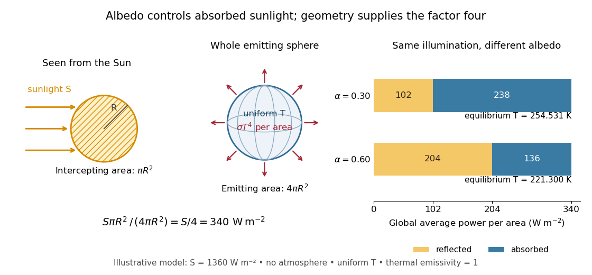
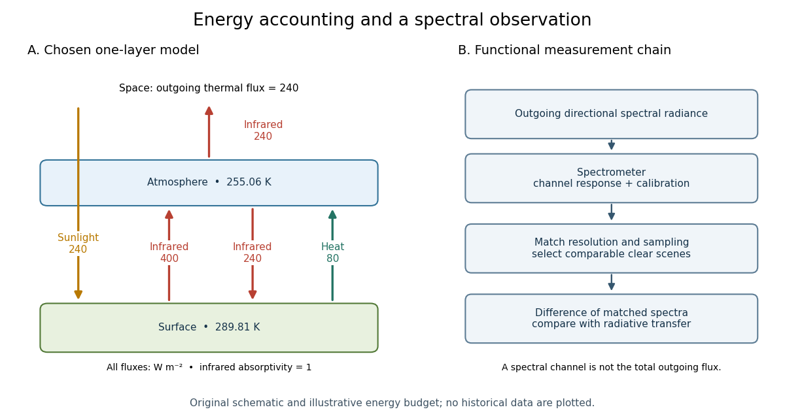
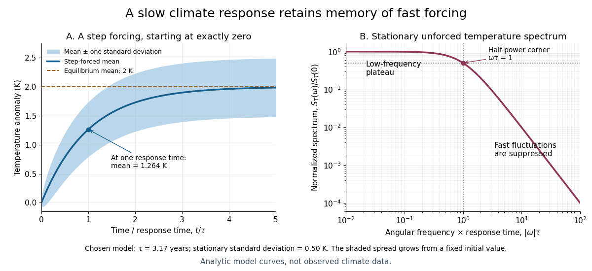
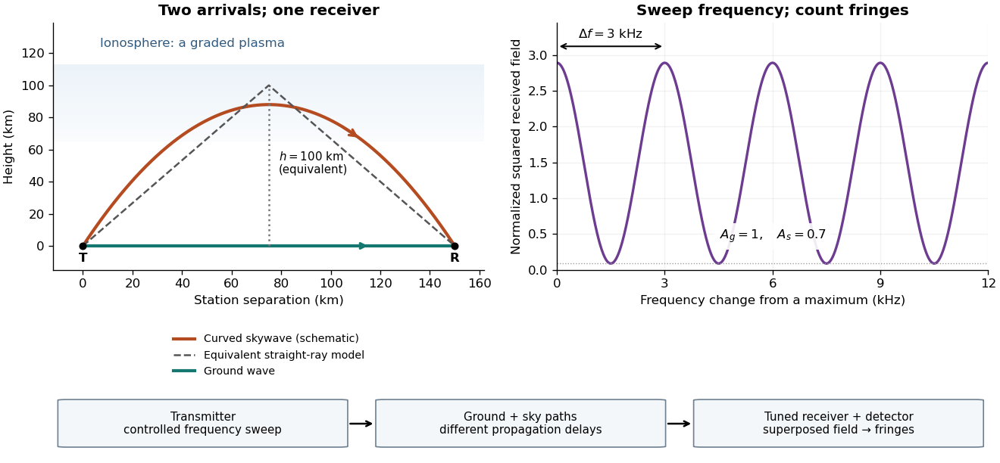
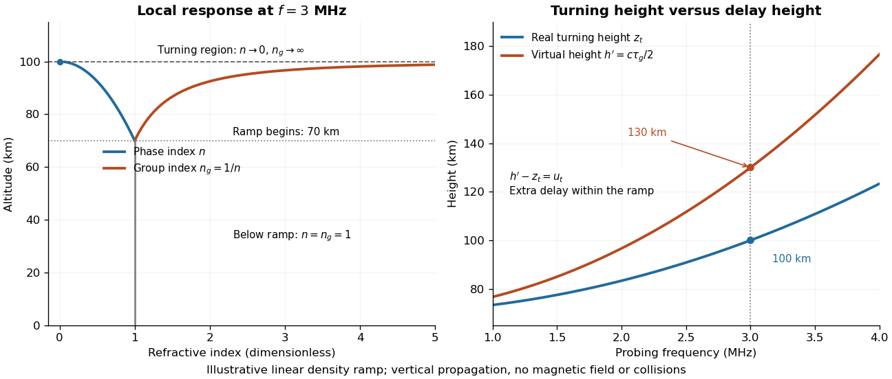

# Geophysics

↑ **Parent:** [Branches of physics](physics.md#branches-of-physics)  
ⓦ [Wiki](https://en.wikipedia.org/wiki/Geophysics)

Geophysics applies [physics](physics.md) and [mathematics](mathematics.md) to the structure, composition, and evolution of [planets](planetary-science.md#planet), including [Earth](planetary-science.md#earth). It connects measurements with mechanisms: [plate tectonics](#plate-tectonics) explains moving crust, the [geodynamo](planetary-science.md#geodynamo) explains a planetary [magnetic field](magnetic-field.md), and [albedo](#albedo) connects reflected sunlight to a [planetary surface energy balance](#planetary-surface-energy-balance). Even a small model can reveal a useful organizing principle, such as the competition between [ice-ocean albedo feedback](#ice-ocean-albedo-feedback) and stabilizing [thermal radiation](electromagnetic-radiation.md#thermal-radiation).

**Table of contents**

- [International Earth Rotation and Reference Systems Service](#international-earth-rotation-and-reference-systems-service)
  - [Work by International Earth Rotation and Reference Systems Service](#work-by-international-earth-rotation-and-reference-systems-service)
- [United States Geological Survey](#united-states-geological-survey)
  - [Work by United States Geological Survey](#work-by-united-states-geological-survey)
- [Geothermal gradient](#geothermal-gradient)
- [Planetary mantle](#planetary-mantle)
  - [Asthenosphere](#asthenosphere)
- [Planetary crust](#planetary-crust)
- [Geophysicist](#geophysicist)
  - [List of geophysicists](#list-of-geophysicists)
    - [W. J. Morgan](#w-j-morgan)
      - [Work by W. J. Morgan](#work-by-w-j-morgan)
    - [A. B. Watts](#a-b-watts)
      - [Work by A. B. Watts](#work-by-a-b-watts)
    - [H. F. Reid](#h-f-reid)
    - [W. Ellsworth](#w-ellsworth)
      - [Work by W. Ellsworth](#work-by-w-ellsworth)
    - [F. Waldhauser](#f-waldhauser)
      - [Work by F. Waldhauser](#work-by-f-waldhauser)
    - [R. D. van der Hilst](#r-d-van-der-hilst)
      - [Work by R. D. van der Hilst](#work-by-r-d-van-der-hilst)
    - [S. J. Mackwell](#s-j-mackwell)
      - [Work by S. J. Mackwell](#work-by-s-j-mackwell)
    - [John G. Sclater](#john-g-sclater)
      - [Work by John G. Sclater](#work-by-john-g-sclater)
    - [Barry Parsons](#barry-parsons)
      - [Work by Barry Parsons](#work-by-barry-parsons)
    - [Peter M. Shearer](#peter-m-shearer)
      - [Work by Peter M. Shearer](#work-by-peter-m-shearer)
    - [Jeanne L. Hardebeck](#jeanne-l-hardebeck)
      - [Work by Jeanne L. Hardebeck](#work-by-jeanne-l-hardebeck)
    - [Don L. Anderson](#don-l-anderson)
      - [Work by Don L. Anderson](#work-by-don-l-anderson)
    - [Adam M. Dziewonski](#adam-m-dziewonski)
      - [Work by Adam M. Dziewonski](#work-by-adam-m-dziewonski)
    - [R. Drummond](#r-drummond)
      - [Work by R. Drummond](#work-by-r-drummond)
    - [D. F. Argus](#d-f-argus)
      - [Work by D. F. Argus](#work-by-d-f-argus)
    - [W. R. Peltier](#w-r-peltier)
      - [Work by W. R. Peltier](#work-by-w-r-peltier)
    - [D. H. Matthews](#d-h-matthews)
      - [Work by D. H. Matthews](#work-by-d-h-matthews)
    - [F. J. Vine](#f-j-vine)
      - [Work by F. J. Vine](#work-by-f-j-vine)
    - [Carl Bowin](#carl-bowin)
      - [Work by Carl Bowin](#work-by-carl-bowin)
    - [Dan McKenzie](#dan-mckenzie)
      - [Work by Dan McKenzie](#work-by-dan-mckenzie)
- [Geodesy](#geodesy)
  - [GNSS](#gnss)
- [Radial density inversion of the Earth](#radial-density-inversion-of-the-earth)
  - [Preliminary Reference Earth Model](#preliminary-reference-earth-model)
- [Geoid](#geoid)
- [Gravity anomaly](#gravity-anomaly)
  - [Gravity-topography admittance](#gravity-topography-admittance)
    - [Gravity and topography near Hawaii](#gravity-and-topography-near-hawaii)
      - [Hawaiian swell](#hawaiian-swell)
    - [Gravity-topography coherence](#gravity-topography-coherence)
    - [Flexural gravity admittance](#flexural-gravity-admittance)
  - [Bouguer gravity anomaly](#bouguer-gravity-anomaly)
    - [Terrain correction](#terrain-correction)
  - [Free-air gravity anomaly](#free-air-gravity-anomaly)
- [Isostasy](#isostasy)
  - [Isostatic ridge elevation in a plate model](#isostatic-ridge-elevation-in-a-plate-model)
  - [Pratt isostasy](#pratt-isostasy)
  - [Airy isostasy](#airy-isostasy)
- [Seismology](#seismology)
  - [Toroidal normal mode of the Earth](#toroidal-normal-mode-of-the-earth)
  - [Seismic phase](#seismic-phase)
  - [Low-velocity zone](#low-velocity-zone)
    - [Seismic shadow range from a low-velocity zone](#seismic-shadow-range-from-a-low-velocity-zone)
  - [Earthquake location by arrival times](#earthquake-location-by-arrival-times)
    - [Earthquake depth–origin-time trade-off](#earthquake-depth-origin-time-trade-off)
    - [Origin-time and speed-ratio regression](#origin-time-and-speed-ratio-regression)
    - [Earthquake location from interphase delays](#earthquake-location-from-interphase-delays)
    - [Earthquake origin time](#earthquake-origin-time)
    - [Double-difference earthquake relocation](#double-difference-earthquake-relocation)
  - [Seismic anisotropy](#seismic-anisotropy)
  - [Seismic ray theory](#seismic-ray-theory)
    - [Seismic travel-time triplication](#seismic-travel-time-triplication)
      - [Seismic travel-time fold caustic](#seismic-travel-time-fold-caustic)
    - [Seismic rays in a linear velocity gradient](#seismic-rays-in-a-linear-velocity-gradient)
    - [Seismic ray parameter in horizontal layering](#seismic-ray-parameter-in-horizontal-layering)
      - [Seismic intercept time](#seismic-intercept-time)
  - [Seismic surface-wave dispersion](#seismic-surface-wave-dispersion)
    - [Spherical surface-wave evanescence threshold](#spherical-surface-wave-evanescence-threshold)
  - [Seismogram](#seismogram)
  - [Layer reverberation](#layer-reverberation)
  - [Adams-Williamson equation](#adams-williamson-equation)
  - [Seismic parameter](#seismic-parameter)
  - [Seismometer](#seismometer)
- [Silicate weathering](#silicate-weathering)
- [Palaeomagnetism](#palaeomagnetism)
  - [Thermoremanent magnetization](#thermoremanent-magnetization)
  - [Magnetic anomaly](#magnetic-anomaly)
    - [Marine magnetic stripe](#marine-magnetic-stripe)
- [Meteorology](#meteorology)
  - [Jet stream](#jet-stream)
  - [Teleconnection](#teleconnection)
    - [Rossby-wave teleconnection](#rossby-wave-teleconnection)
  - [Lifting condensation level](#lifting-condensation-level)
  - [Foehn wind](#foehn-wind)
    - [Isentropic foehn drawdown](#isentropic-foehn-drawdown)
    - [Precipitation-driven foehn warming](#precipitation-driven-foehn-warming)
  - [Potential temperature](#potential-temperature)
    - [Entropy form of dry potential temperature](#entropy-form-of-dry-potential-temperature)
      - [Irreversible qualification of dry potential-temperature conservation](#irreversible-qualification-of-dry-potential-temperature-conservation)
  - [Met Office](#met-office)
    - [Work by Met Office](#work-by-met-office)
  - [Thermal high](#thermal-high)
  - [Thermal low](#thermal-low)
  - [National Oceanic and Atmospheric Administration](#national-oceanic-and-atmospheric-administration)
    - [Work by National Oceanic and Atmospheric Administration](#work-by-national-oceanic-and-atmospheric-administration)
  - [World Meteorological Organization](#world-meteorological-organization)
  - [Atmospheric precipitation](#atmospheric-precipitation)
    - [Cloud ice nucleation versus ice growth](#cloud-ice-nucleation-versus-ice-growth)
    - [Ice-crystal aggregation](#ice-crystal-aggregation)
    - [Precipitation efficiency](#precipitation-efficiency)
    - [Riming](#riming)
    - [Wegener-Bergeron-Findeisen process](#wegener-bergeron-findeisen-process)
  - [Lightning](#lightning)
  - [Cloud](#cloud)
    - [Liquid-water path](#liquid-water-path)
    - [Cloud radiative lifetime tendency](#cloud-radiative-lifetime-tendency)
    - [Cloud droplet](#cloud-droplet)
      - [Collision-coalescence](#collision-coalescence)
        - [Cloud-droplet collision kernel](#cloud-droplet-collision-kernel)
  - [Meteorologist](#meteorologist)
    - [List of meteorologists](#list-of-meteorologists)
      - [Isaac Held](#isaac-held)
        - [Work by Isaac Held](#work-by-isaac-held)
      - [Sebastian Bathiany](#sebastian-bathiany)
        - [Work by Sebastian Bathiany](#work-by-sebastian-bathiany)
      - [Helge F. Goessling](#helge-f-goessling)
        - [Work by Helge F. Goessling](#work-by-helge-f-goessling)
      - [Piers Forster](#piers-forster)
        - [Work by Piers Forster](#work-by-piers-forster)
      - [S. Twomey](#s-twomey)
        - [Work by S. Twomey](#work-by-s-twomey)
      - [Richard T. Wetherald](#richard-t-wetherald)
        - [Work by Richard T. Wetherald](#work-by-richard-t-wetherald)
      - [Syukuro Manabe](#syukuro-manabe)
        - [Work by Syukuro Manabe](#work-by-syukuro-manabe)
  - [Weather forecasting](#weather-forecasting)
- [Snow](#snow)
  - [Firn](#firn)
- [Fram Strait](#fram-strait)
- [North Atlantic Oscillation](#north-atlantic-oscillation)
- [Katabatic wind](#katabatic-wind)
- [Atlantic meridional overturning circulation](#atlantic-meridional-overturning-circulation)
- [Albedo](#albedo)
  - [Albedo-to-forcing conversion](#albedo-to-forcing-conversion)
  - [Cloud albedo](#cloud-albedo)
    - [Cloud optical depth at fixed liquid-water path](#cloud-optical-depth-at-fixed-liquid-water-path)
  - [Zero-dimensional planetary energy balance](#zero-dimensional-planetary-energy-balance)
- [Ocean heat flux](#ocean-heat-flux)
- [Ice deformation](#ice-deformation)
- [Iceberg](#iceberg)
  - [Iceberg melt heat budget](#iceberg-melt-heat-budget)
    - [Poleward heat transport by equatorward iceberg drift](#poleward-heat-transport-by-equatorward-iceberg-drift)
  - [Iceberg freeboard](#iceberg-freeboard)
  - [Iceberg free drift](#iceberg-free-drift)
    - [Damped free drift of an iceberg](#damped-free-drift-of-an-iceberg)
    - [Iceberg towing drag](#iceberg-towing-drag)
- [Open-ocean convection](#open-ocean-convection)
  - [Convective chimney](#convective-chimney)
- [Ice-ocean albedo feedback](#ice-ocean-albedo-feedback)
- [Arctic Oscillation](#arctic-oscillation)
- [Sea ice thermodynamics](#sea-ice-thermodynamics)
  - [Basal melt heat flux](#basal-melt-heat-flux)
  - [Freezing degree-day](#freezing-degree-day)
    - [Lebedev ice-growth law](#lebedev-ice-growth-law)
  - [Water-equivalent thickness](#water-equivalent-thickness)
  - [Brine rejection](#brine-rejection)
    - [Migration of brine inclusions](#migration-of-brine-inclusions)
    - [Brine expulsion](#brine-expulsion)
    - [Meltwater flushing of sea ice](#meltwater-flushing-of-sea-ice)
    - [Gravity drainage of sea-ice brine](#gravity-drainage-of-sea-ice-brine)
    - [Conservation of salt during freezing](#conservation-of-salt-during-freezing)
      - [Conservation of salt with salt-retaining ice](#conservation-of-salt-with-salt-retaining-ice)
      - [Freezing-to-cooling density efficiency](#freezing-to-cooling-density-efficiency)
    - [Freezing density increase](#freezing-density-increase)
  - [Maykut-Untersteiner model](#maykut-untersteiner-model)
    - [Snow insulation and summer ice protection](#snow-insulation-and-summer-ice-protection)
    - [Annual sea-ice thermodynamic equilibrium](#annual-sea-ice-thermodynamic-equilibrium)
- [Oil spill under sea ice](#oil-spill-under-sea-ice)
  - [Ice-floe oil painting fraction](#ice-floe-oil-painting-fraction)
- [Permafrost](#permafrost)
  - [Permafrost carbon feedback](#permafrost-carbon-feedback)
  - [Thermokarst](#thermokarst)
- [Climate change](#climate-change)
  - [Stratospheric aerosol injection](#stratospheric-aerosol-injection)
  - [Climate model](#climate-model)
    - [Climate sensitivity](#climate-sensitivity)
    - [Radiative-convective climate column](#radiative-convective-climate-column)
      - [Convective adjustment](#convective-adjustment)
    - [Hasselmann stochastic climate model](#hasselmann-stochastic-climate-model)
    - [Satellite test of greenhouse spectral change](#satellite-test-of-greenhouse-spectral-change)
  - [Polar amplification](#polar-amplification)
  - [Attribution of recent climate change](#attribution-of-recent-climate-change)
  - [Global warming](#global-warming)
  - [Sea level rise](#sea-level-rise)
    - [Global ocean freshwater budget](#global-ocean-freshwater-budget)
    - [Eustatic sea level change](#eustatic-sea-level-change)
    - [Steric sea level change](#steric-sea-level-change)
      - [Thermosteric sea level change](#thermosteric-sea-level-change)
  - [Arctic dipole anomaly](#arctic-dipole-anomaly)
  - [Radiative forcing](#radiative-forcing)
    - [Annual versus accumulated radiative forcing](#annual-versus-accumulated-radiative-forcing)
  - [Climate feedback](#climate-feedback)
    - [Climate forcing-response energy balance](#climate-forcing-response-energy-balance)
    - [Lapse-rate feedback](#lapse-rate-feedback)
    - [Planck feedback](#planck-feedback)
    - [Water-vapor feedback](#water-vapor-feedback)
    - [Arctic methane feedback](#arctic-methane-feedback)
    - [Ice-albedo feedback](#ice-albedo-feedback)
- [Seabed gouging by ice](#seabed-gouging-by-ice)
- [Solid Earth](#solid-earth)
  - [Outer core of the Earth](#outer-core-of-the-earth)
  - [Carbonate-silicate cycle](#carbonate-silicate-cycle)
  - [Volcanism](#volcanism)
  - [Earthquake](#earthquake)
    - [Elastic rebound model](#elastic-rebound-model)
    - [Earthquake centroid](#earthquake-centroid)
    - [Hypocenter](#hypocenter)
      - [Epicenter](#epicenter)
    - [Fault plane](#fault-plane)
      - [Fault rake](#fault-rake)
      - [Fault dip](#fault-dip)
      - [Fault strike](#fault-strike)
    - [Fault slip](#fault-slip)
    - [Aftershock](#aftershock)
  - [Lithosphere](#lithosphere)
    - [Oceanic plate cooling model](#oceanic-plate-cooling-model)
      - [Surface heat flux of a cooling plate](#surface-heat-flux-of-a-cooling-plate)
    - [Half-space cooling model](#half-space-cooling-model)
      - [Oceanic thermal subsidence](#oceanic-thermal-subsidence)
    - [Lithospheric flexure](#lithospheric-flexure)
      - [Effective elastic thickness](#effective-elastic-thickness)
  - [Magma](#magma)
    - [Dike](#dike)
      - [Thermal dike-widening similarity](#thermal-dike-widening-similarity)
        - [Melt-dilution heat balance in a dike](#melt-dilution-heat-balance-in-a-dike)
    - [Lava lake](#lava-lake)
      - [Radiogenically heated lava-lake crust model](#radiogenically-heated-lava-lake-crust-model)
        - [Instantaneous stationary lava-crust thickness](#instantaneous-stationary-lava-crust-thickness)
        - [Lava-crust overshoot under warming](#lava-crust-overshoot-under-warming)
        - [Constant-temperature lava-crust growth law](#constant-temperature-lava-crust-growth-law)
    - [Magma intrusion](#magma-intrusion)
      - [Toughness-controlled magma intrusion](#toughness-controlled-magma-intrusion)
        - [Reservoir-fed magma intrusion](#reservoir-fed-magma-intrusion)
      - [Vapour-tip peeling of a magma intrusion](#vapour-tip-peeling-of-a-magma-intrusion)
  - [Mantle convection](#mantle-convection)
    - [Coupled thermal histories of layered mantle convection](#coupled-thermal-histories-of-layered-mantle-convection)
    - [Flux-driven convective layer cooling](#flux-driven-convective-layer-cooling)
    - [Dynamic topography](#dynamic-topography)
    - [Plate tectonics](#plate-tectonics)
      - [Geological fault](#geological-fault)
        - [Dip-slip faulting](#dip-slip-faulting)
          - [Reverse faulting](#reverse-faulting)
          - [Normal faulting](#normal-faulting)
        - [Oblique-slip faulting](#oblique-slip-faulting)
          - [Transpression](#transpression)
        - [Strike-slip faulting](#strike-slip-faulting)
      - [Triple junction](#triple-junction)
        - [Trench-trench-transform triple junction](#trench-trench-transform-triple-junction)
        - [Ridge-ridge-transform triple junction](#ridge-ridge-transform-triple-junction)
        - [Triple-junction velocity compatibility](#triple-junction-velocity-compatibility)
        - [Plate velocity triangle](#plate-velocity-triangle)
      - [Spreading ridge](#spreading-ridge)
        - [Seafloor spreading](#seafloor-spreading)
        - [Half-spreading rate](#half-spreading-rate)
      - [Transform fault](#transform-fault)
      - [Euler pole](#euler-pole)
        - [Euler angular velocity vector](#euler-angular-velocity-vector)
      - [Tectonic plate](#tectonic-plate)
      - [Ridge push](#ridge-push)
        - [Ridge-push force in a plate model](#ridge-push-force-in-a-plate-model)
      - [Subduction](#subduction)
        - [Overriding plate](#overriding-plate)
        - [Subduction trench](#subduction-trench)
        - [Slab pull](#slab-pull)
    - [Rayleigh number](#rayleigh-number)
      - [Local Rayleigh-number closure](#local-rayleigh-number-closure)
        - [Marginal-stability thermal boundary-layer scaling](#marginal-stability-thermal-boundary-layer-scaling)
      - [Penetrative convection](#penetrative-convection)
        - [Density anomaly of water](#density-anomaly-of-water)
        - [Penetrative convection in an ice-covered lake](#penetrative-convection-in-an-ice-covered-lake)
- [Planetary ice shell](#planetary-ice-shell)
  - [Sea ice](#sea-ice)
    - [Sea-ice drift momentum balance](#sea-ice-drift-momentum-balance)
    - [Lead (sea ice)](#lead-sea-ice)
      - [Sea-ice lead-width distribution](#sea-ice-lead-width-distribution)
    - [Sea-ice thickness distribution](#sea-ice-thickness-distribution)
      - [Mechanical redistribution of sea ice](#mechanical-redistribution-of-sea-ice)
    - [Snow ice](#snow-ice)
    - [Nilas](#nilas)
    - [Sea-ice crystal fabric](#sea-ice-crystal-fabric)
    - [Odden ice tongue](#odden-ice-tongue)
    - [Melt pond](#melt-pond)
    - [Fast ice](#fast-ice)
    - [Multi-year sea ice](#multi-year-sea-ice)
    - [First-year sea ice](#first-year-sea-ice)
      - [Congelation ice](#congelation-ice)
    - [Sea-ice draft](#sea-ice-draft)
    - [Arctic sea ice decline](#arctic-sea-ice-decline)
      - [Recovery of summer sea ice](#recovery-of-summer-sea-ice)
    - [Sea-ice pressure ridge](#sea-ice-pressure-ridge)
      - [Sonar ridge shadowing](#sonar-ridge-shadowing)
      - [Exponential ridge-draft model](#exponential-ridge-draft-model)
        - [Triangular ridge occupation identity](#triangular-ridge-occupation-identity)
      - [Sea-ice shear ridge](#sea-ice-shear-ridge)
    - [Wave attenuation in sea ice](#wave-attenuation-in-sea-ice)
      - [Viscous layer model of frazil-pancake ice](#viscous-layer-model-of-frazil-pancake-ice)
      - [Scattering attenuation by ice floes](#scattering-attenuation-by-ice-floes)
    - [Polynya](#polynya)
      - [Dilute frazil polynya similarity solution](#dilute-frazil-polynya-similarity-solution)
      - [Pease polynya model](#pease-polynya-model)
      - [North Water Polynya](#north-water-polynya)
      - [Northeast Water Polynya](#northeast-water-polynya)
      - [Sensible-heat polynya](#sensible-heat-polynya)
      - [Latent-heat polynya](#latent-heat-polynya)
    - [Pancake ice](#pancake-ice)
      - [Consolidated pancake ice](#consolidated-pancake-ice)
    - [Frazil ice](#frazil-ice)
      - [Frazil export enthalpy balance](#frazil-export-enthalpy-balance)
    - [Marginal ice zone](#marginal-ice-zone)
      - [Ice-edge band](#ice-edge-band)
        - [Wave-driven ice-band compaction](#wave-driven-ice-band-compaction)
    - [Ice floe](#ice-floe)
      - [Sea-ice free drift](#sea-ice-free-drift)
        - [Quadratic-drag free-drift turning angle](#quadratic-drag-free-drift-turning-angle)
    - [Single-category sea-ice thermodynamic model](#single-category-sea-ice-thermodynamic-model)
      - [Peak-temperature sea-ice survival](#peak-temperature-sea-ice-survival)
      - [Ocean-heat correction to seasonal ice growth](#ocean-heat-correction-to-seasonal-ice-growth)
  - [Planetary surface energy balance](#planetary-surface-energy-balance)
    - [Solar constant](#solar-constant)
      - [Daily mean solar irradiance](#daily-mean-solar-irradiance)
    - [Ocean heat content](#ocean-heat-content)
    - [Surface albedo](#surface-albedo)
  - [Stefan problem](#stefan-problem)
    - [Binary alloy Stefan similarity solution](#binary-alloy-stefan-similarity-solution)
      - [Small-solid-diffusivity melting concentration](#small-solid-diffusivity-melting-concentration)
    - [Quasistatic spherical Stefan problem with capillarity](#quasistatic-spherical-stefan-problem-with-capillarity)
      - [Critical radius for a supercooled spherical seed](#critical-radius-for-a-supercooled-spherical-seed)
        - [Finite-time extinction of a subcritical spherical seed](#finite-time-extinction-of-a-subcritical-spherical-seed)
    - [Spherical freezing inside a porous cavity](#spherical-freezing-inside-a-porous-cavity)
    - [Dendrite (crystal)](#dendrite-crystal)
    - [Travelling solidification front in a pure supercooled melt](#travelling-solidification-front-in-a-pure-supercooled-melt)
      - [Full thermal stability of a travelling solidification front](#full-thermal-stability-of-a-travelling-solidification-front)
      - [Small-wavelength thermal approximation for a solidification front](#small-wavelength-thermal-approximation-for-a-solidification-front)
        - [Capillary threshold of a reduced solidification dispersion](#capillary-threshold-of-a-reduced-solidification-dispersion)
    - [Asteroidal core growth by crustal sinking](#asteroidal-core-growth-by-crustal-sinking)
    - [Pressure-limited spherical freezing in a porous medium](#pressure-limited-spherical-freezing-in-a-porous-medium)
    - [Stefan condition](#stefan-condition)
    - [Kinetic undercooling](#kinetic-undercooling)
      - [Solidification attachment mobility](#solidification-attachment-mobility)
        - [Instantaneous interface kinetics](#instantaneous-interface-kinetics)
      - [Morphological instability of a kinetically limited solidification front](#morphological-instability-of-a-kinetically-limited-solidification-front)
        - [One-sided kinetic solidification dispersion](#one-sided-kinetic-solidification-dispersion)
          - [Large-wavenumber branches of kinetic solidification](#large-wavenumber-branches-of-kinetic-solidification)
          - [Capillary stability threshold for a kinetic freezing front](#capillary-stability-threshold-for-a-kinetic-freezing-front)
    - [Icicle ripple](#icicle-ripple)
      - [Thin-film icicle-ripple instability](#thin-film-icicle-ripple-instability)
    - [Phase boundary](#phase-boundary)
      - [Particle pushing by a freezing front](#particle-pushing-by-a-freezing-front)
        - [Premelted-film particle pushing](#premelted-film-particle-pushing)
      - [Solid-liquid segregation coefficient](#solid-liquid-segregation-coefficient)
      - [Crystal interface anisotropy](#crystal-interface-anisotropy)
        - [Hexagonal ice crystal anisotropy](#hexagonal-ice-crystal-anisotropy)
      - [Premelting](#premelting)
        - [Thermomolecular pressure](#thermomolecular-pressure)
          - [Clapeyron pressure relation for equal-density phases](#clapeyron-pressure-relation-for-equal-density-phases)
        - [Frost heave](#frost-heave)
          - [Premelted-film lifting of a disk](#premelted-film-lifting-of-a-disk)
          - [Hydraulic control of frost heave](#hydraulic-control-of-frost-heave)
            - [Explicit solution of gravity-limited frost heave](#explicit-solution-of-gravity-limited-frost-heave)
            - [Heat-balance correction to a premelted-film growth model](#heat-balance-correction-to-a-premelted-film-growth-model)
      - [Solid-liquid surface energy](#solid-liquid-surface-energy)
    - [Neumann solution of the Stefan problem](#neumann-solution-of-the-stefan-problem)
      - [Superheated two-phase Stefan similarity](#superheated-two-phase-stefan-similarity)
        - [Small-interface-parameter growth with liquid superheat](#small-interface-parameter-growth-with-liquid-superheat)
    - [Constitutional supercooling](#constitutional-supercooling)
      - [Small-diffusivity constitutional-supercooling threshold](#small-diffusivity-constitutional-supercooling-threshold)
    - [Saline Stefan problem](#saline-stefan-problem)
      - [Ice layer between freshwater and cold brine](#ice-layer-between-freshwater-and-cold-brine)
        - [Brine-ice sandwich with disparate diffusion scales](#brine-ice-sandwich-with-disparate-diffusion-scales)
        - [Large latent heat in a freezing and melting ice layer](#large-latent-heat-in-a-freezing-and-melting-ice-layer)
      - [Dilution function for a melting saline Stefan front](#dilution-function-for-a-melting-saline-stefan-front)
      - [Salt rejection](#salt-rejection)
      - [Salt-rejection function for a saline Stefan front](#salt-rejection-function-for-a-saline-stefan-front)
      - [Diffusion-controlled iceberg growth and ablation](#diffusion-controlled-iceberg-growth-and-ablation)
    - [Mushy layer](#mushy-layer)
      - [Strain-driven steady mush](#strain-driven-steady-mush)
        - [Strain-dominated mush temperature profile](#strain-dominated-mush-temperature-profile)
      - [Solute-diffusion characteristics in a fixed-temperature mush](#solute-diffusion-characteristics-in-a-fixed-temperature-mush)
        - [No-flux constraint in a fixed-temperature mush](#no-flux-constraint-in-a-fixed-temperature-mush)
          - [Final salt budget of a sealed mush column](#final-salt-budget-of-a-sealed-mush-column)
      - [Stagnant mushy-layer model](#stagnant-mushy-layer-model)
        - [Large-concentration stagnant-mush similarity](#large-concentration-stagnant-mush-similarity)
        - [Marginal equilibrium at a mush-liquid boundary](#marginal-equilibrium-at-a-mush-liquid-boundary)
      - [Solid fraction](#solid-fraction)
        - [Liquid fraction](#liquid-fraction)
      - [Phase-change volume source in a rigid mush](#phase-change-volume-source-in-a-rigid-mush)
    - [Directional solidification](#directional-solidification)
      - [Grain selector](#grain-selector)
      - [Frozen-temperature approximation](#frozen-temperature-approximation)
      - [Finite-inventory directional salt rejection](#finite-inventory-directional-salt-rejection)
        - [Frozen-temperature solutal interface dispersion](#frozen-temperature-solutal-interface-dispersion)
          - [Quasistatic solute diffusion](#quasistatic-solute-diffusion)
      - [Diffusive steadily pulled equilibrium mush](#diffusive-steadily-pulled-equilibrium-mush)
      - [Density-change flow in a pulled mushy layer](#density-change-flow-in-a-pulled-mushy-layer)
        - [Solute conservation in a steadily pulled mush](#solute-conservation-in-a-steadily-pulled-mush)
      - [Large-concentration thermal profile of a pulled mush](#large-concentration-thermal-profile-of-a-pulled-mush)
    - [Advection-driven melting front in a porous matrix](#advection-driven-melting-front-in-a-porous-matrix)
- [Glaciology](#glaciology)
  - [Ice sheet](#ice-sheet)
  - [Glacier](#glacier)
  - [Ice accumulation](#ice-accumulation)
  - [Ice ablation](#ice-ablation)
    - [Ice dissolution in saline water](#ice-dissolution-in-saline-water)
    - [Diffusive glacier-ablation interface law](#diffusive-glacier-ablation-interface-law)
  - [Ice sheet dynamics](#ice-sheet-dynamics)
    - [Ice cap](#ice-cap)
    - [Shallow-ice approximation](#shallow-ice-approximation)
      - [Newtonian shallow-ice flux](#newtonian-shallow-ice-flux)
        - [Shallow-ice flux with linear basal drag](#shallow-ice-flux-with-linear-basal-drag)
          - [Traveling nose of a glacier with linear basal drag](#traveling-nose-of-a-glacier-with-linear-basal-drag)
          - [Shear-to-slip transition in a shallow ice current](#shear-to-slip-transition-in-a-shallow-ice-current)
      - [Gravity-driven ice flow on a conical slope](#gravity-driven-ice-flow-on-a-conical-slope)
        - [Steady conical ice cap with a linear accumulation gradient](#steady-conical-ice-cap-with-a-linear-accumulation-gradient)
        - [Volume-conserving conical ice-current similarity solution](#volume-conserving-conical-ice-current-similarity-solution)
          - [Characteristic transformation for conical ice drainage](#characteristic-transformation-for-conical-ice-drainage)
        - [Apex filling layer of a conical ice cap](#apex-filling-layer-of-a-conical-ice-cap)
    - [Ice divide](#ice-divide)
    - [Snowline](#snowline)
    - [Basal sliding](#basal-sliding)
      - [Linear basal drag law](#linear-basal-drag-law)
      - [Subglacial till](#subglacial-till)
        - [Newtonian till lubrication](#newtonian-till-lubrication)
    - [Ice shelf](#ice-shelf)
      - [Ice-shelf buttressing](#ice-shelf-buttressing)
      - [Ice-shelf water](#ice-shelf-water)
      - [Grounding line](#grounding-line)
        - [Ice-sheet flotation](#ice-sheet-flotation)
        - [Friction-dominated grounding-line evolution law](#friction-dominated-grounding-line-evolution-law)
          - [Steady friction-dominated grounding-line thickness relation](#steady-friction-dominated-grounding-line-thickness-relation)
        - [Unbuttressed Newtonian grounding-line stress](#unbuttressed-newtonian-grounding-line-stress)
        - [Newtonian grounding-line flux](#newtonian-grounding-line-flux)
        - [Shelfy stream](#shelfy-stream)
      - [Shallow-shelf approximation](#shallow-shelf-approximation)
      - [Ice-shelf corrugation relaxation](#ice-shelf-corrugation-relaxation)
- [Postglacial rebound](#postglacial-rebound)
  - [Sinusoidal viscous rebound](#sinusoidal-viscous-rebound)
  - [Glacial isostatic adjustment](#glacial-isostatic-adjustment)
    - [Mantle viscosity from glacial isostatic adjustment](#mantle-viscosity-from-glacial-isostatic-adjustment)
    - [Flexural isostasy](#flexural-isostasy)
    - [Laurentide Ice Sheet](#laurentide-ice-sheet)
    - [Fennoscandian Ice Sheet](#fennoscandian-ice-sheet)
- [Upper atmosphere](#upper-atmosphere)
  - [Ionosphere](#ionosphere)
    - [E layer](#e-layer)
    - [F layer](#f-layer)
    - [Ground wave](#ground-wave)
    - [Skywave](#skywave)
    - [Appleton-Barnett radio interference experiment](#appleton-barnett-radio-interference-experiment)
      - [Ionospheric interference fringe spacing](#ionospheric-interference-fringe-spacing)
    - [Cold-plasma radio dispersion](#cold-plasma-radio-dispersion)
      - [Ionospheric virtual height](#ionospheric-virtual-height)

## International Earth Rotation and Reference Systems Service

↑ **Parent:** [Geophysics](geophysics.md)

Publisher of [IERS Conventions (2010) by International Earth Rotation and Reference Systems Service](physics-bibliography.md#iers-conventions-2010-by-international-earth-rotation-and-reference-systems-service).

### Work by International Earth Rotation and Reference Systems Service

↑ **Parent:** [International Earth Rotation and Reference Systems Service](#international-earth-rotation-and-reference-systems-service)

## United States Geological Survey

↑ **Parent:** [Geophysics](geophysics.md)

[https://www.usgs.gov](https://www.usgs.gov)

### Work by United States Geological Survey

↑ **Parent:** [United States Geological Survey](#united-states-geological-survey)

## Geothermal gradient

↑ **Parent:** [Geophysics](geophysics.md)

The [geothermal gradient](#geothermal-gradient) is the rate at which [temperature](temperature.md) varies with depth. For steady one-dimensional [thermal conduction](heat.md#thermal-conduction) with constant [thermal conductivity](heat.md#thermal-conductivity) $k_T$, the magnitude of upward [heat flux](heat.md#heat-flux-density) is $q=k_T\,dT/dz$.

## Planetary mantle

↑ **Parent:** [Geophysics](geophysics.md)

The [planetary mantle](#planetary-mantle) is the predominantly silicate rock region beneath a rocky planet's [crust](#planetary-crust). On geological timescales, solid rock can undergo [material creep](engineering.md#creep-deformation) and support [mantle convection](#mantle-convection) without wholesale melting.

### Asthenosphere

↑ **Parent:** [Planetary mantle](#planetary-mantle)

The [asthenosphere](#asthenosphere) is a relatively weak region of the upper [mantle](#planetary-mantle) below the mechanically strong [lithosphere](#lithosphere). A seismic [low-velocity zone](#low-velocity-zone) often occurs in this region, particularly beneath oceanic [lithosphere](#lithosphere), but mechanical weakness and seismic [speed](classical-mechanics.md#speed) are distinct properties.

## Planetary crust

↑ **Parent:** [Geophysics](geophysics.md)

The [planetary crust](#planetary-crust) is the outer compositional rock layer of a differentiated rocky planet. Its thickness need not equal either the [lithosphere](#lithosphere)'s thermal thickness or its [effective elastic thickness](#effective-elastic-thickness).

## Geophysicist

↑ **Parent:** [Geophysics](geophysics.md)

### List of geophysicists

↑ **Parent:** [Geophysicist](#geophysicist)

#### W. J. Morgan

↑ **Parent:** [List of geophysicists](#list-of-geophysicists)

##### Work by W. J. Morgan

↑ **Parent:** [W. J. Morgan](#w-j-morgan)

#### A. B. Watts

↑ **Parent:** [List of geophysicists](#list-of-geophysicists)

##### Work by A. B. Watts

↑ **Parent:** [A. B. Watts](#a-b-watts)

#### H. F. Reid

↑ **Parent:** [List of geophysicists](#list-of-geophysicists)

#### W. Ellsworth

↑ **Parent:** [List of geophysicists](#list-of-geophysicists)

##### Work by W. Ellsworth

↑ **Parent:** [W. Ellsworth](#w-ellsworth)

#### F. Waldhauser

↑ **Parent:** [List of geophysicists](#list-of-geophysicists)

##### Work by F. Waldhauser

↑ **Parent:** [F. Waldhauser](#f-waldhauser)

#### R. D. van der Hilst

↑ **Parent:** [List of geophysicists](#list-of-geophysicists)

##### Work by R. D. van der Hilst

↑ **Parent:** [R. D. van der Hilst](#r-d-van-der-hilst)

#### S. J. Mackwell

↑ **Parent:** [List of geophysicists](#list-of-geophysicists)

##### Work by S. J. Mackwell

↑ **Parent:** [S. J. Mackwell](#s-j-mackwell)

#### John G. Sclater

↑ **Parent:** [List of geophysicists](#list-of-geophysicists)

##### Work by John G. Sclater

↑ **Parent:** [John G. Sclater](#john-g-sclater)

#### Barry Parsons

↑ **Parent:** [List of geophysicists](#list-of-geophysicists)

##### Work by Barry Parsons

↑ **Parent:** [Barry Parsons](#barry-parsons)

#### Peter M. Shearer

↑ **Parent:** [List of geophysicists](#list-of-geophysicists)

Coauthor of the 2002 first-motion focal-mechanism uncertainty method.

##### Work by Peter M. Shearer

↑ **Parent:** [Peter M. Shearer](#peter-m-shearer)

#### Jeanne L. Hardebeck

↑ **Parent:** [List of geophysicists](#list-of-geophysicists)

Coauthor of the 2002 first-motion focal-mechanism uncertainty method.

##### Work by Jeanne L. Hardebeck

↑ **Parent:** [Jeanne L. Hardebeck](#jeanne-l-hardebeck)

#### Don L. Anderson

↑ **Parent:** [List of geophysicists](#list-of-geophysicists)

Coauthor of the 1981 [Preliminary Reference Earth Model](#preliminary-reference-earth-model).

##### Work by Don L. Anderson

↑ **Parent:** [Don L. Anderson](#don-l-anderson)

#### Adam M. Dziewonski

↑ **Parent:** [List of geophysicists](#list-of-geophysicists)

Coauthor of the 1981 [Preliminary Reference Earth Model](#preliminary-reference-earth-model).

##### Work by Adam M. Dziewonski

↑ **Parent:** [Adam M. Dziewonski](#adam-m-dziewonski)

#### R. Drummond

↑ **Parent:** [List of geophysicists](#list-of-geophysicists)

Coauthor of the 2015 ICE-6G\_C model study.

##### Work by R. Drummond

↑ **Parent:** [R. Drummond](#r-drummond)

#### D. F. Argus

↑ **Parent:** [List of geophysicists](#list-of-geophysicists)

Coauthor of the 2015 ICE-6G\_C space-geodesy study.

##### Work by D. F. Argus

↑ **Parent:** [D. F. Argus](#d-f-argus)

#### W. R. Peltier

↑ **Parent:** [List of geophysicists](#list-of-geophysicists)

Lead author of the 2015 ICE-6G\_C glacial-isostatic-adjustment model study.

##### Work by W. R. Peltier

↑ **Parent:** [W. R. Peltier](#w-r-peltier)

#### D. H. Matthews

↑ **Parent:** [List of geophysicists](#list-of-geophysicists)

Coauthor of the 1963 magnetic-anomaly seafloor-spreading interpretation.

##### Work by D. H. Matthews

↑ **Parent:** [D. H. Matthews](#d-h-matthews)

#### F. J. Vine

↑ **Parent:** [List of geophysicists](#list-of-geophysicists)

Coauthor of the 1963 magnetic-anomaly seafloor-spreading interpretation.

##### Work by F. J. Vine

↑ **Parent:** [F. J. Vine](#f-j-vine)

#### Carl Bowin

↑ **Parent:** [List of geophysicists](#list-of-geophysicists)

Coauthor of the 1976 Atlantic [gravity](physics.md#gravity)/bathymetry study.

##### Work by Carl Bowin

↑ **Parent:** [Carl Bowin](#carl-bowin)

#### Dan McKenzie

↑ **Parent:** [List of geophysicists](#list-of-geophysicists)

Coauthor of the 1976 [gravity](physics.md#gravity)/bathymetry spectral study.

##### Work by Dan McKenzie

↑ **Parent:** [Dan McKenzie](#dan-mckenzie)

## Geodesy

↑ **Parent:** [Geophysics](geophysics.md)

Measurement and modeling of a [planet](planetary-science.md#planet)’s shape, [gravity](physics.md#gravity) field, orientation and deformation. Space [geodesy](#geodesy) can constrain both rigid plate motion and time-dependent solid-Earth loading response.

### GNSS

↑ **Parent:** [Geodesy](#geodesy)

Global navigation satellite systems can measure station position time series in a stated terrestrial [reference frame](mathematical-physics.md#reference-frame). Vertical and horizontal secular or transient motions require treatment of station offsets, atmospheric delays, loading and reference-frame uncertainty.

## Radial density inversion of the Earth

↑ **Parent:** [Geophysics](geophysics.md)

Infer a spherically averaged [density](fluid-mechanics.md#density) profile using seismic travel times, normal-mode frequencies, [mass](classical-mechanics.md#mass), [moment of inertia](rigid-body-dynamics.md#moment-of-inertia), hydrostatic structure and material constraints. Seismic [speeds](classical-mechanics.md#speed) alone measure elastic-modulus-to-density ratios, so they do not uniquely supply [density](fluid-mechanics.md#density).

### Preliminary Reference Earth Model

↑ **Parent:** [Radial density inversion of the Earth](#radial-density-inversion-of-the-earth)

A one-dimensional reference model combining [elastic wave](wave-equation.md#elastic-wave) [speeds](classical-mechanics.md#speed), [density](fluid-mechanics.md#density) and attenuation, developed by [Adam M. Dziewonski](#adam-m-dziewonski) and [Don L. Anderson](#don-l-anderson). It incorporates joint seismic and global integral constraints rather than treating [density](fluid-mechanics.md#density) as a direct travel-time measurement.

## Geoid

↑ **Parent:** [Geophysics](geophysics.md)

An equipotential surface of [Earth](planetary-science.md#earth) [gravity](physics.md#gravity), including the centrifugal potential, used as an idealized sea-level reference. [geoid](#geoid) height responds to long-wavelength [density](fluid-mechanics.md#density) anomalies and boundary deformation; local [gravity](physics.md#gravity) and [geoid](#geoid) height are related but distinct observables.

## Gravity anomaly

↑ **Parent:** [Geophysics](geophysics.md)

A difference between observed [gravity](physics.md#gravity) and a specified reference field after stated reductions. Free-air, Bouguer and isostatic anomalies remove different modeled effects; they are not interchangeable raw measurements.

### Gravity-topography admittance

↑ **Parent:** [Gravity anomaly](#gravity-anomaly)

A spectral transfer estimate $Z(k)=\langle g_kh_k^*\rangle/\langle|h_k|^2\rangle$. Its wavelength dependence constrains compensation, [density](fluid-mechanics.md#density) structure and support, but one transfer curve does not uniquely determine them.

#### Gravity and topography near Hawaii

↑ **Parent:** [Gravity-topography admittance](#gravity-topography-admittance)

The narrow volcanic ridge loads the [lithosphere](#lithosphere) and generates a regional flexural response, while the broad swell involves deeper support. The observed positive ridge anomaly, negative flanks, outer positive belt, and long-wavelength positive swell anomaly probe distinct spatial scales.[Abstract, regional gravity and bathymetry](physics-bibliography.md#gravity-and-bathymetry-in-the-central-pacific-ocean-by-a-b-watts)

##### Hawaiian swell

↑ **Parent:** [Gravity and topography near Hawaii](#gravity-and-topography-near-hawaii)

#### Gravity-topography coherence

↑ **Parent:** [Gravity-topography admittance](#gravity-topography-admittance)

For cross-spectrum $S_{gh}$ and autospectra $S_{gg},S_{hh}$, squared coherence is $|S_{gh}|^2/(S_{gg}S_{hh})$. It measures the fraction of spectral association between [gravity](physics.md#gravity) and topography. Low coherence can signal uncorrelated internal loading, noise or shortcomings of a simple surface-load model; interpreting it as [elastic thickness](#effective-elastic-thickness) requires a loading model.

#### Flexural gravity admittance

↑ **Parent:** [Gravity-topography admittance](#gravity-topography-admittance)

For a surface load above a uniform-density [crust](#planetary-crust) over a denser substrate, a simple [lithospheric flexure](#lithospheric-flexure) model gives the indicated [gravity-topography admittance](#gravity-topography-admittance), with $\ell_f^4=D/[g(\rho_m-\rho_c)]$. The surface mass contributes positive gravity; downward displacement of the [density](fluid-mechanics.md#density) interface contributes a compensating negative signal attenuated by $e^{-kt}$. Hence $Z\to0$ at long [wavelength](wave-equation.md#wavelength) and $Z\to2\pi G\rho_c$ at short [wavelength](wave-equation.md#wavelength). Here $t$ is the interface depth, not automatically the [effective elastic thickness](#effective-elastic-thickness).

### Bouguer gravity anomaly

↑ **Parent:** [Gravity anomaly](#gravity-anomaly)

A [gravity anomaly](#gravity-anomaly) after removing an approximate topographic [mass](classical-mechanics.md#mass) contribution, often an infinite slab $2\pi G\rho h$, in addition to free-air reduction. Terrain and spherical-curvature corrections refine the slab model.

#### Terrain correction

↑ **Parent:** [Bouguer gravity anomaly](#bouguer-gravity-anomaly)

A correction for the difference between real surrounding relief and the assumed simple topographic slab. Its computation needs terrain geometry and an assumed [density](fluid-mechanics.md#density), and can matter in rough [surface topography](optics.md#surface-topography).

### Free-air gravity anomaly

↑ **Parent:** [Gravity anomaly](#gravity-anomaly)

[gravity](physics.md#gravity) reduced to a reference elevation while retaining the gravitational contribution of the intervening topographic [mass](classical-mechanics.md#mass). The local elevation correction is approximately $2g h/R$ for a spherical reference, with sign chosen to undo the measured decrease with height.

## Isostasy

↑ **Parent:** [Geophysics](geophysics.md)

Approximate gravitational compensation of loads by subsurface [mass](classical-mechanics.md#mass) redistribution. Airy and Pratt models use local column balances; flexural support spreads the load laterally. Real [surface topography](optics.md#surface-topography) can also be maintained by dynamic [stresses](continuum-mechanics.md#stress).

### Isostatic ridge elevation in a plate model

↑ **Parent:** [Isostasy](#isostasy)

A cold linear plate profile has excess column [mass](classical-mechanics.md#mass) $\rho_m\alpha\Delta T a/2$ relative to hot [mantle](#planetary-mantle). Equal [hydrostatic pressure](fluid-mechanics.md#hydrostatic-pressure) below the plates is restored by replacing part of the rock column with water. The displayed elevation follows to first order in [thermal expansion](thermodynamics.md#thermal-expansion); its denominator is the rock-minus-water [density](fluid-mechanics.md#density) difference, not the rock [density](fluid-mechanics.md#density) alone.

### Pratt isostasy

↑ **Parent:** [Isostasy](#isostasy)

A local compensation model in which columns of different [density](fluid-mechanics.md#density) reach a common compensation depth. Higher [surface topography](optics.md#surface-topography) is associated with a less dense column; [density](fluid-mechanics.md#density) variation replaces the variable-root mechanism of an Airy model.

### Airy isostasy

↑ **Parent:** [Isostasy](#isostasy)

A local compensation model with approximately fixed crustal [density](fluid-mechanics.md#density) and variable crustal thickness. A height $h$ is supported by a crustal root $b=\rho_c h/(\rho_m-\rho_c)$ in a simple constant-density, air-loaded column model.

## Seismology

↑ **Parent:** [Geophysics](geophysics.md)

[Seismology](#seismology) studies [elastic waves](wave-equation.md#elastic-wave) in a planet and uses their propagation to infer its interior and the sources of ground motion.

### Toroidal normal mode of the Earth

↑ **Parent:** [Seismology](#seismology)

A [toroidal normal mode of the Earth](#toroidal-normal-mode-of-the-earth) is a free oscillation with tangential, divergence-free displacement. It is the spherical counterpart of the transverse shear motion in a [Love wave](wave-equation.md#love-wave). A bounded spherical [Earth](planetary-science.md#earth) has discrete angular orders and [eigenfrequencies](wave-equation.md#eigenfrequency), so the arbitrarily low-frequency continuum of a flat infinite layer is not a literal statement about global nonrigid oscillations.

### Seismic phase

↑ **Parent:** [Seismology](#seismology)

A [seismic phase](#seismic-phase) labels a propagation type and path, such as direct P, direct S, a reflection or a converted wave. Misidentifying the phase assigns the wrong travel-time function even if its arrival is picked precisely.

### Low-velocity zone

↑ **Parent:** [Seismology](#seismology)

A [low-velocity zone](#low-velocity-zone) has a wave-speed decrease with depth over some interval. Surface rays do not turn within its negative-gradient interior; rays penetrating it can return only after encountering sufficient [speed](classical-mechanics.md#speed) recovery below. This can produce shadow ranges, multiple travel-time branches and poor turning-depth coverage. A wave-specific [low-velocity zone](#low-velocity-zone) is not identical to a mechanical layer boundary.

#### Seismic shadow range from a low-velocity zone

↑ **Parent:** [Low-velocity zone](#low-velocity-zone)

A seismic shadow range is an interval of receiver distances missing a specified family of geometrical rays. A [velocity](classical-mechanics.md#velocity) decrease can separate shallow-turning and deep-turning arrivals; [diffraction](quantum-scattering.md#diffraction) or other wave families can still deliver [energy](energy.md) there.

### Earthquake location by arrival times

↑ **Parent:** [Seismology](#seismology)

Arrival-time location estimates a [hypocenter](#hypocenter) and origin time by comparing picked phase arrivals with predicted [travel times](dispersion-relation.md#travel-time). [Linearization](algebra.md#linearization) gives residual changes $\delta t_i=\delta t_0+\nabla T_i\cdot\delta\mathbf x$. Poorly distinct [derivative](calculus.md#derivative) columns cause tradeoffs, while incorrect [wave speeds](wave-equation.md#wave-speed) or phase labels cause systematic bias even with many stations.

<h4 id="earthquake-depth-origin-time-trade-off">Earthquake depth–origin-time trade-off</h4>

↑ **Parent:** [Earthquake location by arrival times](#earthquake-location-by-arrival-times)

For surface stations at similar distances, the travel-time [derivatives](calculus.md#derivative) with respect to depth can be small or nearly equal. Their arrival-time shifts are then difficult to distinguish from a common change in [earthquake origin time](#earthquake-origin-time). A deeper source can be paired with an earlier origin. Nearby stations, broad distance coverage, and depth-sensitive phases help separate the two parameters.

#### Origin-time and speed-ratio regression

↑ **Parent:** [Earthquake location by arrival times](#earthquake-location-by-arrival-times)

If $r=v_A/v_B$ and both phases share path length, arrival time of A is affine in the interphase delay. With unbiased independent clock errors, the intercept estimates [earthquake origin time](#earthquake-origin-time) and slope estimates $1/(r-1)$. A common clock bias is indistinguishable from an origin-time shift; unrestricted station offsets also destroy speed-ratio [identifiability](statistical-model.md#identifiability). A statistical [regression](statistical-modelling.md#regression-analysis) must state its clock-error assumptions.

#### Earthquake location from interphase delays

↑ **Parent:** [Earthquake location by arrival times](#earthquake-location-by-arrival-times)

In a homogeneous medium, two phases along the same geometric path have delay $\Delta t=KR$, where $K=1/v_B-1/v_A$. The squared delay is a quadratic in station position. Its vertex locates the [epicentre](#epicenter), while the ratio of intercept to quadratic coefficient gives squared depth. These spatial parameters do not depend on a particular assigned speed ratio if both speeds are inferred from the same data. Local clock offsets cancel, although uncertainties in the velocity model do not.

#### Earthquake origin time

↑ **Parent:** [Earthquake location by arrival times](#earthquake-location-by-arrival-times)

An [earthquake origin time](#earthquake-origin-time) is the estimated onset time of rupture. Predicted arrivals add this time to a propagation [travel time](dispersion-relation.md#travel-time); an uncertain origin time therefore couples to uncertain source depth in some station geometries.

#### Double-difference earthquake relocation

↑ **Parent:** [Earthquake location by arrival times](#earthquake-location-by-arrival-times)

Differences between arrival times of nearby [earthquakes](#earthquake) at a common station largely cancel common propagation errors. Comparing observed and predicted differences constrains relative source separation and origin-time differences. Closely similar waveforms permit precise differential picks by [cross-correlation](fourier-analysis.md#cross-correlation). Absolute position still needs an accurate model or external anchor.

### Seismic anisotropy

↑ **Parent:** [Seismology](#seismology)

[Seismic anisotropy](#seismic-anisotropy) is direction dependence of elastic-wave propagation. Aligned crystals or layering can produce it; using it to infer deformation requires a model connecting fabric to flow.

### Seismic ray theory

↑ **Parent:** [Seismology](#seismology)

[Seismic ray theory](#seismic-ray-theory) approximates high-frequency propagation through smoothly varying media. The travel-time field satisfies the [eikonal equation](elasticity-physics.md#eikonal-equation), and its characteristics are paths of stationary travel time according to [Fermat's principle](mathematical-physics.md#fermat-principle). Diffraction and caustics require refinements beyond a simple geometrical-ray approximation.

#### Seismic travel-time triplication

↑ **Parent:** [Seismic ray theory](#seismic-ray-theory)

A ray family can fold in the mapping from ray parameter or turning depth to surface range, so that three rays arrive at the same range with different [travel times](dispersion-relation.md#travel-time). A sufficiently strong, thin high-positive-gradient zone can produce this effect. The first-arrival curve is the lower envelope of the branches; other branches represent later arrivals. [Gradient](multivariable-calculus.md#gradient) contrast and thickness determine whether folds exist.

##### Seismic travel-time fold caustic

↑ **Parent:** [Seismic travel-time triplication](#seismic-travel-time-triplication)

#### Seismic rays in a linear velocity gradient

↑ **Parent:** [Seismic ray theory](#seismic-ray-theory)

For $v(z)=v_s+\beta z$ with $\beta>0$, a surface-to-surface diving ray is circular. Its turning speed is $v_t=1/p$, and its range and time are $X=2\sqrt{v_t^2-v_s^2}/\beta$ and $T=2\operatorname{arcosh}(v_t/v_s)/\beta$. Differentiation gives $dT/dX=p$, the [seismic ray parameter](#seismic-ray-parameter-in-horizontal-layering). In the limit $\beta\to0$ at fixed range, $T\to X/v_s$.

#### Seismic ray parameter in horizontal layering

↑ **Parent:** [Seismic ray theory](#seismic-ray-theory)

In horizontally layered isotropic media, horizontal slowness is conserved along a ray. The incidence angle $i$ is measured from vertical. A smooth turning depth satisfies $pv=1$. The range and [travel time](dispersion-relation.md#travel-time) are $x=2\int pv\,dz/\sqrt{1-p^2v^2}$ and $T=2\int dz/[v\sqrt{1-p^2v^2}]$ for a symmetric surface-to-surface turning ray.

##### Seismic intercept time

↑ **Parent:** [Seismic ray parameter in horizontal layering](#seismic-ray-parameter-in-horizontal-layering)

A ray's intercept time subtracts its tangent travel-time contribution at the receiver range. For a smooth branch, $dT/dx=p$ implies $d\tau/dp=-x$. Thus an intercept-time curve encodes range as its negative slope. Separate turning branches around a [low-velocity zone](#low-velocity-zone) must be retained rather than joined by fictitious rays.

### Seismic surface-wave dispersion

↑ **Parent:** [Seismology](#seismology)

[Seismic surface-wave dispersion](#seismic-surface-wave-dispersion) is the [frequency](wave.md#frequency) dependence of [Rayleigh wave](wave-equation.md#rayleigh-wave) or [Love wave](wave-equation.md#love-wave) propagation caused by depth-dependent elastic properties, mode structure and possibly intrinsic anelasticity. [Phase velocity](dispersion-relation.md#phase-velocity) is $\omega/k$; [group velocity](dispersion-relation.md#group-velocity) is $d\omega/dk$. Different [periods](mathematics.md#period-of-a-function) and branches have different depth sensitivities, enabling [surface-wave tomography](inverse-problem.md#surface-wave-tomography).

#### Spherical surface-wave evanescence threshold

↑ **Parent:** [Seismic surface-wave dispersion](#seismic-surface-wave-dispersion)

For surface phase [speed](classical-mechanics.md#speed) $c$ on a spherical [Earth](planetary-science.md#earth), the conserved angular ray parameter is $p=R_E/c$. The local horizontal [slowness](wave-equation.md#slowness) at radius $r$ is $p/r$, giving squared radial shear [wavenumber](wave-equation.md#wavenumber) $q_r^2=\omega^2[\beta(r)^{-2}-p^2/r^2]$ in ray theory. The displayed inequality makes it negative. A jump in shear [speed](classical-mechanics.md#speed) can turn a propagating wave above the interface into an [evanescent wave](elasticity-physics.md#evanescent-wave) below it. This is a local condition, not proof of evanescence at every greater depth.

### Seismogram

↑ **Parent:** [Seismology](#seismology)

A [seismogram](#seismogram) records ground motion through an instrument response. Comparing it with a synthetic [seismogram](#seismogram) requires consistent component orientation, sampling, timing, filtering and instrument calibration.

### Layer reverberation

↑ **Parent:** [Seismology](#seismology)

Repeated [reflection](linear-algebra.md#reflection-mathematics) and conversion between a layer surface and its lower interface produces additional delayed phases. Their travel times and amplitude depend on layer thickness, wave [speeds](classical-mechanics.md#speed), impedance contrasts, attenuation and source spectrum.

### Adams-Williamson equation

↑ **Parent:** [Seismology](#seismology)

In a chemically homogeneous adiabatic spherical region, $d\rho/dr=-\rho g/\Phi$, coupled to $dm/dr=4\pi r^2\rho$ and $g=Gm/r^2$. Seismic [velocities](classical-mechanics.md#velocity) supply $\Phi$; [density](fluid-mechanics.md#density) normalization and jumps require further data and assumptions.

### Seismic parameter

↑ **Parent:** [Seismology](#seismology)

The [adiabatic bulk modulus](elasticity-physics.md#adiabatic-bulk-modulus) divided by [density](fluid-mechanics.md#density), $\Phi=K_S/\rho=\alpha^2-4\beta^2/3$ for an [isotropic](continuum-mechanics.md#isotropy) solid. It has units of squared [speed](classical-mechanics.md#speed) and is a key input to the Adams-Williamson [density](fluid-mechanics.md#density) relation.

### Seismometer

↑ **Parent:** [Seismology](#seismology)

A [seismometer](#seismometer) compares ground motion with the motion of an inertial test [mass](classical-mechanics.md#mass). A mechanical [seismograph](#seismometer) records their relative displacement. Its [frequency response](electrical-engineering.md#frequency-response) depends on the suspension and on which relative or absolute velocity enters the damping law.

## Silicate weathering

↑ **Parent:** [Geophysics](geophysics.md)

Chemical alteration of silicate minerals by [water](chemical-substance.md#water) and dissolved [carbon dioxide](chemical-substance.md#carbon-dioxide). Coupled to transport and subsequent carbonate burial, this provides a long-term geological sink for added carbon. Its response is much slower than atmospheric mixing or upper-ocean exchange; a rapid pulse can persist while this adjustment proceeds.

## Palaeomagnetism

↑ **Parent:** [Geophysics](geophysics.md)

Study of ancient magnetic fields recorded in rocks. Correlation to geomagnetic polarity chronology can constrain the age of archaeological and fossil-bearing strata.

### Thermoremanent magnetization

↑ **Parent:** [Palaeomagnetism](#palaeomagnetism)

[magnetization](electromagnetism.md#magnetization) retained as magnetic minerals cool through blocking [temperatures](temperature.md) in an ambient field. Subsequent alteration, reheating and remagnetization can change the record.

### Magnetic anomaly

↑ **Parent:** [Palaeomagnetism](#palaeomagnetism)

A measured [magnetic field](magnetic-field.md) component or magnitude after subtraction of a reference field. Source geometry, [magnetization](electromagnetism.md#magnetization) direction and observation height affect its sign and amplitude; an anomaly is not a direct map of rock polarity.

#### Marine magnetic stripe

↑ **Parent:** [Magnetic anomaly](#magnetic-anomaly)

A lineated pattern associated with differently magnetized crust formed at a [spreading ridge](#spreading-ridge) during changes of field polarity. The age-distance relation is set by spreading, while the measured anomaly is a spatially filtered field of the magnetized material.

## Meteorology

↑ **Parent:** [Geophysics](geophysics.md)

### Jet stream

↑ **Parent:** [Meteorology](#meteorology)

A comparatively narrow band of strong atmospheric flow. Tropospheric jets are associated with large horizontal temperature gradients through the [thermal wind](geophysical-fluid-dynamics.md#thermal-wind) relation; strong [potential vorticity](geophysical-fluid-dynamics.md#potential-vorticity) gradients can guide [Rossby waves](geophysical-fluid-dynamics.md#rossby-wave). The background speed and its spatial variation control Doppler shifting and refraction of wave packets. Not every atmospheric jet has the same origin or altitude.

### Teleconnection

↑ **Parent:** [Meteorology](#meteorology)

Correlated atmospheric variability between geographically separated regions. Wave propagation, mean-flow changes and coupled atmosphere–ocean forcing can produce physical connections, while statistical correlation alone does not identify a unique cause. A [Rossby-wave teleconnection](#rossby-wave-teleconnection) is an important large-scale pathway rather than an exhaustive definition of all teleconnections.

#### Rossby-wave teleconnection

↑ **Parent:** [Teleconnection](#teleconnection)

A spatially localized forcing, such as persistent tropical heating, can excite [Rossby waves](geophysical-fluid-dynamics.md#rossby-wave) that propagate wave activity into distant regions. Mean winds Doppler-shift the waves, and background [potential vorticity](geophysical-fluid-dynamics.md#potential-vorticity) gradients and jets guide or refract the packets. A stationary pattern can thus connect remote ridges and troughs even though the underlying wave energy propagates. [Group velocity](dispersion-relation.md#group-velocity), rather than phase velocity alone, diagnoses packet propagation; damping, seasonality and eddy feedbacks affect the response.

### Lifting condensation level

↑ **Parent:** [Meteorology](#meteorology)

The level where an initially unsaturated air parcel first reaches saturation during an approximately dry adiabatic ascent. Before saturation, expansion cools the parcel while its water-vapour mixing ratio remains approximately constant. At saturation, further ascent can condense water and release [latent heat](thermodynamic-potential.md#latent-heat); the subsequent parcel lapse rate differs from the dry rate. Mixing with surrounding air changes this ideal parcel construction.

### Foehn wind

↑ **Parent:** [Meteorology](#meteorology)

A relatively warm, dry downslope wind on the lee side of a mountain. Condensation and condensate removal during ascent can produce [precipitation-driven foehn warming](#precipitation-driven-foehn-warming); [isentropic foehn drawdown](#isentropic-foehn-drawdown), turbulent mixing and radiative warming can also contribute. Rainfall is therefore not a necessary condition for every foehn event. The atmosphere's upstream stratification, moisture and flow over or around the mountain determine the contributing mechanisms.[Four mechanisms of lee-side warming and drying](physics-bibliography.md#foehn-effect-by-met-office)

#### Isentropic foehn drawdown

↑ **Parent:** [Foehn wind](#foehn-wind)

Mountain blocking can prevent low-level upstream air from crossing the barrier while air from higher levels passes over and descends. In stable stratification that elevated source air has higher [potential temperature](#potential-temperature); adiabatic descent can bring it into a lee valley warmer than the blocked low-level air. This source-air change permits a dry foehn without requiring condensation and rainout along the arriving parcel's path.

#### Precipitation-driven foehn warming

↑ **Parent:** [Foehn wind](#foehn-wind)

In the classical idealized parcel path, ascend dry adiabatically to condensation height $z_c$, continue at constant moist lapse rate $\Gamma_m$ to height $H>z_c$, lose condensate, then descend at dry lapse rate $\Gamma_d$ to the initial height. Adding the temperature changes gives the title. Complete condensate removal and an unsaturated descent are essential assumptions. A reversible dry ascent and descent with the same source air instead gives no net temperature increase at the same pressure.

### Potential temperature

↑ **Parent:** [Meteorology](#meteorology)

The temperature a parcel would have after reversible adiabatic compression to a reference pressure. For a dry ideal gas, $\theta=T(p_0/p)^{R/c_p}$; it is conserved for dry adiabatic motion.

#### Entropy form of dry potential temperature

↑ **Parent:** [Potential temperature](#potential-temperature)

For a dry fixed-composition ideal gas with constant specific heats, $ds=c_p\,d\ln T-R_d\,d\ln p$. Defining $\theta=T(p_0/p)^{R_d/c_p}$ gives the displayed identity. Reversible adiabatic parcel motion conserves entropy and theta simultaneously. Irreversible entropy production or moist latent heating can change ordinary dry theta even without heat exchanged through the parcel boundary.

##### Irreversible qualification of dry potential-temperature conservation

↑ **Parent:** [Entropy form of dry potential temperature](#entropy-form-of-dry-potential-temperature)

### Met Office

↑ **Parent:** [Meteorology](#meteorology)

#### Work by Met Office

↑ **Parent:** [Met Office](#met-office)

### Thermal high

↑ **Parent:** [Meteorology](#meteorology)

A lower-atmospheric high-pressure circulation associated with a cold dense air mass, often over a continent in winter. This does not imply the same circulation sign at all altitudes.

### Thermal low

↑ **Parent:** [Meteorology](#meteorology)

A lower-atmospheric low-pressure circulation associated with a warm air mass or heated land surface. Its strength and vertical structure depend on environmental constraints.

### National Oceanic and Atmospheric Administration

↑ **Parent:** [Meteorology](#meteorology)

#### Work by National Oceanic and Atmospheric Administration

↑ **Parent:** [National Oceanic and Atmospheric Administration](#national-oceanic-and-atmospheric-administration)

### World Meteorological Organization

↑ **Parent:** [Meteorology](#meteorology)

### Atmospheric precipitation

↑ **Parent:** [Meteorology](#meteorology)

Condensed [water](chemical-substance.md#water) falling from [clouds](#cloud) or deposited from the atmosphere as liquid or solid particles. It can efficiently scavenge soluble gases and [aerosol](chemistry.md#aerosol) particles. Gas conversion into [sulfate](chemistry.md#sulfate) and subsequent [atmospheric precipitation](#atmospheric-precipitation) removal are separate stages of an atmospheric sulfur budget.

#### Cloud ice nucleation versus ice growth

↑ **Parent:** [Atmospheric precipitation](#atmospheric-precipitation)

Nucleation creates the initial ice embryo, either within liquid or with assistance from a suitable interface. Deposition, [riming](#riming) and [ice-crystal aggregation](#ice-crystal-aggregation) enlarge already existing ice. A list of efficient ice-growth processes does not by itself explain how the first crystals formed. Small-particle nucleation probabilities depend on thermodynamic driving, interfaces, volume and exposure time.

#### Ice-crystal aggregation

↑ **Parent:** [Atmospheric precipitation](#atmospheric-precipitation)

Ice particles collide and stick to form a larger aggregate, such as a snowflake. Temperature, habit and collision speed affect sticking. This differs from vapour deposition onto ice and from [riming](#riming), in which collected supercooled liquid freezes on the ice particle. [Glossary: aggregation and accretion; snow definition](physics-bibliography.md#international-cloud-atlas-by-world-meteorological-organization)

#### Precipitation efficiency

↑ **Parent:** [Atmospheric precipitation](#atmospheric-precipitation)

The fraction of a specified condensate or moisture supply that appears as precipitation under a stated spatial, temporal and flux convention. Collection, fall-out, entrainment, evaporation and sublimation all affect it. A cloud can activate many droplets yet precipitate inefficiently; droplet formation, growth to precipitation size and survival to the surface are separate requirements.

#### Riming

↑ **Parent:** [Atmospheric precipitation](#atmospheric-precipitation)

Supercooled droplets collide with an ice particle and freeze onto it, increasing its mass. Deposition, riming and ice aggregation are distinct growth mechanisms.

#### Wegener-Bergeron-Findeisen process

↑ **Parent:** [Atmospheric precipitation](#atmospheric-precipitation)

Because ice has lower equilibrium vapour pressure than supercooled liquid, a mixed-phase environment can sustain deposition onto ice while liquid droplets evaporate. This is distinct from ice collecting droplets by riming.

### Lightning

↑ **Parent:** [Meteorology](#meteorology)

An atmospheric electrical discharge. Its high-temperature chemistry can produce [nitrogen oxides](chemistry.md#nitrogen-oxides), influencing [ozone](chemical-substance.md#ozone) and [radical](chemistry.md#radical-chemistry) chemistry away from surface emission sources. The [ozone](chemical-substance.md#ozone) response depends on subsequent transport and the local chemical regime.

### Cloud

↑ **Parent:** [Meteorology](#meteorology)

A suspension of liquid-water droplets, ice particles or both in an atmosphere. [Clouds](#cloud) interact with solar and thermal radiation; their net radiative effect depends on height, [water](chemical-substance.md#water) content, particle size distribution and coverage.

#### Liquid-water path

↑ **Parent:** [Cloud](#cloud)

The vertically integrated liquid-water mass per horizontal area in a cloud. Its units are mass per area, unlike the local liquid-water content per volume. Droplet number, effective radius and water path are distinct properties; changing one does not specify the others without further assumptions.

#### Cloud radiative lifetime tendency

↑ **Parent:** [Cloud](#cloud)

Radiative cooling can promote condensation and turbulence; net heating can promote evaporation or sublimation. Cloud altitude alone does not determine lifetime, because optical thickness, environmental radiation, entrainment and moisture supply all matter.

#### Cloud droplet

↑ **Parent:** [Cloud](#cloud)

A liquid-water particle suspended in a [cloud](#cloud). Number, size distribution and liquid-water content are separate properties; increasing number at fixed total [water](chemical-substance.md#water) shifts the characteristic radius downward.

##### Collision-coalescence

↑ **Parent:** [Cloud droplet](#cloud-droplet)

Growth of liquid [cloud droplets](#cloud-droplet) by collisions followed by merging. Differences in droplet fall speeds and collection efficiency affect the process. Increasing droplet number at fixed liquid-water content can reduce typical sizes and delay drizzle, but [cloud](#cloud) mixing and water-content adjustments prevent a universal precipitation response.

###### Cloud-droplet collision kernel

↑ **Parent:** [Collision-coalescence](#collision-coalescence)

A gravitational collision kernel multiplies geometric encounter area, relative fall speed, collection efficiency and coalescence efficiency. Its units are volume per time. The number of encounters also depends on the droplet size distribution. Hydrodynamic deflection, breakup and turbulence change the simple settling picture. Condensational growth alone tends to reduce relative size differences, so a precipitation-growth calculation must explain how efficient collectors arise.

### Meteorologist

↑ **Parent:** [Meteorology](#meteorology)

#### List of meteorologists

↑ **Parent:** [Meteorologist](#meteorologist)

##### Isaac Held

↑ **Parent:** [List of meteorologists](#list-of-meteorologists)

Author of [Teleconnections and stationary Rossby waves by Isaac Held](physics-bibliography.md#teleconnections-and-stationary-rossby-waves-by-isaac-held), hosted by NOAA's Geophysical Fluid Dynamics Laboratory.

###### Work by Isaac Held

↑ **Parent:** [Isaac Held](#isaac-held)

##### Sebastian Bathiany

↑ **Parent:** [List of meteorologists](#list-of-meteorologists)

###### Work by Sebastian Bathiany

↑ **Parent:** [Sebastian Bathiany](#sebastian-bathiany)

##### Helge F. Goessling

↑ **Parent:** [List of meteorologists](#list-of-meteorologists)

###### Work by Helge F. Goessling

↑ **Parent:** [Helge F. Goessling](#helge-f-goessling)

##### Piers Forster

↑ **Parent:** [List of meteorologists](#list-of-meteorologists)

###### Work by Piers Forster

↑ **Parent:** [Piers Forster](#piers-forster)

##### S. Twomey

↑ **Parent:** [List of meteorologists](#list-of-meteorologists)

###### Work by S. Twomey

↑ **Parent:** [S. Twomey](#s-twomey)

##### Richard T. Wetherald

↑ **Parent:** [List of meteorologists](#list-of-meteorologists)

A [meteorologist](#meteorologist) who collaborated with [Syukuro Manabe](#syukuro-manabe) on [climate models](#climate-model).[Appendix A-4, staff table: Wetherald, Richard T., Meteorologist](physics-bibliography.md#geophysical-fluid-dynamics-laboratory-activities-fy00-plans-fy01-by-geophysical-fluid-dynamics-laboratory-u-s)

###### Work by Richard T. Wetherald

↑ **Parent:** [Richard T. Wetherald](#richard-t-wetherald)

##### Syukuro Manabe

↑ **Parent:** [List of meteorologists](#list-of-meteorologists)

A [meteorologist](#meteorologist) who developed [climate models](#climate-model) at Princeton and NOAA’s Geophysical Fluid Dynamics Laboratory.[Profile: Senior Meteorologist appointment and climate-model research](physics-bibliography.md#professional-profile-of-syukuro-manabe-environmenthalfcentury-princeton-edu)

###### Work by Syukuro Manabe

↑ **Parent:** [Syukuro Manabe](#syukuro-manabe)

### Weather forecasting

↑ **Parent:** [Meteorology](#meteorology)

Weather forecasting estimates future meteorological conditions from observations and physical models. Numerical models use an approximate [initial condition](differential-equation.md#initial-condition) and equations of [fluid mechanics](fluid-mechanics.md) to simulate future conditions; forecasters also compare model outputs and apply experience and research.[National Weather Service, The forecast process](https://www.weather.gov/rah/virtualtourforecast) The [forecast horizon](dynamical-systems.md#forecast-horizon) describes how far ahead a prediction remains useful at a specified accuracy; [sensitive dependence on initial conditions](dynamical-systems.md#butterfly-effect) can limit detailed predictions under [deterministic evolution](dynamical-systems.md#deterministic-evolution).

## Snow

↑ **Parent:** [Geophysics](geophysics.md)  
ⓦ [Wiki](https://en.wikipedia.org/wiki/Snow)

### Firn

↑ **Parent:** [Snow](#snow)  
ⓦ [Wiki](https://en.wikipedia.org/wiki/Firn)

Firn is compacted, recrystallized old [snow](#snow) that has not yet become dense glacier ice. Its [porosity](porous-media-flow.md#porosity) affects meltwater infiltration and [heat transfer](heat.md#heat-transfer).

## Fram Strait

↑ **Parent:** [Geophysics](geophysics.md)  
ⓦ [Wiki](https://en.wikipedia.org/wiki/Fram_Strait)

## North Atlantic Oscillation

↑ **Parent:** [Geophysics](geophysics.md)  
ⓦ [Wiki](https://en.wikipedia.org/wiki/North_Atlantic_Oscillation)

## Katabatic wind

↑ **Parent:** [Geophysics](geophysics.md)  
ⓦ [Wiki](https://en.wikipedia.org/wiki/Katabatic_wind)

A katabatic wind is a downslope flow of cold dense air accelerated by gravity. Over Antarctic coasts its offshore component can export [sea ice](#sea-ice) and maintain a [latent-heat polynya](#latent-heat-polynya).

## Atlantic meridional overturning circulation

↑ **Parent:** [Geophysics](geophysics.md)

The Atlantic meridional overturning circulation transports warm surface water northward and returns denser water at depth; its strength depends on heat loss, freshwater and mixing.

## Albedo

↑ **Parent:** [Geophysics](geophysics.md)  
ⓦ [Wiki](https://en.wikipedia.org/wiki/Albedo)

[Albedo](#albedo) is the fraction of incident [electromagnetic radiation](electromagnetic-radiation.md) [power](energy.md#power) reflected, summed over the outgoing directions included in the measurement. For incident [power](energy.md#power) $P_{\rm in}>0$ and reflected [power](energy.md#power) $P_{\rm ref}$,

$$
\alpha=\frac{P_{\rm ref}}{P_{\rm in}},\qquad 0\leq\alpha\leq1.
$$

Thus $\alpha=0.30$ means 30 percent reflected. For an opaque surface the remaining 70 percent is absorbed; for a transmitting layer, transmission must also be accounted for. Specify the incident [wavelengths](wave-equation.md#wavelength) and illumination geometry: a visible-band [surface albedo](#surface-albedo) and a sunlight-weighted broadband [surface albedo](#surface-albedo) need not agree. NASA's definition explicitly allows a specified spectral band. [NASA, My NASA Data: Albedo Values](https://mynasadata.larc.nasa.gov/basic-page/albedo-values)

For a whole [planet](planetary-science.md#planet), broadband [Bond albedo](exoplanet.md#bond-albedo) sums reflected [power](energy.md#power) over all outgoing directions and all incident [wavelengths](wave-equation.md#wavelength), weighted by the illuminating spectrum. It is the fraction needed for a whole-planet absorbed-sunlight budget. A local [surface albedo](#surface-albedo) describes one surface under specified illumination; it cannot simply replace the [Bond albedo](exoplanet.md#bond-albedo) of [Earth](planetary-science.md#earth), whose clouds and [terrestrial atmosphere](planetary-science.md#terrestrial-atmosphere) also reflect and absorb sunlight. Nor is [Bond albedo](exoplanet.md#bond-albedo) the same as [geometric albedo](exoplanet.md#geometric-albedo), which compares brightness in a particular viewing geometry. NASA's account of [Earth](planetary-science.md#earth)'s budget separates reflection by clouds, particles and the surface from absorption within the [terrestrial atmosphere](planetary-science.md#terrestrial-atmosphere) and at the surface. [NASA Earth Observatory, Climate and Earth's Energy Budget, 2009](https://science.nasa.gov/earth/earth-observatory/climate-and-earths-energy-budget/)

The usefulness of [albedo](#albedo) is that it turns optical behavior into an [energy](energy.md) budget. Bright [snow](#snow) and [sea ice](#sea-ice) usually absorb less sunlight than exposed water under comparable illumination, but their actual [surface albedos](#surface-albedo) depend on the spectrum and surface conditions. The [ice-ocean albedo feedback](#ice-ocean-albedo-feedback) makes that optical property part of the dynamics, while the following [zero-dimensional planetary energy balance](#zero-dimensional-planetary-energy-balance) isolates the geometry and competing [thermal radiation](electromagnetic-radiation.md#thermal-radiation).

### Albedo-to-forcing conversion

↑ **Parent:** [Albedo](#albedo)

For [solar constant](#solar-constant) $S_0$ and planetary [albedo](#albedo) change $\Delta A$, the global-mean absorbed shortwave perturbation is $\Delta F=-S_0\Delta A/4$. The factor four comes from intercepted disk area versus total spherical area. The incoming top-of-atmosphere sunlight itself is unchanged.

### Cloud albedo

↑ **Parent:** [Albedo](#albedo)

The fraction of incident radiation reflected by a [cloud](#cloud) under a specified spectral and angular convention. For the approximate shortwave relation $A=\tau/(\tau+7)$, increasing [optical depth](astrophysics.md#optical-depth) raises [albedo](#albedo) with diminishing sensitivity near $A=1$. Transmitted and absorbed radiation must also be accounted for in the [energy](energy.md) budget.

#### Cloud optical depth at fixed liquid-water path

↑ **Parent:** [Cloud albedo](#cloud-albedo)

For spherical liquid droplets in the geometric-optics regime, the extinction efficiency is approximately2. Comparing projected extinction area with liquid-water mass gives the displayed relation. At fixed [liquid-water path](#liquid-water-path), smaller effective radius means larger optical depth, the basis of the [Twomey effect](chemistry.md#twomey-effect). Absorption spectra, phase and cloud adjustments can invalidate a simple inference from this optical-depth change to net climate forcing.

### Zero-dimensional planetary energy balance

↑ **Parent:** [Albedo](#albedo)

Consider an idealized [planet](planetary-science.md#planet) that is a [sphere](euclidean-geometry.md#sphere) of [radius](topology.md#radius) $R$, illuminated by parallel sunlight of [irradiance](radiometry.md#irradiance) $S$, measured on a plane perpendicular to the rays. Its intercepting [projected area](radiometry.md#projected-area) is $\pi R^2$, whereas its total surface [area](differential-geometry.md#surface-area) is $4\pi R^2$. Therefore the incoming [power](energy.md#power) averaged per unit total surface [area](differential-geometry.md#surface-area) is

$$
\frac{S\pi R^2}{4\pi R^2}=\frac S4,
\qquad P_{\rm abs}=(1-\alpha)S\pi R^2,
$$

where $\alpha$ is the broadband [Bond albedo](exoplanet.md#bond-albedo). The factor four is a [sphere](euclidean-geometry.md#sphere) geometry result, not an atmospheric transmission factor. Local sunlight still varies over the illuminated hemisphere and vanishes on the dark side.

Now stipulate a single spatially uniform [temperature](temperature.md) $T$, no atmosphere, no internal heating, and [emissivity](heat.md#emissivity) one for outgoing [thermal radiation](electromagnetic-radiation.md#thermal-radiation). This is a thermal [blackbody](astrophysics.md#blackbody) model using the [Stefan–Boltzmann law](heat.md#stefan-boltzmann-law); the prescribed solar-band reflection is treated separately, so the body is not a perfect absorber at all [wavelengths](wave-equation.md#wavelength). Let $C>0$ be the effective [heat capacity](heat.md#heat-capacity) per unit surface [area](differential-geometry.md#surface-area), in $\mathrm{J\,m^{-2}\,K^{-1}}$. [Conservation of energy](mathematical-physics.md#conservation-of-energy) gives the [ordinary differential equation](differential-equation.md#ordinary-differential-equation)

$$
C\frac{dT}{dt}=F(T),\qquad
F(T)=\frac S4[1-\alpha(T)]-\sigma T^4.
$$

Here $F$ is net heating per unit surface [area](differential-geometry.md#surface-area), in $\mathrm{W\,m^{-2}}$, and $\sigma$ is the [Stefan-Boltzmann constant](heat.md#stefan-boltzmann-constant). Use $\sigma=5.670374419\times10^{-8}\,\mathrm{W\,m^{-2}\,K^{-4}}$, rounded from the exact constant reported by NIST. [NIST, CODATA value: Stefan-Boltzmann constant](https://physics.nist.gov/cgi-bin/cuu/Value?sigma%7Csearch_for=stefan+boltzmann) The uniform [temperature](temperature.md) is a model assumption: generally the surface average of $T^4$ differs from the fourth power of the surface-average [temperature](temperature.md).

For fixed [Bond albedo](exoplanet.md#bond-albedo) $\alpha$, [radiative equilibrium](heat.md#radiative-equilibrium) requires $F(T_*)=0$, giving

$$
T_* = \left[\frac{S(1-\alpha)}{4\sigma}\right]^{1/4}.
$$

With the illustrative [solar constant](#solar-constant) $S=1360\,\mathrm{W\,m^{-2}}$, the global incoming average is $340\,\mathrm{W\,m^{-2}}$:

| Fixed [Bond albedo](exoplanet.md#bond-albedo) | Reflected average ($\mathrm{W\,m^{-2}}$) | Absorbed average ($\mathrm{W\,m^{-2}}$) | Equilibrium [temperature](temperature.md) ($\mathrm K$) |
| --- | --- | --- | --- |
| $0.30$ | $102$ | $238$ | $254.531$ |
| $0.60$ | $204$ | $136$ | $221.300$ |

Doubling [albedo](#albedo) here lowers the equilibrium [temperature](temperature.md) by $33.231\,\mathrm K$, rather than halving it: the absorbed fraction changes from $0.7$ to $0.4$, and [thermal radiation](electromagnetic-radiation.md#thermal-radiation) scales as $T^4$. These stipulated [Bond albedos](exoplanet.md#bond-albedo) are whole-planet examples, not measurements of bare water and ice. The model predicts neither [Earth](planetary-science.md#earth)'s modern surface [temperature](temperature.md) nor its response to actual [climate change](#climate-change); it omits the [greenhouse effect](exoplanet.md#greenhouse-effect), spatial [heat transfer](heat.md#heat-transfer) and seasons.

**[Figure 1](#image-from-a-sunlit-disk-to-a-whole-sphere-geometry-and-fixed-albedo-energy-budgets). From a sunlit disk to a whole sphere: geometry and fixed-albedo energy budgets**. The disk intercepts sunlight over area pi R squared; a uniform emitting sphere has four times that area. Both fixed-albedo examples use the same 1360 watts per square metre illumination and thermal emissivity one.

Each fixed-[albedo](#albedo) [equilibrium](dynamical-systems.md#equilibrium-point-of-a-dynamical-system) is a [stable equilibrium](dynamical-systems.md#stable-equilibrium): for $T_*>0$, the [derivative](calculus.md#derivative) is $F'(T_*)=-4\sigma T_*^3<0$. A small [temperature](temperature.md) increase produces net cooling, and a small decrease produces net heating. This is the simplest expression of the stabilizing [Planck feedback](#planck-feedback). Allowing [albedo](#albedo) to fall with [temperature](temperature.md) adds a competing term, as in [ice-ocean albedo feedback](#ice-ocean-albedo-feedback).

## Ocean heat flux

↑ **Parent:** [Geophysics](geophysics.md)

Ocean heat flux is the upward or downward heat transfer between ocean water and an overlying ice or atmosphere system.

## Ice deformation

↑ **Parent:** [Geophysics](geophysics.md)

Ice deformation creates ridges, rubble and keels that change transport, stress and storage beneath a floe.

## Iceberg

↑ **Parent:** [Geophysics](geophysics.md)

An iceberg is a detached mass of freshwater ice floating in the ocean.

### Iceberg melt heat budget

↑ **Parent:** [Iceberg](#iceberg)

For an initially cold [iceberg](#iceberg), melting to liquid at temperature $T_m$ requires both [latent heat of fusion](statistical-physics.md#latent-heat-of-fusion) $L_f$ and sensible warming determined by the ice [specific heat capacity](heat.md#specific-heat-capacity) $c_i$. Spatial [mass density](fluid-mechanics.md#density) and temperature profiles determine their mass-weighted integrals. Additional warming of the meltwater requires a separate heat contribution.

#### Poleward heat transport by equatorward iceberg drift

↑ **Parent:** [Iceberg melt heat budget](#iceberg-melt-heat-budget)

An [iceberg](#iceberg) moving toward the equator carries a thermal deficit into warmer water. Melting extracts heat there, equivalent to transport of heat toward the pole. For an annual number of similar bergs, multiply their individual [iceberg melt heat budget](#iceberg-melt-heat-budget) by the rate per second. Freshwater effects on [density stratification](gravity-wave.md#density-stratification) and [ocean circulation](geophysical-fluid-dynamics.md#ocean-circulation) are separate from this heat accounting.

### Iceberg freeboard

↑ **Parent:** [Iceberg](#iceberg)

For a vertical-sided floating [iceberg](#iceberg) of height $H$, [Archimedes' principle](fluid-mechanics.md#archimedes-principle) equates displaced water mass to ice mass. Its draft is $\rho_w^{-1}\int_0^H\rho_i(z)\,dz$ and its freeboard is the remaining height above water. A depth-dependent [mass density](fluid-mechanics.md#density) must be integrated; using the densest layer throughout overestimates the draft.

### Iceberg free drift

↑ **Parent:** [Iceberg](#iceberg)

The free-drift velocity of an iceberg follows from air and water drag, the [Coriolis force](mathematical-physics.md#coriolis-force), pressure gradients, currents and other external forces. Large submerged area and mass make its wind response weak compared with that of a thin floe.

#### Damped free drift of an iceberg

↑ **Parent:** [Iceberg free drift](#iceberg-free-drift)

For a constant wind force $\mathbf F$, still water, and linear water [drag force](fluid-mechanics.md#drag-physics) $-m\gamma\mathbf v$, let $J\mathbf v=\hat{\mathbf z}\times\mathbf v$. The [Coriolis parameter](geophysical-fluid-dynamics.md#coriolis-parameter) $f$ gives equilibrium $\mathbf v_\infty=(\gamma\mathbf F-fJ\mathbf F)/[m(\gamma^2+f^2)]$. The deviation evolves as $e^{-\gamma t}R(-ft)(\mathbf v(0)-\mathbf v_\infty)$, a damped [inertial oscillation](geophysical-fluid-dynamics.md#inertial-oscillation). Actual drag is commonly quadratic, so this is a linear illustrative model rather than a universal iceberg speed law.

#### Iceberg towing drag

↑ **Parent:** [Iceberg free drift](#iceberg-free-drift)

Water drag on a large iceberg can exceed a tug force by many orders of magnitude; the relevant area is the immersed horizontal base when the quoted coefficient is an equivalent water-drag coefficient.

## Open-ocean convection

↑ **Parent:** [Geophysics](geophysics.md)  
ⓦ [Wiki](https://en.wikipedia.org/wiki/Open-ocean_convection)

### Convective chimney

↑ **Parent:** [Open-ocean convection](#open-ocean-convection)

A convective chimney is a localized deeply mixed region formed when surface [buoyancy](fluid-mechanics.md#buoyancy) loss overcomes ocean [density stratification](gravity-wave.md#density-stratification). Small plumes, compensating flow, rotation and lateral exchange maintain its structure; it need not be a permanently uniform descending column. [Brine rejection](#brine-rejection) can increase its surface density forcing. A fresh summer cap can isolate a deep homogeneous core until winter forcing renews contact with the surface, so a surviving core need not imply continuous active convection.

## Ice-ocean albedo feedback

↑ **Parent:** [Geophysics](geophysics.md)

[Ice-ocean albedo feedback](#ice-ocean-albedo-feedback) is the ocean-surface case of [ice-albedo feedback](#ice-albedo-feedback): loss of bright [sea ice](#sea-ice), often covered by [snow](#snow), exposes darker water, lowers [surface albedo](#surface-albedo) and increases absorbed sunlight. The extra stored [ocean heat content](#ocean-heat-content) can promote further melting and delay refreezing. Reversing the sequence can amplify cooling. This is a positive [climate feedback](#climate-feedback), meaning that it reinforces the initial change; the word positive does not mean beneficial, and it does not guarantee runaway warming.

For unchanged downward solar [irradiance](radiometry.md#irradiance) $S_\downarrow$ on a newly exposed opaque patch, the extra absorbed [heat flux](heat.md#heat-flux-density) is

$$
\Delta F_{\rm abs}=(\alpha_{\rm ice}-\alpha_{\rm water})S_\downarrow.
$$

For illustrative local [surface albedos](#surface-albedo) $0.60$ and $0.10$, and $S_\downarrow=200\,\mathrm{W\,m^{-2}}$, the patch absorbs an additional $100\,\mathrm{W\,m^{-2}}$. This is a local sunlight calculation, not a whole-planet [radiative forcing](#radiative-forcing): newly exposed [area](differential-geometry.md#surface-area), illumination, clouds and season determine its global contribution. With no incident sunlight this particular heating pathway vanishes. NASA's notes describe the contrast between reflective [ice](chemical-substance.md#ice) and [snow](#snow) and darker water. [NASA, Explore Albedo Activity](https://science.nasa.gov/learn/heat/resource/explore-albedo-activity/)

To isolate how a positive [climate feedback](#climate-feedback) competes with [Planck feedback](#planck-feedback), retain the assumptions of the [zero-dimensional planetary energy balance](#zero-dimensional-planetary-energy-balance) and prescribe the smooth broadband [Bond albedo](exoplanet.md#bond-albedo)

$$
\alpha(T)=0.3+\frac{0.3}{1+\exp[(T-240\,\mathrm K)/(3\,\mathrm K)]}.
$$

The [exponential function](calculus.md#exponential-function) makes a smooth transition from a bright cold state near $0.6$ to a darker warm state near $0.3$. The midpoint $240\,\mathrm K$ and width $3\,\mathrm K$ are chosen to illustrate the dynamics. They are not a seawater freezing law, an observed global relation, or a calibration of modern [Earth](planetary-science.md#earth). No evolving ice thickness or [latent heat](thermodynamic-potential.md#latent-heat) is represented.

An [equilibrium](dynamical-systems.md#equilibrium-point-of-a-dynamical-system) satisfies $F(T_*)=0$. For a small perturbation $\delta T$, [linear stability](dynamical-systems.md#linear-stability) follows from

$$
C\frac{d\delta T}{dt}\simeq F'(T_*)\delta T,\qquad
F'(T)=-\frac S4\alpha'(T)-4\sigma T^3.
$$

Since $C>0$, $F'<0$ gives an [asymptotically stable](dynamical-systems.md#asymptotic-stability) [equilibrium](dynamical-systems.md#equilibrium-point-of-a-dynamical-system), while $F'>0$ gives an [unstable equilibrium](dynamical-systems.md#unstable-equilibrium). With $x=(T-240\,\mathrm K)/(3\,\mathrm K)$, the [derivative](calculus.md#derivative) is

$$
\alpha'(T)=-\frac{0.3}{3\,\mathrm K}\frac{e^x}{(1+e^x)^2}<0.
$$

Thus the optical term $-S\alpha'/4$ is destabilizing, while the [thermal radiation](electromagnetic-radiation.md#thermal-radiation) term $-4\sigma T^3$ is stabilizing. Their sum, not the optical term alone, decides the [linear stability](dynamical-systems.md#linear-stability).

For the same $S=1360\,\mathrm{W\,m^{-2}}$ and [Stefan-Boltzmann constant](heat.md#stefan-boltzmann-constant) used above, the [bisection method](numerical-analysis.md#bisection-method) on the intervals $(220,223)$, $(238,241)$ and $(253,255)$, with [temperature](temperature.md) in [kelvins](temperature.md#kelvin), gives:

| Equilibrium [temperature](temperature.md) ($\mathrm K$) | [Bond albedo](exoplanet.md#bond-albedo) $\alpha(T_*)$ | $F'(T_*)$ ($\mathrm{W\,m^{-2}\,K^{-1}}$) | Behavior |
| --- | --- | --- | --- |
| $221.384$ | $0.599396$ | $-2.392633$ | [Asymptotically stable](dynamical-systems.md#asymptotic-stability) cold [equilibrium](dynamical-systems.md#equilibrium-point-of-a-dynamical-system) |
| $240.211$ | $0.444731$ | $+5.345752$ | [Unstable equilibrium](dynamical-systems.md#unstable-equilibrium) |
| $254.301$ | $0.302530$ | $-3.445726$ | [Asymptotically stable](dynamical-systems.md#asymptotic-stability) warm [equilibrium](dynamical-systems.md#equilibrium-point-of-a-dynamical-system) |

Unrounded numerical [zeros of a function](polynomial.md#zero-of-a-function) have $|F(T_*)|<10^{-10}\,\mathrm{W\,m^{-2}}$; the table rounds them for readability. In the positive-[temperature](temperature.md) domain the sign of $F$ alternates between heating, cooling, heating and cooling across these three [equilibria](dynamical-systems.md#equilibrium-point-of-a-dynamical-system). The middle [equilibrium](dynamical-systems.md#equilibrium-point-of-a-dynamical-system) separates the [basins of attraction](dynamical-systems.md#basin-of-attraction) of the two [stable equilibria](dynamical-systems.md#stable-equilibrium). For example, a starting [temperature](temperature.md) of $235\,\mathrm K$ cools toward the cold state, whereas $245\,\mathrm K$ warms toward the warm state: this is [bistability](dynamical-systems.md#bistability) at identical external illumination.

**[Figure 2](#image-two-stable-equilibria-and-one-unstable-equilibrium-in-an-illustrative-smooth-ice-albedo-model). Two stable equilibria and one unstable equilibrium in an illustrative smooth ice-albedo model**. Left: net heating versus temperature at fixed illumination, with arrows pointing toward the stable zeros. Right: the equilibrium curve as illumination varies; solid branches are stable and the dashed branch is unstable. The dotted vertical line selects the same three equilibria shown on the left.

The same model illustrates [hysteresis](critical-phenomenon.md#hysteresis). Its [equilibrium](dynamical-systems.md#equilibrium-point-of-a-dynamical-system) curve can be written as $S(T)=4\sigma T^4/[1-\alpha(T)]$. The two turning points, where $4[1-\alpha(T)]+T\alpha'(T)=0$, are [saddle-node bifurcations](bifurcation-theory.md#saddle-node-bifurcation): approximately $(T,S)=(232.637\,\mathrm K,1567.801\,\mathrm{W\,m^{-2}})$ and $(245.893\,\mathrm K,1250.481\,\mathrm{W\,m^{-2}})$. For illumination strictly between these thresholds there are two [stable equilibria](dynamical-systems.md#stable-equilibrium) and one [unstable equilibrium](dynamical-systems.md#unstable-equilibrium). Under sufficiently slow increase of $S$, the cold branch ends at the upper threshold; under sufficiently slow decrease, the warm branch ends at the lower threshold. The ensuing warming and cooling transitions differ, so the state depends on its history. Finite sweep rates can delay the transitions; these thresholds describe this model's static [equilibrium](dynamical-systems.md#equilibrium-point-of-a-dynamical-system) curve, not predicted tipping points for modern [Earth](planetary-science.md#earth).

The striking feature is that a smooth [albedo](#albedo) law can produce distinct long-time states and abrupt transitions, although no discontinuity was inserted into the optical law. It is useful for understanding why positive [climate feedback](#climate-feedback) can amplify a response while stabilizing [thermal radiation](electromagnetic-radiation.md#thermal-radiation) still limits it. Here $0.3<\alpha(T)<0.6$ bounds the incoming heating, whereas outgoing [thermal radiation](electromagnetic-radiation.md#thermal-radiation) grows as $T^4$; high enough [temperatures](temperature.md) therefore cool rather than run away indefinitely.

Historically, M. I. Budyko's 1969 paper coupled changing [albedo](#albedo) from expanding [ice](chemical-substance.md#ice) cover to a latitude-dependent [temperature](temperature.md) and [heat transfer](heat.md#heat-transfer) calculation, showing how that coupling amplified the effect of changed sunlight. [M. I. Budyko, The effect of solar radiation variations on the climate of the Earth, Tellus 21(5), 611–619, 1969, pp. 614–616](https://cdn.repub.ch/s3/republik-assets/assets/pdf/budyko_1969.pdf) William D. Sellers's 1969 paper constructed an annual energy-budget model in 10-degree latitude belts, including planetary [albedo](#albedo), atmospheric infrared transmission and atmospheric and oceanic exchange. [William D. Sellers, A Global Climatic Model Based on the Energy Balance of the Earth-Atmosphere System, Journal of Applied Meteorology 8, 392–400, 1969](https://acoustique.ec-lyon.fr/chaos/Sellers69.pdf) These primary papers provide historical examples of ice-sensitive energy-budget modeling; the smooth single-[temperature](temperature.md) example above is a separate illustration, not a reproduction of either paper's equations or predictions.

## Arctic Oscillation

↑ **Parent:** [Geophysics](geophysics.md)  
ⓦ [Wiki](https://en.wikipedia.org/wiki/Arctic_Oscillation)

## Sea ice thermodynamics

↑ **Parent:** [Geophysics](geophysics.md)

The thermodynamics of [sea ice](#sea-ice) couples conductive heat transport, radiative and turbulent surface fluxes, basal ocean heat and latent heat of freezing and melting.

### Basal melt heat flux

↑ **Parent:** [Sea ice thermodynamics](#sea-ice-thermodynamics)

Melting a basal ice thickness $\Delta h$ consumes energy $\rho_iL_f\Delta h$ per unit area, ignoring sensible warming and salinity corrections. The corresponding time-averaged [heat flux](heat.md#heat-flux-density) is this energy divided by $\Delta t$. The actual [ocean heat flux](#ocean-heat-flux) also includes heat conducted into the ice.

// Target: geophysics.bigb

### Freezing degree-day

↑ **Parent:** [Sea ice thermodynamics](#sea-ice-thermodynamics)

A freezing degree-day accumulates air temperature below a declared reference freezing temperature, with time in days and temperature difference in degrees Celsius or kelvins. The reference temperature and averaging convention must match the empirical [sea ice thermodynamics](#sea-ice-thermodynamics) formula using it. Warming by a constant $\Delta T$ subtracts $\Delta T$ times the number of days only if those days remain below the reference threshold.

#### Lebedev ice-growth law

↑ **Parent:** [Freezing degree-day](#freezing-degree-day)

This empirical [sea ice](#sea-ice) growth relation gives thickness $H$ in metres from accumulated [freezing degree-days](#freezing-degree-day) $N$. Its coefficient includes the specified units and calibration. It is not a complete energy-balance model: snow, ocean heat and changing forcing can alter its applicability. Inversion gives $N=(H/0.0133)^{1/0.58}$.

### Water-equivalent thickness

↑ **Parent:** [Sea ice thermodynamics](#sea-ice-thermodynamics)

The water-equivalent thickness expresses an ice mass per area as a depth of water at a declared reference density. With $m_i=\rho_i h_i$ per area, $h_w=m_i/\rho_{w,\mathrm{ref}}$. Ice at $900\ \mathrm{kg\,m^{-3}}$ and thickness $2.44\ \mathrm m$ has about $2.20\ \mathrm m$ water equivalent at a fresh-water reference density of $1000\ \mathrm{kg\,m^{-3}}$. The depth of seawater consumed at $1025\ \mathrm{kg\,m^{-3}}$ is instead about $2.14\ \mathrm m$. A reference depth must not replace ice thickness in an ice-volume calculation or the liquid mass removed in [brine rejection](#brine-rejection).

### Brine rejection

↑ **Parent:** [Sea ice thermodynamics](#sea-ice-thermodynamics)  
ⓦ [Wiki](https://en.wikipedia.org/wiki/Brine_rejection)

When seawater freezes, most salt remains in liquid, increasing salinity and density and potentially driving convection.

#### Migration of brine inclusions

↑ **Parent:** [Brine rejection](#brine-rejection)

A temperature gradient can move a brine inclusion by melting its warmer wall and freezing its colder wall. This slow process can redistribute salt, but is generally much less effective at net desalination than [gravity drainage of sea-ice brine](#gravity-drainage-of-sea-ice-brine) or [meltwater flushing of sea ice](#meltwater-flushing-of-sea-ice).

// Target: geophysics.bigb

#### Brine expulsion

↑ **Parent:** [Brine rejection](#brine-rejection)

Freezing within a brine inclusion expands the solid fraction and can force concentrated liquid into neighboring pores or channels. Expulsion redistributes salt internally; net desalination requires a path crossing the ice boundary.

// Target: geophysics.bigb

#### Meltwater flushing of sea ice

↑ **Parent:** [Brine rejection](#brine-rejection)

Surface meltwater with a positive hydraulic head can percolate through permeable [sea ice](#sea-ice), displacing brine into the ocean. Flushing can efficiently desalinate warm summer ice, but requires meltwater and connected flow paths.

// Target: geophysics.bigb

#### Gravity drainage of sea-ice brine

↑ **Parent:** [Brine rejection](#brine-rejection)

Dense saline liquid in connected pore space can drain from [sea ice](#sea-ice) while fresher seawater enters. The process is controlled by [buoyancy](fluid-mechanics.md#buoyancy), [permeability of a porous medium](porous-media-flow.md#permeability-of-a-porous-medium) and network connectivity, and is a major means of growing-ice desalination.

// Target: geophysics.bigb

#### Conservation of salt during freezing

↑ **Parent:** [Brine rejection](#brine-rejection)

If a fraction $f_i$ of initial liquid mass freezes into salt-free ice, all original salt remains in a liquid mass fraction $1-f_i$. Writing [salinity](mathematical-physics.md#salinity) as salt concentration per mass gives $S_1(1-f_i)=S_0$, hence $\Delta S=S_0 f_i/(1-f_i)$. For equal initial cooling and subsequent freezing heat extraction, $f_i=c_{p,w}\Delta T/L_f$. The liquid [specific heat capacity](heat.md#specific-heat-capacity), rather than the ice value, determines the initial heat removal. If ice retains salt, the mass balance instead reads $S_1(1-f_i)+S_i f_i=S_0$.

##### Conservation of salt with salt-retaining ice

↑ **Parent:** [Conservation of salt during freezing](#conservation-of-salt-during-freezing)

Let liquid mass $M$ freeze incrementally, and let each new ice increment retain [salinity](mathematical-physics.md#salinity) $rS$ with constant $0\leq r\leq1$, where $S$ is the instantaneous well-mixed liquid salinity. Conservation gives $d(MS)=rS\,dM$, hence $dS/S=(r-1)dM/M$. Integrating yields $S/S_0=(M/M_0)^{r-1}$. For frozen mass fraction $f$, $\Delta S=S_0[(1-f)^{-(1-r)}-1]\simeq(1-r)S_0f$. Specifying a fixed bulk ice salinity instead produces a different, though first-order compatible, finite-mass balance.

##### Freezing-to-cooling density efficiency

↑ **Parent:** [Conservation of salt during freezing](#conservation-of-salt-during-freezing)

For equal heat extraction, the density increase caused by [brine rejection](#brine-rejection) can exceed that caused by cooling near the freezing point because the thermal density response is weak. Using [conservation of salt during freezing](#conservation-of-salt-during-freezing), the ratio is $R=(\partial\rho/\partial S)S_0f_i/[(1-f_i)|\partial\rho/\partial T|\Delta T]$, with $f_i=c_{p,w}\Delta T/L_f$. This is a parcel comparison, not a guarantee that freezing overcomes any ambient [density stratification](gravity-wave.md#density-stratification).

#### Freezing density increase

↑ **Parent:** [Brine rejection](#brine-rejection)

For the conversion used in the exam, rejected salt increases density about one kilogram per cubic metre per practical salinity unit. The same heat loss can therefore produce much denser water through freezing than through modest sensible cooling.

### Maykut-Untersteiner model

↑ **Parent:** [Sea ice thermodynamics](#sea-ice-thermodynamics)

The Maykut-Untersteiner model is a seasonally forced one-dimensional [sea ice thermodynamics](#sea-ice-thermodynamics) model with snow and saline ice layers. It couples radiative and turbulent surface fluxes, [heat conduction](heat.md#thermal-conduction), interior shortwave absorption, brine-dependent effective heat capacity and conductivity, snowfall, and a basal [Stefan condition](#stefan-condition) driven by prescribed [ocean heat flux](#ocean-heat-flux). Its [annual sea-ice thermodynamic equilibrium](#annual-sea-ice-thermodynamic-equilibrium) is a periodic cycle with zero net yearly thickness change. The [snow insulation and summer ice protection](#snow-insulation-and-summer-ice-protection) mechanisms compete, so additional snow need not reduce annual equilibrium thickness. The transient temperature profile need not be linear.

#### Snow insulation and summer ice protection

↑ **Parent:** [Maykut-Untersteiner model](#maykut-untersteiner-model)

At fixed boundary temperatures, a snow cover decreases winter conductive heat loss through the resistance $h_s/k_s+h_i/k_i$ and inhibits [sea ice](#sea-ice) growth. Its high [albedo](#albedo) and persistence into summer reduce ablation. Therefore annual equilibrium thickness has competing snow sensitivities. The near cancellation at modest snow depth and thickening with persistent summer snow in the original [Maykut-Untersteiner model](#maykut-untersteiner-model) are forcing-dependent responses, not a universal monotonically decreasing snow-thickness relation.

#### Annual sea-ice thermodynamic equilibrium

↑ **Parent:** [Maykut-Untersteiner model](#maykut-untersteiner-model)

For annually repeated forcing, a thermodynamic equilibrium is a periodic temperature field and thickness cycle. The yearly integral of net ice growth is zero, although substantial winter growth and summer ablation can each occur. Equilibrium thickness must specify an annual mean or a phase of the cycle. A change in forcing can remove a perennial-ice solution without making every transient thickness decrease at the same rate.

## Oil spill under sea ice

↑ **Parent:** [Geophysics](geophysics.md)

An oil spill beneath [sea ice](#sea-ice) is transported by a rising [buoyant plume](fluid-mechanics.md#buoyant-plume), lateral currents and the evolving ice--water interface. A slick can be spread, trapped in ridges, incorporated into growing ice or released through brine channels and melt ponds.

### Ice-floe oil painting fraction

↑ **Parent:** [Oil spill under sea ice](#oil-spill-under-sea-ice)

If a [buoyant plume](fluid-mechanics.md#buoyant-plume) of diameter $d$ supplies oil at volume rate $Q$ to an [ice floe](#ice-floe) moving at speed $v$, the plume sweeps area $dv$ per unit time. Retaining a layer of depth $h$ over that area would require volume rate $dvh$, so [conservation of mass](continuum-mechanics.md#mass-conservation) gives the painted fraction $\min\{1,Q/(dvh)\}$. Discontinuous painting starts when $v>Q/(dh)$. This estimate assumes all arriving oil is retained and a constant track width equal to the plume diameter; the plume's circular cross-sectional area does not enter the swept-area rate.

## Permafrost

↑ **Parent:** [Geophysics](geophysics.md)  
ⓦ [Wiki](https://en.wikipedia.org/wiki/Permafrost)

Permafrost is ground that remains at or below its freezing threshold for at least two consecutive years. Thaw can expose previously frozen organic material to decomposition, with [methanogenesis](chemical-substance.md#methanogenesis) where conditions are anaerobic.

### Permafrost carbon feedback

↑ **Parent:** [Permafrost](#permafrost)

Thawing [permafrost](#permafrost) makes previously frozen organic matter available for decomposition, releasing [carbon dioxide](chemical-substance.md#carbon-dioxide) and, in waterlogged oxygen-poor conditions, [methane](chemical-substance.md#methane). These [greenhouse gases](exoplanet.md#greenhouse-gas) amplify warming, which can cause further thaw. The amount reaching the atmosphere depends on decomposition, transport and oxidation; this feedback does not imply an inevitable abrupt release of an entire carbon reservoir.

### Thermokarst

↑ **Parent:** [Permafrost](#permafrost)  
ⓦ [Wiki](https://en.wikipedia.org/wiki/Thermokarst)

Thermokarst is subsidence and related landscape change caused by thaw of ice-rich [permafrost](#permafrost). Resulting lakes and saturated sediments can promote [methanogenesis](chemical-substance.md#methanogenesis).

## Climate change

↑ **Parent:** [Geophysics](geophysics.md)  
ⓦ [Wiki](https://en.wikipedia.org/wiki/Climate_change)

[Climate change](#climate-change) is a persistent alteration of the [statistics](statistical-inference.md#statistic) of a [planet](planetary-science.md#planet)'s climate. External [radiative forcing](#radiative-forcing), internal variability and [climate feedbacks](#climate-feedback) all matter, and the timescale must be specified. A [climate model](#climate-model) connects mechanisms to observable changes; the [radiative-convective climate column](#radiative-convective-climate-column) separates vertical [heat transfer](heat.md#heat-transfer) from whole-planet [conservation of energy](mathematical-physics.md#conservation-of-energy), while the [Hasselmann stochastic climate model](#hasselmann-stochastic-climate-model) explains how fast weather can drive slow thermal variability.

### Stratospheric aerosol injection

↑ **Parent:** [Climate change](#climate-change)

Proposed climate intervention that adds material to the [stratosphere](planetary-science.md#stratosphere) to increase reflection of sunlight. Sulfur-dioxide injection relies on conversion into a sufficiently persistent [sulfate](chemistry.md#sulfate) particle population. A global-mean shortwave forcing target does not uniquely specify regional [temperature](temperature.md), rainfall or [ozone](chemical-substance.md#ozone) responses.

### Climate model

↑ **Parent:** [Climate change](#climate-change)  
ⓦ [Wiki](https://en.wikipedia.org/wiki/Climate_model)

A [climate model](#climate-model) is a mathematical description of the mechanisms and [statistics](statistical-inference.md#statistic) of a [planet](planetary-science.md#planet)'s [climate change](#climate-change) and variability. A useful hierarchy starts with [conservation of energy](mathematical-physics.md#conservation-of-energy) in a [zero-dimensional planetary energy balance](#zero-dimensional-planetary-energy-balance), adds vertical [radiative transfer](astrophysics.md#radiative-transfer) and [convection](convection.md) in a [radiative-convective climate column](#radiative-convective-climate-column), and can resolve three-dimensional [fluid mechanics](fluid-mechanics.md) and [ocean circulation](geophysical-fluid-dynamics.md#ocean-circulation). Each level answers different questions. A column can explain why changing an absorber changes surface [temperature](temperature.md); it cannot locate tomorrow's storm.

Three questions should be kept distinct: what sets an average [temperature](temperature.md), how fast does it respond to [radiative forcing](#radiative-forcing), and how large are its unforced fluctuations? [Climate sensitivity](#climate-sensitivity) concerns the first, [heat capacity](heat.md#heat-capacity) controls response times, and the [Hasselmann stochastic climate model](#hasselmann-stochastic-climate-model) illustrates the third. An observational test must compare a predicted observable with an instrument's actual readout, as in the [satellite test of greenhouse spectral change](#satellite-test-of-greenhouse-spectral-change).

#### Climate sensitivity

↑ **Parent:** [Climate model](#climate-model)  
ⓦ [Wiki](https://en.wikipedia.org/wiki/Climate_sensitivity)

[Climate sensitivity](#climate-sensitivity) quantifies the equilibrium [temperature](temperature.md) response to a specified change in forcing. Distinguish the response to doubled [carbon dioxide](chemical-substance.md#carbon-dioxide) from the gain per unit [radiative forcing](#radiative-forcing): for a linear net restoring coefficient $\lambda>0$ and constant forcing $F_0$, the gain is $1/\lambda$, whereas the equilibrium warming is $\Delta T_{\rm eq}=F_0/\lambda$. The forcing convention and the [climate feedbacks](#climate-feedback) permitted to adjust are part of the definition. A transient warming before the [ocean heat content](#ocean-heat-content) has adjusted is a different quantity.

#### Radiative-convective climate column

↑ **Parent:** [Climate model](#climate-model)

A [radiative-convective climate column](#radiative-convective-climate-column) applies a [radiative-convective equilibrium model](exoplanet.md#radiative-convective-equilibrium-model) to the vertical thermal structure relevant to [climate change](#climate-change). [Radiative transfer](astrophysics.md#radiative-transfer) determines heating and cooling; [convective adjustment](#convective-adjustment) represents unresolved vertical redistribution when the chosen [atmospheric lapse rate](exoplanet.md#lapse-rate-atmosphere) is too steep. [Radiative equilibrium](heat.md#radiative-equilibrium) alone need not give a physically admissible lower-atmospheric profile.

In 1967, [Syukuro Manabe](#syukuro-manabe) and [Richard T. Wetherald](#richard-t-wetherald) computed equilibrium with prescribed [relative humidity](physiology.md#relative-humidity), allowing atmospheric [water vapor](chemical-substance.md#water-vapor) to change with [temperature](temperature.md). Their average-cloud case warmed by $2.36\,\mathrm K$ for [carbon dioxide](chemical-substance.md#carbon-dioxide) increasing from 300 to 600 parts per million, versus $1.33\,\mathrm K$ with fixed absolute humidity. These are model outputs, not measured warming. The comparison isolates an important [water-vapor feedback](#water-vapor-feedback).[Manabe and Wetherald, 1967, abstract; Section 4b, Table 5 and Fig. 16](physics-bibliography.md#thermal-equilibrium-of-the-atmosphere-with-a-given-distribution-of-relative-humidity-by-syukuro-manabe-and-richard-t-wetherald)

An original two-temperature calculation exposes the bookkeeping. Let an opaque surface absorb solar [irradiance](radiometry.md#irradiance) $Q$ and emit [blackbody](astrophysics.md#blackbody) [thermal radiation](electromagnetic-radiation.md#thermal-radiation) $\sigma T_s^4$. A single isothermal atmospheric layer transmits all sunlight and absorbs a fraction $\epsilon$ of surface infrared emission, emitting $\epsilon\sigma T_a^4$ both upward and downward. This is a grey thermal-band [emissivity](heat.md#emissivity), with $0<\epsilon\leq1$. Let $H$ be upward nonradiative [heat flux](heat.md#heat-flux-density), and let $C_s,C_a>0$ be [heat capacities](heat.md#heat-capacity) per unit [area](differential-geometry.md#surface-area). Then [conservation of energy](mathematical-physics.md#conservation-of-energy) gives

$$
C_s\dot T_s=Q+\epsilon\sigma T_a^4-\sigma T_s^4-H,
\qquad
C_a\dot T_a=\epsilon\sigma T_s^4-2\epsilon\sigma T_a^4+H.
$$

The two equations sum to

$$
\frac{d}{dt}(C_sT_s+C_aT_a)=Q-L,
\qquad
L=(1-\epsilon)\sigma T_s^4+\epsilon\sigma T_a^4.
$$

Here $L$ is [outgoing longwave radiation](astrophysics.md#outgoing-longwave-radiation). Both $H$ and downward atmospheric emission cancel internally: they redistribute [energy](energy.md) without creating it. The factor two in atmospheric emission counts two faces. Dropping the downward face would spoil the surface budget. Each right-hand term has units $\mathrm{W\,m^{-2}}$; each $C$ has units $\mathrm{J\,m^{-2}\,K^{-1}}$.

Choose $Q=240\,\mathrm{W\,m^{-2}}$, $H=80\,\mathrm{W\,m^{-2}}$ and $\epsilon=1$. At [equilibrium](dynamical-systems.md#equilibrium-point-of-a-dynamical-system), $L=\sigma T_a^4=240\,\mathrm{W\,m^{-2}}$ and $\sigma T_s^4=400\,\mathrm{W\,m^{-2}}$, giving $T_a\simeq255.06\,\mathrm K$ and $T_s\simeq289.81\,\mathrm K$. Direct substitution gives surface balance $240+240-400-80=0$ and atmospheric balance $400-480+80=0$. These deliberately chosen fluxes illustrate the model; they are not an observed global budget or a reconstruction of the 1967 calculation. Prescribing $H$ illustrates [heat transfer](heat.md#heat-transfer) accounting but does not close a realistic [convection](convection.md) law.

**[Figure 3](#image-a-conserving-climate-model-column-and-the-route-from-outgoing-radiance-to-a-spectral-comparison). A conserving climate model column and the route from outgoing radiance to a spectral comparison**. The left panel uses the stipulated opaque-layer fluxes in watts per square metre. The right panel is a functional measurement diagram, not an observed spectrum. Broadband energy accounting and a directional spectral readout test different parts of the description.

For fixed $Q,H,\epsilon$, the positive-[temperature](temperature.md) [equilibrium](dynamical-systems.md#equilibrium-point-of-a-dynamical-system) is locally stable. Put $a=4\sigma T_s^3>0$ and $b=4\epsilon\sigma T_a^3>0$. The [Jacobian matrix](multivariable-calculus.md#jacobian-matrix) of the temperature equations has [trace](linear-algebra.md#matrix-trace) $-a/C_s-2b/C_a<0$ and [determinant](multilinear-algebra.md#determinant) $ab(2-\epsilon)/(C_sC_a)>0$. Thus both [eigenvalues](linear-operator-theory.md#eigenvalue) have negative real part. Temperature-dependent [climate feedbacks](#climate-feedback) alter this test. A single grey layer also omits the [optical spectrum](optics.md#optical-spectrum), cloud structure and the independent thermal behavior of the [troposphere](planetary-science.md#troposphere) and [stratosphere](planetary-science.md#stratosphere).

##### Convective adjustment

↑ **Parent:** [Radiative-convective climate column](#radiative-convective-climate-column)

[Convective adjustment](#convective-adjustment) replaces an excessively steep vertical [temperature gradient](heat.md#temperature-gradient) by an allowed profile while respecting the selected [energy](energy.md) budget. It is a closure for unresolved [convection](convection.md), not a direct simulation of individual rising parcels. A prescribed critical [atmospheric lapse rate](exoplanet.md#lapse-rate-atmosphere) is a modeling assumption; it need not equal the [dry adiabatic lapse rate](exoplanet.md#dry-adiabatic-lapse-rate).

For an original dry two-slab example, take fixed equal [heat capacities](heat.md#heat-capacity) and slab centers separated by $\Delta z=2\,\mathrm{km}$. Initially $T_1=300\,\mathrm K$ below and $T_2=280\,\mathrm K$ above. Stipulate a permitted [atmospheric lapse rate](exoplanet.md#lapse-rate-atmosphere) $\Gamma_c=6\,\mathrm{K\,km^{-1}}$. The initial difference $20\,\mathrm K$ exceeds the allowed $12\,\mathrm K$. Conservation of the sum of the two sensible [energies](energy.md) requires $T_1'+T_2'=580\,\mathrm K$, while the adjusted gradient requires $T_1'-T_2'=12\,\mathrm K$. Hence $T_1'=296\,\mathrm K$ and $T_2'=284\,\mathrm K$. Heat removed below equals heat added above. Simply holding the lower slab fixed and raising the upper slab to $288\,\mathrm K$ would introduce external [energy](energy.md).

For unequal constant [heat capacities](heat.md#heat-capacity) $C_1,C_2$, the same two constraints instead give

$$
T_1'=\frac{C_1T_1+C_2T_2+C_2\Gamma_c\Delta z}{C_1+C_2},
\qquad T_2'=T_1'-\Gamma_c\Delta z.
$$

Apply this adjustment only when the original gradient exceeds the threshold. A moist adjustment also has to account for [latent heat](thermodynamic-potential.md#latent-heat) and changing composition; conservation of this dry sensible-[energy](energy.md) expression alone is then insufficient.

#### Hasselmann stochastic climate model

↑ **Parent:** [Climate model](#climate-model)

The [Hasselmann stochastic climate model](#hasselmann-stochastic-climate-model) represents slowly responding climate variables driven by fast weather fluctuations as well as external forcing. [Klaus Hasselmann](physicist.md#klaus-hasselmann)'s 1976 paper separates fast and slow variables, retains fluctuations lost by simple averaging, and explains why stabilizing [climate feedbacks](#climate-feedback) are needed to prevent indefinitely growing variability. Its general framework is broader than a single-temperature equation.[Hasselmann, Stochastic climate models. Part I. Theory, 1976, Section 2; Section 7, summary points 1–4](physics-bibliography.md#stochastic-climate-models-part-i-theory-by-klaus-hasselmann)

Consider an original scalar specialization for a spatially averaged [temperature](temperature.md) anomaly $T$, with an effective [ocean mixed layer](gravity-wave.md#ocean-mixed-layer) [heat capacity](heat.md#heat-capacity) per unit [area](differential-geometry.md#surface-area) $C$:

$$
C\frac{dT}{dt}=F(t)-\lambda T+\eta(t),\qquad C>0,\quad\lambda>0.
$$

Here $F$ is imposed [radiative forcing](#radiative-forcing), $\lambda$ is the net restoring coefficient after the chosen [climate feedbacks](#climate-feedback), and $\eta$ represents random net [heat flux](heat.md#heat-flux-density) from unresolved weather. The anomaly [energy](energy.md) per unit [area](differential-geometry.md#surface-area) is $CT$, so its tendency equals the net input. The weather term represents exchange with omitted degrees of freedom; it does not assert that an isolated ocean creates [energy](energy.md). $F$ and $\eta$ have units $\mathrm{W\,m^{-2}}$, and $\lambda$ has units $\mathrm{W\,m^{-2}\,K^{-1}}$.

First set $\eta=0$, start from $T(0)=0$, and switch to constant $F_0>0$. The [integrating factor](linear-ordinary-differential-equation.md#integrating-factor) $e^{\lambda t/C}$ gives

$$
T(t)=\frac{F_0}{\lambda}(1-e^{-t/\tau}),\qquad \tau=\frac C\lambda.
$$

For $C=2.0\times10^8\,\mathrm{J\,m^{-2}\,K^{-1}}$, $\lambda=2.0\,\mathrm{W\,m^{-2}\,K^{-1}}$ and $F_0=4.0\,\mathrm{W\,m^{-2}}$, the [relaxation time](markov-chain.md#relaxation-time) is $10^8\,\mathrm s$, about $3.17$ years using 365.25 days per year. At $t=\tau$, $T=2(1-e^{-1})\,\mathrm K\simeq1.264\,\mathrm K$, with eventual warming $2\,\mathrm K$. Doubling $C$ doubles the response time but leaves this equilibrium unchanged. This separates thermal inertia from [climate sensitivity](#climate-sensitivity).

Now set $F=0$ and idealize the weather forcing as [Gaussian white noise](gaussian-process.md#gaussian-white-noise) with

$$
\mathbb E\eta(t)=0,\qquad
\mathbb E[\eta(t)\eta(t')]=2D\delta(t-t'),\qquad D>0.
$$

The [Dirac delta function](distribution-theory.md#dirac-delta-function) has inverse-time units, so $D$ has units $(\mathrm{W\,m^{-2}})^2\mathrm s$. The rigorous [stochastic differential equation](stochastic-calculus.md#stochastic-differential-equation) is

$$
dT=-\frac{\lambda}{C}T\,dt+\frac{\sqrt{2D}}{C}\,dW_t,
$$

where $W_t$ is [Brownian motion](brownian-motion.md). This is an [Ornstein-Uhlenbeck process](gaussian-process.md#ornstein-uhlenbeck-process). In stationary initialization its [variance](variance.md) and [autocovariance function](time-series.md#autocovariance) are

$$
v_\infty=\frac{D}{C\lambda},\qquad R_T(u)=v_\infty e^{-|u|/\tau}.
$$

Define the two-sided angular-frequency [power spectral density](electrical-engineering.md#power-spectral-density) by $R_T(u)=(2\pi)^{-1}\int_{-\infty}^{\infty}S_T(\omega)e^{i\omega u}\,d\omega$. The [Fourier transform](fourier-transform.md) of the exponential [autocovariance function](time-series.md#autocovariance), or the squared response to a sinusoidal input, gives

$$
S_T(\omega)=\frac{2D}{\lambda^2+C^2\omega^2},\qquad
\frac{S_T(\omega)}{S_T(0)}=\frac{1}{1+(\omega\tau)^2}.
$$

Thus fast fluctuations are suppressed; the climate output is red over the frequency range above the corner $|\omega|=1/\tau$, with a low-frequency plateau. This is a [colored noise](gaussian-process.md#colored-noise) spectrum without a periodic driver. The corner is $f_c=1/(2\pi\tau)$ in cycles per second, not $1/\tau$. The continuous white input is only an approximation on times longer than weather's [correlation time](time-series.md#correlation-time).

**[Figure 4](#image-thermal-inertia-delays-forced-warming-and-filters-random-weather-forcing). Thermal inertia delays forced warming and filters random weather forcing**. Original one-box model: the step-forced mean approaches two kelvins, with one-standard-deviation spread from a fixed initial temperature and chosen white-noise strength. The right panel shows the analytic normalized two-sided spectrum, not measured climate data.

For the same $C,\lambda$ and $D=10^8\,(\mathrm{W\,m^{-2}})^2\mathrm s$, $v_\infty=0.25\,\mathrm{K^2}$ and the stationary [standard deviation](variance.md#standard-deviation) is $0.50\,\mathrm K$. From fixed $T(0)=0$, the [variance](variance.md) grows as $v_\infty(1-e^{-2t/\tau})$, even when the forced [expected value](expected-value.md) is predictable. Integrating $S_T/(2\pi)$ over all angular [frequencies](wave.md#frequency) returns $D/(C\lambda)$, checking the normalization independently. If $\lambda=0$ the unforced [variance](variance.md) instead grows as $2Dt/C^2$; if $\lambda<0$, deviations amplify. Neither case has the stationary spectrum above.

A red spectrum alone cannot establish [attribution of recent climate change](#attribution-of-recent-climate-change): internal variability, changing forcing and measurement effects must be distinguished. This scalar model supplies a calculable baseline for variability and persistence, not a universal spectrum for all climate timescales or a full attribution analysis.

#### Satellite test of greenhouse spectral change

↑ **Parent:** [Climate model](#climate-model)

A [satellite test of greenhouse spectral change](#satellite-test-of-greenhouse-spectral-change) compares outgoing [radiance](radiometry.md#radiance) with [radiative transfer](astrophysics.md#radiative-transfer) predictions. The 2001 study compared IRIS on Nimbus 4 (1970) and IMG on ADEOS (1997). Matching April–June ocean regions, masking land, screening clouds and correcting resolution and [wavenumber](wave-equation.md#wavenumber) controlled comparability. Spectral [radiance](radiometry.md#radiance) became [brightness temperature](exoplanet.md#brightness-temperature) readouts. Regional comparisons and independent calculations tested interpretation. [Carbon dioxide](chemical-substance.md#carbon-dioxide) and [methane](chemical-substance.md#methane) features supported changed absorption; residual clouds, calibration and interannual variability limited background inference.[Harries et al., 2001, pp. 355–357, Table 1, Fig. 1 and Methods](physics-bibliography.md#increases-in-greenhouse-forcing-inferred-from-the-outgoing-longwave-radiation-spectra-of-the-earth-in-1970-and-1997-by-john-e-harries-and-others)

This observational comparison tests [radiative transfer](astrophysics.md#radiative-transfer); it does not by itself measure equilibrium [climate sensitivity](#climate-sensitivity) or validate a complete [climate model](#climate-model).

To understand the readout, write an instrument's spectral channel schematically as

$$
y_j=\int K_j(\widetilde\nu)I(\widetilde\nu,\widehat{\mathbf n})\,d\widetilde\nu+b_j+e_j,
\qquad \int K_j(\widetilde\nu)\,d\widetilde\nu=1.
$$

Here $I$ is spectral [radiance](radiometry.md#radiance) in the viewing direction $\widehat{\mathbf n}$, $K_j$ is a normalized channel response, $b_j$ is calibration offset and $e_j$ is random error. Subtracting two channel readings isolates an atmospheric difference only after their response functions and sampling are comparable. Matching kernels reduces a false difference caused merely by observing a narrow [spectral line](stellar-astrophysics.md#spectral-line) at different resolutions; it cannot remove every calibration offset.

[Outgoing longwave radiation](astrophysics.md#outgoing-longwave-radiation) in an [energy](energy.md) budget also integrates [radiance](radiometry.md#radiance) over upward directions and over the thermal spectrum, with the appropriate projected-angle factor. A [brightness temperature](exoplanet.md#brightness-temperature) converts one spectral [radiance](radiometry.md#radiance) to the equivalent [blackbody](astrophysics.md#blackbody) value through [Planck's law](statistical-physics.md#planck-s-law); it is not automatically surface [temperature](temperature.md). This explains why a spectral difference, a broadband [radiative flux](astrophysics.md#radiative-flux) difference and surface warming are related observables with different units and different inferences.

### Polar amplification

↑ **Parent:** [Climate change](#climate-change)  
ⓦ [Wiki](https://en.wikipedia.org/wiki/Polar_amplification)

Polar amplification is greater temperature change at high latitudes than in the global mean. [Ice-albedo feedback](#ice-albedo-feedback), the vertical structure of atmospheric warming, the temperature dependence of radiative cooling, ocean heat storage, clouds and energy transport all contribute; the balance differs between the Arctic and Antarctic and between seasons.

### Attribution of recent climate change

↑ **Parent:** [Climate change](#climate-change)

Attribution of recent climate change assesses the contributions of anthropogenic forcing, natural forcing and internal variability to observed changes. It combines the physics of [radiative transfer](astrophysics.md#radiative-transfer), measured forcing agents, energy budgets and spatial, vertical and temporal response patterns. A single weather event or a single trend is insufficient by itself to identify all causes.

### Global warming

↑ **Parent:** [Climate change](#climate-change)

Global warming is an increase in Earth's global mean surface temperature. It is one aspect of [climate change](#climate-change), which also includes changes in precipitation, circulation, extremes and the cryosphere. Warming driven by additional [greenhouse gases](exoplanet.md#greenhouse-gas) can be amplified or moderated by [climate feedbacks](#climate-feedback).

### Sea level rise

↑ **Parent:** [Climate change](#climate-change)  
ⓦ [Wiki](https://en.wikipedia.org/wiki/Sea_level_rise)

Global mean sea level can rise through changes in ocean volume at fixed mass and through additions of ocean mass. Local relative sea level additionally depends on ocean circulation, gravity and vertical motion of the land. Floating [sea ice](#sea-ice) has already displaced seawater, so its melt has a much smaller direct sea-level effect than transfer of grounded land ice into the ocean.

#### Global ocean freshwater budget

↑ **Parent:** [Sea level rise](#sea-level-rise)

With positive freshwater runoff $R$, net [sea ice](#sea-ice) melt $I$ and precipitation $P$, and evaporation loss $E$, the ocean water-mass budget is $\dot M=R+I+P-E$. With salt-free ice and fixed total dissolved salt mass, mean [salinity](mathematical-physics.md#salinity) satisfies $\dot S/S=-\dot M/M$. Gross regional ice melt must not be substituted for net global melt without accounting for ice formation elsewhere and the averaging period.

#### Eustatic sea level change

↑ **Parent:** [Sea level rise](#sea-level-rise)

Eustatic sea level change is a change in global sea level associated with changes of ocean water amount or ocean-basin capacity. For contemporary climate budgets the relevant contribution is principally transfer of water between land and ocean, including melting grounded ice and changes in terrestrial water storage. It is distinct from [steric sea level change](#steric-sea-level-change).

#### Steric sea level change

↑ **Parent:** [Sea level rise](#sea-level-rise)

Steric sea level change results from changes of seawater [mass density](fluid-mechanics.md#density) at fixed ocean mass. To first order, [thermal expansion](thermodynamics.md#thermal-expansion) gives $\Delta\eta_{\rm thermal}=\int\alpha\Delta T\,dz$; changes in [salinity](mathematical-physics.md#salinity) give a halosteric contribution. The reference column, pressure and equation of state must be specified.

##### Thermosteric sea level change

↑ **Parent:** [Steric sea level change](#steric-sea-level-change)

Thermosteric sea level change is the [thermal expansion](thermodynamics.md#thermal-expansion) part of [steric sea level change](#steric-sea-level-change). For a uniform layer of depth $H$, [conservation of mass](continuum-mechanics.md#mass-conservation) gives $\rho H=(\rho+\Delta\rho)(H+\Delta\eta)$, hence $\Delta\eta\simeq-H\Delta\rho/\rho=H\alpha\Delta T$.

### Arctic dipole anomaly

↑ **Parent:** [Climate change](#climate-change)  
ⓦ [Wiki](https://en.wikipedia.org/wiki/Arctic_dipole_anomaly)

The Arctic dipole anomaly describes a pressure pattern with opposed anomalies on the North American and Eurasian sides of the Arctic. It is distinct from the more nearly annular [Arctic Oscillation](#arctic-oscillation); associated winds can change [sea ice](#sea-ice) export and warm-air advection.

### Radiative forcing

↑ **Parent:** [Climate change](#climate-change)  
ⓦ [Wiki](https://en.wikipedia.org/wiki/Radiative_forcing)

Radiative forcing is a change in the net downward [radiative flux](astrophysics.md#radiative-flux) caused by an imposed perturbation, evaluated with a specified adjustment convention before the surface climate responds. State the reference period and whether the diagnostic is at the tropopause or top of the atmosphere. A local seasonal [ocean heat flux](#ocean-heat-flux) is not directly interchangeable with global annual radiative forcing.

#### Annual versus accumulated radiative forcing

↑ **Parent:** [Radiative forcing](#radiative-forcing)

For $F(C)-F(C_0)=a\ln(C/C_0)$, a further annual [concentration](mathematical-physics.md#concentration) increment produces $a\ln[(C+\Delta C)/C]$, whereas the accumulated forcing from the original baseline is $a\ln(C/C_0)$. The former can decrease as $C$ rises while the latter increases. Maintaining a short-lived compensating [aerosol](chemistry.md#aerosol) burden also requires replacement, not only compensation of the next increment.

### Climate feedback

↑ **Parent:** [Climate change](#climate-change)

A climate feedback is a response to [climate change](#climate-change) that alters the initial warming or cooling. Positive feedback amplifies the change; negative feedback opposes it. Positive feedback alone does not prove an irreversible transition.

#### Climate forcing-response energy balance

↑ **Parent:** [Climate feedback](#climate-feedback)

With positive-downward net top-of-atmosphere flux N, imposed forcing F and positive stabilizing coefficient lambda, a simple global model has $N=F-\lambda\Delta T=C\,d\Delta T/dt$. A positive imbalance means energy storage, not an independent measurement of F. Ocean uptake and multiple response times complicate the one-capacity approximation. Feedback sign conventions differ between references; writing the full equation prevents confusion. [§7.4.1 andBox7.1, forcing–response framework](chemistry.md#the-earth-s-energy-budget-climate-feedbacks-and-climate-sensitivity-by-piers-forster-and-others)

#### Lapse-rate feedback

↑ **Parent:** [Climate feedback](#climate-feedback)

Lapse-rate feedback is the radiative effect of changes in the vertical temperature profile beyond a vertically uniform temperature change. In the tropics, enhanced warming aloft often increases radiative cooling and is stabilizing. In a stably stratified polar atmosphere, warming concentrated near the surface can yield less compensating cooling aloft and help produce [polar amplification](#polar-amplification). The sign and magnitude depend on the profile and radiation physics.

#### Planck feedback

↑ **Parent:** [Climate feedback](#climate-feedback)

The Planck feedback is the stabilizing increase in outgoing thermal radiation when temperatures rise, with other properties held fixed. For a [blackbody](astrophysics.md#blackbody) the local derivative is $4\sigma T^3$, so a colder emitter has a smaller absolute radiation increase per kelvin. The atmospheric response requires [radiative transfer](astrophysics.md#radiative-transfer), and cannot be obtained by replacing the entire climate system with a single surface blackbody.

#### Water-vapor feedback

↑ **Parent:** [Climate feedback](#climate-feedback)

[Water-vapor feedback](#water-vapor-feedback) is the [climate feedback](#climate-feedback) from changing atmospheric [water vapor](chemical-substance.md#water-vapor) as [temperature](temperature.md) changes. Fixed [relative humidity](physiology.md#relative-humidity) allows more [water vapor](chemical-substance.md#water-vapor) in a warmer column, altering [radiative transfer](astrophysics.md#radiative-transfer) and often amplifying warming. Fixing absolute humidity suppresses this response. The net restoring coefficient must still include the other [climate feedbacks](#climate-feedback); this individual positive contribution does not establish instability.

#### Arctic methane feedback

↑ **Parent:** [Climate feedback](#climate-feedback)

Warming can mobilize frozen organic material or change sediment conditions, increasing [methane](chemical-substance.md#methane) emissions and strengthening the [greenhouse effect](exoplanet.md#greenhouse-effect). Production, transport and atmospheric release must be distinguished: methane can dissolve or be oxidized before reaching the atmosphere. Observed seabed bubbles alone do not establish the magnitude or timing of a global atmospheric feedback.

#### Ice-albedo feedback

↑ **Parent:** [Climate feedback](#climate-feedback)  
ⓦ [Wiki](https://en.wikipedia.org/wiki/Ice–albedo_feedback)

Replacing bright ice or snow with darker water or ground decreases [surface albedo](#surface-albedo), increases absorbed sunlight and can cause further melting. Locally the extra absorbed [heat flux](heat.md#heat-flux-density) is $(\alpha_{\rm ice}-\alpha_{\rm water})S_\downarrow$ on the newly exposed surface. The effect depends on season, cloud cover and incident sunlight.

## Seabed gouging by ice

↑ **Parent:** [Geophysics](geophysics.md)  
ⓦ [Wiki](https://en.wikipedia.org/wiki/Seabed_gouging_by_ice)

A moving ice keel can gouge sediment when its draft exceeds water depth. In an [exponential ridge-draft model](#exponential-ridge-draft-model), a point crossed by ice at relative speed $|V|$ experiences candidate encounters at rate $|V|\mu\exp[-(\max(D,h_0)-h_0)/(h_m-h_0)]$. Actual erosion also depends on grounding, deformation of the keel and sediment strength.

## Solid Earth

↑ **Parent:** [Geophysics](geophysics.md)  
ⓦ [Wiki](https://en.wikipedia.org/wiki/Solid_Earth)

The Solid Earth comprises a planet's solid inner core, liquid outer core, viscously deforming mantle, and mechanically stronger crust and lithosphere.

### Outer core of the Earth

↑ **Parent:** [Solid Earth](#solid-earth)

The [Earth](planetary-science.md#earth)'s outer core is liquid. [P waves](wave-equation.md#p-wave) slow strongly across the mantle-to-outer-core transition, while ordinary shear waves do not propagate through the liquid. This produces major changes in seismic ray paths and shadow ranges.

### Carbonate-silicate cycle

↑ **Parent:** [Solid Earth](#solid-earth)  
ⓦ [Wiki](https://en.wikipedia.org/wiki/Carbonate–silicate_cycle)

A long-term carbon cycle coupling silicate weathering, carbonate formation and interior recycling with volcanic carbon dioxide supply. Its temperature- and water-dependent weathering can provide a climate feedback. Active [plate tectonics](#plate-tectonics) can support recycling, but the effectiveness of the feedback also depends on rock exposure, water and reaction rates.

### Volcanism

↑ **Parent:** [Solid Earth](#solid-earth)  
ⓦ [Wiki](https://en.wikipedia.org/wiki/Volcanism)

Transport and eruption or intrusion of molten rock and associated gases. [Subduction](#subduction), spreading and mantle upwellings can supply melt; volcanism does not require globally active [plate tectonics](#plate-tectonics). Outgassing couples interior evolution to atmospheric inventories.

### Earthquake

↑ **Parent:** [Solid Earth](#solid-earth)  
ⓦ [Wiki](https://en.wikipedia.org/wiki/Earthquake)

A transient release of stored mechanical energy in the solid planet, often associated with fault motion. [Plate tectonics](#plate-tectonics) is a major terrestrial driver, but earthquakes can also occur without an active global plate system.

#### Elastic rebound model

↑ **Parent:** [Earthquake](#earthquake)

An [elastic rebound model](#elastic-rebound-model) describes slow loading of a locked fault, storage of elastic [strain](continuum-mechanics.md#strain) [energy](energy.md), and sudden slip with [stress](continuum-mechanics.md#stress) reduction when the fault fails. The surrounding rock partly relaxes while retaining a permanent displacement across the fault. It does not by itself predict the failure time, rupture extent or frictional dynamics, and continuous creep need not follow this ideal cycle.

#### Earthquake centroid

↑ **Parent:** [Earthquake](#earthquake)

An [earthquake centroid](#earthquake-centroid) is an effective average location of [seismic moment](wave-equation.md#seismic-moment) release. It differs from the [hypocenter](#hypocenter), where rupture starts, and can depend on the source representation and observations. An associated [centroid](euclidean-geometry.md#centroid) time similarly averages release rather than marking its first instant.

#### Hypocenter

↑ **Parent:** [Earthquake](#earthquake)

The [hypocenter](#hypocenter) is the point where an [earthquake](#earthquake) rupture starts, rather than necessarily the centroid of its eventual slip distribution.

##### Epicenter

↑ **Parent:** [Hypocenter](#hypocenter)

The [epicenter](#epicenter) is the projection of an [earthquake](#earthquake)'s [hypocenter](#hypocenter) onto the surface directly above it.

#### Fault plane

↑ **Parent:** [Earthquake](#earthquake)

A [fault plane](#fault-plane) is an idealized planar surface across which rock has slipped. A curved fault can be described by local [fault planes](#fault-plane). Its orientation is specified by [fault strike](#fault-strike) and [fault dip](#fault-dip), and the slip direction within it by [fault rake](#fault-rake).

##### Fault rake

↑ **Parent:** [Fault plane](#fault-plane)

The [fault rake](#fault-rake) specifies the slip direction within a [fault plane](#fault-plane). With an along-strike unit [vector](vector-space.md#vector) $\mathbf s$ and a down-dip unit [vector](vector-space.md#vector) $\mathbf d$, one explicit convention is $\mathbf b/b=\cos\lambda\,\mathbf s-\sin\lambda\,\mathbf d$. Positive $90^\circ$ then denotes up-dip slip. A convention must accompany a signed [fault rake](#fault-rake).

##### Fault dip

↑ **Parent:** [Fault plane](#fault-plane)

The [fault dip](#fault-dip) is the angle between a [fault plane](#fault-plane) and a horizontal plane, measured perpendicular to [fault strike](#fault-strike) towards the descending side. It lies between $0$ and $90^\circ$.

##### Fault strike

↑ **Parent:** [Fault plane](#fault-plane)

The [fault strike](#fault-strike) is the azimuth of the intersection of a [fault plane](#fault-plane) with a horizontal plane. A right-hand convention chooses the along-strike direction for which the fault dips to the observer's right.

#### Fault slip

↑ **Parent:** [Earthquake](#earthquake)

The relative [displacement](classical-mechanics.md#displacement) across a fault surface. Its [vector](vector-space.md#vector) and the fault normal determine an ideal double-couple seismic moment; a finite rupture can have spatially and temporally variable slip.

#### Aftershock

↑ **Parent:** [Earthquake](#earthquake)

An [earthquake](#earthquake) occurring in the region affected by an earlier event during its subsequent relaxation and [stress](continuum-mechanics.md#stress) redistribution. A spatial [aftershock](#aftershock) pattern can help identify a fault, but not every [aftershock](#aftershock) must lie on the main rupture plane.

### Lithosphere

↑ **Parent:** [Solid Earth](#solid-earth)  
ⓦ [Wiki](https://en.wikipedia.org/wiki/Lithosphere)

The mechanically strong outer shell of a rocky planet, including crust and the colder upper mantle. It can form mobile plates in [plate tectonics](#plate-tectonics) or a relatively stagnant lid. Its temperature, water content and damage affect its ability to yield.

#### Oceanic plate cooling model

↑ **Parent:** [Lithosphere](#lithosphere)

An [oceanic plate cooling model](#oceanic-plate-cooling-model) solves the [heat equation](diffusion-equation.md#heat-equation) in a layer of fixed thickness $a$, with fixed cold surface and hot basal [temperatures](temperature.md). A hot initial interior cools towards a linear steady profile. Unlike a [half-space cooling model](#half-space-cooling-model), it has a finite limiting thermal thickness and a nonzero old-age surface [heat flux](heat.md#heat-flux-density). Its transient sine coefficients must reproduce the chosen initial profile as well as the boundary values.

##### Surface heat flux of a cooling plate

↑ **Parent:** [Oceanic plate cooling model](#oceanic-plate-cooling-model)

For a hot initial plate cooled from above, [Fourier's law](heat.md#fourier-s-law) gives the displayed upward [heat flux](heat.md#heat-flux-density). At old ages only the steady value $k\Delta T/a$ remains. At young ages the sum approaches a [Gaussian integral](integral.md#gaussian-integral), giving $q_s\sim k\Delta T/\sqrt{\pi\kappa t}$. This divergence is an idealized sudden surface cooling, not an infinite observed ridge [heat flux](heat.md#heat-flux-density).

#### Half-space cooling model

↑ **Parent:** [Lithosphere](#lithosphere)

The [half-space cooling model](#half-space-cooling-model) solves the one-dimensional [heat equation](diffusion-equation.md#heat-equation) for initially hot material cooled at a fixed-temperature surface. For constant [thermal diffusivity](heat.md#thermal-diffusivity) $\kappa$, a fixed interior-temperature isotherm deepens proportional to $\sqrt\tau$. Applied to an oceanic [lithosphere](#lithosphere), it explains the leading age dependence of cooling; finite plate thickness and basal heat supply limit its extrapolation to old ages.

##### Oceanic thermal subsidence

↑ **Parent:** [Half-space cooling model](#half-space-cooling-model)

Cooling oceanic [lithosphere](#lithosphere) contracts and increases its column [mass](classical-mechanics.md#mass), causing isostatic deepening. Integrating a half-space cooling profile gives an excess [mass](classical-mechanics.md#mass) proportional to $\sqrt t$. Converting this to seafloor depth includes the [density contrast](linear-cosmological-density-perturbation.md#density-contrast) between [mantle](#planetary-mantle) and seawater. Finite-plate cooling and basal [heat](heat.md) supply limit indefinite square-root subsidence at old ages.

#### Lithospheric flexure

↑ **Parent:** [Lithosphere](#lithosphere)

[Lithospheric flexure](#lithospheric-flexure) is bending of a mechanically strong outer shell under loads. A flat [elastic plate](elasticity-physics.md#elastic-plate) approximation balances bending, buoyancy and applied loading. In the Fourier domain, bending contributes a term proportional to the [flexural rigidity](elasticity-physics.md#bending-stiffness) times the fourth power of horizontal [wavenumber](wave-equation.md#wavenumber); it therefore suppresses short-wavelength deflection particularly strongly.

##### Effective elastic thickness

↑ **Parent:** [Lithospheric flexure](#lithospheric-flexure)

The [effective elastic thickness](#effective-elastic-thickness) is the thickness of a homogeneous [elastic plate](elasticity-physics.md#elastic-plate) with the same effective bending stiffness as the loaded [lithosphere](#lithosphere). In an isotropic thin-plate model, $D=ET_e^3/[12(1-\nu^2)]$, with [Young's modulus](elasticity-physics.md#young-s-modulus) $E$ and [Poisson's ratio](elasticity-physics.md#poisson-s-ratio) $\nu$. It depends on thermal state, [material creep](engineering.md#creep-deformation), loading history and yielding, and is not generally the [crust](#planetary-crust)'s thickness or the full thermal thickness.

### Magma

↑ **Parent:** [Solid Earth](#solid-earth)  
ⓦ [Wiki](https://en.wikipedia.org/wiki/Magma)

Magma is molten or partially molten rock within a planet. Its [dynamic viscosity](dynamic-viscosity.md), cooling and interaction with the surrounding [elasticity](elasticity-physics.md) influence transport and storage.

#### Dike

↑ **Parent:** [Magma](#magma)

A geological dike is a sheet-like body or conduit formed when [magma](#magma) enters a fracture cutting across the surrounding rock. A vertical narrow dike can be modeled as a two-dimensional channel for coupled flow, [heat transfer](heat.md#heat-transfer) and wall [melting](critical-phenomenon.md#melting).

##### Thermal dike-widening similarity

↑ **Parent:** [Dike](#dike)

With equal solid and liquid densities, [magma](#magma) entering a [dike](#dike) at constant flux $Q_0$ has $bw=Q_0$: melt added by the walls exactly supplies the increasing cross-sectional storage. If wall heat flux is $\alpha_T\rho c_pw(T-T_m)$, both walls give $b_t=2\alpha_Tc_pw(T-T_m)/L$. Combining this with sensible-heat conservation admits $b=B(t)f(\eta)$, $\eta=2\alpha_Tz/B$, $B^2=4\alpha_TQ_0t/S$. The shape equations are $f(f-\eta f')=\vartheta$ and $(S-\eta f)\vartheta'=-(S+\vartheta)\vartheta/f$.

###### Melt-dilution heat balance in a dike

↑ **Parent:** [Thermal dike-widening similarity](#thermal-dike-widening-similarity)

New wall melt enters at the wall melting temperature $T_m$. Besides supplying its [latent heat](thermodynamic-potential.md#latent-heat), the flowing magma must warm this added melt. Relative to $T_m$, conservative heat storage is $b(T-T_m)$, so differentiating it retains $(T-T_m)b_t$ and gives the displayed dilution term. Omitting that term requires an additional approximation, such as a small sensible-to-latent heat ratio; it does not follow from equal densities alone.

#### Lava lake

↑ **Parent:** [Magma](#magma)  
ⓦ [Wiki](https://en.wikipedia.org/wiki/Lava_lake)

A lava lake is a persistent exposed body of molten or partly molten [magma](#magma). Surface [radiative cooling](heat.md#radiative-cooling), [thermal convection](convection.md#thermal-convection), [latent heat](thermodynamic-potential.md#latent-heat), and internal [radiogenic heating](physics.md#radiogenic-heating) can jointly control formation and melting of its crust.

##### Radiogenically heated lava-lake crust model

↑ **Parent:** [Lava lake](#lava-lake)

For a well-mixed [lava lake](#lava-lake) of depth $H$ and a thin conductive crust of thickness $a$, put $\Delta T=T_m-T_s$, and use the convective flux $K(\overline T-T_m)$ with constant [heat transfer coefficient](linear-ordinary-differential-equation.md#heat-transfer-coefficient) $K>0$. The [Stefan condition](#stefan-condition) and liquid heat balance give, to leading order in $a/H$,

$$
\rho L_f\dot a=\frac{k\Delta T}{a}-K(\overline T-T_m),\qquad \rho c_pH\dot{\overline T}=\rho QH-K(\overline T-T_m).
$$

Here [latent heat](thermodynamic-potential.md#latent-heat) $L_f$ is per unit mass and $k=\rho c_p\kappa$. Crust heating and changes of liquid depth are neglected. The linear conductive profile uses a [quasi-steady approximation](mathematics.md#quasi-steady-approximation); thinness alone does not justify neglecting crust thermal storage. During initial growth, a small [Stefan number](thermodynamic-potential.md#stefan-number) supplies a sufficient rapid-adjustment regime. Define $h=a/H$, $\theta=(\overline T-T_m)/\Delta T$, and $\tau=\kappa t/H^2$. Scaling by the [thermal diffusion time](heat.md#thermal-diffusion-time) $H^2/\kappa$ and $\Delta T$ gives $h'=S(1/h-B\theta)$ and $\theta'=R-B\theta$, where $B=KH/k$, $R=QH^2/(c_p\kappa\Delta T)$, and $S=c_p\Delta T/L_f$ is the [Stefan number](thermodynamic-potential.md#stefan-number). Thus $\theta=R/B+(\theta_0-R/B)e^{-B\tau}$ exactly. The reduction applies while $a/H\ll1$, the conductive profile is approximately linear, and the [thermal convection](convection.md#thermal-convection) closure remains valid; it does not model complete freezing of a deep lake.

###### Instantaneous stationary lava-crust thickness

↑ **Parent:** [Radiogenically heated lava-lake crust model](#radiogenically-heated-lava-lake-crust-model)

In the [radiogenically heated lava-lake crust model](#radiogenically-heated-lava-lake-crust-model), the thickness [derivative](calculus.md#derivative) vanishes at $h_e=1/(B\theta)$ when the liquid superheat $\theta$ is positive. This moving curve balances [thermal conduction](heat.md#thermal-conduction) and convective [heat flux](heat.md#heat-flux-density); it is not itself the evolving crust. Cooling raises the curve and keeps an initially absent crust below it. Warming lowers the curve, allowing [lava-crust overshoot under warming](#lava-crust-overshoot-under-warming). At zero superheat the stationary thickness is infinite, so its finite formula applies only after positive superheat develops.

###### Lava-crust overshoot under warming

↑ **Parent:** [Radiogenically heated lava-lake crust model](#radiogenically-heated-lava-lake-crust-model)

In the [radiogenically heated lava-lake crust model](#radiogenically-heated-lava-lake-crust-model), initially cool liquid warms exponentially and its [instantaneous stationary lava-crust thickness](#instantaneous-stationary-lava-crust-thickness) $1/(B\theta)$ decreases. The actual crust can cross this moving value, reach a maximum, and melt back to $h_*=1/R$. Overshoot is not automatic. Linearizing about equilibrium gives

$$
v'+SR^2v=-SB(\theta_0-R/B)e^{-B\tau},\qquad v=h-h_*.
$$

If $B<SR^2$ and $\theta_0<R/B$, the slowly decaying forced response has positive sign, so the crust eventually approaches equilibrium from above; an initially absent crust must then have overshot. In contrast, initially hot liquid cools, its instantaneous stationary thickness increases, and an initially absent crust cannot cross it from below: at a proposed first crossing its own [derivative](calculus.md#derivative) is zero but the stationary thickness has positive [derivative](calculus.md#derivative). The hot-start crust therefore grows monotonically. These comparisons assume nonnegative liquid superheat.

###### Constant-temperature lava-crust growth law

↑ **Parent:** [Radiogenically heated lava-lake crust model](#radiogenically-heated-lava-lake-crust-model)

In the [radiogenically heated lava-lake crust model](#radiogenically-heated-lava-lake-crust-model), [temperature](temperature.md) stays constant precisely when $\theta_0=R/B$. Then $h'=S(1/h-R)$, and an initially absent crust satisfies the displayed law for $0\le h<1/R$. It follows by integrating $h/(1-Rh)$ from zero to $h$. The crust starts as $\sqrt{2S\tau}$ and tends to $1/R$ only at infinite time. The equilibrium remains thin only if $R\gg1$.

#### Magma intrusion

↑ **Parent:** [Magma](#magma)

A magma intrusion is the emplacement of [magma](#magma) into surrounding rock. A shallow, approximately axisymmetric intrusion can lift an [elastic plate](elasticity-physics.md#elastic-plate) roof, with spreading determined by [viscous peeling of an elastic plate](elasticity-physics.md#viscous-peeling-of-an-elastic-plate) or [fracture toughness](elasticity-physics.md#fracture-toughness).

##### Toughness-controlled magma intrusion

↑ **Parent:** [Magma intrusion](#magma-intrusion)

With the [axisymmetric clamped-plate deflection](elasticity-physics.md#axisymmetric-clamped-plate-deflection) and fixed front [curvature](differential-geometry.md#curvature) $\kappa_f>0$, a [magma intrusion](#magma-intrusion) has

$$
R=\left(\frac{24V}{\pi\kappa_f}\right)^{1/4},\qquad
p=\sqrt{\frac{8\pi}{3}}B\kappa_f^{3/2}V^{-1/2}.
$$

These relations describe the advancing fracture branch, with roof bending rather than hydrostatic pressure controlling the interior load.

###### Reservoir-fed magma intrusion

↑ **Parent:** [Toughness-controlled magma intrusion](#toughness-controlled-magma-intrusion)

Let $V_T$ be total magma volume shared between a reservoir and an advancing [toughness-controlled magma intrusion](#toughness-controlled-magma-intrusion), $p_r=E(V_T-V)$, and conduit conductance $\beta>0$. With $A=\sqrt{8\pi/3}B\kappa_f^{3/2}$,

$$
\dot V=\beta[E(V_T-V)-A/\sqrt V].
$$

Equilibria satisfy $\sqrt V(V_T-V)=A/E$. Two positive equilibria exist when $A/E<2V_T^{3/2}/(3\sqrt3)$; the smaller is unstable and the larger is stable under this volume equation. An advancing solution between them approaches the larger. The singular pressure as $V\to0$ prevents this late-time model from nucleating an intrusion by itself.

##### Vapour-tip peeling of a magma intrusion

↑ **Parent:** [Magma intrusion](#magma-intrusion)

If a positive vapour-tip pressure magnitude $p_T$ sets $h_f\sim p_Tl_p^4/B$, matching $h_f/l_p^2$ to the interior [curvature](differential-geometry.md#curvature) $\kappa_i$ gives $l_p\sim(B\kappa_i/p_T)^{1/2}$. The [viscous peeling of an elastic plate](elasticity-physics.md#viscous-peeling-of-an-elastic-plate) law then yields $\dot R\sim B^{3/2}\kappa_i^{7/2}/(\mu p_T^{1/2})$. For constant injected [volume flux](fluid-mechanics.md#volumetric-flow-rate) $Q$, $V=Qt$ and $\kappa_i\sim V/R^4$, hence

$$
R\sim\left(\frac{B^3Q^7t^9}{p_T\mu^2}\right)^{1/30}.
$$

Order-one coefficients require solving the local peeling profile. The scaling assumes a front region much shorter than the intrusion radius.

### Mantle convection

↑ **Parent:** [Solid Earth](#solid-earth)  
ⓦ [Wiki](https://en.wikipedia.org/wiki/Mantle_convection)

Mantle convection is the slow buoyancy-driven motion of a rocky planetary mantle. On geological timescales the solid mantle behaves as a highly viscous [Newtonian fluid](viscous-fluid-flow.md#newtonian-fluid) to first approximation.

#### Coupled thermal histories of layered mantle convection

↑ **Parent:** [Mantle convection](#mantle-convection)

Two separately mixed layers with an interfacial thermal bottleneck require separate [energy](energy.md) budgets. For lower input $F$, interlayer transfer $J$, surface loss $E$, and per-area [heat capacities](heat.md#heat-capacity) $H_l,H_u$, these are $H_l\dot T_l=F-J$ and $H_u\dot T_u=J-E$. At equilibrium all three fluxes agree, but a finite interface resistance retains a [temperature](temperature.md) difference. Thus layer count alone does not specify the cooling rate.

#### Flux-driven convective layer cooling

↑ **Parent:** [Mantle convection](#mantle-convection)

For [heat capacity](heat.md#heat-capacity) per area $H=kd/\kappa$, imposed basal flux $F$, fixed top [temperature](temperature.md), and [marginal-stability thermal boundary-layer scaling](#marginal-stability-thermal-boundary-layer-scaling), the well-mixed interior has $H\dot\theta=F-C\theta^{4/3}$. Its steady excess [temperature](temperature.md) is $\theta_*=(F/C)^{3/4}$. The near-equilibrium [relaxation time](markov-chain.md#relaxation-time) is $\tau=3H\theta_*/(4F)=3d\delta_*/(4\kappa)$, with $\delta_*=k\theta_*/F$. A full large-amplitude cooling history is nonlinear rather than a single exponential.

#### Dynamic topography

↑ **Parent:** [Mantle convection](#mantle-convection)

[Dynamic topography](#dynamic-topography) is surface or internal-boundary relief supported by stresses from interior flow. Inferring it requires separating effects of the thickness of the [crust](#planetary-crust), thermal subsidence and other loads, and depends on the assumed interior [viscosity](dynamic-viscosity.md) and [density](fluid-mechanics.md#density) structure.

#### Plate tectonics

↑ **Parent:** [Mantle convection](#mantle-convection)  
ⓦ [Wiki](https://en.wikipedia.org/wiki/Plate_tectonics)

A mobile-lid mode of planetary evolution in which coherent pieces of the [lithosphere](#lithosphere) move, form at spreading regions and can recycle through [subduction](#subduction). [Slab pull](#slab-pull), [ridge push](#ridge-push) and mantle flow compete with deformation resistance. It affects heat transport, [volcanism](#volcanism), [earthquakes](#earthquake) and the [carbonate-silicate cycle](#carbonate-silicate-cycle). It is not guaranteed solely by an [exoplanet](exoplanet.md)'s mass.

##### Geological fault

↑ **Parent:** [Plate tectonics](#plate-tectonics)

A [geological fault](#geological-fault) is a fracture or fracture zone across which rock has undergone relative displacement. Its local geometry is described by a [fault plane](#fault-plane), [fault strike](#fault-strike), [fault dip](#fault-dip) and [fault rake](#fault-rake). A locked [fault](#geological-fault) can store elastic [strain](continuum-mechanics.md#strain) while surrounding rock deforms; some [faults](#geological-fault) also accommodate displacement by slow creep.

###### Dip-slip faulting

↑ **Parent:** [Geological fault](#geological-fault)

###### Reverse faulting

↑ **Parent:** [Dip-slip faulting](#dip-slip-faulting)

Shortening accommodated by a hanging wall moving up relative to the footwall. The centre of its dip-slip [focal mechanism](wave-equation.md#focal-mechanism) is compressional under the usual lower-hemisphere convention. Low-angle [reverse faulting](#reverse-faulting) is commonly called thrust faulting.

###### Normal faulting

↑ **Parent:** [Dip-slip faulting](#dip-slip-faulting)

Extension accommodated by a hanging wall moving down relative to the footwall. Its [focal mechanism](wave-equation.md#focal-mechanism) has an extensional dip-slip pattern, with the centre unshaded under the convention that shaded quadrants denote compression.

###### Oblique-slip faulting

↑ **Parent:** [Geological fault](#geological-fault)

[Fault slip](#fault-slip) with both dip-slip and strike-slip components. The [focal mechanism](wave-equation.md#focal-mechanism) can have an off-centre nodal intersection, with the central polarity indicating its dip-slip sense under a specified shading convention. A reverse component with horizontal shear is compatible with [transpression](#transpression).

###### Transpression

↑ **Parent:** [Oblique-slip faulting](#oblique-slip-faulting)

###### Strike-slip faulting

↑ **Parent:** [Geological fault](#geological-fault)

Predominantly horizontal relative motion along a fault. A pure strike-slip double couple has two vertical nodal planes; a [focal mechanism](wave-equation.md#focal-mechanism) gives both possible planes, and independent evidence selects the actual one.

##### Triple junction

↑ **Parent:** [Plate tectonics](#plate-tectonics)

A point where three plate boundaries meet. Kinematic stability means that one instantaneous junction [velocity](classical-mechanics.md#velocity) is compatible with all three moving boundaries, so a connected junction can persist. It is not a guarantee of dynamical stability for arbitrary future plate motion.

###### Trench-trench-transform triple junction

↑ **Parent:** [Triple junction](#triple-junction)

A junction whose persistence depends on the two overriding-plate trench constraints and the transform [velocity](classical-mechanics.md#velocity) line meeting at one point. Specifying only the boundary-type letters does not specify the compatibility geometry or trench polarities.

###### Ridge-ridge-transform triple junction

↑ **Parent:** [Triple junction](#triple-junction)

For pure normal symmetric spreading, the two ridge constraints are [perpendicular bisectors](euclidean-geometry.md#perpendicular-bisector) of two edges of the [plate velocity triangle](#plate-velocity-triangle). The transform constraint lies along the third edge. For a nondegenerate triangle their common intersection exists only when the angle opposite that third edge is a right angle; the junction [velocity](classical-mechanics.md#velocity) is then the midpoint of the transform edge.

###### Triple-junction velocity compatibility

↑ **Parent:** [Triple junction](#triple-junction)

For a boundary with in-plane normal $n$, an admissible junction [velocity](classical-mechanics.md#velocity) $U$ obeys $(U-v_{\rm boundary})\cdot n=0$. A ridge uses the mean of adjacent plate [velocities](classical-mechanics.md#velocity) in the symmetric model, a trench uses the [overriding plate](#overriding-plate) [velocity](classical-mechanics.md#velocity), and a transform uses either adjoining plate [velocity](classical-mechanics.md#velocity). Compatibility requires a common intersection of the three velocity-space lines.

###### Plate velocity triangle

↑ **Parent:** [Triple junction](#triple-junction)

The three plate [velocities](classical-mechanics.md#velocity) plotted in a common [reference frame](mathematical-physics.md#reference-frame) form a triangle whose directed edges are the pairwise relative [velocities](classical-mechanics.md#velocity). Adding the same reference [velocity](classical-mechanics.md#velocity) translates the triangle without changing its edges.

##### Spreading ridge

↑ **Parent:** [Plate tectonics](#plate-tectonics)

An accreting divergent plate boundary. In the symmetric normal-spreading model, its normal [velocity](classical-mechanics.md#velocity) equals the mean normal [velocity](classical-mechanics.md#velocity) of the adjoining plates; motion parallel to the ridge does not change that normal compatibility condition.

###### Seafloor spreading

↑ **Parent:** [Spreading ridge](#spreading-ridge)

[Seafloor spreading](#seafloor-spreading) creates oceanic [crust](#planetary-crust) at a [spreading ridge](#spreading-ridge) and carries it away with the adjoining plates. With symmetric steady spreading, an age interval maps to distance by the [half-spreading rate](#half-spreading-rate), not the full relative opening [speed](classical-mechanics.md#speed). A time sequence of field polarities can therefore become paired [marine magnetic stripes](#marine-magnetic-stripe).

###### Half-spreading rate

↑ **Parent:** [Spreading ridge](#spreading-ridge)

The [speed](classical-mechanics.md#speed) of one side of newly formed crust relative to the ridge axis in a symmetric spreading model. It is half the full relative opening [speed](classical-mechanics.md#speed); the width formed during a polarity interval is this [speed](classical-mechanics.md#speed) times the interval duration.

##### Transform fault

↑ **Parent:** [Plate tectonics](#plate-tectonics)

A plate boundary at which relative motion is tangential to the boundary. It neither creates nor consumes [lithosphere](#lithosphere) in the ideal kinematic model. The admissible junction [velocities](classical-mechanics.md#velocity) form a line parallel to the fault through either adjacent plate [velocity](classical-mechanics.md#velocity) in [velocity](classical-mechanics.md#velocity) space.

##### Euler pole

↑ **Parent:** [Plate tectonics](#plate-tectonics)

The direction of the instantaneous angular-velocity [vector](vector-space.md#vector) describing relative rigid-plate motion on a [sphere](euclidean-geometry.md#sphere). At position $\mathbf r$, the relative [velocity](classical-mechanics.md#velocity) is $\boldsymbol\omega\times\mathbf r$. The antipodal pole represents the same physical [rotation](riemannian-geometry.md#rotation-mathematics) if the angular-velocity sign is reversed.

###### Euler angular velocity vector

↑ **Parent:** [Euler pole](#euler-pole)

Relative [angular velocities](rigid-body-dynamics.md#angular-velocity) add as [vectors](vector-space.md#vector): $\boldsymbol\omega_{B/C}=\boldsymbol\omega_{B/A}+\boldsymbol\omega_{A/C}$. Geographic pole [latitudes](astrophysics.md#geographical-latitude) and [longitudes](multivariable-calculus.md#longitude) must first be converted into Cartesian [vector](vector-space.md#vector) directions.

##### Tectonic plate

↑ **Parent:** [Plate tectonics](#plate-tectonics)

A region of [lithosphere](#lithosphere) approximated as rigid on the spatial and temporal scale of a plate-kinematic model. Its instantaneous motion on a [sphere](euclidean-geometry.md#sphere) is a [rotation](riemannian-geometry.md#rotation-mathematics); deformation within boundary zones limits the rigid-plate approximation.

##### Ridge push

↑ **Parent:** [Plate tectonics](#plate-tectonics)  
ⓦ [Wiki](https://en.wikipedia.org/wiki/Ridge_push)

Gravitational sliding of lithospheric material away from elevated spreading regions. It supplies a driving contribution to [plate tectonics](#plate-tectonics) together with [slab pull](#slab-pull) and mantle stresses.

###### Ridge-push force in a plate model

↑ **Parent:** [Ridge push](#ridge-push)

The [ridge-push force in a plate model](#ridge-push-force-in-a-plate-model) is the depth [integral](integral.md) of the horizontal [pressure](pressure.md) difference between hot and cold compensated columns. To leading order, the old plate's linear excess [density](fluid-mechanics.md#density) gives $F=g\int_0^a s\delta\rho(s)\,ds=\rho_mg\alpha\Delta T a^2/6$. Here $s$ is depth below the old seafloor. Retaining the geometrical contribution from its lowered surface adds $g(\rho_m-\rho_w)h^2/2$ within the linear-density model. [Force](force.md) per ridge length has units $\mathrm{N\,m^{-1}}$, distinct from [stress](continuum-mechanics.md#stress).

##### Subduction

↑ **Parent:** [Plate tectonics](#plate-tectonics)  
ⓦ [Wiki](https://en.wikipedia.org/wiki/Subduction)

Downward recycling of a lithospheric plate into the mantle. A sufficiently cold, dense slab can provide [slab pull](#slab-pull), while bending and friction resist motion. The resulting material and volatile recycling connects [plate tectonics](#plate-tectonics) with [volcanism](#volcanism) and long-term climate.

###### Overriding plate

↑ **Parent:** [Subduction](#subduction)

The upper plate above a subducting plate. Its motion determines the normal [velocity](classical-mechanics.md#velocity) of a non-rolling-back trench in the idealized triple-junction compatibility construction.

###### Subduction trench

↑ **Parent:** [Subduction](#subduction)

A convergent margin where one plate descends beneath another. In a simple junction-kinematic model the trench normal motion is tied to the [overriding plate](#overriding-plate); rollback or distributed deformation can modify that rule.

###### Slab pull

↑ **Parent:** [Subduction](#subduction)  
ⓦ [Wiki](https://en.wikipedia.org/wiki/Slab_pull)

A gravitational driving force associated with a dense descending slab. The slab's buoyancy and ability to remain coherent matter, so increased planetary gravity alone does not determine whether [subduction](#subduction) occurs.

#### Rayleigh number

↑ **Parent:** [Mantle convection](#mantle-convection)  
ⓦ [Wiki](https://en.wikipedia.org/wiki/Rayleigh_number)

The Rayleigh number compares buoyancy driving with viscous and thermal diffusion. For a layer of thickness $h$, temperature drop $\Delta T$, density $\rho$, thermal expansion coefficient $\alpha_T$, gravitational acceleration $g$, thermal diffusivity $\kappa$, and dynamic viscosity $\mu$,

$$
\operatorname{Ra}=\frac{\rho g\alpha_T\Delta T h^3}{\mu\kappa}.
$$

Thermal convection begins when this exceeds a geometry-dependent critical value.

##### Local Rayleigh-number closure

↑ **Parent:** [Rayleigh number](#rayleigh-number)

A local Rayleigh-number closure estimates the thickness $\delta$ of a turbulent [thermal boundary layer](continuum-mechanics.md#thermal-boundary-layer) by setting

$$
\operatorname{Ra}_\delta
=\frac{g\Delta\rho\,\delta^3}{\rho\nu\kappa}
=\operatorname{Ra}_c,
$$

where $\operatorname{Ra}_c$ is an order-one or geometry-dependent critical value. Combining this with [Fourier's law](heat.md#fourier-s-law) converts the boundary-layer temperature and density differences into a [heat flux](heat.md#heat-flux-density) law.

###### Marginal-stability thermal boundary-layer scaling

↑ **Parent:** [Local Rayleigh-number closure](#local-rayleigh-number-closure)

For constant [viscosity](dynamic-viscosity.md) and thermal properties, marginal local [Rayleigh number](#rayleigh-number) gives $\rho g\alpha\theta\delta^3/(\eta\kappa)\sim R_c$. Conduction through the resulting [thermal boundary layer](continuum-mechanics.md#thermal-boundary-layer) gives $E\sim k\theta/\delta\propto\theta^{4/3}$. This determines exponents, not an exact prefactor. The closure applies when the layer is thin compared with the convecting interior and its [temperature](temperature.md) contrast is positive.

##### Penetrative convection

↑ **Parent:** [Rayleigh number](#rayleigh-number)  
ⓦ [Wiki](https://en.wikipedia.org/wiki/Penetrative_convection)

Penetrative convection occurs when an unstable convecting region extends into, or is capped by, a stably stratified region. Water near its temperature of maximum density provides a common example: a cold stable layer can lie above a warmer turbulent convecting layer.

###### Density anomaly of water

↑ **Parent:** [Penetrative convection](#penetrative-convection)

Fresh water reaches maximum [mass density](fluid-mechanics.md#density) near $4\,{}^\circ\mathrm C$ at atmospheric pressure. A useful local [equation of state](pressure.md#equation-of-state) is

$$
\rho=\rho_m\left[1-\alpha(T-T_m)^2\right],
$$

so water becomes less dense when its temperature moves either above or below $T_m$.

###### Penetrative convection in an ice-covered lake

↑ **Parent:** [Penetrative convection](#penetrative-convection)

In an ice-covered freshwater lake, a stagnant layer colder than the density-maximum temperature can cap a warmer turbulent region. Maximizing the boundary-layer [heat flux](heat.md#heat-flux-density) obtained from a [Local Rayleigh-number closure](#local-rayleigh-number-closure) gives an interface temperature $T_h$ satisfying

$$
T_m-T_h=\frac35(T_w-T_m)
$$

and a maximum upward [heat flux](heat.md#heat-flux-density) proportional to $(T_w-T_m)^{5/3}$.

## Planetary ice shell

↑ **Parent:** [Geophysics](geophysics.md)

A planetary ice shell is a solid water-rich layer overlying an ocean or deeper planetary interior. Its thickness can be controlled by [thermal conduction](heat.md#thermal-conduction), basal heat flux, surface radiation, and solid-state [mantle convection](#mantle-convection).

### Sea ice

↑ **Parent:** [Planetary ice shell](#planetary-ice-shell)  
ⓦ [Wiki](https://en.wikipedia.org/wiki/Sea_ice)

Sea ice is frozen ocean water. A local thermodynamic description uses [thermal conduction](heat.md#thermal-conduction), a surface energy balance and the [Stefan condition](#stefan-condition); salinity, mechanical transport and fractional ice coverage add further physics.

#### Sea-ice drift momentum balance

↑ **Parent:** [Sea ice](#sea-ice)

The horizontal [sea-ice drift momentum balance](#sea-ice-drift-momentum-balance) per unit area includes air and water [drag forces](fluid-mechanics.md#drag-physics), the [Coriolis force](mathematical-physics.md#coriolis-force), depth-integrated internal ice stress and the sea-surface pressure gradient. Here $m$ is ice-plus-snow mass per area and $\Sigma$ is a depth-integrated [stress tensor](continuum-mechanics.md#cauchy-stress-tensor).

// Target: geophysics.bigb

#### Lead (sea ice)

↑ **Parent:** [Sea ice](#sea-ice)  
ⓦ [Wiki](https://en.wikipedia.org/wiki/Lead_(sea_ice))

A [sea-ice lead](#lead-sea-ice) is a fracture or elongated opening in a sea-ice cover, containing open water or young thin ice. Divergence and shear create leads, while freezing and convergence close them.

// Target: geophysics.bigb

##### Sea-ice lead-width distribution

↑ **Parent:** [Lead (sea ice)](#lead-sea-ice)

[Sea-ice lead-width distributions](#sea-ice-lead-width-distribution) depend on observational thresholds, resolution and whether leads are counted individually or weighted by area. Observations commonly exhibit a broad, approximately [power law](analysis.md#power-law) range, with many narrow leads and a relatively heavy tail.

// Target: geophysics.bigb

#### Sea-ice thickness distribution

↑ **Parent:** [Sea ice](#sea-ice)

A [sea-ice thickness distribution](#sea-ice-thickness-distribution) assigns fractional horizontal area to ice thickness intervals: $g(h)\,dh$ is the fraction between $h$ and $h+dh$. Include open water as a mass at $h=0$ when normalizing over the entire ocean area. The first moment is ice volume per ocean area. With growth rate $f$ and velocity $v$, its conservative evolution is $\partial_tg+\nabla\cdot(vg)+\partial_h(fg)=\psi$, with [mechanical redistribution of sea ice](#mechanical-redistribution-of-sea-ice) represented by $\psi$.

// Target: geophysics.bigb

##### Mechanical redistribution of sea ice

↑ **Parent:** [Sea-ice thickness distribution](#sea-ice-thickness-distribution)

[Mechanical redistribution of sea ice](#mechanical-redistribution-of-sea-ice) changes thickness-class area through ridging, rafting and lead formation. In the conservative thickness-distribution equation, local volume conservation gives $\int h\psi(h)\,dh=0$; area normalization including open water gives $\int\psi(h)\,dh=\nabla\cdot v$ when thermodynamic boundary fluxes are accounted for consistently.

// Target: geophysics.bigb

#### Snow ice

↑ **Parent:** [Sea ice](#sea-ice)

[Snow ice](#snow-ice) forms when flooded [snow](#snow) or a seawater-snow mixture freezes. Snow loading of a thin floe can depress the ice surface below water level and initiate flooding; wave overwash is another route.

// Target: geophysics.bigb

#### Nilas

↑ **Parent:** [Sea ice](#sea-ice)

[Nilas](#nilas) is a thin, flexible, relatively continuous initial sea-ice sheet. Further freezing at its underside in quiet water produces [congelation ice](#congelation-ice).

// Target: geophysics.bigb

#### Sea-ice crystal fabric

↑ **Parent:** [Sea ice](#sea-ice)

The [sea-ice crystal fabric](#sea-ice-crystal-fabric) describes grain shapes and crystallographic orientations. Calm-water [congelation ice](#congelation-ice) tends to develop vertical columns with predominantly horizontal crystal c-axes, whereas accumulated [frazil ice](#frazil-ice) produces a granular texture with much less systematic orientation.

// Target: geophysics.bigb

#### Odden ice tongue

↑ **Parent:** [Sea ice](#sea-ice)

The Odden ice tongue is an intermittent extension of young [sea ice](#sea-ice) into the Greenland Sea. Repeated formation and export of [frazil ice](#frazil-ice) and [pancake ice](#pancake-ice) can produce [brine rejection](#brine-rejection) without a steadily thickening local ice cover, increasing the salinity of the water left behind.

#### Melt pond

↑ **Parent:** [Sea ice](#sea-ice)  
ⓦ [Wiki](https://en.wikipedia.org/wiki/Melt_pond)

A melt pond is liquid water collected in a depression on melting ice. Its lower [albedo](#albedo) than snow-covered ice can strengthen [ice-albedo feedback](#ice-albedo-feedback). Pond drainage and connected pores can redistribute an [oil spill under sea ice](#oil-spill-under-sea-ice) during warming.

#### Fast ice

↑ **Parent:** [Sea ice](#sea-ice)  
ⓦ [Wiki](https://en.wikipedia.org/wiki/Fast_ice)

[Sea ice](#sea-ice) anchored to a coast, grounded feature or other fixed support is fast ice. It can be smooth or deformed, young or old. Currents can transport an [oil spill under sea ice](#oil-spill-under-sea-ice) beneath it even though the ice itself remains stationary.

#### Multi-year sea ice

↑ **Parent:** [Sea ice](#sea-ice)

Multi-year sea ice has survived at least one summer melt season. Its age, thickness, salinity and deformation history affect how it responds to further melting and mechanical forcing. Ice age does not uniquely determine ridge shape.

#### First-year sea ice

↑ **Parent:** [Sea ice](#sea-ice)

First-year sea ice is ice that has formed since the preceding summer melt season and has not yet survived a summer. It is usually thinner than older ice, although deformation can create thick [sea-ice pressure ridges](#sea-ice-pressure-ridge) in a young cover.

##### Congelation ice

↑ **Parent:** [First-year sea ice](#first-year-sea-ice)

[Congelation ice](#congelation-ice) grows by freezing onto the underside of an existing sheet. Competitive growth selects grains whose fast basal-plane growth can advance downward, yielding columnar [sea-ice crystal fabric](#sea-ice-crystal-fabric) with brine-bearing intergranular regions.

// Target: geophysics.bigb

#### Sea-ice draft

↑ **Parent:** [Sea ice](#sea-ice)

Sea-ice draft is the depth of the ice underside below the local water surface. Total thickness also includes the part above the water. A [sea-ice pressure ridge](#sea-ice-pressure-ridge) has a spatially variable draft, and its peak draft differs from its mean along a track.

#### Arctic sea ice decline

↑ **Parent:** [Sea ice](#sea-ice)  
ⓦ [Wiki](https://en.wikipedia.org/wiki/Arctic_sea_ice_decline)

A decline in Arctic [sea ice](#sea-ice) can mean reduced extent, concentration, thickness, volume or survival of older ice. These measures differ: extent counts areas above a concentration threshold, whereas area weights actual coverage. Comparisons require consistent season, geographical domain and measurement method.

##### Recovery of summer sea ice

↑ **Parent:** [Arctic sea ice decline](#arctic-sea-ice-decline)

Loss of summer [sea ice](#sea-ice) need not be irreversible at fixed external forcing. Open water can release excess [heat](heat.md) in autumn, and thin ice grows faster than thick ice during winter because it offers less resistance to [thermal conduction](heat.md#thermal-conduction). Continued [climate change](#climate-change) can nevertheless shift the long-term ice cover downward. A one-summer perturbation and persistent forcing are different physical experiments.

#### Sea-ice pressure ridge

↑ **Parent:** [Sea ice](#sea-ice)

A pressure ridge is a pile of fractured [sea ice](#sea-ice) formed by horizontal convergence. Ice displaced upward forms a sail; ice displaced downward forms a keel. Newly formed ridges contain angular blocks and pores, and freezing, melting and further deformation alter their strength and shape.

##### Sonar ridge shadowing

↑ **Parent:** [Sea-ice pressure ridge](#sea-ice-pressure-ridge)

A [sonar](physics.md#sonar) ridge-identification rule can miss a shallow peak near a deeper peak because the intervening valley fails the required separation criterion. This apparent shadowing suppresses short observed spacings even without an acoustic blind zone. Finite beam width and genuine geometric occlusion can impose additional limitations. The resulting minimum resolvable spacing need not be a universal physical exclusion distance.

##### Exponential ridge-draft model

↑ **Parent:** [Sea-ice pressure ridge](#sea-ice-pressure-ridge)

Here $n(H)dH$ is the expected number of ridge peaks per track length with [sea-ice draft](#sea-ice-draft) in $[H,H+dH]$. If total line density is $\mu$ and mean peak draft is $h_m>h_0$, integration gives $b=1/(h_m-h_0)$ and $B=\mu b e^{bh_0}$. The normalized peak draft has a shifted [exponential distribution](continuous-probability-distribution.md#exponential-distribution). This is a model over a specified draft range, not a universal description of every ridge.

###### Triangular ridge occupation identity

↑ **Parent:** [Exponential ridge-draft model](#exponential-ridge-draft-model)

For nonoverlapping triangular [sea-ice pressure ridges](#sea-ice-pressure-ridge) with a common along-track side slope $\tan\delta$, a ridge whose peak exceeds $h$ contributes $2\cot\delta\,dh$ of track length in a draft interval $dh$. Summing over peaks proves the identity. Above the cutoff of an [exponential ridge-draft model](#exponential-ridge-draft-model), $g(h)=Ae^{-bh}$ with $A=2B/(b\tan\delta)$. This draft occupation is not the normalized peak [probability density function](continuous-probability-distribution.md#probability-density-function); level ice and shallower parts supply the remaining probability.

##### Sea-ice shear ridge

↑ **Parent:** [Sea-ice pressure ridge](#sea-ice-pressure-ridge)

Relative tangential motion across a fracture in [sea ice](#sea-ice) can break and pile blocks along the fracture. Local convergence at rough contacts makes ridging possible even when the large-scale deformation is mainly shear.

#### Wave attenuation in sea ice

↑ **Parent:** [Sea ice](#sea-ice)

Wave attenuation is a reduction of a chosen wave component as it travels through [sea ice](#sea-ice). An amplitude coefficient $\alpha$ corresponds to an energy coefficient $2\alpha$. [Wave scattering at a planar interface](partial-differential-equation.md#wave-scattering-at-a-planar-interface) can remove energy from the forward wave without dissipating total energy; [viscous dissipation](stokes-flow.md#viscous-dissipation), collisions and internal ice losses irreversibly convert mechanical [energy](energy.md) to [heat](heat.md).

##### Viscous layer model of frazil-pancake ice

↑ **Parent:** [Wave attenuation in sea ice](#wave-attenuation-in-sea-ice)

Represent disconnected [frazil ice](#frazil-ice) and [pancake ice](#pancake-ice) as an upper layer with effective density, thickness and viscosity, rather than a continuous [elastic plate](elasticity-physics.md#elastic-plate). Linear [Navier-Stokes equations](viscous-fluid-flow.md#navier-stokes-equation) in that layer are coupled to underlying water through velocity and stress conditions. A complex [wavenumber](wave-equation.md#wavenumber) describes both dispersion and [wave attenuation in sea ice](#wave-attenuation-in-sea-ice). A simpler conservative limit keeps ice mass loading but removes the elastic bending term; it does not predict viscous attenuation. The suspension model's effective viscosity is a fitted property, and a compact pancake cover need not behave like dilute frazil.

##### Scattering attenuation by ice floes

↑ **Parent:** [Wave attenuation in sea ice](#wave-attenuation-in-sea-ice)

Interfaces between [ice floes](#ice-floe) and open water reflect and redirect [surface gravity waves](fluid-mechanics.md#surface-gravity-wave). The effective attenuation depends on floe thickness, diameter, spatial arrangement and wave period. For very small diameter relative to [wavelength](wave-equation.md#wavelength), a floe responds nearly with the water and scatters weakly. Individual-floe interference and the number of interfaces per unit distance prevent a universal monotonic diameter law.

#### Polynya

↑ **Parent:** [Sea ice](#sea-ice)  
ⓦ [Wiki](https://en.wikipedia.org/wiki/Polynya)

A polynya is a persistent or recurrent area of open water or relatively thin ice within surrounding [sea ice](#sea-ice). Wind can maintain it by transporting ice away; an oceanic [heat flux](heat.md#heat-flux-density) can prevent freezing. Open-water width supplies an [open-water fetch](fluid-mechanics.md#wave-fetch) over which wind waves can grow.

##### Dilute frazil polynya similarity solution

↑ **Parent:** [Polynya](#polynya)

In a uniformly wind-forced [polynya](#polynya) with normalized heat loss $f$, let $H=L+c_pmC_\infty$, $K=f/H$, $J=3S/(4\rho)$ and $r=\rho-\rho_s$. The dilute equilibrium model gives $bu^2=Jx$, $\phi bu=Kx$ and $rg\phi bb'=S/4$. Hence $u=(rgKx/\rho)^{1/3}$, $b=Jx/u^2$ and $\phi=(K/J)u$. This [similarity solution](partial-differential-equation.md#similarity-solution) is valid only while the [frazil ice](#frazil-ice) volume fraction is small and no exported crystal flux has been neglected improperly.

##### Pease polynya model

↑ **Parent:** [Polynya](#polynya)

The simplest Pease polynya model balances offshore ice export at speed $U$ against production of new ice at thickness rate $F$ within an open strip of width $L$. Newly formed ice is collected into an edge of prescribed thickness $H$, with negligible residence time. Per unit coastline length, conservation gives $H(U-\dot L)=FL$. For constant positive parameters,

$$
\dot L=U-\frac FH L,\qquad L(t)=\frac{HU}{F}+\left(L(0)-\frac{HU}{F}\right)e^{-Ft/H}.
$$

Thus the equilibrium width is $HU/F$ and the relaxation time is $H/F$. If warming reduces $F$ while $U,H$ stay fixed, both increase. With $F\leq0$ the positive-freezing equilibrium ceases to apply. Finite [frazil ice](#frazil-ice) residence, variable atmospheric forcing and alongshore transport require extensions of the model.

##### North Water Polynya

↑ **Parent:** [Polynya](#polynya)  
ⓦ [Wiki](https://en.wikipedia.org/wiki/North_Water_Polynya)

The North Water Polynya, also called Pikialasorsuaq, lies between northern Greenland and the Canadian Arctic in the Smith Sound and northern Baffin Bay region. An upstream ice arch can restrict replenishment of drifting Arctic ice while winds and currents export newly formed ice. Ocean heat contributes in some parts of the polynya.

##### Northeast Water Polynya

↑ **Parent:** [Polynya](#polynya)

The Northeast Water Polynya is a recurrent open-water region off northeast Greenland. Ice barriers, local currents and winds organize ice divergence; summer opening and winter new-ice export need not have the same dominant forcing. Its regional northward coastal flow must not be confused with assuming that every current along east Greenland flows southward.

##### Sensible-heat polynya

↑ **Parent:** [Polynya](#polynya)

A sensible-heat polynya is maintained by ocean heat delivered through currents, mixing or upwelling, sufficient to inhibit local [sea ice](#sea-ice) growth. Mechanical export and sensible heating may act together, so this classification identifies a dominant mechanism rather than an exclusive geographical class.

##### Latent-heat polynya

↑ **Parent:** [Polynya](#polynya)

A latent-heat polynya remains relatively open because winds or currents remove newly formed [sea ice](#sea-ice). Sustained cooling can produce large amounts of ice even while local ice concentration remains low. Opening is maintained by export, not by latent heat warming the ocean enough to prevent freezing.

#### Pancake ice

↑ **Parent:** [Sea ice](#sea-ice)  
ⓦ [Wiki](https://en.wikipedia.org/wiki/Pancake_ice)

Pancake ice consists of approximately disk-shaped young [ice floes](#ice-floe), often with raised edges formed by collisions. Wave-driven collisions and motion in the surrounding [frazil ice](#frazil-ice) can dissipate energy.

##### Consolidated pancake ice

↑ **Parent:** [Pancake ice](#pancake-ice)

[Consolidated pancake ice](#consolidated-pancake-ice) forms when [pancake ice](#pancake-ice) packs, rafts and freezes together with interstitial [frazil ice](#frazil-ice). Its heterogeneous granular structure can retain stacked layers and acquire later columnar basal growth.

// Target: geophysics.bigb

#### Frazil ice

↑ **Parent:** [Sea ice](#sea-ice)  
ⓦ [Wiki](https://en.wikipedia.org/wiki/Frazil_ice)

Frazil ice consists of small suspended ice crystals formed in supercooled turbulent water. A layer of crystals can damp [surface gravity waves](fluid-mechanics.md#surface-gravity-wave) through [viscous dissipation](stokes-flow.md#viscous-dissipation), even when individual crystals scatter very little wave energy.

##### Frazil export enthalpy balance

↑ **Parent:** [Frazil ice](#frazil-ice)

Let $q$ be the depth-integrated volume flux, $E$ the [entrainment](fluid-mechanics.md#fluid-entrainment) rate, $R$ the upward export of pure ice, and $e=c_p(T-T_\infty)-L\phi$. Then $q'=E-R$, $[\overline Cq]'=C_\infty E$ and $[eq]'=-f-R[c_p(T-T_\infty)-L]$. Export carries negative relative [enthalpy](enthalpy.md), so it is not a heat-loss term with the same sign as atmospheric cooling. Total production is the increase in advected ice plus its exported amount. When both retained ice fraction and total processed fraction are small, equilibrium [salinity](mathematical-physics.md#salinity) and [conservation of energy](mathematical-physics.md#conservation-of-energy) give production $f/(L+c_pmC_\infty)$ even when retained and exported fractions differ.

#### Marginal ice zone

↑ **Parent:** [Sea ice](#sea-ice)  
ⓦ [Wiki](https://en.wikipedia.org/wiki/Marginal_ice_zone)

The marginal ice zone is the transition between open ocean and compact [sea ice](#sea-ice), where interacting [ice floes](#ice-floe) and [surface gravity waves](fluid-mechanics.md#surface-gravity-wave) can dominate the mechanical evolution.

##### Ice-edge band

↑ **Parent:** [Marginal ice zone](#marginal-ice-zone)

An ice-edge band is an elongated concentration of [ice floes](#ice-floe) separated from neighbouring ice by open water. In one mechanism, an off-ice wind opens [polynyas](#polynya); short wind waves then exert [wave radiation stress](fluid-mechanics.md#radiation-stress) on their downwind floes. Wave forcing compacts floes into bands, opposed by incoming longer-period swell. Collisions and mergers can produce fewer, larger bands.

###### Wave-driven ice-band compaction

↑ **Parent:** [Ice-edge band](#ice-edge-band)

If forward-going [surface-gravity-wave energy](fluid-mechanics.md#surface-gravity-wave-energy) decays as $a^2(x)=a_0^2e^{-\kappa x}$ and local wave force is $F=C\rho_wgR^2a^2$, its spatial decrease is $-\partial_xF=C\rho_wgR^2\kappa a^2$. In a weak-reflection independent-layer approximation, $\kappa\simeq pR^2/d$. Standard deep-water [wave radiation stress](fluid-mechanics.md#radiation-stress) gives $C=1/2$, hence a compaction-force density $\rho_wgpR^4a^2/(2d)$. Different amplitude or force conventions change the coefficient; the force formula alone does not fix $\kappa$. This quantity is force per horizontal area, not automatically the three-dimensional [stress](continuum-mechanics.md#stress) in the ice skeleton.

#### Ice floe

↑ **Parent:** [Sea ice](#sea-ice)

An ice floe is a connected floating piece of [sea ice](#sea-ice). Its diameter relative to [wavelength](wave-equation.md#wavelength) and its thickness affect the reflection, transmission and dissipation of [surface gravity waves](fluid-mechanics.md#surface-gravity-wave).

##### Sea-ice free drift

↑ **Parent:** [Ice floe](#ice-floe)

[Sea-ice free drift](#sea-ice-free-drift) neglects internal stress transmitted from neighboring ice. An isolated floe is governed by air and water [drag forces](fluid-mechanics.md#drag-physics), the [Coriolis force](mathematical-physics.md#coriolis-force) and sea-surface tilt; steady drift also neglects acceleration.

// Target: geophysics.bigb

###### Quadratic-drag free-drift turning angle

↑ **Parent:** [Sea-ice free drift](#sea-ice-free-drift)

For stationary level water and wind stress approximated by $F=\rho_a C_a U^2$ in the wind direction, equilibrium with quadratic water drag gives $F^2=(\rho_w C_w)^2q^4+(mf)^2q^2$. The signed angle to the right of the wind is $\theta=\arctan[mf/(\rho_w C_wq)]$. This neglects the floe velocity relative to the wind in the air drag; the exact relative-wind equation adds $\rho_a C_a|U-v|$ to the angle denominator.

#### Single-category sea-ice thermodynamic model

↑ **Parent:** [Sea ice](#sea-ice)

A single-category model represents local ice by one thickness $h$ and one surface temperature $T_s$. With basal freezing temperature $T_m$, atmospheric temperature $T_A$, [thermal conductivity](heat.md#thermal-conductivity) $k$ and atmospheric [heat transfer coefficient](linear-ordinary-differential-equation.md#heat-transfer-coefficient) $\lambda_A$, quasistatic [thermal conduction](heat.md#thermal-conduction) gives

$$
T_s=\frac{kT_m+\lambda_AhT_A}{k+\lambda_Ah}
$$

while $T_s<T_m$. If $F_O$ is upward ocean [heat flux](heat.md#heat-flux-density), the [Stefan condition](#stefan-condition) gives $\rho L\dot h=\lambda_A(T_m-T_A)/(1+\lambda_Ah/k)-F_O$. During surface melting, $T_s=T_m$ and $\rho L\dot h=-\lambda_A(T_A-T_m)-F_O$ when $T_A\ge T_m$. Thickness is constrained to be nonnegative, and the open-water energy balance applies after complete melt.

##### Peak-temperature sea-ice survival

↑ **Parent:** [Single-category sea-ice thermodynamic model](#single-category-sea-ice-thermodynamic-model)

In a cycle starting at the atmospheric temperature maximum, positive thickness at the next maximum is a peak-temperature survival test. It is not sufficient for perennial ice: with sinusoidal forcing, surface melting continues for another quarter-cycle. If ocean heat was neglected during winter growth, the leading thickness at the next temperature maximum is

$$
\max\left\{0,h_m-\frac{\lambda_A\Delta T\tau}{\rho L}\left[1+\frac\pi2\frac{\lambda_O(T_O-T_m)}{\lambda_A\Delta T}\right]\right\}.
$$

Literal year-round survival must be tested through the end of the subsequent melt season, rather than at the temperature maximum alone. For the specified forcing with annual mean atmospheric temperature $T_m$, the zero-ocean-heat upper bound on winter growth obeys $h_m^2/2+h_m/a=2H^2$, where $a=\lambda_A/k$ and $H^2=\kappa\tau/\mathcal S$, with $\mathcal S$ the [inverse Stefan number](thermodynamic-potential.md#latent-to-sensible-heat-ratio). Thus $h_m<2aH^2$, already less than the atmospheric melt over the full subsequent warm half-cycle. Positive ocean heat only strengthens the failure to produce literal perennial ice from an ice-free start.

##### Ocean-heat correction to seasonal ice growth

↑ **Parent:** [Single-category sea-ice thermodynamic model](#single-category-sea-ice-thermodynamic-model)

For $T_A=T_m+\Delta T\cos(t/\tau)$ and $F_O=\lambda_O(T_O-T_m)$, put $r=F_O/(\lambda_A\Delta T)$. Open-water freezing requires $r<1$ and starts at $t_1=\tau\arccos(-r)$. Neglecting ocean heat during growth is a bulk approximation when $r(1+\lambda_Ah_m/k)\ll1$. It cannot hold pointwise at the onset or maximum, where the atmospheric removal and ocean input are comparable. The actual maximum satisfies $-\cos(t_2/\tau)=r[1+\lambda_Ah(t_2)/k]$; neglecting $F_O$ gives $t_2=3\pi\tau/2$.

### Planetary surface energy balance

↑ **Parent:** [Planetary ice shell](#planetary-ice-shell)

A planetary surface energy balance equates absorbed short-wave radiation and heat supplied from below with reflected short-wave radiation and emitted long-wave radiation. With incident flux $F_r$, [Bond albedo](exoplanet.md#bond-albedo) $\alpha$, conductive upward flux $F_c$, and [emissivity](heat.md#emissivity) $\epsilon$,

$$
(1-\alpha)F_r+F_c=\epsilon\sigma T_s^4.
$$

#### Solar constant

↑ **Parent:** [Planetary surface energy balance](#planetary-surface-energy-balance)  
ⓦ [Wiki](https://en.wikipedia.org/wiki/Solar_constant)

The solar constant is solar irradiance on a plane normal to incoming sunlight at a specified reference distance from the Sun, conventionally the mean Earth-Sun distance. Local horizontal irradiance includes solar geometry and atmospheric transmission.

##### Daily mean solar irradiance

↑ **Parent:** [Solar constant](#solar-constant)

At latitude $\phi$ and solar declination $\delta$, integrate $S_0\max(0,\sin\phi\sin\delta+\cos\phi\cos\delta\cos H)$ over hour angle $H$. Sunset occurs at $H_0=\arccos(-\tan\phi\tan\delta)$ when this lies in $[0,\pi]$, with clipping for polar day or night. The displayed daily mean is at the top of the atmosphere; local absorbed [heat flux](heat.md#heat-flux-density) also includes transmission and [surface albedo](#surface-albedo).

#### Ocean heat content

↑ **Parent:** [Planetary surface energy balance](#planetary-surface-energy-balance)

Ocean heat content relative to a reference [temperature](temperature.md) $T_f$ is an integral through the water column. For a uniform column of depth $H$, $Q=\rho_wc_wH(T-T_f)$ per horizontal area. Melting ice already at its fusion temperature requires its [latent heat](thermodynamic-potential.md#latent-heat); warming cold ice first requires additional sensible [heat](heat.md). A surface temperature alone does not determine the column integral.

#### Surface albedo

↑ **Parent:** [Planetary surface energy balance](#planetary-surface-energy-balance)

Surface albedo is the fraction of incident solar [energy flux](mathematical-physics.md#energy-flux) reflected by a surface, averaged over the specified spectrum and illumination geometry. The locally absorbed fraction is $1-\alpha$. It is distinct from [geometric albedo](exoplanet.md#geometric-albedo), which measures brightness in a particular viewing configuration.

### Stefan problem

↑ **Parent:** [Planetary ice shell](#planetary-ice-shell)  
ⓦ [Wiki](https://en.wikipedia.org/wiki/Stefan_problem)

A Stefan problem is a [moving-boundary problem](partial-differential-equation.md#moving-boundary-problem) in which a phase boundary moves as [latent heat](thermodynamic-potential.md#latent-heat) is released or absorbed. Temperature satisfies a [heat equation](diffusion-equation.md#heat-equation) in each phase and the [Stefan condition](#stefan-condition) supplies the interfacial energy balance.

#### Binary alloy Stefan similarity solution

↑ **Parent:** [Stefan problem](#stefan-problem)

A two-phase diffusion model with constant properties has [similarity solutions](partial-differential-equation.md#similarity-solution) built from the [complementary error function](integral.md#complementary-error-function) in each half-line. Equilibrium gives $T_a=-mC_a$ and $C_s(a)=k_D C_a$. The [Stefan condition](#stefan-condition) and interfacial solute balance determine $\lambda$ and $C_a$; finite diffusion on both sides must be retained when constructing the narrow transition near $\lambda=0$.

##### Small-solid-diffusivity melting concentration

↑ **Parent:** [Binary alloy Stefan similarity solution](#binary-alloy-stefan-similarity-solution)

For $r=-\lambda>0$ and vanishing solid-to-liquid diffusivity ratio, $H(r)=\sqrt\pi r e^{r^2}\operatorname{erfc}(-r)$ gives the interfacial liquid [concentration](mathematical-physics.md#concentration). It increases from zero to $C_s$ as $r$ increases. Its [derivative](calculus.md#derivative) is $C_sH'/(1+H)^2$, which decreases from $\sqrt\pi C_s$ to zero. For a direct proof, write $A=H/r=\sqrt\pi e^{r^2}\operatorname{erfc}(-r)$. Then $A'=2rA+2$, so $A\geq\sqrt\pi+2r$. Differentiation gives $2H'^2-(1+H)H''=2[(1+r^2+2r^4)A^2+r(4r^2-1)A+2r^2-2]>0$: the bracket increases with $A$, and substitution of its lower bound gives only positive [polynomial](polynomial.md) coefficients, including constant $\pi-2$. Thus the [concentration](mathematical-physics.md#concentration) is strictly concave as a function of melting speed parameter $r$. Combining this with a linearized thermal balance produces one fold on the melting branch and, with the freezing branch, an interval of three possible interface speeds.

#### Quasistatic spherical Stefan problem with capillarity

↑ **Parent:** [Stefan problem](#stefan-problem)

For a one-phase spherical [Stefan problem](#stefan-problem) with melting-temperature boundary value $T_s-\Gamma/a$ and supercooling $\Delta T=T_s-T_\infty>0$, use the latent-to-sensible heat ratio $S=\mathcal L/(c_p\Delta T)$. Large $S$ separates heat diffusion from slow interface motion. The exterior harmonic temperature is $T=T_\infty+(\Delta T-\Gamma/a)a/r$. The [Stefan condition](#stefan-condition) gives the displayed radius equation with $a_c=\Gamma/\Delta T$. This is the large inverse-[Stefan number](thermodynamic-potential.md#stefan-number) convention; the common sensible-to-latent Stefan number is $1/S$.

##### Critical radius for a supercooled spherical seed

↑ **Parent:** [Quasistatic spherical Stefan problem with capillarity](#quasistatic-spherical-stefan-problem-with-capillarity)

The [Gibbs--Thomson relation](surface-tension.md#gibbs-thomson-relation) depresses a spherical interface's equilibrium temperature by $\Gamma/a$. For $a>a_c$, its interface is warmer than the supercooled ambient and heat loss drives growth. For $a<a_c$, its interface is colder than the ambient and heat gain drives melting. The equilibrium radius is unstable because the derivative of the quasistatic radius velocity at $a_c$ is positive.

###### Finite-time extinction of a subcritical spherical seed

↑ **Parent:** [Critical radius for a supercooled spherical seed](#critical-radius-for-a-supercooled-spherical-seed)

In the quasistatic spherical model, $\eta_0=a_0/a_c\in(0,1)$. Separating the radius equation gives $t_e=(S/\kappa)\int_0^{a_0}a^2/(a_c-a)\,da$, which is finite and evaluates to the displayed expression. Near disappearance, $a^3\sim3\kappa a_c(t_e-t)/S$. The time diverges logarithmically as the initial radius approaches the critical radius from below.

#### Spherical freezing inside a porous cavity

↑ **Parent:** [Stefan problem](#stefan-problem)

A spherical solid of radius $a$ growing inside a fixed cavity of radius $R$ expels volume at rate $4\pi(1-\rho_s/\rho_l)a^2\dot a$. The [Darcy flux](porous-media-flow.md#darcy-velocity) outside the cavity gives $p-p_m=\mu(1-\rho_s/\rho_l)a^2\dot a/(\Pi R)$. The [common-pressure melting-point slope](thermodynamic-potential.md#common-pressure-melting-point-slope) and quasi-steady spherical [thermal conduction](heat.md#thermal-conduction) give $\rho_sLa\dot a=k(T_i-T_\infty)$. Define $x=a/R$, $\tau=tk(T_m-T_\infty)/(R^2\rho_sL)$ and $K=L^2\Pi/[kT_m\mu(1/\rho_s-1/\rho_l)^2]$. Elimination yields $(x+x^2/K)x_\tau=1$ and the displayed zero-seed integral. The pressure rise is $p^*x/(x+K)$, with $p^*=L(T_m-T_\infty)/[T_m(1/\rho_s-1/\rho_l)]$. Easy drainage gives square-root growth; low permeability gives an initial square-root regime followed by cube-root growth and pressure saturation. The model stops at $x=1$ and uses a uniform exterior conductivity.

#### Dendrite (crystal)

↑ **Parent:** [Stefan problem](#stefan-problem)  
ⓦ [Wiki](https://en.wikipedia.org/wiki/Dendrite_(crystal))

A crystal dendrite is a branched crystal-growth morphology. Diffusive access to undercooling or supersaturation favours protruding tips, while interfacial capillarity regularizes fine scales and [crystal interface anisotropy](#crystal-interface-anisotropy) selects directions. [Dendritic growth of a snowflake](chemical-substance.md#dendritic-growth-of-a-snowflake) is a vapour-growth example.

#### Travelling solidification front in a pure supercooled melt

↑ **Parent:** [Stefan problem](#stefan-problem)

For equal thermal properties and bounded travelling profiles on two deep half-spaces, the solid [temperature](temperature.md) is $T_m$ and the liquid profile is exponential. The [Stefan condition](#stefan-condition) requires $L=c_p\Delta T$. This balances the [latent heat](thermodynamic-potential.md#latent-heat) of [solidification](critical-phenomenon.md#freezing) with warming of the initially supercooled liquid.

##### Full thermal stability of a travelling solidification front

↑ **Parent:** [Travelling solidification front in a pure supercooled melt](#travelling-solidification-front-in-a-pure-supercooled-melt)

Retaining perturbation thermal diffusion gives

$$
Q=\sqrt{\alpha^2+V^2/(4\kappa^2)+\sigma/\kappa},
\qquad r_s=Q-V/(2\kappa),\quad r_l=-Q-V/(2\kappa).
$$

The displaced interfacial [temperature](temperature.md) and [Stefan condition](#stefan-condition) give the displayed implicit [dispersion relation](dispersion-relation.md). In the capillarity-free limit its growing branch is exactly $\sigma=V\alpha$, which checks the limits of the [small-wavelength thermal approximation for a solidification front](#small-wavelength-thermal-approximation-for-a-solidification-front).

##### Small-wavelength thermal approximation for a solidification front

↑ **Parent:** [Travelling solidification front in a pure supercooled melt](#travelling-solidification-front-in-a-pure-supercooled-melt)

Approximating perturbation [temperatures](temperature.md) by harmonic fields decaying as $e^{\pm\alpha\xi}$, while retaining displacement through the base gradient, produces this reduced [dispersion relation](dispersion-relation.md). The [Gibbs--Thomson relation](surface-tension.md#gibbs-thomson-relation) supplies $\Gamma=\gamma T_m/(\rho L)$. This short-wave reduction suppresses perturbation advection and time dependence; its constant term and a threshold at $\alpha\kappa/V=O(1)$ are not controlled next-order results of the full diffusion problem.

###### Capillary threshold of a reduced solidification dispersion

↑ **Parent:** [Small-wavelength thermal approximation for a solidification front](#small-wavelength-thermal-approximation-for-a-solidification-front)

The reduced dimensionless growth rate $g(q)=-1+q-2q^3/R_c$ has a positive maximum precisely when $R_c>27/2$. Its maximizing $q=\sqrt{R_c/6}$ follows by differentiation. At equality $q=3/2$, outside a strict $q\gg1$ short-wave regime. The inequality is an exact criterion for the reduced cubic, not a quantitative onset theorem for [full thermal stability of a travelling solidification front](#full-thermal-stability-of-a-travelling-solidification-front).

#### Asteroidal core growth by crustal sinking

↑ **Parent:** [Stefan problem](#stefan-problem)

At zero liquid superheat, dense solid released by [viscous overturn of a dense crust](continuum-mechanics.md#viscous-overturn-of-a-dense-crust) can sink and remain solid. For a thin crust on an asteroid of fixed radius $R$, efficient deposition and the equal-density volume approximation give $b^3-b_0^3=3R^2J_s(t-t_0)$. If surface gravity scales as $R$, the crustal flux scales as $R^{1/3}$ and the core radius as $R^{7/9}t^{1/3}$. The approximation ends when remaining liquid is exhausted or the renewed crust is no longer thin.

#### Pressure-limited spherical freezing in a porous medium

↑ **Parent:** [Stefan problem](#stefan-problem)

A growing ice-filled sphere expels liquid because ice is less dense than water. With [porosity](porous-media-flow.md#porosity) $\phi$, $\epsilon=1-\rho_s/\rho$, and pressure-induced [freezing-point depression](thermodynamic-potential.md#freezing-point-depression) $T_i=T_m-\gamma p_i$, the [Darcy velocity](porous-media-flow.md#darcy-velocity) gives $p_i=\mu\phi\epsilon a\dot a/\Pi$. Quasi-steady spherical [thermal conduction](heat.md#thermal-conduction) gives $\phi\rho_sLa\dot a=k(T_i-T_\infty)$. Hence $a\dot a=k(T_m-T_\infty)/[\phi\rho_sL(1+\Lambda)]$, where $\Lambda=k\gamma\mu\epsilon/(\Pi\rho_sL)$. The interface approaches the far-field temperature at low [permeability of a porous medium](porous-media-flow.md#permeability-of-a-porous-medium), while its pressure tends to a finite equilibrium value.

#### Stefan condition

↑ **Parent:** [Stefan problem](#stefan-problem)  
ⓦ [Wiki](https://en.wikipedia.org/wiki/Stefan_condition)

The Stefan condition equates latent heat generated by motion of a phase boundary to the jump in conductive heat flux across it. With interface speed $V$ and normal directed from solid to liquid, one common sign convention is

$$
\rho L V=k_s\partial_nT_s-k_l\partial_nT_l.
$$

#### Kinetic undercooling

↑ **Parent:** [Stefan problem](#stefan-problem)

Kinetic undercooling makes the speed of a phase boundary proportional to the difference between its equilibrium and actual interface temperatures. A curvature correction raises the required undercooling for protrusions and therefore stabilizes short wavelengths.

##### Solidification attachment mobility

↑ **Parent:** [Kinetic undercooling](#kinetic-undercooling)

The attachment mobility $\mathcal M>0$ is the coefficient converting interfacial undercooling into a [solidification](critical-phenomenon.md#freezing) speed. In the linear isotropic law, $U=\mathcal M(T_{\rm eq}-T_i)$, and capillarity makes $T_{\rm eq}=T_m-\gamma_T\mathcal K$. Thus $T_i=T_m-U/\mathcal M-\gamma_T\mathcal K$. This kinetic coefficient refers to a moving [phase boundary](#phase-boundary), rather than an order-parameter relaxation coefficient. The [Gibbs--Thomson relation](surface-tension.md#gibbs-thomson-relation) determines $\gamma_T=T_m\gamma/(\rho L)$ for isotropic [solid-liquid surface energy](#solid-liquid-surface-energy) $\gamma$.

###### Instantaneous interface kinetics

↑ **Parent:** [Solidification attachment mobility](#solidification-attachment-mobility)

Instantaneous interface kinetics is the limit of negligible kinetic undercooling at a moving [solidification](critical-phenomenon.md#freezing) interface. Its [temperature](temperature.md) is set by local [liquidus](thermodynamic-potential.md#liquidus) equilibrium and [curvature-induced melting-temperature depression](surface-tension.md#curvature-induced-melting-temperature-depression), without a further velocity-dependent attachment term. It does not imply that [diffusion](thermodynamics.md#diffusion) or heat transport is instantaneous.

##### Morphological instability of a kinetically limited solidification front

↑ **Parent:** [Kinetic undercooling](#kinetic-undercooling)

A planar front growing into a supercooled melt can amplify corrugations because protrusions enter colder liquid. Interface curvature opposes this effect. Linearization couples the perturbation growth rate to the decaying thermal exponent ahead of the front.

###### One-sided kinetic solidification dispersion

↑ **Parent:** [Morphological instability of a kinetically limited solidification front](#morphological-instability-of-a-kinetically-limited-solidification-front)

Use undercooling $\Delta T=T_m-T_\infty$, [solidification attachment mobility](#solidification-attachment-mobility) $\mathcal M$, velocity scale $U_0=\mathcal M\Delta T$, length $\ell=\kappa/U_0$ and time $\kappa/U_0^2$. Let $S=L/(c_p\Delta T)$ be the [latent-to-sensible heat ratio](thermodynamic-potential.md#latent-to-sensible-heat-ratio), $\theta=(T-T_\infty)/\Delta T$, and $\Gamma=\gamma_T/(\Delta T\ell)$. In the one-sided liquid-diffusion model, a travelling planar front has $\theta=S e^{-V\xi}$ and $V=1-S$. For a corrugation $\zeta e^{\sigma t+i\alpha y}$, the decaying thermal perturbation is $A_1e^{-p\xi}$, with $p^2-Vp=\sigma+\alpha^2$ and the branch $p=[V+\sqrt{V^2+4(\sigma+\alpha^2)}]/2$. The displaced kinetic condition gives $A_1=(SV-\sigma-\Gamma\alpha^2)\zeta$. The displaced [Stefan condition](#stefan-condition) gives $S\sigma\zeta=pA_1-SV^2\zeta$. Eliminating $A_1$ proves the displayed [dispersion relation](dispersion-relation.md). Neglect of solid-side perturbation heat flux is part of this model.

###### Large-wavenumber branches of kinetic solidification

↑ **Parent:** [One-sided kinetic solidification dispersion](#one-sided-kinetic-solidification-dispersion)

The cubic follows by eliminating $\sigma=p^2-Vp-\alpha^2$ from [one-sided kinetic solidification dispersion](#one-sided-kinetic-solidification-dispersion), with $V=1-S$. For $\Gamma=0$, the interface branch tends to $\sigma=SV-SV/\alpha+O(\alpha^{-2})$. For fixed $0<\Gamma<1$, substituting $p=\sqrt{1-\Gamma}\alpha+d$ gives $2d-V=S\Gamma/(1-\Gamma)$, hence $\sigma=-\Gamma\alpha^2+[S\Gamma/\sqrt{1-\Gamma}]\alpha+O(1)$. At $\Gamma=1$ the balance is $p^3\sim S\alpha^2$, giving $\sigma=-\alpha^2+S^{2/3}\alpha^{4/3}+o(\alpha^{4/3})$. For $1<\Gamma<1+2S/V$, $p\to S/(\Gamma-1)>V/2$ and $\sigma=-\alpha^2+p^2-Vp+o(1)$. Stronger capillarity can remove the real isolated interface mode from the chosen thermal branch; it does not create growth. These distinctions explain why replacing $p$ by $\alpha$ is not a controlled fixed-capillarity limit.

###### Capillary stability threshold for a kinetic freezing front

↑ **Parent:** [One-sided kinetic solidification dispersion](#one-sided-kinetic-solidification-dispersion)

For $0<S<1$ and $V=1-S$, the translational branch of [one-sided kinetic solidification dispersion](#one-sided-kinetic-solidification-dispersion) has $\sigma=(S/V-\Gamma)\alpha^2+O(\alpha^4)$. Expand $p=V+(\sigma+\alpha^2)/V+O(\alpha^4)$ and substitute to prove this limit. At zero growth, $p_0=[V+\sqrt{V^2+4\alpha^2}]/2$, and the destabilizing right side has sign $\alpha^2(SV/p_0^2-\Gamma)$. For nonnegative real $\sigma$, the residual has derivative at least one, so there is one growing root precisely when $\Gamma<SV/p_0^2$. Thus instability exists exactly when $\Gamma<S/V$, with unstable band $\alpha^2<p_c(p_c-V)$, $p_c=\sqrt{SV/\Gamma}$ for $\Gamma>0$. At threshold the next term is $\sigma=-2S\alpha^4/V^3+O(\alpha^6)$. Surface energy removes short-wave growth even when long waves remain unstable.

#### Icicle ripple

↑ **Parent:** [Stefan problem](#stefan-problem)

An icicle ripple is a corrugation of the ice-water interface produced while a thin flowing water film freezes. Coupling [lubrication theory](viscous-fluid-flow.md#lubrication-theory), [surface tension](surface-tension.md), [thermal conduction](heat.md#thermal-conduction), and the [Stefan condition](#stefan-condition) determines its growth and migration.

##### Thin-film icicle-ripple instability

↑ **Parent:** [Icicle ripple](#icicle-ripple)

For a water film of thickness $h$, lateral freezing speed $V$, ripple wavenumber $\alpha$, and $\Gamma=\gamma/(3\rho g)$, a long-wave model gives the [dispersion relation](dispersion-relation.md)

$$
\frac{h\sigma}{V}
=\frac{\alpha h}{1-i\Gamma\alpha^3h}.
$$

The fastest-growing mode has $\alpha_m=5^{-1/6}(\Gamma h)^{-1/3}$ and travels upward at speed $\sqrt5V/6$ when the vertical coordinate points downward.

#### Phase boundary

↑ **Parent:** [Stefan problem](#stefan-problem)  
ⓦ [Wiki](https://en.wikipedia.org/wiki/Phase_boundary)

A phase boundary is an interface separating distinct phases of matter. Its temperature, velocity, and flux jumps are constrained by phase equilibrium and conservation laws.

##### Particle pushing by a freezing front

↑ **Parent:** [Phase boundary](#phase-boundary)

A planar freezing front can push a spherical particle steadily when repulsive [sphere-plane dispersion force](force.md#sphere-plane-dispersion-force) balances [lubrication resistance](viscous-fluid-flow.md#lubrication-resistance). The thin parabolic gap gives hydraulic drag $6\pi\mu Va^2/d$, and balancing it against $Aa/(6d^2)$ gives the displayed speed. This balance assumes a nonretarded interaction, small gap and negligible inertial and other particle forces.

###### Premelted-film particle pushing

↑ **Parent:** [Particle pushing by a freezing front](#particle-pushing-by-a-freezing-front)

For a sphere partially below a planar melting isotherm, write $c=\cos\theta_0$ and depth $a(\cos\theta-c)$. Local [premelting](#premelting) gives film thickness $d^3=K/(\cos\theta-c)$. Conservation in the thin spherical film gives flux $Va\sin\theta/2$ and [pressure](pressure.md) $p=3\mu Va^2(\cos\theta-c)^2/K$. Integrating vertical repulsive and hydraulic stresses over the wetted cap yields the displayed speed. The unknown thermodynamic constant $K$ cancels, but a narrow rim where the film ceases to be thin is excluded from the leading approximation.

##### Solid-liquid segregation coefficient

↑ **Parent:** [Phase boundary](#phase-boundary)

The solid-liquid segregation coefficient is the ratio of the solute concentration in newly formed solid to that in the adjacent equilibrium liquid. A coefficient of zero means complete solute rejection: newly formed crystals are pure solvent. It does not mean the bulk solute in a [mushy layer](#mushy-layer) vanishes, because its pore liquid can remain concentrated.

##### Crystal interface anisotropy

↑ **Parent:** [Phase boundary](#phase-boundary)

A crystal's interfacial free energy and attachment kinetics depend on the interface normal $\mathbf n$. The orientation-dependent energy $\gamma$ and mobility $M$ select directions even when bulk diffusion is isotropic. This supplements the transport mechanism of [crystal dendrites](#dendrite-crystal); isotropic transport alone does not specify the number of preferred arms.

###### Hexagonal ice crystal anisotropy

↑ **Parent:** [Crystal interface anisotropy](#crystal-interface-anisotropy)

Ordinary atmospheric snow crystals are predominantly hexagonal [ice](chemical-substance.md#ice) Ih. Rotating by sixty degrees around its crystallographic axis leaves the equilibrium orientation dependence unchanged, giving six equivalent basal-plane directions. [Temperature](temperature.md) and supersaturation determine whether plates, columns or [crystal dendrites](#dendrite-crystal) develop. [Dendritic growth of a snowflake](chemical-substance.md#dendritic-growth-of-a-snowflake) needs this crystal symmetry as well as the diffusion instability.

##### Premelting

↑ **Parent:** [Phase boundary](#phase-boundary)  
ⓦ [Wiki](https://en.wikipedia.org/wiki/Premelting)

Premelting is the persistence of a liquid layer at a surface or interface below the bulk [melting](critical-phenomenon.md#melting) [temperature](temperature.md). Molecular [disjoining pressure](viscous-fluid-flow.md#disjoining-pressure) and phase equilibrium can stabilize the film. Its hydraulic connection to a reservoir permits [frost heave](#frost-heave) when water freezes onto the base of loaded [ice](chemical-substance.md#ice).

###### Thermomolecular pressure

↑ **Parent:** [Premelting](#premelting)

Thermomolecular pressure is the [temperature](temperature.md)-dependent force per area transmitted through a thin liquid film between a solid and a substrate. For a repulsive ice-film interaction $p_T=A/(6\pi a^3)$, it can drive water through a porous material and support a load. Its thermodynamic relation to undercooling is the [Clapeyron pressure relation for equal-density phases](#clapeyron-pressure-relation-for-equal-density-phases).

###### Clapeyron pressure relation for equal-density phases

↑ **Parent:** [Thermomolecular pressure](#thermomolecular-pressure)

For equal solid and liquid [mass densities](fluid-mechanics.md#density), $d\mu=-s\,dT+dp/\rho$ and $s_l-s_s=L/T_m$ imply the displayed relation from equality of [chemical potentials](chemical-potential.md). $T_m$ must be absolute [temperature](temperature.md). The phase pressures differ; this should not be confused with differentiating a coexistence curve along a common pressure.

###### Frost heave

↑ **Parent:** [Premelting](#premelting)  
ⓦ [Wiki](https://en.wikipedia.org/wiki/Frost_heave)

Frost heave is displacement caused by segregated [ice](chemical-substance.md#ice) growth supplied by liquid flow, rather than solely by the expansion of water on [freezing](critical-phenomenon.md#freezing). A [premelting](#premelting) film allows liquid access beneath the [ice](chemical-substance.md#ice); [thermomolecular pressure](#thermomolecular-pressure) draws supply against viscous resistance and load.

###### Premelted-film lifting of a disk

↑ **Parent:** [Frost heave](#frost-heave)

In an equal-density, no-slip [lubrication approximation](viscous-fluid-flow.md#lubrication-theory), repulsive [disjoining pressure](viscous-fluid-flow.md#disjoining-pressure) $A/(6\pi d^3)$ sustains a [premelting](#premelting) film of thickness $d$ beneath a rigid disk of radius $a$. With imposed radial undercooling $\Delta T(1-r^2/a^2)$, local [thermomolecular pressure](#thermomolecular-pressure) is $P_T=\rho L\Delta T(1-r^2/a^2)/T_m$, and $d^3=A/(6\pi P_T)$. A constant vertical lifting rate $U$ requires inward volume flux $q_r=-Ur/2$. Integrating the resulting [lubrication pressure](viscous-fluid-flow.md#lubrication-pressure) and disk [force balance](force.md#force-balance) gives the displayed rate, where $W$ is the apparent load, $\mu$ is liquid [dynamic viscosity](dynamic-viscosity.md), $L$ is specific [latent heat](thermodynamic-potential.md#latent-heat), and $T_m$ is the absolute bulk melting [temperature](temperature.md). Positive lifting requires $W<\pi a^2\rho L\Delta T/(2T_m)$. For fixed positive load, the rate rises from zero at that threshold towards $A/(6\pi\mu a^2)$ as undercooling increases. That plateau is an asymptotic limit within this constitutive model, not a claim that continuum-film physics persists at arbitrarily low [temperatures](temperature.md).

###### Hydraulic control of frost heave

↑ **Parent:** [Frost heave](#frost-heave)

A porous sheet of thickness $d$ and [permeability of a porous medium](porous-media-flow.md#permeability-of-a-porous-medium) $\Pi$ supplies a thin [premelting](#premelting) film. The [Darcy flow law](porous-media-flow.md#darcy-law) equates water supply to [ice](chemical-substance.md#ice) growth for equal densities. With equal film and [ice](chemical-substance.md#ice) conductivities, negligible latent heat relative to the through-going conductive flux, and $a\ll h$, phase equilibrium gives $p_T=(\rho L\Delta T/T_m)^{3/4}(A/(6\pi h^3))^{1/4}$. The increasing gravitational load limits growth. A quasi-steady [temperature](temperature.md) field alone does not imply the negligible-latent-heat approximation.

###### Explicit solution of gravity-limited frost heave

↑ **Parent:** [Hydraulic control of frost heave](#hydraulic-control-of-frost-heave)

For $\eta'=\eta^{-3/4}-\eta$, set $u=\eta^{7/4}$ to get $u'=(7/4)(1-u)$. The displayed solution approaches the stable equilibrium $\eta=1$. From the formal zero start it behaves as $(7\tau/4)^{4/7}$ at early times and $1-(4/7)e^{-7\tau/4}$ at late times. The zero-start asymptote is an intermediate reduced-model regime, since the physical thin-film approximation fails at vanishing [ice](chemical-substance.md#ice) thickness.

###### Heat-balance correction to a premelted-film growth model

↑ **Parent:** [Hydraulic control of frost heave](#hydraulic-control-of-frost-heave)

Combine the full quasi-steady [Stefan condition](#stefan-condition) above with $\delta T=T_mp_T/(\rho L)$, $a=(A/(6\pi p_T))^{1/3}$ and the [Darcy flow law](porous-media-flow.md#darcy-law) to obtain an implicit pressure-growth system. Even when latent heat is negligible, a conductivity ratio $K_s/K_l=r$ changes the leading molecular driving pressure by $r^{3/4}$. Thus a reduced equal-conductivity formula requires an explicit material and rate approximation.

##### Solid-liquid surface energy

↑ **Parent:** [Phase boundary](#phase-boundary)

The excess free energy per area of a solid-liquid [phase boundary](#phase-boundary). Curvature changes the equilibrium [temperature](temperature.md) through the [Gibbs--Thomson relation](surface-tension.md#gibbs-thomson-relation). Crystal anisotropy can make this energy and its associated surface stiffness depend on orientation.

#### Neumann solution of the Stefan problem

↑ **Parent:** [Stefan problem](#stefan-problem)

The Neumann solution places a planar phase boundary at $h(t)=2\lambda\sqrt{\kappa t}$. Similarity reduction of the [heat equation](diffusion-equation.md#heat-equation) gives temperature profiles in terms of the [error function](integral.md#error-function), while the [Stefan condition](#stefan-condition) determines $\lambda$ implicitly.

##### Superheated two-phase Stefan similarity

↑ **Parent:** [Neumann solution of the Stefan problem](#neumann-solution-of-the-stefan-problem)

For equal phase thermal properties, a roof undercooling $\Delta T$ and liquid superheat $\Theta$, the planar [Stefan problem](#stefan-problem) has interface $a=2\lambda\sqrt{\kappa t}$. The solid [error function](integral.md#error-function) profile and liquid complementary-error-function profile give $S\lambda=e^{-\lambda^2}[1/\operatorname{erf}\lambda-(\Theta/\Delta T)/\operatorname{erfc}\lambda]/\sqrt\pi$. Here $S=L/(c_p\Delta T)$ is the [latent-to-sensible heat ratio](thermodynamic-potential.md#latent-to-sensible-heat-ratio). Liquid heat supplied to the interface reduces crust growth.

###### Small-interface-parameter growth with liquid superheat

↑ **Parent:** [Superheated two-phase Stefan similarity](#superheated-two-phase-stefan-similarity)

The small-$\lambda$ limit of [superheated two-phase Stefan similarity](#superheated-two-phase-stefan-similarity) gives $a\simeq A\sqrt{\kappa t}$, where $A=2/[\sqrt{\vartheta^2/\pi+2S}+\vartheta/\sqrt\pi]$ and $\vartheta=\Theta/\Delta T$. For fixed superheat at large [latent-to-sensible heat ratio](thermodynamic-potential.md#latent-to-sensible-heat-ratio), $A\sim\sqrt{2/S}$. For much larger superheat, $A\sim\sqrt\pi/\vartheta$. The approximation retains the leading effect of a hot interior and its coefficient need not be exact when $S$ is only order one.

#### Constitutional supercooling

↑ **Parent:** [Stefan problem](#stefan-problem)

Constitutional [supercooling](critical-phenomenon.md#supercooling) occurs when liquid ahead of a solidification [phase boundary](#phase-boundary) lies below its local [liquidus](thermodynamic-potential.md#liquidus). In a saline liquid with $T_L=-mC$ and $m>0$, [salt rejection](#salt-rejection) enriches the interface liquid and depresses its [liquidus](thermodynamic-potential.md#liquidus); as the [concentration](mathematical-physics.md#concentration) decreases away from the interface, the [liquidus](thermodynamic-potential.md#liquidus) rises. If it rises faster than the actual [temperature](temperature.md), a supercooled interval appears. This can make a planar solidification [phase boundary](#phase-boundary) unstable.

##### Small-diffusivity constitutional-supercooling threshold

↑ **Parent:** [Constitutional supercooling](#constitutional-supercooling)

For a [saline Stefan problem](#saline-stefan-problem) with common thermal properties, $\epsilon=\sqrt{D/\kappa}\ll1$, and fixed [latent-to-sensible heat ratio](thermodynamic-potential.md#latent-to-sensible-heat-ratio), set $T_0=-mC_0$, $\theta_-=T_0-T_{-\infty}$ and $\theta_+=T_\infty-T_0>0$. A finite-$\lambda$ [similarity solution](partial-differential-equation.md#similarity-solution) has $T_i=(T_\infty+T_{-\infty})/2+O(\epsilon)$. At the onset of [constitutional supercooling](#constitutional-supercooling), $\lambda=O(\epsilon)$ and the error in this mean is $O(\epsilon^2)$. The [salt-rejection function for a saline Stefan front](#salt-rejection-function-for-a-saline-stefan-front) then gives $m\lambda C_i=(\theta_--\theta_+)/(2\sqrt\pi)+O(\epsilon^2)$, whereas $\sqrt{Dt}\,T_{l,x}(a^+)=\epsilon\theta_+/\sqrt\pi+O(\epsilon^2)$. Comparing the actual [temperature gradient](heat.md#temperature-gradient) to the [liquidus](thermodynamic-potential.md#liquidus) [gradient](multivariable-calculus.md#gradient) gives the displayed onset, with supercooling on the side of greater $\theta_-$. For a freezing front at $a\ge0$ and $D<\kappa$, the ratio of these two [gradients](multivariable-calculus.md#gradient) decreases into the liquid, so their interface comparison also decides whether a supercooled interval occurs anywhere ahead. The formula is an asymptotic criterion; finite-$\epsilon$ onset requires the full [Stefan condition](#stefan-condition) and salt balance.

#### Saline Stefan problem

↑ **Parent:** [Stefan problem](#stefan-problem)

A saline Stefan problem couples a [heat equation](diffusion-equation.md#heat-equation), a solute [diffusion equation](diffusion-equation.md), a [Stefan condition](#stefan-condition), solute conservation, and a concentration-dependent [liquidus](thermodynamic-potential.md#liquidus) at a moving solid-liquid boundary. Different thermal and solutal diffusivities produce nested boundary layers.

##### Ice layer between freshwater and cold brine

↑ **Parent:** [Saline Stefan problem](#saline-stefan-problem)

In a planar no-flow model with pure [ice](chemical-substance.md#ice), a stable cold brine below freshwater can support an [ice](chemical-substance.md#ice) layer whose upper [phase boundary](#phase-boundary) freezes freshwater while its lower boundary melts into diluted brine. [Heat conduction](heat.md#thermal-conduction) and salt [diffusion](thermodynamics.md#diffusion) obey different similarity scales. Local [liquidus](thermodynamic-potential.md#liquidus) equilibrium, salt conservation and two [Stefan conditions](#stefan-condition) determine both boundary positions. The heat lost into the brine supports net [ice](chemical-substance.md#ice) growth even while some basal [ice](chemical-substance.md#ice) melts.

###### Brine-ice sandwich with disparate diffusion scales

↑ **Parent:** [Ice layer between freshwater and cold brine](#ice-layer-between-freshwater-and-cold-brine)

For an [ice layer between freshwater and cold brine](#ice-layer-between-freshwater-and-cold-brine), set $\epsilon=\sqrt{D/\kappa}$ and use solutal similarity positions $a=2\lambda_a\sqrt{Dt}$, $b=2\lambda_b\sqrt{Dt}$. A linear ice temperature, two [Stefan conditions](#stefan-condition) and interfacial salt conservation determine both negative interface constants. As $\epsilon\to0$ with fixed [latent-to-sensible heat ratio](thermodynamic-potential.md#latent-to-sensible-heat-ratio) $S$, $\lambda_b=O(1)$ but $\lambda_a=O(\epsilon^{-1})$. Freezing above occurs over the thermal diffusion scale, while dilution-driven melting below has the much shorter solutal scale.

###### Large latent heat in a freezing and melting ice layer

↑ **Parent:** [Ice layer between freshwater and cold brine](#ice-layer-between-freshwater-and-cold-brine)

For $S=L/(c_p\Delta T)\gg1$, $\epsilon=\sqrt{D/\kappa}\ll S^{-1}$ and $R=mC_0/\Delta T>1$, the leading thickness is the displayed expression. The basal position is $2A\sqrt{Dt}$, with $A$ determined by

$$
\frac{R}{1+\sqrt\pi A e^{A^2}\operatorname{erfc}(-A)}
\simeq\frac2{\pi S}+\frac{2\epsilon A}{\sqrt\pi}.
$$

Only when $\epsilon SA\ll1$ can the basal translation be omitted from the upper position. Then $A e^{A^2}\simeq\sqrt\pi RS/4$, exposing the logarithmic refinement to the scale ordering.

##### Dilution function for a melting saline Stefan front

↑ **Parent:** [Saline Stefan problem](#saline-stefan-problem)

For stationary liquid below a salt-free solid and an upward [melting](critical-phenomenon.md#melting) interface $a(t)=2A\sqrt{Dt}$, the [complementary error function](integral.md#complementary-error-function) salt profile and flux balance $D C_z(a)=-\dot a C_i$ give the displayed concentration ratio. For $A>0$ it lies below one. At large $A$ it behaves as $e^{-A^2}/(2\sqrt\pi A)$.

##### Salt rejection

↑ **Parent:** [Saline Stefan problem](#saline-stefan-problem)

When salt-free [ice](chemical-substance.md#ice) forms from a saline liquid, the moving [phase boundary](#phase-boundary) excludes the dissolved salt. With equal phase [mass densities](fluid-mechanics.md#density), no bulk flow, liquid salt [diffusion coefficient](brownian-motion.md#diffusion-coefficient) $D$, and interface [concentration](mathematical-physics.md#concentration) $C_i$, salt conservation gives the displayed condition, where $x$ increases from solid to liquid. Positive freezing speed $\dot a$ therefore requires a negative liquid [concentration](mathematical-physics.md#concentration) [gradient](multivariable-calculus.md#gradient). During melting the same condition gives dilution. Coupling [salt rejection](#salt-rejection), the [liquidus](thermodynamic-potential.md#liquidus), and the [Stefan condition](#stefan-condition) produces the [saline Stefan problem](#saline-stefan-problem).

##### Salt-rejection function for a saline Stefan front

↑ **Parent:** [Saline Stefan problem](#saline-stefan-problem)

For salt-free [ice](chemical-substance.md#ice) and a liquid [concentration](mathematical-physics.md#concentration) profile proportional to $\operatorname{erfc}[x/(2\sqrt{Dt})]$, [salt rejection](#salt-rejection) at $a=2\lambda\sqrt{Dt}$ gives $C_iF(\lambda)=C_0$, where $D$ is the salt [diffusion coefficient](brownian-motion.md#diffusion-coefficient), and $C_i,C_0$ are the interface and far-field [concentrations](mathematical-physics.md#concentration). This follows from $-DC_x(a^+)=\dot a C_i$. The function is positive and strictly decreasing for all real $\lambda$, since an integration by parts gives

$$
F(\lambda)=2\int_0^\infty u e^{-u^2-2\lambda u}\,du,\qquad F'(\lambda)=-4\int_0^\infty u^2e^{-u^2-2\lambda u}\,du<0.
$$

Consequently $C_i=C_0/F(\lambda)$ increases with $\lambda$, equals $C_0$ at zero, and is enriched for freezing and diluted for melting. The positivity proof also prevents spurious negative interface [concentrations](mathematical-physics.md#concentration) when using the [complementary error function](integral.md#complementary-error-function) formula.

##### Diffusion-controlled iceberg growth and ablation

↑ **Parent:** [Saline Stefan problem](#saline-stefan-problem)

For a planar ice-ocean interface with no fluid motion, similarity places the boundary at $a(t)=2\lambda\sqrt{Dt}$. The sign of $\lambda$ distinguishes ice growth from ablation, while rejected salt during growth can cause [constitutional supercooling](#constitutional-supercooling) in the adjacent ocean.

#### Mushy layer

↑ **Parent:** [Stefan problem](#stefan-problem)

A mushy layer contains solid crystals and liquid in local phase equilibrium, rather than a single sharp [phase boundary](#phase-boundary). Its [solid fraction](#solid-fraction) changes as heat and solute are transported. A concentration-dependent [liquidus](thermodynamic-potential.md#liquidus) couples temperature to liquid composition; a connected crystal framework makes the residual liquid behave as a [porous-media flow](porous-media-flow.md).

##### Strain-driven steady mush

↑ **Parent:** [Mushy layer](#mushy-layer)

A uniform-permeability [mushy layer](#mushy-layer) on an impermeable eutectic floor, under the quadratic roof pressure $p_0-E^2x^2/2$, has [Darcy flux](porous-media-flow.md#darcy-velocity) $\mathbf q=\alpha(x,-z)$, where $\alpha=\Pi E^2/\mu$. With pulling velocity $-V\mathbf e_z$, pure primary crystals, [solid fraction](#solid-fraction) $\phi$, liquid [concentration](mathematical-physics.md#concentration) $C$ and constant phase properties, its one-dimensional balances are

$$
\kappa T''+(V+\alpha z)T'-\frac{VL}{c_p}\phi'=0,\qquad [V(1-\phi)C]'=-\alpha zC',\qquad T=-mC.
$$

The [solidification](critical-phenomenon.md#freezing) product at the eutectic floor retains bulk composition $C_s=(1-\phi(0))C_E$. Integration gives $C_s=C_0-(\alpha/V)\int_0^h(C-C_0)\,dz$: horizontal strain removes solute before the material freezes. A negative predicted $C_s$ is inadmissible, and diagnoses failure of the assumed steady branch rather than a negative-composition product.

###### Strain-dominated mush temperature profile

↑ **Parent:** [Strain-driven steady mush](#strain-driven-steady-mush)

Set $\delta=\sqrt{2\kappa/\alpha}$, $R=\alpha h/V$ and $S=L/[c_p(T_0-T_E)]$. In the regular limit $R\gg S\gg1$, at fixed finite thermal strain number $\alpha h^2/\kappa$ and bounded phase fraction, the [heat equation](diffusion-equation.md#heat-equation) reduces to $\kappa T''+\alpha zT'=0$. Integration gives the displayed [error function](integral.md#error-function) profile. Matching the roof [temperature gradient](heat.md#temperature-gradient) $G$ yields

$$
G=\frac{2(T_0-T_E)}{\sqrt{\pi}\delta}\frac{e^{-(h/\delta)^2}}{\operatorname{erf}(h/\delta)}.
$$

The product composition is $C_s=C_0-\alpha(T_0-T_E)\delta[1-e^{-(h/\delta)^2}]/[mV\sqrt\pi\operatorname{erf}(h/\delta)]$. The asymptotic reduction requires admissible phase fractions. If the thermal strain number grows singularly with $R$, the two ordering inequalities alone do not control boundary-layer errors; the full [strain-driven steady mush](#strain-driven-steady-mush) equations retain the latent-heat term.

##### Solute-diffusion characteristics in a fixed-temperature mush

↑ **Parent:** [Mushy layer](#mushy-layer)

In a stationary [mushy layer](#mushy-layer) with fixed $T=T_E+Gz$, pure solid and local [liquidus](thermodynamic-potential.md#liquidus) $C=-T/m$, solute conservation is $\partial_t[(1-\phi)C]=D\partial_z[(1-\phi)C_z]$. Since $C_z=-G/m$ is constant, it reduces to $(z+T_E/G)\phi_t=D\phi_z$. The [method of characteristics](transport-equation.md#method-of-characteristics) makes the displayed $\eta$ constant and gives $\phi=f(\eta)$ within the region that remains mush. For negative $T_E$, the characteristics move upward where the equilibrium concentration is positive. Extrapolating a zero-solid-fraction level is not sufficient to determine a boundary when additional flux constraints create a liquid cap or a solid-fraction jump.

###### No-flux constraint in a fixed-temperature mush

↑ **Parent:** [Solute-diffusion characteristics in a fixed-temperature mush](#solute-diffusion-characteristics-in-a-fixed-temperature-mush)

For nonzero imposed thermal gradient and linear [liquidus](thermodynamic-potential.md#liquidus) equilibrium, $C_z=-G/m\ne0$ wherever a mixture of crystals and pore liquid persists. A sealed boundary requires zero solute flux, so a local-equilibrium mush trace there would require $1-\phi=0$, not a zero-solid-fraction roof. In particular a pure-liquid trace with the equilibrium concentration gradient has nonzero diffusive flux. A sealed column must develop a nonequilibrium-in-the-liquid temperature/composition relation, a separate liquid cap, or an appropriate phase-fraction jump; simply transporting the initial zero-fraction level violates the boundary condition.

###### Final salt budget of a sealed mush column

↑ **Parent:** [No-flux constraint in a fixed-temperature mush](#no-flux-constraint-in-a-fixed-temperature-mush)

Assume a column is sealed to salt at both ends, diffusion occurs only in liquid, and its imposed temperature increases strictly upward. A finite-width equilibrium [mushy layer](#mushy-layer) cannot be stationary: its solute flux is nonzero unless its liquid fraction vanishes. The final state is pure ice below a height $h_f$ and uniform-composition brine above it. Their interface obeys $C_f=-(T_E+Gh_f)/m$. The displayed [mass conservation](continuum-mechanics.md#mass-conservation) equation fixes $h_f$ from the initial salt content. For a [diffusive steadily pulled equilibrium mush](#diffusive-steadily-pulled-equilibrium-mush), let $H=-T_E/G$, $c=mC_0/G$, $d=D/V$ and $h_0=H-c-d$. The initial salt content is $N=C_0[h_0+d\log(1+h_0/c)]$. Thus the liquid-cap depth $\ell_f=h_0-h_f$ obeys $\ell_f(\ell_f+c+d)=c[h_0+d\log(1+h_0/c)]$, which has one positive root. This conclusion assumes no subsequent exchange with an underlying eutectic reservoir.

##### Stagnant mushy-layer model

↑ **Parent:** [Mushy layer](#mushy-layer)

A stagnant mushy-layer model has no bulk advection, equal phase [mass densities](fluid-mechanics.md#density), pure solid, and local equilibrium on the [liquidus](thermodynamic-potential.md#liquidus). With [liquid fraction](#liquid-fraction) $\phi$, [specific enthalpy](enthalpy.md#specific-enthalpy) $E=c_pT+L\phi$ and bulk solute [concentration](mathematical-physics.md#concentration) $B=\phi C$, neglecting solute [diffusion](thermodynamics.md#diffusion) inside the [mushy layer](#mushy-layer) gives $T_t+(L/c_p)\phi_t=\kappa T_{zz}$ and $(\phi C)_t=0$. The latter fixes composition at each stationary material level; it does not automatically set every level to the initial liquid [concentration](mathematical-physics.md#concentration) when solute can diffuse ahead of the growing mush.

###### Large-concentration stagnant-mush similarity

↑ **Parent:** [Stagnant mushy-layer model](#stagnant-mushy-layer-model)

For $\mathcal C=C_0/\Delta C\gg1$ and [inverse Stefan number](thermodynamic-potential.md#latent-to-sensible-heat-ratio) $\mathcal S=O(\mathcal C)$, a [stagnant mushy-layer model](#stagnant-mushy-layer-model) has nearly constant effective [heat capacity](heat.md#heat-capacity), giving $\Omega^2\theta_t=\kappa\theta_{zz}$ with $\Omega^2=1+\mathcal S/\mathcal C$. With negligible liquid [solutal diffusivity](brownian-motion.md#solutal-diffusivity), roof value $\theta=-1$, positive liquid superheat $\theta_\infty$, and edge $h=2\lambda\sqrt{\kappa t}$, the mush profile is $\theta=-1+\operatorname{erf}(\Omega\eta)/\operatorname{erf}(\Omega\lambda)$. Matching [heat flux](heat.md#heat-flux-density) requires $\Omega e^{\lambda^2}\operatorname{erfc}\lambda=\theta_\infty e^{\Omega^2\lambda^2}\operatorname{erf}(\Omega\lambda)$. The square on $\Omega$ in the exponential is essential. The [porosity](porous-media-flow.md#porosity) $\mathcal C/(\mathcal C-\theta)$ records the leading composition balance; the linear thermal profile is asymptotic, not exact at finite $\mathcal C$.

###### Marginal equilibrium at a mush-liquid boundary

↑ **Parent:** [Stagnant mushy-layer model](#stagnant-mushy-layer-model)

At a sharp mush–liquid edge with linear [liquidus](thermodynamic-potential.md#liquidus) $T_L=T_m-mC$, marginal equilibrium makes the liquid [temperature gradient](heat.md#temperature-gradient) tangent to the local [liquidus](thermodynamic-potential.md#liquidus): $T_z=-mC_z$. Together with $T=T_L$ at the edge and $T\ge T_L$ in the exterior liquid, it supplies the usual absence-of-[constitutional supercooling](#constitutional-supercooling) closure. When solute [diffusion](thermodynamics.md#diffusion) is neglected inside the [mushy layer](#mushy-layer) but retained outside it, interfacial solute conservation can require a small [solid fraction](#solid-fraction) jump; imposing unit [porosity](porous-media-flow.md#porosity) as an additional finite-diffusivity condition generally overdetermines this sharp-edge reduction.

##### Solid fraction

↑ **Parent:** [Mushy layer](#mushy-layer)

The solid fraction is the volume fraction occupied by solid in a solid–liquid mixture. The complementary [liquid fraction](#liquid-fraction) is $1-\varphi$.

###### Liquid fraction

↑ **Parent:** [Solid fraction](#solid-fraction)

The liquid fraction is the volume fraction occupied by liquid in a solid–liquid mixture. For a saturated rigid [mushy layer](#mushy-layer), it is the [porosity](porous-media-flow.md#porosity) available to [Darcy flux](porous-media-flow.md#darcy-velocity).

##### Phase-change volume source in a rigid mush

↑ **Parent:** [Mushy layer](#mushy-layer)

For constant phase [mass densities](fluid-mechanics.md#density) $\rho_s,\rho_l$, a fixed solid framework has mixture density $\bar\rho=\rho_s\varphi+\rho_l(1-\varphi)$. [Mass conservation](continuum-mechanics.md#mass-conservation) gives

$$
\partial_t\bar\rho+\rho_l\nabla\cdot\mathbf u=0,\qquad \nabla\cdot\mathbf u=(1-r)\varphi_t,\qquad r=\rho_s/\rho_l,
$$

where $\mathbf u$ is [Darcy flux](porous-media-flow.md#darcy-velocity). Equal phase densities give a divergence-free flux. Unequal densities require expansion or contraction flow during freezing or melting.

#### Directional solidification

↑ **Parent:** [Stefan problem](#stefan-problem)  
ⓦ [Wiki](https://en.wikipedia.org/wiki/Directional_solidification)

Directional solidification advances a freezing region preferentially along an imposed temperature gradient. Pulling material through fixed heat exchangers can make the [mushy layer](#mushy-layer) stationary in the apparatus frame even while solid and liquid pass through it.

##### Grain selector

↑ **Parent:** [Directional solidification](#directional-solidification)

A restricted passage in a casting mould that progressively excludes competing [crystal grains](thermodynamics.md#grain-in-a-polycrystal) so a single surviving orientation can grow into the component.

##### Frozen-temperature approximation

↑ **Parent:** [Directional solidification](#directional-solidification)

The frozen-temperature approximation prescribes the external thermal field during interface perturbations, rather than solving a perturbation heat equation. An interface displacement samples that prescribed field at its new location. Local [liquidus](thermodynamic-potential.md#liquidus) and [Gibbs-Thomson effect](surface-tension.md#gibbs-thomson-relation) conditions still apply, and the solute field may retain full time-dependent [diffusion](thermodynamics.md#diffusion).

##### Finite-inventory directional salt rejection

↑ **Parent:** [Directional solidification](#directional-solidification)

For pure solid rejecting all solute, pulling speed $V>0$, solutal diffusivity $D$ and finite solute inventory per unit area $N$, a stationary planar front has $C(z)=C_Ie^{-Vz/D}$ in its liquid half-space. The [advection-diffusion equation](diffusion-equation.md#advection-diffusion-equation) gives this profile, and $\int_0^\infty C\,dz=N$ fixes $C_I=VN/D$. A [liquidus](thermodynamic-potential.md#liquidus) $T_I=-mC_I$ fixes its position in an imposed [temperature gradient](heat.md#temperature-gradient). The pure-solid branch requires $C_I<C_E$, where $C_E$ is the [eutectic composition](thermodynamic-potential.md#eutectic-composition).

###### Frozen-temperature solutal interface dispersion

↑ **Parent:** [Finite-inventory directional salt rejection](#finite-inventory-directional-salt-rejection)

For an interface perturbation $\eta e^{ikx+st}$ with [instantaneous interface kinetics](#instantaneous-interface-kinetics), take the liquid concentration perturbation proportional to $e^{-qz}$. Here $\Gamma>0$ is the coefficient of [curvature-induced melting-temperature depression](surface-tension.md#curvature-induced-melting-temperature-depression). The [advection-diffusion equation](diffusion-equation.md#advection-diffusion-equation) and interfacial [mass conservation](continuum-mechanics.md#mass-conservation) give

$$
s=Dq^2-Vq-Dk^2,\qquad sC_I=(Dq-V)\left[\frac{VC_I}{D}-\frac{G+\Gamma k^2}{m}\right].
$$

For a growing [normal mode](wave-equation.md#normal-mode) the unique decaying liquid branch has $q=(V+\sqrt{V^2+4D(s+Dk^2)})/(2D)$. Writing $b=(G+\Gamma k^2)/(mC_I)$, its rate is $s=(D/2)(V/D-b)(\sqrt{b^2+4k^2}-b)$. Instability requires $G+\Gamma k^2<mVC_I/D$. The [Gibbs-Thomson effect](surface-tension.md#gibbs-thomson-relation) suppresses sufficiently short waves; a [quasistatic solute diffusion](#quasistatic-solute-diffusion) to solute diffusion changes the rate and must be stated separately.

###### Quasistatic solute diffusion

↑ **Parent:** [Frozen-temperature solutal interface dispersion](#frozen-temperature-solutal-interface-dispersion)

A quasistatic approximation to the solute field neglects its perturbation time derivative while retaining the interface motion in the solute balance. For steady pulling, a lateral [wavenumber](wave-equation.md#wavenumber) $k$ then has decaying exponent $q=(V+\sqrt{V^2+4D^2k^2})/(2D)$. It is justified when the interface growth time is long compared with the relevant solute diffusion time. Fixing the thermal field does not by itself impose this solutal timescale ordering.

##### Diffusive steadily pulled equilibrium mush

↑ **Parent:** [Directional solidification](#directional-solidification)

For a linear imposed [temperature](temperature.md) $T=T_E+Gz$, local [liquidus](thermodynamic-potential.md#liquidus) equilibrium gives $C=-(T_E+Gz)/m$ in the [mushy layer](#mushy-layer). With equal densities, pure solid, pulling velocity $-V$, and diffusion only in liquid volume fraction $q=1-\phi$, steady solute flux is $-VqC-DqC_z=-VC_0$. The exterior concentration is $C_0+(C_i-C_0)e^{-V(z-h_0)/D}$. [Marginal equilibrium at a mush-liquid boundary](#marginal-equilibrium-at-a-mush-liquid-boundary) gives $C_i-C_0=GD/(mV)$ and hence the displayed thickness. In the mush, $q[C+(D/V)C_z]=C_0$, so $\phi=(h_0-z)/(mC_0/G+h_0-z)$. A positive thickness requires the thermal interval to exceed the diffusive length $D/V$.

##### Density-change flow in a pulled mushy layer

↑ **Parent:** [Directional solidification](#directional-solidification)

If the solid skeleton translates with velocity $-V\mathbf e_z$ and the fully solid material has density $\rho_s$, steady [mass conservation](continuum-mechanics.md#mass-conservation) fixes [Darcy flux](porous-media-flow.md#darcy-velocity) to

$$
\mathbf u=(1-r)V(1-\varphi)\mathbf e_z,\qquad r=\rho_s/\rho_l.
$$

The liquid's laboratory velocity is therefore $\mathbf v_l=-rV\mathbf e_z$ wherever liquid exists. This upward relative flux for $r<1$ supplies the expansion needed when liquid becomes a less dense solid.

###### Solute conservation in a steadily pulled mush

↑ **Parent:** [Density-change flow in a pulled mushy layer](#density-change-flow-in-a-pulled-mushy-layer)

With pure solid crystals, negligible solute diffusion, and the [density-change flow in a pulled mushy layer](#density-change-flow-in-a-pulled-mushy-layer), steady solute balance gives $(1-\varphi)C=C_0$. If $\theta=(T-T_0)/\Delta T$, $\mathcal C=mC_0/\Delta T$, and the [liquidus](thermodynamic-potential.md#liquidus) is $T-T_0=-m(C-C_0)$, then

$$
\varphi=-\frac{\theta}{\mathcal C-\theta}.
$$

##### Large-concentration thermal profile of a pulled mush

↑ **Parent:** [Directional solidification](#directional-solidification)

For $\mathcal C\gg1$ and [latent-to-sensible heat ratio](thermodynamic-potential.md#latent-to-sensible-heat-ratio) $S\gg1$ with $S/\mathcal C=O(1)$, put $\Omega=1+S/(r\mathcal C)$, $\zeta=Vz/\kappa$, and $H=Vh/\kappa$. The steady [heat equation](diffusion-equation.md#heat-equation) becomes $\theta''+r\Omega\theta'=0$ in the mush and $\theta''+r\theta'=0$ in the liquid. Matching temperature and [heat flux](heat.md#heat-flux-density) at $\zeta=H$, with $\theta(0)=-1$ and liquid temperature $\theta_\infty>0$ far above, gives

$$
\theta_m=\frac{\theta_\infty}{\Omega}-(1+\theta_\infty/\Omega)e^{-r\Omega\zeta},\qquad \theta_l=\theta_\infty[1-e^{-r(\zeta-H)}],\qquad H=\frac1{r\Omega}\log(1+\Omega/\theta_\infty).
$$

The latent heat modifies the mush's effective thermal decay rate and therefore its thickness.

#### Advection-driven melting front in a porous matrix

↑ **Parent:** [Stefan problem](#stefan-problem)

For equal phase [mass densities](fluid-mechanics.md#density), equal sensible [heat capacities](heat.md#heat-capacity) per unit volume, and negligible thermal diffusion, a porous melting front driven by hot [Darcy flux](porous-media-flow.md#darcy-velocity) $U$ has speed

$$
V=\frac{U}{1+S\Delta\phi},\qquad S=\frac{L}{c_p\Delta T}.
$$

Here $\Delta\phi$ is the newly melted volume fraction. [Mass conservation](continuum-mechanics.md#mass-conservation) preserves $U$ on both sides: the liquid gained by melting fills the newly available pores. The [enthalpy](enthalpy.md) increase per unit bulk volume is $\rho c_p\Delta T+\rho L\Delta\phi$, so its rate of production is balanced by incoming heat flux $\rho c_pU\Delta T$.

## Glaciology

↑ **Parent:** [Geophysics](geophysics.md)  
ⓦ [Wiki](https://en.wikipedia.org/wiki/Glaciology)

Glaciology studies glaciers, ice sheets, snow, and their interaction with climate, oceans, and the solid Earth.

### Ice sheet

↑ **Parent:** [Glaciology](#glaciology)  
ⓦ [Wiki](https://en.wikipedia.org/wiki/Ice_sheet)

An ice sheet is a large body of glacier ice covering land. Its mass budget combines accumulation, surface ablation, basal melting and discharge. Changes of floating [ice shelves](#ice-shelf) can influence discharge of grounded ice through changes in restraint, even though shelf melt itself has only a small direct sea-level contribution.

### Glacier

↑ **Parent:** [Glaciology](#glaciology)  
ⓦ [Wiki](https://en.wikipedia.org/wiki/Glacier)

A glacier is a persistent mass of land-based [ice](chemical-substance.md#ice) that deforms and flows under gravity. [Ice accumulation](#ice-accumulation), [ice ablation](#ice-ablation), internal deformation and [basal sliding](#basal-sliding) determine its geometry and motion.

### Ice accumulation

↑ **Parent:** [Glaciology](#glaciology)

Ice accumulation is the local gain of glacier or ice-sheet material, expressed in thickness per unit time after converting to ice-equivalent volume. The net accumulation rate subtracts [ice ablation](#ice-ablation).

### Ice ablation

↑ **Parent:** [Glaciology](#glaciology)

Ice ablation removes glacier or ice-sheet material by melting, sublimation, or mechanical loss. A negative net [ice accumulation](#ice-accumulation) rate removes ice only where ice is present; an initially bare region cannot acquire negative thickness.

#### Ice dissolution in saline water

↑ **Parent:** [Ice ablation](#ice-ablation)

Salt lowers the freezing temperature of water. Consequently [ice](chemical-substance.md#ice) can ablate in saline water below the pure-water [melting](critical-phenomenon.md#melting) temperature if the ocean is warmer than its own [liquidus](thermodynamic-potential.md#liquidus). Solute diffusion towards the interface sustains the freezing-point depression. In the [diffusive glacier-ablation interface law](#diffusive-glacier-ablation-interface-law), small compositional [Péclet number](fluid-mechanics.md#peclet-number) makes interfacial salinity close to ocean salinity and gives $P\simeq[T_\infty-T_m+\Gamma(C_\infty-C_s)]/[LD/(c_p\kappa)+\Gamma(C_\infty-C_s)]$ near the no-ablation threshold. This is diffusion-assisted dissolution rather than a supply of heat above the pure-water melting point; latent heat must still be supplied to complete the phase change.

#### Diffusive glacier-ablation interface law

↑ **Parent:** [Ice ablation](#ice-ablation)

In a constant-thickness laminar [boundary layer](continuum-mechanics.md#boundary-layer) at an ablating glacier, approximate fluxes by $\kappa(T_\infty-T_i)/\delta$ and $D(C_\infty-C_i)/\delta$. Neglect solid diffusion and sensible heating relative to [latent heat](thermodynamic-potential.md#latent-heat). With ablation speed $U>0$, solute balance gives $U(C_i-C_s)=D(C_\infty-C_i)/\delta$, so $C_i=C_s+(C_\infty-C_s)/(1+P)$, $P=U\delta/D$. The [liquidus](thermodynamic-potential.md#liquidus) $T_i=T_m-\Gamma(C_i-C_s)$ and [Stefan condition](#stefan-condition) $UL/c_p=\kappa(T_\infty-T_i)/\delta$ then give the displayed law, where $A_T=LD/(c_p\kappa)$. Its positive root exists when the ocean is above its own freezing point. In the small-$P$ regime, interface salinity approaches ocean salinity; in the large-$P$ regime it approaches the ice composition.

### Ice sheet dynamics

↑ **Parent:** [Glaciology](#glaciology)  
ⓦ [Wiki](https://en.wikipedia.org/wiki/Ice_sheet_dynamics)

Ice sheet dynamics describes the gravity-driven deformation and basal motion of large terrestrial ice masses together with their mass balance.

#### Ice cap

↑ **Parent:** [Ice sheet dynamics](#ice-sheet-dynamics)  
ⓦ [Wiki](https://en.wikipedia.org/wiki/Ice_cap)

An ice cap is a dome-shaped terrestrial ice mass that flows outward from one or more ice divides and is smaller than an ice sheet.

#### Shallow-ice approximation

↑ **Parent:** [Ice sheet dynamics](#ice-sheet-dynamics)  
ⓦ [Wiki](https://en.wikipedia.org/wiki/Shallow-ice_approximation)

The shallow-ice approximation uses the small ratio of ice thickness to horizontal extent to make pressure hydrostatic and balance its horizontal gradient primarily by vertical shear stress.

##### Newtonian shallow-ice flux

↑ **Parent:** [Shallow-ice approximation](#shallow-ice-approximation)

For a two-dimensional Newtonian ice sheet of thickness $h$ on a flat no-slip bed, hydrostatic pressure and vertical shear give the depth-integrated flux

$$
q=-\frac{gh^3}{3\nu}h_x,
$$

where $\nu$ is the kinematic viscosity. Mass conservation is $h_t+q_x=a$ for accumulation rate $a$.

###### Shallow-ice flux with linear basal drag

↑ **Parent:** [Newtonian shallow-ice flux](#newtonian-shallow-ice-flux)

On a horizontal bed, the [shallow-ice approximation](#shallow-ice-approximation) with a [linear basal drag law](#linear-basal-drag-law) gives $u=-(\rho g/\mu)h_x(h/\beta+hz-z^2/2)$ and $q=-(\rho g/\mu)(h^3/3+h^2/\beta)h_x$. With no [ice accumulation](#ice-accumulation) or [ice ablation](#ice-ablation), [mass conservation](continuum-mechanics.md#mass-conservation) is $h_t+q_x=0$. Internal shear supplies the cubic mobility and [basal sliding](#basal-sliding) the quadratic mobility.

###### Traveling nose of a glacier with linear basal drag

↑ **Parent:** [Shallow-ice flux with linear basal drag](#shallow-ice-flux-with-linear-basal-drag)

A locally steady [glacier](#glacier) nose moving at speed $v>0$ has $q=vh$ by [mass conservation](continuum-mechanics.md#mass-conservation). At distance $s$ behind its edge, the [linear basal drag law](#linear-basal-drag-law) then gives $s=(\rho g/\mu v)(h^3/9+h^2/(2\beta))$. The thin nose has $h\propto s^{1/2}$ from [basal sliding](#basal-sliding); a thicker outer nose has $h\propto s^{1/3}$ from internal deformation. A thick bulk therefore still has a sliding-controlled inner tip. The divergent idealized edge slope limits the immediate validity of the [shallow-ice approximation](#shallow-ice-approximation).

###### Shear-to-slip transition in a shallow ice current

↑ **Parent:** [Shallow-ice flux with linear basal drag](#shallow-ice-flux-with-linear-basal-drag)

The two mobilities in the [shallow-ice flux with linear basal drag](#shallow-ice-flux-with-linear-basal-drag) are equal at thickness $H_*=3/\beta$. A conserved half-volume $V_g$ gives length $L_*=V_g/H_*$ and time $T_*=3\mu L_*^2/(\rho gH_*^3)$. Nondimensional thick profiles spread as $\tau^{1/5}$; thin sliding profiles spread as $\tau^{1/4}$. Matching the centre of the mass-normalized early [planar volume-conserving nonlinear-diffusion similarity](diffusion-equation.md#planar-volume-conserving-nonlinear-diffusion-similarity) to unit depth estimates $\tau_{\mathrm{tr}}=3/(10I_3^2)\simeq0.42385$. The numerical estimate depends on the matching convention and the initial-profile relaxation.

##### Gravity-driven ice flow on a conical slope

↑ **Parent:** [Shallow-ice approximation](#shallow-ice-approximation)

For a thin [Newtonian fluid](viscous-fluid-flow.md#newtonian-fluid) film on a conical slope at angle $\alpha$, neglecting the thickness-gradient contribution to the driving pressure gives [volume flux per unit width](fluid-mechanics.md#volume-flux-per-unit-width) $q=Dh^3$, where $D=g\sin\alpha/(3\nu)$. Radial [mass conservation](continuum-mechanics.md#mass-conservation) is

$$
h_t+\frac1x\partial_x(xDh^3)=a(x).
$$

The distance $x$ is measured along the slope; the horizontal radius is $x\cos\alpha$, so total volume is $2\pi\cos\alpha\int xh\,dx$.

###### Steady conical ice cap with a linear accumulation gradient

↑ **Parent:** [Gravity-driven ice flow on a conical slope](#gravity-driven-ice-flow-on-a-conical-slope)

For [ice accumulation](#ice-accumulation) $a=A(1-x/\ell)$, regular zero flux at the apex gives

$$
h_s^3=\frac AD\left(\frac x2-\frac{x^2}{3\ell}\right),\qquad 0<x<\frac32\ell.
$$

The steady zero-thickness terminus is at $3\ell/2$, below the [snowline](#snowline) $x=\ell$. Accumulation above the snowline exactly balances [ice ablation](#ice-ablation) below it.

###### Volume-conserving conical ice-current similarity solution

↑ **Parent:** [Gravity-driven ice flow on a conical slope](#gravity-driven-ice-flow-on-a-conical-slope)

After [ice accumulation](#ice-accumulation) and [ice ablation](#ice-ablation) cease, the [similarity solution](partial-differential-equation.md#similarity-solution) conserving $M=\int xh\,dx$ is

$$
h(x,\tau)=\sqrt{\frac{x}{5D\tau}},\qquad 0<x<x_N(\tau),\qquad x_N=\left(\frac{125}{4}DM^2\tau\right)^{1/5}.
$$

It is dry outside this interval. At its terminus the thickness $h_N$ is nonzero: the [Rankine-Hugoniot condition](transport-equation.md#rankine-hugoniot-conditions) gives $\dot x_N=q_N/h_N=Dh_N^2=x_N/(5\tau)$. This is an [entropy solution](transport-equation.md#entropy-solution) of the gravity-only [kinematic wave](transport-equation.md#kinematic-wave) model and a long-time approximation for general finite-volume initial profiles. Local pressure-gradient effects smooth the idealized discontinuous front.

###### Characteristic transformation for conical ice drainage

↑ **Parent:** [Volume-conserving conical ice-current similarity solution](#volume-conserving-conical-ice-current-similarity-solution)

Putting $y=x^{5/3}$ and $w=x^{1/3}h$ transforms $h_t+x^{-1}(xDh^3)_x=0$ into the [scalar conservation law](transport-equation.md#scalar-conservation-law)

$$
w_t+\frac{5D}{3}\partial_y(w^3)=0.
$$

Along smooth [characteristic curves](transport-equation.md#characteristic-curve), $w$ is constant and $y$ grows at speed $5Dw^2$. Starting from $h_0(s)$ gives

$$
h(x,t)x^{1/3}=h_0(s)s^{1/3},\qquad x^{5/3}=s^{5/3}+5D[h_0(s)s^{1/3}]^2t.
$$

After [characteristic crossing](transport-equation.md#characteristic-crossing), the [Rankine-Hugoniot condition](transport-equation.md#rankine-hugoniot-conditions) and [entropy solution](transport-equation.md#entropy-solution) select the physical front.

###### Apex filling layer of a conical ice cap

↑ **Parent:** [Gravity-driven ice flow on a conical slope](#gravity-driven-ice-flow-on-a-conical-slope)

For an initially bare cone with accumulation $a\simeq A$ near its apex, the early outer thickness is $At$. The radial gravity flux becomes comparable to accumulation over distance $x_a\sim DA^2t^3$. Setting $h=AtF(\eta)$ and $\eta=x/(DA^2t^3)$ gives

$$
F-3\eta F'=1-\frac1\eta(\eta F^3)',\qquad F(\infty)=1.
$$

Regular apex flux requires $F\sim(\eta/2)^{1/3}$ near zero. The [boundary layer](continuum-mechanics.md#boundary-layer) therefore approaches the local steady thickness $(Ax/(2D))^{1/3}$ while farther regions are still filling.

#### Ice divide

↑ **Parent:** [Ice sheet dynamics](#ice-sheet-dynamics)  
ⓦ [Wiki](https://en.wikipedia.org/wiki/Ice_divide)

An ice divide is a line or point of maximum ice-surface elevation from which ice flows in opposite directions. Symmetry gives zero horizontal ice flux at the divide.

#### Snowline

↑ **Parent:** [Ice sheet dynamics](#ice-sheet-dynamics)  
ⓦ [Wiki](https://en.wikipedia.org/wiki/Snowline)

The snowline separates a region of net annual snow accumulation from a region of net ablation. A height-based idealization places it where the ice surface has a prescribed elevation $h^*$.

#### Basal sliding

↑ **Parent:** [Ice sheet dynamics](#ice-sheet-dynamics)  
ⓦ [Wiki](https://en.wikipedia.org/wiki/Basal_sliding)

Basal sliding is motion of glacier ice relative to its bed. A sliding law relates the basal velocity to basal shear stress, effective pressure, roughness, or other bed properties.

##### Linear basal drag law

↑ **Parent:** [Basal sliding](#basal-sliding)

A linear basal drag law has resisting traction $-\mu\beta u_b$, with $\beta>0$ of dimension inverse length. It idealizes lubrication by [subglacial till](#subglacial-till) and is equivalent to a [Navier slip boundary condition](fluid-mechanics.md#navier-slip-boundary-condition) of [slip length](fluid-mechanics.md#slip-length) $1/\beta$ when the ice is a [Newtonian fluid](viscous-fluid-flow.md#newtonian-fluid). It is a constitutive idealization, not a universal sliding law.

##### Subglacial till

↑ **Parent:** [Basal sliding](#basal-sliding)

Subglacial till is a mixture of rock fragments and fine sediment beneath [ice](chemical-substance.md#ice). A wet deformable layer can lubricate [basal sliding](#basal-sliding). Its [constitutive equation](continuum-mechanics.md#constitutive-equation) must be specified; [Newtonian till lubrication](#newtonian-till-lubrication) is one idealization, rather than a claim that all subglacial till is a [Newtonian fluid](viscous-fluid-flow.md#newtonian-fluid).

###### Newtonian till lubrication

↑ **Parent:** [Subglacial till](#subglacial-till)

A thin layer of [subglacial till](#subglacial-till) idealized as a [Newtonian fluid](viscous-fluid-flow.md#newtonian-fluid) of [dynamic viscosity](dynamic-viscosity.md) $\lambda\mu$ and thickness $l$ undergoes [Couette flow](viscous-fluid-flow.md#couette-flow) between stationary bedrock and [ice](chemical-substance.md#ice) moving at speed $u$. Its resisting basal [shear stress](viscous-fluid-flow.md#shear-stress) has magnitude $\tau_b=\lambda\mu u/l$ and acts opposite to the sliding motion. Combining this drag with the hydrostatic driving force gives the bulk approximation used in the [friction-dominated grounding-line evolution law](#friction-dominated-grounding-line-evolution-law).

#### Ice shelf

↑ **Parent:** [Ice sheet dynamics](#ice-sheet-dynamics)  
ⓦ [Wiki](https://en.wikipedia.org/wiki/Ice_shelf)

An ice shelf is the floating extension of a grounded ice sheet. Hydrostatic flotation makes its surface slope and horizontal driving stress depend on the density contrast between ice and seawater.

##### Ice-shelf buttressing

↑ **Parent:** [Ice shelf](#ice-shelf)

Ice-shelf buttressing is the restraint that a floating [ice shelf](#ice-shelf), through its contact with sidewalls or pinning points, can exert on upstream grounded ice flow. Thinning or loss of the shelf can reduce this restraint and increase discharge, but the response depends on geometry and cannot be inferred from floating-ice area alone.

##### Ice-shelf water

↑ **Parent:** [Ice shelf](#ice-shelf)

Ice-shelf water has acquired characteristic properties through interaction with the underside of an [ice shelf](#ice-shelf). Melting at depth can cool and freshen the water, including cooling below the surface freezing temperature because pressure lowers the freezing point. Its eventual density and contribution to deep-water formation depend on mixing with surrounding shelf and ocean waters.

##### Grounding line

↑ **Parent:** [Ice shelf](#ice-shelf)  
ⓦ [Wiki](https://en.wikipedia.org/wiki/Grounding_line)

The grounding line is the transition where an ice sheet detaches from its bed and begins to float as an [ice shelf](#ice-shelf). Ice thickness there obeys the hydrostatic flotation condition.

###### Ice-sheet flotation

↑ **Parent:** [Grounding line](#grounding-line)

At a [grounding line](#grounding-line), [hydrostatic pressures](fluid-mechanics.md#hydrostatic-pressure) balance when the weight of an [ice](chemical-substance.md#ice) column of thickness $H$ and [mass density](fluid-mechanics.md#density) $\rho$ equals the weight of its displaced [water](chemical-substance.md#water), of depth $b$ and [mass density](fluid-mechanics.md#density) $\rho_w$. Thus flotation gives $\rho H=\rho_w b$. Its time [derivative](calculus.md#derivative) along a moving [grounding line](#grounding-line) relates local thickness changes to grounding-line speed; it supplies a different boundary condition from the [unbuttressed Newtonian grounding-line stress](#unbuttressed-newtonian-grounding-line-stress).

###### Friction-dominated grounding-line evolution law

↑ **Parent:** [Grounding line](#grounding-line)

For a bed depth $b=\alpha x$, a thin [subglacial till](#subglacial-till) layer of thickness $l$ is idealized by [Newtonian till lubrication](#newtonian-till-lubrication), with [dynamic viscosity](dynamic-viscosity.md) $\lambda\mu$ and basal drag $\lambda\mu u/l$. Neglecting longitudinal stress divergence in the bulk yields $u=-(l/\lambda)(g/\nu)Hh_x$. Retaining the [unbuttressed Newtonian grounding-line stress](#unbuttressed-newtonian-grounding-line-stress) condition as boundary data and differentiating [ice-sheet flotation](#ice-sheet-flotation) along the moving [grounding line](#grounding-line) gives

$$
\left(\alpha\frac{\rho_w}{\rho}-H_x\right)\dot x_G=\frac l\lambda\frac g\nu Hh_x(h_x+\alpha)-\frac{g'H^2}{8\nu}.
$$

Indeed, [mass conservation](continuum-mechanics.md#mass-conservation) gives $H_t=-uH_x-Hu_x$, $H_x=h_x+\alpha$, and [ice-sheet flotation](#ice-sheet-flotation) gives $H_t=(\alpha\rho_w/\rho-H_x)\dot x_G$. This is a formal local friction closure, not a uniformly valid removal of membrane stress near every grounding line. If the coefficient of $\dot x_G$ vanishes, it is an implicit compatibility condition and cannot be divided to obtain a finite speed.

###### Steady friction-dominated grounding-line thickness relation

↑ **Parent:** [Friction-dominated grounding-line evolution law](#friction-dominated-grounding-line-evolution-law)

With constant [volume flux per unit width](fluid-mechanics.md#volume-flux-per-unit-width) $Hu=q_0>0$, define $\beta=l/\lambda$, $\mathcal H=H/\beta$, and $\mathcal Q=\nu q_0/(g\beta^3)$. The friction closure gives $H_x=\alpha-q_0\nu/(\beta gH^2)$. Differentiating constant flux and applying the [unbuttressed Newtonian grounding-line stress](#unbuttressed-newtonian-grounding-line-stress) condition gives $q_0H_x/H+g'H^2/(8\nu)=0$. Substitution proves the displayed relation. For $\alpha\ge0$, $g'>0$ and $\mathcal Q>0$, the polynomial $(g'/8g)\mathcal H^5+\alpha\mathcal Q\mathcal H^2-\mathcal Q^2$ increases strictly on the positive half-line, begins negative and tends to infinity; hence it has exactly one positive root. Its root satisfies $\mathcal Q>\alpha\mathcal H^2$, so the thickness decreases seaward at that steady grounding line.

###### Unbuttressed Newtonian grounding-line stress

↑ **Parent:** [Grounding line](#grounding-line)

For a two-dimensional [Newtonian fluid](viscous-fluid-flow.md#newtonian-fluid) [ice](chemical-substance.md#ice) sheet attached to an unbuttressed [ice shelf](#ice-shelf), [ice-sheet flotation](#ice-sheet-flotation) gives $\rho H=\rho_wb$. The difference between the depth-integrated [ice](chemical-substance.md#ice) and ocean [hydrostatic pressures](fluid-mechanics.md#hydrostatic-pressure) is $\rho gH^2/2-\rho_wgb^2/2=\rho g'H^2/2$, where $g'=g(1-\rho/\rho_w)$. Shelf force balance integrates $4\mu Hu_x-\rho g'H^2/2$ to a constant; absence of a buttressing force makes that constant zero. The [shallow-shelf approximation](#shallow-shelf-approximation) therefore gives the displayed boundary condition, or $u_x=g'H/(8\nu)$ with [kinematic viscosity](dynamic-viscosity.md#kinematic-viscosity) $\nu=\mu/\rho$.

###### Newtonian grounding-line flux

↑ **Parent:** [Grounding line](#grounding-line)

Matching a slowly varying grounded Newtonian sheet to a freely extending Newtonian shelf gives, in a standard two-dimensional model,

$$
q_G=\frac{\sqrt{gg'}}{6\nu}h_G^3,
$$

where $h_G$ is the flotation thickness and $g'=g(\rho_w-\rho)/\rho_w$ is the [reduced gravity](reduced-gravity.md).

###### Shelfy stream

↑ **Parent:** [Grounding line](#grounding-line)

A shelfy stream is a grounded, rapidly sliding ice stream whose internal resistance is dominated by longitudinal extension, as in an [ice shelf](#ice-shelf), but which retains a basal drag. It is described by the [shallow-shelf approximation](#shallow-shelf-approximation).

##### Shallow-shelf approximation

↑ **Parent:** [Ice shelf](#ice-shelf)  
ⓦ [Wiki](https://en.wikipedia.org/wiki/Shallow-shelf_approximation)

The shallow-shelf approximation treats horizontal velocity as nearly depth-independent and balances membrane stress, hydrostatic driving stress, and basal traction. For Newtonian ice of thickness $h$ and speed $u$, the extensional resultant is $4\mu h u_x$.

##### Ice-shelf corrugation relaxation

↑ **Parent:** [Ice shelf](#ice-shelf)

Short-wavelength corrugations on the underside of a highly viscous ice shelf relax through local [Stokes flow](stokes-flow.md). For a wavelength much smaller than the shelf thickness, the deformation occupies a depth of order the inverse [wavenumber](wave-equation.md#wavenumber) and the ice may be treated as a viscous half-space.

## Postglacial rebound

↑ **Parent:** [Geophysics](geophysics.md)  
ⓦ [Wiki](https://en.wikipedia.org/wiki/Postglacial_rebound)

Postglacial rebound is uplift following removal of an ice load. It reflects viscous flow in the mantle and elastic or viscoelastic deformation of the lithosphere.

### Sinusoidal viscous rebound

↑ **Parent:** [Postglacial rebound](#postglacial-rebound)

A small sinusoidal relief on an incompressible Newtonian viscous half-space relaxes exponentially with the displayed timescale in the ideal free-surface model. Here $\lambda$ is [wavelength](wave-equation.md#wavelength), not automatically an ice-sheet radius or diameter. Ice-history, finite [mantle](#planetary-mantle) layering, elastic [lithosphere](#lithosphere) and self-gravity complicate real [glacial isostatic adjustment](#glacial-isostatic-adjustment).

### Glacial isostatic adjustment

↑ **Parent:** [Postglacial rebound](#postglacial-rebound)  
ⓦ [Wiki](https://en.wikipedia.org/wiki/Glacial_isostatic_adjustment)

Glacial isostatic adjustment is the broader solid-Earth and sea-level response to growth and retreat of ice sheets.

#### Mantle viscosity from glacial isostatic adjustment

↑ **Parent:** [Glacial isostatic adjustment](#glacial-isostatic-adjustment)

Infer mantle relaxation from dated relative sea levels and shorelines, geodetic [displacements](classical-mechanics.md#displacement), [gravity](physics.md#gravity) changes and a reconstructed ice/water load history. The inferred [viscosity](dynamic-viscosity.md) trades off with ice history, lithospheric thickness, radial structure and transient [rheology](rheology.md), so independent constraints and uncertainty propagation are essential.

#### Flexural isostasy

↑ **Parent:** [Glacial isostatic adjustment](#glacial-isostatic-adjustment)  
ⓦ [Wiki](https://en.wikipedia.org/wiki/Flexural_isostasy)

Flexural isostasy models the lithosphere as an [elastic plate](elasticity-physics.md#elastic-plate) that bends over a buoyant substrate. For a sinusoidal deflection of wavenumber $k$, bending contributes a restoring stress proportional to $Bk^4$, where $B$ is the plate's bending stiffness.

#### Laurentide Ice Sheet

↑ **Parent:** [Glacial isostatic adjustment](#glacial-isostatic-adjustment)  
ⓦ [Wiki](https://en.wikipedia.org/wiki/Laurentide_Ice_Sheet)

The Laurentide Ice Sheet covered much of northern North America during the last glacial period and left a major postglacial-rebound signal after retreat.

#### Fennoscandian Ice Sheet

↑ **Parent:** [Glacial isostatic adjustment](#glacial-isostatic-adjustment)  
ⓦ [Wiki](https://en.wikipedia.org/wiki/Fennoscandian_Ice_Sheet)

The Fennoscandian Ice Sheet covered northern Europe during the last glacial period and produced ongoing uplift around the Baltic region after retreat.

## Upper atmosphere

↑ **Parent:** [Geophysics](geophysics.md)  
🏷️ **Tags:** [Terrestrial atmosphere](planetary-science.md#terrestrial-atmosphere)

The upper part of the [terrestrial atmosphere](planetary-science.md#terrestrial-atmosphere) includes regions where [ionization](atomic-physics.md#ionization) makes the response to [electromagnetic waves](electromagnetic-wave.md) depend strongly on mobile [electrons](physics.md#electron). The [ionosphere](#ionosphere) describes that electrical structure; its boundaries need not coincide with the boundaries defined by [temperature](temperature.md) in the [mesosphere](planetary-science.md#mesosphere) and [thermosphere](planetary-science.md#thermosphere).

### Ionosphere

↑ **Parent:** [Upper atmosphere](#upper-atmosphere)  
ⓦ [Wiki](https://en.wikipedia.org/wiki/Ionosphere)

The ionosphere is a region of the [upper atmosphere](#upper-atmosphere) of [Earth](planetary-science.md#earth) with substantial partial [ionization](atomic-physics.md#ionization). Its mobile [electrons](physics.md#electron) and [ions](chemistry.md#ion) constitute a [plasma](physics.md#plasma-physics) mixed with neutral gas. For [radio communication](electrical-engineering.md#radio-communication), the crucial question is whether a chosen [radio wave](electromagnetic-radiation.md#radio-wave) returns toward the ground, is absorbed, or passes through. A [skywave](#skywave) can connect stations beyond their direct view across the curved surface of [Earth](planetary-science.md#earth), while [wave interference](physical-optics.md#interference-wave-propagation) between a [ground wave](#ground-wave) and a [skywave](#skywave) can make reception fade even when the [radio transmitter](electrical-engineering.md#radio-transmitter) remains steady.

The [ionosphere](#ionosphere) is useful both as a route for [radio communication](electrical-engineering.md#radio-communication) and as a remote laboratory: varying the probing [frequency](wave.md#frequency) changes how deeply the [radio wave](electromagnetic-radiation.md#radio-wave) penetrates the [plasma](physics.md#plasma-physics). The [Appleton-Barnett radio interference experiment](#appleton-barnett-radio-interference-experiment) turned an unwanted fluctuation in reception into a measurement of the overhead route. [Cold-plasma radio dispersion](#cold-plasma-radio-dispersion) explains why this is a tunable medium, while [ionospheric virtual height](#ionospheric-virtual-height) explains why a measured delay is not automatically an altitude.

#### E layer

↑ **Parent:** [Ionosphere](#ionosphere)

The E layer is a main region of the [ionosphere](#ionosphere) below the [F layer](#f-layer). The 1924 [Appleton-Barnett radio interference experiment](#appleton-barnett-radio-interference-experiment) concerns this lower region.[Edward V. Appleton, The ionosphere, Nobel lecture, 12 December 1947, printed p. 81, final three paragraphs](physics-bibliography.md#the-ionosphere-by-edward-victor-appleton)

#### F layer

↑ **Parent:** [Ionosphere](#ionosphere)

The F layer is a higher main region of the [ionosphere](#ionosphere), above the [E layer](#e-layer). Its different [electron density](chemistry.md#electron-density) and persistence can permit [skywave](#skywave) propagation when a probing [radio wave](electromagnetic-radiation.md#radio-wave) passes through the lower [E layer](#e-layer).

#### Ground wave

↑ **Parent:** [Ionosphere](#ionosphere)  
ⓦ [Wiki](https://en.wikipedia.org/wiki/Ground_wave)

A ground wave is a [radio wave](electromagnetic-radiation.md#radio-wave) propagating near and along the surface of [Earth](planetary-science.md#earth). In a short-baseline comparison with a [skywave](#skywave), it supplies a reference path. Approximating its distance by the station separation and its speed by the [speed of light](special-relativity.md#speed-of-light) is a modeling choice; ground properties and [frequency](wave.md#frequency) can also affect its attenuation and [wave phase](wave.md#phase-waves).

#### Skywave

↑ **Parent:** [Ionosphere](#ionosphere)  
ⓦ [Wiki](https://en.wikipedia.org/wiki/Skywave)

A skywave is a [radio wave](electromagnetic-radiation.md#radio-wave) returned toward [Earth](planetary-science.md#earth) through interaction with the [ionosphere](#ionosphere). In a smoothly varying [plasma](physics.md#plasma-physics), the ray can bend continuously through [refraction](optics.md#refraction) before returning: there need be no sharp material surface at the apparent point of reflection. Different [frequencies](wave.md#frequency), launch directions and [wave polarizations](wave.md#polarization-waves) can have different paths and losses.

#### Appleton-Barnett radio interference experiment

↑ **Parent:** [Ionosphere](#ionosphere)

On 11 December 1924, [Edward Victor Appleton](physicist.md#edward-victor-appleton) and [Miles Aylmer Fulton Barnett](physicist.md#miles-aylmer-fulton-barnett) perform an experiment: the Bournemouth broadcasting [radio transmitter](electrical-engineering.md#radio-transmitter) slowly changes [wavelength](wave-equation.md#wavelength); an Oxford [radio receiver](electrical-engineering.md#radio-receiver) records alternating maxima and minima from [ground wave](#ground-wave)-[skywave](#skywave) [wave interference](physical-optics.md#interference-wave-propagation). The inferred equivalent height is about $90\,\mathrm{km}$. A separate comparison of simultaneous loop and vertical [antenna](electrical-engineering.md#antenna-radio) signals tests the downward arrival direction. The [E layer](#e-layer) is established first; the higher [F layer](#f-layer) is found in winter 1926–27. These dates describe different findings.[Edward V. Appleton, The ionosphere, Nobel lecture, 12 December 1947, printed pp. 80–81, Fig. 1, Eq. (1), and the wavelength-change and antenna-comparison paragraphs](physics-bibliography.md#the-ionosphere-by-edward-victor-appleton)

Why change the [wavelength](wave-equation.md#wavelength) deliberately? Ordinary fading alone could arise from changing emission, receiver drift or a moving propagation path. A controlled sweep predicts a specific progression of [phase difference](wave.md#phase-difference) between two arrivals. The directional [antenna](electrical-engineering.md#antenna-radio) comparison supplies an independent kind of evidence for an overhead contribution. Agreement supports an atmospheric return; fitting a distance alone would not establish a unique [electron density](chemistry.md#electron-density) profile. In the model below, comparable received amplitudes make the [interference fringes](physical-optics.md#interference-fringe) easier to see. A practical repetition would also calibrate the [frequency](wave.md#frequency) sweep, track [radio transmitter](electrical-engineering.md#radio-transmitter) output and receiver gain, and compare repeated sweeps with fixed-[frequency](wave.md#frequency) intervals to detect time drift. These are controls inferred from the measurement model, rather than additional procedures attributed to the historical account.

The [radio receiver](electrical-engineering.md#radio-receiver) does not need to resolve two pulses to detect two paths. If one path takes longer, the two contributions reaching the receiver during a slow [frequency](wave.md#frequency) sweep carry slightly different emission [frequencies](wave.md#frequency) and can produce a slow [beat](physical-optics.md#beat) in the detected amplitude. At strictly fixed [frequency](wave.md#frequency) with stationary paths, the arrivals instead have a fixed [phase difference](wave.md#phase-difference): there is no continuing [beat](physical-optics.md#beat) merely because one path is longer. This distinction connects the historical observation to [ionospheric interference fringe spacing](#ionospheric-interference-fringe-spacing).

##### Ionospheric interference fringe spacing

↑ **Parent:** [Appleton-Barnett radio interference experiment](#appleton-barnett-radio-interference-experiment)

Consider an original two-path model with a locally flat ground baseline $d$ and a symmetric equivalent return height $h$. Replace the [skywave](#skywave) by two straight segments traveling at the [speed of light](special-relativity.md#speed-of-light) $c$, and replace the [ground wave](#ground-wave) by a straight segment of length $d$. Their lengths and positive excess distance are

$$
L_s=2\sqrt{h^2+(d/2)^2},\qquad L_g=d,\qquad \Delta L=L_s-L_g>0.
$$

This is an equivalent geometric construction, not a metallic layer overhead. It neglects the curvature of [Earth](planetary-science.md#earth), [refraction](optics.md#refraction) within the return region, ground-induced [wave phase](wave.md#phase-waves) shifts and [optical dispersion](geometrical-optics.md#dispersion-optics).

For received [complex amplitudes](wave.md#complex-amplitude) $A_g$ and $A_s$, absorb their constant relative [wave phase](wave.md#phase-waves) into $\phi_0$ and choose their magnitudes nonnegative. An ideal detector reading proportional to squared received field has

$$
P(f)=K\left[A_g^2+A_s^2+2A_gA_s\cos\Phi(f)\right],\qquad
\Phi(f)=\frac{2\pi f\Delta L}{c}+\phi_0,\qquad K>0.
$$

Assume $\Delta L$ and $\phi_0$ are independent of [frequency](wave.md#frequency) across the sweep, with slowly changing amplitudes. Consecutive maxima differ by $2\pi$ in [phase difference](wave.md#phase-difference), so

$$
\Phi(f+\Delta f)-\Phi(f)=\frac{2\pi\Delta f\Delta L}{c}=2\pi,
\qquad \Delta f=\frac{c}{\Delta L}.
$$

The often-used approximation $\Delta f\simeq c/\Delta L$ therefore carries a frequency-independent-path assumption. Counting $N$ complete fringe periods between $f_1$ and $f_2$ gives $\Delta L\simeq Nc/|f_2-f_1|$; equivalently, $N=\Delta L|1/\lambda_2-1/\lambda_1|$ when the vacuum [wavelength](wave-equation.md#wavelength) is $\lambda=c/f$. Count whole periods, not maxima plus minima as though each were a whole period.

Choose $d=150\,\mathrm{km}$ and $h=100\,\mathrm{km}$, with $c\simeq3.00\times10^8\,\mathrm{m\,s^{-1}}$. Then $L_s=250\,\mathrm{km}$, $\Delta L=100\,\mathrm{km}$ and $\Delta f=3.00\,\mathrm{kHz}$. A $12.0\,\mathrm{kHz}$ sweep covers four full fringe periods. Conversely, the inferred equivalent height is

$$
h=\frac12\sqrt{(d+\Delta L)^2-d^2}=100\,\mathrm{km}.
$$

These chosen values illustrate the inversion; they are not a transcription of the 1924 measurements. With $A_g=1$ and $A_s=0.7$, the normalized reading ranges from $(1-0.7)^2=0.09$ to $(1+0.7)^2=2.89$: incomplete cancellation does not remove the distance information.

**[Figure 5](#image-two-arrival-paths-and-the-interference-fringes-produced-by-a-controlled-frequency-sweep). Two arrival paths and the interference fringes produced by a controlled frequency sweep**. An original functional diagram distinguishes a curved skywave from a dashed equivalent straight-ray construction. The neighboring graph uses the stipulated nondispersive 150 km baseline and 100 km equivalent height, giving 3 kHz fringe spacing. The receiver detects the superposed arrivals.

For a sweep with linearly changing [frequency](wave.md#frequency) $f(t)=f_0+\dot f t$ and two constant delays $\tau_s>\tau_g$, the received instantaneous [frequency](wave.md#frequency) difference has magnitude $|\dot f|(\tau_s-\tau_g)$. In this model $\tau_s-\tau_g=\Delta L/c$, giving a [beat](physical-optics.md#beat) [frequency](wave.md#frequency) $|\dot f|\Delta L/c$. Equivalently, traversing each $\Delta f$ of the sweep crosses one fringe. This calculation requires a sufficiently slow sweep that propagation, tuning and amplitude changes can be treated consistently; it is not a [beat](physical-optics.md#beat) between two independent transmitters.

More generally, measure the total [phase difference](wave.md#phase-difference) $\Phi(f)$, including propagation and any reflection or apparatus contribution. Define the differential [group delay](physical-optics.md#group-delay)

$$
\Delta\tau_g=\frac{1}{2\pi}\frac{d\Phi}{df}.
$$

For a locally monotone [wave phase](wave.md#phase-waves) with slowly varying [derivative](calculus.md#derivative), the local spacing is $\Delta f\simeq1/|\Delta\tau_g|$. If $\Phi=2\pi fD(f)/c+\phi_r(f)$, this becomes

$$
\Delta\tau_g=\frac{D+fD'}{c}+\frac{1}{2\pi}\phi_r'(f).
$$

Here $D(f)$ is a phase-equivalent [optical path difference](physical-optics.md#optical-path-difference), not necessarily the geometric excess distance $\Delta L$. A drifting [ionosphere](#ionosphere), several simultaneous [skywaves](#skywave), changing [wave polarization](wave.md#polarization-waves), a frequency-dependent reflection [wave phase](wave.md#phase-waves) or significant loss can invalidate the simple constant-spacing inversion.

#### Cold-plasma radio dispersion

↑ **Parent:** [Ionosphere](#ionosphere)

Take a cold, unmagnetized, collisionless [plasma](physics.md#plasma-physics) with uniform equilibrium [electron density](chemistry.md#electron-density) $n_e$, fixed neutralizing [ions](chemistry.md#ion), and a small [electromagnetic wave](electromagnetic-wave.md) that is a [transverse wave](wave.md#transverse-wave). Cold means that thermal-motion corrections are neglected. For [electron mass](physics.md#electron-mass) $m_e$, [elementary charge](electric-charge.md#elementary-charge) magnitude $e$ and [electric field](electric-field.md) $\mathbf E=\operatorname{Re}(\widehat{\mathbf E}e^{-i\omega t})$, the linear [Newton's second law](force.md#newton-s-second-law) equation is $m_e\dot{\mathbf v}=-e\mathbf E$. Thus $\widehat{\mathbf v}=-ie\widehat{\mathbf E}/(m_e\omega)$ and the [current density](electric-charge.md#current-density) is $\widehat{\mathbf J}=in_ee^2\widehat{\mathbf E}/(m_e\omega)$. Writing the induced [electric polarization](electromagnetism.md#polarization-density) as $\widehat{\mathbf J}=-i\omega\widehat{\mathbf P}$ gives a negative [electric susceptibility](permittivity.md#electric-susceptibility). With [vacuum permittivity](permittivity.md#vacuum-permittivity) $\epsilon_0$,

$$
\epsilon_r=1-\frac{\omega_p^2}{\omega^2},\qquad
\omega_p^2=\frac{n_ee^2}{\epsilon_0m_e},\qquad
c^2k^2=\omega^2-\omega_p^2,\qquad
n^2=\frac{c^2k^2}{\omega^2}=1-\frac{\omega_p^2}{\omega^2}.
$$

The [plasma frequency](physics.md#plasma-frequency) $\omega_p$ controls the response. For $\omega>\omega_p$, the propagating branch has real [refractive index](electromagnetic-wave.md#refractive-index) $0<n<1$. For $\omega<\omega_p$, this homogeneous model has an [evanescent wave](elasticity-physics.md#evanescent-wave), not an ordinary propagating wave with a negative real [refractive index](electromagnetic-wave.md#refractive-index). In a slowly varying vertical profile, a normally incident ray approaches a turning region where $\omega_p(z)=\omega$; the geometrical-ray approximation fails right at that region. At oblique incidence the conserved horizontal [wave vector](elasticity-physics.md#wavevector) changes the turning condition. A smooth density gradient can therefore return a [skywave](#skywave) without a mirror or a layer of metal.

For a homogeneous propagating section, direct [differentiation](calculus.md#differentiation) of the [dispersion relation](dispersion-relation.md) gives

$$
v_{\rm ph}=\frac{\omega}{k}=\frac c n>c,\qquad
v_g=\frac{d\omega}{dk}=cn<c,\qquad
n_g=n+\omega\frac{dn}{d\omega}=\frac1n.
$$

A [phase velocity](dispersion-relation.md#phase-velocity) greater than $c$ does not send information faster than $c$. Here a narrow [wave packet](dispersion-relation.md#wave-packet) has [group velocity](dispersion-relation.md#group-velocity) $v_g$, while the full causal response must still respect [special relativity](special-relativity.md). Even this stripped-down [plasma](physics.md#plasma-physics) is strongly dispersive near its [plasma frequency](physics.md#plasma-frequency). In the actual [ionosphere](#ionosphere), collisions produce absorption, and the [magnetic field](magnetic-field.md) of [Earth](planetary-science.md#earth) changes the response with direction and [wave polarization](wave.md#polarization-waves); a single real scalar $n$ cannot capture all of that behavior.

##### Ionospheric virtual height

↑ **Parent:** [Cold-plasma radio dispersion](#cold-plasma-radio-dispersion)

For a vertical outgoing and returning [radio wave](electromagnetic-radiation.md#radio-wave), define the virtual height $h'=c\tau_g/2$ from its round-trip [group delay](physical-optics.md#group-delay) $\tau_g$, after removing instrument delays. It is the height a fictitious reflector would have if both legs traveled at $c$. It differs from both the real turning height $z_t$ and a height fitted to an oblique constant-path [interference fringe](physical-optics.md#interference-fringe) model.

An original solvable profile makes the difference explicit. Approximate the region below $z_0$ by $n=1$, and prescribe a linear rise of squared [plasma frequency](physics.md#plasma-frequency) above it:

$$
\omega_p^2(z)=a(z-z_0),\qquad a>0,\qquad
u_t=\frac{\omega^2}{a},\qquad z_t=z_0+u_t.
$$

Here the symbol $u_t$ denotes the penetration depth, and $a$ has units $\mathrm{s^{-2}\,m^{-1}}$. In the propagating part of the ramp, $n=\sqrt{1-(z-z_0)/u_t}$. In the leading geometrical-ray delay model, with a frequency-independent turning connection [wave phase](wave.md#phase-waves), the round-trip [group delay](physical-optics.md#group-delay) is

$$
\tau_g=\frac2c\left[z_0+\int_0^{u_t}\frac{du}{\sqrt{1-u/u_t}}\right]
=\frac2c(z_0+2u_t),\qquad
h'=z_0+2u_t=2z_t-z_0>z_t.
$$

The endpoint singularity is integrable: substitute $s=\sqrt{1-u/u_t}$ to obtain $2u_t$. This approximation does not resolve the finite-wavelength structure at the turning region. It illustrates the effect of slow [group velocity](dispersion-relation.md#group-velocity) before the return, rather than adding extra geometric altitude.

As an independent phase-based derivation, the propagation contribution to the round-trip [wave phase](wave.md#phase-waves) is

$$
\Psi(\omega)=\frac{2\omega}{c}\left[z_0+\int_0^{u_t}\sqrt{1-u/u_t}\,du\right]
=\frac{2\omega}{c}\left(z_0+\frac23\frac{\omega^2}{a}\right).
$$

Its [derivative](calculus.md#derivative) $d\Psi/d\omega=2(z_0+2\omega^2/a)/c$ agrees with the delay [integral](integral.md). Using the phase integral itself as a distance at speed $c$ would give $z_0+2u_t/3$ instead of $h'$: [wave phase](wave.md#phase-waves), [group delay](physical-optics.md#group-delay) and real turning height are three different quantities.

Choose $z_0=70\,\mathrm{km}$ and stipulate $f_p(z)=3\,\mathrm{MHz}\sqrt{(z-z_0)/(30\,\mathrm{km})}$, where $f_p=\omega_p/(2\pi)$. Then

$$
z_t=70\,\mathrm{km}+30\,\mathrm{km}\left(\frac{f}{3\,\mathrm{MHz}}\right)^2,\qquad
h'=70\,\mathrm{km}+60\,\mathrm{km}\left(\frac{f}{3\,\mathrm{MHz}}\right)^2.
$$

At $f=3\,\mathrm{MHz}$, the real turning height is $100\,\mathrm{km}$ but the virtual height is $130\,\mathrm{km}$, corresponding to $\tau_g\simeq0.867\,\mathrm{ms}$ with $c\simeq3.00\times10^8\,\mathrm{m\,s^{-1}}$. These stipulated parameters describe neither a measured profile nor a separate physical reflector at $130\,\mathrm{km}$. Because the ramp has no density maximum, it also has no finite upper penetration threshold; a real bounded [E layer](#e-layer) or [F layer](#f-layer) requires a richer profile.

**[Figure 6](#image-cold-plasma-radio-dispersion-separates-real-turning-height-from-ionospheric-virtual-height). Cold-plasma radio dispersion separates real turning height from ionospheric virtual height**. Original linear-density-ramp model: the refractive index falls to zero at the 3 MHz turning point, while the group refractive index rises. The right panel shows the real turning height and the larger delay-derived virtual height as frequency changes. The 100 km and 130 km values are illustrative model outputs.

## ↑ Ancestors (3)

1. [Branches of physics](physics.md#branches-of-physics)
2. [Physics](physics.md)
3. [Codex Wiki](README.md)
