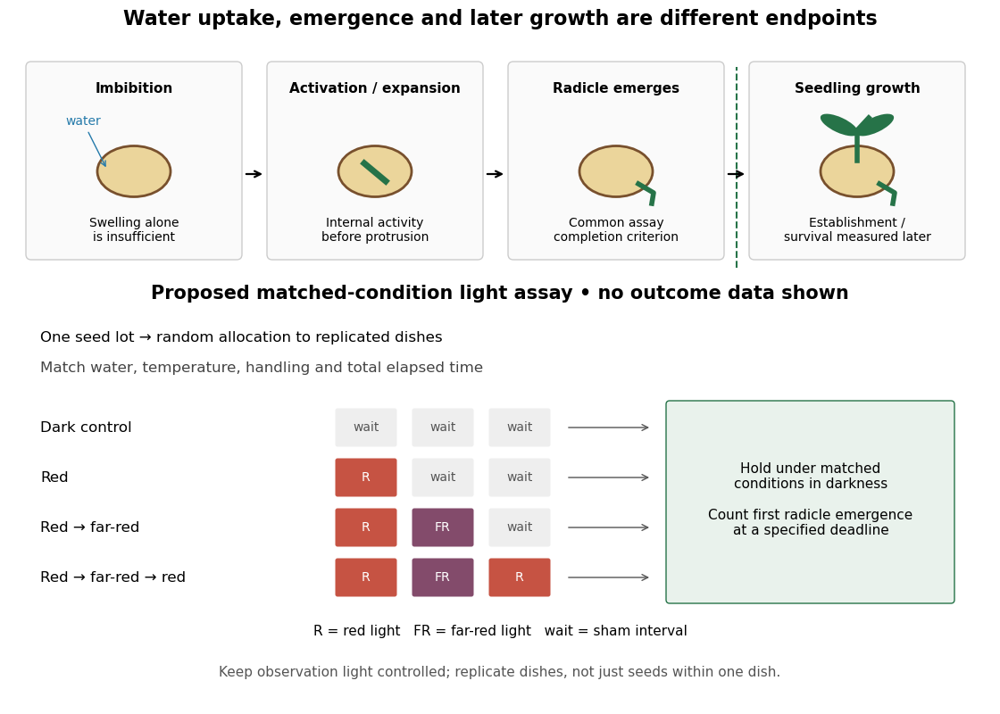

# Germination

↑ **Parent:** [Seed](seed.md)  
ⓦ [Wiki](https://en.wikipedia.org/wiki/Germination)

[Seed](seed.md) [germination](germination.md) is renewed [plant embryo](plant-embryo.md) activity and growth. Many [germination assays](germination-assay.md) score completion as [radicle](radicle.md) emergence, before [seedling](seedling.md) establishment. [Seed imbibition](seed-imbibition.md) precedes that endpoint; swelling alone is insufficient.[Seed dormancy and the control of germination, §II.1, p. 502: [water](water.md) uptake, embryo expansion and radicle protrusion](seed-dormancy-and-the-control-of-germination-by-william-e-finch-savage-and-gerhard-leubner-metzger.md)

**[Figure 11](#image-germination-stages-and-a-controlled-red-far-red-light-assay). Germination stages and a controlled red/far-red light assay**. Original qualitative diagram. The upper sequence separates [seed imbibition](seed-imbibition.md), activation, [radicle](radicle.md) emergence and later [seedling](seedling.md) growth. The lower panel is a proposed [germination assay](germination-assay.md), not observed counts or a measured time curve.

[Water](water.md), [molecular oxygen](molecular-oxygen.md) and suitable [temperature](temperature-split.md) support [germination](germination.md); [light](light.md) sensitivity depends on the [species](species.md) and [seed](seed.md) state. Neither illumination nor one particular [temperature](temperature-split.md) is universally required. [Seed dormancy](seed-dormancy.md) connects [germination](germination.md) timing to [ecology](ecology-split.md) by delaying [seedling](seedling.md) establishment.[Seed dormancy and the control of germination, Summary and §II.1–2, pp. 501–502: environmental requirements and timing](seed-dormancy-and-the-control-of-germination-by-william-e-finch-savage-and-gerhard-leubner-metzger.md)

The distinction matters when comparing propagation experiments: a treatment that increases [radicle](radicle.md) emergence need not improve later [seedling](seedling.md) survival. Define the endpoint before comparing treatments, then measure the later outcome separately.

**Table of contents**

- [Seed imbibition](seed-imbibition.md)
- [Seed dormancy](seed-dormancy.md)
- [Seed viability](seed-viability.md)
- [Lettuce red and far-red germination experiment](lettuce-red-and-far-red-germination-experiment.md)
- [Germination assay](germination-assay.md)

## ↑ Ancestors (6)

1. [Seed](seed.md)
2. [Plant](plant.md)
3. [Eukaryote](eukaryote.md)
4. [Organism](organism-split.md)
5. [Biology](biology-split.md)
6. [Codex Wiki](split.md)

## ← Incoming links (9)

- [Cellular respiration](cellular-respiration.md)
- [Germination](germination.md)
- [Germination assay](germination-assay.md)
- [Lettuce red and far-red germination experiment](lettuce-red-and-far-red-germination-experiment.md)
- [Radicle](radicle.md)
- [Seed](seed.md)
- [Seed dormancy](seed-dormancy.md)
- [Seed viability](seed-viability.md)
- [Seedling](seedling.md)
