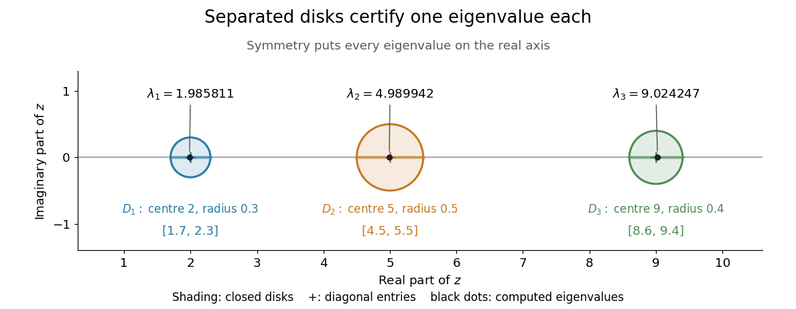

# Gershgorin circle theorem

↑ **Parent:** [Numerical analysis](numerical-analysis-split.md)  
ⓦ [Wiki](https://en.wikipedia.org/wiki/Gershgorin_circle_theorem)

The [Gershgorin circle theorem](gershgorin-circle-theorem.md) locates every [eigenvalue](eigenvalue.md) of a [square matrix](square-matrix.md) using only its entries. A diagonal entry supplies a centre in the [complex plane](complex-plane.md), and the sum of the off-diagonal [absolute values](absolute-value.md) in its row supplies a radius. Small off-diagonal couplings therefore confine the [eigenvalues](eigenvalue.md) near the diagonal entries. This turns a global [eigenvalue](eigenvalue.md) problem into a picture built one row at a time.

Precisely, let $A=(a_{ij})\in\mathbb C^{n\times n}$, with $n\geq1$, and define the closed [Gershgorin discs](gershgorin-disc.md)

$$
r_i=\sum_{\substack{j=1\\j\ne i}}^n|a_{ij}|,\qquad D_i(A)=\{z\in\mathbb C:|z-a_{ii}|\leq r_i\},\qquad i=1,\ldots,n.
$$

Every [eigenvalue](eigenvalue.md) $\lambda$ of $A$ satisfies $\lambda\in\bigcup_iD_i(A)$, including [eigenvalues](eigenvalue.md) on the boundaries. No symmetry or [diagonalizability](diagonalizable-matrix.md) is required. Despite the name, the theorem uses filled [disks](disk-mathematics.md), not just their circular boundaries.[Gene H. Golub, CME 302: Numerical Linear Algebra, Lecture 2, §6, 2005; notes by James Lambers, edited by Lek-Heng Lim](https://www.stat.uchicago.edu/~lekheng/courses/302/notes2.pdf)

The short reason is the [triangle inequality](triangle-inequality.md). For a nonzero [eigenvector](eigenvector.md) $x$ with $Ax=\lambda x$, choose $i$ with $|x_i|=\max_j|x_j|>0$. The $i$th row gives

$$
(\lambda-a_{ii})x_i=\sum_{j\ne i}a_{ij}x_j,\qquad |\lambda-a_{ii}|\leq\sum_{j\ne i}|a_{ij}|\frac{|x_j|}{|x_i|}\leq r_i.
$$

Thus the largest [eigenvector](eigenvector.md) coordinate identifies a [Gershgorin disc](gershgorin-disc.md) containing $\lambda$, even though that [eigenvector](eigenvector.md) need never be computed to use the bound.

This is useful when a full [eigenvalue](eigenvalue.md) computation would be expensive: forming the [Gershgorin discs](gershgorin-disc.md) needs one pass over the nonzero entries of a [sparse matrix](sparse-matrix.md). If $0$ lies outside every [Gershgorin disc](gershgorin-disc.md), then $A$ is an [invertible matrix](invertible-matrix.md), since zero is not an [eigenvalue](eigenvalue.md). The condition is exactly $|a_{ii}|>r_i$ in every row, namely [strict diagonal dominance](strictly-diagonally-dominant-matrix.md). This connects [diagonal dominance](diagonal-dominance.md) to solvability of a [linear system](system-of-linear-equations.md); the [inverse infinity-norm bound from diagonal dominance](inverse-infinity-norm-bound-from-diagonal-dominance.md) adds a quantitative bound. It is a sufficient test: failure to exclude zero does not prove singularity.

For a concrete [symmetric matrix](symmetric-matrix.md), take

$$
A=\begin{pmatrix}2&0.2&0.1\\0.2&5&0.3\\0.1&0.3&9\end{pmatrix},\qquad (r_1,r_2,r_3)=(0.3,0.5,0.4).
$$

The three [Gershgorin discs](gershgorin-disc.md) have centres $2,5,9$ and are pairwise disjoint. The [finite-dimensional spectral theorem](finite-dimensional-spectral-theorem.md) makes the [eigenvalues](eigenvalue.md) real, so their possible locations reduce to the [intervals](interval-mathematics.md) $[1.7,2.3]$, $[4.5,5.5]$, and $[8.6,9.4]$. [Gershgorin eigenvalue counting](gershgorin-eigenvalue-counting.md) gives exactly one [eigenvalue](eigenvalue.md) in each. Independently, the [characteristic polynomial](characteristic-polynomial.md) is

$$
\det(\lambda I-A)=\lambda^3-16\lambda^2+72.86\lambda-89.422,
$$

whose numerical [polynomial roots](root-of-a-polynomial.md) are $1.985811$, $4.989942$, and $9.024247$, rounded to six decimal places. All are positive, as [Gershgorin bounds for symmetric matrices](gershgorin-bounds-for-symmetric-matrices.md) already guarantee without finding those [polynomial roots](root-of-a-polynomial.md).

**[Figure 13](#image-three-separated-gershgorin-discs-each-containing-one-real-eigenvalue-of-the-symmetric-example). Three separated Gershgorin discs, each containing one real eigenvalue of the symmetric example**.

S. Gerschgorin published the result in 1931 in _Über die Abgrenzung der Eigenwerte einer Matrix_, in the _Bulletin de l'Académie des Sciences de l'URSS_, issue 6, pages 749–754. The original paper's §2 states both [eigenvalue](eigenvalue.md) inclusion and counting in separated groups of [Gershgorin discs](gershgorin-disc.md); §3 already discusses column bounds and transformations preserving the [eigenvalues](eigenvalue.md). Thus both the localization picture and ways to sharpen it were part of the original development.[S. Gerschgorin, Über die Abgrenzung der Eigenwerte einer Matrix, 1931, pp. 749–754; original German paper in the journal archive](https://www.mathnet.ru/php/getFT.phtml?jrnid=im&paperid=5235&what=fullt&option_lang=eng)

**Table of contents**

- [Gershgorin disc](gershgorin-disc.md)
- [Gershgorin eigenvalue counting](gershgorin-eigenvalue-counting.md)
- [Gershgorin bounds for symmetric matrices](gershgorin-bounds-for-symmetric-matrices.md)
- [Diagonal scaling of Gershgorin discs](diagonal-scaling-of-gershgorin-discs.md)
- [Gershgorin stability bound for a variable-coefficient diffusion stencil](gershgorin-stability-bound-for-a-variable-coefficient-diffusion-stencil.md)

## ↑ Ancestors (5)

1. [Numerical analysis](numerical-analysis-split.md)
2. [Analysis](analysis-split.md)
3. [Area of mathematics](area-of-mathematics.md)
4. [Mathematics](mathematics-split.md)
5. [Codex Wiki](split.md)

## ← Incoming links (9)

- [Cumulative coherence bound for restricted isometry](cumulative-coherence-bound-for-restricted-isometry.md)
- [Gershgorin circle theorem](gershgorin-circle-theorem.md)
- [Gershgorin disc](gershgorin-disc.md)
- [Solution](past-exam-of-the-mathematics-course-of-the-university-of-cambridge/2013/iii/paper-36/2/b/solution.md)
- [Solution](past-exam-of-the-mathematics-course-of-the-university-of-cambridge/2015/ii/paper-1/38e/b/solution.md)
- [Solution](past-exam-of-the-mathematics-course-of-the-university-of-cambridge/2020/ii/paper-4/40e/c/solution.md)
- [Solution](past-exam-of-the-mathematics-course-of-the-university-of-cambridge/2022/ii/paper-4/40c/a/solution.md)
- [Solution](past-exam-of-the-mathematics-course-of-the-university-of-cambridge/2022/ii/paper-4/40c/b/ii/solution.md)
- [Strictly diagonally dominant matrix](strictly-diagonally-dominant-matrix.md)
