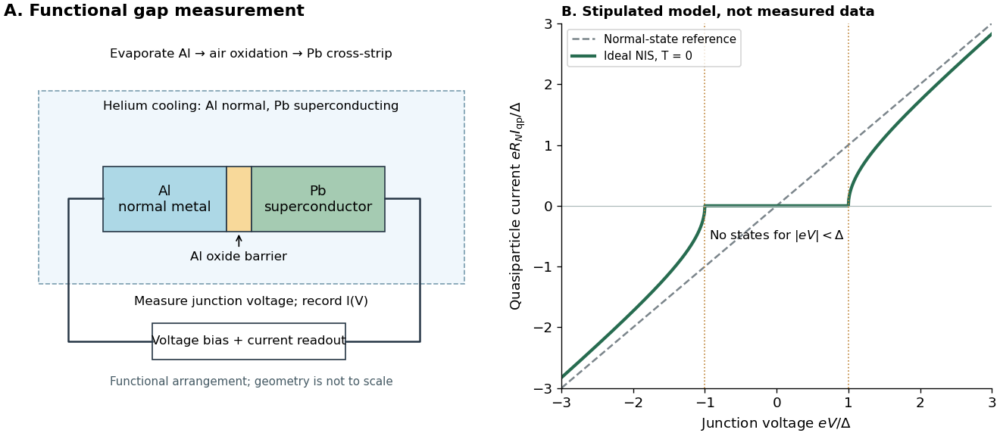

# Giaever gap experiment

↑ **Parent:** [Single-electron superconducting tunneling](single-electron-superconducting-tunneling.md)

[Ivar Giaever](ivar-giaever.md)'s gap experiment used a metal–insulator–metal sandwich. His lecture describes evaporating [aluminium](aluminium.md) onto glass, briefly exposing it to air to form an oxide barrier, then evaporating [lead](lead.md) cross-strips. Cooling in liquid [helium](helium.md) made the [lead](lead.md) superconducting while the [aluminium](aluminium.md) stayed normal in the measurements compared. A voltmeter and ammeter supplied the junction [electric potential difference](electric-potential-difference.md) and [electric current](electric-current.md) readouts. Thick oxides initially gave unmeasurably small [electric currents](electric-current.md); the thinner barrier made the measurement practical. Temperature comparisons and a subsequent controlled [magnetic field](magnetic-field-split.md) test changed the [current-voltage characteristic](current-voltage-characteristic.md) with the superconducting state. [Giaever, Nobel lecture (12 December 1973), Figs. 2–3 and 6–8; preparation and first successful measurement](electron-tunneling-and-superconductivity-by-ivar-giaever.md)

The 1960 letter compares measurements at $4.2$ and $1.6\,\mathrm K$. An applied parallel [magnetic field](magnetic-field-split.md) of $2.7\,\mathrm{kOe}$ kept the [lead](lead.md) normal; removing the [magnetic field](magnetic-field-split.md) strongly suppressed the small-voltage [electric current](electric-current.md). Figure 2 divides the superconducting $dI/dV$ by the normal-state slope. The letter calls its gap estimates preliminary and notes a temperature-dependent broadened peak. It also flags a limitation of interpreting tunneling directly through the [density of states](density-of-states.md); the ideal NIS calculation above states additional assumptions explicitly. [Giaever (1960), p. 147, Figs. 1–2; p. 148, concluding paragraph and footnote 2](energy-gap-in-superconductors-measured-by-electron-tunneling-by-ivar-giaever.md)

**[Figure 9](#image-functional-nis-gap-measurement-and-an-original-idealized-quasiparticle-current-voltage-curve). Functional NIS gap measurement and an original idealized quasiparticle current-voltage curve**. Left: functional schematic of film preparation, cooling and electrical readout in the [Giaever gap experiment](giaever-gap-experiment.md); no historical dimensions or instrument topology are claimed. Right: the derived zero-[temperature](temperature-split.md) NIS model with a stipulated fixed gap $\Delta$, not digitized data or a fit to [lead](lead.md). The normal-state line uses the same $R_N$. Neither curve is a [Josephson effect](josephson-effect.md) pair current.

The central inference is that the barrier lets [electric current](electric-current.md) interrogate available [quasiparticle](quasiparticle.md) states. Suppression at small [electric potential difference](electric-potential-difference.md) and the rise near the gap edge support a gapped spectrum; tracking the superconducting state helps distinguish that feature from an arbitrary nonlinear barrier. A leakage path through a metallic short, imperfect barrier, or an energy-dependent tunneling matrix element limits a literal [density of states](density-of-states.md) interpretation. The preparation and state controls therefore matter as much as seeing a nonlinear [current-voltage characteristic](current-voltage-characteristic.md).

## ↑ Ancestors (6)

1. [Single-electron superconducting tunneling](single-electron-superconducting-tunneling.md)
2. [Superconductivity](superconductivity-split.md)
3. [Statistical physics](statistical-physics-split.md)
4. [Branches of physics](branches-of-physics.md)
5. [Physics](physics-split.md)
6. [Codex Wiki](split.md)

## ← Incoming links (2)

- [Giaever gap experiment](giaever-gap-experiment.md)
- [Josephson junction](josephson-junction.md)
