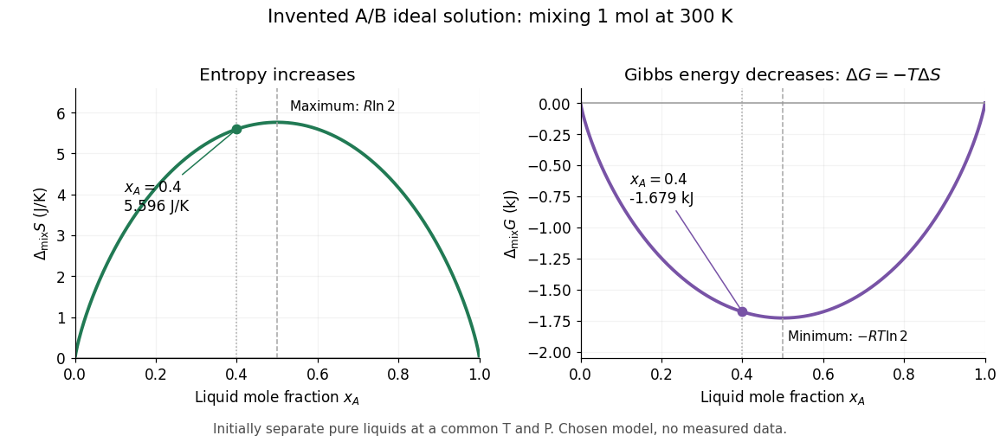

# Gibbs free energy of mixing

↑ **Parent:** [Ideal solution](ideal-solution.md)

The Gibbs free energy of mixing compares the final [mixture](mixture-split.md)'s [Gibbs free energy](gibbs-free-energy.md) with that of its initially separate components at the same [temperature](temperature-split.md) and [pressure](pressure-split.md). For an [ideal solution](ideal-solution.md), subtract the pure-component reference from $G=\sum_i n_i\mu_i$:

$$
\Delta_{\rm mix}G=\sum_i n_i(\mu_i-\mu_i^*)
=RT\sum_i n_i\ln x_i
=nRT\sum_i x_i\ln x_i.
$$

For one [mole](mole-unit.md) of the chosen A/B [ideal solution](ideal-solution.md) at $300\,\mathrm K$ and $x_A=0.4$,

$$
\Delta_{\rm mix}G\approx-1.67872\,\mathrm{kJ}.
$$

The individual [chemical potential](chemical-potential-split.md) changes are $RT\ln0.4\approx-2.28554\,\mathrm{kJ\,mol^{-1}}$ for A and $RT\ln0.6\approx-1.27417\,\mathrm{kJ\,mol^{-1}}$ for B. Weighting these by $0.4\,\mathrm{mol}$ and $0.6\,\mathrm{mol}$ reproduces the total [Gibbs free energy of mixing](gibbs-free-energy-of-mixing.md).

**[Figure 4](#image-chosen-ideal-binary-model-entropy-gain-and-gibbs-energy-decrease). Chosen ideal binary model: entropy gain and Gibbs energy decrease**. At the same stipulated [temperature](temperature-split.md) $300\,\mathrm K$, one [mole](mole-unit.md) of the invented A/B [ideal solution](ideal-solution.md) has positive [entropy of mixing](entropy-of-mixing.md) and negative [Gibbs free energy of mixing](gibbs-free-energy-of-mixing.md) at every interior composition. The marked $x_A=0.4$ example gives approximately $5.596\,\mathrm{J\,K^{-1}}$ and $-1.679\,\mathrm{kJ}$. Dashed markers show the extrema at equal [mole fractions](mole-fraction.md); both functions vanish at the pure endpoints. These are calculated mixing quantities at a common initial/final [pressure](pressure-split.md), not measured data or a [vapor](vapor.md) composition plot.

If ideality holds in a neighborhood of the specified [temperature](temperature-split.md) and [pressure](pressure-split.md), differentiation at fixed component amounts gives

$$
\Delta_{\rm mix}S=-\left(\frac{\partial\Delta_{\rm mix}G}{\partial T}\right)_{P,\{n_i\}}
=-R\sum_i n_i\ln x_i,
\qquad
\Delta_{\rm mix}H=\Delta_{\rm mix}G+T\Delta_{\rm mix}S=0,
$$

$$
\Delta_{\rm mix}V=\left(\frac{\partial\Delta_{\rm mix}G}{\partial P}\right)_{T,\{n_i\}}=0.
$$

Thus the ideal mixing [Gibbs free energy](gibbs-free-energy.md) decrease comes entirely from the [entropy](entropy-split.md) increase; the mixing [enthalpy](enthalpy-split.md) and [volume](volume-thermodynamics.md) changes vanish. Ideality at a single isolated state alone does not determine [temperature](temperature-split.md) or [pressure](pressure-split.md) [derivatives](derivative.md).[§9.4.3, printed pp. 250–251, equations 9.4.9–9.4.11; §11.1.2, printed pp. 305–307, equations 11.1.8–11.1.12](thermodynamics-and-chemistry-by-howard-devoe.md)

The same formula rules out spontaneous separation into two [liquid](liquid.md) [thermodynamic phases](thermodynamic-phase.md) within this model. Per [mole](mole-unit.md), the mixing [Gibbs free energy](gibbs-free-energy.md) $g_{\rm mix}=RT[x\ln x+(1-x)\ln(1-x)]$ has

$$
\frac{d^2g_{\rm mix}}{dx^2}=RT\left(\frac{1}{x}+\frac{1}{1-x}\right)>0.
$$

Adding the pure-component reference contributions changes only a term linear in $x$. The total molar [Gibbs free energy](gibbs-free-energy.md) is therefore a strictly [convex function](convex-function.md): a separated pair of different compositions has a larger composition-weighted [Gibbs free energy](gibbs-free-energy.md) than the uniform sample with the same inventory. Such [phase separation](phase-separation.md) requires physics beyond this [ideal solution](ideal-solution.md) model.

## ↑ Ancestors (5)

1. [Ideal solution](ideal-solution.md)
2. [Solution (chemistry)](solution-chemistry.md)
3. [Mixture](mixture-split.md)
4. [Chemistry](chemistry-split.md)
5. [Codex Wiki](split.md)

## ← Incoming links (2)

- [Gibbs free energy of mixing](gibbs-free-energy-of-mixing.md)
- [Ideal solution](ideal-solution.md)
