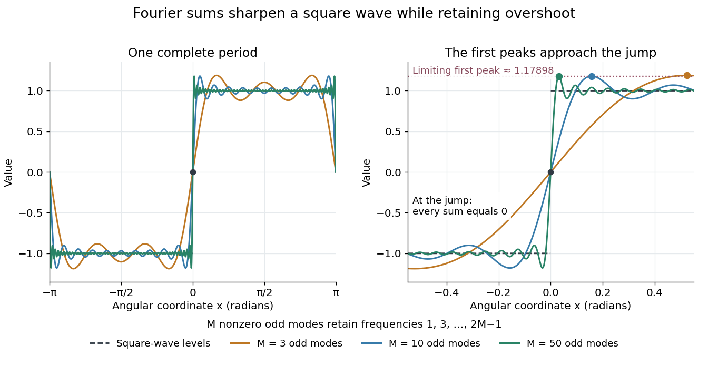

# Gibbs phenomenon

↑ **Parent:** [Fourier series](fourier-series-split.md)  
ⓦ [Wiki](https://en.wikipedia.org/wiki/Gibbs_phenomenon)

The [Gibbs phenomenon](gibbs-phenomenon.md) is the persistent overshoot near a [jump discontinuity](jump-discontinuity.md) in ordinary truncated [Fourier series](fourier-series-split.md). For this [square wave](square-wave.md), retain $M$ nonzero odd modes:

$$
Q_M(x)=\frac4\pi\sum_{k=0}^{M-1}\frac{\sin((2k+1)x)}{2k+1}.
$$

As $M$ grows, the first peak approaches the jump while its height tends to approximately $1.17897974$. This is an excess of about $0.17898$ above the upper level $1$, or $8.949\%$ of the jump size $2$. The narrower region does not imply a vanishing maximum error. At the jump itself every $Q_M(0)=0$. These observations are compatible with [pointwise convergence](pointwise-convergence.md) and $L^2$ convergence but exclude [uniform convergence](uniform-convergence.md) to the discontinuous [square wave](square-wave.md). [NIST DLMF, section 6.16(i): square-wave overshoot and its limiting height](https://dlmf.nist.gov/6.16).

**[Figure 2](#image-more-fourier-harmonics-narrow-a-transition-while-leaving-a-persistent-overshoot). More Fourier harmonics narrow a transition while leaving a persistent overshoot**. Left: the constructed [square wave](square-wave.md) and sums of $3$, $10$ and $50$ nonzero odd [Fourier harmonics](fourier-harmonic.md). Right: the same sums near the jump at zero, with each first positive peak marked. The highest frequency retained is $2M-1$, so a count of $M$ nonzero terms differs from a cutoff at frequency $M$. The limiting peak is approximately $1.17898$, while the level above the jump is $1$.

For this particular sum, its [derivative](derivative.md) is $Q_M'(x)=(2/\pi)\sin(2Mx)/\sin x$ away from multiples of $\pi$, so the first positive peak is exactly at $x=\pi/(2M)$. There,

$$
Q_M\!\left(\frac\pi{2M}\right)
=\frac2M\sum_{k=0}^{M-1}\frac{\sin(\pi u_k)}{\pi u_k},\qquad u_k=\frac{k+1/2}{M}.
$$

This is a midpoint [Riemann sum](riemann-sum.md) tending to $2\operatorname{Si}(\pi)/\pi$, where $\operatorname{Si}$ is the [sine integral](sine-integral.md). It gives a short explanation of the nonzero limiting excess.

The phenomenon matters whenever a sharp boundary is represented by a limited set of [Fourier harmonics](fourier-harmonic.md): a visible ripple can be a property of the approximation rather than an oscillation in the original profile. [Josiah Willard Gibbs](josiah-willard-gibbs.md) reported the phenomenon in his 1899 letter “Fourier's Series” in Nature, volume 59, page 606. This is a documented historical report, without a claim of first discovery. [Gibbs, Fourier's Series, 1899](https://www.nature.com/articles/059606a0).

## ↑ Ancestors (5)

1. [Fourier series](fourier-series-split.md)
2. [Analysis](analysis-split.md)
3. [Area of mathematics](area-of-mathematics.md)
4. [Mathematics](mathematics-split.md)
5. [Codex Wiki](split.md)

## ← Incoming links (4)

- [Fourier partial sum](fourier-partial-sum.md)
- [Fourier series](fourier-series-split.md)
- [Gibbs phenomenon](gibbs-phenomenon.md)
- [Square wave](square-wave.md)
