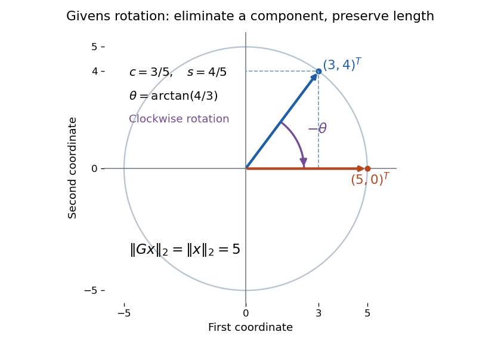

# Givens rotation

↑ **Parent:** [Numerical analysis](numerical-analysis-split.md)  
ⓦ [Wiki](https://en.wikipedia.org/wiki/Givens_rotation)

A [Givens rotation](givens-rotation.md) eliminates one component of a [vector](vector.md) by rotating just two coordinates, preserving its [Euclidean norm](euclidean-norm.md). For example,

$$
\begin{pmatrix}3/5&4/5\\-4/5&3/5\end{pmatrix}
\begin{pmatrix}3\\4\end{pmatrix}
=\begin{pmatrix}5\\0\end{pmatrix}.
$$

The length remains five: elimination moves the component into the retained coordinate rather than discarding it. Applied to a [matrix](matrix.md), the same operation mixes two rows; [QR decomposition by Givens rotations](qr-decomposition-by-givens-rotations.md) uses these local operations to build an [upper triangular matrix](upper-triangular-matrix.md).

**[Figure 19](#image-a-givens-rotation-takes-3-4-t-clockwise-to-5-0-t-while-preserving-the-euclidean-norm). A Givens rotation takes $(3,4)^T$ clockwise to $(5,0)^T$ while preserving the Euclidean norm**.

For indices $i<j$, the [matrix](matrix.md) $G_{ij}(c,s)$ is the [identity matrix](identity-matrix.md) except for its block on coordinates $i,j$:

$$
G\big|_{i,j}=\begin{pmatrix}c&s\\-s&c\end{pmatrix},\qquad c^2+s^2=1.
$$

This article uses left [matrix multiplication](matrix-multiplication.md) on column [vectors](vector.md). If $c=\cos\theta$ and $s=\sin\theta$, the block is a [rotation matrix](rotation-matrix.md) through angle $-\theta$: the minus sign belongs in the lower left. Its [transpose](transpose.md) reverses the [rotation](rotation-mathematics.md). Direct multiplication gives $G^TG=I$ and [determinant](determinant.md) one, so it is an [orthogonal matrix](orthogonal-matrix.md); consequently $\|Gx\|_2^2=x^TG^TGx=\|x\|_2^2$. Only two coordinates change, but this [Euclidean norm](euclidean-norm.md) identity holds for the entire [vector](vector.md).

**Table of contents**

- [Stable construction of a Givens rotation](stable-construction-of-a-givens-rotation.md)
- [Givens row-pair update](givens-row-pair-update.md)
- [QR decomposition by Givens rotations](qr-decomposition-by-givens-rotations.md)

## ↑ Ancestors (5)

1. [Numerical analysis](numerical-analysis-split.md)
2. [Analysis](analysis-split.md)
3. [Area of mathematics](area-of-mathematics.md)
4. [Mathematics](mathematics-split.md)
5. [Codex Wiki](split.md)

## ← Incoming links (17)

- [Geometric quantum state synthesis by adjacent rotations](geometric-quantum-state-synthesis-by-adjacent-rotations.md)
- [Givens rotation](givens-rotation.md)
- [Givens row-pair update](givens-row-pair-update.md)
- [Solution](past-exam-of-the-mathematics-course-of-the-university-of-cambridge/2006/iii/paper-60/3/d/solution.md)
- [Solution](past-exam-of-the-mathematics-course-of-the-university-of-cambridge/2009/ib/paper-2/18c/solution.md)
- [Solution](past-exam-of-the-mathematics-course-of-the-university-of-cambridge/2013/ia/paper-1/2a/i/solution.md)
- [Solution](past-exam-of-the-mathematics-course-of-the-university-of-cambridge/2013/ia/paper-1/2a/ii/solution.md)
- [Solution](past-exam-of-the-mathematics-course-of-the-university-of-cambridge/2013/ia/paper-1/2a/iii/solution.md)
- [Solution](past-exam-of-the-mathematics-course-of-the-university-of-cambridge/2013/ib/paper-1/18c/solution.md)
- [Solution](past-exam-of-the-mathematics-course-of-the-university-of-cambridge/2014/iii/paper-7/4/a/solution.md)
- [Solution](past-exam-of-the-mathematics-course-of-the-university-of-cambridge/2014/iii/paper-7/4/b/solution.md)
- [Solution](past-exam-of-the-mathematics-course-of-the-university-of-cambridge/2016/ib/paper-2/19d/a/solution.md)
- [Solution](past-exam-of-the-mathematics-course-of-the-university-of-cambridge/2016/ib/paper-2/19d/b/solution.md)
- [Solution](past-exam-of-the-mathematics-course-of-the-university-of-cambridge/2024/ib/paper-1/17a/solution.md)
- [Solution](past-exam-of-the-mathematics-course-of-the-university-of-cambridge/2026/ib/paper-4/6c/solution.md)
- [QR decomposition by Givens rotations](qr-decomposition-by-givens-rotations.md)
- [Stable construction of a Givens rotation](stable-construction-of-a-givens-rotation.md)
