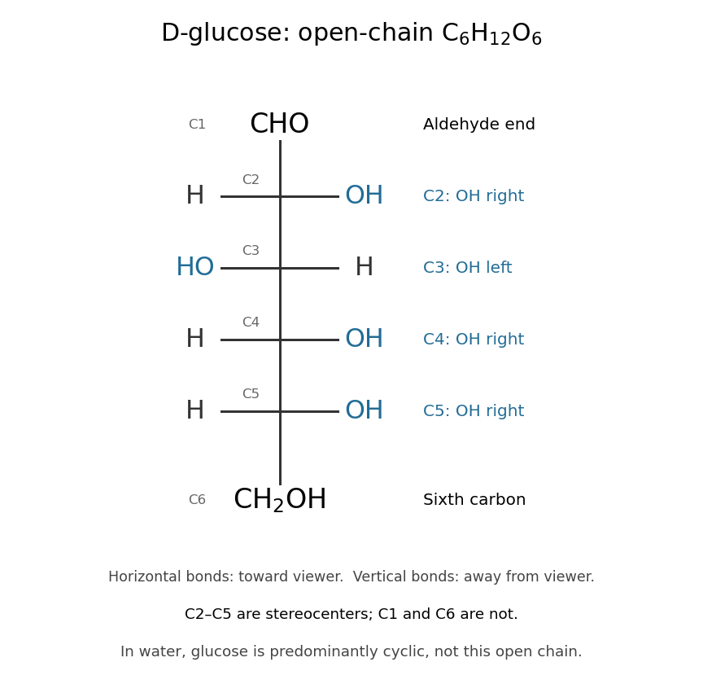

# Glucose

↑ **Parent:** [Sugar](sugar.md)  
ⓦ [Wiki](https://en.wikipedia.org/wiki/Glucose)

[Glucose](glucose.md) is a [monosaccharide](monosaccharide.md) with [molecular formula](molecular-formula.md) $\mathrm C_6\mathrm H_{12}\mathrm O_6$. Its familiar biological form, D-glucose, is an [aldohexose](aldohexose.md). In the open-chain [Fischer projection](fischer-projection.md), $\mathrm{CHO}$ is at the top and $\mathrm{CH}_2\mathrm{OH}$ at the bottom; the [hydroxy groups](hydroxy-group.md) at C2, C3, C4, and C5 point right, left, right, right. This full pattern distinguishes D-[glucose](glucose.md) from other six-[carbon](carbon.md) [aldehyde](aldehyde.md) [sugars](sugar.md). See [McMurry, Organic Chemistry, 25.4: configurations of the aldoses](https://openstax.org/books/organic-chemistry/pages/25-4-configurations-of-the-aldoses).

**[Figure 4](#image-d-glucose-six-carbon-positions-and-four-open-chain-stereocenters). D-glucose: six carbon positions and four open-chain stereocenters**. Horizontal [chemical bonds](chemical-bond-split.md) point toward the viewer; vertical [chemical bonds](chemical-bond-split.md) point away. The [hydroxy group](hydroxy-group.md) pattern from C2 through C5 is right/left/right/right. $\mathrm{CHO}$ and $\mathrm{CH}_2\mathrm{OH}$ are condensed end groups. The diagram records an open-chain reference structure, not the predominant form in an aqueous [chemical solution](solution-chemistry.md).

The [molecular formula](molecular-formula.md) can be checked directly: one $\mathrm{CHO}$ group, four $\mathrm{CHOH}$ groups, and one $\mathrm{CH}_2\mathrm{OH}$ group give six [carbon](carbon.md), twelve [hydrogen](hydrogen.md), and six [oxygen](oxygen.md) [chemical atoms](atom-physics.md). All four interior [carbon](carbon.md) positions are [stereocenters](stereocenter.md) in this open-chain structure. Neither their orientations nor the arrangement of [chemical bonds](chemical-bond-split.md) can be recovered from the [molecular formula](molecular-formula.md) alone.

In [water](water.md), [glucose](glucose.md) exists mainly in six-membered rings in [chemical equilibrium](chemical-equilibrium.md) with a small amount of open-chain [glucose](glucose.md). Ring closure connects the [hydroxy group](hydroxy-group.md) at C5 to the [aldehyde](aldehyde.md) carbon at C1; the ring contains five [carbon](carbon.md) [chemical atoms](atom-physics.md) and one [oxygen](oxygen.md), with C6 outside it. No [chemical atoms](atom-physics.md) are lost, so the [molecular formula](molecular-formula.md) remains $\mathrm C_6\mathrm H_{12}\mathrm O_6$. See [McMurry, Organic Chemistry, 25.5: cyclic structures of monosaccharides](https://openstax.org/books/organic-chemistry/pages/25-5-cyclic-structures-of-monosaccharides-anomers).

[Glucose](glucose.md) is useful both as a substrate in cellular [metabolism](metabolism.md) and as a building block of [polysaccharides](polysaccharide.md). [Cellulose](cellulose.md) chains assembled from [glucose](glucose.md) units help support plant [cell walls](cell-wall.md). The same small [sugar](sugar.md) thus connects chemical fuel to a structural material; its role depends on how it is transformed or linked. See [Cooper, The Cell: A Molecular Approach, the molecular composition of cells](https://www.ncbi.nlm.nih.gov/books/NBK9879/).

## ↑ Ancestors (5)

1. [Sugar](sugar.md)
2. [Carbohydrate](carbohydrate.md)
3. [Chemical substance](chemical-substance-split.md)
4. [Chemistry](chemistry-split.md)
5. [Codex Wiki](split.md)

## ← Incoming links (51)

- [Active site](active-site.md)
- [ADP-glucose](adp-glucose.md)
- [Aerobic respiration](aerobic-respiration.md)
- [Aldohexose](aldohexose.md)
- [Anomeric carbon](anomeric-carbon.md)
- [ATP-driven sugar phosphorylation](atp-driven-sugar-phosphorylation.md)
- [Beta-glucosidase](beta-glucosidase.md)
- [Blood sugar](blood-sugar.md)
- [Carbohydrate](carbohydrate.md)
- [Cellobiose](cellobiose.md)
- [Cellulose](cellulose.md)
- [Cellulose synthase](cellulose-synthase.md)
- [Chemical formula](chemical-formula.md)
- [Coupled-enzyme readout of glycolytic ATP formation](coupled-enzyme-readout-of-glycolytic-atp-formation.md)
- [Ethanol fermentation](ethanol-fermentation.md)
- [Evolutionary game theory](evolutionary-game-theory.md)
- [Fischer projection](fischer-projection.md)
- [Galactose induction](galactose-induction.md)
- [Glucagon](glucagon.md)
- [Glucan](glucan.md)
- [Gluconeogenesis](gluconeogenesis.md)
- [Glucose](glucose.md)
- [Glucose clamp technique](glucose-clamp-technique.md)
- [Glucose mutarotation experiment](glucose-mutarotation-experiment.md)
- [Glycogen](glycogen.md)
- [Glycolysis](glycolysis.md)
- [Glycolysis carbon and ATP ledger](glycolysis-carbon-and-atp-ledger.md)
- [Glycolysis cofactor recycling](glycolysis-cofactor-recycling.md)
- [Induced fit](induced-fit.md)
- [Insulin](insulin.md)
- [Islet perifusion experiment](islet-perifusion-experiment.md)
- [Monosaccharide](monosaccharide.md)
- [Monosaccharide ring-chain interconversion](monosaccharide-ring-chain-interconversion.md)
- [Solution](past-exam-of-the-biochemistry-and-molecular-biology-course-of-the-university-of-cambridge/2024/paper-1/section-a/3/solution.md)
- [Solution](past-exam-of-the-biochemistry-and-molecular-biology-course-of-the-university-of-cambridge/2024/paper-1/section-c/7/solution.md)
- [Solution](past-exam-of-the-biochemistry-and-molecular-biology-course-of-the-university-of-cambridge/2025/paper-1/section-c/7/solution.md)
- [Solution](past-exam-of-the-biochemistry-course-of-the-university-of-cambridge/2025/paper-4/section-ii/4/solution.md)
- [Solution](past-exam-of-the-biochemistry-course-of-the-university-of-cambridge/2025/paper-4/section-iii/7/solution.md)
- [Photosynthesis](photosynthesis.md)
- [Respiration and ATP coupling](respiration-and-atp-coupling.md)
- [Respiratory quotient](respiratory-quotient.md)
- [Saccharomyces cerevisiae](saccharomyces-cerevisiae.md)
- [Selective biochemical reaction pathways](selective-biochemical-reaction-pathways.md)
- [Starch](starch.md)
- [Stereocenter](stereocenter.md)
- [Substrate-level phosphorylation](substrate-level-phosphorylation.md)
- [Sugar](sugar.md)
- [Synthetic insulin-glucagon response model](synthetic-insulin-glucagon-response-model.md)
- [UDP-glucose](udp-glucose.md)
- [Unicellular organism](unicellular-organism.md)
- [Yeast cross-species complementation experiment](yeast-cross-species-complementation-experiment.md)
