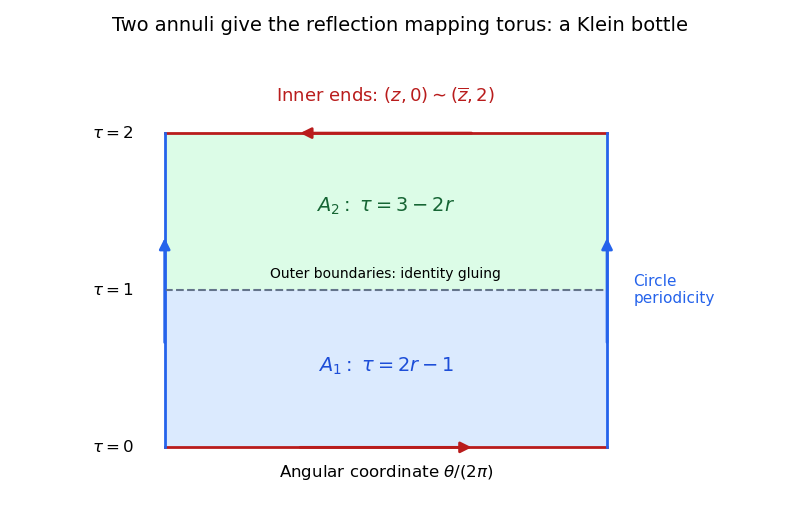

# Gluing annuli with one reflected boundary

↑ **Parent:** [Klein bottle](klein-bottle.md)

Glue the outer circles of two closed [annuli](annulus-mathematics.md) by the identity, and their inner circles by complex conjugation. The result is a [Klein bottle](klein-bottle.md). To see the gluing explicitly, let $r\in[1/2,1]$ and $z\in S^1$. Parametrize the first annulus by $(z,\tau)=(z,2r-1)$, with $0\leq\tau\leq1$, and the second by $(z,\tau)=(z,3-2r)$, with $1\leq\tau\leq2$. The outer-circle gluing identifies their common level $\tau=1$. The remaining gluing is

$$
(z,0)\sim(\overline z,2).
$$

This is the [mapping torus](mapping-torus.md) of reflection of the [circle](circle.md). The coordinate maps and their piecewise inverses agree on every identified boundary, so the [universal property of the quotient topology](universal-property-of-the-quotient-topology.md) gives inverse continuous maps between the two quotient descriptions. Gluing collars by the reflection supplies disc charts at the seam; thus it is a closed [surface](topological-surface-split.md). Cutting the circle coordinate at one point gives a rectangle with one matching and one reversed edge pairing, the usual Klein-bottle model. Its [Euler characteristic](euler-characteristic.md) is zero and it is a [nonorientable surface](non-orientable-surface.md), so the classification theorem identifies it with the connected sum of two real projective planes.

**[Figure 3](#image-annulus-coordinates-exhibit-the-klein-bottle-as-a-reflection-mapping-torus). Annulus coordinates exhibit the Klein bottle as a reflection mapping torus**. The identity outer-circle gluing forms the middle level. The two inner boundaries become the reflected cylinder ends; the vertical sides represent the periodic circle coordinate.

## ↑ Ancestors (7)

1. [Klein bottle](klein-bottle.md)
2. [Topological surface](topological-surface-split.md)
3. [Topology](topology-split.md)
4. [Geometry and topology](geometry-and-topology-split.md)
5. [Area of mathematics](area-of-mathematics.md)
6. [Mathematics](mathematics-split.md)
7. [Codex Wiki](split.md)

## ← Incoming links (1)

- [Solution](past-exam-of-the-topology-course-of-the-university-of-oxford/2017/3/b/solution.md)
